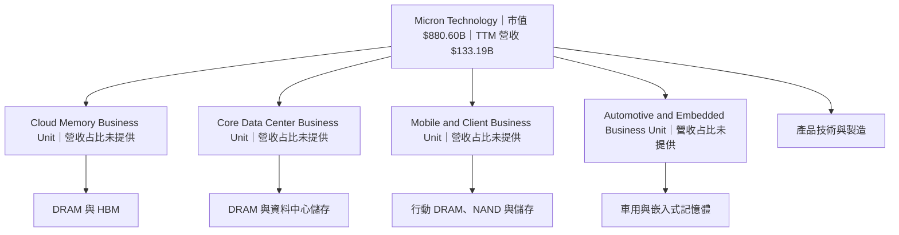
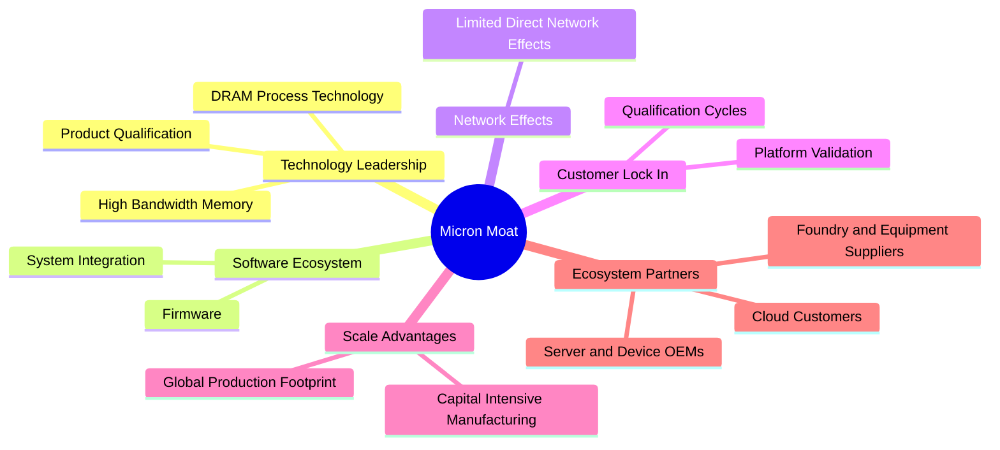
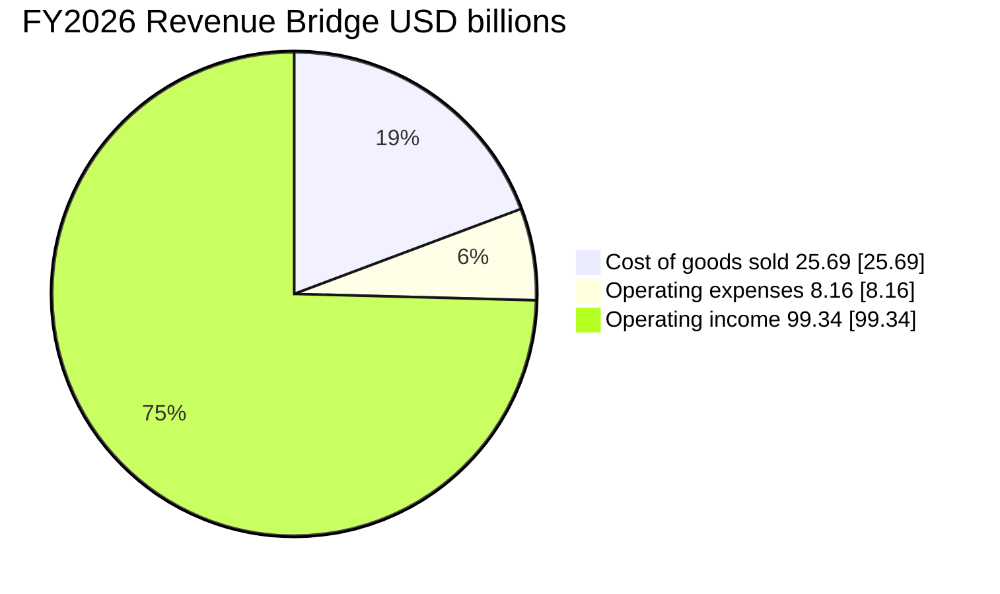
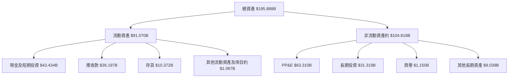
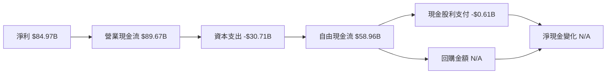
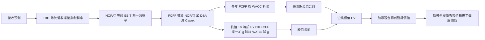
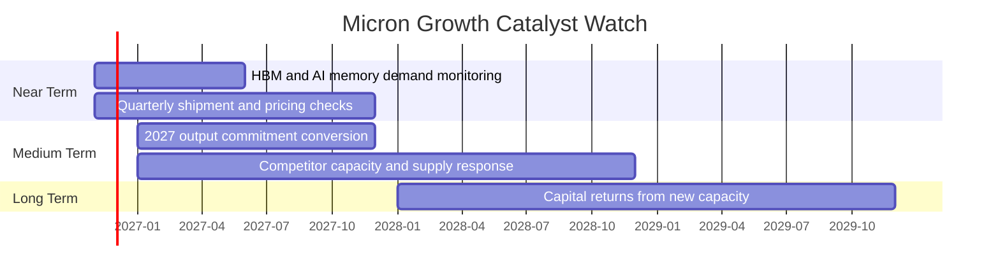
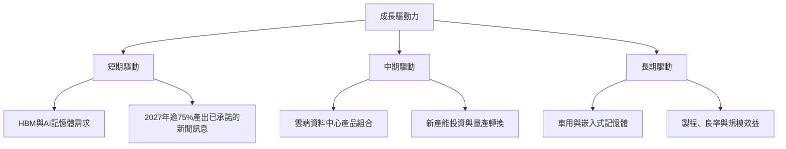
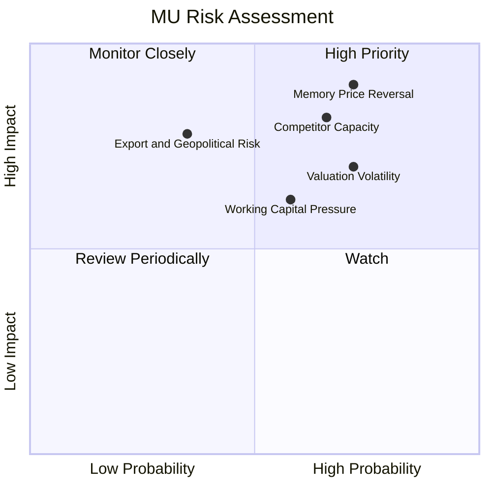
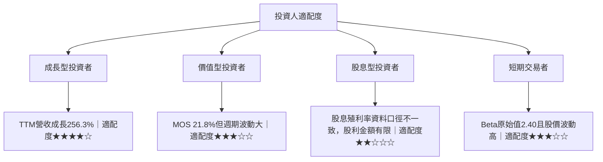

# MU 基本面深度分析報告
> **報告日期**：2026-11-16 ｜ **語言**：繁體中文 ｜ **數據來源**：SEC 申報資料 (XBRL)、Yahoo Finance、Finviz、StockAnalysis、Roic.ai ｜ **分析師**：CFA 級機構研究

---

## 目錄

| # | 章節 | 核心結論 |
|---|------|----------|
| 1 | 執行摘要 | 買入；加權合理價值 $995.07；MOS +21.8% |
| 2 | 公司概覽與商業模式 | 具技術、製造規模與客戶認證優勢；產業週期使護城河非絕對 |
| 3 | 損益表深度分析 | TTM 營收 $133.19B、TTM 成長 256.3%；利潤率急升，需留意週期高點 |
| 4 | 資產負債表分析 | 淨現金 $40.15B；流動性充裕，但現金轉換週期延長 |
| 5 | 現金流量深度分析 | TTM FCF $58.96B；高資本支出仍有可觀現金流 |
| 6 | 獲利能力與資本效率 | ROIC 86.2% 高於 WACC 14.0%，目前大幅創造價值 |
| 7 | 相對估值分析 | 相對同業估值不一；P/E低於自身歷史中位數，P/S高於歷史中位數 |
| 8 | DCF 內在價值評估 | 基準 DCF $881.83；估值對週期利潤率與折現率敏感 |
| 9 | 成長催化劑 | AI／HBM需求與已承諾產能提供催化；TAM數據未提供 |
| 10 | 風險矩陣 | 記憶體價格反轉、供給擴張與客戶集中／出口風險為主要風險 |
| 11 | 投資建議 | 買入；以 $746–$896 作為分批評估區間，按季度監控週期與現金流 |

---

## 1. 執行摘要

### 1.0 一頁式投資儀表板（Portfolio Manager 30 秒速讀）

| 項目 | 內容 |
|------|------|
| **投資論點（3句）** | ① TTM 營收成長 256.3%，最新一季年增 379.3%，反映記憶體需求與定價大幅改善；② TTM FCF $58.96B、ROIC 86.2%，均支持目前強勁獲利與現金創造；③ 但營業利益率 TTM 74.6% 可能處於週期高位，估值對利潤率回落敏感。 |
| **綜合評分** | **8.3/10**（引用 1.1；六項算術平均） |
| **財務健康** | 🟢 淨現金 $40.15B、流動比率 3.31；CCC 由 155 天升至 185 天，營運資金效率轉弱。 |
| **ROIC vs WACC** | **86.2% vs 14.0%**；現階段創造股東價值，差距 +72.2 個百分點。 |
| **FCF 趨勢** | 明顯上升；TTM FCF $58.96B，FCF Yield **6.70%**。 |
| **估值** | Forward P/E **3.75x** ｜ EV/EBITDA **7.74x** ｜ FCF Yield **6.70%**。 |
| **DCF 內在價值（基準）** | **$881.83** ｜ 現價相對 DCF 折價 **11.7%**（折溢價基準為 DCF）。 |
| **安全邊際（MOS）** | **+21.8%**＝（加權合理價值 **$995.07** − 現價 $778.31）÷ $995.07；🟡有限。 |
| **預期報酬（基準情境 12M）** | **+13.3%**（DCF 基準情境；加權合理價值上行空間為 +27.9%，兩者估值基準不同）。 |
| **關鍵風險（前二）** | 記憶體價格與供需反轉；競爭者新增產能令 HBM／DRAM 供應加速。 |
| **評級 + 信心度** | 🟢 **買入** ｜ 信心：中；週期性與 DCF 終值假設造成較大不確定性。 |

### 1.1 綜合評分卡（全報告唯一）

| 維度 | 評分（1–10） | 主要依據（引用數字與其來源章節） |
|------|--------------|----------------------------------|
| 成長性 | 9.0 | TTM 營收成長 256.3%、最新一季年增 379.3%（第 3 章）；高增長含有週期回升因素。 |
| 獲利能力 | 9.5 | TTM 營業利益率 74.6%、ROIC 86.2%、Piotroski F-Score 8/9（第 3、6 章）。 |
| 財務健康 | 8.5 | 淨現金 $40.15B、流動比率 3.314；CCC 升至 185 天（第 4 章）。 |
| 估值 | 7.0 | MOS +21.8%；P/E 低於自身五年中位數，但 P/S 高於自身中位數（第 7、8 章）。 |
| 護城河 | 8.0 | DRAM／HBM 技術、製程與資本規模具門檻；但記憶體仍具商品週期及供給競爭（第 2 章）。 |
| 管理層與資本配置 | 7.5 | FY2026 資本支出 $30.71B、SBC $1.33B、稀釋股數測試未通過；現金股利支付 $0.61B（第 3、5 章）。 |
| **綜合評分** | **8.3** | 六項算術平均：\((9.0+9.5+8.5+7.0+8.0+7.5)÷6=8.25\)，四捨五入至一位小數為 **8.3**。 |

### 1.2 五大投資論點 + 三大核心風險

| 類型 | 項目 | 具體依據 | 信心度 |
|------|------|----------|--------|
| 🟢 **投資論點①** | AI與高階記憶體需求推動成長 | TTM 營收 $133.19B、TTM 成長 256.3%；最新一季年增 379.3%。成長顯著，但需區分產業週期回升與長期結構需求。 | 🟢 高 |
| 🟢 **投資論點②** | 高利潤率與營業槓桿 | TTM 營業利益率 74.6%，最新一季 80.7%；若高階產品組合與價格維持，利潤轉換可延續。 | 🟢 高 |
| 🟢 **投資論點③** | 現金流與資產負債表具韌性 | TTM OCF $89.67B、Capex $30.71B、FCF $58.96B；淨現金 $40.15B。 | 🟢 高 |
| 🟢 **投資論點④** | 資本回報遠高於資本成本 | ROIC 86.2% 對 WACC 14.0%，差距 72.2 個百分點；但若週期獲利回落，差距會收窄。 | 🟡 中高 |
| 🟢 **投資論點⑤** | 加權估值仍有折價空間 | 加權合理價值 $995.07，較 2026-11-13 收盤價 $778.31 高 27.9%；MOS +21.8%。 | 🟡 中 |
| 🟡 **風險①** | 供需反轉與價格下跌 | 記憶體屬高固定成本產業；若新增產能快於需求，74.6% TTM 營業利益率可能快速回落。 | 🔴 高衝擊 |
| 🔴 **風險②** | 極高預測波動性 | 24 個月收盤價由 2024-11 的 $97.43 升至 2026-06 的 $1,153.93，之後回落；高 Beta 2.40 原始值反映股價波動大。 | 🔴 高 |
| 🟡 **風險③** | 營運資金佔用增加 | CCC 由 155 天升至 185 天；DSO 87 天、DIO 147 天，應收與庫存週期延長可能壓低未來 FCF。 | 🟡 中 |

### 1.3 快速統計卡片

| 指標 | 公司實際值（期間） | 同業中位數 | 狀態 |
|------|--------------------|------------|------|
| 營收成長（TTM） | **256.3%** | — | 🟢 |
| 營收成長（最新一季年增） | **379.3%** | 327.9% | 🟢 |
| 毛利率（TTM） | **80.7%** | 77.4% | 🟢 |
| 營業利益率（TTM） | **74.6%** | — | 🟢 |
| ROIC（TTM） | **86.2%** | — | 🟢 |
| Forward P/E | **3.75x** | 3.2x | 🟡 |
| FCF Yield（TTM） | **6.70%** | — | 🟢 |
| Piotroski F-Score | **8 / 9** | — | 🟢 |

### 1.4 投資結論

╔══════════════════════════════════════════════════════════════════╗  
║                    📊 投資結論摘要                               ║  
╠══════════════════════════════════════════════════════════════════╣  
║  評級：買入（MOS +21.8%，且 ROIC 86.2% > WACC 14.0%）             ║  
║  價格（2026-11-13 收盤）：$778.31                                ║  
║  DCF 內在價值（基準）：$881.83（折價 11.7%）                    ║  
║  安全邊際 MOS：+21.8%（以加權合理價值作分母）                    ║  
║  加權合理價值（8.8）：$995.07                                    ║  
║  DCF 情境價值：                                                  ║  
║    悲觀情境：$429.05（-44.9%）                                   ║  
║    基準情境：$881.83（+13.3%）                                   ║  
║    樂觀情境：$1,715.71（+120.4%）                                ║  
║  綜合評分：8.3/10（引用 1.1）                                    ║  
║  適合投資人：能承受週期與股價波動的成長型、長線投資人            ║  
╚══════════════════════════════════════════════════════════════════╝

---

## 2. 公司概覽與商業模式

### 2.1 業務結構與收入來源

Micron 提供 DRAM（含 HBM）、NAND 與儲存產品，客戶市場包括雲端資料中心、核心資料中心、行動與客戶端、汽車與嵌入式。公司概覽列出四個業務單位，但未提供各單位營收及占比；因此不虛構板塊金額或占比。軟體／服務營收分部數據未提供。

### 2.2 市場份額

市場份額數據未提供，因此不列比例或繪製份額圖。公司 TTM 營收 $133.19B、最新一季營收年增 379.3%，顯示規模與當前成長速度均高；但其相對市場份額變化仍需以 DRAM、NAND、HBM 各市場的出貨量與營收資料驗證。

### 2.3 競爭護城河分析

### 2.4 護城河強度

| 護城河項目 | 強度（強／中／弱） | 證據（引用數字或事實） | 會削弱它的情況 |
|------------|--------------------|------------------------|----------------|
| 技術與產品認證 | 中至強 | 產品涵蓋 DRAM、HBM、NAND；資料中心及車用產品需經客戶驗證。財務數據未提供產品別營收或份額。 | 競爭者在效能、良率、供貨時點取得優勢。 |
| 規模與資本門檻 | 強 | FY2026 Capex $30.71B、PP&E $63.31B；建置與維持先進產能需大量資本。 | 產業供給擴張令產能利用率下降，固定成本吸收惡化。 |
| 客戶轉換成本 | 中 | 記憶體產品通常需系統相容性測試及認證；未提供客戶留存率與合約覆蓋比例。 | 客戶採多來源採購、產品規格趨於標準化。 |
| 網路效應 | 弱 | 記憶體產品不具典型平台式直接網路效應；未有可量化網路指標。 | 商品化程度升高，價格與供給成為主要競爭因素。 |
| 軟體生態系 | 弱至中 | 主要價值來自硬體、製程、品質與系統整合；軟體／服務收入未單獨披露。 | 對手提供整合度更高的產品與系統方案。 |
| 生態夥伴 | 中 | 客戶涵蓋雲端、行動、車用與嵌入式市場；未提供客戶集中度與長約比例。 | 客戶縮減訂單、供應鏈限制或地域政策改變。 |

護城河分數引用 1.1 的 **8.0/10**：製程、資本及客戶驗證提供進入障礙，但記憶體的商品屬性與強烈供需週期限制其持久性。

---

## 3. 損益表深度分析

### 3.1 年度收入成長趨勢（近4年）

╔══════════════════════════════════════════════════════════════════╗  
║              Micron 年度收入趨勢（FY2023–FY2026）                ║  
╠══════════════════════════════════════════════════════════════════╣  
║ FY2023  $15.54B   ███░░░░░░░░░░░░░░░░░░░  YoY: -49.5% 🔴       ║  
║ FY2024  $25.11B   █████░░░░░░░░░░░░░░░░░  YoY: +61.6% 🟢       ║  
║ FY2025  $37.38B   ███████░░░░░░░░░░░░░░░  YoY: +48.9% 🟢       ║  
║ FY2026 $133.19B   ██████████████████████  YoY: +256.3% 🟢      ║  
╠══════════════════════════════════════════════════════════════════╣  
║ FY2023–FY2026 CAGR：((133.19 ÷ 15.54)^(1/3) − 1) = 約 104.7%   ║  
╚══════════════════════════════════════════════════════════════════╝

FY2026 營收由 FY2025 的 $37.38B 升至 $133.19B，反映記憶體價格、出貨與產品組合處於急速改善階段。此三年 CAGR 以低基期 FY2023 為起點，不能直接視為長期趨勢；供給回升或 ASP 下跌可能令後續成長率大幅收斂。

### 3.2 季度收入趨勢分析

| 季度 | 營收（$B） | QoQ 成長 | YoY 成長 | 備註 |
|------|------------:|---------:|---------:|------|
| 2025-11-30 | 13.64 | 20.6%* | 56.7% | QoQ 以 2025-08-31 的 $11.315B 計算；YoY 採季度資料列示值。 |
| 2026-02-28 | 23.86 | 74.9% | 196.3% | 較 2025-11 季度提高，成長加速。 |
| 2026-05-31 | 41.46 | 73.7% | 345.7% | 高增長持續，量價與產品組合均可能推升營收。 |
| 2026-08-31 | 54.23 | 30.8% | 379.3% | 單季年增率為季度數據，不等同 TTM 成長率。 |

\*2025-11 季對上一季以資料中 FY2025 Q4 $11.315B 為比較基準。季度 QoQ 成長由 74.9% 降至 30.8%，但單季年增仍升至 379.3%；後續應關注增速放緩是否來自高基期，或價格／出貨的實際轉弱。

### 3.3 利潤率演變分析

| 利潤率指標 | FY2023 | FY2024 | FY2025 | FY2026 | 趨勢 | 評估 |
|------------|-------:|-------:|-------:|-------:|------|------|
| **毛利率** | -9.1% | 22.3% | 39.8% | 80.7% | 由負轉正並急升，主因週期復甦與高階產品組合 | 🟢 但週期風險高 |
| **營業利益率** | -34.8% | 5.2% | 26.1% | 74.6% | 產能利用、售價與營業槓桿帶動擴張 | 🟢 但不宜線性外推 |
| **淨利率** | -37.5% | 3.1% | 22.8% | 63.8% | FY2026 淨利率大幅提高 | 🟡 受週期高點影響 |

年度比率以年度財務數據計算，例如 FY2026 毛利率＝$107.50B÷$133.19B＝80.7%。最新季度營業利益率另有 Verified Figure 為 **80.7%**；年度與季度期間不同，本文不互換。

**利潤率演變深度解析：**FY2023 毛利與營業利益為負，FY2024 開始轉正，FY2025 持續改善，FY2026 的毛利率和營業利益率分別達 80.7% 與 74.6%。記憶體製造有高固定成本，價格與產能利用率一旦改善，營收增量會放大到利潤；反之，供給增加或 ASP 下跌時，利潤率可能比營收更快收縮。FY2026 R&D 支出 $5.65B，較 FY2025 的 $3.80B 增加，顯示公司同時提高研發投入。

### 3.4 費用結構分析

FY2026 收入分解依年度營收、毛利及營業利益計算：銷貨成本約 $25.69B（$133.19B−$107.50B），毛利以下營業費用約 $8.16B（$107.50B−$99.34B），營業利益 $99.34B。該分解不是完整 GAAP 費用項目表，因各營業費用細項未完整提供。

╔══════════════════════════════════════════════════════════════════╗  
║ FY2026 營收結構（由收入到營業利益）                              ║  
╠══════════════════════════════════════════════════════════════════╣  
║ 營收 $133.19B       ██████████████████████████                    ║  
║ 銷貨成本 $25.69B    █████                                         ║  
║ 營業費用 $8.16B     ██                                            ║  
║ 營業利益 $99.34B    ████████████████████                          ║  
╚══════════════════════════════════════════════════════════════════╝

### 3.5 季度 EPS 趨勢與盈餘品質（Quality of Earnings）

| 季度 | EPS（美元） | EPS YoY | EPS 預估／實際差異 |
|------|------------:|--------:|--------------------|
| 2025-11-30 | 4.60 | 175.45% | 分析師預估及實際值為 N/A，無法判定是否超預期。 |
| 2026-02-28 | 12.07 | 756.03% | 分析師預估及實際值為 N/A，無法判定是否超預期。 |
| 2026-05-31 | 24.67 | 1368.45% | 分析師預估及實際值為 N/A，無法判定是否超預期。 |
| 2026-08-31 | 32.85 | 1059.46% | 分析師預估及實際值為 N/A，無法判定是否超預期。 |

四季 EPS 持續攀升，與營收及記憶體週期復甦方向一致；但估計值缺失，不能把股價或實際 EPS 增長當成「超預期」證據。

| 盈餘品質項目 | 數值／佔比 | 評估 |
|--------------|------------|------|
| 股權薪酬 SBC / 營收 | FY2026 $1.33B÷$133.19B＝**1.0%** | 🟢 相對營收比例不高；仍會稀釋股東，且 F-Score 稀釋股數測試未通過。 |
| SBC / 營業現金流 | $1.33B÷$89.67B＝**1.5%** | 🟢 OCF 足以覆蓋 SBC；SBC 是非現金費用，但非零股東成本。 |
| FCF / 淨利（現金轉換率） | $58.96B÷$84.97B＝**69.4%** | 🟡 現金轉換良好但低於淨利，主要受 $30.71B Capex 影響。 |
| 一次性／非經常性損益 | 未提供可量化明細 | N/A；無足夠資料斷定一次性項目是否顯著。 |
| 有效稅率異常 | **14.8%**（最新年度） | 稅率低於稅前利潤，資料未顯示明確一次性稅務利益，仍應追蹤年度變化。 |
| 資本化支出 vs 費用化 | FY2026 Capex $30.71B；R&D $5.65B | Capex 形成 PP&E 並以折舊分期費用化；無資料顯示異常資本化。 |

**盈餘品質結論：**FY2026 GAAP 淨利 $84.97B 有 $58.96B TTM FCF 支持，且 F-Score 為 8/9，獲利含金量偏高；但 FCF／淨利率 69.4%、SBC 稀釋股數測試未通過，以及週期高點可能令當期盈利高於中期常態，估值不宜直接套用當前利潤率至永續期。

---

## 4. 資產負債表分析

### 4.1 資產結構分解

FY2026 總資產 $195.888B。分項依資產負債表披露；流動資產中應收款及存貨占用上升，固定資產與長期投資亦較大。

### 4.2 流動性與營運資金分析

| 指標 | 最新 TTM | 一年前 TTM | 變化 | 解讀 |
|------|---------:|-----------:|------:|------|
| DSO 應收帳款天數 | 87 天 | 70 天 | +17 天 | 收款週期拉長；需觀察新客戶、產品出貨與付款條件。 |
| DIO 存貨天數 | 147 天 | 136 天 | +11 天 | 庫存天數上升，可能是供應鏈備貨或需求變化；對週期股需特別監控跌價風險。 |
| DPO 應付帳款天數 | 50 天 | 51 天 | -1 天 | 對供應商付款天數略減，沒有顯示透過延後付款釋放現金。 |
| CCC 現金轉換週期 | 185 天 | 155 天 | +30 天 | 現金由投入至回收所需時間變長，可能增加營運資金需求。 |

流動比率為 3.314、速動比率為 2.898，短期流動性良好；然而 CCC 增加 30 天，說明帳面流動性充足不代表營運資金效率同步改善。

### 4.3 債務結構分析

╔══════════════════════════════════════════════════════════════════╗  
║                   Micron 債務健康診斷                            ║  
╠══════════════════════════════════════════════════════════════════╣  
║ 總債務：        $3.28B    ██░░░░░░░░░░░░░░░░░░░  🟢              ║  
║ 現金及短期投資：$43.43B   ████████████████████░  🟢              ║  
║ 淨現金：        $40.15B   ██████████████████░░░  🟢              ║  
║ Debt / EBITDA： 約 0.03x（$3.28B ÷ $109.28B）  🟢              ║  
║ Interest Coverage：N/A（未提供利息費用及可比期間資料）          ║  
╚══════════════════════════════════════════════════════════════════╝

債務指標以 Verified Figures 的總債務 $3.28B、淨現金 $40.15B 為準。其他彙整財務表另列總債務 $5.18B；因官方驗證數字優先，本節採用 $3.28B，分析時應留意不同資料來源的債務口徑差異。

### 4.4 股東權益趨勢

╔══════════════════════════════════════════════════════════════════╗  
║                 Micron 股東權益趨勢（年度）                      ║  
╠══════════════════════════════════════════════════════════════════╣  
║ FY2023  $44.12B  ███████░░░░░░░░░░░░░░                           ║  
║ FY2024  $45.13B  ███████░░░░░░░░░░░░░                           ║  
║ FY2025  $54.16B  ████████░░░░░░░░░░░░                           ║  
║ FY2026 $138.38B  ████████████████████                           ║  
╚══════════════════════════════════════════════════════════════════╝

股東權益於 FY2026 大幅增加，與當年淨利 $84.97B 與資產累積一致；但股東權益上升部分並不等同於每股價值同比例增加，仍需考慮稀釋股數與市場估值。

---

## 5. 現金流量深度分析

### 5.1 現金流量瀑布圖

淨利與 OCF 均為正，OCF 高於淨利 $4.70B；扣除 Capex 後仍有 $58.96B FCF。回購金額及淨現金變化未提供，故不補填。

### 5.2 FCF 轉換率趨勢

| 財年 | FCF（$B） | 淨利（$B） | FCF／淨利 | 解讀 |
|------|----------:|-----------:|----------:|------|
| FY2023 | -6.12 | -5.83 | 105.0%* | 分子、分母均為負，比例不代表正向現金轉換。 |
| FY2024 | 0.121 | 0.778 | 15.6% | 投資與營運現金流仍偏弱。 |
| FY2025 | 1.67 | 8.54 | 19.6% | 淨利改善快於 FCF，Capex 仍高。 |
| FY2026 | 58.96 | 84.97 | 69.4% | FCF 明顯跟上獲利復甦，資本支出後仍有大量現金。 |

\*由兩個負值相除，僅供算術呈現，不作為正向轉換率解讀。

### 5.3 自由現金流趨勢

╔══════════════════════════════════════════════════════════════════╗  
║               自由現金流：歷史實際（$B）                         ║  
╠══════════════════════════════════════════════════════════════════╣  
║ FY2023  -$6.12B  ← 負值                                          ║  
║ FY2024   $0.12B  ░░                                              ║  
║ FY2025   $1.67B  █                                               ║  
║ FY2026  $58.96B  ████████████████████  FCF Yield 6.70%           ║  
╠══════════════════════════════════════════════════════════════════╣  
║ TTM OCF $89.67B − Capex $30.71B = FCF $58.96B                    ║  
╚══════════════════════════════════════════════════════════════════╝

FY2026 FCF 由 FY2025 的 $1.67B 升至 $58.96B，主要由營運現金流升至 $89.67B 推動；同時 Capex 亦增加至 $30.71B。單年增幅極大，反映產業週期反彈，不應按單年增速長期外推。

### 5.4 資本配置評估

可確認的 FY2026 資本用途為 Capex $30.71B、現金股利 $0.61B、SBC $1.33B；回購金額與總留存現金變化未提供，不繪製不完整比例圓餅圖。

| 資本配置項目 | FY2026 金額 | 評估 |
|--------------|------------:|------|
| 資本支出 | $30.71B | 維持與擴大產能、支持新產品；若需求落後預期，回報率可能下滑。 |
| 現金股利 | $0.61B | 低於 FCF，財務彈性仍高。 |
| 股票回購 | N/A | 未提供可確認金額。 |
| 併購／其他投資 | N/A | 未提供。 |
| FCF 留存（股利前） | $58.96B | 提供償債、投資或股東回饋能力，但實際用途需後續追蹤。 |

---

## 6. 獲利能力與資本效率

### 6.1 ROE / ROA / ROIC 趨勢

| 指標 | FY2023 | FY2024 | FY2025 | 最新 TTM | 評估 |
|------|-------:|-------:|-------:|---------:|------|
| ROE | N/A | N/A | N/A | **61.4%** | Verified Quality Figure；其他資料源列出不同口徑，不混用。 |
| ROA | N/A | N/A | N/A | N/A | 歷史序列未提供可一致引用數值。 |
| ROIC | N/A | N/A | N/A | **86.2%** | 顯著高於 14.0% WACC，當前創造經濟價值。 |

行業均值未提供，不作臆測比較。ROIC 高度受當前週期獲利與投入資本口徑影響，需在 ASP 下行或產能投資增加時重新評估。

### 6.2 ROIC vs WACC 分析（核心價值創造判斷）

╔══════════════════════════════════════════════════════════════════╗  
║                ROIC vs WACC 深度分析                             ║  
╠══════════════════════════════════════════════════════════════════╣  
║ WACC 輸入：                                                      ║  
║ ├── 無風險利率（10Y 美債）：5.15%                                ║  
║ ├── 市場風險溢酬 ERP：5.00%                                      ║  
║ ├── 原始 Beta：2.40；採用調整後 Beta：1.93                       ║  
║ ├── 股權成本 Ke：14.81%                                          ║  
║ ├── 稅前債務成本：3.23%；有效稅率：14.8%                         ║  
║ ├── 股權／債務權重：99.6%／0.4%                                  ║  
║ ├── 未封頂計算 WACC：14.77%；受 7%–14% 區間限制                  ║  
║ └── 採用 WACC：14.00%                                             ║  
║                                                                  ║  
║ ROIC（TTM）：86.2%                                               ║  
║ EVA Spread = 86.2% − 14.0% = +72.2 個百分點                     ║  
║ ROIC / WACC = 86.2% ÷ 14.0% = 6.16 倍                           ║  
║                                                                  ║  
║ ROIC 86.2%  ▓▓▓▓▓▓▓▓▓▓▓▓▓▓▓▓▓▓▓▓▓▓▓▓▓▓▓▓▓▓▓▓▓▓▓▓▓▓▓ 🟢         ║  
║ WACC 14.0%  ▓▓▓▓▓▓░░░░░░░░░░░░░░░░░░░░░░░░░░░░░░░░             ║  
╠══════════════════════════════════════════════════════════════════╣  
║ 結論：目前 ROIC 大幅高於 WACC，營運在創造股東價值；             ║  
║ 但週期高點 ROIC 不宜被視作全週期常態。                           ║  
╚══════════════════════════════════════════════════════════════════╝

ROIC 與 WACC 直接採用程式計算的 Verified Figures；無風險利率日期未提供更細資料，故不另推定日期。成本資本資料指出 Beta 調整方式為 \(⅔×2.40+⅓=1.93\)。WACC 計算值 14.77% 被限制在 7%–14% 區間，因此採用 14.00%。

### 6.3 杜邦三因素分解

| 因素 | 數值（TTM） | 解讀 |
|------|-------------|------|
| 淨利率 | 63.8% | 高淨利率是 ROE 的主要推動因素，受當前記憶體價格與產品組合支持。 |
| 資產週轉率 | 0.68 | 資產使用效率提高，但仍受資本密集型製造模式影響。 |
| 權益乘數 | 1.42 | 槓桿程度不高，ROE 並非主要依靠財務槓桿。 |
| **ROE** | **61.4%** | **63.8% × 0.68 × 1.42 ≈ 61.4%**（依品質指標原值引用）。 |

### 6.4 財務體質：Piotroski F-Score

Piotroski F-Score：**8/9**。九項測試結果按品質指標原值列示：

| 測試 | 結果 | 解讀 |
|------|------|------|
| ROA > 0 | ✅ 通過 | 獲利為正。 |
| 營業現金流 > 0 | ✅ 通過 | 核心營運產生正現金流。 |
| ROA 高於一年前 | ✅ 通過 | 盈利能力改善。 |
| 營業現金流 > 淨利 | ✅ 通過 | 應計品質測試通過，現金流支持盈餘。 |
| 長期負債／總資產低於一年前 | ✅ 通過 | 槓桿相對下降。 |
| 流動比率高於一年前 | ✅ 通過 | 短期流動性改善。 |
| 稀釋股數未增加 | ❌ 未通過 | 表示股數稀釋可能抵銷部分每股價值增長。 |
| 毛利率高於一年前 | ✅ 通過 | 產品價格／組合與產能吸收改善。 |
| 資產週轉率高於一年前 | ✅ 通過 | 資產產生營收的效率提高。 |

未通過項為稀釋股數未增加，代表報告期股數變動對股東每股權益有潛在稀釋；應連續追蹤稀釋後股數與 SBC，而不只觀察淨利總額。

---

## 7. 相對估值分析

### 7.1 同業估值比較表格

同業倍數取自 Yahoo Finance 同業資料；SKHY 的 P/S 與 EV/EBITDA 因混合幣別標示 N/A，不納入相關中位數。

| 估值指標 | **MU** | **SKHY** | **SNDK** | **WDC** | 本公司評估 |
|----------|-------:|---------:|---------:|-------:|-----------|
| **Trailing P/E** | 10.5x | 8.4x | 7.1x | 10.4x | 🟡 高於同業中位數 8.4x；MU 盈利成長更快，但週期盈餘需折價看待。 |
| **Forward P/E** | 3.75x | 3.2x | 3.1x | 7.3x | 🟢 低於 WDC，接近低倍數同業；遠期 EPS 預期高度依賴週期高峰。 |
| **P/S Ratio** | 6.61x | N/A | 4.3x | 7.6x | 🟡 相對可比同業中位數約 6.0x 略高。 |
| **EV/EBITDA** | 7.74x | N/A | 5.7x | 17.5x | 🟢 低於可比同業中位數 11.6x，但不同產品組合與週期需調整。 |
| **最新一季營收 YoY** | 379.3% | 327.9% | 377.9% | 55.5% | 🟢 MU 高於同業中位數 327.9%，仍有低基期效應。 |
| **毛利率 TTM** | 80.7% | 77.4% | 80.0% | 52.6% | 🟢 高於同業中位數 77.4%；此水準未必可跨週期維持。 |

同業估值顯示 MU 不是所有指標都便宜：Forward P/E 低，但 P/S 高於同業中位數，且 P/E 受盈利週期分母影響較大。相對估值須同時考慮 MU 的高成長、高利潤率及高週期波動。

### 7.2 歷史估值區間分析

╔══════════════════════════════════════════════════════════════════╗  
║               MU 過去五年 TTM P/E 區間                          ║  
╠══════════════════════════════════════════════════════════════════╣  
║ 五年低點 7.4x  ├──── 現值 10.5x ────┼ 五年中位數 17.4x          ║  
║ 五年高點 138.5x；目前歷史百分位：20%                             ║  
║                                                                  ║  
║ P/E：目前 10.5x vs 中位數 17.4x，位於歷史偏低區間 🟢             ║  
║ P/S：目前 6.7x vs 中位數 4.2x，歷史百分位 85% 🔴                 ║  
║ EV/EBITDA：目前 7.8x vs 中位數 9.7x，歷史百分位 45% 🟡           ║  
╚══════════════════════════════════════════════════════════════════╝

不同倍數給出不同訊號：P/E 看似低於歷史中位數，但在週期高獲利時容易被壓低；P/S 已處自身歷史高位附近，顯示市場已為營收規模與成長支付較高估值。

### 7.3 情境價值（Bear / Base / Bull，照抄 DCF MODEL 的 Scenarios）

| 情境 | 第 1 年營收成長 | 期末營業利潤率 | WACC | 每股價值 | 相對現價 | 機率 | 會發生的條件 |
|------|----------------:|----------------:|-----:|---------:|---------:|-----:|--------------|
| 🔴 悲觀 | 15.0% | 22.2% | 15.00% | $429.05 | -44.9% | 25% | AI／HBM 成長降速、記憶體供給增加，成熟期利潤率低於基準。 |
| 🟡 基準 | 30.0% | 26.1% | 14.00% | $881.83 | +13.3% | 50% | 初期維持較快成長，後續按模型逐年降速，利潤率回歸五年中位數。 |
| 🟢 樂觀 | 45.0% | 28.8% | 13.00% | $1,715.71 | +120.4% | 25% | AI 與高階記憶體需求強於預期，供應受限且產品組合持續改善。 |

模型未提供三個情境各自 FY+10 營收與 FY+10 FCFF 明細，因此不另行重建情境現金流；情境估值與假設採用 DCF MODEL 原值。

### 7.4 相對估值隱含價格區間

╔══════════════════════════════════════════════════════════════════╗  
║              估值方法回推每股價值（美元）                        ║  
╠══════════════════════════════════════════════════════════════════╣  
║ 同業 P/S       $705.63 ── 現價 $778.31 ── DCF $881.83            ║  
║ 同業 EV/EBITDA $1,150.06 ── 共識目標價 $1,561.91                 ║  
╠══════════════════════════════════════════════════════════════════╣  
║ EV/EBITDA：SNDK、WDC 同業中位數 11.6x × TTM EBITDA，加淨現金。  ║  
║ P/S：SNDK、WDC 同業中位數 6.0x × TTM 營收。                     ║  
║ 共識：45 位分析師平均目標價 $1,561.91。                           ║  
╚══════════════════════════════════════════════════════════════════╝

分析師共識比現價高 100.7%，但分析師目標價不是基本面保證；其分布由 $361 至 $3,000，範圍極寬，反映市場對週期高點持續性存在重大分歧。

---

## 8. DCF 內在價值評估（Discounted Cash Flow）

### 8.0 估值推理鏈（Thinking Logic）

**Step 1 — 價值由哪些變數決定？**  
MU 的價值可拆為現有記憶體業務現金流底盤、HBM／資料中心需求帶來的成長、以及高固定成本製造所產生的週期營業槓桿。各分部營收占比未提供，不能為各業務臆設比重。模型中最主導價值的變數是營業利潤率和 WACC：基準期末營業利潤率由 74.6% 回落至 26.1%，終值現值仍占 EV 33.9%。

**Step 2 — 模型選擇**

| 決策點 | 本報告採用 | 理由（含數字） | 曾考慮但否決 | 否決理由 |
|--------|-----------|----------------|--------------|----------|
| 現金流定義 | FCFF | 與企業價值及 WACC 折現一致；公式為 NOPAT + D&A − Capex。 | FCFE | 公司有債務，且官方模型採 FCFF。 |
| 預測期 N | 10 年 | DCF MODEL 固定 10 年，容納營收成長與利潤率逐步回歸。 | 5 年 | 會縮短週期與成熟化過程的呈現；不可替代既有模型。 |
| 終值方法 | Gordon Growth | 官方基準 g=3.0%、WACC=14.0%，符合 WACC>g。 | 退出倍數 | DCF 模型未提供退出倍數輸入，不能另行造值。 |
| EBIT 基礎 | GAAP | 模型明確採 GAAP EBIT。 | 非 GAAP | 會加回已費用化 SBC，且需另處理 SBC。 |

**Step 3 — 關鍵假設推導鏈**

- **營收成長**：錨點＝TTM 營收年增 256.3%、最新季度年增 379.3%；兩者受低基期與週期強勢影響。模型將第一年增長限制在區間上限 30.0%，再線性降至第十年 3.0%；採用 30.0% 起始、3.0% 結束。曾考慮把 256.3% TTM 增速外推，但基期與週期不支持，故否決。
- **期末營業利潤率**：錨點＝TTM 74.6%，近五財年中位數為模型採用的 26.1%；模型將利潤率由 74.6% 線性降至 26.1%。曾考慮長期維持 74.6%，但記憶體過往週期性及模型採用五年中位數，故否決。
- **永續成長率 g**：錨點為模型所採 3.0%，且低於 WACC 14.0%；未提供正式長期 GDP／通膨估算。採用 3.0%；曾考慮高於 3.0% 的永續成長，但成熟製造業長期成長不宜高於長期經濟成長，故不採用。
- **預測期 N**：錨點＝官方模型 10 年；採用 10 年。曾考慮較短預測期，但會改變模型已計算現金流及終值，不能自行替換。
- **Capex／營收**：錨點＝TTM 23.1%；依模型逐步降至第十年 7.8%，即 D&A 的 1.1 倍。採用 23.1% 至 7.8% 的路徑；曾考慮固定維持 23.1%，但這會假設高資本投入永久維持，未採用。
- **GAAP EBIT、SBC 與稀釋**：錨點＝模型採 GAAP EBIT，並明確規定 GAAP EBIT 已包含 SBC 費用。採用組合 **(A) GAAP EBIT + 固定股數 + 年稀釋率 0%**；不再扣 SBC，也不額外放大股數。模型已把 SBC 影響計入一次。曾考慮另扣 SBC 或另加稀釋，但會重複計算股東成本，故否決。
- **WACC**：錨點＝Verified Figures 計算 14.77%，按指定 7%–14% 區間封頂後採用 14.00%。曾考慮採用未封頂數值，但模型規定採用限制後 WACC，故不替換。
- **ΔWC**：官方模型說明營運資金未建模，不提供可用假設數值。模型現金流不另扣 ΔWC；這是模型限制，不代表營運資金需求為零。

**Step 4 — 最脆弱一環**  
最脆弱的是週期高點 74.6% 的起始營業利潤率以及其回歸路徑；若價格下跌速度快於模型，基準價值會向悲觀情境 $429.05 靠攏。

**Step 5 — 計算路徑圖**

### 8.1 模型假設總表（Model Inputs）

| 假設項目 | 採用值 | 依據／來源 | 敏感度 |
|----------|--------|-------------|--------|
| 預測期長度 N | 10 年 | DCF MODEL 固定預測期 | 🟡 中 |
| 營收成長路徑 | FY+1 30.0%，FY+10 3.0%，線性遞減 | TTM 增長 256.3%，模型將起點限制於 30.0% | 🔴 高 |
| 營業利潤率 | FY+1 74.6% → FY+10 26.1% | TTM 74.6% 回歸近五財年中位數 | 🔴 高 |
| 有效稅率 | 14.8% | 最新年度有效稅率 | 🟢 低 |
| Capex／營收 | FY+1 23.1% → FY+10 7.8% | TTM Capex／營收；期末為 D&A 的 1.1 倍 | 🟡 中 |
| D&A／營收 | 7.1% | TTM 比率，維持固定 | 🟢 低 |
| 營運資金變動 | 未建模 | 官方 DCF MODEL 明示 Working capital is not modelled | 🟢 低但模型限制 |
| EBIT 基礎 | GAAP EBIT | 模型採 GAAP EBIT | 🟡 中 |
| SBC 處理 | 組合 (A)：GAAP EBIT 已含 SBC，不再扣除 | SBC FY2026 $1.33B；固定股數、不額外稀釋 | 🟡 中 |
| 年稀釋率 | 0%（DCF 模型口徑） | 組合 (A) 固定股數；不代表實際股數完全不變 | 🟡 中 |
| 永續成長率 g | 3.0% | 官方模型；低於 WACC 14.0% | 🔴 高 |
| 終值方法 | Gordon Growth | 官方 DCF MODEL 已提供終值 | 🔴 高 |
| WACC | 14.00% | 計算 14.77%，受 7%–14% 區間封頂 | 🔴 高 |

### 8.2 折現率推導（WACC）

╔══════════════════════════════════════════════════════════════════╗  
║                    WACC 推導（折現率）                           ║  
╠══════════════════════════════════════════════════════════════════╣  
║ 股權成本 Ke（CAPM）：                                            ║  
║ ├── 無風險利率 Rf：5.15%                                         ║  
║ ├── 市場風險溢酬 ERP：5.00%                                      ║  
║ ├── 原始 Beta：2.40；調整後 Beta：1.93                           ║  
║ ├── 規模／國別溢酬：未提供，採 0% 額外溢酬                       ║  
║ └── Ke = 5.15% + 1.93 × 5.00% = 14.80%（輸入表列 14.81%）       ║  
║                                                                  ║  
║ 債務成本 Kd：                                                    ║  
║ ├── 稅前 Kd：3.23%（成本資本輸入直接提供）                      ║  
║ ├── 有效稅率：14.8%                                              ║  
║ └── 稅後 Kd = 3.23% × (1 − 14.8%) = 2.75%                       ║  
║                                                                  ║  
║ 資本結構：股權 99.6%；債務 0.4%                                  ║  
║ 未封頂計算 WACC：14.77%                                          ║  
║ 區間限制：7%–14%；模型採用 WACC：14.00%                         ║  
╚══════════════════════════════════════════════════════════════════╝

逐步演算：

1. **Ke（CAPM）**＝5.15%＋1.93×5.00%＝14.80%；成本資本輸入原列 **14.81%**，差異為顯示精度。
2. **稅前 Kd**＝成本資本輸入直接列示 **3.23%**；利息費用金額與平均計息負債明細未提供，故不倒推金額。
3. **稅後 Kd**＝3.23%×（1−14.8%）＝**2.752%**。
4. **權重**＝股權 **99.6%**、債務 **0.4%**；兩者相加＝**100.0%**。資本成本輸入以市值／債務權重提供比例；不同來源的債務明細未能完全核對。
5. **WACC**＝成本資本輸入的計算值 **14.77%**，按 7%–14% 區間限制後採用 **14.00%**。本值與第 6.2 節及 DCF 模型一致。

### 8.3 逐年自由現金流預測（基準情境）

單位：$B；表中數字按 DCF MODEL 原值。模型 FCFF 定義為 **NOPAT + D&A − Capex**，不含營運資金變動列；這是模型設定，不代表 ΔWC 實際為零。SBC 不另扣。

| 年度 | FY+1 | FY+2 | FY+3 | FY+4 | FY+5 | FY+6 | FY+7 | FY+8 | FY+9 | FY+10 |
|------|-----:|-----:|-----:|-----:|-----:|-----:|-----:|-----:|-----:|------:|
| 營收 | 173.14 | 219.89 | 272.67 | 329.93 | 389.32 | 447.71 | 501.44 | 546.57 | 579.36 | 596.74 |
| 營收 YoY | 30.0% | 27.0% | 24.0% | 21.0% | 18.0% | 15.0% | 12.0% | 9.0% | 6.0% | 3.0% |
| 營業利潤率 | 74.6% | 69.2% | 63.8% | 58.4% | 53.1% | 47.7% | 42.3% | 36.9% | 31.5% | 26.1% |
| EBIT（GAAP） | 129.14 | 152.17 | 174.02 | 192.80 | 206.55 | 213.43 | 212.05 | 201.71 | 182.62 | 155.98 |
| − 稅（14.8%） | (19.13) | (22.54) | (25.77) | (28.55) | (30.59) | (31.61) | (31.40) | (29.87) | (27.05) | (23.10) |
| NOPAT | 110.02 | 129.64 | 148.25 | 164.25 | 175.96 | 181.82 | 180.64 | 171.84 | 155.58 | 132.88 |
| + D&A | 12.35 | 15.69 | 19.45 | 23.54 | 27.78 | 31.94 | 35.78 | 39.00 | 41.34 | 42.58 |
| − Capex | (39.93) | (46.99) | (53.66) | (59.35) | (63.45) | (65.41) | (64.78) | (61.37) | (55.26) | (46.84) |
| − ΔWC | 未建模 | 未建模 | 未建模 | 未建模 | 未建模 | 未建模 | 未建模 | 未建模 | 未建模 | 未建模 |
| **FCFF** | **82.44** | **98.34** | **114.04** | **128.44** | **140.28** | **148.36** | **151.64** | **149.46** | **141.65** | **128.62** |
| 折現因子 @14.00% | 0.877 | 0.769 | 0.675 | 0.592 | 0.519 | 0.456 | 0.400 | 0.351 | 0.308 | 0.270 |
| **FCFF 現值 PV** | **72.32** | **75.67** | **76.98** | **76.04** | **72.86** | **67.59** | **60.60** | **52.40** | **43.56** | **34.69** |

預測期現值加總：  
**$72.32 + $75.67 + $76.98 + $76.04 + $72.86 + $67.59 + $60.60 + $52.40 + $43.56 + $34.69 = $632.71B**（各年度原值按兩位小數顯示，細微尾差依未四捨五入原值）。

**FY+1 逐步演算**

1. 營收＝$133.19B×(1+30.0%)＝$173.147B，模型列示 **$173.14B**。
2. EBIT＝$173.14B×74.6%＝約 **$129.14B**。
3. 稅＝$129.14B×14.8%＝約 **$19.13B**。
4. NOPAT＝$129.14B−$19.13B＝約 **$110.02B**（模型原值）。
5. D&A＝$173.14B×7.1%＝約 **$12.35B**。
6. Capex＝$173.14B×23.1%＝約 **$39.93B**。
7. ΔWC＝**未建模**，官方模型 FCFF 定義不含此列。
8. FCFF＝$110.02B+$12.35B−$39.93B＝**$82.44B**。
9. 折現因子＝1÷(1+14.00%)¹＝**0.877**；PV＝$82.44B×0.877＝約 **$72.32B**。

**合理性自檢**

- FY+1 至 FY+10 FCFF：$82.44B 至 $128.62B；十年 CAGR 約 \((128.62÷82.44)^{1/9}−1=5.1\%\)。歷史 FCF 由 FY2023 負值轉為 FY2026 $58.96B，因起點為負，歷史 CAGR 不適合計算。
- FY+10 FCFF 利潤率＝$128.62B÷$596.74B＝**21.6%**；現有 FCF／TTM 營收＝$58.96B÷$133.19B＝**44.3%**。同業最佳長期 FCF 利潤率數據未提供。
- 模型十年 FCFF 均為正；FCFF 是否能實現仍受價格週期與營運資金需求影響。

╔══════════════════════════════════════════════════════════════════╗  
║            自由現金流：歷史實際 vs 模型預測（$B）                ║  
╠══════════════════════════════════════════════════════════════════╣  
║ FY2024（實） $0.12B   ░                                         ║  
║ FY2025（實） $1.67B   █                                         ║  
║ FY2026（實）$58.96B   ██████████                                ║  
║ FY+1（預）  $82.44B   ██████████████                            ║  
║ FY+10（預）$128.62B   ██████████████████████                    ║  
╠══════════════════════════════════════════════════════════════════╣  
║ 預測 FCFF 由 FY+1 至 FY+10 CAGR 約 5.1%；歷史起點含負值，         ║  
║ 無法作可比 CAGR。                                                ║  
╚══════════════════════════════════════════════════════════════════╝

### 8.4 終值計算（Terminal Value）

**適用性檢查：**WACC **14.00%** vs g **3.00%** → WACC > g？✅

| 方法 | 計算式 | 終值 TV | TV 現值 | 佔總 EV 比重 |
|------|--------|---------:|--------:|-------------:|
| Gordon Growth | $128.62B×(1+3.0%)÷(14.00%−3.00%) | $1,204.36B | $324.87B | 33.9% |
| 退出倍數法 | N/A；模型未提供退出倍數 | N/A | N/A | N/A |

逐步演算：

1. FY+N FCFF＝FY+10 **$128.62B**。
2. 分子＝$128.62B×(1+3.0%)＝約 **$132.48B**。
3. 分母＝14.00%−3.00%＝**11.00%**；TV＝$132.48B÷11.00%＝模型列示 **$1,204.36B**。
4. PV(TV)＝模型列示終值按 N=10 期折現，結果 **$324.87B**。模型顯示折現因子 0.270 為三位小數；未四捨五入折現因子未列，故無法僅用顯示值精確重現最後兩位。
5. 終值佔比＝$324.87B÷$957.57B＝**33.9%**。

退出倍數的終值 EBITDA 倍數、成熟期同業基準未提供，因此不自行估算。終值佔 EV 33.9%，並非絕大部分，但仍是重要估值來源。

### 8.5 企業價值 → 每股內在價值（Bridge）

╔══════════════════════════════════════════════════════════════════╗  
║              企業價值 → 每股內在價值橋接表                      ║  
╠══════════════════════════════════════════════════════════════════╣  
║ 預測期 FCF 現值合計             +$632.71B                        ║  
║ 終值現值 PV(TV)                 +$324.87B                        ║  
║ 企業價值 EV                     $957.57B（模型原值）             ║  
║ 加：淨現金                      +$40.15B                         ║  
║ 股權價值                        $997.73B（模型原值）             ║  
║ 每股內在價值（模型橋接）        $881.83                          ║  
║ 當前股價（2026-11-13 收盤）     $778.31                          ║  
║ 折溢價＝現價÷DCF價值−1           -11.7%（折價）                  ║  
╚══════════════════════════════════════════════════════════════════╝

逐步演算：

1. EV＝預測期 PV $632.71B＋PV(TV) $324.87B＝**$957.58B**；模型列示 **$957.57B**，差 $0.01B，屬顯示四捨五入尾差。
2. 股權價值＝模型 EV $957.57B＋淨現金 $40.15B＝$997.72B；模型原列 **$997.73B**，相差 $0.01B，為模型顯示精度尾差。
3. 每股內在價值依模型原式：**股權價值 × 價格 ÷ 市值＝$881.83**。模型沒有以股權價值直接除稀釋股數；因此照抄模型的價格／市值橋接口徑，不另換算。
4. 折溢價＝$778.31÷$881.83−1＝約 **-11.7%**，即現價相對 DCF 基準值折價。
5. **本節不計算 MOS**；MOS 僅在 8.8 以加權合理價值為分母。

股數來歷：模型使用價格與市值橋接公式，並採組合 (A) 固定股數處理，不額外施加稀釋；現金／債務淨額採 Verified Figures 淨現金 $40.15B。財務數據另列總現金及短期投資 $43.43B、總債務 $3.28B，兩者相減約為 $40.15B。

### 8.6 敏感性分析（WACC × 永續成長率）

格內為 DCF MODEL 每股價值及相對現價 $778.31 的上行／下行空間；基準格為粗體。

| g（列）／WACC（欄） | 12.00% | 13.00% | **14.00%（基準）** | 15.00% | 16.00% |
|-----------|------:|------:|------------------:|------:|------:|
| 2.0% | $1,019.58（+31.0%） | $930.16（+19.5%） | $855.35（+9.9%） | $791.82（+1.7%） | $737.17（-5.3%） |
| 2.5% | $1,041.16（+33.8%） | $946.54（+21.6%） | $868.01（+11.5%） | $801.76（+3.0%） | $745.08（-4.3%） |
| **3.0%（基準）** | $1,065.13（+36.9%） | $964.56（+23.9%） | **$881.83（+13.3%）** | $812.53（+4.4%） | $753.60（-3.2%） |
| 3.5% | $1,091.92（+40.3%） | $984.47（+26.4%） | $896.97（+15.2%） | $824.24（+5.9%） | $762.80（-2.0%） |
| 4.0% | $1,122.07（+44.2%） | $1,006.60（+29.3%） | $913.61（+17.4%） | $837.01（+7.5%） | $772.76（-0.7%） |

逐步演算示範：選格 **WACC 13.00% > g 3.00% ✅**。官方敏感度模型給出的該格每股價值為 **$964.56**；該矩陣格的逐年現值及未四捨五入折現因子未另提供，故不另造數字重建中間值。

**三情境 DCF（營運假設與折現率均變動）**

| 情境 | 第1年營收成長 | 期末營業利潤率 | g | WACC | 每股價值 | 相對現價 | 主觀機率 |
|------|--------------:|----------------:|---:|-----:|---------:|---------:|---------:|
| 🔴 悲觀 | 15.0% | 22.2% | 未另列 | 15.00% | $429.05 | -44.9% | 25% |
| 🟡 基準 | 30.0% | 26.1% | 3.0% | 14.00% | $881.83 | +13.3% | 50% |
| 🟢 樂觀 | 45.0% | 28.8% | 未另列 | 13.00% | $1,715.71 | +120.4% | 25% |
| **機率加權** | — | — | — | — | **$977.10** | **+25.5%** | **100%** |

三情境逐年營收與 FCFF 明細未提供，故不虛構 FY+10 營收、終值及每股價值的中間推導；情境目標價與假設照錄 DCF MODEL。機率加權原值為 $977.10，僅作情境參考；第 8.8 節使用基準 DCF，而非機率加權值。

**敏感度結論**

- g 由 2.0% 升至 3.0%、WACC 固定 14.0%：每股價值由 $855.35 升至 $881.83，增加 **$26.48／3.1%**。
- WACC 由 13.0% 升至 14.0%、g 固定 3.0%：每股價值由 $964.56 降至 $881.83，減少 **$82.73／8.6%**。
- 期末營業利潤率每 +1 個百分點的獨立敏感度數值未提供，不能可靠計算每股變化；情境間價值差異同時包含成長、利潤率與 WACC 變動。
- 在已提供的敏感度矩陣中，WACC 變動的量化影響較大，與 8.0 指出利潤率及折現率均為關鍵風險一致；營業利潤率的單變數彈性尚未提供。

### 8.7 反推 DCF（Reverse DCF：市場在預期什麼）

官方反推模型僅提供兩個單變數解，其餘未計算；固定輸入包括基準 WACC 14.00%、稅率 14.8%、Capex 路徑、D&A／營收 7.1%、預測期 10 年，以及模型固定股數橋接。

| 求解的變數（一次一個） | 其餘變數設定 | 市場隱含值（令 DCF = 現價） | 公司歷史／基準 | 判斷 |
|------------------------|--------------|------------------------------:|---------------|------|
| 第1年營收成長 | 利潤率、g 等固定為基準值 | **26.0%** | 基準為 30.0%；TTM 成長 256.3% | 🟡 低於模型基準，但不代表市場採保守週期假設。 |
| 固定營業利潤率 | 其他輸入固定 | **35.2%** | 基準由 74.6% 降至 26.1% | 🟡 低於目前高點但高於期末基準。 |
| 永續成長率 g | 未計算 | 未計算 | — | N/A。 |
| 預測期長度 N | 未計算 | 未計算 | — | N/A；不能用未提供的疊代解替代。 |

反推模型附有的數字為年 1 成長 26.0%、固定營業利潤率 35.2%。逐點試算軌跡、FY+N 營收及 FCFF 未提供，不能列出假造的收斂表。依該模型，現價可由低於基準的第一年成長率，或低於現況但高於模型末期的固定利潤率支持；關鍵是利潤率及週期延續性，而不是單看低 Forward P/E。

### 8.8 估值三角驗證與安全邊際

| 估值方法 | 隱含每股價值 | 上行空間（÷現價） | 權重 | 說明 |
|----------|--------------:|-------------------:|-----:|------|
| DCF（基準） | $881.83 | +13.3% | 40% | 10 年 FCFF，WACC 14.00%、g 3.0%。 |
| 同業 EV/EBITDA | $1,150.06 | +47.8% | 30% | SNDK、WDC 同業中位數 11.6x × TTM EBITDA，加淨現金。 |
| 同業 P/S | $705.63 | -9.3% | 20% | SNDK、WDC 同業中位數 6.0x × TTM 營收。 |
| 分析師共識目標價 | $1,561.91 | +100.7% | 10% | 45 位分析師平均目標價；分布較寬，僅作參考。 |
| **加權合理價值** | **$995.07** | **+27.9%** | **100%** | 公司類型為週期股；權重依公司類型固定。 |

逐步演算：  
**$881.83×40% + $1,150.06×30% + $705.63×20% + $1,561.91×10%  
= $352.732 + $345.018 + $141.126 + $156.191  
= $995.067 ≈ $995.07。**  
權重合計＝40%+30%+20%+10%＝100%。此為週期股固定權重方法；四項均由估值方法資料提供，沒有方法被剔除。

╔══════════════════════════════════════════════════════════════════╗  
║                  估值區間與安全邊際                              ║  
╠══════════════════════════════════════════════════════════════════╣  
║ $429.05 ── $778.31 ── $881.83 ── [$995.07] ── $1,715.71        ║  
║ 悲觀 DCF       現價       基準 DCF     加權合理值     樂觀 DCF     ║  
║                                                                  ║  
║ MOS = ($995.07 − $778.31) ÷ $995.07 = **+21.8%**                ║  
║ MOS 評估：🟡 10%–25% 有限                                       ║  
║ 上行空間 = ($995.07 − $778.31) ÷ $778.31 = **+27.9%**          ║  
║ 折溢價基準另計：現價相對 DCF 基準 $881.83 折價 11.7%。           ║  
║ 建議買入區間：$746–$896；現價 $778.31 位於此區間內。             ║  
║ 合理持有區間：$896–$1,150；高於區間上緣應重新檢視預期回報。     ║  
║ 減碼考慮：高於 $1,715.71，或基本面／週期假設惡化時。            ║  
╚══════════════════════════════════════════════════════════════════╝

買入區間上緣約 $895.56，計算為 $995.07×(1−10%)；區間下緣約 $746.30，計算為 $995.07×(1−25%)，四捨五入至整數。現價處於該範圍，符合買入評級的價格區間要求。

> 🔎 **程式複算（Python，依本節各項自動重算）**
>
> 加權合理價值 = $881.83 × 40% + $1,150.06 × 30% + $705.63 × 20% + $1,561.91 × 10% = **$995.07**（權重合計 100%）
>
> 以價格 $778.31 計：MOS = **+21.8%**，上行空間 = **+27.9%**
>
> ✅ 與本節所寫數值一致。

### 8.9 DCF 模型的局限與失效條件

- **終值依賴度：**終值現值占 EV **33.9%**，仍有約三分之一企業價值取決於 FY+10 以後的永續假設。
- **最脆弱假設：**① 高起始營業利益率能否逐步收斂而不是突然下跌；② Capex 率能否由 23.1% 降至 7.8%。若需求或售價轉弱，模型每股價值可能向悲觀情境 **$429.05** 靠近。
- **模型限制：**營運資金未建模；但 CCC 已由 155 天上升至 185 天，若此趨勢持續，實際 FCFF 可能低於模型。模型採 GAAP EBIT、固定股數與零額外稀釋口徑；實際稀釋股數測試未通過。
- **週期性影響：**FCF 在 FY2023 為 -$6.12B、FY2026 升至 $58.96B，波動幅度大；若盈利回落，單一基準 DCF 可靠度下降，應輔以同業 EV/EBITDA、P/S 與全週期盈利分析。
- **與第 10 章風險連結：**記憶體供給增加影響營收成長與營業利潤率；庫存上升影響營運資金；資本支出超出模型路徑影響 Capex／營收；利率上升則直接推高 WACC。

### 8.10 複算檢核表（Audit Trail）

| # | 檢核項目 | 檢查方式 | 結果 |
|---|----------|----------|------|
| 1 | 所有高／中敏感度輸入有推導鏈 | 對照 8.0、8.1；模型原始輸入均列出，部分情境細節未提供 | 🟡 |
| 2 | 每個假設都有來歷 | 8.1 逐項列明資料錨點或模型來源 | ✅ |
| 3 | WACC 五步算式及限制說明 | 計算值 14.77%，上限採用 14.00%；顯示精度存在小尾差 | 🟡 |
| 4 | Kd 與 D 口徑一致 | Kd 直接採成本資本輸入；利息費用及平均計息負債明細未提供 | 🟡 |
| 5 | WACC 與第 6.2 節同值 | 兩處均採 14.00% | ✅ |
| 6 | 逐年年度數等於 N | FY+1 至 FY+10 共 10 年，無省略年度 | ✅ |
| 7 | FY+1 代表年度可複算 | FCFF 以 NOPAT + D&A − Capex 核對 | ✅ |
| 8 | 預測期 PV 加總 | 逐年 PV 顯示值加總約 $632.71B | ✅ |
| 9 | WACC > g | 14.00% > 3.00% | ✅ |
| 10 | 終值基於 FY+N 並折現 10 期 | 以 FY+10 FCFF $128.62B 為基礎 | ✅ |
| 11 | 橋接算式可複算 | 模型 EV／股權價值與顯示加總各有 $0.01B 尾差 | 🟡 |
| 12 | SBC 三要素組合相容 | GAAP EBIT、無額外扣 SBC、固定股數 | ✅ |
| 13 | 矩陣基準格等於 8.5 | 14%／3% 基準格均為 $881.83 | ✅ |
| 14 | 敏感度矩陣有效性 | 所列 WACC 均高於 g，矩陣採模型數值 | ✅ |
| 15 | 三情境機率與加權值 | 25%+50%+25%=100%；採官方加權值 $977.10 | ✅ |
| 16 | 反推每列只放開一個變數 | 只列模型有解出的兩項，其餘標未計算 | ✅ |
| 17 | MOS 與折溢價基準 | MOS 以 $995.07；折溢價以 DCF $881.83 | ✅ |
| 18 | 報告完整至第 11 章 | 章節 1–11 均列示 | ✅ |
| 19 | 加權合理價值加總 | 四方法加權總和 $995.067，顯示 $995.07 | ✅ |
| 20 | 評級符合 MOS 門檻 | MOS +21.8% 對應買入；ROIC 高於 WACC | ✅ |

差異說明：官方 DCF 顯示值的 EV、股權價值與折現因子因四捨五入有約 $0.01B 尾差；報告保留官方基準估值及數字，不以其他假設修正。模型未提供完整 WACC 負債明細、情境逐年明細及矩陣中間計算，因此相應項目標示為未提供或按原模型值引用。

---

## 9. 成長催化劑

### 9.1 催化劑時間軸

以下時間窗為依報告日期與已提供新聞所作的分析觀察期，並非公司正式財測。

近期新聞提及 Micron 2027 年產出超過 75% 已承諾；這可增加近端需求能見度，但不等同實際出貨、收入或利潤保證。Samsung 新增 HBM 投資的新聞同時代表競爭者供給能力上升，是成長催化與供給風險的兩面因素。

### 9.2 TAM 市場規模分析

**N/A（TAM 數據未提供）**。公司 TTM 營收 $133.19B、TTM 成長 256.3%，代表市場需求及產品出貨快速擴張；惟未提供 DRAM、NAND、HBM 各市場 TAM 與公司營收分拆，無法計算滲透率。

### 9.3 成長驅動力結構圖

---

## 10. 風險矩陣

### 10.1 風險評分矩陣

下列座標為分析師對相對發生機率與衝擊的定性評估，不是公司財務數據或統計預測。

### 10.2 風險清單詳細分析

| # | 風險項目 | 發生機率 | 財務衝擊 | 風險評分 | 緩解措施 |
|---|----------|----------|----------|----------|----------|
| 1 | 🔴 **記憶體價格與供需反轉** | 高（分析判斷 60%） | 高；營業利益率可能由 TTM 74.6% 明顯收縮，幅度無法精確估計 | 🔴 9/10 | 追蹤各產品 ASP、庫存、產能利用與客戶訂單；以全週期利潤率而非峰值利潤估值。 |
| 2 | 🔴 **競爭者新增產能／HBM供給增加** | 中高（55%） | 高；可能壓低 ASP、提高 Capex 回報門檻 | 🔴 8/10 | 追蹤同業 Capex、HBM 供給、產品良率與訂單轉換，避免只依賴需求新聞。 |
| 3 | 🟡 **營運資金與庫存壓力** | 中（50%） | 中高；CCC 已由 155 天升至 185 天，可能壓低現金轉換 | 🟡 7/10 | 監控 DSO、DIO、存貨跌價與 FCF；若 CCC 持續上升需下修現金流預期。 |
| 4 | 🟡 **地緣政治、出口管制與客戶限制** | 中（35%） | 高；營運地區涵蓋美國、台灣、中國及其他亞洲市場 | 🟡 7/10 | 追蹤政策公告、區域營收暴露與供應鏈備援；財務資料未提供地區營收比例。 |
| 5 | 🟡 **估值與股價波動** | 高（70%） | 高；Beta 原始值 2.40，24 個月股價曾由 $97.43 升至 $1,153.93 | 🟡 8/10 | 分批配置、以 MOS 與業績確認加碼；避免把分析師共識目標價當成下檔保護。 |

---

## 11. 投資建議

### 11.1 最終評級與評分

評級為 **買入**：加權合理價值 $995.07、現價 $778.31 對應 MOS +21.8%，落在規則 20 的買入區間；ROIC 86.2% 高於 WACC 14.0%。不作一級調整；公司綜合評分引用 1.1 為 **8.3/10**，六項分數依序為成長性 9.0、獲利能力 9.5、財務健康 8.5、估值 7.0、護城河 8.0、管理層與資本配置 7.5。

### 11.2 合理價值與隱含報酬率

| 估值 | 每股價值 | 相對現價 | 機率／權重 |
|------|---------:|---------:|-----------:|
| 加權合理價值（8.8） | **$995.07** | **+27.9%** | 固定估值權重合計 100% |
| 悲觀 DCF 情境 | $429.05 | -44.9% | 25% |
| 基準 DCF 情境 | $881.83 | +13.3% | 50% |
| 樂觀 DCF 情境 | $1,715.71 | +120.4% | 25% |
| DCF 情境機率加權（僅供參考） | $977.10 | +25.5% | 100% |

情境目標價採 DCF MODEL 原值。加權合理價值與情境加權值為不同估值方法，不互相替代；MOS 仍以加權合理價值計算。

### 11.3 買入時機與觸發因素

╔══════════════════════════════════════════════════════════════════╗  
║                  ✅ 買入觸發因素 Checklist                       ║  
╠══════════════════════════════════════════════════════════════════╣  
║  立即／分批建立部位條件：                                        ║  
║  ✅ 現價 $778.31 低於加權合理價值 $995.07，MOS +21.8%。          ║  
║  ✅ TTM FCF $58.96B、FCF Yield 6.70%，且淨現金 $40.15B。         ║  
║  ✅ 每季毛利率及營業利益率未出現連續快速下滑。                   ║  
║                                                                  ║  
║  加碼觸發條件：                                                  ║  
║  ☐ 股價回落至約 $746 以下，按加權合理價值計 MOS 約達 25%。      ║  
║  ☐ 庫存與 CCC 回落，且營收成長仍由實際出貨支持。                ║  
║  ☐ FCF 保持正值，Capex 增加仍帶來可驗證的營收與回報。            ║  
║                                                                  ║  
║  減碼／重新評估條件：                                            ║  
║  ☐ 股價升越約 $896，MOS 低於 10%，重新檢視預期回報。            ║  
║  ☐ ASP 下跌造成營業利益率連續收縮，或 FCF 顯著低於淨利。         ║  
║  ☐ 新增供給快於需求，或公司下修產品需求與產能利用展望。          ║  
╚══════════════════════════════════════════════════════════════════╝

### 11.4 投資人適配度分析

股息資料存在來源口徑差異：市場資料列示殖利率 8.0%，但 FY2026 現金股利支付為 $0.61B，且股利支付率列示 0.7%；在未核對價格、頻率與分配口徑前，不以 8.0% 作為股息投資論點。

### 11.5 每季財報監控清單（Quarterly Watch List）

| 監控指標 | 目前參考值 | 觸發加碼 | 觸發減碼／重新評估 |
|----------|------------|----------|-------------------|
| 營收成長 | TTM +256.3%；最新季 YoY +379.3% | 出貨與產品組合支持成長，管理層展望未下修 | 連續兩季 YoY 營收低於 50%，並伴隨價格或訂單轉弱 |
| 營業利益率 | TTM 74.6%；最新季度 80.7% | 高階產品組合支持，利潤率維持高位 | 較 TTM 基準收縮超過 10 個百分點，且非短期組合因素 |
| 毛利率 | TTM 80.7% | 庫存與 ASP 穩定，毛利率未顯著下行 | 連續兩季下降並伴隨庫存增加 |
| Capex | TTM $30.71B | 投資後新增產能轉化為收入與現金流 | Capex 持續增加但 OCF／FCF 同步轉弱 |
| FCF | TTM $58.96B；Yield 6.70% | 維持正值且現金轉換改善 | FCF 轉負，或 FCF／淨利持續低於 50% |
| 存貨與營運資金 | DIO 147天、CCC 185天 | CCC 回落、庫存周轉改善 | CCC 持續高於 185 天且 DIO 上升 |
| HBM／AI需求與產能承諾 | 新聞稱 2027 年逾 75% 產出已承諾 | 追蹤承諾轉為實際出貨與收入 | 訂單延期、取消或新供給令 ASP 下跌 |
| 稀釋股數／SBC | SBC $1.33B；F-Score 股數測試未通過 | SBC／營收穩定或下降、稀釋受控 | 稀釋股數持續增加且回購不足以抵銷 |
| 管理層財測 | 未提供完整財測數字 | 財測上修並由實際訂單支持 | 下修營收、毛利率或產能利用展望 |

### 11.6 反面論證：什麼會證明論點錯誤（What Would Change My Mind）

╔══════════════════════════════════════════════════════════════════╗  
║              ⚠️ 論點失效條件（Disconfirming Evidence）            ║  
╠══════════════════════════════════════════════════════════════════╣  
║ ☐ 營收年增率連續兩季低於 50%，且訂單或產品價格同步轉弱。        ║  
║ ☐ TTM 營業利益率由 74.6% 收縮超過 10 個百分點，並持續兩季。      ║  
║ ☐ TTM FCF 轉負，或 FCF／淨利連續兩季低於 50%。                  ║  
║ ☐ ROIC 跌破 WACC 14.0%，代表經濟價值創造優勢消失。               ║  
║ ☐ CCC 高於 185 天且 DIO 高於 147 天，顯示庫存／現金回收惡化。    ║  
║ ☐ 2027 年產出承諾未轉化為實際出貨，或競爭者供給使價格下滑。     ║  
║ ☐ 股數持續稀釋，且 SBC 相對營收或 FCF 顯著上升。                ║  
╚══════════════════════════════════════════════════════════════════╝

> **免責聲明**：本報告為 AI 自動生成，僅供研究參考，不構成投資建議。投資有風險，入市需謹慎。

---

## 資料與來源

| 項目 | 內容 |
|------|------|
| 價格 | 778.31 USD，2026-11-13 收盤（Yahoo Finance 日線） |
| 財務報表 | SEC 10-K filed 2026-10-09，最新季度 2026-09-03（FY2026 Q4） |
| 有回應的資料來源 | SEC 申報資料 (XBRL)、Yahoo Finance、Finviz、StockAnalysis、Roic.ai |
| 由程式計算 | TTM 數字、WACC、DCF 模型、估值方法與權重、加權合理價值、MOS、評級門檻、F-Score、杜邦分解、營運資金天數、綜合評分 |
| 撰寫模型 | openai / gpt-6-luna |

> 本區塊由產生報告的程式依實際取得的資料填寫，非模型撰寫。「由程式計算」的數字不是模型的估計；其餘判斷（評分、情境、策略）是模型的分析。
