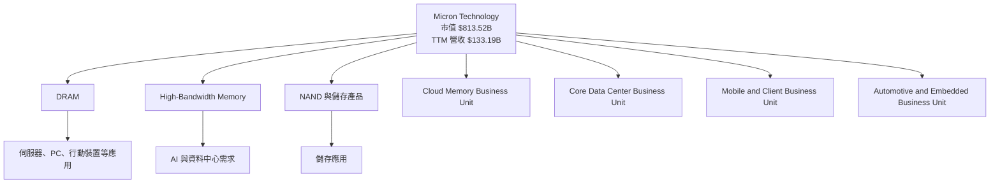
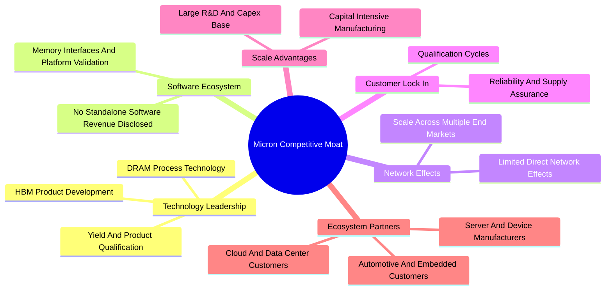
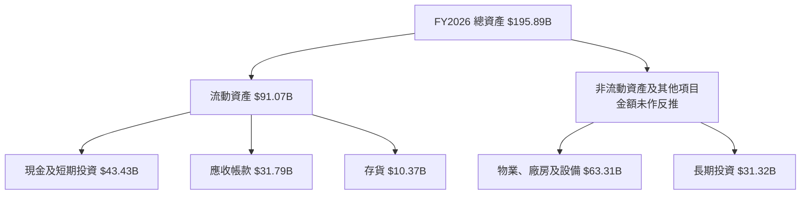
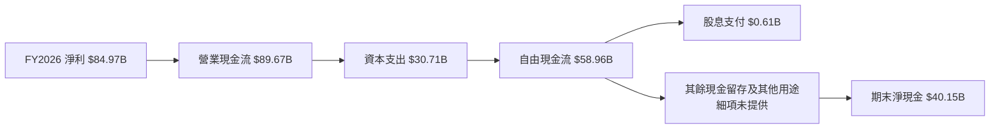
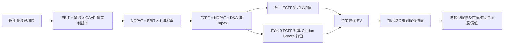
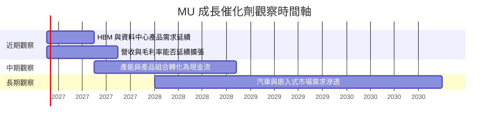
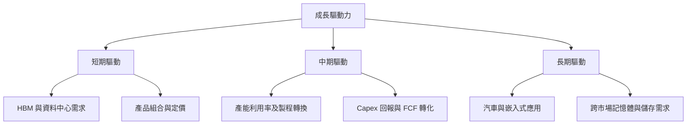
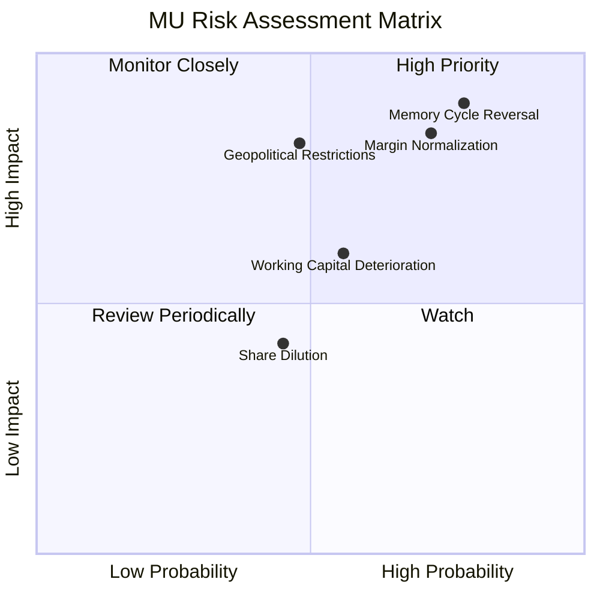
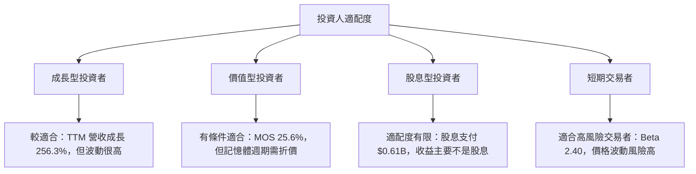

# MU 基本面深度分析報告
> **報告日期**：2026-11-17 ｜ **語言**：繁體中文 ｜ **數據來源**：SEC 申報資料 (XBRL)、Yahoo Finance、Finviz、StockAnalysis、Roic.ai ｜ **分析師**：CFA 級機構研究

## 目錄

| # | 章節 | 核心結論 |
|---|------|----------|
| 1 | 執行摘要 | 強烈買入；加權合理價值 $966.26；MOS +25.6% |
| 2 | 公司概覽與商業模式 | DRAM、HBM 與 NAND 具規模及技術門檻；營收分部明細未提供 |
| 3 | 損益表深度分析 | TTM 營收 $133.19B、TTM 成長 256.3%；獲利率處於高峰 |
| 4 | 資產負債表分析 | 淨現金 $40.15B；流動性充裕，但 CCC 延長至 185 天 |
| 5 | 現金流量深度分析 | TTM FCF $58.96B，FCF yield 7.25%；資本支出仍高 |
| 6 | 獲利能力與資本效率 | ROIC 86.2% 對比 WACC 14.00%，目前價值創造幅度大 |
| 7 | 相對估值分析 | 估值低於自身 P/E 中位數，P/S 高於自身中位數 |
| 8 | DCF 內在價值評估 | 基準 DCF $881.83；加權合理價值 $966.26；估值對假設敏感 |
| 9 | 成長催化劑 | AI／HBM 需求及產品組合是主要催化劑；TAM 數據未提供 |
| 10 | 風險矩陣 | 記憶體週期、估值假設與地緣政策是主要風險 |
| 11 | 投資建議 | 強烈買入；買入區間上限依 MOS 10% 門檻為 $869.63 |

---

## 1. 執行摘要

截至 2026-11-16 收盤，MU 股價為 **$719.02**。公司 TTM 營收 **$133.19B**、TTM 營收年增 **256.3%**、TTM FCF **$58.96B**，ROIC **86.2%**，高於採用的 WACC **14.00%**。以 DCF 基準每股價值 **$881.83**、同業估值及分析師共識等方法三角驗證後，加權合理價值為 **$966.26**；相對現價的 MOS 為 **+25.6%**，依規則 20 評級為 **強烈買入**。此結論高度依賴記憶體高景氣能否持續，以及目前極高利潤率能否有序收斂而非快速反轉。

### 1.0 一頁式投資儀表板

| 項目 | 內容 |
|------|------|
| **投資論點（3 句）** | ① TTM 營收年增 **256.3%**，反映記憶體需求與定價急升，但週期高峰風險同步升高。② TTM FCF **$58.96B**、FCF yield **7.25%**，顯示現階段獲利轉現金能力強。③ ROIC **86.2%** 對比 WACC **14.00%**，目前資本回報大幅超過資本成本。 |
| **綜合評分** | **8.4/10**（引用 1.1 評分卡） |
| **財務健康** | 🟢 淨現金 **$40.15B**；流動比率 **3.314**，流動性有緩衝。 |
| **ROIC vs WACC** | **86.2% vs 14.00%**；目前創造股東價值，ROIC 為 WACC 的約 **6.2 倍**。 |
| **FCF 趨勢** | 明顯上升；TTM FCF **$58.96B**、FCF yield **7.25%**。 |
| **估值** | Forward P/E **3.46x**｜EV/EBITDA **7.12x**｜FCF Yield **7.25%**。 |
| **DCF 內在價值（基準）** | **$881.83**；現價相對 DCF 折價 **18.5%**（折溢價基準為 DCF 基準價值）。 |
| **安全邊際（MOS）** | **+25.6%**＝($966.26 − $719.02) ÷ $966.26；🟢 以加權合理價值為基準，MOS 充足。 |
| **預期報酬（基準情境 12M）** | **+22.6%**，採 DCF 基準情境 $881.83 相對現價計算；非保證報酬。 |
| **關鍵風險（前二）** | 記憶體價格與供需週期反轉；AI／HBM 需求及高利潤率無法延續。 |
| **評級 + 信心度** | 🟢 **強烈買入**｜信心：中；估值有吸引力，但景氣循環與數據口徑風險不低。 |

### 1.1 綜合評分卡（全報告唯一）

| 維度 | 評分（1–10） | 主要依據（引用數字與其來源章節） |
|------|--------------|----------------------------------|
| 成長性 | 9.0 | TTM 營收年增 **256.3%**、最新一季年增 **379.3%**（第 3 章）；基期與週期因素令高分不代表可持續。 |
| 獲利能力 | 9.5 | TTM 營業利益率 **74.6%**、ROIC **86.2%**、Piotroski F-Score **8/9**（第 3、6 章）。 |
| 財務健康 | 9.0 | 淨現金 **$40.15B**、流動比率 **3.314**；但 CCC 從 **155 天**增至 **185 天**（第 4 章）。 |
| 估值 | 8.0 | MOS **25.6%**；P/E 低於自身五年中位數，但 P/S 位於自身五年歷史第 75 百分位（第 7、8 章）。 |
| 護城河 | 8.0 | DRAM/HBM/NAND 的製程、資本與客戶認證門檻；但商品週期、競爭供給及客戶議價力會削弱定價優勢（第 2 章）。 |
| 管理層與資本配置 | 6.5 | 2026 年資本支出 **$30.71B**、SBC **$1.33B**；F-Score 的稀釋股數測試未通過，回購資料未提供（第 3、5 章）。 |
| **綜合評分** | **8.3** | 六項算術平均：(**9.0 + 9.5 + 9.0 + 8.0 + 8.0 + 6.5**) ÷ 6 = **8.3**。 |

### 1.2 五大投資論點 + 三大核心風險

| 類型 | 項目 | 具體依據 | 信心度 |
|------|------|----------|--------|
| 🟢 **投資論點①** | 營收及產品需求高速擴張 | TTM 營收 **$133.19B**、年增 **256.3%**；最新一季年增 **379.3%**。若 HBM 與資料中心需求維持，產品組合可支撐較高毛利。 | 🟢 高 |
| 🟢 **投資論點②** | 現金流轉強 | TTM OCF **$89.67B** 減 Capex **$30.71B**，FCF **$58.96B**；現金轉換率約 **69.4%**（FCF／淨利）。 | 🟢 高 |
| 🟢 **投資論點③** | 資本回報遠高於資本成本 | ROIC **86.2%**，WACC **14.00%**，差距 **72.2 個百分點**。 | 🟢 高 |
| 🟢 **投資論點④** | 淨現金與低財務槓桿 | 現金及短期投資 **$43.43B**、總債務 **$3.28B**、淨現金 **$40.15B**。 | 🟢 高 |
| 🟡 **投資論點⑤** | 相對自身歷史估值有吸引力 | TTM P/E **9.7x**，低於自身五年中位數 **17.4x**；但 P/S **6.2x** 高於中位數 **4.2x**。 | 🟡 中 |
| 🟡 **風險①** | 記憶體週期逆轉 | 單季營收年增 **379.3%**，基期與價格波動可能使增長快速降速；若出現供給過剩，毛利率和估值可同時收縮。 | 🟡 中高 |
| 🔴 **風險②** | DCF 對高利潤率假設敏感 | 模型營業利潤率由 FY+1 **74.6%** 降至 FY+10 **26.1%**；即使已大幅收斂，基準價值仍依賴未來十年現金流及終值。 | 🔴 高衝擊 |
| 🔴 **風險③** | 庫存及回款天數增加 | DIO **147 天**、DSO **87 天**，CCC **185 天**，均高於一年前；若非產品放量所致，可能形成營運資金壓力。 | 🔴 中高 |

### 1.3 快速統計卡片

| 指標 | 公司實際值（期間） | 同業中位數 | 狀態 |
|------|--------------------|------------|------|
| 營收成長（TTM） | **256.3%** | — | 🟢 |
| 營收成長（最新一季年增） | **379.3%** | **377.9%**（SKHY、SNDK、WDC） | 🟢 |
| 毛利率（TTM） | **80.7%** | **77.4%**（SKHY、SNDK、WDC） | 🟢 |
| 營業利益率（TTM） | **74.6%** | — | 🟢 |
| ROIC（TTM） | **86.2%** | — | 🟢 |
| Forward P/E | **3.46x** | **3.0x**（SKHY、SNDK、WDC 中位數） | 🟢 |
| FCF Yield（TTM） | **7.25%** | — | 🟢 |
| Piotroski F-Score | **8 / 9** | — | 🟢 |

> 同業中位數依可用 Peer multiples 計算；SKHY 的部分估值欄位因混合幣別標為 N/A，因此只在可比較指標中使用。

### 1.4 投資結論

```text
╔══════════════════════════════════════════════════════════════════╗
║                    📊 投資結論摘要                               ║
╠══════════════════════════════════════════════════════════════════╣
║  評級：強烈買入（MOS +25.6%，且 ROIC 86.2% > WACC 14.00%）      ║
║  價格（2026-11-16 收盤）：$719.02                               ║
║  DCF 內在價值（基準）：$881.83（折價 18.5%）                    ║
║  安全邊際 MOS：+25.6%（以加權合理價值為分母）                   ║
║  加權合理價值（8.8）：$966.26                                    ║
║  DCF 情境價值：                                                  ║
║    悲觀情境：$429.05（-40.3%）                                   ║
║    基準情境：$881.83（+22.6%）                                   ║
║    樂觀情境：$1,715.71（+138.6%）                                ║
║  綜合評分：8.3/10（引用 1.1）                                    ║
║  適合投資人：能承受週期波動、重視長期成長與現金流的投資人      ║
╚══════════════════════════════════════════════════════════════════╝
```

---

## 2. 公司概覽與商業模式

Micron Technology, Inc. 是美國記憶體與儲存半導體公司，主要產品包含 DRAM（含 HBM）、NAND 與儲存產品，服務雲端資料中心、核心資料中心、行動與個人電腦、汽車及嵌入式市場。公司資料列示員工 **61,000 人**，TTM 營收 **$133.19B**，市值 **$813.52B**。

### 2.1 業務結構與收入來源

各業務單位營收金額及占比未提供，因此不製作分部占比圖，也不以公司整體營收反推。以下圖示僅呈現已披露的業務結構。



**軟體／服務收入**：未提供獨立收入資料；公司核心仍是記憶體及儲存半導體產品。

### 2.2 市場份額

市場份額資料未提供，故不製作份額圖或填列市占率。以財務規模觀察，MU TTM 營收 **$133.19B**、最新一季營收年增 **379.3%**；同業 SKHY 與 SNDK 最新一季年增分別為 **327.9%** 與 **377.9%**，顯示 MU 正處於產業需求快速擴張期，但不能僅憑成長率推定市占率變化。

### 2.3 競爭護城河分析



### 2.4 護城河強度

| 護城河項目 | 強度（強／中／弱） | 證據（引用數字或事實） | 會削弱它的情況 |
|------------|--------------------|------------------------|----------------|
| 技術與製程 | 強 | 公司涵蓋 DRAM、HBM、NAND；FY2026 研發支出 **$5.65B**。產品效能、良率及驗證要求構成門檻。 | 競爭者技術追趕、製程轉換延誤、良率落後。 |
| 軟體生態系統 | 弱 | 未提供獨立軟體收入或以軟體為核心的鎖定資料。 | 客戶以價格與供貨能力選擇替代供應商。 |
| 網路效應 | 弱 | 記憶體屬上游零組件，未見直接網路效應證據。 | 替代產品可快速完成相容驗證。 |
| 客戶鎖定 | 中 | 雲端、汽車及嵌入式產品需經平台驗證；但客戶分部營收與留存數據未提供。 | 客戶多源採購、產品規格標準化、價格競爭。 |
| 規模效應 | 強 | FY2026 Capex **$30.71B**，顯示產業資本門檻高；規模有助分攤研發與製造成本。 | 產能過剩、資本投入回報下降、固定成本吸收不足。 |
| 生態夥伴 | 中 | 業務涵蓋雲端、資料中心、行動、PC、汽車與嵌入式市場。 | 主要客戶轉向競品或供應鏈限制導致交付中斷。 |

**1.1 護城河分數 8.0/10**：評分依據是高研發與資本門檻、跨終端市場及產品驗證要求；扣分原因是記憶體高度週期化，且軟體生態與網路效應有限。

---

## 3. 損益表深度分析

### 3.1 年度收入成長趨勢（近 4 年）

年度營收以美元計；柱狀長度為視覺化比例，不代表精確線性刻度。

```text
╔══════════════════════════════════════════════════════════════════╗
║             Micron 年度營收趨勢（FY2023–FY2026）                ║
╠══════════════════════════════════════════════════════════════════╣
║  FY2023  $15.54B  ████░░░░░░░░░░░░░░░░░░░░  基期               ║
║  FY2024  $25.11B  █████░░░░░░░░░░░░░░░░░░░  YoY +61.6% 🟢     ║
║  FY2025  $37.38B  ███████░░░░░░░░░░░░░░░░░  YoY +48.9% 🟢     ║
║  FY2026 $133.19B  ████████████████████████  YoY +256.3% 🟢    ║
╠══════════════════════════════════════════════════════════════════╣
║  FY2023–FY2026 三年 CAGR：約 104.7%                             ║
╚══════════════════════════════════════════════════════════════════╝
```

三年 CAGR 算式：\((133.19 ÷ 15.54)^{1/3} - 1 \approx 104.7\%\)。此成長反映記憶體景氣由低谷反彈及高階產品需求提升，不能視為長期穩態增速；FY2026 的年增率尤其受到低基期及產業價格循環影響。

### 3.2 季度收入趨勢分析

季度營收依財務報表列示；QoQ 為本季相對上一季計算，YoY 為財務數據列示的單季年增率。

| 季度 | 營收 | QoQ | YoY | 備註 |
|------|------:|----:|----:|------|
| 2025-11-30 | $13.64B | — | +56.65% | 年增回升，但基期仍低。 |
| 2026-02-28 | $23.86B | +74.9% | +196.29% | 營收規模快速擴大。 |
| 2026-05-31 | $41.46B | +73.7% | +345.72% | 需求與定價延續改善。 |
| 2026-08-31 | $54.23B | +30.8% | +379.3% | 營收仍擴張，但 QoQ 增速低於前兩季。 |

QoQ 算式例：\($54.23B ÷ $41.46B - 1 \approx 30.8\%\)。季度營收逐季上升，且最新季單季年增率 **379.3%**；然而，增速從此前約 74% 的 QoQ 降至 30.8%，後續應觀察價格、出貨與產品組合是否仍支持高位增長。

### 3.3 利潤率演變分析

| 利潤率指標 | FY2023 | FY2024 | FY2025 | FY2026 | 趨勢 | 評估 |
|------------|-------:|-------:|-------:|-------:|------|------|
| **毛利率** | -9.1% | 22.3% | 39.8% | 80.7% | 由週期低谷快速反彈 | 🟢 |
| **營業利益率** | -34.8% | 5.2% | 26.1% | 74.6% | 固定成本吸收與定價改善 | 🟢 |
| **淨利率** | -37.5% | 3.1% | 22.8% | 63.8% | 隨營收復甦及營運槓桿擴大 | 🟢 |

> FY2023 毛利率及營業利益率依年度損益表中的毛利與營業利益計算；FY2026 TTM 毛利率 **80.7%**、營業利益率 **74.6%** 採財務數據列示值。

FY2026 利潤率改善與營收由 FY2025 **$37.38B** 升至 **$133.19B** 同步發生。記憶體製造固定成本高，產能利用率和產品售價提升會放大營業槓桿；高階記憶體產品組合改善亦可能推升毛利。但目前毛利率與營業利益率極高，周期性價格與供給增加可能令其回落，不宜將 FY2026 水準直接外推。

### 3.4 費用結構分析

FY2026 損益表列示營收 **$133.19B**、毛利 **$107.50B**、營業利益 **$99.34B**、研發費用 **$5.65B**。資料未提供可直接重建的完整費用細項與分類，故不繪製費用占比圓餅圖，以免混合毛利成本、營業費用及非營業項目。

```text
╔══════════════════════════════════════════════════════════════════╗
║              FY2026 損益結構（已披露數字）                      ║
╠══════════════════════════════════════════════════════════════════╣
║  營收                   $133.19B                                ║
║  毛利                   $107.50B                                ║
║  營業利益                $99.34B                                ║
║  研發費用                 $5.65B                                ║
║  毛利至營業利益差額        $8.16B（由披露數字相減）             ║
╚══════════════════════════════════════════════════════════════════╝
```

### 3.5 季度 EPS 趨勢與盈餘品質（Quality of Earnings）

近四季實際 EPS 及盈餘成長如下。EPS 預估值與 surprise 欄位為 N/A，不能判斷各季是否超預期或不及預期。

| 季度 | EPS 實際 | EPS 年增 | 實際盈餘 | 盈餘 YoY | 是否超／不及預期 |
|------|---------:|--------:|---------:|---------:|------------------|
| 2025-11-30 | $4.60 | +175.45% | $5.24B | +1,077.8%（最新單季資料為整體列示；各季可比口徑未完整） | N/A：估計 EPS 為 N/A |
| 2026-02-28 | $12.07 | +756.03% | $13.79B | +756.03% | N/A：估計 EPS 為 N/A |
| 2026-05-31 | $24.67 | +1,368.45% | $28.24B | +1,368.45% | N/A：估計 EPS 為 N/A |
| 2026-08-31 | $32.85 | +1,059.46% | $37.70B | +1,059.46% | N/A：估計 EPS 為 N/A |

> EPS 成長以 StockAnalysis 的季度序列列示；各來源在最新季度的增長欄位可能有口徑差異，故不將無法核對的季度盈餘成長補成一致序列。EPS surprise 歷史表的估計值與實際值均缺失，無法判定 beat/miss。

| 盈餘品質項目 | 數值／佔比 | 評估 |
|--------------|-----------|------|
| 股權薪酬 SBC / 營收 | $1.33B ÷ $133.19B = **1.0%** | 🟢 占比不高；仍會形成股東稀釋成本。 |
| SBC / 營業現金流 | $1.33B ÷ $89.67B = **1.5%** | 🟢 對現金流規模影響有限。 |
| FCF / 淨利（現金轉換率） | $58.96B ÷ $84.97B = **69.4%** | 🟡 現金轉換正向，但 Capex 高，FCF 低於淨利。 |
| 一次性／非經常性損益 | N/A（未提供明細） | 無法判斷是否有重大一次性項目影響淨利。 |
| 有效稅率 | **14.8%**（最新年度） | 暫未見數據顯示稅率特別異常；歷史年度可比稅率序列不足。 |
| 資本化支出 vs 費用化 | FY2026 Capex **$30.71B**；研發費用 **$5.65B** | 資本密集型製造業，資本支出主要形成產能與設備；資產折舊與資本化明細不足，無法進一步判斷成本遞延程度。 |

**盈餘品質結論**：TTM OCF **$89.67B** 大於淨利 **$84.97B**，Piotroski 應計品質測試亦通過，現金獲利具一定支撐；SBC 占營收約 **1.0%**，不高但仍有稀釋。FCF／淨利 **69.4%** 反映重資本投入消耗現金，故評估盈餘時須同時看 Capex 與產能回報，而不只看 GAAP 淨利。

---

## 4. 資產負債表分析

### 4.1 資產結構分解

截至 FY2026，總資產 **$195.89B**、流動資產 **$91.07B**；主要已列項目如下。未列資產項目合計未在圖中反推。



### 4.2 流動性與營運資金分析

| 指標 | FY2026 | FY2025 | 評估 |
|------|-------:|-------:|------|
| 流動比率 | 3.314 | N/A | 🟢 短期資產足以覆蓋流動負債。 |
| 速動比率 | 2.898 | N/A | 🟢 即使排除較不流動項目，短期流動性仍充足。 |
| 現金及短期投資 | $43.43B | $10.31B | 🟢 現金緩衝明顯增加。 |

| 指標 | 最新 TTM | 一年前 TTM | 變化 | 解讀 |
|------|----------:|-----------:|-----:|------|
| DSO 應收帳款天數 | 87 天 | 70 天 | +17 天 | 回款天數增加；營收快速擴張可能推高應收款，仍應追蹤壞帳與收款品質。 |
| DIO 存貨天數 | 147 天 | 136 天 | +11 天 | 庫存占用時間增加；可能與產能準備及產品放量有關，也可能反映庫存風險上升。 |
| DPO 應付帳款天數 | 50 天 | 51 天 | -1 天 | 付款天數大致穩定，未見明顯延長供應商付款期。 |
| CCC 現金轉換週期 | 185 天 | 155 天 | +30 天 | 現金被營運資金占用更久；應收帳款及存貨週轉惡化是重點監控項。 |

### 4.3 債務結構分析

```text
╔══════════════════════════════════════════════════════════════════╗
║                   Micron 債務健康診斷                            ║
╠══════════════════════════════════════════════════════════════════╣
║  總債務（VERIFIED FIGURES）： $3.28B                             ║
║  總現金及短期投資：           $43.43B                            ║
║  淨現金：                     $40.15B  🟢                       ║
║  Debt / EBITDA：              0.03x（$3.28B ÷ $109.28B）         ║
║  Interest Coverage：          N/A（利息費用資料未提供）         ║
║                                                                  ║
║  備註：其他市場資料列示總債務 $5.18B，口徑與核實財務數據不同；  ║
║        本報告債務、淨現金及 DCF 橋接採用核實數值。              ║
╚══════════════════════════════════════════════════════════════════╝
```

### 4.4 股東權益趨勢

股東權益以年度資產負債表列示值呈現。2026 年股東權益增加與淨利大幅上升一致，但年度資料無法單獨拆分留存盈餘、其他綜合損益及資本交易的各自貢獻。

```text
╔══════════════════════════════════════════════════════════════════╗
║                  股東權益年度變化                                ║
╠══════════════════════════════════════════════════════════════════╣
║  FY2023  $44.12B  █████████░░░░░░░░░░░░░░                       ║
║  FY2024  $45.13B  █████████░░░░░░░░░░░░░░                       ║
║  FY2025  $54.16B  ███████████░░░░░░░░░░░░                       ║
║  FY2026 $138.38B  ████████████████████████                       ║
╚══════════════════════════════════════════════════════════════════╝
```

---

## 5. 現金流量深度分析

### 5.1 現金流量瀑布圖



### 5.2 FCF 轉換率趨勢

| 年度 | FCF | 淨利 | FCF／淨利 | 趨勢解讀 |
|------|----:|-----:|----------:|----------|
| FY2023 | -$6.12B | -$5.83B | 105.0% | 比率因分子、分母皆為負而不具正常經濟意義。 |
| FY2024 | $0.12B | $0.78B | 15.6% | 低景氣與資本投入令現金流偏弱。 |
| FY2025 | $1.67B | $8.54B | 19.6% | 盈利復甦快於自由現金流恢復。 |
| FY2026 TTM | $58.96B | $84.97B | 69.4% | 現金流大幅改善，但 Capex 仍達 $30.71B。 |

### 5.3 自由現金流趨勢

```text
╔══════════════════════════════════════════════════════════════════╗
║                自由現金流趨勢（美元）                            ║
╠══════════════════════════════════════════════════════════════════╣
║  FY2023  -$6.12B  （負值）                                       ║
║  FY2024   $0.12B  ░                                              ║
║  FY2025   $1.67B  █                                              ║
║  FY2026  $58.96B  ████████████████████████  FCF yield 7.25%     ║
╚══════════════════════════════════════════════════════════════════╝
```

FY2026 FCF 增加主要因 OCF 升至 **$89.67B**，遠高於 FY2025 **$17.52B**；同期 Capex 亦由 **$15.86B** 增至 **$30.71B**。營運現金流成長高於資本支出增幅，令 FCF 從 FY2025 **$1.67B** 大幅提高至 **$58.96B**。由於記憶體產業需要持續更新產能，若需求降溫而 Capex 調整滯後，FCF 可能迅速收縮。

### 5.4 資本配置評估

| 項目 | FY2026 金額 | 評估 |
|------|------------:|------|
| Capex | $30.71B | 高資本強度，與產能、製程及產品需求相關；投資回報應以後續利用率及 ROIC 驗證。 |
| 股息支付 | $0.61B | 相對 FCF $58.96B 約 1.0%；現金流主要未以股息形式返還。 |
| SBC | $1.33B | 約為營收 1.0%；仍造成股數稀釋風險。 |
| 回購 | N/A | 未提供可核對的年度回購金額。 |
| 留存現金 | N/A | 未提供可與其他用途完整調節的現金配置表。 |

資料不足以將資本配置拆成可加總比例，因此不畫資本配置圓餅圖。FCF 的資金用途主要仍需結合 Capex、股息、現金累積及其他投資項目追蹤。

---

## 6. 獲利能力與資本效率

### 6.1 ROE／ROA／ROIC 趨勢

| 指標 | FY2026 TTM | 歷史序列可比性 | 評估 |
|------|-----------:|----------------|------|
| ROE | 61.4% | 品質指標計算值；其他市場資料另列 88.3%，口徑不同 | 🟢 採品質指標口徑，獲利回報高。 |
| ROA | N/A（品質區塊未提供歷年一致序列） | 其他資料列示 TTM 44.6%，但非同一品質指標組 | 高回報，但不作歷年趨勢比較。 |
| ROIC | 86.2% | 核實財務數據提供 TTM 值 | 🟢 大幅高於 WACC。 |

沒有可比的行業均值資料，不列行業均值欄。由於其他資料源對 ROE、債務及資產回報數字存在口徑差異，本節以 QUALITY FIGURES 的 DuPont ROE **61.4%** 及核實 ROIC **86.2%** 為準。

### 6.2 ROIC vs WACC 分析（核心價值創造判斷）

```text
╔══════════════════════════════════════════════════════════════════╗
║                ROIC vs WACC 深度分析                            ║
╠══════════════════════════════════════════════════════════════════╣
║  WACC 輸入（依 Cost of capital）：                               ║
║  ├── 無風險利率（10Y 美債）：       5.12%                       ║
║  ├── 市場風險溢酬 ERP：             5.00%                       ║
║  ├── Beta（調整後）：               1.93                        ║
║  ├── 股權成本 Ke：                  14.78%                      ║
║  ├── 稅前債務成本：                  3.23%                      ║
║  ├── 有效稅率：                     14.8%                       ║
║  ├── 資本結構 E/D：                 99.6% / 0.4%                 ║
║  └── 採用 WACC：                    14.00%                      ║
║                                                                  ║
║  ROIC（TTM）：                       86.2%                       ║
║  ROIC − WACC：                       +72.2 個百分點              ║
║                                                                  ║
║  ROIC  86.2%  ▓▓▓▓▓▓▓▓▓▓▓▓▓▓▓▓▓▓▓▓▓▓▓▓▓▓▓▓▓▓▓▓▓▓▓▓▓▓▓▓       ║
║  WACC  14.0%  ▓▓▓▓▓▓░░░░░░░░░░░░░░░░░░░░░░░░░░░░░░░░░░       ║
║  EVA   +72.2pp  🟢 明顯高於資本成本                               ║
║                                                                  ║
║  結論：目前 ROIC 為 WACC 約 6.2 倍，創造股東價值；            ║
║        但 ROIC 為週期高點環境下的 TTM 指標，不代表長期穩態。    ║
╚══════════════════════════════════════════════════════════════════╝
```

WACC 的詳細輸入與計算限制見第 8.2 節。核實資料列示 ROIC **86.2%**；其資本回報遠高於資本成本，意味當前資本投入產生正經濟利潤。若記憶體價格下跌、產能利用率下降，ROIC 可快速回落，因此不能以峰值 ROIC 永續外推。

### 6.3 杜邦三因素分解

| 因素 | 數值（TTM） | 解讀 |
|------|-------------|------|
| 淨利率 | 63.8% | 利潤率是 ROE 高企的主要來源，反映目前景氣與定價水準。 |
| 資產週轉率 | 0.68 | 每單位資產產生的營收；資產密集特徵明顯。 |
| 權益乘數 | 1.42 | 槓桿倍數適中，ROE 不是主要靠高槓桿撐起。 |
| **ROE** | **61.4%** | 63.8% × 0.68 × 1.42 = **61.4%**（品質指標列示值，四捨五入有差異）。 |

ROE 的主要驅動為 **63.8% 淨利率**，而非高權益乘數；但如此高的淨利率仍可能隨週期反轉而下降。

### 6.4 財務體質：Piotroski F-Score

Piotroski F-Score 為 **8 / 9**。依品質指標列示如下：

| 測試 | 結果 | 解讀 |
|------|------|------|
| ROA > 0 | ✅ 通過 | 公司目前盈利。 |
| 營業現金流 > 0 | ✅ 通過 | TTM OCF 為正。 |
| ROA 高於一年前 | ✅ 通過 | 盈利能力相較去年改善。 |
| 營業現金流 > 淨利（應計品質） | ✅ 通過 | OCF $89.67B 高於淨利 $84.97B。 |
| 長期負債 ÷ 總資產低於一年前 | ✅ 通過 | 負債相對資產下降。 |
| 流動比率高於一年前 | ✅ 通過 | 流動性改善。 |
| 稀釋股數未增加 | ❌ 未通過 | 股數稀釋表示每股經濟利益可能被攤薄。 |
| 毛利率高於一年前 | ✅ 通過 | 毛利率隨景氣復甦提升。 |
| 資產週轉率高於一年前 | ✅ 通過 | 資產利用效率改善。 |

八項通過、一項未通過。稀釋股數測試未通過是重要股東回報監控點；在高盈利年度，需確認每股 FCF 增長是否與總 FCF 增長一致。

---

## 7. 相對估值分析

### 7.1 同業估值比較

| 估值指標 | **MU** | **SKHY** | **SNDK** | **WDC** | 本公司評估 |
|----------|-------:|---------:|---------:|-------:|-----------|
| **Trailing P/E** | 9.7x | 7.8x | 6.5x | 9.9x | 🟡 位於同業區間內；週期高峰盈餘會壓低 P/E。 |
| **Forward P/E** | 3.46x | 3.0x | 2.8x | 7.0x | 🟢 低於 WDC，接近 SKHY、SNDK；前瞻盈餘預期很高。 |
| **P/S Ratio** | 6.1x | N/A | 4.0x | 7.3x | 🟡 高於 SNDK、低於 WDC；SKHY 因混合幣別不可比。 |
| **EV/EBITDA** | 7.1x | N/A | 5.2x | 16.6x | 🟢 低於 WDC，但高於 SNDK。 |
| **最新一季營收 YoY** | 379.3% | 327.9% | 377.9% | 55.5% | 🟢 成長高於三家可比公司或接近最高值。 |
| **毛利率 TTM** | 80.7% | 77.4% | 80.0% | 52.6% | 🟢 略高於 SNDK 與 SKHY。 |

本公司倍數依市場估值資料；同業倍數依 Yahoo Finance Peer multiples。公司 Forward P/E **3.46x** 不等於同業中位數 **3.0x**，顯示估值依賴盈利預測能否兌現，而不是單純「低倍數即低風險」。

### 7.2 歷史估值區間分析

```text
╔══════════════════════════════════════════════════════════════════╗
║            MU TTM 估值：自身五年歷史位置                        ║
╠══════════════════════════════════════════════════════════════════╣
║  P/E        7.4x ├────────● 9.7x──────────────┤ 138.5x        ║
║             中位數 17.4x；當前百分位 13%                        ║
║  P/S        2.1x ├────────────────● 6.2x──────┤ 11.7x         ║
║             中位數 4.2x；當前百分位 75%                         ║
║  EV/EBITDA  3.6x ├──────● 7.2x────────────────┤ 80.7x         ║
║             中位數 9.7x；當前百分位 35%                         ║
╚══════════════════════════════════════════════════════════════════╝
```

P/E **9.7x** 位於自身五年歷史第 **13 百分位**，但 P/S **6.2x** 位於第 **75 百分位**。兩者呈現相反訊號，原因是盈利在週期高點快速擴張：以高峰盈餘作分母的 P/E 可能顯得便宜，而 P/S 更直接反映股價相對營收規模的溢價。

### 7.3 情境價值（照抄 DCF MODEL 的 Scenarios）

| 情境 | 第 1 年營收成長 | 期末營業利潤率 | WACC | 每股價值 | 相對現價 | 機率 | 會發生的條件 |
|------|----------------:|----------------:|-----:|---------:|---------:|-----:|--------------|
| 🔴 悲觀 | 15.0% | 22.2% | 15.00% | $429.05 | -40.3% | 25% | 需求或價格回落、供給增加，利潤率收斂至低於基準終值水準，資本成本維持高位。 |
| 🟡 基準 | 30.0% | 26.1% | 14.00% | $881.83 | +22.6% | 50% | 近端需求仍高，但營收成長逐步降至模型設定的長期成熟增速，利潤率回歸歷史五年中位數。 |
| 🟢 樂觀 | 45.0% | 28.8% | 13.00% | $1,715.71 | +138.6% | 25% | 高階記憶體需求持續超預期、產品組合與定價長期保持強勢，折現率下降。 |

### 7.4 相對估值隱含價格區間

```text
╔══════════════════════════════════════════════════════════════════╗
║         估值方法隱含每股價值與現價位置                          ║
╠══════════════════════════════════════════════════════════════════╣
║  $661.29       $719.02             $881.83        $1,083.59     ║
║  同業 P/S      現價                DCF 基準        同業 EV/EBITDA║
║                                                                  ║
║  分析師共識目標價：$1,561.91                                      ║
╚══════════════════════════════════════════════════════════════════╝
```

| 方法 | 每股價值 | 依據 |
|------|---------:|------|
| 同業 EV/EBITDA | $1,083.59 | SNDK、WDC 同業中位數 **10.9x** × MU TTM EBITDA，加回淨現金。 |
| 同業 P/S | $661.29 | SNDK、WDC 同業中位數 **5.6x** × MU TTM 營收。 |

價格區間顯示相對估值並不一致：P/S 法低於現價，EV/EBITDA 法高於現價。分析師共識價格由 45 位分析師平均目標價提供，屬參考，不代表基本面模型必然能達成。

---

## 8. DCF 內在價值評估（Discounted Cash Flow）

### 8.0 估值推理鏈（Thinking Logic）

**Step 1 — 價值來源與主導變數**

MU 的價值可拆成 DRAM/HBM、NAND 與儲存產品的現金流底盤，以及資料中心、行動與汽車等應用需求帶來的增長；各業務營收占比未提供，故不能量化個別產品的營收貢獻。模型顯示估值最受**營業利潤率與折現率**影響：營收增長退坡之外，毛利與營業利益率由高峰回落的速度將決定 FCF 路徑。

**Step 2 — 模型選擇**

| 決策點 | 本報告採用 | 理由（含數字） | 曾考慮但否決 | 否決理由 |
|--------|-----------|----------------|--------------|----------|
| 現金流定義 | FCFF | 與 WACC 折現並先求企業價值相容；TTM FCF 為 $58.96B。 | FCFE | 現金流與債務融資變化需另行預測，已有核實 FCFF 模型。 |
| 預測期 N | 10 年 | DCF 模型固定預測 FY+1 至 FY+10，記憶體週期與高獲利回歸需要較長過渡期。 | 5 年 | 對景氣常態化過程覆蓋不足；不得改動既有模型年限。 |
| 終值方法 | Gordon Growth | 模型採終值永續成長率 3.0%，且 WACC 14.00% > g。 | 單用退出倍數 | DCF 模型未提供退出倍數估值，不能自行加入。 |
| EBIT 基礎 | GAAP EBIT | 模型明列 GAAP EBIT；TTM 營業利益率 74.6%。 | 非 GAAP EBIT | 會造成 SBC 是否加回不一致。 |

**Step 3 — 關鍵假設推導鏈**

- **營收增長**：錨點為 TTM 營收年增 **256.3%**；單季最新年增 **379.3%**，但這些高增速含低基期與景氣週期。模型將第 1 年增長限制在 **30.0%**，之後每年線性退坡至第 10 年 **3.0%**；採用值刻意低於當前成長速度。曾考慮沿用 TTM 256.3%，但否決，因其不適合十年預測。
- **期末營業利潤率**：錨點為 TTM **74.6%**；模型逐年回落至 FY+10 **26.1%**，依據為最近五個財年中位水準（TTM 含在模型計算中）。採用 26.1%；否決永續維持 74.6%，因其把週期高峰當成穩態。
- **永續成長率 g**：採用 **3.0%**；依據是成熟期名目長期成長的保守假設，且低於 WACC 14.00%。曾考慮 4.0%，但較高終值會提高估值對永續假設的依賴。
- **預測期 N**：採用 **10 年**，錨點即模型設定；以十年逐步淡化高增長和利潤率。曾考慮更短期間，但既有模型預測期固定為十年，不能替換。
- **Capex／營收**：錨點為 TTM **23.1%**；模型由 FY+1 **23.1%** 逐步降至 FY+10 **7.8%**，後段約為 D&A 的 **1.1 倍**。採用值反映高增長期投資密集、成熟期投資收斂；否決永遠維持 23.1%，因會忽略成熟期資本強度下降。
- **EBIT 基礎、SBC 及稀釋**：採用組合 **(A) GAAP EBIT + 固定股數**。GAAP EBIT 已扣 SBC，模型不再扣 SBC，股數不額外稀釋；SBC 只計入一次。模型未另列年稀釋率輸入，故不擅自加稀釋假設。
- **終值方法**：採 Gordon Growth；錨點為模型提供的 FCFF(FY+10)、g 3.0% 與 WACC 14.00%。退出倍數缺少模型輸出及對應 EV/EBITDA 終值，故不補算。
- **WACC**：採用 **14.00%**；先由資本成本輸入得到 14.73%，因資料明示限制於 **7%–14%** 區間而採上限。否決直接使用未限制的 14.73%，因模型要求採用限制後數值。

**Step 4 — 最脆弱假設**

最脆弱的是高峰營業利益率逐步回落的速度；若價格或利用率比模型假設更快惡化，FCFF 及終值將下修，悲觀情境價值為 **$429.05**，較基準低約 **51.3%**。

**Step 5 — 計算路徑圖**



### 8.1 模型假設總表（Model Inputs）

| 假設項目 | 採用值 | 依據／來源 | 敏感度 |
|----------|--------|-------------|--------|
| 預測期長度 N | 10 年 | DCF MODEL 固定預測十年；為高景氣回歸提供過渡期。 | 🟡 中 |
| 營收增長 | FY+1 30.0%，FY+10 3.0%，線性退坡 | TTM 成長 256.3%；將當前極高增長向成熟期收斂。 | 🔴 高 |
| 營業利潤率 | FY+1 74.6% → FY+10 26.1% | 起點採 TTM 營業利益率；終點採過去五財年中位數（含 TTM）。 | 🔴 高 |
| 有效稅率 | 14.8% | 最新年度有效稅率。 | 🟢 低 |
| Capex／營收 | FY+1 23.1% → FY+10 7.8% | TTM Capex／營收起點；後段依模型向 1.1×D&A 收斂。 | 🔴 高 |
| D&A／營收 | 7.1% | TTM 比率，模型固定不變。 | 🟢 低 |
| 營運資金變動／營收增額 | 未建模 | DCF MODEL 明示 working capital is not modelled；不自行填入。 | 🟡 中 |
| EBIT 基礎 | GAAP | 模型採 GAAP EBIT。 | 🟡 中 |
| SBC 處理 | 組合 (A)：GAAP EBIT，不另扣 SBC，股數不稀釋 | GAAP EBIT 已含 SBC 費用；避免重複扣除。 | 🟡 中 |
| 年稀釋率 | 0%（依組合 A） | 模型明示股數不另稀釋；股權薪酬已進 GAAP 費用。 | 🟡 中 |
| 永續成長率 g | 3.0% | DCF MODEL 固定輸入，低於 WACC。 | 🔴 高 |
| 終值方法 | Gordon Growth | DCF MODEL 提供 Gordon Growth 終值；退出倍數模型未提供。 | 🔴 高 |
| WACC | 14.00% | 採資本成本區塊限制後 WACC。 | 🔴 高 |

FCFF 定義為 **FCFF = NOPAT + D&A − Capex**；因模型不建模營運資金，不列 ΔWC。**本模型採用 (A)，故 SBC 影響已計入一次。**

### 8.2 折現率推導（WACC）

```text
╔══════════════════════════════════════════════════════════════════╗
║                    WACC 推導（折現率）                           ║
╠══════════════════════════════════════════════════════════════════╣
║  股權成本 Ke（CAPM）：                                           ║
║  ├── 無風險利率 Rf：                  5.12%                      ║
║  ├── 市場風險溢酬 ERP：               5.00%                      ║
║  ├── 原始 Beta（Yahoo）：             2.40                       ║
║  ├── 調整後 Beta：                    1.93                       ║
║  ├── Beta 調整：                      ⅔ × 2.40 + ⅓ = 1.93       ║
║  └── Ke：                             14.78%（來源列示）         ║
║                                                                  ║
║  債務成本：                                                      ║
║  ├── 稅前 Kd：                        3.23%                      ║
║  ├── 有效稅率：                       14.8%                      ║
║  └── 稅後 Kd：                        3.23% × (1−14.8%) = 2.75% ║
║                                                                  ║
║  資本結構（來源列示）：E / D = 99.6% / 0.4%                      ║
║  未限制 WACC：                     14.73%                       ║
║  採用 WACC：                       14.00%（限制於 7%–14%）      ║
╚══════════════════════════════════════════════════════════════════╝
```

**逐步演算與資料限制：**

1. **Ke（CAPM）**：採用資本成本資料列示的調整後 Beta **1.93**、Rf **5.12%**、ERP **5.00%**。以顯示至兩位小數的輸入相乘，\(5.12\% + 1.93 × 5.00\% = 14.77\%\)；核實資本成本欄列示 Ke **14.78%**，差異為底層 Beta 精度與四捨五入。
2. **稅前 Kd**：財務數據直接列示 **3.23%**。利息費用與平均計息負債明細未提供，故無法重建分子、分母。
3. **稅後 Kd**：\(3.23\% × (1 - 14.8\%) = 2.75\%\)。
4. **權重**：採用來源列示股權／債務權重 **99.6% / 0.4%**；因市場市值、總債務與負債範圍存在資料口徑差異，不用不一致的價格、股數與債務數字重建權重。
5. **WACC**：來源列示未限制計算值 **14.73%**，再按區間限制取 **14.00%**，此為 DCF 與第 6.2 節共用折現率。

10 年期美債無風險利率 **5.12%** 的具體觀察日期未提供；ERP **5.00%** 為資本成本輸入的假設值。調整後 Beta **1.93** 使用指定的三分之二原始 Beta 加三分之一市場 Beta 的調整方式。沒有另加規模或國別溢酬。WACC 採用值與第 6.2 節一致。

### 8.3 逐年自由現金流預測（基準情境）

金額單位為 **$B**；折現因子保留三位小數，其他數字依 DCF MODEL 列示值。工作資金未建模；按模型組合 (A) 不另扣 SBC。

| 年度 | FY+1 | FY+2 | FY+3 | FY+4 | FY+5 | FY+6 | FY+7 | FY+8 | FY+9 | FY+10 |
|------|-----:|-----:|-----:|-----:|-----:|-----:|-----:|-----:|-----:|------:|
| 營收 | 173.14 | 219.89 | 272.67 | 329.93 | 389.32 | 447.71 | 501.44 | 546.57 | 579.36 | 596.74 |
| 營收 YoY | 30.0% | 27.0% | 24.0% | 21.0% | 18.0% | 15.0% | 12.0% | 9.0% | 6.0% | 3.0% |
| 營業利潤率 | 74.6% | 69.2% | 63.8% | 58.4% | 53.1% | 47.7% | 42.3% | 36.9% | 31.5% | 26.1% |
| EBIT（GAAP） | 129.14 | 152.17 | 174.02 | 192.80 | 206.55 | 213.43 | 212.05 | 201.71 | 182.62 | 155.98 |
| − 稅（14.8%） | (19.13) | (22.54) | (25.77) | (28.55) | (30.59) | (31.61) | (31.40) | (29.87) | (27.05) | (23.10) |
| = NOPAT | 110.02 | 129.64 | 148.25 | 164.25 | 175.96 | 181.82 | 180.64 | 171.84 | 155.58 | 132.88 |
| + D&A | 12.35 | 15.69 | 19.45 | 23.54 | 27.78 | 31.94 | 35.78 | 39.00 | 41.34 | 42.58 |
| − Capex | (39.93) | (46.99) | (53.66) | (59.35) | (63.45) | (65.41) | (64.78) | (61.37) | (55.26) | (46.84) |
| **= FCFF** | **82.44** | **98.34** | **114.04** | **128.44** | **140.28** | **148.36** | **151.64** | **149.46** | **141.65** | **128.62** |
| 折現因子 @14.00% | 0.877 | 0.769 | 0.675 | 0.592 | 0.519 | 0.456 | 0.400 | 0.351 | 0.308 | 0.270 |
| **FCFF 現值 PV** | **72.32** | **75.67** | **76.98** | **76.04** | **72.86** | **67.59** | **60.60** | **52.40** | **43.56** | **34.69** |

預測期現值總和：

\[
72.32 + 75.67 + 76.98 + 76.04 + 72.86 + 67.59 + 60.60 + 52.40 + 43.56 + 34.69 = 632.71\text{B}
\]

**FY+1 逐步演算：**

1. 營收：\(133.19 × (1 + 30.0\%) = 173.147 \approx \$173.14B\)（依模型底層精度列示）。
2. EBIT：\(173.14 × 74.6\% = 129.16 \approx \$129.14B\)（模型採未四捨五入營收與比率）。
3. 稅：模型列示 **$19.13B**。
4. NOPAT：模型列示 **$110.02B**。
5. D&A：\(173.14 × 7.1\% \approx \$12.29B\)；模型依未四捨五入輸入列示 **$12.35B**。
6. Capex：模型列示 **$39.93B**，對應第 1 年 Capex／營收約 **23.1%**。
7. ΔWC：**未建模**；模型 FCFF 不含營運資金變動。
8. FCFF：\(110.02 + 12.35 - 39.93 = \$82.44B\)。
9. 折現因子：\(1 ÷ (1 + 14.00\%)^1 = 0.877\)；PV：\(82.44 × 0.877 \approx \$72.32B\)。

> 部分逐年表格數字因 DCF MODEL 以未四捨五入底層數值計算，使用顯示後的兩位小數重算可能產生少量尾差；本報告保留模型輸出，不以顯示值重建替換。

**合理性自檢**

- 預測 FCFF 從 FY+1 **$82.44B** 增至 FY+10 **$128.62B**；九年間 CAGR 約 **5.1%**。歷史 FY2023–FY2026 FCF CAGR 不宜直接比較：期間包含負值 FY2023 **-$6.12B**，且 FY2026 處於景氣反彈高峰。
- FY+10 FCFF 利潤率：**$128.62B ÷ $596.74B = 21.6%**；目前 TTM FCF 利潤率：**$58.96B ÷ $133.19B = 44.3%**。同業最佳的可比 FCF 利潤率未提供，不能判斷模型是否高於產業最佳。
- 模型每年 FCFF 均為正；終值與長期現金流對估值仍有實質影響。

```text
╔══════════════════════════════════════════════════════════════════╗
║            自由現金流：歷史實際 vs 模型預測                      ║
╠══════════════════════════════════════════════════════════════════╣
║  FY2023(實)  -$6.12B  負值                                      ║
║  FY2024(實)   $0.12B  ░                                         ║
║  FY2025(實)   $1.67B  ░                                         ║
║  FY2026(實)  $58.96B  ████████████████████████                  ║
║  FY+1 (預)   $82.44B  █████████████████████████████████          ║
║  FY+10(預)  $128.62B  ██████████████████████████████████████████ ║
╠══════════════════════════════════════════════════════════════════╣
║  模型預測 FCFF 由 FY+1 至 FY+10 增長，歷史基期受週期影響較大。  ║
╚══════════════════════════════════════════════════════════════════╝
```

### 8.4 終值計算（Terminal Value）

**適用性檢查**：WACC **14.00%** vs g **3.0%** → WACC > g？✅

| 方法 | 計算式 | 終值 TV | TV 現值 | 佔總 EV 比重 |
|------|--------|--------:|-------:|-------------:|
| Gordon Growth | $128.62B × (1 + 3.0%) ÷ (14.00% − 3.0%) | $1,204.36B | $324.87B | 33.9% |
| 退出倍數法 | N/A：DCF MODEL 未提供退出倍數終值 | N/A | N/A | N/A |

**逐步演算：**

1. FY+N FCFF：FY+10 FCFF **$128.62B**。
2. 分子：\(128.62 × (1 + 3.0\%) = 132.4786\text{B}\)。
3. 分母：\(14.00\% - 3.0\% = 11.00\%\)；TV：模型列示 **$1,204.36B**。
4. PV(TV)：模型列示 \(1,204.36 × 0.270 = \$324.87B\)（使用模型未四捨五入折現因子）。
5. 終值占比：\($324.87B ÷ $957.57B = 33.9\%\)。

模型的終值 PV 占 EV **33.9%**，未高於 75% 警示線，但仍是估值的重要組成。退出倍數交叉驗證因模型沒有相應輸出，不能自行補建。

### 8.5 企業價值 → 每股內在價值（Bridge）

```text
╔══════════════════════════════════════════════════════════════════╗
║              企業價值 → 每股內在價值 橋接表                      ║
╠══════════════════════════════════════════════════════════════════╣
║  預測期 FCF 現值合計              +$632.71B                      ║
║  終值現值 PV(TV)                  +$324.87B                      ║
║  = 企業價值 EV                     $957.57B                      ║
║  + 淨現金                          +$40.15B                      ║
║  = 股權價值                        $997.73B                      ║
║  每股價值（模型列示）              $881.83                       ║
║  當前股價（2026-11-16 收盤）       $719.02                       ║
║  折溢價（現價 ÷ DCF 價值 − 1）     -18.5%（折價）               ║
╚══════════════════════════════════════════════════════════════════╝
```

DCF MODEL 列示 EV **$957.57B**、淨現金 **$40.15B**、股權價值 **$997.73B**，總和與逐項顯示值可能有約 $0.01B 的四捨五入差。每股價值依模型列示公式以股權價值、股價及市值橋接，模型結果為 **$881.83**；其底層未四捨五入市值及股數未提供，不能用顯示後的市值及股數重建替換。

**逐步演算：**

1. EV：\(632.71 + 324.87 = 957.58\text{B}\)；模型以未四捨五入數列示 **$957.57B**。
2. 股權價值：模型列示 EV 加淨現金後為 **$997.73B**；已披露淨現金取自 FY2026 資料，DCF 沿用模型橋接值。
3. 每股內在價值：DCF MODEL 列示股權價值依「股權價值 × 股價 ÷ 市值」橋接，結果 **$881.83**；模型底層市值及股數精度未提供，不另行反推。
4. 折溢價：\(($719.02 ÷ $881.83) - 1 = -18.5\%\)。
5. **本節不計算 MOS**：MOS 一律以第 8.8 節加權合理價值為分母。

### 8.6 敏感性分析（WACC × 永續成長率）

矩陣值照 DCF MODEL 列示；括號為相對現價 **$719.02** 的上行空間。

| g（列）／WACC（欄） | 12.00% | 13.00% | **14.00%（基準）** | 15.00% | 16.00% |
|-----------|------:|------:|------------------:|------:|------:|
| **2.0%** | $1,019.58 (+41.8%) | $930.16 (+29.3%) | $855.35 (+18.9%) | $791.82 (+10.1%) | $737.17 (+2.5%) |
| **2.5%** | $1,041.16 (+44.8%) | $946.54 (+31.6%) | $868.01 (+20.7%) | $801.76 (+11.5%) | $745.08 (+3.6%) |
| **3.0%** | $1,065.13 (+48.1%) | $964.56 (+34.1%) | **$881.83 (+22.6%)** | $812.53 (+13.0%) | $753.60 (+4.8%) |
| **3.5%** | $1,091.92 (+51.9%) | $984.47 (+36.9%) | $896.97 (+24.7%) | $824.24 (+14.6%) | $762.80 (+6.1%) |
| **4.0%** | $1,122.07 (+56.1%) | $1,006.60 (+40.0%) | $913.61 (+27.1%) | $837.01 (+16.4%) | $772.76 (+7.5%) |

**代表格重算限制**：矩陣中的 FCFF、折現因子及股權橋接未提供未四捨五入逐年明細，故不能在不另建模型的情況下完整重算一個非基準格。採用矩陣原值，基準格與 DCF 基準值一致；不以自行估算數字代替程式輸出。

**DCF 三情境（模型列示）**

| 情境 | 營收假設 | 期末營業利潤率 | g | WACC | 每股價值 | 相對現價 | 機率 |
|------|----------|----------------:|--:|-----:|---------:|---------:|-----:|
| 🔴 悲觀 | 第 1 年 15.0% | 22.2% | 未單獨列示 | 15.00% | $429.05 | -40.3% | 25% |
| 🟡 基準 | 第 1 年 30.0% | 26.1% | 3.0%（基準模型） | 14.00% | $881.83 | +22.6% | 50% |
| 🟢 樂觀 | 第 1 年 45.0% | 28.8% | 未單獨列示 | 13.00% | $1,715.71 | +138.6% | 25% |
| **機率加權** | — | — | — | — | **$977.10** | **+35.9%** | **100%** |

模型未提供各情境的完整 FY+N 營收、FCFF 與終值明細，因此不自行重建情境內部算式。已提供的機率加權值為上下文參考；第 8.8 節仍依規定使用基準 DCF 值及固定權重估值方法。

**敏感度結論**

- g 由 **2.0%** 提高至 **4.0%**、WACC 固定 14.00%：$855.35 → $913.61，增加 **$58.26**，相對起點增加約 **6.8%**。
- WACC 由 **13.00%** 提高至 **15.00%**、g 固定 3.0%：$964.56 → $812.53，下降 **$152.03**，相對起點下降約 **15.8%**。
- 期末營業利潤率每 +1 個百分點的價值變動：**N/A**（敏感度矩陣未提供利潤率維度，且不得另建 DCF）。
- 在已提供的可量化敏感度中，WACC 對價值的影響較大；這與 8.0 所指出的營業利潤率與折現率共同主導估值一致。

### 8.7 反推 DCF（Reverse DCF：市場在預期什麼）

每次只放開一個變數；市場價為 **$719.02**。下列結果照 DCF MODEL 的反推輸出，未提供數值的變數不自行求解。

| 求解的變數（一次一個） | 其餘變數設定 | 市場隱含值 | 公司歷史實際／基準 | 判斷 |
|------------------------|--------------|------------:|--------------------|------|
| 第 1 年營收成長 | 其餘變數維持基準情境 | **23.4%** | 模型基準 30.0%；TTM 成長 256.3% | 🟡 市場隱含增長低於基準，但仍高於成熟期增長。 |
| 固定營業利潤率 | 其餘變數維持基準情境 | **32.8%** | TTM 74.6%；模型從 74.6% 降至 26.1% | 🟡 隱含利潤率低於當前高峰。 |
| 永續成長率 g | N/A | N/A（模型未提供解） | 基準 3.0% | N/A |
| 預測期長度 N | N/A | N/A（模型未提供解） | 基準 10 年 | N/A |

固定輸入包括模型 WACC **14.00%**、稅率 **14.8%**、Capex 路徑、D&A／營收 **7.1%**、預測期 **10 年**；ΔWC 未建模，SBC 採 GAAP EBIT 固定股數組合。模型未提供各試算點的疊代軌跡，故不捏造收斂表格。

**反推結論**：在其他輸入固定的條件下，現價對應第 1 年營收成長 **23.4%**，低於基準假設 **30.0%**；換言之，現價並未要求模型基準增長完全兌現，但仍需要公司避免營收迅速萎縮，並讓成熟期營業利潤率保持在具經濟回報的水準。

### 8.8 估值三角驗證與安全邊際

| 估值方法 | 隱含每股價值 | 上行空間（÷現價） | 權重 | 說明 |
|----------|--------------:|------------------:|-----:|------|
| DCF（基準） | $881.83 | +22.6% | 40% | 10 年 FCFF、WACC 14.00%、永續成長 3.0%。 |
| 同業 EV/EBITDA | $1,083.59 | +50.7% | 30% | SNDK、WDC 同業中位數 10.9x × TTM EBITDA，加回淨現金。 |
| 同業 P/S | $661.29 | -8.0% | 20% | SNDK、WDC 同業中位數 5.6x × TTM 營收。 |
| 分析師共識目標價 | $1,561.91 | +117.2% | 10% | 45 位分析師平均目標價，作為參考項。 |
| **加權合理價值** | **$966.26** | **+34.4%** | **100%** | 依週期性公司固定權重加權。 |

逐步演算：

\[
\$881.83×40\% + \$1,083.59×30\% + \$661.29×20\% + \$1,561.91×10\%
\]
\[
= \$352.732 + \$325.077 + \$132.258 + \$156.191
= \$966.258 \approx \mathbf{\$966.26}
\]

此權重對應公司類型 **cyclical（週期性）**；列入方法均依估值方法資料，未增刪方法或調整權重。

```text
╔══════════════════════════════════════════════════════════════════╗
║                  估值區間與安全邊際                              ║
╠══════════════════════════════════════════════════════════════════╣
║  $429.05 ─── $719.02 ─── [$966.26] ─── $881.83 ─── $1,715.71  ║
║  悲觀DCF       現價       加權合理值    基準DCF       樂觀DCF   ║
║                                                                  ║
║  安全邊際 MOS = ($966.26 − $719.02) ÷ $966.26 = +25.6%          ║
║  MOS 評估：🟢 充足                                               ║
║  上行空間 = ($966.26 − $719.02) ÷ $719.02 = +34.4%              ║
║                                                                  ║
║  建議買入區間：$719.02 – $869.63                                 ║
║  合理持有區間：$869.63 – $966.26                                 ║
║  減碼考慮區間：高於 $1,715.71，或基本面假設失效時                ║
╚══════════════════════════════════════════════════════════════════╝
```

MOS 算式採加權合理價值為分母；買入區間上限以 MOS 至少 10% 計算：\($966.26 × (1 - 10\%) = $869.63\)。

> 🔎 **程式複算（Python，依本節各項自動重算）**
>
> 加權合理價值 = $881.83 × 40% + $1,083.59 × 30% + $661.29 × 20% + $1,561.91 × 10% = **$966.26**（權重合計 100%）
>
> 以價格 $719.02 計：MOS = **+25.6%**，上行空間 = **+34.4%**
>
> ✅ 與本節所寫數值一致。

### 8.9 DCF 模型的局限與失效條件

- **終值依賴度**：PV(TV) 占 EV **33.9%**，估值約三分之一由 FY+10 之後的假設決定。
- **最脆弱假設**：營收成長、營業利潤率與 WACC。DCF 悲觀情境 **$429.05**，相對現價下跌 **40.3%**；樂觀情境 **$1,715.71**，模型區間很寬。
- **週期性限制**：FY2023 FCF **-$6.12B**，FY2026 TTM FCF **$58.96B**，獲利波動巨大。DCF 對高峰 FCF 的外推可靠度有限，應與 EV/EBITDA、P/S 及週期正常化獲利交叉檢驗。
- **營運資金與股數**：DCF 模型未建模營運資金；股數依組合 (A) 固定，與 F-Score 的稀釋股數測試未通過存在需要監控的落差。
- **與第 10 章風險連結**：供給過剩會壓低營收增長與利潤率；地緣政策可能限制出貨或客戶需求；高資本支出而利用率下降會令 FCF 低於模型。

### 8.10 複算檢核表（Audit Trail）

| # | 檢核項目 | 檢查方式 | 結果 |
|---|----------|----------|------|
| 1 | 所有高／中敏感度輸入有推導說明 | 對照 8.0 Step 3 與 8.1 假設表 | ✅ |
| 2 | 每個假設都有來歷 | 依據列出 TTM、最新年度或模型指定輸入 | ✅ |
| 3 | WACC 算式與限制處理 | Ke、Kd、資本權重採來源值；14.73% 限制為 14.00% | ✅（底層輸入精度造成 Ke 顯示尾差已註明） |
| 4 | Kd 分母與 D 權重範圍一致 | 利息費用、平均計息負債及債務範圍未完整提供，採來源列示 WACC 組成而不自行重建 | ⚠️ |
| 5 | WACC 與第 6.2 節一致 | 均為 14.00% | ✅ |
| 6 | 預測年數為 N = 10 且無省略年度 | FY+1 至 FY+10 完整列示 | ✅ |
| 7 | FY+1 FCFF 與 PV 演算 | 採用模型列示金額與折現因子 | ✅（輸入底層精度造成顯示值小幅尾差） |
| 8 | 預測期 PV 加總 | 十年 PV 顯示值相加為 $632.71B | ✅ |
| 9 | WACC > g | 14.00% > 3.0% | ✅ |
| 10 | 終值基於 FY+10 FCFF 並折現十期 | 模型終值與 0.270 折現因子 | ✅ |
| 11 | EV、股權價值至每股價值橋接 | 使用 DCF MODEL 列示值；顯示後總和有約 $0.01B 尾差 | ✅（依底層精度保留模型輸出） |
| 12 | SBC 三要素組合相容 | GAAP EBIT、無 SBC 額外扣除、固定股數 | ✅ |
| 13 | 敏感性矩陣基準格等於 DCF 基準值 | g=3.0%、WACC=14.00% 為 $881.83 | ✅ |
| 14 | 矩陣有效格符合 WACC > g | 全部格子均有 WACC > g | ✅ |
| 15 | 三情境機率合計 | 25% + 50% + 25% = 100% | ✅ |
| 16 | 反推每列只放開一個變數 | 只列模型提供的營收增長與固定利潤率解 | ✅；未提供迭代軌跡，未自行編造 |
| 17 | MOS、折溢價基準一致 | MOS 採 8.8 加權合理值；折溢價採 DCF 基準值 | ✅ |
| 18 | 報告完整至第 11 章 | 已完整輸出 | ✅ |
| 19 | 加權合理價值為方法值乘權重之和 | 算得 $966.258，四捨五入 $966.26 | ✅ |
| 20 | 評級符合 MOS 門檻 | MOS +25.6%，ROIC 86.2% > WACC 14.00% | ✅ |

> 檢核限制：WACC 來源資料提供成本與權重結果，但利息費用、平均計息負債及精確債務範圍未提供；因此保留來源採用值，不以不一致的負債數字重算。

---

## 9. 成長催化劑

### 9.1 催化劑時間軸

下列為業務觀察時間軸，非公司已公布的營收承諾或財測。



### 9.2 TAM 市場規模分析

**N/A（TAM 數據未提供）**。MU TTM 營收 **$133.19B**、最新一季營收年增 **379.3%**，反映目前需求增長快速；但在缺少 TAM 金額、年份及來源的情況下，不估算市場滲透率或可服務市場規模。

### 9.3 成長驅動力結構圖



短期催化劑能否持續，應由季度營收、毛利率、Capex 及營運資金變化共同驗證；目前分部營收未提供，無法量化單一催化劑對公司營收的貢獻。

---

## 10. 風險矩陣

### 10.1 風險評分矩陣

下圖座標為定性分析位置，不是財務預測或公司公布機率；機率與衝擊級別為分析判斷。



### 10.2 風險清單詳細分析

| # | 風險項目 | 發生機率 | 財務衝擊 | 風險評分 | 緩解措施 |
|---|----------|----------|----------|----------|----------|
| 1 | 🔴 **記憶體週期與價格反轉** | 中高（分析判斷） | 高；可能令收入與毛利率下滑，模型悲觀情境每股價值 **$429.05** | 🔴 高 | 追蹤營收 YoY、毛利率、庫存與供應紀律；避免將高峰盈餘永續化。 |
| 2 | 🔴 **高峰利潤率正常化** | 中高（分析判斷） | 高；TTM 營業利益率 **74.6%**，模型期末收斂至 **26.1%** | 🔴 高 | 每季比對實際營業利益率與模型路徑；若兩季快速低於預期，重新評估 DCF。 |
| 3 | 🟠 **地緣政治及出口限制** | 中（分析判斷） | 高；可能影響中國及其他區域銷售、客戶供應與產品組合 | 🟠 高 | 追蹤出口政策、客戶地區集中度與公司管理層財測；資料未提供客戶地區占比。 |
| 4 | 🟡 **營運資金占用上升** | 中（分析判斷） | 中；CCC 由 **155 天**升至 **185 天**，可能降低 FCF 轉換 | 🟡 中 | 追蹤 DSO、DIO、CCC 及 FCF／淨利；若週轉持續惡化，檢視存貨可售性。 |
| 5 | 🟡 **股數稀釋** | 中（分析判斷） | 中；F-Score 稀釋股數測試未通過 | 🟡 中 | 追蹤稀釋股數、SBC 占營收及每股 FCF；回購資料未提供。 |
| 6 | 🟡 **Capex 回報低於預期** | 中（分析判斷） | 中高；FY2026 Capex **$30.71B**，需求若反轉可能降低資產回報 | 🟠 中高 | 按季度追蹤 Capex、利用率、折舊及 ROIC；若 ROIC 接近或低於 WACC，重新檢視投資論點。 |

---

## 11. 投資建議

### 11.1 最終評級與評分

MOS **+25.6%**，且 ROIC **86.2%** 高於 WACC **14.00%**，依規則 20 評級為 **強烈買入**；不做質化調整。1.1 綜合評分為 **8.3/10**，六項分數依序為成長性 **9.0**、獲利能力 **9.5**、財務健康 **9.0**、估值 **8.0**、護城河 **8.0**、管理層與資本配置 **6.5**。

### 11.2 合理價值與隱含報酬率

| 估值項目 | 每股價值 | 相對現價 | 機率／權重 |
|----------|---------:|---------:|-----------:|
| 加權合理價值 | **$966.26** | **+34.4%** | 估值方法加權 100% |
| 悲觀 DCF 情境 | $429.05 | -40.3% | 25% |
| 基準 DCF 情境 | $881.83 | +22.6% | 50% |
| 樂觀 DCF 情境 | $1,715.71 | +138.6% | 25% |
| DCF 情境機率加權（參考） | $977.10 | +35.9% | 100% |

基準與機率加權 DCF 是不同概念：本報告第 8.8 節合理價值採固定方法權重結果 **$966.26**，不以機率加權 DCF 取代。

### 11.3 買入時機與觸發因素

```text
╔══════════════════════════════════════════════════════════════════╗
║                  ✅ 買入觸發因素 Checklist                      ║
╠══════════════════════════════════════════════════════════════════╣
║  立即買入觸發條件（多數符合）：                                  ║
║  ✅ 股價不高於加權合理價值 MOS 10% 門檻：$869.63                 ║
║  ✅ TTM FCF 維持正值，且營業現金流保持高於資本支出               ║
║  ✅ ROIC 高於 14.00% WACC                                        ║
║                                                                  ║
║  加碼觸發條件（出現以下任一）：                                  ║
║  ☐ 股價低於 $719.02，且營收與毛利率沒有連續惡化                 ║
║  ☐ DSO、DIO、CCC 回落，且 FCF／淨利轉換率改善                   ║
║  ☐ 管理層財測支持營收增長與 Capex 回報                           ║
║                                                                  ║
║  減碼／停損觸發條件（出現以下任一）：                            ║
║  ☐ 股價高於樂觀情境 $1,715.71，且基本面未同步上修                ║
║  ☐ 營業利益率連續兩季顯著低於模型收斂路徑                       ║
║  ☐ ROIC 跌至 14.00% WACC 以下，或 TTM FCF 轉負                  ║
╚══════════════════════════════════════════════════════════════════╝
```

### 11.4 投資人適配度分析



### 11.5 每季財報監控清單（Quarterly Watch List）

| 監控指標 | 最新基準 | 觸發加碼訊號 | 觸發減碼／重估訊號 |
|----------|---------:|--------------|---------------------|
| 單季營收年增 | +379.3% | 成長仍正向、且營收 QoQ 繼續增加 | 連續兩季年增轉負或季度營收顯著下滑 |
| 營業利益率 | TTM 74.6%；最新一季 80.7% | 高於長期模型收斂路徑且現金流同步改善 | 連續兩季快速收縮，並低於模型預期路徑 |
| 毛利率 | TTM 80.7% | 維持高位，且非單靠存貨或一次性因素 | 明顯下滑並伴隨價格壓力或庫存上升 |
| OCF、Capex、FCF | $89.67B、$30.71B、$58.96B | OCF 足以覆蓋 Capex，FCF 保持正值 | FCF 轉負或 Capex 上升但營收未跟進 |
| FCF／淨利 | 69.4% | 轉換率改善 | 低於 50% 且連續兩季下降 |
| DSO／DIO／CCC | 87／147／185 天 | CCC 開始回落 | CCC 持續高於 185 天且存貨增速高於營收 |
| 稀釋股數／SBC | FY2026 SBC $1.33B；F-Score 稀釋測試未通過 | 稀釋股數穩定或下降 | SBC／營收上升、股數持續增加 |
| ROIC 對 WACC | 86.2% 對 14.00% | ROIC 維持顯著高於 WACC | ROIC 跌破 WACC |
| 管理層財測與 Capex | 最新財測未提供；FY2026 Capex $30.71B | 成長與資本回報共同獲支持 | 上調 Capex、下調營收或利潤率展望 |

### 11.6 反面論證：什麼會證明論點錯誤（What Would Change My Mind）

```text
╔══════════════════════════════════════════════════════════════════╗
║              ⚠️ 論點失效條件（Disconfirming Evidence）           ║
╠══════════════════════════════════════════════════════════════════╣
║  本投資論點在下列情況成立時應重新檢視或退出：                    ║
║  ☐ 營收年增連續兩季低於 0%，且不是短期交付時點影響              ║
║  ☐ TTM 營業利益率由 74.6% 大幅收縮，且低於模型收斂路徑          ║
║  ☐ TTM FCF 轉負，或 FCF／淨利連續兩季低於 50%                   ║
║  ☐ ROIC 跌破 WACC 14.00%，顯示資本回報不再覆蓋資本成本          ║
║  ☐ DSO、DIO、CCC 持續惡化，CCC 高於目前 185 天且 FCF 受壓        ║
║  ☐ SBC 或稀釋股數持續增加，令每股 FCF 增長落後總 FCF 增長        ║
║  ☐ HBM／資料中心需求未能支撐產品組合，且 Capex 回報顯著下降      ║
╚══════════════════════════════════════════════════════════════════╝
```

> **免責聲明**：本報告為 AI 自動生成，僅供研究參考，不構成投資建議。投資有風險，入市需謹慎。

---

## 資料與來源

| 項目 | 內容 |
|------|------|
| 價格 | 719.02 USD，2026-11-16 收盤（Yahoo Finance 日線） |
| 財務報表 | SEC 10-K filed 2026-10-09，最新季度 2026-09-03（FY2026 Q4） |
| 有回應的資料來源 | SEC 申報資料 (XBRL)、Yahoo Finance、Finviz、StockAnalysis、Roic.ai |
| 由程式計算 | TTM 數字、WACC、DCF 模型、估值方法與權重、加權合理價值、MOS、評級門檻、F-Score、杜邦分解、營運資金天數、綜合評分 |
| 撰寫模型 | openai / gpt-6-luna |

> 本區塊由產生報告的程式依實際取得的資料填寫，非模型撰寫。「由程式計算」的數字不是模型的估計；其餘判斷（評分、情境、策略）是模型的分析。
