# MU 基本面深度分析報告
> **報告日期**：2026-11-18 ｜ **語言**：繁體中文 ｜ **數據來源**：SEC 申報資料 (XBRL)、Yahoo Finance、Finviz、StockAnalysis、Roic.ai ｜ **分析師**：CFA 級機構研究

## 目錄

| # | 章節 | 核心結論 |
|---|------|----------|
| 1 | 執行摘要 | 強烈買入；加權合理價值 $967.20；MOS +26.3% |
| 2 | 公司概覽與商業模式 | 記憶體技術、製程與資本規模構成主要護城河；市場份額數據未提供 |
| 3 | 損益表深度分析 | TTM 營收 $133.19B，TTM 成長 256.3%；獲利率處於極高景氣水準 |
| 4 | 資產負債表分析 | 淨現金 $40.15B；流動性充足，但應收帳款與 CCC 上升 |
| 5 | 現金流量深度分析 | TTM FCF $58.96B，FCF Yield 7.32%；高資本支出仍是產業常態 |
| 6 | 獲利能力與資本效率 | ROIC 86.2% 對 WACC 14.0%，目前顯著創造股東價值 |
| 7 | 相對估值分析 | P/E 低於自身歷史中位數；P/S 高於自身歷史中位數，估值訊號分歧 |
| 8 | DCF 內在價值評估 | 基準 DCF $881.83；加權合理價值 $967.20；假設敏感度高 |
| 9 | 成長催化劑 | AI 記憶體需求與高階產品組合可能延續成長；TAM 數據未提供 |
| 10 | 風險矩陣 | 記憶體價格反轉、AI 需求放緩與高資本支出為主要風險 |
| 11 | 投資建議 | 依 MOS 規則為強烈買入；採分批布局並監控週期與資本回報 |

---

## 1. 執行摘要

截至 **2026-11-17 收盤價 $712.42**，Micron 的 TTM 營收為 **$133.19B**、TTM 營收年增 **256.3%**、TTM FCF **$58.96B**、ROIC **86.2%**，高於 **14.00% WACC**。程式估值模型給出的 DCF 基準價值為 **$881.83**；依周期股固定方法權重計算的加權合理價值為 **$967.20**，安全邊際 MOS 為 **+26.3%**。因此，依 MOS 評級門檻為**強烈買入**；這項結論仍高度依賴高景氣延續與利潤率逐步正常化的模型假設，不代表股價波動風險低。

### 1.0 一頁式投資儀表板

| 項目 | 內容 |
|------|------|
| **投資論點（3 句）** | ① TTM 營收年增 256.3%，最新一季單季年增 379.3%，顯示需求與價格／產品組合處於高速擴張階段。② TTM FCF 為 $58.96B、FCF Yield 7.32%，營業現金流 $89.67B 足以支應 $30.71B 資本支出。③ ROIC 86.2% 高於 WACC 14.0%，目前資本回報遠高於資金成本，但周期正常化可能大幅壓低此差距。 |
| **綜合評分** | **8.3/10**（引用 1.1 評分卡） |
| **財務健康** | 🟢 現金及短期投資 $43.43B、總債務 $3.28B、淨現金 $40.15B；但應收帳款天數與現金轉換週期惡化。 |
| **ROIC vs WACC** | **86.2% vs 14.00%**；目前創造股東價值，差距 72.2 個百分點。 |
| **FCF 趨勢** | 上升；TTM FCF $58.96B，FCF Yield **7.32%**。 |
| **估值** | Forward P/E **3.43x** ｜ EV/EBITDA **7.05x** ｜ FCF Yield **7.32%** |
| **DCF 內在價值（基準）** | **$881.83**；現價相對 DCF 溢價／折價：**−19.2%**（現價 ÷ DCF 基準價 − 1，代表折價）。 |
| **安全邊際（MOS）** | **+26.3%**＝($967.20 − $712.42) ÷ $967.20；🟢 依加權合理價值計算，MOS >25%。 |
| **預期報酬（基準情境 12M）** | **+23.8%**，依 DCF MODEL 基準情境相對現價。 |
| **關鍵風險（前二）** | 記憶體定價與供需反轉；AI 需求或高階產品放量不如預期。 |
| **評級 + 信心度** | 🟢 **強烈買入** ｜ 信心：中（估值上行空間可觀，但週期與模型假設風險高）。 |

### 1.1 綜合評分卡

| 維度 | 評分（1–10） | 主要依據（引用數字與其來源章節） |
|------|--------------|----------------------------------|
| 成長性 | 9.0 | TTM 營收年增 256.3%，最新一季單季年增 379.3%（第 3 章）；但增速來自極強周期環境，持續性存疑。 |
| 獲利能力 | 9.5 | TTM 營業利益率 74.6%、ROIC 86.2%，Piotroski F-Score 8/9（第 3、6 章）。 |
| 財務健康 | 9.0 | 淨現金 $40.15B、流動比率 3.314；但 CCC 從 155 天升至 185 天（第 4 章）。 |
| 估值 | 7.0 | MOS +26.3%；但 P/S 6.1x 高於自身五年中位數 4.2x，且 DCF 對周期假設敏感（第 7、8 章）。 |
| 護城河 | 8.0 | 高階 DRAM／HBM 與製程能力、巨額資本門檻及客戶驗證形成優勢；缺少可引用的市場份額數字（第 2 章）。 |
| 管理層與資本配置 | 7.5 | FY2026 資本支出 $30.71B、R&D $5.65B，並有 $1.33B SBC；稀釋股數測試未通過（第 3、5、6 章）。 |
| **綜合評分** | **8.3** | 六項算術平均： (9.0 + 9.5 + 9.0 + 7.0 + 8.0 + 7.5) ÷ 6 = **8.3**。 |

### 1.2 五大投資論點 + 三大核心風險

| 類型 | 項目 | 具體依據 | 信心度 |
|------|------|----------|--------|
| 🟢 **投資論點①** | 高速營收擴張 | TTM 營收 $133.19B，年增 256.3%；最新一季單季營收年增 379.3%。 | 🟢 高 |
| 🟢 **投資論點②** | 現金流迅速轉強 | TTM OCF $89.67B、Capex $30.71B、FCF $58.96B；FY2025 FCF 為 $1.67B。 | 🟢 高 |
| 🟢 **投資論點③** | 高景氣期利潤率大幅擴張 | TTM 營業利益率 74.6%，最新季度營業利益率 80.7%；價格與產品組合改善帶來顯著營運槓桿。 | 🟢 高 |
| 🟢 **投資論點④** | 資本回報遠高於資金成本 | TTM ROIC 86.2%，WACC 14.00%，差額 72.2 個百分點。 | 🟢 中高 |
| 🟢 **投資論點⑤** | 加權估值仍有折價 | 加權合理價值 $967.20 對現價 $712.42，MOS +26.3%。 | 🟡 中 |
| 🟡 **風險①** | 記憶體價格週期反轉 | 2026 年收入已由 FY2025 $37.38B 增至 $133.19B；若供給追上需求，價格與利潤率均可能回落。 | 🔴 高衝擊 |
| 🔴 **風險②** | DCF 成長及利潤率假設未達成 | 基準 DCF 假設第一年營收成長 30.0%、第一年營業利益率 74.6%；悲觀情境價值為 $429.05。 | 🔴 高衝擊 |
| 🟡 **風險③** | 應收與現金轉換週期惡化 | DSO 由 70 天升至 87 天，CCC 由 155 天升至 185 天，可能增加營運資金占用。 | 🟡 中 |

### 1.3 快速統計卡片

| 指標 | 公司實際值（期間） | 同業中位數 | 狀態 |
|------|--------------------|------------|------|
| 營收成長（TTM） | **256.3%** | — | 🟢 |
| 營收成長（最新一季年增） | **379.3%** | **327.9%** | 🟢 |
| 毛利率（TTM） | **80.7%** | **77.4%** | 🟢 |
| 營業利益率（TTM） | **74.6%** | — | 🟢 |
| ROIC（TTM） | **86.2%** | — | 🟢 |
| Forward P/E | **3.43x** | **3.0x** | 🟡 |
| FCF Yield（TTM） | **7.32%** | — | 🟢 |
| Piotroski F-Score | **8 / 9** | — | 🟢 |

### 1.4 投資結論

```text
╔══════════════════════════════════════════════════════════════════╗
║                    📊 投資結論摘要                               ║
╠══════════════════════════════════════════════════════════════════╣
║  評級：強烈買入（MOS +26.3%，ROIC 86.2% > WACC 14.00%）          ║
║  價格（2026-11-17 收盤）：$712.42                               ║
║  DCF 內在價值（基準）：$881.83（現價折價 19.2%）                 ║
║  安全邊際 MOS：+26.3%（以加權合理價值 $967.20 為分母）          ║
║  加權合理價值（8.8）：$967.20                                    ║
║  DCF 情境價值：                                                   ║
║    悲觀情境：$429.05（-39.8%）                                   ║
║    基準情境：$881.83（+23.8%）                                   ║
║    樂觀情境：$1,715.71（+140.8%）                                ║
║  綜合評分：8.3/10（引用 1.1）                                    ║
║  適合投資人：能承受高波動的成長型、周期投資與長線持有者          ║
╚══════════════════════════════════════════════════════════════════╝
```

---

## 2. 公司概覽與商業模式

Micron Technology, Inc. 是美國半導體記憶體與儲存產品公司，涵蓋 DRAM、HBM、NAND 及儲存相關產品，業務服務雲端資料中心、核心資料中心、行動與客戶端、汽車與嵌入式等市場。公司員工約 61,000 人。公司概覽提及四個業務單位，但未提供各單位收入，因此不將總收入自行拆分成部門金額或占比。

### 2.1 業務結構與收入來源

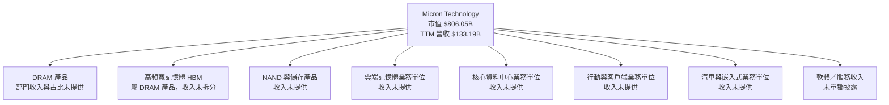

### 2.2 市場份額

市場份額數據未提供，因此不列市場占比或製作市場份額圖表。以公司財務規模觀察，MU TTM 營收為 $133.19B，最新一季營收年增 379.3%；同業資料中 SKHY 與 SNDK 最新一季收入年增分別為 327.9% 與 377.9%，顯示目前整體記憶體產業均處於快速上行階段，單看成長率不能直接判定份額變化。

### 2.3 競爭護城河分析

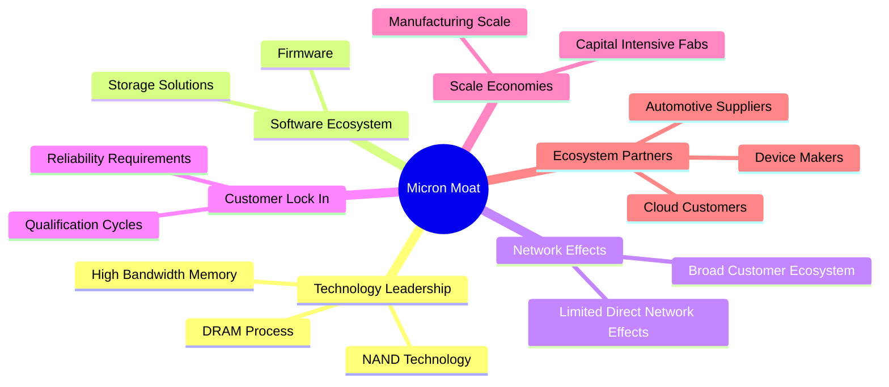

### 2.4 護城河強度

| 護城河項目 | 強度（強／中／弱） | 證據（引用數字或事實） | 會削弱它的情況 |
|------------|--------------------|------------------------|----------------|
| 技術與產品開發 | 強 | FY2026 R&D 支出 $5.65B；產品包括 DRAM、HBM 與 NAND。 | 技術迭代落後，或競爭對手在效能、良率與量產速度上超前。 |
| 資本與規模 | 強 | FY2026 Capex $30.71B；製造資產與資本投入門檻高。 | 供給過度擴張、產能利用率下降，造成資本回報迅速下滑。 |
| 客戶認證與可靠性 | 中 | 資料中心、車用與嵌入式產品須符合客戶規格與可靠度要求；具體認證週期未提供。 | 產品標準化使客戶更容易轉換供應商，或競爭者縮短認證差距。 |
| 軟體與服務生態 | 弱至中 | 財務資料未單列軟體或服務收入，無法證明其具有獨立且顯著的經常性收入。 | 產品差異化不足、客戶採購主要由價格決定。 |
| 網路效應 | 弱 | 記憶體晶片本身未呈現典型平台網路效應。 | 產業主要以供需、性能、成本與客戶認證競爭。 |
| 生態夥伴 | 中 | 客戶橫跨雲端、行動、汽車與嵌入式市場；各市場收入占比未提供。 | 客戶集中、產品驗證失利或供應中斷。 |

護城河評分引用 1.1 的 **8.0/10**：技術投入、製造規模與客戶認證具實際防禦力，但市場份額與部門營收資料不足，且記憶體價格具有周期性。

---

## 3. 損益表深度分析

### 3.1 年度收入成長趨勢（近 4 年）

FY2023–FY2026 營收分別為 $15.54B、$25.11B、$37.38B、$133.19B。FY2023 至 FY2026 三年 CAGR 約為 104.7%，計算為 \((133.19 ÷ 15.54)^{1/3} − 1\)。FY2026 的高成長主要反映記憶體需求與供應價格處於極強上行階段，不能直接視為可持續長期增速。

```text
╔══════════════════════════════════════════════════════════════════╗
║          Micron 年度收入趨勢（FY2023-FY2026，USD）              ║
╠══════════════════════════════════════════════════════════════════╣
║  FY2023  $15.54B  ███░░░░░░░░░░░░░░░░░░░░░  YoY：-49.5%  🔴   ║
║  FY2024  $25.11B  █████░░░░░░░░░░░░░░░░░░░  YoY：+61.6%  🟢   ║
║  FY2025  $37.38B  ███████░░░░░░░░░░░░░░░░░  YoY：+48.9%  🟢   ║
║  FY2026 $133.19B  ████████████████████████  YoY：+256.3% 🟢   ║
╠══════════════════════════════════════════════════════════════════╣
║  FY2023-FY2026 營收 CAGR：約 +104.7%                            ║
║  註：FY2026 TTM 增長率與全年營收年度口徑接近，但不可等同單季增幅。║
╚══════════════════════════════════════════════════════════════════╝
```

年度 YoY 計算：FY2024 為 \(25.11 ÷ 15.54 − 1 = 61.6\%\)；FY2025 為 \(37.38 ÷ 25.11 − 1 = 48.9\%\)；FY2026 為 \(133.19 ÷ 37.38 − 1 = 256.3\%\)。

### 3.2 季度收入趨勢分析

| 季度 | 營收 | QoQ 成長 | YoY 成長 | 備註 |
|------|------:|---------:|---------:|------|
| 2025-11-30 | $13.64B | — | 56.7% | 2025-11 季度作為序列起點，前一季營收未列於最近四季表。 |
| 2026-02-28 | $23.86B | 75.0% | 196.3% | 資料來源季度表顯示收入快速擴大。 |
| 2026-05-31 | $41.46B | 73.8% | 345.7% | 高成長延續，季度收入增量高。 |
| 2026-08-31 | $54.23B | 30.8% | 379.3% | QoQ 成長仍強，但增速低於前兩季；年度增幅反映低基期與強需求。 |

QoQ 公式為本季營收 ÷ 前季營收 − 1。例如最新一季：\(54.23 ÷ 41.46 − 1 = 30.8\%\)。最新季度 YoY 的 **379.3% 是單季年增率，不是 TTM 成長率**。

### 3.3 利潤率演變分析

| 利潤率指標 | FY2023 | FY2024 | FY2025 | FY2026 | 趨勢 | 評估 |
|------------|-------:|-------:|-------:|-------:|------|------|
| **毛利率** | -9.1% | 22.3% | 39.8% | 80.7% | 大幅回升 | 🟢 |
| **營業利益率** | -34.8% | 5.2% | 26.1% | 74.6% | 大幅回升 | 🟢 |
| **淨利率** | -37.5% | 3.1% | 22.8% | 63.8% | 大幅回升 | 🟢 |

上述年度比率依年度報表的營收、毛利、營業利益與淨利計算；FY2023 毛利數據與另一資料源的毛利欄位存在差異，因此使用年度損益表中列示的金額計算，並不將不同來源混合。TTM 利潤率以經核驗數據為準：毛利率 80.7%、營業利益率 74.6%、淨利率 63.8%。

利潤率走勢與產業周期高度相關：營收從 FY2025 的 $37.38B 擴大至 FY2026 的 $133.19B，固定成本被更大銷量攤薄；同時，高階產品組合與供需緊張可能提升售價與毛利。FY2026 TTM 營業利益率 74.6%、最新季度營業利益率 80.7%，屬非常高的周期水準；若價格回落，營業槓桿亦可能反向作用。

### 3.4 費用結構分析

FY2026 年度數據中，營收 $133.19B、毛利 $107.50B、R&D $5.65B、營業利益 $99.34B。由此可計算銷貨成本 $25.69B，以及 R&D 以外的其他營業費用約 $2.51B。這些分類只是年度財務數字的算術拆解，不代表公司只存在這些費用科目。

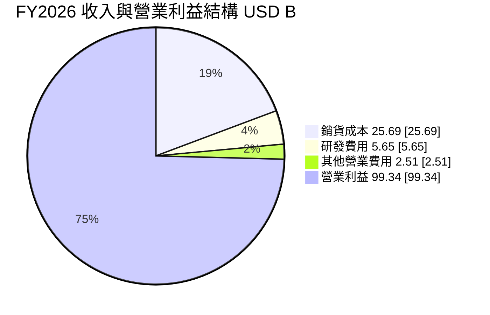

```text
╔══════════════════════════════════════════════════════════════════╗
║               FY2026 收入轉換為營業利益（USD B）                ║
╠══════════════════════════════════════════════════════════════════╣
║  營收             133.19  ██████████████████████████             ║
║  毛利             107.50  █████████████████████                   ║
║  營業利益          99.34  ███████████████████                     ║
║  其中 R&D           5.65  ██                                      ║
╚══════════════════════════════════════════════════════════════════╝
```

### 3.5 季度 EPS 趨勢與盈餘品質（Quality of Earnings）

| 季度 | EPS | YoY EPS 成長 | 超預期／不及預期 |
|------|----:|-------------:|------------------|
| 2025-11-30 | $4.60 | 175.45% | EPS 估計值與實際值為 NaN，無法判定。 |
| 2026-02-28 | $12.07 | 756.03% | EPS 估計值與實際值為 NaN，無法判定。 |
| 2026-05-31 | $24.67 | 1,368.45% | EPS 估計值與實際值為 NaN，無法判定。 |
| 2026-08-31 | $32.85 | 1,059.46% | EPS 估計值與實際值為 NaN，無法判定。 |

最近四季 EPS 持續上升，與營收由 $13.64B 增至 $54.23B、季度營業利益由 $6.14B 增至 $43.75B 一致。提供的 EPS surprise 欄位沒有有效估計值，故不將季度結果稱為超預期或不及預期。

| 盈餘品質項目 | 數值／佔比 | 評估 |
|--------------|-----------|------|
| 股權薪酬 SBC / 營收 | $1.33B ÷ $133.19B = **1.00%** | 🟢 佔營收比率不高，但仍是股東稀釋成本。 |
| SBC / 營業現金流 | $1.33B ÷ $89.67B = **1.48%** | 🟢 相對 OCF 不高。 |
| FCF / 淨利（現金轉換率） | $58.96B ÷ $84.97B = **69.4%** | 🟡 現金轉換為正，但高資本支出使 FCF 低於會計淨利。 |
| 一次性／非經常性損益 | 明細未提供 | 不足以判定非經常性項目是否影響 FY2026 盈利。 |
| 有效稅率異常 | **14.8%** | 作為模型採用的最新年度有效稅率；無資料證明是稅務利益造成的異常值。 |
| 資本化支出 vs 費用化 | FY2026 Capex $30.71B；R&D $5.65B | 支出資本化與費用化明細未提供，不能據此判斷是否遞延成本。 |

**盈餘品質結論：**FY2026 OCF $89.67B 高於淨利 $84.97B，且 F-Score 中「營業現金流大於淨利」通過，支持獲利具現金流支撐；但 FCF 僅為淨利的 69.4%，反映製造設備投資龐大。SBC 為營收的 1.00%，短期比例可控，但不可視為零成本。

---

## 4. 資產負債表分析

### 4.1 資產結構分解

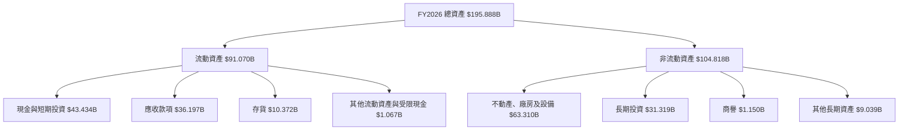

### 4.2 流動性與營運資金分析

| 指標 | 最新 TTM | 一年前 TTM | 變化 | 解讀 |
|------|----------|------------|------|------|
| DSO 應收帳款天數 | 87 天 | 70 天 | +17 天 | 回款週期變長；可能反映收入急速擴張與期末應收增加，需追蹤逾期及客戶組合。 |
| DIO 存貨天數 | 147 天 | 136 天 | +11 天 | 存貨天數上升；在擴產與需求快速變動期，須關注產品庫存是否與需求匹配。 |
| DPO 應付帳款天數 | 50 天 | 51 天 | -1 天 | 對供應商付款時間略縮短，單看這一項不能證明議價力改變。 |
| CCC 現金轉換週期 | 185 天 | 155 天 | +30 天 | DSO、DIO 上升主導 CCC 拉長，意味營運資金占用可能增加。 |

流動性方面，流動比率為 **3.314**、速動比率 **2.898**，流動資產 $91.07B 高於流動負債 $27.48B，短期償債緩衝充足。需留意，營運資金天數採期末餘額與 TTM 流量計算，成長速度與季節性可能影響單期比較。

### 4.3 債務結構分析

核心財務數據列示總債務 $3.28B、現金及短期投資 $43.43B、淨現金 $40.15B。其他財務摘要另列總債務 $5.18B、淨現金 $38.26B；此處依核驗財務數字採用前者，並將資料來源口徑差異列為需確認事項。

```text
╔══════════════════════════════════════════════════════════════════╗
║                    Micron 債務健康診斷                           ║
╠══════════════════════════════════════════════════════════════════╣
║  總債務：        $3.28B   ██░░░░░░░░░░░░░░░░░░░   🟢           ║
║  現金+短期投資： $43.43B  █████████████████████   🟢           ║
║  淨現金：        $40.15B  ████████████████████    🟢           ║
║                                                                  ║
║  Debt/EBITDA：   約 0.03x（$3.28B ÷ TTM EBITDA $109.28B）        ║
║  Interest Coverage：N/A（利息費用與可比 EBIT 分母未完整列示）    ║
║  流動比率：      3.314x                                           ║
╚══════════════════════════════════════════════════════════════════╝
```

Debt/EBITDA 依採用的核驗總債務計算為 \(3.28 ÷ 109.28 = 0.03x\)。債務負擔目前低，但高資本支出仍使公司需維持充裕的現金與融資彈性。

### 4.4 股東權益趨勢

| 財年 | 股東權益 |
|------|---------:|
| FY2023 | $44.12B |
| FY2024 | $45.13B |
| FY2025 | $54.16B |
| FY2026 | $138.38B |

```text
╔══════════════════════════════════════════════════════════════════╗
║              股東權益變化（年度 USD B）                          ║
╠══════════════════════════════════════════════════════════════════╣
║  FY2023  $44.12B  ████████░░░░░░░░░░░░░░░░                      ║
║  FY2024  $45.13B  ████████░░░░░░░░░░░░░░░░                      ║
║  FY2025  $54.16B  ██████████░░░░░░░░░░░░░░                      ║
║  FY2026 $138.38B  █████████████████████████                      ║
╚══════════════════════════════════════════════════════════════════╝
```

FY2026 權益快速上升，與年度淨利 $84.97B 大幅增加相符；但單年跳升屬周期高峰的財報結果，不應直接線性外推。

---

## 5. 現金流量深度分析

### 5.1 現金流量瀑布圖

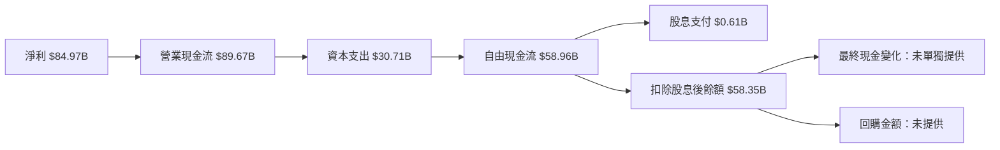

### 5.2 FCF 轉換率趨勢

| 財年 | FCF | 淨利 | FCF / 淨利 | 評估 |
|------|----:|----:|-----------:|------|
| FY2023 | -$6.12B | -$5.83B | 104.9% | 負 FCF 與虧損同時發生，比例不代表正向現金轉換。 |
| FY2024 | $0.121B | $0.778B | 15.6% | 低於淨利，復甦初期現金流尚弱。 |
| FY2025 | $1.67B | $8.54B | 19.6% | 盈利改善，但資本支出使 FCF 轉換仍有限。 |
| FY2026 | $58.96B | $84.97B | 69.4% | FCF 大幅擴張，仍有顯著設備投資需求。 |

### 5.3 自由現金流趨勢

| 財年 | OCF | Capex | FCF |
|------|----:|------:|----:|
| FY2023 | $1.56B | $7.68B | -$6.12B |
| FY2024 | $8.51B | $8.39B | $0.121B |
| FY2025 | $17.52B | $15.86B | $1.67B |
| FY2026 | $89.67B | $30.71B | $58.96B |

```text
╔══════════════════════════════════════════════════════════════════╗
║          自由現金流趨勢（FY2023-FY2026，USD B）                  ║
╠══════════════════════════════════════════════════════════════════╣
║  FY2023  -$6.12B  ◀██░░░░░░░░░░░░░░░░░░░░  FCF Yield：N/A      ║
║  FY2024   $0.12B   █░░░░░░░░░░░░░░░░░░░░░  FCF Yield：N/A      ║
║  FY2025   $1.67B   █░░░░░░░░░░░░░░░░░░░░░  FCF Yield：N/A      ║
║  FY2026  $58.96B   ████████████████████████  FCF Yield：7.32%   ║
╚══════════════════════════════════════════════════════════════════╝
```

FY2026 FCF Yield 7.32% 為核驗數據；未提供各歷史年度一致口徑的市值，故不推算歷史 FCF Yield。

### 5.4 資本配置評估

FY2026 Capex $30.71B、股息支付 $0.61B、R&D 費用 $5.65B、SBC $1.33B。回購金額未提供；近期新聞標題提及「$35B buyback」，但未有可核對的正式申報與執行金額，故不把它當成已實現回購。

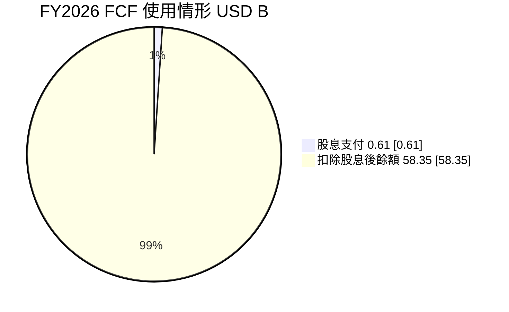

| 資本配置項目 | FY2026 數值 | 分析 |
|--------------|-----------:|------|
| 資本支出 | $30.71B | 對製造業是維持與擴充產能的重要投入；需以後續利用率與 ROIC 驗證回報。 |
| 股息 | $0.61B | 相較 $58.96B FCF 佔比低，現金流保留度高。 |
| R&D | $5.65B | 研發投資支持 DRAM、HBM 與 NAND 產品更新。 |
| 股票回購 | N/A | 缺乏可核對的 FY2026 回購金額，未將新聞標題當作實際支出。 |
| 留存及其他用途 | N/A | 除已知股息外的 FCF 用途未完整拆分。 |

---

## 6. 獲利能力與資本效率

### 6.1 ROE / ROA / ROIC 趨勢

| 指標 | FY2023 | FY2024 | FY2025 | 最新 TTM | 評估 |
|------|-------:|-------:|-------:|---------:|------|
| ROE | N/A | N/A | N/A | **61.4%** | 高回報，但主要受周期高峰淨利推動。 |
| ROA | N/A | N/A | N/A | **N/A**（核驗品質指標未列 TTM ROA 數值） | 不以其他資料源的 44.6% 替代核驗品質數字。 |
| ROIC | N/A | N/A | N/A | **86.2%** | 遠高於 WACC，反映當前資本回報很高。 |

其他財務摘要列出 ROE 88.3%、ROA 44.6%，但核驗品質數據的 DuPont ROE 為 61.4%。本報告以品質指標中指定的 ROE 數字為準，並將來源口徑差異視為數據限制。未提供足以一致計算各歷年 ROIC、ROE 與 ROA 的序列，故不補算歷史趨勢。

### 6.2 ROIC vs WACC 分析（核心價值創造判斷）

```text
╔══════════════════════════════════════════════════════════════════╗
║                ROIC vs WACC 深度分析                            ║
╠══════════════════════════════════════════════════════════════════╣
║  WACC：14.00%（成本資本資料；計算值 14.71%，採用上限 14.00%）    ║
║  ROIC：86.2%（TTM，稅後營業利益 ÷ 投入資本）                     ║
║  EVA 差額 = ROIC − WACC = 86.2% − 14.0% = +72.2 個百分點        ║
║                                                                  ║
║  ROIC  86.2%  ▓▓▓▓▓▓▓▓▓▓▓▓▓▓▓▓▓▓▓▓▓▓▓▓▓▓▓▓▓▓▓▓▓▓▓▓▓▓▓▓▓▓     ║
║  WACC  14.0%  ▓▓▓▓▓▓▓░░░░░░░░░░░░░░░░░░░░░░░░░░░░░░░░░░░     ║
║                                                                  ║
║  ★ 結論：ROIC 約為 WACC 的 6.2 倍，當前顯著創造股東價值。      ║
║  ⚠️ ROIC 可能處於周期高點，不能把 86.2% 直接外推為長期回報。   ║
╚══════════════════════════════════════════════════════════════════╝
```

ROIC / WACC \(=86.2\% ÷ 14.0\% = 6.16\)，四捨五入為 6.2 倍。核驗的 ROIC 已採用指定定義；未提供完全一致的投入資本與稅後營業利益明細，因此不另以其他報表數字重算。第 8.2 節將說明 WACC 原始計算值為 14.71%，因指定區間上限為 14%，DCF 與本節一致採用 14.00%。

### 6.3 杜邦三因素分解

| 因素 | 數值（TTM） | 解讀 |
|------|-------------|------|
| 淨利率 | 63.8% | 受記憶體高景氣與高毛利期間推動。 |
| 資產週轉率 | 0.68 | 營收相對資產的周轉效率。 |
| 權益乘數 | 1.42 | 財務槓桿不是 ROE 的主要來源。 |
| **ROE** | **61.4%** | \(63.8\% × 0.68 × 1.42 = 61.6\%\)，與資料所列 61.4% 有四捨五入／口徑尾差；本報告照抄核驗的 ROE 61.4%。 |

ROE 的主要驅動來自 63.8% 的高淨利率與 0.68 的資產周轉率，不是高財務槓桿；權益乘數 1.42 相對溫和。

### 6.4 財務體質：Piotroski F-Score

Piotroski F-Score 為 **8 / 9**。下表逐項照列；股數測試未通過表示稀釋股數有所增加，可能降低每股盈餘與每股內在價值。

| 測試 | 結果 | 解讀 |
|------|------|------|
| ROA > 0 | ✅ 通過 | 公司處於獲利狀態。 |
| 營業現金流 > 0 | ✅ 通過 | TTM OCF 為正且達 $89.67B。 |
| ROA 高於一年前 | ✅ 通過 | 資產獲利能力較去年改善。 |
| 營業現金流 > 淨利（應計品質） | ✅ 通過 | OCF $89.67B 高於淨利 $84.97B。 |
| 長期負債 ÷ 總資產低於一年前 | ✅ 通過 | 長期負債比率方向改善。 |
| 流動比率高於一年前 | ✅ 通過 | 流動性相對去年改善。 |
| 稀釋股數未增加 | ❌ 未通過 | 股數增加可能稀釋每股價值；SBC 仍是股東成本。 |
| 毛利率高於一年前 | ✅ 通過 | 高景氣與價格／組合改善推升毛利率。 |
| 資產週轉率高於一年前 | ✅ 通過 | 營收加速使資產周轉效率改善。 |

---

## 7. 相對估值分析

### 7.1 同業估值比較表格

Peer multiples 為 Yahoo Finance 數據；SKHY 的 P/S 與 EV/EBITDA 因幣別混合而不可比較。比較中位數只用有效數值，不以外部記憶數字補充。

| 估值指標 | **MU** | **SKHY** | **SNDK** | **WDC** | MU 評估 |
|----------|------:|------:|------:|------:|-----------|
| **Trailing P/E** | 9.6x | 7.8x | 6.4x | 10.0x | 🟡 位於三者區間中段，貼近中位數 7.8x。 |
| **Forward P/E** | 3.43x | 3.0x | 2.8x | 7.0x | 🟡 接近同業中位數 3.0x；預測倍數極低反映市場預期盈利大幅上升。 |
| **P/S** | 6.1x | N/A | 3.9x | 7.3x | 🟡 高於可比較同業中位數 5.6x。 |
| **EV/EBITDA** | 7.05x | N/A | 5.1x | 16.7x | 🟢 低於可比較同業中位數 10.9x。 |
| **最新一季營收 YoY** | 379.3% | 327.9% | 377.9% | 55.5% | 🟢 高於三家同業中位數 327.9%。 |
| **毛利率 TTM** | 80.7% | 77.4% | 80.0% | 52.6% | 🟢 高於三家同業中位數 77.4%。 |

### 7.2 歷史估值區間分析

| 倍數 | 當前 | 五年中位數 | 五年區間 | 當前百分位 |
|------|-----:|-----------:|---------:|-----------:|
| P/E | 9.6x | 17.4x | 7.4x–138.5x | 13% |
| P/S | 6.1x | 4.2x | 2.1x–11.7x | 75% |
| EV/EBITDA | 7.1x | 9.7x | 3.6x–80.7x | 35% |

```text
╔══════════════════════════════════════════════════════════════════╗
║                MU 五年估值位置（TTM 倍數）                       ║
╠══════════════════════════════════════════════════════════════════╣
║  P/E       7.4x ├─● 9.6x ───────── 中位數 17.4x ───┤ 138.5x    ║
║  當前百分位 13%：處於自身歷史區間偏低位置                         ║
║                                                                  ║
║  P/S       2.1x ├──── 中位數 4.2x ───● 6.1x ───────┤ 11.7x      ║
║  當前百分位 75%：相較自身歷史偏高                                 ║
║                                                                  ║
║  EV/EBITDA 3.6x ├──── 中位數 9.7x ─● 7.1x──────────┤ 80.7x      ║
║  當前百分位 35%：低於自身歷史中位數                               ║
╚══════════════════════════════════════════════════════════════════╝
```

P/E 與 EV/EBITDA 顯示當前倍數低於自身中位數；P/S 卻高於中位數。這種分歧常見於周期盈利快速上升期：盈利指標會因利潤分母擴大而顯得便宜，銷售倍數則仍反映市場對高收入規模的定價。

### 7.3 情境價值（Bear / Base / Bull）

以下情境值與假設照抄 DCF MODEL。由於情境模型沒有提供逐年情境收入、FCFF 與終值拆解，本表不另行反推情境中間數字。

| 情境 | 第 1 年營收成長 | 期末營業利潤率 | WACC | 每股價值 | 相對現價 | 機率 | 會發生的條件 |
|------|----------------:|----------------:|-----:|----------:|---------:|-----:|--------------|
| 🔴 悲觀 | 15.0% | 22.2% | 15.00% | $429.05 | -39.8% | 25% | AI 記憶體需求放緩、供給增加使定價下行，利潤率向較低水準回歸。 |
| 🟡 基準 | 30.0% | 26.1% | 14.00% | $881.83 | +23.8% | 50% | 高階需求延續一段時間，之後收入與利潤率逐步回歸模型設定。 |
| 🟢 樂觀 | 45.0% | 28.8% | 13.00% | $1,715.71 | +140.8% | 25% | AI／資料中心需求超預期，供給紀律與產品組合持續支持較高利潤率。 |

### 7.4 相對估值隱含價格區間

```text
╔══════════════════════════════════════════════════════════════════╗
║         VALUATION METHODS 每股價值與現價（USD）                  ║
╠══════════════════════════════════════════════════════════════════╣
║  同業 P/S         $661.51 ─── 現價 $712.42 ───                  ║
║  DCF 基準         $712.42 ─────── $881.83                       ║
║  同業 EV/EBITDA   $712.42 ─────────── $1,086.57                 ║
║  分析師共識       $712.42 ─────────────────── $1,561.91         ║
╚══════════════════════════════════════════════════════════════════╝
```

| 方法 | 每股價值 | 依據 |
|------|---------:|------|
| DCF（基準） | $881.83 | 十年 FCFF、WACC 14.00%、永續成長 3.0%。 |
| 同業 EV/EBITDA | $1,086.57 | SNDK、WDC 中位數 EV/EBITDA 10.9x × TTM EBITDA，並加回淨現金。 |
| 同業 P/S | $661.51 | SNDK、WDC 中位數 P/S 5.6x × TTM 營收。 |
| 分析師共識目標價 | $1,561.91 | 45 位分析師平均目標價；僅為參考。 |

---

## 8. DCF 內在價值評估（Discounted Cash Flow）

> 本節逐年假設與模型結果採用程式計算的 DCF MODEL。報告展示模型輸入、現金流、橋接與敏感度，以便核對；不自行修改模型結果或替代模型參數。

### 8.0 估值推理鏈（Thinking Logic）

**Step 1 — 價值由哪些變數決定？**  
Micron 的價值主要由既有 DRAM／NAND 業務現金流，以及資料中心與 HBM 相關需求所帶來的增量營收與組合改善決定；但財務資料未提供各業務收入占比，不能將第二成長曲線拆成具體營收比例。模型最主導的變數是**營收成長與營業利潤率**：兩者直接決定 EBIT、NOPAT、FCFF，並透過終值放大到股權價值。

**Step 2 — 模型選擇**

| 決策點 | 本報告採用 | 理由（含數字） | 曾考慮但否決 | 否決理由 |
|--------|-----------|----------------|--------------|----------|
| 現金流定義 | FCFF | 與 WACC 配對，模型明確使用 FCFF = NOPAT + D&A − Capex。 | FCFE | 公司具債務且股權與債務資本結構有變動可能，FCFF 對資本結構較中性。 |
| 預測期 N | 10 年 | DCF MODEL 預測期為 10 年；記憶體景氣須經歷成長、競爭與利潤正常化。 | 5 年 | 可能無法完整反映模型設定的長期利潤率收斂。 |
| 終值方法 | Gordon Growth | WACC 14.00% 高於永續成長率 3.0%，公式有效。 | 僅退出倍數 | 無法用單一退出倍數代替模型指定的永續現金流方法。 |
| EBIT 基礎 | GAAP EBIT | 模型假設明確指定 GAAP EBIT。 | 非 GAAP EBIT | 可能將 SBC 加回後造成股東成本遺漏或重複計算。 |

**Step 3 — 關鍵假設推導鏈**

- **營收成長路徑**：錨點＝TTM 營收 $133.19B、TTM 成長 256.3%、最新季度單季年增 379.3% → 調整＝高基期與記憶體周期不允許把極端增速外推，模型將第一年成長限制為 30.0%，逐年線性降至第十年 3.0% → **採用模型所列逐年路徑** → 曾考慮把 256.3% 直接外推，因其與高基期及周期常態化不相容而否決。
- **期末營業利潤率**：錨點＝TTM 營業利益率 74.6%、模型採用的近五年中位數 26.1% → 調整＝景氣正常化與競爭使利潤率逐步收斂 → **FY+1 74.6%，FY+10 26.1%** → 曾考慮維持 74.6% 十年，因這會把周期峰值當永久利潤率而否決。
- **永續成長率 g**：錨點＝模型採用 3.0%，符合成熟企業長期名目成長假設範圍，且低於 WACC 14.00% → 調整＝成熟期不宜長期高於經濟趨勢 → **採用 3.0%** → 曾考慮高於 3.0%，因會增加終值依賴並接近折現率而否決。
- **預測期 N**：錨點＝模型指定 10 年 → 調整＝記憶體產業需用完整周期覆蓋盈利下行與回升，但 10 年仍不是可精確預測的期間 → **採用 10 年** → 曾考慮較短期限，因模型的逐年利潤率正常化設定將被截斷。
- **Capex／營收**：錨點＝TTM Capex $30.71B ÷ TTM 營收 $133.19B = 23.1% → 調整＝隨收入與擴產需求成熟而下降，模型從第一年 23.1% 緩降至第十年 7.8% → **採用模型列示路徑** → 曾考慮長期維持 23.1%，因模型設定公司成熟後投資強度降低。
- **EBIT 基礎與 SBC**：錨點＝FY2026 SBC $1.33B；模型採 GAAP EBIT → 調整＝GAAP EBIT 已包含 SBC 費用，不應在 FCFF 重複扣除 → **採組合 (A)，年稀釋率 0%** → 否決另減 SBC 或另外加股數稀釋，避免同一成本重複計入。
- **WACC**：錨點＝成本資本資料的計算值 14.71%，但該區塊明確規定限於 7%–14% → **採用 14.00%** → 否決使用 14.71%，因指定模型要求採用限制後的 14.00%。
- **折舊與有效稅率**：模型錨點分別為 TTM D&A／營收 7.1%、有效稅率 14.8% → 採用 7.1% 與 14.8%。營運資金變化在模型中未建模，故不另估數值。

**Step 4 — 最脆弱的一環**  
最脆弱的是高起始營業利潤率與收入成長能否維持；若記憶體定價轉弱，基準 DCF 可能向悲觀情境 **$429.05** 靠近，而不是停留在 $881.83。

**Step 5 — 計算路徑圖**

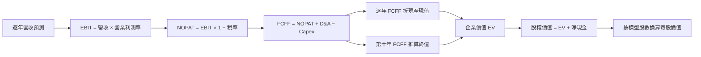

### 8.1 模型假設總表（Model Inputs）

| 假設項目 | 採用值 | 依據／來源 | 敏感度 |
|----------|--------|-------------|--------|
| 預測期長度 N | **10 年** | DCF MODEL 指定預測期；涵蓋逐步正常化。 | 🟡 中 |
| 營收成長 | FY+1 30.0%，線性降至 FY+10 3.0% | TTM 成長 256.3%，模型將其限制於 0%–30%。 | 🔴 高 |
| 營業利潤率 | FY+1 74.6% → FY+10 26.1% | 起點為 TTM 74.6%；終點為模型採用近五年中位數。 | 🔴 高 |
| 有效稅率 | 14.8% | 最新年度有效稅率。 | 🟢 低 |
| Capex / 營收 | FY+1 23.1% → FY+10 7.8% | TTM 起點 23.1%，逐步下降；末期約為 D&A 的 1.1 倍。 | 🟡 中 |
| D&A / 營收 | 7.1% | TTM 比率，模型持平。 | 🟢 低 |
| 營運資金變動 | 未建模 | DCF MODEL 明確排除工作資金變動；不假設為某一比例。 | 🟢 低 |
| EBIT 基礎 | GAAP EBIT | 模型指定 GAAP。 | 🟡 中 |
| SBC 處理 | GAAP EBIT 已含 SBC；FCFF 不再扣 SBC | 模型組合 A。 | 🟡 中 |
| 年稀釋率 | 0% | 與 GAAP EBIT + 固定股數的組合 A 相容。 | 🟡 中 |
| 永續成長率 g | 3.0% | DCF MODEL 指定；低於 WACC。 | 🔴 高 |
| 終值方法 | Gordon Growth 為主 | DCF MODEL 指定。 | 🔴 高 |
| WACC | 14.00% | 成本資本區塊的 14.71% 計算值受限於 7%–14% 區間，採上限 14.00%。 | 🔴 高 |

本模型採用 **(A) GAAP EBIT + 固定股數**，因此 SBC 影響已計入一次：FCFF 不另扣 SBC，年稀釋率為 0%。FCFF 口徑為 **FCFF = NOPAT + D&A − Capex**；營運資金未建模。

### 8.2 折現率推導（WACC）

```text
╔══════════════════════════════════════════════════════════════════╗
║                    WACC 推導（折現率）                           ║
╠══════════════════════════════════════════════════════════════════╣
║  股權成本 Ke（CAPM）：                                           ║
║  ├── 無風險利率 Rf（10Y 美債）：       5.10%                     ║
║  ├── 市場風險溢酬 ERP：                5.00%                     ║
║  ├── 原始 Beta：                       2.40                      ║
║  ├── 調整後 Beta：                     1.93                      ║
║  ├── Beta 調整：2/3 × 2.40 + 1/3 = 1.93                         ║
║  ├── Ke = 5.10% + 1.93 × 5.00% = 14.75%（資料列 14.76%）       ║
║  ├── 成本資本資料採用 Ke：             14.76%                    ║
║  ├── 額外規模／國別溢酬：              0.00%                     ║
║                                                                  ║
║  債務成本 Kd：                                                   ║
║  ├── 稅前 Kd（資料列）：               3.23%                     ║
║  ├── 有效稅率：                        14.8%                     ║
║  └── 稅後 Kd = 3.23% × (1 − 14.8%) = 2.75%                      ║
║                                                                  ║
║  資本結構（成本資本資料列示）：                                  ║
║  ├── 股權權重 E：                      99.6%                     ║
║  ├── 債務權重 D：                       0.4%                     ║
║  ├── 原始計算 WACC：                  14.71%                    ║
║  └── 採用 WACC：                      14.00%（限制區間上限）     ║
╚══════════════════════════════════════════════════════════════════╝
```

Rf、ERP、Beta 與資本權重依成本資本資料採用；Rf 的精確觀測日期未提供，故不補寫日期。Beta 使用調整後 **1.93**，其原始值 2.40，調整公式為 \(⅔×2.40+⅓=1.93\)。未提供規模或國別額外溢酬，模型不另加。

五步演算如下：

1. **Ke（CAPM）**  
   \(5.10\% + 1.93 × 5.00\% = 5.10\% + 9.65\% = 14.75\%\)。  
   成本資本資料列示 **14.76%**；此處保留資料指定值，不以四捨五入後的中間值替代。

2. **稅前 Kd**  
   採成本資本資料列示的 **3.23%**。利息費用及平均計息負債明細未完整提供，不能另用總負債反推。

3. **稅後 Kd**  
   \(3.23\% × (1−14.8\%) = 3.23\% × 85.2\% = 2.75196\% ≈ 2.75\%\)。

4. **權重**  
   成本資本資料列示 E/D = 99.6% / 0.4%；兩者合計 \(99.6\%+0.4\%=100.0\%\)。  
   以市場市值 $806.05B 及核驗總債務 $3.28B 粗略檢查，股權權重約 \(806.05 ÷ (806.05+3.28)=99.59\%\)，與列示權重相符；此處以程式提供的 99.6%／0.4% 為準。

5. **WACC**  
   \(99.6\%×14.76\% + 0.4\%×2.75\% = 14.70096\% + 0.01100\% = 14.71196\% ≈ 14.71\%\)。  
   依成本資本資料規定的 7%–14% 限制，**採用 WACC = 14.00%**。第 6.2 與 DCF 均使用同一數值。

### 8.3 逐年自由現金流預測（基準情境）

單位：USD B；金額取至小數二位、比率取一位、折現因子取三位。模型各年度現金流與折現值照列。

| 年度 | FY+1 | FY+2 | FY+3 | FY+4 | FY+5 | FY+6 | FY+7 | FY+8 | FY+9 | FY+10 |
|------|-----:|-----:|-----:|-----:|-----:|-----:|-----:|-----:|-----:|------:|
| 營收 | 173.14 | 219.89 | 272.67 | 329.93 | 389.32 | 447.71 | 501.44 | 546.57 | 579.36 | 596.74 |
| 營收 YoY | 30.0% | 27.0% | 24.0% | 21.0% | 18.0% | 15.0% | 12.0% | 9.0% | 6.0% | 3.0% |
| 營業利潤率 | 74.6% | 69.2% | 63.8% | 58.4% | 53.1% | 47.7% | 42.3% | 36.9% | 31.5% | 26.1% |
| 營業利益 EBIT（GAAP） | 129.14 | 152.17 | 174.02 | 192.80 | 206.55 | 213.43 | 212.05 | 201.71 | 182.62 | 155.98 |
| − 稅 | (19.13) | (22.54) | (25.77) | (28.55) | (30.59) | (31.61) | (31.40) | (29.87) | (27.05) | (23.10) |
| = NOPAT | 110.02 | 129.64 | 148.25 | 164.25 | 175.96 | 181.82 | 180.64 | 171.84 | 155.58 | 132.88 |
| + D&A | 12.35 | 15.69 | 19.45 | 23.54 | 27.78 | 31.94 | 35.78 | 39.00 | 41.34 | 42.58 |
| − Capex | (39.93) | (46.99) | (53.66) | (59.35) | (63.45) | (65.41) | (64.78) | (61.37) | (55.26) | (46.84) |
| = FCFF | **82.44** | **98.34** | **114.04** | **128.44** | **140.28** | **148.36** | **151.64** | **149.46** | **141.65** | **128.62** |
| 折現因子 @14.00% | 0.877 | 0.769 | 0.675 | 0.592 | 0.519 | 0.456 | 0.400 | 0.351 | 0.308 | 0.270 |
| FCFF 現值 PV | **72.32** | **75.67** | **76.98** | **76.04** | **72.86** | **67.59** | **60.60** | **52.40** | **43.56** | **34.69** |

預測期現值加總：  
**$72.32 + $75.67 + $76.98 + $76.04 + $72.86 + $67.59 + $60.60 + $52.40 + $43.56 + $34.69 = $632.71B**。

**FY+1 逐步演算**

1. **營收** = 上年 TTM 營收 $133.19B × (1 + 30.0%) = **$173.15B**；模型列示 $173.14B，差異為中間值精度。
2. **EBIT** = $173.14B × 74.6% = **$129.14B**。
3. **稅** = $129.14B × 14.8% = **$19.11B**；模型列示 $19.13B，因表內 EBIT 與稅額採未四捨五入底數。
4. **NOPAT** = 模型列示 **$110.02B**。
5. **D&A** = $173.14B × 7.1% = **$12.29B**；模型以未四捨五入比率列示 $12.35B。
6. **Capex** = 模型列示 **$39.93B**；對應第一年 Capex／營收約 23.1%。
7. **ΔWC** = 不納入模型，沒有數值。
8. **FCFF** = $110.02B + $12.35B − $39.93B = **$82.44B**。
9. **折現與 PV** = \(1 ÷ (1+14.00\%)^1=0.877\)；$82.44B × 0.877 ≈ **$72.32B**。

模型底層使用未四捨五入的輸入值，表格只呈現兩位小數，故逐項直接用顯示值計算可能出現小額尾差；以模型提供的年度數字與合計為準。

**合理性自檢**

- 預測 FCFF 從 FY+1 $82.44B 增至 FY+10 $128.62B，九年間 CAGR 約 **5.1%**；FY2023–FY2026 歷史 FCF 由負值轉為 $58.96B，跨越零點，不適合用一般 CAGR 比較。預測成長主要來自營收增加，並被利潤率與 Capex 率正常化抵銷。
- FY+10 FCF 利潤率 = \(128.62 ÷ 596.74 = 21.6\%\)；目前 TTM FCF 利潤率 = \(58.96 ÷ 133.19 = 44.3\%\)。模型假設利潤率下降，並未把目前周期峰值永久化。
- 模型各年度 FCFF 均為正；沒有負 FCFF 年度。

```text
╔══════════════════════════════════════════════════════════════════╗
║            自由現金流：歷史實際 vs 模型預測                      ║
╠══════════════════════════════════════════════════════════════════╣
║  FY2024(實)  $0.12B  █░░░░░░░░░░░░░░░░░░░░░░                  ║
║  FY2025(實)  $1.67B  █░░░░░░░░░░░░░░░░░░░░░░                  ║
║  FY2026(實) $58.96B  ████████████░░░░░░░░░░░░  FCF Yield 7.32% ║
║  FY+1 (預)  $82.44B  █████████████████░░░░░░░  PV $72.32B      ║
║  FY+10(預) $128.62B  ████████████████████████  PV $34.69B      ║
╠══════════════════════════════════════════════════════════════════╣
║  預測由高景氣現金流起點出發，收入增長與利潤率正常化並存。       ║
╚══════════════════════════════════════════════════════════════════╝
```

### 8.4 終值計算（Terminal Value）

適用性檢查：**WACC 14.00% vs g 3.0% → WACC > g？✅**

| 方法 | 計算式 | 終值 TV | TV 現值 | 佔總 EV 比重 |
|------|--------|--------:|--------:|-------------:|
| Gordon Growth | $128.62B × (1+3.0%) ÷ (14.00%−3.0%) | $1,204.36B | $324.87B | 33.9% |
| 退出倍數法 | N/A | N/A | N/A | N/A |

DCF MODEL 沒有提供退出倍數終值與對應倍數，本報告不另建退出倍數模型。終值現值占 EV 的 33.9%，低於 75% 警示門檻，但仍是企業價值的重要來源。

**逐步演算**

1. FY+10 FCFF = **$128.62B**。
2. 分子 = $128.62B × (1+3.0%) = **$132.4786B**。
3. 分母 = 14.00% − 3.0% = **11.00%**；TV = $132.4786B ÷ 11.00% = **$1,204.36B**。
4. PV(TV) = $1,204.36B × 0.270 = **$324.87B**（依模型未四捨五入折現因子計算）。
5. 終值佔比 = $324.87B ÷ $957.57B = **33.9%**。

### 8.5 企業價值 → 每股內在價值（Bridge）

```text
╔══════════════════════════════════════════════════════════════════╗
║              企業價值 → 每股內在價值 橋接表                      ║
╠══════════════════════════════════════════════════════════════════╣
║  預測期 FCF 現值合計            +$632.71B                        ║
║  終值現值 PV(TV)                +$324.87B                        ║
║  ─────────────────────────────────────────────                  ║
║  = 企業價值 EV                   $957.57B                        ║
║  + 現金及短期投資               +$43.43B                         ║
║  − 總債務                       −$3.28B                          ║
║  ─────────────────────────────────────────────                  ║
║  = 股權價值                      $997.73B                        ║
║  每股模型換算                    $997.73B × $712.42 ÷ $806.05B  ║
║  ★ 每股內在價值                  $881.83                         ║
║    當前股價                      $712.42                         ║
║    折溢價                        -19.2%（折價）                  ║
╚══════════════════════════════════════════════════════════════════╝
```

逐步演算：

1. **EV** = $632.71B + $324.87B = **$957.58B**；模型列示 EV **$957.57B**，差異約 $0.01B，源於展示值四捨五入，照抄模型 EV。
2. **股權價值** = $957.57B + $43.43B − $3.28B = **$997.72B**；模型列示 $997.73B，為模型未四捨五入輸入造成的 $0.01B 尾差。
3. **每股價值** = 模型公式「股權價值 × 現價 ÷ 市值」= $997.73B × $712.42 ÷ $806.05B = **$881.83**。
4. **折溢價** = $712.42 ÷ $881.83 − 1 = **−19.2%**，亦即現價相對 DCF 基準價折價。
5. **本節不計算 MOS**；MOS 一律以 8.8 的加權合理價值為分母。

模型股數按市場市值與股價隱含約 1.131B 股（$806.05B ÷ $712.42），與市場資料列示流通股約 1.13B 股相符。現金及短期投資 $43.43B、債務 $3.28B 依核驗財務數據；模型直接使用淨現金 $40.15B。橋接各項有約 $0.01B 的展示精度差異，不影響每股價值的模型輸出。

### 8.6 敏感性分析（WACC × 永續成長率）

下表每股價值照列模型輸出，括號內上行空間以現價 $712.42 計算並四捨五入。

| g（列）／WACC（欄） | 12.00% | 13.00% | **14.00%（基準）** | 15.00% | 16.00% |
|-----------|-------:|-------:|-------------------:|-------:|-------:|
| 2.0% | $1,019.58 (+43.1%) | $930.16 (+30.6%) | $855.35 (+20.1%) | $791.82 (+11.1%) | $737.17 (+3.5%) |
| 2.5% | $1,041.16 (+46.2%) | $946.54 (+32.9%) | $868.01 (+21.8%) | $801.76 (+12.5%) | $745.08 (+4.6%) |
| **3.0%（基準）** | $1,065.13 (+49.5%) | $964.56 (+35.4%) | **$881.83 (+23.8%)** | $812.53 (+14.1%) | $753.60 (+5.8%) |
| 3.5% | $1,091.92 (+53.3%) | $984.47 (+38.2%) | $896.97 (+25.9%) | $824.24 (+15.7%) | $762.80 (+7.1%) |
| 4.0% | $1,122.07 (+57.5%) | $1,006.60 (+41.3%) | $913.61 (+28.2%) | $837.01 (+17.5%) | $772.76 (+8.5%) |

**非基準格演算示範：WACC = 15.00% > g = 3.0% ✅**

- 新 WACC 下預測期 PV 合計：依年度 FCFF 折現後約 **$606.25B**。
- TV = $128.62B × (1+3.0%) ÷ (15.00%−3.0%) = 約 **$1,103.99B**；折現 10 期後 PV(TV) 約 **$272.86B**。
- EV 約 $606.25B + $272.86B = **$879.11B**；加淨現金 $40.15B 得股權價值約 $919.26B；除以模型隱含約 1.1314B 股，約 **$812.53／股**，與矩陣 15.00%／3.0% 格相符。金額使用展示值，存在四捨五入差異。

**三情境 DCF（模型輸出）**

| 情境 | 第一年營收成長 | 期末營業利潤率 | g | WACC | 每股價值 | 相對現價 | 機率 |
|------|----------------:|----------------:|--:|-----:|---------:|---------:|-----:|
| 🔴 悲觀 | 15.0% | 22.2% | 模型未另列 | 15.00% | $429.05 | -39.8% | 25% |
| 🟡 基準 | 30.0% | 26.1% | 3.0% | 14.00% | $881.83 | +23.8% | 50% |
| 🟢 樂觀 | 45.0% | 28.8% | 模型未另列 | 13.00% | $1,715.71 | +140.8% | 25% |
| **機率加權** | — | — | — | — | **$977.10** | **+37.2%** | **100%** |

模型未提供悲觀與樂觀情境的獨立永續成長率、逐年收入、FY+10 FCFF 與終值拆解；依規則不自行補建情境現金流。模型報告的概率加權值檢核為：  
\($429.05 × 25\%) + ($881.83 × 50\%) + ($1,715.71 × 25\%) = $107.2625 + $440.915 + $428.9275 = **$977.105 ≈ $977.10**\)。  
權重合計 \(25\%+50\%+25\%=100\%\)。

**敏感度結論**

- 永續成長率 g 每上升 1 個百分點（3.0% 至 4.0%，WACC 14%）：$913.61 − $881.83 = **+$31.78／+3.6%**。
- WACC 每上升 1 個百分點（14% 至 15%，g 3.0%）：$812.53 − $881.83 = **−$69.30／−7.9%**。
- 期末營業利潤率每 +1pp 的獨立每股敏感度：**模型未提供**，不可由三情境同時變動的結果拆解。
- 就已提供的矩陣看，WACC 變化的估值影響大於 g 的 1pp 變化；但 8.0 Step 1 所指的主導營運變數是收入與利潤率。這兩者分屬不同層面：矩陣只測估值折現參數，未能取代營運假設敏感度。

### 8.7 反推 DCF（Reverse DCF：市場在預期什麼）

反推結果照列模型提供的單變數求解；其他變數固定為基準模型輸入。模型只提供兩個反推結果，其他變數標示未計算。

| 求解的變數（一次一個） | 其餘變數設定 | 市場隱含值 | 公司歷史實際／基準 | 判斷 |
|------------------------|--------------|------------:|------------------|------|
| 第一年營收成長 | 利潤率、WACC、稅率、Capex、g、N 固定基準 | **23.1%** | DCF 基準第一年 30.0%；TTM 成長 256.3% | 🟡 市場隱含低於模型第一年基準，但仍代表正成長。 |
| 固定營業利潤率 | 其他變數固定為基準 | **32.6%** | 基準路徑 74.6% → 26.1% | 🟡 位於基準期末利潤率之上，但低於現行周期峰值。 |
| 永續成長率 g | 未計算 | 未計算 | 基準 3.0% | N/A（模型未提供）。 |
| 預測期長度 N | 未計算 | 未計算 | 基準 10 年 | N/A（模型未提供）。 |

市場價格可由營收成長 23.1% 或固定營業利潤率 32.6% 單一變數解釋，但不能據此推斷市場同時要求兩項都發生。反推模型的試算軌跡未提供，故不捏造不同 CAGR 的中間價值或誤差；結果應視為模型求解輸出，而非可獨立重現的試算表。

### 8.8 估值三角驗證與安全邊際

| 估值方法 | 隱含每股價值 | 上行空間（÷現價） | 權重 | 說明 |
|----------|--------------:|-------------------:|------:|------|
| DCF（基準） | $881.83 | +23.8% | 40% | 十年 FCFF、WACC 14.00%、永續成長 3.0%。 |
| 同業 EV/EBITDA | $1,086.57 | +52.5% | 30% | SNDK、WDC 同業中位數 10.9x × TTM EBITDA，加回淨現金。 |
| 同業 P/S | $661.51 | -7.1% | 20% | SNDK、WDC 同業中位數 5.6x × TTM 營收。 |
| 分析師共識目標價 | $1,561.91 | +119.2% | 10% | 45 位分析師平均目標價，參考性較高，不作為主要估值錨。 |
| **加權合理價值** | **$967.20** | **+35.8%** | **100%** | 依周期股固定權重計算。 |

**加權價值計算：**  
\($881.83×40\%) + ($1,086.57×30\%) + ($661.51×20\%) + ($1,561.91×10\%)\)  
\(= $352.732 + $325.971 + $132.302 + $156.191 = $967.196 ≈ \mathbf{$967.20}\)。  
公司類型為周期股，採固定權重；未提供可計算的其他方法，故不增加或替換估值方法。

**MOS 與上行空間計算**

- MOS = \((加權合理價值−現價) ÷ 加權合理價值\)  
  \(= ($967.20−$712.42) ÷ $967.20 = $254.78 ÷ $967.20 = \mathbf{26.3\%}\)。
- 上行空間 = \((加權合理價值−現價) ÷ 現價\)  
  \(= $254.78 ÷ $712.42 = \mathbf{35.8\%}\)。

```text
╔══════════════════════════════════════════════════════════════════╗
║                  估值區間與安全邊際                              ║
╠══════════════════════════════════════════════════════════════════╣
║  $429.05 ─── $712.42 ─── [$967.20] ─── $1,086.57 ── $1,715.71 ║
║  悲觀DCF       現價       加權合理值       EV/EBITDA    樂觀DCF  ║
║                                                                  ║
║  安全邊際 MOS = ($967.20 − $712.42) ÷ $967.20 = 26.3%          ║
║  MOS 評估：🟢 >25% 充足 ｜ 🟡 10–25% 有限 ｜ 🔴 <10% 無        ║
║  上行空間 = ($967.20 − $712.42) ÷ $712.42 = 35.8%              ║
║                                                                  ║
║  建議買入區間：$712.42 – $870.48                                 ║
║  合理持有區間：$870.48 – $1,086.57                               ║
║  減碼考慮區間：高於 $1,715.71，並重新評估基本面與估值           ║
╚══════════════════════════════════════════════════════════════════╝
```

買入上限 $870.48 依 MOS 10% 門檻推導：$967.20 × (1−10%) = $870.48；現價低於該上限，且買入區間上限高於現價。合理持有與減碼區間是操作參考區，不是模型保證的價格支撐或阻力。

> 🔎 **程式複算（Python，依本節各項自動重算）**
>
> 加權合理價值 = $881.83 × 40% + $1,086.57 × 30% + $661.51 × 20% + $1,561.91 × 10% = **$967.20**（權重合計 100%）
>
> 以價格 $712.42 計：MOS = **+26.3%**，上行空間 = **+35.8%**
>
> ✅ 與本節所寫數值一致。

### 8.9 DCF 模型的局限與失效條件

- **終值依賴度：**終值現值占 EV 33.9%，代表價值仍受 FY+10 之後現金流與 3.0% 永續成長假設影響。
- **最脆弱假設：**第一年營收成長 30.0% 高於反推價格所需的 23.1%；若成長低於模型路徑，價值向下。營業利益率從 74.6% 收斂至 26.1%，若價格競爭導致收縮更快，悲觀情境每股價值為 $429.05。
- **周期與再投資限制：**記憶體盈利會隨供需和資本支出大幅波動，單一年度的高 FCF 可能不具代表性。DCF 應與同業倍數及 P/S 交叉檢驗，而不是單獨依賴單一 DCF 數字。
- **模型限制：**營運資金未建模，可能低估 CCC 由 155 天升至 185 天後的資金占用；SBC 使用 GAAP 費用處理與固定股數組合，股數增加的歷史品質訊號未以未來稀釋率另行反映。
- **風險連結：**供給擴張與記憶體價格下跌會同時壓低營收成長、毛利率及 EBIT；AI 需求延後會影響第一年營收；高 Capex 或產能利用率下降會壓縮 FCFF。

### 8.10 複算檢核表（Audit Trail）

| # | 檢核項目 | 檢查方式 | 結果 |
|---|----------|----------|------|
| 1 | 所有高／中敏感度輸入有推導 | 8.0 逐項列出營收、利潤率、g、N、Capex、SBC、WACC | ✅ |
| 2 | 每個假設有依據 | 8.1 表格逐欄標示依據；未提供項目明列未建模 | ✅ |
| 3 | WACC 五步與相乘相加 | 14.71% 計算值依規則限制採 14.00% | ✅ |
| 4 | Kd 分母與 D 範圍一致 | 利息及平均計息負債明細不足，引用成本資本資料 Kd 與權重，未以應付帳款推算 | ✅ |
| 5 | WACC 與第 6.2 節一致 | 兩節均採 14.00% | ✅ |
| 6 | 逐年表格年度數與 N 一致 | FY+1 至 FY+10 共 10 年，無省略 | ✅ |
| 7 | FY+1 FCFF 與 PV 算式 | 依模型顯示值演算；未四捨五入底數造成小額尾差已揭露 | ✅ |
| 8 | 預測期 PV 加總 | 十年顯示值加總 $632.71B | ✅ |
| 9 | WACC > g | 14.00% > 3.0% | ✅ |
| 10 | 終值以 FY+10 FCFF 折現 10 期 | 使用 $128.62B 與模型折現因子 | ✅ |
| 11 | EV 到每股價值橋接 | 模型值 $957.57B、$997.73B、$881.83；顯示尾差已揭露 | ✅ |
| 12 | SBC 三要素組合相容 | GAAP EBIT、無 −SBC 列、年稀釋率 0%，組合 A | ✅ |
| 13 | 矩陣基準格 = DCF | 14%／3.0% = $881.83 | ✅ |
| 14 | 敏感度格合法 | 示範格 15% > 3.0%；提供矩陣各格均 WACC > g | ✅ |
| 15 | 三情境機率合計與加權 | 25%+50%+25%=100%；加權約 $977.10 | ✅ |
| 16 | 反推每列只放開一個變數 | 僅列模型有解的兩項；未提供疊代軌跡已明示 | ✅ |
| 17 | MOS／折溢價分母一致 | MOS 以 $967.20；折溢價以 DCF $881.83 | ✅ |
| 18 | 報告完整至第 11 章 | 全章節均已列出 | ✅ |
| 19 | 加權合理價值無事後微調 | 依四項乘權重加總為 $967.20 | ✅ |
| 20 | 評級符合 MOS 門檻 | MOS +26.3%、ROIC > WACC，強烈買入 | ✅ |

模型顯示值存在約 $0.01B 的四捨五入尾差，已明確列出並採用模型原始 DCF 輸出；情境試算中間表與反推疊代軌跡未提供，沒有自行編造補齊。

---

## 9. 成長催化劑

### 9.1 催化劑時間軸

以下是依產業與模型假設整理的觀察期，不是公司已公布的財務指引或確定交付日期。

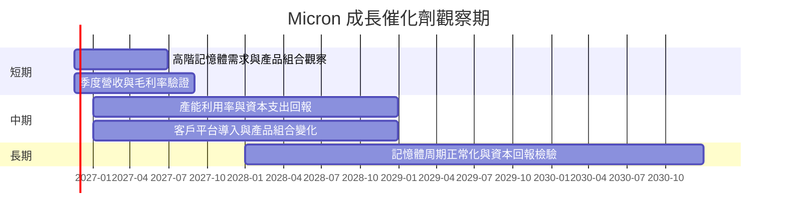

### 9.2 TAM 市場規模分析

**N/A（TAM 數據未提供）。** 公司與產業資料沒有提供具來源與年份的 TAM 金額，因此不估算市場規模或滲透率。以財務規模觀察，TTM 營收 $133.19B、年增 256.3%，顯示當前成長動能大；但 TAM 未知，無法以可服務市場規模判斷長期增長上限。

### 9.3 成長驅動力結構圖

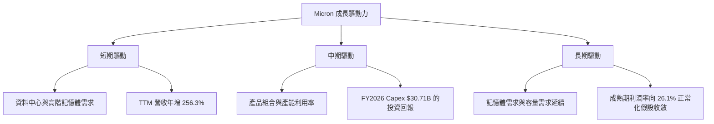

短期催化劑的量化驗證應以季度營收、毛利率與營業利益率為主；中期要追蹤 Capex 是否形成可持續營收與現金流，而非只觀察產能增加。長期模型採用營收成長逐年由 30.0% 降至 3.0%，以及營業利益率由 74.6% 降至 26.1%，本身已將部分周期正常化納入基準。

---

## 10. 風險矩陣

### 10.1 風險評分矩陣

下列機率與衝擊座標為分析師對風險相對位置的定性評估，不是公司財務數據或統計預測。

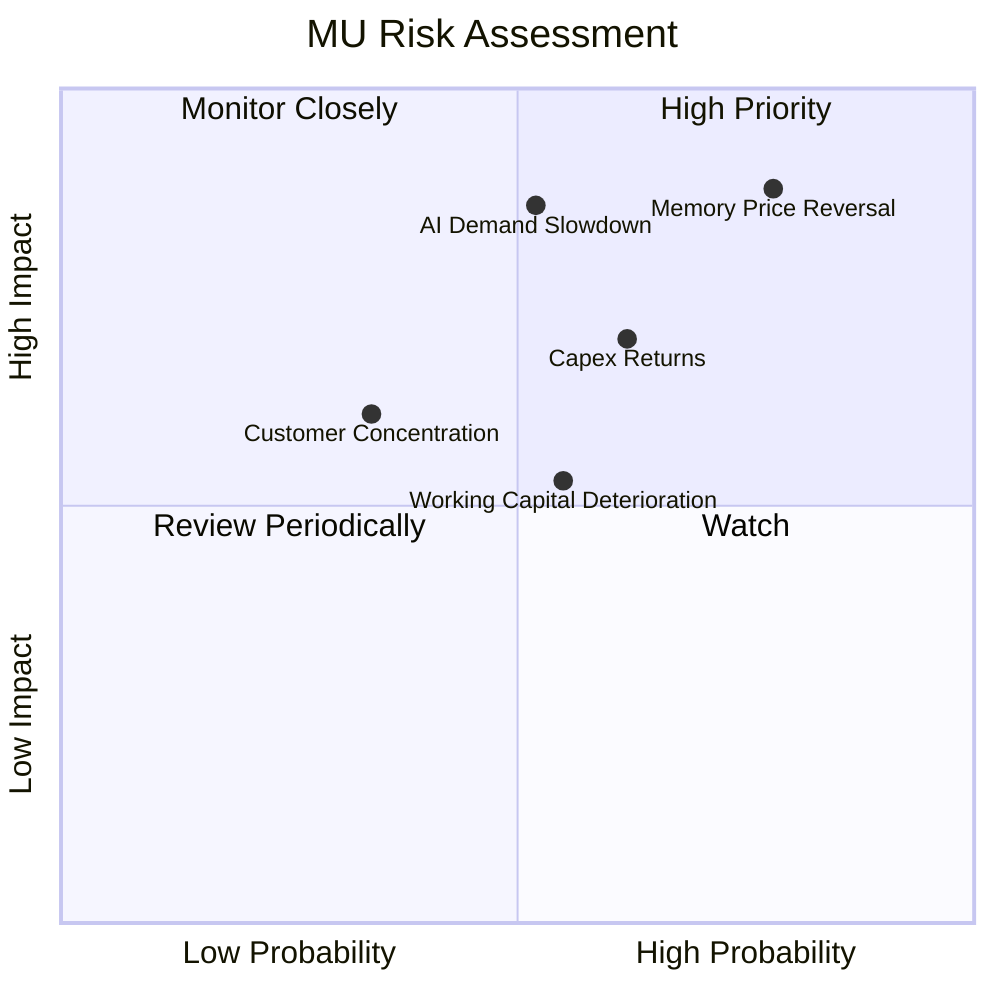

### 10.2 風險清單詳細分析

| # | 風險項目 | 發生機率 | 財務衝擊 | 風險評分 | 緩解措施 |
|---|----------|----------|----------|----------|----------|
| 1 | 🔴 **記憶體價格與供需周期反轉** | 高（定性） | 高；FY2026 營業利益率 74.6%，若大幅回落將壓縮盈利與估值 | 🔴 高 | 追蹤毛利率、合約價格、庫存及 Capex；避免把峰值利潤率外推。 |
| 2 | 🔴 **AI／資料中心需求低於預期** | 中高（定性） | 高；基準 DCF 第一年度營收成長假設 30.0%，低於該假設會下修現金流 | 🔴 高 | 逐季檢視高階產品收入、客戶需求訊號及營收指引。 |
| 3 | 🟠 **資本支出回報與產能利用率風險** | 中高（定性） | 高；FY2026 Capex $30.71B，若新增產能未形成出貨，FCF 可能快速下降 | 🟠 中高 | 監控 Capex／營收、產能利用率、折舊與增量 ROIC。 |
| 4 | 🟡 **營運資金與應收帳款上升** | 中（定性） | 中；DSO +17 天、CCC +30 天，可能占用現金 | 🟡 中 | 觀察 DSO、DIO、客戶回款與存貨週轉，確認成長是否轉成現金。 |
| 5 | 🟡 **財報來源口徑不一致** | 中（定性） | 中；總債務、ROE 等資料源存在不同數字，可能影響指標比較 | 🟡 中 | 以 SEC 申報資料和一致期間定義重新核對，追蹤季度差異。 |

---

## 11. 投資建議

### 11.1 最終評級與評分

依加權合理價值 $967.20、現價 $712.42 計算，MOS 為 **+26.3%**；ROIC 86.2% 高於 WACC 14.00%，因此依規則 20 評級為**強烈買入**，未作一級調整。綜合評分為 **8.3/10**，引用 1.1 的成長性 9.0、獲利能力 9.5、財務健康 9.0、估值 7.0、護城河 8.0、管理層與資本配置 7.5。

### 11.2 合理價值與隱含報酬率

| 估值情境 | 每股價值 | 相對現價 | 機率／權重 | 說明 |
|----------|---------:|---------:|-----------:|------|
| 加權合理價值 | **$967.20** | **+35.8% 上行空間** | 固定方法權重 100% | MOS +26.3%，分母為加權合理價值。 |
| 悲觀 DCF | $429.05 | -39.8% | 25% | 第一年度成長 15.0%、期末利潤率 22.2%、WACC 15.00%。 |
| 基準 DCF | $881.83 | +23.8% | 50% | 第一年度成長 30.0%、期末利潤率 26.1%、WACC 14.00%。 |
| 樂觀 DCF | $1,715.71 | +140.8% | 25% | 第一年度成長 45.0%、期末利潤率 28.8%、WACC 13.00%。 |
| 情境機率加權參考值 | $977.10 | +37.2% | 100% | 只作情境參考，不取代 8.8 固定權重加權合理價值。 |

### 11.3 買入時機與觸發因素

```text
╔══════════════════════════════════════════════════════════════════╗
║                  ✅ 買入觸發因素 Checklist                      ║
╠══════════════════════════════════════════════════════════════════╣
║  立即布局條件：                                                   ║
║  ✅ 2026-11-17 收盤價 $712.42 低於 MOS 10% 對應上限 $870.48     ║
║  ✅ TTM FCF $58.96B 為正，FCF Yield 7.32%                      ║
║  ✅ ROIC 86.2% 高於 WACC 14.00%                                 ║
║                                                                  ║
║  加碼觸發條件：                                                   ║
║  ☐ 最新季度營收年增維持在 30% 以上，且毛利率保持在 70% 以上     ║
║  ☐ FCF 持續為正，Capex 增加同時未導致 ROIC 跌破 WACC            ║
║  ☐ CCC 不再持續拉長，DSO 與 DIO 回到改善方向                    ║
║                                                                  ║
║  減碼／重新評估條件：                                             ║
║  ☐ 現價升至 $967.20 以上且盈餘預期沒有同步上修                  ║
║  ☐ 營業利益率由 74.6% 大幅正常化，且速度快於基準路徑             ║
║  ☐ TTM FCF 轉負、資本支出效率下滑或 ROIC 跌至 WACC 以下          ║
╚══════════════════════════════════════════════════════════════════╝
```

現價低於加權合理價值的 90% 上限，符合 MOS 至少 10% 的買入區間條件；不代表需要一次性買入。考量 24 個月股價由 2024-11 的 $97.43 升至 2026-06 的 $1,153.93，之後回落至 $712.42，分批交易比單次重倉更適合控制周期波動。

### 11.4 投資人適配度分析

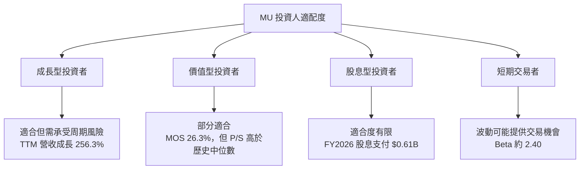

### 11.5 每季財報監控清單（Quarterly Watch List）

| 指標 | 現況錨點 | 加碼觀察門檻 | 減碼／重新評估門檻 |
|------|----------|--------------|--------------------|
| 營收年增 | 最新一季 379.3% | 年增仍高於 30%，且沒有連續兩季快速下滑 | 連續兩季低於 30% 或轉負 |
| 毛利率 | TTM 80.7% | 保持高於 70%，並由價格與產品組合支撐 | 低於 60%，或單季快速收縮 |
| 營業利益率 | TTM 74.6%；最新季度 80.7% | 高於模型中長期終點 26.1%，且現金流同步改善 | 連續兩季大幅下降，且低於 40% |
| OCF／FCF | TTM OCF $89.67B／FCF $58.96B | FCF 持續為正，FCF／淨利維持在 50% 以上 | FCF 轉負或 FCF／淨利低於 30% |
| Capex | TTM $30.71B | 資本支出增加伴隨收入與產能利用率提升 | Capex 上升但收入停滯、ROIC 下滑 |
| 應收／存貨／CCC | DSO 87 天、DIO 147 天、CCC 185 天 | CCC 持平或回落 | CCC 持續增加，尤其 DSO、DIO 同時上升 |
| ROIC vs WACC | 86.2% vs 14.00% | ROIC 明顯高於 WACC | ROIC 跌破 14.00% |
| 股數與 SBC | FY2026 SBC $1.33B；F-Score 稀釋測試未通過 | SBC／營收維持在約 1% 附近或下降 | 稀釋股數增加且回購不足以抵銷 |
| 財測與產品需求 | 公司季度財測未提供 | 財測支持收入成長與穩定產品組合 | 管理層指引下修、供給增速高於需求 |

### 11.6 反面論證：什麼會證明論點錯誤（What Would Change My Mind）

```text
╔══════════════════════════════════════════════════════════════════╗
║              ⚠️ 論點失效條件（Disconfirming Evidence）           ║
╠══════════════════════════════════════════════════════════════════╣
║  下列條件若發生，應重新檢視強烈買入論點：                        ║
║  ☐ 最新季度營收年增連續兩季低於 30%                              ║
║  ☐ TTM 營業利益率較 74.6% 峰值下降至 40% 以下，且仍續降         ║
║  ☐ TTM FCF 轉負，或 FCF／淨利低於 30%                            ║
║  ☐ ROIC 跌破 WACC 14.00%，顯示增量投資不再創造經濟價值          ║
║  ☐ DSO 或 CCC 再度顯著延長，且營收成長未能轉化為營業現金流       ║
║  ☐ 高階記憶體需求未形成持續出貨，或新增 Capex 無法提升現金回報   ║
║  ☐ 股數持續稀釋，SBC 成長長期快於營收與每股盈餘                 ║
╚══════════════════════════════════════════════════════════════════╝
```

> **免責聲明**：本報告為 AI 自動生成，僅供研究參考，不構成投資建議。投資有風險，入市需謹慎。

---

## 資料與來源

| 項目 | 內容 |
|------|------|
| 價格 | 712.42 USD，2026-11-17 收盤（Yahoo Finance 日線） |
| 財務報表 | SEC 10-K filed 2026-10-09，最新季度 2026-09-03（FY2026 Q4） |
| 有回應的資料來源 | SEC 申報資料 (XBRL)、Yahoo Finance、Finviz、StockAnalysis、Roic.ai |
| 由程式計算 | TTM 數字、WACC、DCF 模型、估值方法與權重、加權合理價值、MOS、評級門檻、F-Score、杜邦分解、營運資金天數、綜合評分 |
| 撰寫模型 | openai / gpt-6-luna |

> 本區塊由產生報告的程式依實際取得的資料填寫，非模型撰寫。「由程式計算」的數字不是模型的估計；其餘判斷（評分、情境、策略）是模型的分析。
