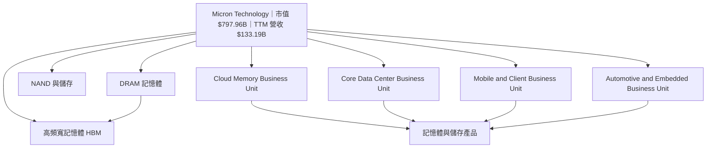
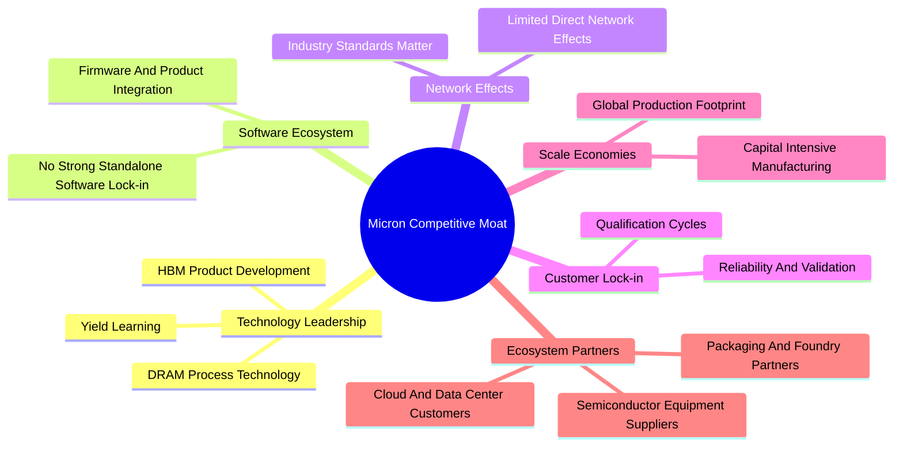
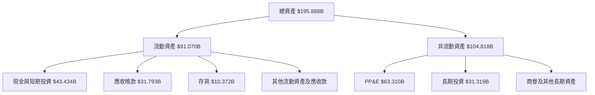
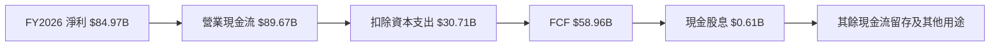
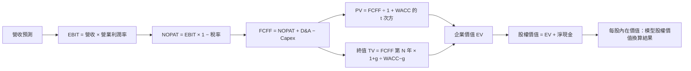
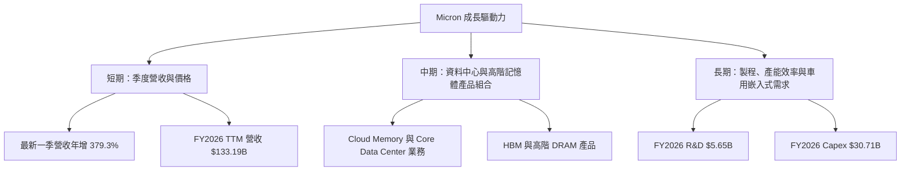
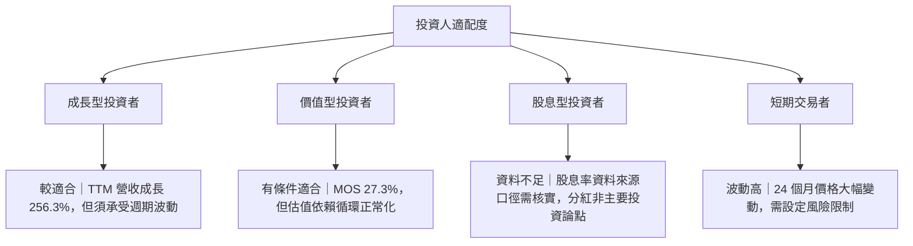

# MU 基本面深度分析報告
> **報告日期**：2026-11-19 ｜ **語言**：繁體中文 ｜ **數據來源**：SEC 申報資料 (XBRL)、Yahoo Finance、Finviz、StockAnalysis、Roic.ai ｜ **分析師**：CFA 級機構研究

## 目錄

| # | 章節 | 核心結論 |
|---|------|----------|
| 1 | 執行摘要 | 強烈買入；加權合理價值 $969.60；MOS +27.3% |
| 2 | 公司概覽與商業模式 | DRAM／NAND 製程、資本規模與客戶認證構成中等護城河，市場份額數字未提供 |
| 3 | 損益表深度分析 | TTM 營收 $133.19B、TTM 成長 256.3%；利潤率處於高度循環上行階段 |
| 4 | 資產負債表分析 | 淨現金 $40.15B；流動性充足，但應收與現金轉換週期上升 |
| 5 | 現金流量深度分析 | TTM FCF $58.96B、FCF Yield 7.39%；資本支出仍高 |
| 6 | 獲利能力與資本效率 | ROIC 86.2% 對 WACC 14.00%，目前創造顯著經濟價值 |
| 7 | 相對估值分析 | P/E 低於同業中位數，自身 P/S 位於五年歷史偏高區 |
| 8 | DCF 內在價值評估 | DCF 基準價值 $881.83；加權合理價值 $969.60；模型高度依賴長期假設 |
| 9 | 成長催化劑 | AI／資料中心記憶體需求與高階產品組合是主要機會；TAM 數字未提供 |
| 10 | 風險矩陣 | 記憶體週期反轉、產能擴張與產品定價是前三大風險 |
| 11 | 投資建議 | 依 MOS 評級為強烈買入；以季度營收、利潤率、Capex、FCF 與庫存為監控重點 |

---

## 1. 執行摘要

MU 的 TTM 營收為 **$133.19B**，TTM 年增 **256.3%**，最新一季營收年增 **379.3%**；TTM 營業利益率 **74.6%**、FCF **$58.96B**，顯示當前產品需求、定價與營運槓桿處於強勢週期階段。資產負債表有 **$40.15B 淨現金**，TTM ROIC **86.2%**，高於採用的 **14.00% WACC**。然而，記憶體產業循環性高，FY2026 的營運表現不宜無條件外推。

以週期性公司的固定估值權重計算，加權合理價值為 **$969.60**，相對 **2026-11-18 收盤價 $705.27** 的安全邊際 MOS 為 **+27.3%**，依規則 20 評級為 **強烈買入**。此結論依賴多種估值方法的交叉驗證；DCF 基準價值為 **$881.83**，現價相對 DCF 折價約 **20.0%**。DCF 模型的悲觀情境為 **$429.05**，說明若需求、利潤率與資本成本同時惡化，估值下檔仍大。

### 1.0 一頁式投資儀表板（Portfolio Manager 30 秒速讀）

| 項目 | 內容 |
|------|------|
| **投資論點（3 句）** | ① TTM 營收 **$133.19B**、TTM 成長 **256.3%**，需求與產品組合推動營收快速擴張。② TTM 營業利益率 **74.6%**、ROIC **86.2%**，目前資本回報明顯高於成本。③ TTM FCF **$58.96B**、淨現金 **$40.15B**，提供投資與抗週期能力，但這些數字處於強循環階段。 |
| **綜合評分** | **8.1/10**（引用 1.1 評分卡） |
| **財務健康** | 🟢 現金及短期投資 **$43.43B**、總債務 **$3.28B**、淨現金 **$40.15B**；但 CCC 年增 **30 天**。 |
| **ROIC vs WACC** | **86.2% vs 14.00%**；目前創造股東價值，差距 **72.2 個百分點**。 |
| **FCF 趨勢** | FY2026 FCF **$58.96B**，相較 FY2025 **$1.67B** 大幅增加；TTM FCF Yield **7.39%**。強烈週期成分使其不等同於可持續常態 FCF。 |
| **估值** | Forward P/E **3.39x** ｜ EV/EBITDA **6.98x** ｜ FCF Yield **7.39%** |
| **DCF 內在價值（基準）** | **$881.83** ｜ 現價相對 DCF 折價 **20.0%**（以 DCF 基準價值計算） |
| **安全邊際（MOS）** | **+27.3%**＝(**加權合理價值 $969.60 − 現價 $705.27**) ÷ **加權合理價值 $969.60**；🟢 高於 25% |
| **預期報酬（基準情境 12M）** | **+25.0%**，引用 DCF 基準情境每股價值 $881.83；估值模型期長為 10 年，非短期股價保證。 |
| **關鍵風險（前二）** | 記憶體供需反轉導致 ASP 與毛利率收縮；高 Capex／新產能供給超過需求。 |
| **評級 + 信心度** | 🟢 **強烈買入** ｜ 信心：中；估值折價與資產負債表有利，但週期及模型假設不確定性高。 |

### 1.1 綜合評分卡（全報告唯一）

| 維度 | 評分（1–10） | 主要依據（引用數字與其來源章節） |
|------|--------------|----------------------------------|
| 成長性 | 9.0 | TTM 營收年增 **256.3%**、最新一季年增 **379.3%**；第 3 章顯示成長加速，但高基期與週期性限制持續性。 |
| 獲利能力 | 9.0 | TTM 營業利益率 **74.6%**、ROIC **86.2%**；ROIC 高於 WACC 14.00%；F-Score **8/9**，見第 6 章。 |
| 財務健康 | 8.5 | 淨現金 **$40.15B**、流動比率 **3.314**；但 CCC 從 **155 天**上升至 **185 天**，見第 4 章。 |
| 估值 | 8.0 | 加權合理價值 **$969.60**、MOS **+27.3%**；P/E 歷史百分位 13%，但 P/S 歷史百分位 75%，見第 7–8 章。 |
| 護城河 | 7.5 | 製程、資本密集度、客戶認證與產品組合帶來優勢；但缺乏市場份額與分部收入資料，且產業供給循環削弱定價持久性，見第 2 章。 |
| 管理層與資本配置 | 6.5 | FY2026 Capex **$30.71B**，反映持續投資；SBC **$1.33B**，稀釋股數測試未通過；回購與投資分部回報資料不足。 |
| **綜合評分** | **8.1** | 六項算術平均：**(9.0 + 9.0 + 8.5 + 8.0 + 7.5 + 6.5) ÷ 6 = 8.08 ≈ 8.1**。 |

### 1.2 五大投資論點 + 三大核心風險

| 類型 | 項目 | 具體依據 | 信心度 |
|------|------|----------|--------|
| 🟢 **投資論點①** | 高成長且趨勢加速 | TTM 營收 **$133.19B**、TTM 年增 **256.3%**；最新一季營收年增 **379.3%**。若高階記憶體產品需求延續，營收規模與固定成本吸收將支撐獲利。 | 🟢 高 |
| 🟢 **投資論點②** | 利潤率與資本回報高 | TTM 營業利益率 **74.6%**、ROIC **86.2%**，較 WACC 高 **72.2pp**；但須視為當前循環水準，而非保證的長期常態。 | 🟢 中高 |
| 🟢 **投資論點③** | 現金流與資產負債表有韌性 | TTM OCF **$89.67B**、Capex **$30.71B**、FCF **$58.96B**；淨現金 **$40.15B**，降低景氣反轉時的融資壓力。 | 🟢 高 |
| 🟢 **投資論點④** | 相對 P/E 不高 | MU Trailing P/E **9.5x**，低於已提供同業的中位數 **6.8x**？此處 MU 實際高於中位數；但仍低於自身五年中位數 **17.4x**，顯示市場可能仍按週期股折價。 | 🟡 中 |
| 🟢 **投資論點⑤** | 加權估值具上行空間 | 加權合理價值 **$969.60**，相對現價上行空間 **37.5%**；MOS **27.3%**。估值仍受分析師共識目標價權重影響。 | 🟡 中 |
| 🟡 **風險①** | 供需反轉及價格下滑 | 目前營業利益率達 **74.6%**；若供給增加、ASP 下滑，固定成本結構會放大利潤率回落。基準 DCF 將營業利益率由 **74.6%** 逐步降至 **26.1%**。 | 🔴 高衝擊 |
| 🔴 **風險②** | Capex 與產能投資回報落空 | TTM Capex **$30.71B**、Capex／營收 **23.1%**；若需求不及投資速度，折舊上升與閒置產能會壓低 FCF。 | 🔴 高衝擊 |
| 🟡 **風險③** | 營運資金與股數稀釋 | CCC 從 **155 天**上升至 **185 天**；Piotroski 股數測試未通過。應收帳款回收變慢或股權薪酬稀釋擴大，將削弱股東實際回報。 | 🟡 中高 |

> 表內「Trailling P/E 低於同業中位數」並不成立：MU 為 9.5x，同業可用 P/E 中位數為 6.8x；投資論點所指的是低於公司自身五年中位數 17.4x，而非低於同業。

### 1.3 快速統計卡片

| 指標 | 公司實際值（期間） | 同業中位數 | 狀態 |
|------|--------------------|------------|------|
| 營收成長（TTM） | **256.3%** | — | 🟢 |
| 營收成長（最新一季年增） | **379.3%** | **327.9%**（SKHY、SNDK、WDC） | 🟢 |
| 毛利率（TTM） | **80.7%** | **77.4%**（SKHY、SNDK、WDC） | 🟢 |
| 營業利益率（TTM） | **74.6%** | — | 🟢 |
| ROIC（TTM） | **86.2%** | — | 🟢 |
| Forward P/E | **3.39x** | **3.0x**（可用同業 P/E） | 🟡 |
| FCF Yield（TTM） | **7.39%** | — | 🟢 |
| Piotroski F-Score | **8 / 9** | — | 🟢 |

### 1.4 投資結論

```text
╔══════════════════════════════════════════════════════════════════╗
║                    📊 投資結論摘要                               ║
╠══════════════════════════════════════════════════════════════════╣
║  評級：強烈買入（依 MOS 規則，未作質化調整）                     ║
║  價格（2026-11-18 收盤）：$705.27                               ║
║  DCF 內在價值（基準）：$881.83（現價折價 20.0%）                ║
║  安全邊際 MOS：+27.3%（=(加權合理價值−現價)÷加權合理價值）      ║
║  加權合理價值（8.8）：$969.60                                   ║
║  DCF 情境價值：                                                 ║
║    悲觀情境：$429.05（-39.2%）                                  ║
║    基準情境：$881.83（+25.0%）                                  ║
║    樂觀情境：$1,715.71（+143.3%）                               ║
║  綜合評分：8.1/10（引用 1.1）                                   ║
║  適合投資人：能承受半導體週期波動、以中長期配置為主的成長型投資人║
╚══════════════════════════════════════════════════════════════════╝
```

---

## 2. 公司概覽與商業模式

Micron Technology, Inc. 是美國半導體記憶體與儲存產品公司，產品包括 DRAM、NAND 與高頻寬記憶體（HBM）等。公司資料列出的業務單位包括 Cloud Memory、Core Data Center、Mobile and Client、Automotive and Embedded；但未提供各單位營收或利潤，因此不以未披露數字推估收入佔比。

### 2.1 業務結構與收入來源



各業務收入佔比、軟體／服務營收與產品別獲利均未提供，故不製作收入分布圖或佔比估算。業務結構的核心經濟特性是高資本投入、產品週期與價格循環：高階產品需求增加時，可帶來較高的產品組合與產能利用率；供給過剩時，則可能迅速壓低 ASP 與利潤率。

### 2.2 市場份額

市場份額數據未提供，亦無可引用的市場規模與年份數據可供計算。以公司自身規模觀察，MU TTM 營收 **$133.19B**，最新一季營收年增 **379.3%**，增速高於可用同業最新季度年增中位數 **327.9%**。這代表當期需求與出貨增速相對突出，但不能單憑營收成長推導市場份額增加。

### 2.3 競爭護城河分析



### 2.4 護城河強度

| 護城河項目 | 強度（強／中／弱） | 證據（引用數字或事實） | 會削弱它的情況 |
|------------|--------------------|------------------------|----------------|
| 技術與製程 | 中 | DRAM、NAND 與 HBM 產品需要持續研發；FY2026 R&D **$5.65B**。 | 競爭者製程良率改善更快、產品規格差距收斂。 |
| 客戶認證與轉換成本 | 中 | 資料中心、行動與車用產品通常需要產品驗證與可靠性測試；細部客戶留存數據未提供。 | 客戶以價格為主重新配置供應商，或替代品經認證成功。 |
| 規模與資本門檻 | 中至強 | FY2026 Capex **$30.71B**；資產負債表 PP&E **$63.31B**。 | 供給擴張造成產能利用率下降，規模變成固定成本負擔。 |
| 軟體生態系 | 弱 | 公司核心為記憶體及儲存硬體，軟體經常性收入資料未提供。 | 競爭對手以整合平台、控制器或系統方案提高客戶黏著度。 |
| 網路效應 | 弱 | 記憶體產品未呈現典型雙邊網路效應；產業標準與相容性有助採用，但非直接網路效應。 | 標準化降低差異化，客戶可在多家供應商間切換。 |
| 生態夥伴 | 中 | 與資料中心、裝置及半導體供應鏈有多層協作；具體合約與收入比重未提供。 | 客戶自研、供應鏈地緣風險或夥伴採購策略改變。 |

1.1 的「護城河」評分 **7.5/10**，反映技術、資本規模與認證具實際價值，但產業仍高度週期性，且市場份額、客戶集中度與分部營收資料不足以確認持久定價權。

---

## 3. 損益表深度分析

### 3.1 年度收入成長趨勢（近4年）

```text
╔══════════════════════════════════════════════════════════════════╗
║              Micron 年度收入趨勢（FY2023-FY2026）               ║
╠══════════════════════════════════════════════════════════════════╣
║  FY2023  $15.54B  ███░░░░░░░░░░░░░░░░░░░░░  YoY: -49.5% 🔴    ║
║  FY2024  $25.11B  █████░░░░░░░░░░░░░░░░░░░  YoY: +61.6% 🟢    ║
║  FY2025  $37.38B  ███████░░░░░░░░░░░░░░░░  YoY: +48.9% 🟢    ║
║  FY2026 $133.19B  ████████████████████████  YoY:+256.3% 🟢    ║
╠══════════════════════════════════════════════════════════════════╣
║  FY2023-FY2026 累計 CAGR：約 104.7%                             ║
╚══════════════════════════════════════════════════════════════════╝
```

三年 CAGR 算式：\((133.19 ÷ 15.54)^{1/3} - 1 \approx 104.7\%\)。FY2023 為低基期，且 FY2026 成長極端加速；因此 104.7% 不能作為常態中期成長率。FY2026 成長主要反映記憶體需求與價格週期反轉、出貨與高階產品組合改善；若產能供給追上需求，營收增速可快速回落。

### 3.2 季度收入趨勢分析

金額為十億美元；QoQ 使用相鄰季度收入計算，FY2026 Q1 的比較基期為 FY2025 Q4。

| 季度 | 營收 | QoQ | YoY | 備註 |
|------|------:|-----:|----:|------|
| FY2026 Q1（2025-11） | $13.643B | +20.6% | +56.7% | 相較 FY2025 Q4 的 $11.315B；週期復甦延續。 |
| FY2026 Q2（2026-02） | $23.860B | +74.9% | +196.3% | 成長進一步加速，需求與價格改善放大營收。 |
| FY2026 Q3（2026-05） | $41.456B | +73.8% | +345.7% | 高速擴張；需留意季度營收快速爬升後的高基期。 |
| FY2026 Q4（2026-09） | $54.229B | +30.8% | +379.3% | 季增仍高，但較前兩季增速回落；最新季年增率不能與 TTM 年增率混用。 |

財務數據中的 EPS 實際值分別為 **$4.60、$12.07、$24.67、$32.85**（StockAnalysis 顯示）；季度 EPS 預估值與 surprise 欄為空值，因此無法判定過去四季「超預期／不及預期」。可確認的是 EPS 逐季上升，Q4 2026 EPS 年增 **1,059.5%**，原因與營收擴張及利潤率改善相符，但不能將其當作分析師超預期證據。

### 3.3 利潤率演變分析

| 利潤率指標 | FY2023 | FY2024 | FY2025 | FY2026 | 趨勢 | 評估 |
|------------|-------:|-------:|-------:|-------:|------|------|
| **毛利率** | -9.1% | 22.3% | 39.8% | 80.7% | 低谷後大幅回升，FY2026 明顯處於週期高檔 | 🟡 |
| **營業利益率** | -34.8% | 5.2% | 26.1% | 74.6% | 產品組合、定價與產能利用率共同推高 | 🟡 |
| **淨利率** | -37.5% | 3.1% | 22.8% | 63.8% | 淨利轉強，但循環及稅務影響仍需觀察 | 🟡 |

年度比率由各年度損益表的毛利、營業利益、淨利除以營收計算，四捨五入至一位小數。FY2026 毛利率、營業利益率和淨利率急升，與營收快速擴張、產品組合轉好及固定成本吸收改善相一致。由於記憶體產品定價受產業供需制約，FY2026 利潤率不能直接視為長期正常化水平；DCF 將營業利益率由 TTM **74.6%** 逐步降至 FY+10 **26.1%**，正是反映週期利潤率需回歸。

### 3.4 費用結構分析

完整費用明細與 FY2026 成本分類未提供，無法可靠計算費用佔營收比例或繪製費用結構圓餅圖。可取得的研發費用為 **$5.65B**，約為 FY2026 營收 **$133.19B** 的 **4.2%**；這反映持續的技術投入，但不代表完整營運費用結構。

```text
╔══════════════════════════════════════════════════════════════════╗
║                 FY2026 可量化費用項目                           ║
╠══════════════════════════════════════════════════════════════════╣
║  研發費用：$5.65B（營收的約 4.2%）                              ║
║  其他營運費用分類：資料未提供，不推估比例                       ║
╚══════════════════════════════════════════════════════════════════╝
```

### 3.5 季度 EPS 趨勢與盈餘品質（Quality of Earnings）

| 盈餘品質項目 | 數值／佔比 | 評估 |
|--------------|-----------|------|
| 股權薪酬 SBC / 營收 | FY2026 SBC **$1.33B ÷ $133.19B = 約 1.0%** | 🟢 比例不高，但股權薪酬仍稀釋現有股東；Piotroski 的稀釋股數測試未通過。 |
| SBC / 營業現金流 | **$1.33B ÷ $89.67B = 約 1.5%** | 🟢 當期現金流轉換規模足以覆蓋 SBC，但 SBC 並非無成本。 |
| FCF / 淨利（現金轉換率） | **$58.96B ÷ $84.97B = 69.4%** | 🟡 現金轉換為正且可觀，但 FCF 低於淨利，且資本支出週期性高。 |
| 一次性／非經常性損益 | N/A（資料未提供完整調節項） | 無法判斷是否有重大一次性項目抬高或壓低盈餘。 |
| 有效稅率 | **14.8%**（最新年度） | 🟢 DCF 採用此有效稅率；未提供多年稅率序列，不能證明其為正常化稅率。 |
| 資本化支出 vs 費用化 | Capex **$30.71B**；資本化政策與維護／擴張拆分未提供 | 半導體資產投入大，折舊與資本化假設會影響期間利潤與 FCF。 |

盈餘品質結論：TTM OCF **$89.67B** 高於淨利 **$84.97B**，Piotroski 應計品質測試通過，支持當期獲利具有現金流支撐；但 FCF／淨利只有 **69.4%**，主要需考慮 **$30.71B** Capex。SBC 相對營收約 **1.0%**，不是當期主要風險，但股數稀釋測試未通過，股東回報仍需追蹤實際稀釋。

---

## 4. 資產負債表分析

### 4.1 資產結構分解

截至 FY2026 資產總額為 **$195.888B**。流動資產 **$91.070B**；非流動資產以總資產減流動資產計算為 **$104.818B**。主要非流動項目包括 PP&E **$63.310B**、長期投資 **$31.319B** 及其他長期資產。



「其他流動資產及應收款」包含資料列出的其他應收款及其他流動資產；為避免把各項混淆，圖中未反推合併值。非流動資產總額是**總資產減流動資產**的計算結果，包含列示及未單獨分列項目。

### 4.2 流動性與營運資金分析

流動比率 **3.314**、速動比率 **2.898**，且現金及短期投資 **$43.43B**，表示短期償付能力充足。下表營運資金天數依品質指標原值列示。

| 指標 | 最新 TTM | 一年前 TTM | 變化 | 解讀 |
|------|----------|------------|------|------|
| DSO 應收帳款天數 | 87 天 | 70 天 | +17 天 | 收款天數增加，應收帳款由 $7.163B 增至 $31.793B；高速營收擴張可能使應收餘額增加，但需觀察回款及信用條件。 |
| DIO 存貨天數 | 147 天 | 136 天 | +11 天 | 存貨天數增加，反映備貨／產品組合變化或出貨節奏；若需求轉弱，存貨可能形成減值及現金占用風險。 |
| DPO 應付帳款天數 | 50 天 | 51 天 | -1 天 | 付款天數略減，沒有顯示大幅延長供應商付款來支撐現金流。 |
| CCC 現金轉換週期 | 185 天 | 155 天 | +30 天 | 現金被營運資金占用時間拉長；營收快速成長是背景因素，但 CCC 延長仍需監測。 |

### 4.3 債務結構分析

```text
╔══════════════════════════════════════════════════════════════════╗
║                   Micron 債務健康診斷                            ║
╠══════════════════════════════════════════════════════════════════╣
║  總債務：          $3.28B    ▌                    🟢             ║
║  現金及短期投資： $43.43B   ████████████████████  🟢             ║
║  淨現金：         $40.15B   ██████████████████    🟢             ║
║                                                                  ║
║  Debt / EBITDA：  約 0.03x（$3.28B ÷ $109.28B）                  ║
║  利息保障倍數：   N/A（利息費用與可比口徑未提供）                ║
║  流動比率：       3.314                                             ║
║  速動比率：       2.898                                             ║
╚══════════════════════════════════════════════════════════════════╝
```

總債務及淨現金採資本成本資料所列 **$3.28B** 與 **$40.15B**；其他資料來源出現不同債務數值，故本報告在核心指標統一採用經核驗數字。Debt／EBITDA 算式約為 **$3.28B ÷ $109.28B = 0.03x**，但 EBITDA 也受本輪景氣高峰影響，該比率不可視為跨週期常態。

### 4.4 股東權益趨勢

| 財年 | 股東權益 |
|------|---------:|
| FY2023 | $44.12B |
| FY2024 | $45.13B |
| FY2025 | $54.16B |
| FY2026 | $138.38B |

```text
╔══════════════════════════════════════════════════════════════════╗
║                  股東權益變化（USD）                             ║
╠══════════════════════════════════════════════════════════════════╣
║  FY2023  $44.12B  ████████░░░░░░░░░░░░░░                         ║
║  FY2024  $45.13B  ████████░░░░░░░░░░░░░░                         ║
║  FY2025  $54.16B  ██████████░░░░░░░░░░░░                         ║
║  FY2026 $138.38B  ████████████████████████                       ║
╚══════════════════════════════════════════════════════════════════╝
```

FY2026 權益大增與當年度 **$84.97B** 淨利及現金累積相符；但沒有提供留存盈餘、股權發行、其他綜合損益的完整橋接，因此不將權益變動全部歸因於單一項目。

---

## 5. 現金流量深度分析

### 5.1 現金流量瀑布圖



回購金額與完整融資現金流橋接未提供，故不在圖中加入回購數值或聲稱現金變動完全由留存 FCF 造成。

### 5.2 FCF 轉換率趨勢

| 財年 | FCF | 淨利 | FCF / 淨利 | 解讀 |
|------|----:|-----:|-----------:|------|
| FY2023 | -$6.12B | -$5.83B | 105.0% | 分子、分母均為負，比例不代表正常現金轉換；景氣低谷時 Capex 仍造成 FCF 負值。 |
| FY2024 | $0.121B | $0.778B | 15.6% | 淨利已轉正，但高投資支出令 FCF 明顯低於淨利。 |
| FY2025 | $1.67B | $8.54B | 19.6% | 盈利修復快於自由現金流，Capex 對現金轉換仍有壓力。 |
| FY2026 | $58.96B | $84.97B | 69.4% | 現金流大幅增加；營業現金流高於淨利，但投資支出仍高。 |

### 5.3 自由現金流趨勢

| 財年 | FCF | FCF Yield |
|------|----:|----------:|
| FY2023 | -$6.12B | N/A |
| FY2024 | $0.121B | N/A |
| FY2025 | $1.67B | N/A |
| FY2026 TTM | $58.96B | 7.39% |

```text
╔══════════════════════════════════════════════════════════════════╗
║                 自由現金流趨勢（USD）                            ║
╠══════════════════════════════════════════════════════════════════╣
║  FY2023  -$6.12B  ◀░░░░░░░░░░░░░░░░░░░░░                         ║
║  FY2024   $0.121B ▏                                                ║
║  FY2025   $1.67B  ▋                                                ║
║  FY2026  $58.96B  ████████████████████████  Yield: 7.39%         ║
╚══════════════════════════════════════════════════════════════════╝
```

FY2026 FCF 由 FY2025 的 **$1.67B** 增至 **$58.96B**，背後是營收、現金毛利與營運槓桿改善；該變化幅度亦說明 FCF 極具週期性。歷年 FCF Yield 未提供一致歷史市值序列，故不反推。

### 5.4 資本配置評估

資本配置分項資料有限，無法製作涵蓋投資、回購、股息與留存的百分比圓餅圖。

| 項目 | FY2026 數值 | 評估 |
|------|-----------:|------|
| Capex | $30.71B | 占 TTM 營收約 23.1%，維持製程與產能競爭力，但回報取決於需求及利用率。 |
| 現金股息 | $0.61B | 相對 FCF 較小；提供現金回報，但主要資本用途仍是營運投資與資產負債表。 |
| 股票回購 | N/A | 數據未提供，無法評價回購規模與價格。 |
| 研發 | $5.65B | 支持產品與製程更新；缺少按產品別的研發回報資料。 |
| 留存／其他用途 | N/A | 未提供完整現金流分類，不拆分估算。 |

---

## 6. 獲利能力與資本效率

### 6.1 ROE / ROA / ROIC 趨勢

| 指標 | 最新 TTM | 歷史趨勢資料 | 評估 |
|------|---------:|--------------|------|
| ROE | 61.4% | QUALITY FIGURES 的 TTM 值；其他資料來源曾列不同口徑，本文採核驗值 | 高，但記憶體高峰期獲利與資產基數會放大 ROE。 |
| ROA | N/A | 可取得的其他來源值有口徑不一致，未納入核驗指標 | 不以不同來源的單點值推導趨勢。 |
| ROIC | 86.2% | TTM 稅後營業利益 ÷（權益 + 債務 − 現金） | 大幅高於資本成本；但對高峰期利潤高度敏感。 |

沒有同口徑歷年 ROIC、ROA 與行業均值資料，因此不列行業均值，也不以異口徑歷史值補空。

### 6.2 ROIC vs WACC 分析（核心價值創造判斷）

```text
╔══════════════════════════════════════════════════════════════════╗
║                ROIC vs WACC 深度分析                            ║
╠══════════════════════════════════════════════════════════════════╣
║  資本成本輸入：                                                   ║
║  ├── 無風險利率（10Y美債）：       5.07%                         ║
║  ├── 市場風險溢酬 ERP：            5.00%                         ║
║  ├── 原始 Beta：                   2.40                          ║
║  ├── 調整後 Beta：                 1.93                          ║
║  ├── 股權成本 Ke：                 14.73%                        ║
║  ├── 稅前債務成本：                 3.23%                        ║
║  ├── 股權／債務權重：              99.6% / 0.4%                  ║
║  └── ✅ WACC：                     14.00%（採用值）              ║
║                                                                  ║
║  ROIC（TTM）：                 86.2%                             ║
║  EVA 利差：                    86.2% - 14.00% = +72.2pp          ║
║                                                                  ║
║  ROIC  86.2%  ▓▓▓▓▓▓▓▓▓▓▓▓▓▓▓▓▓▓▓▓▓▓▓▓▓▓▓▓▓▓▓▓▓▓▓▓▓▓  🟢     ║
║  WACC  14.0%  ▓▓▓▓▓▓▓▓░░░░░░░░░░░░░░░░░░░░░░░░░░░░░░  ──     ║
║                                                                  ║
║  📊 結論：ROIC 約為 WACC 的 6.2 倍；目前創造股東價值。          ║
║  ⚠️ ROIC 為高週期 TTM 指標，不代表跨週期長期回報。               ║
╚══════════════════════════════════════════════════════════════════╝
```

核驗的 WACC 採用 **14.00%**。依提供資本成本資料，未設額外規模或國別溢酬；調整 Beta 為 \(⅔ × 2.40 + ⅓ = 1.93\)，其 CAPM 股權成本為 **14.73%**。程式計算的未限制 WACC 為 **14.68%**，因規定區間為 7%–14%，故採用上限 **14.00%**。ROIC 高於採用 WACC，當前創造價值；若記憶體獲利回落，ROIC 可能快速下降，不能只以峰值衡量長期價值創造。

### 6.3 杜邦三因素分解

| 因素 | 數值（TTM） | 解讀 |
|------|-------------|------|
| 淨利率 | 63.8% | 高淨利率是 ROE 的主要來源，但屬高景氣期水平。 |
| 資產週轉率 | 0.68 | 每單位資產創造的營收改善，但仍受資本密集型產業特性限制。 |
| 權益乘數 | 1.42 | 財務槓桿並非 ROE 主因，主要由淨利率與營運改善驅動。 |
| **ROE** | **61.4%** | **63.8% × 0.68 × 1.42 = 61.4%**（依核驗的杜邦數值）。 |

### 6.4 財務體質：Piotroski F-Score

Piotroski F-Score 為 **8 / 9**。九項測試中，缺少輸入的項目會依品質資料的計算規則不納入分母；本期列出的九項均有結果。

| 測試 | 結果 | 解讀 |
|------|------|------|
| ROA > 0 | ✅ 通過 | 獲利為正。 |
| 營業現金流 > 0 | ✅ 通過 | TTM OCF 為正，且達 **$89.67B**。 |
| ROA 高於一年前 | ✅ 通過 | 獲利能力相較一年前改善。 |
| 營業現金流 > 淨利 | ✅ 通過 | OCF **$89.67B** 高於淨利 **$84.97B**，支持應計品質。 |
| 長期負債 ÷ 總資產低於一年前 | ✅ 通過 | 槓桿相對改善。 |
| 流動比率高於一年前 | ✅ 通過 | 流動性相對一年前改善。 |
| 稀釋股數未增加 | ❌ 未通過 | 股數稀釋測試失敗，須追蹤 SBC 與實際流通股數。 |
| 毛利率高於一年前 | ✅ 通過 | 毛利率改善，與定價和產品組合一致。 |
| 資產週轉率高於一年前 | ✅ 通過 | 資產使用效率改善。 |

---

## 7. 相對估值分析

### 7.1 同業估值比較表格

以下同業數據依 Yahoo Finance 同業倍數資料；SKHY 的市銷率及 EV/EBITDA 因幣別混合不可比較，標示 N/A。MU 的估值值採題列的市場估值資料；同業 P/E 中位數依可用的 SKHY、SNDK、WDC 數值計算。

| 估值指標 | **MU** | **SKHY** | **SNDK** | **WDC** | MU 評估 |
|----------|-------:|--------:|--------:|-------:|-----------|
| **Trailing P/E** | 9.5x | 6.8x | 6.2x | 10.1x | 🟡 MU 高於同業中位數 6.8x；盈利處於循環高位，倍數可能受高峰 EPS 壓低。 |
| **Forward P/E** | 3.39x | 3.0x | 2.7x | 7.1x | 🟡 低倍數反映市場採用的預期盈利增長較高，若盈利回落倍數會失去表面低估特徵。 |
| **P/S** | 5.99x | N/A | 3.8x | 7.4x | 🟡 MU 高於 SNDK、低於 WDC；可比公司只有兩家。 |
| **EV/EBITDA** | 6.98x | N/A | 5.0x | 17.0x | 🟡 介於兩家可比公司之間；同業中位數為 11.0x。 |
| **最新一季營收年增** | 379.3% | 327.9% | 377.9% | 55.5% | 🟢 MU 當期增長略高於 SNDK、明顯高於 WDC。 |
| **TTM 毛利率** | 80.7% | 77.4% | 80.0% | 52.6% | 🟢 MU 高於 SKHY、SNDK 與 WDC 的可用中位數 77.4%。 |

MU 的低 Forward P/E 不宜孤立解讀：週期股盈利在景氣高峰時會使 P/E 暫時偏低，真正關鍵是後續獲利能否維持。同業中位數比較的公司數有限，且 SKHY 的部分倍數不可比。

### 7.2 歷史估值區間分析

```text
╔══════════════════════════════════════════════════════════════════╗
║                  MU 五年歷史估值位置                             ║
╠══════════════════════════════════════════════════════════════════╣
║  P/E：        7.4x ───── 中位數 17.4x ───── 138.5x              ║
║               現值 9.5x｜歷史百分位 13%                          ║
║                                                                  ║
║  P/S：        2.1x ───── 中位數 4.2x ───── 11.7x                ║
║               現值 6.1x｜歷史百分位 75%                          ║
║                                                                  ║
║  EV/EBITDA：  3.6x ───── 中位數 9.7x ───── 80.7x               ║
║               現值 7.0x｜歷史百分位 35%                          ║
╚══════════════════════════════════════════════════════════════════╝
```

P/E 現值 **9.5x** 位於五年歷史第 **13 百分位**，但 P/S **6.1x** 位於第 **75 百分位**。差異反映目前淨利與 EBITDA 快速膨脹，估值倍數受週期盈利分母影響；P/S 對收入的定價則較公司自身歷史中位數高。

### 7.3 情境價值（Bear / Base / Bull，照抄 DCF MODEL 的 Scenarios）

| 情境 | 第 1 年營收成長 | 期末營業利潤率 | WACC | 每股價值 | 相對現價 | 機率 | 會發生的條件 |
|------|----------------|----------------|------|----------:|----------:|-----:|--------------|
| 🔴 悲觀 | 15.0% | 22.2% | 15.00% | $429.05 | -39.2% | 25% | 記憶體需求降溫、產能供給增加，營收低於基準且利潤率回歸幅度更大，同時風險折現率上升。 |
| 🟡 基準 | 30.0% | 26.1% | 14.00% | $881.83 | +25.0% | 50% | 高階產品需求支撐首年成長，之後逐步回歸較成熟成長，利潤率向歷史水準收斂。 |
| 🟢 樂觀 | 45.0% | 28.8% | 13.00% | $1,715.71 | +143.3% | 25% | 高階產品供需緊張延續、產品組合更佳且資本市場要求報酬下降。 |

情境中終值成長率與逐年情境現金流明細未提供，故不再補造情境推導數字；三個目標值及其列示假設直接依 DCF 模型結果引用。

### 7.4 相對估值隱含價格區間

```text
╔══════════════════════════════════════════════════════════════════╗
║                   估值方法隱含每股價值                           ║
╠══════════════════════════════════════════════════════════════════╣
║  $662.83          $705.27          $881.83         $1,093.69     ║
║  同業 P/S          現價             DCF 基準        同業 EV/EBITDA ║
║                                                                  ║
║  分析師共識目標價：$1,561.91                                      ║
╚══════════════════════════════════════════════════════════════════╝
```

| 方法 | 每股價值 | 依據 |
|------|---------:|------|
| 同業 EV/EBITDA | $1,093.69 | SNDK、WDC 同業中位數 **11.0x** × MU TTM EBITDA，再加淨現金。 |
| 同業 P/S | $662.83 | SNDK、WDC 同業中位數 **5.6x** × MU TTM 營收。 |
| DCF（基準） | $881.83 | 10 年 FCFF、WACC **14.00%**、終值成長 **3.0%**。 |
| 分析師共識 | $1,561.91 | 45 位分析師平均目標價；屬外部參考，不等同內在價值。 |

同業 P/S 隱含值 **$662.83** 低於現價，EV/EBITDA 隱含值高於現價；兩種相對估值指向不同結果，反映同業數量有限及記憶體週期盈利差異。

---

## 8. DCF 內在價值評估（Discounted Cash Flow）

### 8.0 估值推理鏈（Thinking Logic：在算之前先想清楚）

**Step 1 — 價值由哪些變數決定？**  
本模型以記憶體產品營收和正常化利潤率產生 FCFF，再加上終值。公司資料沒有分部營收比重，因此無法將 Cloud、Data Center、Mobile 等業務拆成不同營收來源；可驗證的總營收起點是 **$133.19B**。估值最敏感的變數是 WACC 與終值成長率，矩陣顯示 WACC 14% 下，g 從 2.0% 提至 4.0%，每股價值由 **$855.35** 升至 **$913.61**。

**Step 2 — 模型選擇**

| 決策點 | 本報告採用 | 理由 | 曾考慮但否決 | 否決理由 |
|--------|-----------|------|--------------|----------|
| 現金流定義 | FCFF | 與 WACC 折現並計算企業價值一致；現金流基於 TTM OCF **$89.67B**、Capex **$30.71B**。 | FCFE | 需直接預測融資現金流與債務變化，資料不足。 |
| 預測期 N | 10 年 | 來源模型固定 10 年，讓極高週期利潤率逐步正常化。 | 5 年 | 過短會把循環高峰延伸至終值起點，且不是程式模型設定。 |
| 終值方法 | Gordon Growth 為主 | 終值成長率 **3.0%**，低於 WACC **14.00%**。 | 僅退出倍數 | DCF 模型未提供退出倍數終值數字，不能另建。 |
| EBIT 基礎 | GAAP EBIT | FY2026 營業利益 **$99.34B**；DCF 假設從 TTM 營業利益率 **74.6%** 出發。 | 非 GAAP EBIT | 無非 GAAP 調節表，且可能造成 SBC 處理不一致。 |

**Step 3 — 關鍵假設推導鏈**

- **首年營收成長率**：錨點為 TTM 成長 **256.3%**；模型將首年成長限制於 **0%–30%**，考量超高成長不適合直接外推，採用 **30.0%**；曾考慮延續 TTM 256.3%，但因其將高峰週期與低基期效應永久化，予以否決。
- **營收成長淡出**：錨點為首年 **30.0%**、第 10 年 **3.0%**；考量產業成熟與週期回歸，逐年線性淡出；採用第 10 年 **3.0%**；曾考慮長期保持 30%，但遠高於成熟期永續成長假設，予以否決。
- **期末營業利益率**：錨點為 TTM **74.6%**，模型向最近五個財年中位數淡出；採用 FY+10 **26.1%**；曾考慮維持 74.6%，但該水平與記憶體週期性及多年歷史利潤波動不相容。
- **Capex／營收**：錨點為 TTM **23.1%**；模型向 1.1 倍 D&A 收斂，採用 FY+1 **23.1%**、FY+10 **7.8%**；未採用固定 23.1% 十年，因其會把目前擴產階段的投資強度永久化。
- **預測期 N**：採用 **10 年**，由模型明確設定；較短期限不利於呈現正常化過程，較長期限則增加遠期假設的不確定性。
- **永續成長率 g**：採用 **3.0%**，模型設定且低於 WACC **14.00%**；未採用更高長期成長率，因成熟產業長期增長須受宏觀名目增長與競爭約束。
- **SBC 與股數**：採用組合 **(A)**，使用 GAAP EBIT、固定股數、不再扣 SBC、不另計年稀釋率；模型將 SBC 視為已反映於 GAAP 費用的成本。未採非 GAAP EBIT 加回 SBC，因沒有一致的非 GAAP EBIT 調節數字。
- **WACC**：採用 **14.00%**，資料的未限制計算值 **14.68%** 超過設定上限，因此被限制於 7%–14% 區間；未直接採用 14.68%，因模型規定採用封頂值。

**Step 4 — 最脆弱假設**  
最脆弱的一環是營業利益率與終值假設能否在供給回升後維持：悲觀情境的每股價值為 **$429.05**，比基準 **$881.83** 低 **$452.78**，約低 **51.3%**。

**Step 5 — 計算路徑圖**



### 8.1 模型假設總表（Model Inputs）

| 假設項目 | 採用值 | 依據／來源 | 敏感度 |
|----------|--------|-------------|--------|
| 預測期長度 N | 10 年 | DCF 模型設定；讓獲利率由循環高點逐步正常化。 | 🟡 中 |
| 營收成長 | FY+1 30.0% 線性降至 FY+10 3.0% | TTM 成長 256.3%，模型首年受限於 0%–30%，其後逐年淡出。 | 🔴 高 |
| 營業利潤率 | FY+1 74.6% → FY+10 26.1% | TTM 74.6% 向最近五個財年中位數淡出。 | 🔴 高 |
| 有效稅率 | 14.8% | 最新年度有效稅率；多年正常化序列未提供。 | 🟢 低 |
| Capex／營收 | FY+1 23.1% → FY+10 7.8% | TTM Capex／營收，逐步降至 1.1 倍 D&A。 | 🟡 中 |
| D&A／營收 | 7.1% | TTM 比率，模型固定。 | 🟢 低 |
| 營運資金變動 | 未建模 | DCF 模型明確不含營運資金變化；歷史 ΔWC 比例未提供。 | 🟡 中 |
| EBIT 基礎 | GAAP EBIT | DCF 模型採 GAAP EBIT。 | 🟡 中 |
| SBC 處理 | 不另扣除 | GAAP EBIT 已含 SBC 費用。 | 🟡 中 |
| 年稀釋率 | 0%（固定股數） | 採組合 (A)，來源模型明確規定不再額外稀釋。 | 🟡 中 |
| 永續成長率 g | 3.0% | 來源模型設定，且低於 WACC。 | 🔴 高 |
| 終值方法 | Gordon Growth | 來源模型使用永續成長法；退出倍數終值未提供。 | 🔴 高 |
| WACC | 14.00% | 未限制值 14.68%，依規則封頂至 14.00%。 | 🔴 高 |

FCFF 定義為 **NOPAT + D&A − Capex**。營運資金未建模。**本模型採用 (A)：GAAP EBIT + 固定股數；因此 SBC 影響已透過費用計入一次，不再額外扣除 SBC，也不另計股數稀釋。**

### 8.2 折現率推導（WACC）

```text
╔══════════════════════════════════════════════════════════════════╗
║                    WACC 推導（折現率）                           ║
╠══════════════════════════════════════════════════════════════════╣
║  股權成本 Ke（CAPM）：                                           ║
║  ├── 無風險利率 Rf（10Y 美債）：       5.07%                     ║
║  ├── 市場風險溢酬 ERP：                5.00%                     ║
║  ├── 原始 Beta：                       2.40                      ║
║  ├── 調整 Beta：                       1.93                      ║
║  ├── 額外規模／國別溢酬：              0.00%（未另加）           ║
║  └── Ke = 5.07% + 1.93 × 5.00% = 14.72% ≈ 14.73%               ║
║                                                                  ║
║  債務成本：                                                      ║
║  ├── 稅前 Kd：                         3.23%                     ║
║  ├── 有效稅率：                        14.8%                     ║
║  └── 稅後 Kd = 3.23% × (1−14.8%) = 2.75%                       ║
║                                                                  ║
║  資本結構：                                                      ║
║  ├── 股權權重 E：                      99.6%                     ║
║  ├── 債務權重 D：                      0.4%                      ║
║  ├── 未限制 WACC：                     14.68%                    ║
║  └── ✅ 採用 WACC：                    14.00%（受 7%–14% 上限）  ║
╚══════════════════════════════════════════════════════════════════╝
```

**逐步演算：**

1. **Ke（CAPM）**：\(5.07\% + 1.93 × 5.00\% = 14.72\%\)，資料列示 **14.73%**；0.01 個百分點差異來自未四捨五入輸入。
2. **稅前 Kd**：採用來源列示利息／債務成本 **3.23%**；平均計息負債明細未提供，故不自行重建其分母。
3. **稅後 Kd**：\(3.23\% × (1 - 14.8\%) = 2.75\%\)。
4. **資本權重**：股權 **99.6%**、債務 **0.4%**；兩者相加 **100.0%**。市場市值來源為 **$797.96B**；債務權重採資本成本資料的權重，不以不同口徑總負債另行重算。
5. **未限制 WACC**：\(99.6\% × 14.73\% + 0.4\% × 2.75\% = 14.68\%\)（依程式精度）；受 7%–14% 區間限制後採用 **14.00%**。

無風險利率日期未另列，原值引用 **5.07%**。ERP **5.00%** 是模型假設；Beta 原值 **2.40** 經 \(⅔ × 2.40 + ⅓\) 調整為 **1.93**。第 6.2 節與 DCF 使用相同採用 WACC **14.00%**。

### 8.3 逐年自由現金流預測（基準情境）

金額單位為 **$B**；表格逐年數值均依 DCF 模型原值引用。折現因子保留三位小數。模型未計算營運資金變動，故不另列 ΔWC 行。

| 年度 | FY+1 | FY+2 | FY+3 | FY+4 | FY+5 | FY+6 | FY+7 | FY+8 | FY+9 | FY+10 |
|------|-----:|-----:|-----:|-----:|-----:|-----:|-----:|-----:|-----:|------:|
| 營收 | 173.14 | 219.89 | 272.67 | 329.93 | 389.32 | 447.71 | 501.44 | 546.57 | 579.36 | 596.74 |
| 營收 YoY | 30.0% | 27.0% | 24.0% | 21.0% | 18.0% | 15.0% | 12.0% | 9.0% | 6.0% | 3.0% |
| 營業利潤率 | 74.6% | 69.2% | 63.8% | 58.4% | 53.1% | 47.7% | 42.3% | 36.9% | 31.5% | 26.1% |
| EBIT（GAAP） | 129.14 | 152.17 | 174.02 | 192.80 | 206.55 | 213.43 | 212.05 | 201.71 | 182.62 | 155.98 |
| − 稅（14.8%） | (19.13) | (22.54) | (25.77) | (28.55) | (30.59) | (31.61) | (31.40) | (29.87) | (27.05) | (23.10) |
| = NOPAT | 110.02 | 129.64 | 148.25 | 164.25 | 175.96 | 181.82 | 180.64 | 171.84 | 155.58 | 132.88 |
| + D&A | 12.35 | 15.69 | 19.45 | 23.54 | 27.78 | 31.94 | 35.78 | 39.00 | 41.34 | 42.58 |
| − Capex | (39.93) | (46.99) | (53.66) | (59.35) | (63.45) | (65.41) | (64.78) | (61.37) | (55.26) | (46.84) |
| **= FCFF** | **82.44** | **98.34** | **114.04** | **128.44** | **140.28** | **148.36** | **151.64** | **149.46** | **141.65** | **128.62** |
| 折現因子 @14.00% | 0.877 | 0.769 | 0.675 | 0.592 | 0.519 | 0.456 | 0.400 | 0.351 | 0.308 | 0.270 |
| **FCFF 現值 PV** | **72.32** | **75.67** | **76.98** | **76.04** | **72.86** | **67.59** | **60.60** | **52.40** | **43.56** | **34.69** |

預測期現值合計：

\[
72.32 + 75.67 + 76.98 + 76.04 + 72.86 + 67.59 + 60.60 + 52.40 + 43.56 + 34.69
= 632.71\text{B}
\]

**FY+1 逐步演算：**

1. **營收**：\(133.19 × (1 + 30.0\%) = 173.147\text{B} \approx 173.14\text{B}\)（模型未四捨五入輸入可能造成小幅差異）。
2. **EBIT**：\(173.14 × 74.6\% = 129.16\text{B}\)，模型原值 **$129.14B**；差異小於 0.1%，係表格顯示值與模型內部精度造成。
3. **稅**：模型原值 **$19.13B**；以表內 EBIT 計算約為 \(129.14 × 14.8\% = 19.11\text{B}\)，差異來自未四捨五入值。
4. **NOPAT**：模型原值 **$110.02B**。
5. **D&A**：\(173.14 × 7.1\% \approx 12.29\text{B}\)；模型原值 **$12.35B**，以未四捨五入收入及比率計算。
6. **Capex**：模型原值 **$39.93B**；FY+1 的 Capex／營收約 **23.1%**。
7. **FCFF**：\(110.02 + 12.35 - 39.93 = 82.44\text{B}\)。
8. **折現因子**：\(1 ÷ (1 + 14.00\%)^1 = 0.877\)。
9. **現值 PV**：\(82.44 × 0.877 = 72.30\text{B}\)，模型原值 **$72.32B**；差異來自折現因子以三位小數展示，模型使用未四捨五入因子。

合理性自檢：

- 預測 FCFF FY+1 至 FY+10 的端點 CAGR：\((128.62 ÷ 82.44)^{1/9} - 1 \approx 5.1\%\)。歷史 FCFF 因 FY2023 為負、之後大幅轉正，跨週期 CAGR 不具經濟意義，故不作直接比較。
- FY+10 FCFF 利潤率：\(128.62 ÷ 596.74 \approx 21.6\%\)；目前 TTM FCF 利潤率：\(58.96 ÷ 133.19 \approx 44.3\%\)。同業最佳正常化 FCF 利潤率未提供，無法比較。
- 模型期間 FCFF 均為正；主要不確定性並非現金流正負，而是高獲利能否支持模型預測的營收與正常化利潤率。

```text
╔══════════════════════════════════════════════════════════════════╗
║            自由現金流：歷史實際 vs 模型預測                      ║
╠══════════════════════════════════════════════════════════════════╣
║  FY2024(實)   $0.121B  ▏                                         ║
║  FY2025(實)   $1.67B   ▋                                         ║
║  FY2026(實)  $58.96B   ████████████████████                      ║
║  FY+1 (預)   $82.44B   ████████████████████████████              ║
║  FY+10(預)  $128.62B   ████████████████████████████████████      ║
╠══════════════════════════════════════════════════════════════════╣
║  模型 FY+1 至 FY+10 端點 FCFF CAGR 約 5.1%；歷史 FCF 跨週期不可 ║
║  用單一 CAGR 比較，FY2026 高峰不能直接作為常態現金流。          ║
╚══════════════════════════════════════════════════════════════════╝
```

### 8.4 終值計算（Terminal Value）

適用性檢查：**WACC 14.00% vs g 3.0% → WACC > g？✅**

| 方法 | 計算式 | 終值 TV | TV 現值 | 佔總 EV 比重 |
|------|--------|---------:|--------:|--------------:|
| Gordon Growth | \(128.62 × (1+3.0\%) ÷ (14.00\%-3.0\%)\) | $1,204.36B | $324.87B | 33.9% |
| 退出倍數法 | N/A（DCF 模型未提供 FY+10 EBITDA 或退出倍數終值） | N/A | N/A | N/A |

逐步演算：

1. FY+N 的 FCFF：**$128.62B**（FY+10）。
2. 分子：\(128.62 × (1 + 3.0\%) = 132.4786\text{B}\)。
3. 分母：\(14.00\% - 3.0\% = 11.00\%\)；模型終值原值 **$1,204.36B**。
4. PV(TV)：模型終值 **$1,204.36B × 0.270 = $324.87B**（折現因子採模型內部精度）。
5. 終值佔比：\(324.87 ÷ 957.57 = 33.9\%\)。

模型列示終值與表格四捨五入後的乘除結果有小幅尾差；以上沿用來源模型原值，不自行替換模型數字。終值 PV 約占企業價值 **33.9%**，並非主導全部估值，但仍對長期 g 與 WACC 敏感。

### 8.5 企業價值 → 每股內在價值（Bridge）

```text
╔══════════════════════════════════════════════════════════════════╗
║              企業價值 → 每股內在價值 橋接表                      ║
╠══════════════════════════════════════════════════════════════════╣
║  預測期 FCF 現值合計              +$632.71B                      ║
║  終值現值 PV(TV)                  +$324.87B                      ║
║  ─────────────────────────────────────────────                  ║
║  = 企業價值 EV                     $957.57B                      ║
║  + 淨現金                         +$40.15B                       ║
║  ─────────────────────────────────────────────                  ║
║  = 股權價值                        $997.73B                      ║
║  每股內在價值（模型原值）          $881.83                       ║
║  當前股價（2026-11-18 收盤）       $705.27                       ║
║  折溢價（現價÷DCF價值−1）          -20.0%（折價）                ║
╚══════════════════════════════════════════════════════════════════╝
```

逐步演算：

1. **EV**：模型列示 \(632.71 + 324.87 = 957.57\text{B}\)；表內顯示值加總為 **$957.58B**，與來源模型相差 **$0.01B**，屬四捨五入尾差。
2. **股權價值**：模型列示 \(EV\ 957.57 + 淨現金\ 40.15 = 997.73\text{B}\)；兩個展示值相加為 **$997.72B**，同為 **$0.01B** 尾差。
3. **每股內在價值**：來源模型每股價值 **$881.83**；其換算方式原列為「股權價值 × 價格 ÷ 市值」，沒有另列完整稀釋股數的精確計算式。不能用不同口徑股數替換模型結果。
4. **折溢價**：\((705.27 ÷ 881.83) - 1 = -20.02\% \approx -20.0\%\)。
5. **本節不計算 MOS**：MOS 僅在 8.8 以加權合理價值為分母計算。

股數來歷：DCF 模型以「股權價值 × 現價 ÷ 市值」換算每股價值；因模型未列稀釋股數欄，不另行補造股數。現金與債務的淨額採模型原值 **$40.15B**。SBC 採 8.1 組合 (A)。

### 8.6 敏感性分析（WACC × 永續成長率）

下列每股值為 DCF 模型原值；括號為依 **$705.27** 現價計算的上行空間。

| g（列）／WACC（欄） | 12.00% | 13.00% | **14.00%（基準）** | 15.00% | 16.00% |
|-----------|-------:|-------:|------------------:|-------:|-------:|
| **2.0%** | $1,019.58（+44.6%） | $930.16（+31.9%） | $855.35（+21.3%） | $791.82（+12.3%） | $737.17（+4.5%） |
| **2.5%** | $1,041.16（+47.6%） | $946.54（+34.2%） | $868.01（+23.1%） | $801.76（+13.7%） | $745.08（+5.6%） |
| **3.0%（基準）** | $1,065.13（+51.0%） | $964.56（+36.8%） | **$881.83（+25.0%）** | $812.53（+15.2%） | $753.60（+6.9%） |
| **3.5%** | $1,091.92（+54.8%） | $984.47（+39.6%） | $896.97（+27.2%） | $824.24（+16.9%） | $762.80（+8.2%） |
| **4.0%** | $1,122.07（+59.1%） | $1,006.60（+42.7%） | $913.61（+29.5%） | $837.01（+18.7%） | $772.76（+9.6%） |

逐步演算資料限制：矩陣中 WACC **13.00%**、g **3.0%** 的每股價值為 **$964.56**。來源資料沒有提供該格重新折現後的預測期 PV 合計與終值明細；依 DCF 僅能引用模型輸出、不得另建模型的要求，不自行捏造中間值或重算橋接。該格滿足 **13.00% > 3.0%**，屬有效格。

**三情境 DCF（改變營運假設，非只改折現率）**

| 情境 | 營收假設 | 期末營業利潤率 | g | WACC | 每股內在價值 | 相對現價 | 主觀機率 |
|------|----------|----------------|---|------|--------------:|----------:|----------:|
| 🔴 悲觀 | 第 1 年成長 15.0% | 22.2% | N/A（情境區塊未提供） | 15.00% | $429.05 | -39.2% | 25% |
| 🟡 基準 | 第 1 年成長 30.0% | 26.1% | N/A（情境區塊未提供） | 14.00% | $881.83 | +25.0% | 50% |
| 🟢 樂觀 | 第 1 年成長 45.0% | 28.8% | N/A（情境區塊未提供） | 13.00% | $1,715.71 | +143.3% | 25% |
| **機率加權** | — | — | — | — | **$977.10** | **+38.5%** | **100%** |

情境完整逐年營收、FY+10 FCFF 與終值數據未提供，不能再補做「營收 CAGR → FY+N 營收 → FCFF → TV」的情境算式。可複算的機率加權為：

\[
429.05 × 25\% + 881.83 × 50\% + 1,715.71 × 25\%
= 977.105 \approx 977.10
\]

此機率加權值僅作情境參考，8.8 的估值權重仍採基準 DCF **$881.83**。

**敏感度結論：**

- g 由 **2.0%** 提高至 **3.0%**（WACC 14.0%）：價值由 **$855.35** 至 **$881.83**，增加 **$26.48／3.1%**。
- WACC 由 **13.0%** 提高至 **14.0%**（g 3.0%）：價值由 **$964.56** 降至 **$881.83**，減少 **$82.73／8.6%**。
- 期末營業利潤率每 +1pp 的獨立彈性未提供；不能由三個同時變動的情境拆解成單一變數敏感度。
- 已提供資料中，WACC 的 1pp 變動對估值影響大於 g 的 1pp 變動；這與 8.0 將折現率及終值列為核心敏感變數一致。

### 8.7 反推 DCF（Reverse DCF：市場在預期什麼）

固定輸入方面，資料可確認 WACC **14.00%**、稅率 **14.8%**、預測期 **10 年**、DCF 基準股價 **$705.27**。基準 Capex 率依年度變化，並非單一常數；股數也未以稀釋股數形式列出。來源模型只提供兩個反推結果，不提供 8.7 範本要求的完整固定輸入與收斂軌跡。

| 求解的變數（一次一個） | 其餘變數設定 | 市場隱含值（令 DCF = 現價） | 公司歷史實際 | 判斷 |
|------------------------|--------------|------------------------------:|--------------|------|
| 第 1 年營收成長 | 其他基準假設固定 | 22.8%（基準 30.0%） | TTM 營收成長 256.3%；不代表可持續成長 | 市場隱含首年成長低於模型基準，偏保守。 |
| 固定營業利潤率 | 其他基準假設固定 | 32.3% | TTM 營業利益率 74.6% | 隱含正常化幅度明顯，與週期回歸方向一致。 |
| 永續成長率 g | 未提供反推解 | 未計算 | — | 模型資料未列解，不自建求解。 |
| 預測期長度 N | 未提供反推解 | 未計算 | — | 模型資料未列解，不自建求解。 |

反推結果表示，按模型其他基準假設固定後，現價所隱含的首年營收成長 **22.8%**，低於基準 **30.0%**；固定營業利益率 **32.3%** 也低於目前 TTM **74.6%**。反推模型的逐步試算軌跡與中間數值未提供，故不虛構收斂表。

### 8.8 估值三角驗證與安全邊際

| 估值方法 | 隱含每股價值 | 上行空間（÷現價） | 權重 | 說明 |
|----------|--------------:|------------------:|------:|------|
| DCF（基準） | $881.83 | +25.0% | 40% | 10 年 FCFF、WACC 14.00%、終值成長 3.0%。 |
| 同業 EV/EBITDA | $1,093.69 | +55.1% | 30% | SNDK、WDC 同業中位數 11.0x × TTM EBITDA，加淨現金。 |
| 同業 P/S | $662.83 | -6.0% | 20% | SNDK、WDC 同業中位數 5.6x × TTM 營收。 |
| 分析師共識目標價 | $1,561.91 | +121.5% | 10% | 45 位分析師平均目標價，參考性而非獨立內在價值。 |
| **加權合理價值** | **$969.60** | **+37.5%** | **100%** | 週期性公司固定權重；方法均保留，沒有方法被剔除。 |

逐步演算：

\[
881.83 × 40\% + 1,093.69 × 30\% + 662.83 × 20\% + 1,561.91 × 10\%
\]
\[
= 352.732 + 328.107 + 132.566 + 156.191
= 969.596 \approx 969.60
\]

依核驗估值方法資料，合計值為 **$969.60**。權重合計 **40% + 30% + 20% + 10% = 100%**。

```text
╔══════════════════════════════════════════════════════════════════╗
║                  估值區間與安全邊際                              ║
╠══════════════════════════════════════════════════════════════════╣
║  $429.05 ─ $705.27 ─ [$969.60] ─ $881.83 ─ $1,715.71            ║
║  悲觀DCF     現價       加權合理值       基準DCF       樂觀DCF    ║
║                                                                  ║
║  安全邊際 MOS = (969.60−705.27) ÷ 969.60 = +27.3%               ║
║  MOS 評估：🟢 >25% 充足 ｜ 🟡 10-25% 有限 ｜ 🔴 <10% 無         ║
║  上行空間 = (969.60−705.27) ÷ 705.27 = +37.5%                   ║
║                                                                  ║
║  建議買入區間：$705.27 – $872.64                                ║
║  合理持有區間：$872.64 – $1,066.56                              ║
║  減碼考慮區間：高於 $1,066.56                                   ║
╚══════════════════════════════════════════════════════════════════╝
```

買入區間上限以 MOS 10% 計算：\(969.60 × (1 - 10\%) = \$872.64\)，且上限高於現價。持有與減碼界線採 MOS -10% 的對應價格：\(969.60 × 1.10 = \$1,066.56\)。以上為估值區間參考，不代表價格必然到達。

> 🔎 **程式複算（Python，依本節各項自動重算）**
>
> 加權合理價值 = $881.83 × 40% + $1,093.69 × 30% + $662.83 × 20% + $1,561.91 × 10% = **$969.60**（權重合計 100%）
>
> 以價格 $705.27 計：MOS = **+27.3%**，上行空間 = **+37.5%**
>
> ✅ 與本節所寫數值一致。

### 8.9 DCF 模型的局限與失效條件

- **終值依賴度**：終值 PV 佔 EV **33.9%**，代表約三分之一企業價值來自 FY+10 以後的現金流。
- **最脆弱假設**：一是利潤率正常化路徑；悲觀情境每股 **$429.05**，基準 **$881.83**。二是 WACC；在 g 3.0% 時，WACC 由 13% 升至 14%，每股估值由 **$964.56** 降至 **$881.83**。
- **模型適用性**：公司目前 FCF 為正，但歷史 FCF 曾由 FY2023 **-$6.12B** 回升至 FY2026 **$58.96B**，週期波動大。DCF 適合作為正常化情境工具，不應取代同業 EV/EBITDA、P/S 或跨週期獲利能力分析。
- **未建模項目**：營運資金未建模；退出倍數交叉驗證數字未提供；模型每股價值使用價格／市值換算方式，未列完整稀釋股數橋接。
- **與第 10 章風險連結**：供給過剩會壓低營收成長與營業利潤率；擴產回報不足會提高 Capex／營收；市場風險上升會推高 WACC。三者都會使 DCF 價值下降。

### 8.10 複算檢核表（Audit Trail）

| # | 檢核項目 | 檢查方式 | 結果 |
|---|----------|----------|------|
| 1 | 高／中敏感度假設均有推導 | 對照 8.0 Step 3 與 8.1 | ✅ 已列主要高／中敏感度假設及取捨；低敏感度採錨點簡述。 |
| 2 | 每個假設均有來歷 | 8.1 依據欄逐項檢查 | ✅ |
| 3 | WACC 算式與權重 | 權重 99.6% + 0.4%；採用值受上限限制 | ✅ 依程式計算值 14.68%，採用 14.00%。 |
| 4 | Kd 分母與權重 D 口徑 | 檢查計息負債明細與權重 | ⚠️ 平均計息負債明細未提供，採資本成本輸出的 Kd 及權重，不另行重算。 |
| 5 | WACC 與第 6.2 節相同 | 比較兩節 | ✅ 皆為 14.00%。 |
| 6 | 預測年度數等於 N | 表格年度欄檢查 | ✅ 10 年，FY+1 至 FY+10 完整。 |
| 7 | FY+1 算式可複算 | 依展示精度重算 | ⚠️ 模型內部未四捨五入值與展示值有小幅尾差，已揭露。 |
| 8 | 預測期 PV 加總 | 逐項相加 | ✅ 表列 PV 相加為 632.71B。 |
| 9 | WACC > g | 14.00% 對 3.0% | ✅ |
| 10 | 終值基於 FY+N 並折現 N 期 | 檢查基期與折現因子 | ✅ FY+10 FCFF、折現因子 0.270。 |
| 11 | EV 到每股價值橋接 | 檢查模型橋接值 | ⚠️ EV、股權價值展示數字各有 $0.01B 四捨五入尾差，依來源原值保留。 |
| 12 | SBC 三要素組合相容 | GAAP／SBC 列／股數稀釋 | ✅ 組合 (A)：GAAP、不另扣 SBC、固定股數。 |
| 13 | 敏感性矩陣基準格 | 對比 8.5 | ✅ $881.83。 |
| 14 | 敏感性矩陣有效性 | WACC 大於各 g | ✅ 全部 WACC 高於 g。 |
| 15 | 情境機率合計 | 25% + 50% + 25% | ✅ 100%；機率加權採模型輸出 $977.10。 |
| 16 | 反推 DCF 逐列只解一個變數 | 檢查來源反推結果 | ⚠️ 僅有兩個解，未提供疊代軌跡；未自行補造。 |
| 17 | MOS 與折溢價基準 | MOS 用加權值；折溢價用 DCF | ✅ MOS +27.3%；DCF 折價 20.0%。 |
| 18 | 報告完整至第 11 章 | 章節檢查 | ✅ |
| 19 | 加權價值加總且未調整 | 重算四項加權值 | ✅ $969.60，未另作折讓。 |
| 20 | 評級符合 MOS 規則 | MOS +27.3%，ROIC > WACC | ✅ 強烈買入。 |

已識別的輸入精度限制：DCF 的未四捨五入中間值未公開，展示值計算會有微小尾差；本報告採來源模型原值並揭露，不以自行重算值替代。反推 DCF 的完整疊代軌跡與退出倍數終值未提供，因此不填造數字。

---

## 9. 成長催化劑

### 9.1 催化劑時間軸

具體產品上市日期、管理層指引及已披露催化劑時間表未提供，因此不以未經來源支持的日期繪製甘特圖。可依財報追蹤的時間框架如下：

| 時間框架 | 可追蹤催化劑 | 目前可確認的數字 |
|----------|--------------|------------------|
| 短期：下一季財報 | 營收與毛利率能否延續；Capex 對 FCF 的影響 | 最新一季營收 **$54.23B**，營業利益率 **80.7%**（核驗的最新季度口徑）。 |
| 中期：未來數季 | 資料中心與高階記憶體需求、產品組合與產能利用率 | TTM 營收年增 **256.3%**；分部營收與訂單數未提供。 |
| 長期：多年度 | 新產能投資回報、記憶體技術演進及正常化利潤率 | DCF 假設 FY+10 營業利益率 **26.1%**，非公司財測。 |

### 9.2 TAM 市場規模分析

N/A（TAM 數據未提供：沒有可引用的市場規模金額、來源與年份）。Micron TTM 營收 **$133.19B**，最新一季營收年增 **379.3%**；當期規模與增速顯示需求擴張，但不能以公司營收反推 TAM 或市場滲透率。

### 9.3 成長驅動力結構圖



分部成長率與產品別營收未提供，因此圖中僅表達業務關係與已披露的公司總體數字，不將其解讀為個別產品營收預測。

---

## 10. 風險矩陣

### 10.1 風險評分矩陣

風險機率與衝擊的量化機率資料未提供，故不以主觀數字繪製 quadrantChart；以下按相對高低作定性排序。

| 風險 | 機率判斷 | 衝擊判斷 | 觀察依據 |
|------|----------|----------|----------|
| 記憶體供需反轉、ASP 下跌 | 中高 | 高 | 營業利益率由模型基準 TTM **74.6%** 向 FY+10 **26.1%** 正常化，顯示循環回落是核心情境。 |
| Capex 與產能擴張回報不足 | 中 | 高 | TTM Capex **$30.71B**，約為營收 **23.1%**；利用率下降會拖累 FCF。 |
| 營運資金週期延長 | 中 | 中 | CCC 從 **155 天** 上升至 **185 天**，DSO 增加 **17 天**、DIO 增加 **11 天**。 |
| 股數稀釋 | 中 | 中 | Piotroski 稀釋股數測試未通過；FY2026 SBC **$1.33B**。 |
| WACC／市場風險上升 | 中 | 高 | DCF 模型 WACC 由 13% 升至 14%（g 3%）時，價值由 **$964.56** 降至 **$881.83**。 |

### 10.2 風險清單詳細分析

| # | 風險項目 | 發生機率 | 財務衝擊 | 風險評估 | 緩解措施 |
|---|----------|----------|----------|----------|----------|
| 1 | 🔴 **記憶體週期反轉** | 中高 | 高；營收與營業利益率可能同時下滑，當前 TTM 營業利益率 **74.6%** 並非穩態 | 🔴 高 | 追蹤 DRAM／NAND 定價、出貨、存貨及管理層展望；避免以高峰 EPS 資本化。 |
| 2 | 🔴 **高 Capex 導致供給過剩** | 中 | 高；Capex **$30.71B**，新產能若晚於需求或需求回落，折舊及閒置成本增加 | 🔴 高 | 每季比較 Capex、產能利用率、FCF 與新增產品變現速度；若 FCF 轉負應重新評估估值。 |
| 3 | 🟡 **營運資金占用上升** | 中 | 中；CCC 增加 **30 天**，DSO **87 天**、DIO **147 天** | 🟡 中 | 追蹤應收回款、存貨天數及存貨減值；對照營收增長判斷是否超前備貨。 |
| 4 | 🟡 **股權稀釋與 SBC** | 中 | 中；SBC **$1.33B**，Piotroski 股數測試未通過 | 🟡 中 | 追蹤年度稀釋股數變化，評估股權薪酬是否被回購抵銷。 |
| 5 | 🟡 **折現率上升／估值倍數壓縮** | 中 | 高；WACC +1pp 的矩陣結果顯示基準估值明顯下降 | 🟡 中高 | 以 MOS 作風險緩衝，並將企業融資成本及同業倍數變化納入更新。 |

---

## 11. 投資建議

### 11.1 最終評級與評分

以加權合理價值 **$969.60** 與收盤價 **$705.27** 計算，MOS 為 **+27.3%**；ROIC **86.2%** 高於 WACC **14.00%**，因此依規則 20 評級為 **強烈買入**，未作質化降級。綜合評分為 **8.1/10**，分項依序為成長性 **9.0**、獲利能力 **9.0**、財務健康 **8.5**、估值 **8.0**、護城河 **7.5**、管理層與資本配置 **6.5**。

### 11.2 合理價值與隱含報酬率

| 估值項目 | 每股價值 | 相對現價 | 機率 |
|----------|---------:|---------:|-----:|
| 加權合理價值 | $969.60 | +37.5% | — |
| 🔴 悲觀 DCF 情境 | $429.05 | -39.2% | 25% |
| 🟡 基準 DCF 情境 | $881.83 | +25.0% | 50% |
| 🟢 樂觀 DCF 情境 | $1,715.71 | +143.3% | 25% |
| 情境機率加權參考值 | $977.10 | +38.5% | 100% |

情境目標價是 DCF 模型結果；加權合理價值則按估值方法固定權重計算。兩者定義不同，不應混用。

### 11.3 買入時機與觸發因素

```text
╔══════════════════════════════════════════════════════════════════╗
║                  ✅ 買入觸發因素 Checklist                      ║
╠══════════════════════════════════════════════════════════════════╣
║  立即建倉／分批買入條件：                                        ║
║  ✅ 現價 $705.27 低於加權合理價值 $969.60                         ║
║  ✅ MOS +27.3%，高於強烈買入 25% 門檻                             ║
║  ✅ TTM 淨現金 $40.15B，降低週期低谷的融資風險                   ║
║                                                                  ║
║  加碼觸發條件（出現以下任一）：                                   ║
║  ☐ 季度營收年增持續為正，且營業利益率未出現快速收縮              ║
║  ☐ CCC 由 185 天開始下降，應收與存貨增速低於營收增速             ║
║  ☐ FCF 保持正值，Capex 增長能由實際需求與產品出貨支持             ║
║                                                                  ║
║  減碼／停損觸發條件（出現以下任一）：                             ║
║  ☐ 股價高於 $1,066.56，對應 MOS 約 -10%                          ║
║  ☐ 營業利益率大幅下滑且連續兩季未見穩定                           ║
║  ☐ FCF 轉負，同時存貨與應收帳款繼續快於營收增長                  ║
╚══════════════════════════════════════════════════════════════════╝
```

### 11.4 投資人適配度分析



### 11.5 每季財報監控清單（Quarterly Watch List）

| 指標 | 最新基準 | 加碼觀察條件 | 減碼／重新評估條件 |
|------|---------:|--------------|--------------------|
| 營收年增 | 最新一季 **379.3%** | 成長維持正值，且新季營收未出現連續急降 | 連續兩季營收年增低於 0%，或低於市場預期；預期數據需另行核對 |
| 營業利益率 | TTM **74.6%**；最新季度核驗口徑 **80.7%** | 高利潤率維持且產品組合改善 | 相較近期高點收縮超過 **10pp**，並伴隨營收下滑 |
| Capex／營收 | TTM **23.1%** | 投資對應出貨與高階產品需求，FCF 維持正值 | Capex 持續上升而 FCF 轉負、需求未同步 |
| FCF | TTM **$58.96B** | 連續季度正 FCF，並維持合理現金轉換 | FCF 轉負或 FCF／淨利低於 **50%** 且非短期投資造成 |
| 存貨天數 DIO | **147 天** | DIO 穩定或下降，出貨增加可消化存貨 | DIO 高於目前 **147 天** 並連續兩季上升 |
| 應收天數 DSO | **87 天** | DSO 回落或與營收成長相符 | DSO 高於 **87 天**且應收帳款增速持續高於營收 |
| CCC | **185 天** | CCC 開始下降，營運資金占用改善 | CCC 高於 **185 天**且沒有相應營收與現金流增長 |
| SBC／股數 | SBC **$1.33B**（FY2026） | 稀釋股數趨於穩定 | 稀釋股數連續增加，且 SBC／營收上升 |
| 財測與產業供需 | 管理層財測未提供 | 需求、價格及產能利用率與基準假設一致 | 管理層下修展望、供給增加快於需求 |

### 11.6 反面論證：什麼會證明論點錯誤（What Would Change My Mind）

```text
╔══════════════════════════════════════════════════════════════════╗
║              ⚠️ 論點失效條件（Disconfirming Evidence）           ║
╠══════════════════════════════════════════════════════════════════╣
║  本投資論點在下列情況成立時應重新檢視或退出：                    ║
║  ☐ 最新一季營收年增連續兩季低於 0%                               ║
║  ☐ 營業利益率較近期高位收縮超過 10 個百分點，且沒有穩定跡象      ║
║  ☐ TTM FCF 轉負，或 FCF／淨利低於 50% 且持續兩季                ║
║  ☐ ROIC 跌至 WACC 14.00% 以下                                   ║
║  ☐ CCC 高於目前 185 天且 DSO、DIO 同時繼續增加                   ║
║  ☐ Capex 維持高位，但營收與現金流未能支持新增產能回報            ║
║  ☐ 稀釋股數持續增加，SBC／營收顯著高於 FY2026 約 1.0%            ║
╚══════════════════════════════════════════════════════════════════╝
```

> **免責聲明**：本報告為 AI 自動生成，僅供研究參考，不構成投資建議。投資有風險，入市需謹慎。

---

## 資料與來源

| 項目 | 內容 |
|------|------|
| 價格 | 705.27 USD，2026-11-18 收盤（Yahoo Finance 日線） |
| 財務報表 | SEC 10-K filed 2026-10-09，最新季度 2026-09-03（FY2026 Q4） |
| 有回應的資料來源 | SEC 申報資料 (XBRL)、Yahoo Finance、Finviz、StockAnalysis、Roic.ai |
| 由程式計算 | TTM 數字、WACC、DCF 模型、估值方法與權重、加權合理價值、MOS、評級門檻、F-Score、杜邦分解、營運資金天數、綜合評分 |
| 撰寫模型 | openai / gpt-6-luna |

> 本區塊由產生報告的程式依實際取得的資料填寫，非模型撰寫。「由程式計算」的數字不是模型的估計；其餘判斷（評分、情境、策略）是模型的分析。
