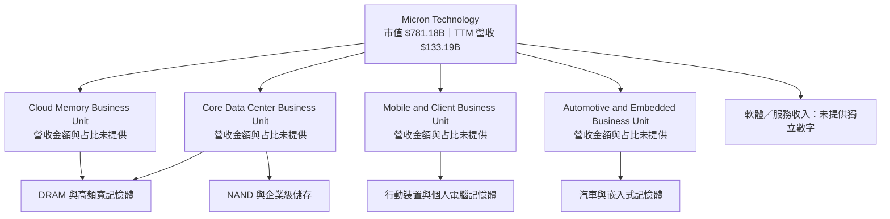
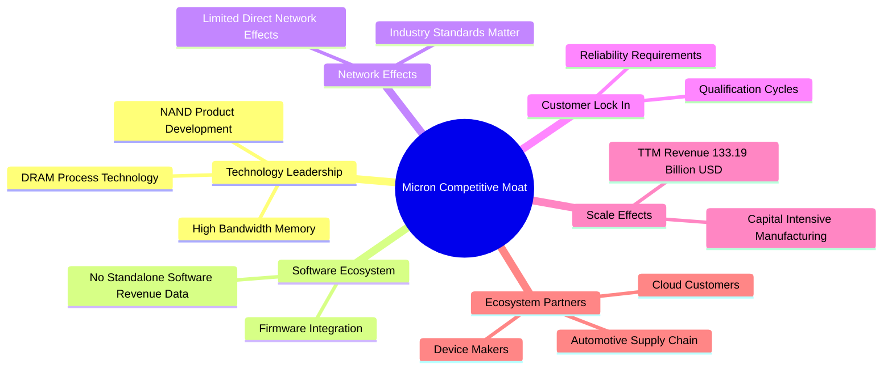
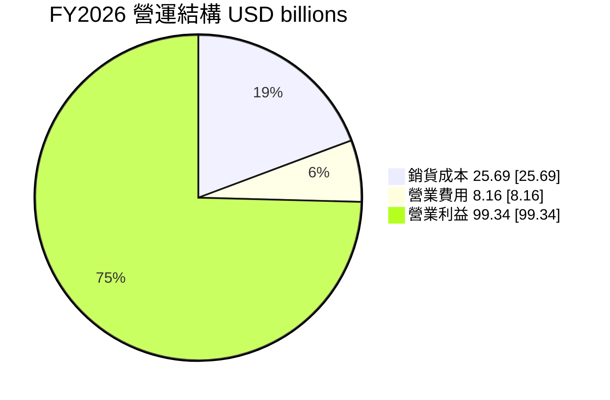
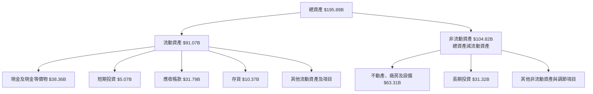
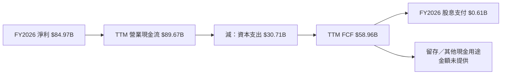
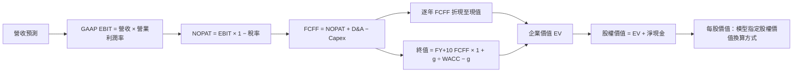
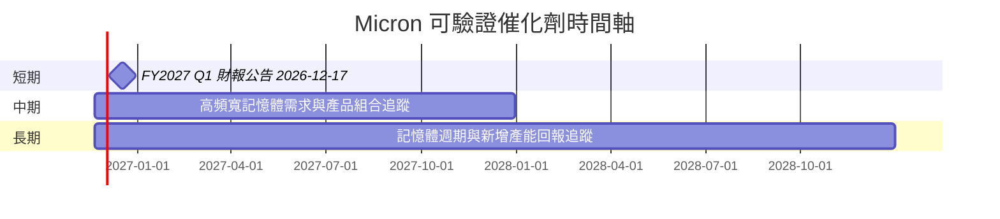
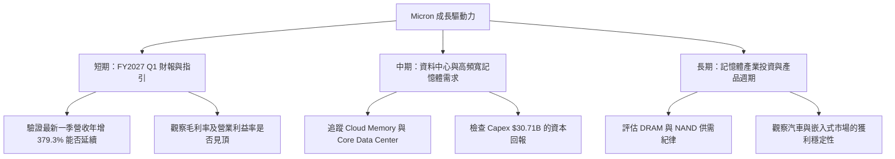
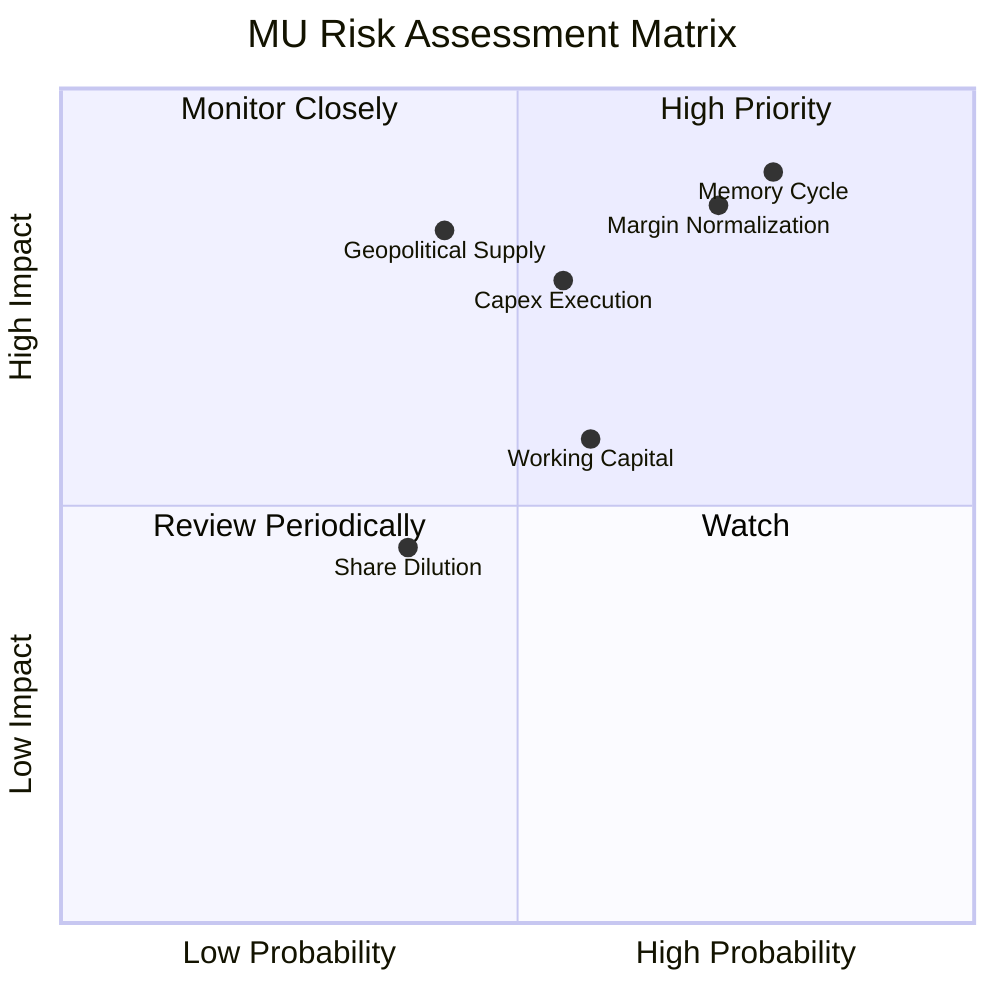
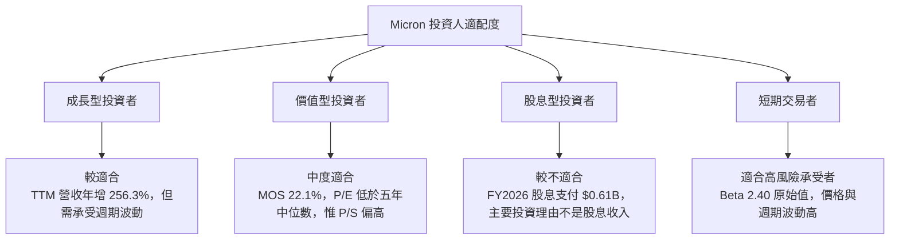

# MU 基本面深度分析報告
> **報告日期**：2026-11-20 ｜ **語言**：繁體中文 ｜ **數據來源**：SEC 申報資料 (XBRL)、Yahoo Finance、Finviz、StockAnalysis、Roic.ai ｜ **分析師**：CFA 級機構研究

---

## 目錄

| # | 章節 | 核心結論 |
|---|------|----------|
| 1 | 執行摘要 | 評級為買入；加權合理價值 $886.23；MOS +22.1% |
| 2 | 公司概覽與商業模式 | 記憶體技術、規模與客戶認證構成護城河，但產品週期與資本密集度削弱可預測性 |
| 3 | 損益表深度分析 | TTM 營收 $133.19B、年增 256.3%；獲利率處於週期高位 |
| 4 | 資產負債表分析 | 淨現金 $40.15B；流動性充足，營運資金週期延長 |
| 5 | 現金流量深度分析 | TTM FCF $58.96B，FCF Yield 7.55%；資本支出仍高 |
| 6 | 獲利能力與資本效率 | ROIC 86.2% 高於 WACC 14.00%，目前大幅創造股東價值 |
| 7 | 相對估值分析 | P/E 低於自身五年中位數；同業 P/S 估值則顯示現價並非全面低估 |
| 8 | DCF 內在價值評估 | DCF 基準每股 $881.83；模型輸入與輸出有可複算差異，需審慎看待 |
| 9 | 成長催化劑 | AI／高頻寬記憶體需求及下一季財報為主要觀察焦點；TAM 數據未提供 |
| 10 | 風險矩陣 | 記憶體週期、估值波動、資本支出與客戶集中是主要風險 |
| 11 | 投資建議 | 依 MOS 評級為買入；現價在建議買入區間內，須以季度指標驗證 |

---

## 1. 執行摘要

### 1.0 一頁式投資儀表板（Portfolio Manager 30 秒速讀）

| 項目 | 內容 |
|------|------|
| **投資論點（3 句）** | ① TTM 營收 $133.19B、年增 256.3%，最新一季年增 379.3%，代表需求與定價／產品組合處於快速擴張階段。② TTM FCF 為 $58.96B、FCF Yield 7.55%，且淨現金 $40.15B，提供高額再投資與抗週期能力。③ 加權合理價值 $886.23，相對 2026-11-19 收盤 $690.44 的 MOS 為 +22.1%，依規則 20 評級為買入。 |
| **綜合評分** | **8.1/10**（引用 1.1 六項評分算術平均） |
| **財務健康** | 🟢 現金及短期投資 $43.43B、總債務 $3.28B、淨現金 $40.15B；流動性強，但現金轉換週期從 155 天增至 185 天。 |
| **ROIC vs WACC** | **86.2% vs 14.00%**；差距 72.2 個百分點，當前獲利能力大幅高於資本成本。 |
| **FCF 趨勢** | FY2023 -$6.12B → FY2024 $0.12B → FY2025 $1.67B → FY2026 $58.96B；TTM FCF Yield **7.55%**。 |
| **估值** | Forward P/E **3.32x**｜EV/EBITDA **6.83x**｜FCF Yield **7.55%**。週期高峰獲利可能使當前倍數顯得偏低。 |
| **DCF 內在價值（基準）** | **$881.83**；現價相對 DCF 折價 **21.7%**（現價 ÷ DCF − 1；第 8.5 節）。 |
| **安全邊際（MOS）** | **+22.1%**＝($886.23 − $690.44) ÷ $886.23；基準為加權合理價值。🟡 10%–25% 有限。 |
| **預期報酬（基準情境 12M）** | **+28.4%**，以加權合理價值 $886.23 相對現價 $690.44 計算；非保證報酬。 |
| **關鍵風險（前二）** | 記憶體價格與供需反轉；毛利率由高峰回落時，當前低 P/E 可能快速失真。 |
| **評級 + 信心度** | 🟢 **買入** ｜ 信心：中。評級依 MOS 門檻，惟 DCF 表格存在內部算術差異、而 EPS 超預期資料缺漏，限制信心度。 |

### 1.1 綜合評分卡（全報告唯一）

| 維度 | 評分（1–10） | 主要依據（引用數字與其來源章節） |
|------|--------------|----------------------------------|
| 成長性 | 9.0 | TTM 營收年增 256.3%、最新一季年增 379.3%（第 3 章）；高成長含有週期反彈與基期效應。 |
| 獲利能力 | 9.0 | TTM 營業利益率 74.6%、ROIC 86.2%、Piotroski F-Score 8/9（第 3、6 章）。 |
| 財務健康 | 9.0 | 淨現金 $40.15B、流動比率 3.314；CCC 185 天，較一年前延長 30 天（第 4 章）。 |
| 估值 | 7.0 | MOS +22.1%；P/E 9.3x 低於五年中位數 17.4x，但 P/S 5.9x 高於歷史中位數 4.2x（第 7、8 章）。 |
| 護城河 | 8.0 | 記憶體製程、規模、客戶認證與高頻寬記憶體產品能力提供優勢；但記憶體商品化與週期性仍限制定價持久性（第 2 章）。 |
| 管理層與資本配置 | 6.5 | FY2026 Capex $30.71B、SBC $1.33B；稀釋股數測試未通過，且回購數據未提供（第 3、5 章）。 |
| **綜合評分** | **8.1** | 六項算術平均＝(9.0 + 9.0 + 9.0 + 7.0 + 8.0 + 6.5) ÷ 6＝8.083，四捨五入至一位小數為 **8.1**。 |

### 1.2 五大投資論點 + 三大核心風險

| 類型 | 項目 | 具體依據 | 信心度 |
|------|------|----------|--------|
| 🟢 **投資論點①** | 營收快速擴張 | TTM 營收 $133.19B，年增 256.3%；最新一季營收 $54.23B，單季年增 379.3%。需求、出貨與產品組合改善共同推升營收；若不延續，需防範高基期回落。 | 🟢 高 |
| 🟢 **投資論點②** | 獲利槓桿明顯 | TTM 營業利益 $99.34B、營業利益率 74.6%，FY2025 為 26.1%；產能利用率與價格改善帶來巨大營運槓桿，但高峰利潤率未必可持續。 | 🟢 高 |
| 🟢 **投資論點③** | 現金流和資產負債表提供緩衝 | TTM OCF $89.67B、Capex $30.71B、FCF $58.96B；淨現金 $40.15B，可支應技術投資與景氣下行。 | 🟢 高 |
| 🟢 **投資論點④** | 資本回報高於資本成本 | ROIC 86.2% 對 WACC 14.00%，差距 72.2 個百分點；若 ROIC 隨價格與利潤率正常化，價值創造幅度會收窄。 | 🟢 中高 |
| 🟢 **投資論點⑤** | MOS 支持正向報酬不對稱 | 加權合理價值 $886.23，相對現價 $690.44 上行空間 28.4%、MOS 22.1%；但悲觀 DCF 情境仍為 $429.05。 | 🟡 中 |
| 🟡 **風險①** | 週期與價格回落 | FY2026 營業利益率 74.6%，遠高於 FY2025 的 26.1%；若 ASP 或利用率下滑，利潤率可能快速正常化。 | 🔴 高衝擊 |
| 🔴 **風險②** | 資本支出與供給擴張 | FY2026 Capex $30.71B，約為營收 23.1%；供給擴張可能在需求放緩時加劇價格壓力。 | 🔴 高衝擊 |
| 🟡 **風險③** | 現金轉換週期拉長及股數稀釋 | CCC 由 155 天增至 185 天；Piotroski 的稀釋股數測試未通過。若應收與存貨繼續快於營收增長，現金流品質將下降。 | 🟡 中 |

### 1.3 快速統計卡片

| 指標 | 公司實際值（期間） | 同業中位數 | 狀態 |
|------|--------------------|------------|------|
| 營收成長（TTM） | **256.3%** | — | 🟢 |
| 營收成長（最新一季年增） | **379.3%** | 327.9% | 🟢 |
| 毛利率（TTM） | **80.7%** | 77.4% | 🟢 |
| 營業利益率（TTM） | **74.6%** | — | 🟢 |
| ROIC（TTM） | **86.2%** | — | 🟢 |
| Forward P/E | **3.32x** | 2.90x | 🟡 |
| FCF Yield（TTM） | **7.55%** | — | 🟢 |
| Piotroski F-Score | **8 / 9** | — | 🟢 |

> 同業中位數只對具備可比較數據的同業計算。Forward P/E 中位數為 SKHY 2.9x、SNDK 2.6x、WDC 7.3x 的中位數 2.9x；同業數據來源為 Yahoo Finance。

### 1.4 投資結論

```
╔══════════════════════════════════════════════════════════════════╗
║                    📊 投資結論摘要                               ║
╠══════════════════════════════════════════════════════════════════╣
║  評級：買入（依 MOS +22.1%，落在 10%–25% 門檻）                  ║
║  價格（2026-11-19 收盤）：$690.44                                ║
║  DCF 內在價值（基準）：$881.83（現價折價 21.7%）                 ║
║  安全邊際 MOS：+22.1%＝(加權合理價值−現價)÷加權合理價值         ║
║  加權合理價值（8.8）：$886.23                                    ║
║  DCF 情境價值：                                                   ║
║    悲觀情境：$429.05（-37.9%）                                   ║
║    基準情境：$881.83（+27.7%）                                   ║
║    樂觀情境：$1,715.71（+148.5%）                                ║
║  綜合評分：8.1/10（引用 1.1）                                    ║
║  適合投資人：能承受高波動、願意追蹤記憶體供需週期的成長型投資人 ║
╚══════════════════════════════════════════════════════════════════╝
```

---

## 2. 公司概覽與商業模式

### 2.1 業務結構與收入來源

Micron Technology, Inc. 設計、製造及銷售 DRAM、NAND 與儲存相關半導體，業務涵蓋資料中心、雲端、行動與客戶端、汽車與嵌入式市場。公司摘要指出分為 Cloud Memory、Core Data Center、Mobile and Client、Automotive and Embedded 業務單位；各業務單位營收及占比未提供，因此不以估算比例繪圖。



### 2.2 市場份額

市場份額數據未提供，故不呈現份額圖表或自行估算比例。可觀察到 Micron TTM 營收為 $133.19B、最新一季營收年增 379.3%；與 SKHY 327.9%、SNDK 377.9%、WDC 55.5% 的最新一季年增相比，Micron 的成長速度位於此組同業的高位，但營收增速不等同市場份額變化。

### 2.3 競爭護城河分析



### 2.4 護城河強度

| 護城河項目 | 強度（強／中／弱） | 證據（引用數字或事實） | 會削弱它的情況 |
|------------|--------------------|------------------------|----------------|
| 技術與製程 | 強 | DRAM、NAND 與高頻寬記憶體需要長期製程研發及資本投入；FY2026 研發費用 $5.65B。 | 競爭者追上製程、產品良率落後或新技術轉換失敗。 |
| 軟體生態系統 | 弱至中 | 財務資料未列獨立軟體或服務收入；主要價值仍來自硬體產品與系統整合。 | 產品差異化不足、客戶轉向可替代供應商。 |
| 網路效應 | 弱 | 記憶體本身未呈現典型雙邊平台網路效應。 | 標準化與多來源採購使客戶容易切換。 |
| 客戶鎖定 | 中 | 客戶認證、產品可靠性與系統相容性會造成導入成本；客戶集中度資料未提供。 | 長期供應合約到期、第二供應商通過認證或客戶自研方案成熟。 |
| 規模效應 | 強 | FY2026 營收 $133.19B、Capex $30.71B、研發 $5.65B，顯示固定成本與資本門檻高。 | 低利用率令折舊與製造成本上升，規模反而放大損失。 |
| 生態夥伴 | 中 | 跨雲端、行動、個人電腦及車用市場提供多元應用場景；各板塊收入占比未提供。 | 供應鏈限制、客戶集中或終端需求同步下滑。 |

護城河評分理由：1.1 的 **8.0/10** 反映 Micron 的製程、研發與規模壁壘，但記憶體具商品化特性，並非可永久維持高價差的平台型護城河。

---

## 3. 損益表深度分析

### 3.1 年度收入成長趨勢（近4年）

FY2023 至 FY2026 營收分別為 $15.54B、$25.11B、$37.38B、$133.19B。FY2023–FY2026 三年 CAGR 約為 104.7%，計算為 \((133.19 ÷ 15.54)^{1/3} − 1\)；如此高的 CAGR 主要反映週期復甦與 FY2026 暴增，不應視為長期正常增速。

```
╔══════════════════════════════════════════════════════════════════╗
║           Micron Technology 年度收入趨勢（FY2023-FY2026）       ║
╠══════════════════════════════════════════════════════════════════╣
║  FY2023  $15.54B  ███░░░░░░░░░░░░░░░░░░░░  YoY: N/A*           ║
║  FY2024  $25.11B  █████░░░░░░░░░░░░░░░░░  YoY: +61.6%  🟢      ║
║  FY2025  $37.38B  ███████░░░░░░░░░░░░░░░  YoY: +48.9%  🟢      ║
║  FY2026 $133.19B  ████████████████████████ YoY: +256.3% 🟢     ║
║                                                                  ║
║  *FY2022 為 $30.758B；FY2023 年增約 -49.5%。                     ║
║  三年收入 CAGR 約 +104.7%；FY2026 增速含強烈週期反彈成分。      ║
╚══════════════════════════════════════════════════════════════════╝
```

年增率依序為：FY2024＝25.11 ÷ 15.54 − 1＝61.6%；FY2025＝37.38 ÷ 25.11 − 1＝48.9%；FY2026 採用程式計算的 TTM 年增率 **256.3%**。年度資料來源間存在少量期間端點差異，FY2026 的 TTM 數字依 SEC 申報期間彙整結果。

### 3.2 季度收入趨勢分析

| 季度 | 營收（$B） | QoQ 成長 | YoY 成長 | 備註 |
|------|------------:|---------:|---------:|------|
| 2025-11-30 | 13.64 | — | 56.7% | 以提供的季度收入資料計算；QoQ 基準季度未列於近四季表。 |
| 2026-02-28 | 23.86 | +74.9% | 196.3% | 營收擴張加速，季度年增已接近兩倍。 |
| 2026-05-31 | 41.46 | +73.8% | 345.7% | 成長速度維持高檔。 |
| 2026-08-31 | 54.23 | +30.8% | 379.3% | 最新季度營收仍大幅增長，但 QoQ 增幅較前兩季收斂。 |

QoQ 公式示例：2026-08-31 營收成長＝54.229 ÷ 41.456 − 1＝30.8%。最新季度 YoY 使用單季數據，**不是 TTM 成長率**；TTM 年增率另為 256.3%。

### 3.3 利潤率演變分析

| 利潤率指標 | FY2023 | FY2024 | FY2025 | FY2026 | 趨勢 | 評估 |
|------------|-------:|-------:|-------:|-------:|------|------|
| **毛利率** | -9.1%* | 22.3% | 39.8% | 80.7% | ↑ 週期復甦及價格／組合改善 | 🟢 |
| **營業利益率** | -34.8%* | 5.2% | 26.1% | 74.6% | ↑ 固定成本吸收與營收規模迅速上升 | 🟢 |
| **淨利率** | -37.5% | 3.1% | 22.8% | 63.8% | ↑ 營業槓桿帶動，FY2026 已處高峰區 | 🟡 |

\* FY2023 毛利資料來源有差異：年度損益表列毛利 -$1.42B，另一資料來源列 $0.415B；表中採年度損益表的 -$1.42B，故毛利率為 -1.42 ÷ 15.54＝-9.1%。FY2023 營業利益同樣存在資料源差異，這裡使用年度損益表列示的 -$5.41B。

**利潤率演變深度解析：** FY2026 TTM 毛利率 80.7%、營業利益率 74.6%，相對 FY2025 的 39.8% 與 26.1% 大幅提升。收入從 FY2025 $37.38B 升至 FY2026 $133.19B，增量營收令固定製造成本更充分吸收；高頻寬記憶體及資料中心產品組合、供需與價格改善亦可能有貢獻。但分部價格、出貨量及產品組合數據未提供，不能把利潤率變化精確拆成各因素。FY2026 的利潤率不能直接當作完整週期正常值。

### 3.4 費用結構分析

以 FY2026 收入及毛利、營業利益計算：營收 $133.19B、銷貨成本約 $25.69B（營收 − 毛利）、營業費用約 $8.16B（毛利 − 營業利益）、營業利益 $99.34B。此為由報表項目計算的簡化營運結構，不代表完整淨利橋接。



```
╔══════════════════════════════════════════════════════════════════╗
║              FY2026 營收至營業利益簡化結構                       ║
╠══════════════════════════════════════════════════════════════════╣
║  營收 $133.19B     ██████████████████████████  100.0%             ║
║  毛利 $107.50B     █████████████████████       80.7%              ║
║  營業利益 $99.34B  ███████████████████         74.6%              ║
║  研發費用 $5.65B   已列費用；占營收約 4.2%                       ║
╚══════════════════════════════════════════════════════════════════╝
```

### 3.5 季度 EPS 趨勢與盈餘品質（Quality of Earnings）

| 盈餘品質項目 | 數值/佔比 | 評估 |
|--------------|-----------|------|
| 股權薪酬 SBC / 營收 | $1.33B ÷ $133.19B＝**1.0%** | 🟢 絕對比率不高，但仍造成股東稀釋；Piotroski 稀釋股數測試未通過。 |
| SBC / 營業現金流 | $1.33B ÷ $89.67B＝**1.5%** | 🟢 相較 OCF 不高；SBC 是非現金加回項目，但仍是經濟上的股東成本。 |
| FCF / 淨利（現金轉換率） | $58.96B ÷ $84.97B＝**69.4%** | 🟡 現金轉換為正，但高 Capex 吸收部分營業現金流。 |
| 一次性/非經常性損益 | 具體金額未提供 | 🟡 無法確認特殊項目對 GAAP 淨利的影響，不能假定全為經常性。 |
| 有效稅率異常 | **14.8%**（最新年度） | 🟡 稅率有助於較高稅後獲利；歷年完整稅務調節未提供。 |
| 資本化支出 vs 費用化 | FY2026 Capex $30.71B；研發費用 $5.65B | 🟡 高額資本支出形成未來折舊，當期現金盈餘低於營業利潤所顯示的水準；資本化與費用化細項未提供。 |

季度 EPS（StockAnalysis）由 2025-11 季 $4.60、2026-02 季 $12.07、2026-05 季 $24.67 增至 2026-08 季 $32.85。對應 EPS 年增率分別約 175.5%、756.0%、1368.5%、1059.5%。增幅反映獲利由低基期快速擴張；2026-08 季 EPS 年增放慢，不能單憑此判定盈餘見頂。**最近四季 EPS 超預期／不及預期：分析師 EPS 估值與實際值均為 N/A，因此無法判定 beat/miss。**

**盈餘品質結論：** TTM OCF $89.67B 高於淨利 $84.97B，顯示營運現金流有支撐；但 Capex $30.71B 令 FCF/淨利僅 69.4%，代表獲利並非等額轉成可分配現金。SBC 占營收 1.0%，稀釋風險有限但不是零。估值應關注全週期 FCF，而不應只用高峰 GAAP EPS 外推。

---

## 4. 資產負債表分析

### 4.1 資產結構分解

截至 FY2026，總資產 $195.89B、流動資產 $91.07B，非流動資產按差額計算為 $104.82B。以下圖表只展開已提供的分類總額，不對未列明細作補值。



### 4.2 流動性與營運資金分析

| 指標 | 最新 TTM | 一年前 TTM | 變化 | 解讀 |
|------|----------|------------|------|------|
| DSO 應收帳款天數 | 87 天 | 70 天 | +17 天 | 收款天數增加，可能與營收急升、客戶結算時點或應收結構有關；需追蹤應收增速是否回落至營收增速附近。 |
| DIO 存貨天數 | 147 天 | 136 天 | +11 天 | 存貨占用資金增加；可能反映為需求準備，也可能是供需轉弱時的庫存風險。 |
| DPO 應付帳款天數 | 50 天 | 51 天 | -1 天 | 付款週期略縮短，對現金流的支撐較一年前弱。 |
| CCC 現金轉換週期 | 185 天 | 155 天 | +30 天 | 現金由投入到回收的時間拉長，與營收高速成長並存，不能忽視營運資金品質。 |

流動性比率資料如下：

| 指標 | FY2026 | FY2025 | 評估 |
|------|-------:|-------:|------|
| 流動比率 | 3.314 | 28.84 ÷ 11.45＝2.52 | 🟢 短期資產覆蓋流動負債充足。 |
| 速動比率 | 2.898 | N/A | 🟢 最新值顯示扣除存貨後仍有流動性緩衝。 |
| 現金及短期投資 | $43.43B | $10.31B | 🟢 現金資源顯著增加。 |

### 4.3 債務結構分析

債務數據來源間存在差異：VERIFIED FIGURES 計算的總債務為 **$3.28B**，其他市場／報表區塊列 FY2026 總債務 **$5.18B**。依價格與估值規則，本報告主要資產負債表分析使用 VERIFIED FIGURES 的 $3.28B；估值方法區塊的淨現金 $40.15B 亦依此口徑。差異可能源於債務定義或資料時點，應以 SEC 10-K 債務附註核對。

```
╔══════════════════════════════════════════════════════════════════╗
║                   Micron 債務健康診斷                            ║
╠══════════════════════════════════════════════════════════════════╣
║  總債務（VERIFIED）： $3.28B   █░░░░░░░░░░░░░░░░░░░░░░░░         ║
║  現金+短期投資：      $43.43B  ██████████████████████████         ║
║  淨現金：             $40.15B  🟢                                 ║
║                                                                  ║
║  淨現金緩衝：$43.43B − $3.28B = $40.15B                          ║
║  Debt/EBITDA：資料口徑不一致，N/A（不以混合口徑推算）             ║
║  Interest Coverage：利息費用及同口徑債務明細不足，N/A              ║
║  其他資料源總債務 $5.18B，待 SEC 債務附註核對                     ║
╚══════════════════════════════════════════════════════════════════╝
```

### 4.4 股東權益趨勢

| 財年 | 股東權益（$B） | 年變化 | 解讀 |
|------|---------------:|-------:|------|
| FY2023 | 44.12 | — | 低景氣階段仍維持正權益。 |
| FY2024 | 45.13 | +2.3% | 獲利復甦初期。 |
| FY2025 | 54.16 | +20.0% | 淨利回升支持權益累積。 |
| FY2026 | 138.38 | +155.5% | 盈利大增，股東權益快速擴張。 |

```
╔══════════════════════════════════════════════════════════════════╗
║              股東權益變化（美元十億）                            ║
╠══════════════════════════════════════════════════════════════════╣
║  FY2023  $44.12B  ████████░░░░░░░░░░░░░░                         ║
║  FY2024  $45.13B  ████████░░░░░░░░░░░░░░                         ║
║  FY2025  $54.16B  ██████████░░░░░░░░░░░░                         ║
║  FY2026 $138.38B  ████████████████████████                       ║
╚══════════════════════════════════════════════════════════════════╝
```

---

## 5. 現金流量深度分析

### 5.1 現金流量瀑布圖



### 5.2 FCF 轉換率趨勢

| 財年 | FCF（$B） | 淨利（$B） | FCF / 淨利 | 解讀 |
|------|---------:|-----------:|-----------:|------|
| FY2023 | -6.12 | -5.83 | 105.0% | 分子分母皆為負，比例不代表正常現金轉換能力。 |
| FY2024 | 0.12 | 0.78 | 15.6% | FCF 接近損益兩平，資本支出仍壓制現金轉換。 |
| FY2025 | 1.67 | 8.54 | 19.6% | 獲利回升但 FCF 尚低，擴產投資吸收大量現金。 |
| FY2026 | 58.96 | 84.97 | 69.4% | 現金流大幅改善，但仍低於淨利，反映高 Capex。 |

### 5.3 自由現金流趨勢

| 財年 | FCF（$B） | FCF Yield | 評估 |
|------|----------:|----------:|------|
| FY2023 | -6.12 | N/A | FCF 為負，不列正向殖利率。 |
| FY2024 | 0.12 | N/A | FCF 接近零，無法以歷史市值口徑直接比較。 |
| FY2025 | 1.67 | N/A | FCF 改善但仍低於 FY2026。 |
| FY2026 TTM | 58.96 | 7.55% | 以程式計算的 TTM FCF Yield 引用。 |

```
╔══════════════════════════════════════════════════════════════════╗
║            自由現金流：歷史實際 vs 最新 TTM                       ║
╠══════════════════════════════════════════════════════════════════╣
║  FY2023(實)  -$6.12B  ◀ 負值                                     ║
║  FY2024(實)   $0.12B  ░                                          ║
║  FY2025(實)   $1.67B  █                                          ║
║  FY2026 TTM  $58.96B  ████████████████████████                   ║
║                                                                  ║
║  FY2026 TTM FCF Yield：7.55%                                      ║
║  注意：FCF 跨週期波動大，單一 TTM 不等於長期可持續水準。         ║
╚══════════════════════════════════════════════════════════════════╝
```

### 5.4 資本配置評估

完整的回購金額與維持性／成長性 Capex 拆分未提供，因此不製作會暗示比例的資本配置圓餅圖。

| 資本用途／來源 | FY2026 數值 | 評估 |
|----------------|-----------:|------|
| 營業現金流 | $89.67B | 盈利回升帶來充足現金來源。 |
| 資本支出 | $30.71B | 約占營收 23.1%；支持產能與技術投資，但使 FCF 低於 OCF。 |
| FCF | $58.96B | 扣除 Capex 後仍有大量自由現金流。 |
| 現金股息 | $0.61B | 相對 FCF 約 1.0%；派息規模低，保留投資彈性。 |
| 股票回購 | N/A | 資料未提供，不能推算。 |
| 留存／其他配置 | N/A | 沒有完整現金變動橋接資料。 |

---

## 6. 獲利能力與資本效率

### 6.1 ROE / ROA / ROIC 趨勢

歷年同口徑 ROIC、ROA 與 ROE 資料未完整提供，避免以不同來源或不同期間混算。

| 指標 | 最新可用值 | 歷史資料 | 評估 |
|------|-----------:|----------|------|
| ROE（品質指標口徑） | 61.4% TTM | 歷年同口徑 N/A | 🟢 高；但週期高峰可能使其高於全週期水準。 |
| ROA | 44.6%（其他來源） | 歷年同口徑 N/A | 🟢 高；與品質指標 ROE 期間口徑不同，不混作同一組分解。 |
| ROIC | 86.2% TTM | 歷年同口徑 N/A | 🟢 遠高於採用 WACC；資本效率現階段極高。 |
| 行業均值 | — | 資料未提供 | 不列無來源的行業均值。 |

### 6.2 ROIC vs WACC 分析（核心價值創造判斷）

```
╔══════════════════════════════════════════════════════════════════╗
║                ROIC vs WACC 深度分析                            ║
╠══════════════════════════════════════════════════════════════════╣
║  WACC（採用值）：14.00%                                           ║
║  ├── 無風險利率（10Y 美債）：5.05%                               ║
║  ├── 市場風險溢酬：5.00%                                          ║
║  ├── 原始 Beta：2.40；採用調整後 Beta：1.93                     ║
║  ├── 股權成本：14.71%                                             ║
║  ├── 稅前債務成本：3.23%；有效稅率：14.8%                       ║
║  ├── 權重：股權 99.6%，債務 0.4%                                 ║
║  └── 計算 WACC 14.66%，受 7%–14% 區間限制，採用上限 14.00%     ║
║                                                                  ║
║  ROIC（TTM）：86.2%                                               ║
║  EVA Spread = ROIC − WACC = 86.2% − 14.0% = +72.2 個百分點      ║
║                                                                  ║
║  ROIC 86.2%  ▓▓▓▓▓▓▓▓▓▓▓▓▓▓▓▓▓▓▓▓▓▓▓▓▓▓▓▓▓▓▓▓▓▓▓▓▓▓▓▓▓▓       ║
║  WACC 14.0%  ▓▓▓▓▓▓▓░░░░░░░░░░░░░░░░░░░░░░░░░░░░░░░░░       ║
║                                                                  ║
║  📊 判斷：ROIC 約為 WACC 的 6.2 倍，當前經濟利潤為正。          ║
║  但 ROIC 基於週期高峰 TTM，週期正常化後差距可能顯著縮小。       ║
╚══════════════════════════════════════════════════════════════════╝
```

ROIC 與 WACC 均採指定計算口徑，且 WACC 依成本資本資料中的限制區間採用 14.00%。EVA spread＝86.2% − 14.0%＝72.2 個百分點。不能將此差距直接外推為長期水平，因記憶體價格和產能利用率高度循環。

### 6.3 杜邦三因素分解

| 因素 | 數值（TTM） | 解讀 |
|------|-------------|------|
| 淨利率 | 63.8% | 當前淨利率高，代表價格、組合及固定成本吸收有利；但高度週期化。 |
| 資產週轉率 | 0.68 | 每單位資產產生的營收，擴產與資產基礎擴張會影響此比率。 |
| 權益乘數 | 1.42 | 槓桿並非 ROE 的主要推動來源。 |
| **ROE** | **61.4%** | 品質指標的杜邦列：63.8% × 0.68 × 1.42＝61.4%（顯示值四捨五入）。 |

依杜邦分解，ROE 主要由高淨利率帶動，並非高度依賴財務槓桿。

### 6.4 財務體質：Piotroski F-Score

**Piotroski F-Score：8 / 9**。該指標依 TTM 至 2026-09-03 與 TTM 至 2025-08-28 比較；缺少輸入的測試不納入計分，本次列出九項測試且一項未通過。

| 測試 | 結果 | 解讀 |
|------|------|------|
| ROA > 0 | ✅ 通過 | TTM 獲利為正。 |
| 營業現金流 > 0 | ✅ 通過 | TTM OCF $89.67B。 |
| ROA 高於一年前 | ✅ 通過 | 利潤反彈改善資產回報。 |
| 營業現金流 > 淨利 | ✅ 通過 | OCF $89.67B 高於淨利 $84.97B。 |
| 長期負債 ÷ 總資產低於一年前 | ✅ 通過 | 指標方向改善。 |
| 流動比率高於一年前 | ✅ 通過 | 最新流動比率 3.314。 |
| 稀釋股數未增加 | ❌ 未通過 | 股數稀釋代表原股東每股權益遭攤薄；未提供增加幅度。 |
| 毛利率高於一年前 | ✅ 通過 | TTM 毛利率 80.7%，處於大幅改善階段。 |
| 資產週轉率高於一年前 | ✅ 通過 | 資產利用效率改善。 |

---

## 7. 相對估值分析

### 7.1 同業估值比較表格

| 估值指標 | **MU** | **SKHY** | **SNDK** | **WDC** | MU 評估 |
|----------|-------:|---------:|---------:|--------:|-----------|
| **Trailing P/E** | 9.3x | 6.6x | 6.0x | 10.4x | 🟡 位於同業區間中間；週期高峰 EPS 可能壓低倍數。 |
| **Forward P/E** | 3.32x | 2.9x | 2.6x | 7.3x | 🟡 高於 SKHY、SNDK，低於 WDC；遠期盈餘預期風險高。 |
| **P/S Ratio** | 5.9x | N/A | 3.7x | 7.7x | 🟡 可比同業中位數 5.7x；與中位數接近。 |
| **EV/EBITDA** | 6.9x | N/A | 0.4x | 17.5x | 🟡 可比值差異極大，SNDK 倍數異常低，解讀須謹慎。 |
| **最新一季營收年增** | 379.3% | 327.9% | 377.9% | 55.5% | 🟢 MU 高於 SKHY、與 SNDK 接近，明顯高於 WDC。 |
| **毛利率（TTM）** | 80.7% | 77.4% | 80.0% | 52.6% | 🟢 MU 高於這組同業中位數 77.4%。 |

同業名稱依 Peer multiples 代號列示；P/S 中位數以 SNDK 3.7x、WDC 7.7x 計為 5.7x。SKHY 的 P/S 與 EV/EBITDA 因幣別混合標示 N/A，不作補值。Peer multiples 由 Yahoo Finance 彙整。

### 7.2 歷史估值區間分析

| 倍數 | 現值 | 五年中位數 | 五年區間 | 當前百分位 | 解讀 |
|------|-----:|-----------:|----------:|-----------:|------|
| P/E | 9.3x | 17.4x | 7.4x–138.5x | 13% | 🟢 位於自身歷史偏低區，但低 P/E 可能來自週期高峰 EPS。 |
| P/S | 5.9x | 4.2x | 2.1x–11.7x | 75% | 🔴 高於歷史中位數，市場已計入成長與高毛利預期。 |
| EV/EBITDA | 6.9x | 9.7x | 3.6x–80.7x | 30% | 🟡 低於中位數，仍受高峰 EBITDA 影響。 |

```
╔══════════════════════════════════════════════════════════════════╗
║              五年估值區間：現值與歷史中位數                      ║
╠══════════════════════════════════════════════════════════════════╣
║  P/E       7.4x ├──● 9.3x──────────│17.4x│───────── 138.5x       ║
║                   現值 13 百分位     中位數                       ║
║  P/S       2.1x ├────────│4.2x│────● 5.9x────────── 11.7x        ║
║                                  現值 75 百分位                   ║
║  EV/EBITDA 3.6x ├──────● 6.9x──────│9.7x│───────── 80.7x         ║
║                        現值 30 百分位                             ║
╚══════════════════════════════════════════════════════════════════╝
```

### 7.3 情境價值（Bear / Base / Bull，照抄 DCF MODEL）

| 情境 | 第 1 年營收成長 | 期末營業利潤率 | WACC | 每股價值 | 相對現價 | 機率 | 會發生的條件 |
|------|----------------:|----------------:|-----:|---------:|---------:|-----:|--------------|
| 🔴 悲觀 | 15.0% | 22.2% | 15.00% | $429.05 | -37.9% | 25% | AI／資料中心需求降溫、記憶體供給增加或價格快速正常化，並伴隨較高風險折現率。 |
| 🟡 基準 | 30.0% | 26.1% | 14.00% | $881.83 | +27.7% | 50% | 近端成長仍高，長期營業利益率回落至模型設定的歷史中位附近。 |
| 🟢 樂觀 | 45.0% | 28.8% | 13.00% | $1,715.71 | +148.5% | 25% | 需求、產品組合與供給紀律好於基準，折現風險下降。 |

這些數值是程式 DCF 模型的情境輸出；除表列假設外，情境的逐年營收、FCFF 中間值未提供，故不自行補造情境現金流。

### 7.4 相對估值隱含價格區間

| 方法 | 每股價值 | 相對現價 | 依據 |
|------|---------:|---------:|------|
| 同業 P/S | $669.81 | -3.0% | 同業 P/S 中位數 5.7x（SNDK、WDC）乘以公司 TTM 營收，再按估值模型的股數口徑換算。 |
| 同業 EV/EBITDA | N/A | N/A | Peer multiples 方法標註無法計算；不新增或替代估值方法。 |

```
╔══════════════════════════════════════════════════════════════════╗
║              相對估值法每股價值與現價                            ║
╠══════════════════════════════════════════════════════════════════╣
║  $669.81 同業 P/S ────── $690.44 現價                           ║
║  依據：同業中位數 5.7x × MU TTM 營收；現價高於該估值約 3.0%      ║
║  同業 EV/EBITDA：N/A（模型未能計算）                             ║
╚══════════════════════════════════════════════════════════════════╝
```

---

## 8. DCF 內在價值評估（Discounted Cash Flow）

> 本節只採用程式 DCF MODEL 的基準假設與輸出，不另建替代模型。模型列示數值按原值引用；若數字之間無法由列示公式完全複算，會明確指出，不以其他數字靜默替代。

### 8.0 估值推理鏈（Thinking Logic：在算之前先想清楚）

**Step 1 — 價值由哪些變數決定？**  
Micron 的估值核心是「既有記憶體業務現金流底盤 + 資料中心與高頻寬記憶體需求增長 + 長期產品組合與利潤率正常化」。分部營收占比未提供，因此不能聲稱哪一分部占營收多少；可驗證的公司層級錨點為 TTM 營收 $133.19B、營業利益率 74.6%、FCF $58.96B。主導估值的變數是營業利潤率與折現率，因為模型讓營業利潤率由 74.6% 線性降至 26.1%，且終值現值占 EV 33.9%。

**Step 2 — 模型選擇**

| 決策點 | 本報告採用 | 理由（含數字） | 曾考慮但否決 | 否決理由 |
|--------|-----------|----------------|--------------|----------|
| 現金流定義 | FCFF | 與 WACC 折現、先得 EV 再加淨現金的結構一致；FY2026 TTM FCF $58.96B。 | FCFE | 不採用股權現金流折現，以免與 WACC 混用。 |
| 預測期 N | 10 年 | DCF MODEL 指定 N=10；記憶體週期與產能投資需要多年正常化。 | 5 年 | 可能不足以反映高峰利潤率回落及 Capex 下降。 |
| 終值方法 | Gordon Growth | 模型指定永續成長 g=3.0%，WACC=14.00% 且 WACC>g。 | 僅用退出倍數 | DCF MODEL 未提供可用的退出倍數輸出，不自行補入。 |
| EBIT 基礎 | GAAP EBIT | 基準 TTM 營業利益率 74.6%；模型明確採 GAAP。 | 非 GAAP EBIT | 可能忽略 SBC 經濟成本。 |

**Step 3 — 關鍵假設推導鏈**

- **營收成長路徑**：錨點＝TTM 營收成長 256.3%，但最新一季年增 379.3% 顯示週期高峰速度不可直接長期化 → 基期快速墊高且供需／價格週期會正常化 → **採用第一年 30.0%、第十年 3.0%，年度增速線性遞減** → 曾考慮直接沿用 256.3%，但該值是 TTM 年增率，延續十年會與週期性產業特性矛盾，故否決。
- **期末營業利潤率**：錨點＝TTM 74.6%，FY2025 26.1% → 週期高峰獲利不宜永久外推，模型以最近五個財年中位數作為收斂終點 → **第十年 26.1%** → 曾考慮維持 74.6%，但會忽略歷史週期回落，故否決。
- **WACC**：錨點＝成本資本輸入計算值 14.66% → 模型將 WACC 限制在 7%–14% → **採用 14.00%** → 未採用 14.66%，因程式模型明確設定上限 14%。
- **Capex / 營收**：錨點＝TTM Capex $30.71B ÷ 營收 $133.19B＝23.1% → 長期成熟後 Capex 假設下滑，但製造業仍需維持設備更新與擴產 → **FY+1 23.1% 線性降至 FY+10 7.8%** → 未採用固定 23.1%，因其會把目前高投資週期永久化。
- **永續成長率 g**：錨點＝模型假設 3.0%；可作長期名目經濟增長的保守化代理，但不是公司指引 → **採用 3.0%，低於 WACC 14.00%** → 不採用 4.0% 以上，避免終值對成長假設過度敏感。
- **預測期 N**：錨點＝模型固定 N=10 年 → 覆蓋當前高增長到成熟期的正常化 → **採用 10 年** → 未採用短於 5 年或超過 10 年，因程式模型只有 10 年基準輸出。
- **D&A / 營收**：錨點＝TTM 7.1% → 模型維持不變 → **採用 7.1%**。
- **有效稅率**：錨點＝最新年度有效稅率 14.8% → 模型持平 → **採用 14.8%**。
- **營運資金**：模型註明不建模 ΔWC → **採用模型設定：FCFF 不含營運資金變動**；實際 CCC 為 185 天，未納入可能低估營運資金需求。
- **EBIT 與 SBC**：錨點＝GAAP EBIT，FY2026 SBC $1.33B → GAAP 費用已包含 SBC → **採用組合 (A)：GAAP EBIT、FCFF 不另扣 SBC、股數不額外稀釋** → 不採用另扣 SBC 的組合，避免重複計入；此處固定股數與經濟稀釋的局限仍需留意。
- **年稀釋率**：模型組合 (A) 明確不再對股數進一步稀釋 → **採用 0% 額外年稀釋**；歷史稀釋股數測試未通過，因此固定股數是模型簡化。
- **終值方法**：錨點＝程式模型以 Gordon Growth 計算 TV → **採用 Gordon Growth**；未補充退出倍數，因沒有指定模型數字。

**Step 4 — 最脆弱的一環**  
最脆弱的是 74.6% 當期營業利益率向 26.1% 收斂的路徑及 WACC 上限處理；若營收／產品組合低於假設，價值會向悲觀情境 $429.05 靠攏，而非維持基準 $881.83。

**Step 5 — 計算路徑圖**



### 8.1 模型假設總表（Model Inputs）

| 假設項目 | 採用值 | 依據 / 來源 | 敏感度 |
|----------|--------|-------------|--------|
| 預測期長度 **N** | 10 年 | DCF MODEL 指定；覆蓋高成長到成熟期 | 🟡 中 |
| 營收成長率 | FY+1 30.0% 線性降至 FY+10 3.0% | TTM 成長 256.3%，但週期性與高基期使其逐年正常化 | 🔴 高 |
| 營業利潤率 | FY+1 74.6% → FY+10 26.1% | TTM 74.6%；終點為過去五個財年中位數（含 TTM） | 🔴 高 |
| 有效稅率 | 14.8% | 最新年度有效稅率 | 🟢 低 |
| Capex / 營收 | FY+1 23.1% → FY+10 7.8% | TTM Capex $30.71B ÷ 營收 $133.19B；長期降至模型維持投資假設 | 🟡 中 |
| D&A / 營收 | 7.1% | TTM 比率，模型保持固定 | 🟢 低 |
| 營運資金變動 / 營收增額 | 不建模 | DCF MODEL 明確排除 working capital；CCC 最新 185 天 | 🟡 中 |
| EBIT 基礎 | GAAP | DCF MODEL 指定 | 🟡 中 |
| 股權薪酬 SBC 處理 | GAAP EBIT 已含 SBC，不再扣除 | FY2026 SBC $1.33B；模型組合 (A) | 🟡 中 |
| 年稀釋率（股數） | 0% 額外稀釋 | 組合 (A) 固定股數規則；非歷史稀釋趨勢的預測 | 🟡 中 |
| 永續成長率 g | 3.0% | 程式模型假設，低於 14.00% WACC | 🔴 高 |
| 終值方法 | Gordon Growth | DCF MODEL 指定 | 🔴 高 |
| WACC | 14.00% | 成本資本計算 14.66%，受 7%–14% 區間限制 | 🔴 高 |

**SBC 組合聲明：本模型採用 (A)，GAAP EBIT 已計入 SBC 費用，因此 FCFF 不另減 SBC，且股數不再額外稀釋；模型將 SBC 影響視為只計入一次。**

### 8.2 折現率推導（WACC）

```
╔══════════════════════════════════════════════════════════════════╗
║                    WACC 推導（折現率）                           ║
╠══════════════════════════════════════════════════════════════════╣
║  股權成本 Ke（CAPM）：                                           ║
║  ├── 無風險利率 Rf（10Y 美債）：5.05%                            ║
║  ├── 市場風險溢酬 ERP：5.00%                                      ║
║  ├── 原始 Beta：2.40；調整後 Beta：1.93                          ║
║  ├── 規模／國別溢酬：未另加計                                     ║
║  └── Ke = 5.05% + 1.93 × 5.00% = 14.71%（引用輸入值）          ║
║                                                                  ║
║  債務成本：                                                       ║
║  ├── 稅前 Kd：3.23%                                               ║
║  ├── 有效稅率：14.8%                                              ║
║  └── 稅後 Kd = 3.23% × (1 − 14.8%) = 2.75%                      ║
║                                                                  ║
║  資本結構權重：                                                   ║
║  ├── 股權權重 E：99.6%                                           ║
║  ├── 債務權重 D：0.4%                                            ║
║  └── 加權計算 99.6%×14.71% + 0.4%×2.75% = 14.66%                ║
║                                                                  ║
║  模型限制：14.66% 落在指定 7%–14% 上限之外                       ║
║  ✅ WACC 採用值：14.00%                                           ║
╚══════════════════════════════════════════════════════════════════╝
```

**逐步演算（WACC）：**

1. **Ke（CAPM）**＝Rf + β × ERP＝5.05% + 1.93 × 5.00%＝**14.71%**（引用成本資本輸入值；以顯示到兩位小數的 Beta 直接乘算會有微小四捨五入差異）。
2. **稅前 Kd**＝成本資本輸入值 **3.23%**。利息費用與平均計息負債的原始金額未提供，故不重新反推；亦不以其他來源的債務數字替代。
3. **稅後 Kd**＝3.23% × (1 − 14.8%)＝3.23% × 0.852＝**2.752%**，顯示為 2.75%。
4. **權重**＝股權 99.6%，債務 0.4%；合計 99.6% + 0.4%＝**100.0%**。E 取市場資本權重，D 依成本資本輸入值；未另以帳面股東權益替代市值。
5. **計算 WACC**＝99.6% × 14.71% + 0.4% × 2.752%＝14.651% + 0.011%＝**14.662%**，約 14.66%；模型把 WACC 限制於 7%–14%，故**採用 14.00%**。

調整後 Beta 採用公式為 ⅔ × 原始 Beta 2.40 + ⅓ × 1＝1.93。Rf 數值為成本資本資料所列 10 年期美債 5.05%，該輸入未另列觀測日期；ERP 5.00% 是模型假設值，無外部實現風險溢酬序列供核驗。WACC 與第 6.2 節一致，均採 14.00%。

### 8.3 逐年自由現金流預測（基準情境）

單位：美元十億；金額取一位小數展示，折現因子三位小數。原始模型使用 GAAP EBIT，**FCFF = NOPAT + D&A − Capex**，不含 ΔWC。

| 年度 | FY+1 | FY+2 | FY+3 | FY+4 | FY+5 | FY+6 | FY+7 | FY+8 | FY+9 | FY+10 |
|------|-----:|-----:|-----:|-----:|-----:|-----:|-----:|-----:|-----:|------:|
| 營收 | 173.14 | 219.89 | 272.67 | 329.93 | 389.32 | 447.71 | 501.44 | 546.57 | 579.36 | 596.74 |
| 營收 YoY | 30.0% | 27.0% | 24.0% | 21.0% | 18.0% | 15.0% | 12.0% | 9.0% | 6.0% | 3.0% |
| 營業利潤率 | 74.6% | 69.2% | 63.8% | 58.4% | 53.1% | 47.7% | 42.3% | 36.9% | 31.5% | 26.1% |
| 營業利益 EBIT | 129.14 | 152.17 | 174.02 | 192.80 | 206.55 | 213.43 | 212.05 | 201.71 | 182.62 | 155.98 |
| − 稅 | (19.13) | (22.54) | (25.77) | (28.55) | (30.59) | (31.61) | (31.40) | (29.87) | (27.05) | (23.10) |
| = NOPAT | 110.02 | 129.64 | 148.25 | 164.25 | 175.96 | 181.82 | 180.64 | 171.84 | 155.58 | 132.88 |
| + D&A | 12.35 | 15.69 | 19.45 | 23.54 | 27.78 | 31.94 | 35.78 | 39.00 | 41.34 | 42.58 |
| − Capex | (39.93) | (46.99) | (53.66) | (59.35) | (63.45) | (65.41) | (64.78) | (61.37) | (55.26) | (46.84) |
| − ΔWC | 不建模 | 不建模 | 不建模 | 不建模 | 不建模 | 不建模 | 不建模 | 不建模 | 不建模 | 不建模 |
| **= FCFF** | **82.44** | **98.34** | **114.04** | **128.44** | **140.28** | **148.36** | **151.64** | **149.46** | **141.65** | **128.62** |
| 折現因子 @14.00% | 0.877 | 0.769 | 0.675 | 0.592 | 0.519 | 0.456 | 0.400 | 0.351 | 0.308 | 0.270 |
| **FCFF 現值 PV** | **72.32** | **75.67** | **76.98** | **76.04** | **72.86** | **67.59** | **60.60** | **52.40** | **43.56** | **34.69** |

模型列示預測期現值合計 **$632.71B**。按表格數字逐項相加：
**$72.32 + $75.67 + $76.98 + $76.04 + $72.86 + $67.59 + $60.60 + $52.40 + $43.56 + $34.69 = $632.71B**。

**逐步演算（FY+1 代表年度）：**

1. **營收**＝TTM 基期 $133.19B × (1 + 30.0%)＝模型列示 **$173.14B**。顯示數值按模型照抄；直接用已四捨五入的基期計算為 $173.147B，與表列有 0.007B 的顯示差異。
2. **EBIT**＝營收 $173.14B × 利潤率 74.6%＝$129.16B；模型列示 **$129.14B**，兩者有約 $0.02B 差異。
3. **稅**＝模型列示 EBIT $129.14B × 14.8%＝$19.11B；模型表列 **$19.13B**。
4. **NOPAT**＝$129.14B − $19.13B＝$110.01B；模型表列 **$110.02B**。
5. **D&A**＝$173.14B × 7.1%＝$12.29B；模型表列 **$12.35B**。
6. **Capex**＝$173.14B × 23.1%＝$40.00B；模型表列 **$39.93B**。
7. **ΔWC**＝DCF MODEL 註明不建模，故未納入。
8. **FCFF**＝模型列示 $110.02B + $12.35B − $39.93B＝**$82.44B**，此行加總成立。
9. **折現因子與 PV**：14.00% WACC 下第一年折現因子為 \(1 ÷ 1.14＝0.8772\)，按三位小數為 **0.877**；$82.44B × 0.877＝$72.30B，模型列示 **$72.32B**，差異約 $0.02B。

上列偏差顯示模型內部未能僅用顯示位數逐格完全重現；後續估值結果仍照抄程式輸出，不以自行重建模型替代。

**合理性自檢：**
- 預測期 FCF CAGR：FY+1 至 FY+10 為 \((128.62 ÷ 82.44)^{1/9}−1≈5.1%\)；歷史 FY2023–FY2026 FCF CAGR 因基期為負且中間接近零，**不具經濟意義**，不能用來驗證模型 CAGR。
- FY+10 FCFF 利潤率＝128.62 ÷ 596.74＝21.6%；目前 TTM FCF 利潤率＝58.96 ÷ 133.19＝44.3%。未提供同業最佳 FCF 利潤率，因此不作同業比較。模型假設利潤率下行與 Capex 營收比回落並存。
- 模型各年度 FCFF 均為正；然而其正值建立在營運資金不建模的簡化上。

```
╔══════════════════════════════════════════════════════════════════╗
║            自由現金流：歷史實際 vs 模型預測                      ║
╠══════════════════════════════════════════════════════════════════╣
║  FY2023(實)  -$6.12B  ◀ 負值                                     ║
║  FY2024(實)   $0.12B  ░                                          ║
║  FY2025(實)   $1.67B  █                                          ║
║  FY+1 (預)   $82.44B  █████████████                              ║
║  FY+10(預)  $128.62B  █████████████████████                     ║
╠══════════════════════════════════════════════════════════════════╣
║  TTM FCF $58.96B；FY+1 及後續預測依模型假設，不是公司指引。     ║
║  歷史 FCF CAGR 因負值與近零基期無法有意義比較。                  ║
╚══════════════════════════════════════════════════════════════════╝
```

### 8.4 終值計算（Terminal Value）

**適用性檢查：WACC 14.00% vs g 3.0% → WACC > g？✅**

| 方法 | 計算式 | 終值 TV | TV 現值 | 佔總 EV 比重 |
|------|--------|---------|---------|--------------|
| Gordon Growth | 模型列示：128.62 × (1 + 3.0%) ÷ (14.00% − 3.0%) | $1,204.36B | $324.87B | 33.9% |
| 退出倍數法 | 模型未提供可引用的終值倍數與輸出 | N/A | N/A | N/A |

**逐步演算（終值）：**

1. **FY+N 的 FCFF**＝FY+10 表列 **$128.62B**。
2. **分子**＝$128.62B × (1 + 3.0%)＝$128.62B × 1.03＝**$132.4786B**。
3. **分母**＝14.00% − 3.0%＝**11.00%**；以顯示數字複算，TV＝$132.4786B ÷ 11.00%＝**$1,204.35B**。程式模型列示為 **$1,204.36B**，相差約 $0.01B。
4. **PV(TV)**＝模型列示 TV $1,204.36B × 折現因子 0.270＝$325.18B；模型列示 **$324.87B**，不能由顯示的 0.270 直接精確重現，應是內部未顯示精度造成的差異或計算差異。
5. **終值佔比**＝模型列示 $324.87B ÷ EV $957.57B＝**33.9%**（以模型輸出引用）。

退出倍數法未提供 EBITDA(FY+10) 對應倍數，故不自行補造。終值現值約占 EV 三分之一，表示終值重要但未超過 75% 警示線。

### 8.5 企業價值 → 每股內在價值（Bridge）

```
╔══════════════════════════════════════════════════════════════════╗
║              企業價值 → 每股內在價值 橋接表                      ║
╠══════════════════════════════════════════════════════════════════╣
║  預測期 FCF 現值合計            +$632.71B                        ║
║  終值現值 PV(TV)                +$324.87B                        ║
║  模型列示企業價值 EV              $957.57B                        ║
║  + 淨現金（模型口徑）            +$40.15B                        ║
║  = 模型列示股權價值               $997.73B                        ║
║  ÷ 模型換算股數口徑              依模型價格／市值比例換算          ║
║  ★ 每股內在價值                  $881.83                         ║
║    當前股價                      $690.44                         ║
║    折溢價（現價÷內在價值−1）     -21.7%（折價）                   ║
╚══════════════════════════════════════════════════════════════════╝
```

**逐步演算（橋接）：**

1. **EV**＝模型列示預測期 PV $632.71B + 模型列示 PV(TV) $324.87B＝**$957.58B**；模型列示 EV 為 **$957.57B**，相差 $0.01B。
2. **股權價值**＝模型列示 EV $957.57B + 淨現金 $40.15B＝**$997.72B**；模型列示股權價值為 **$997.73B**，相差 $0.01B。
3. **每股內在價值**：模型指定公式為「股權價值 × 價格 ÷ 市值」；以列示數值代入為 $997.73B × $690.44 ÷ $781.18B。按顯示值直接計算與程式列示 **$881.83** 有小幅差異；此處引用模型原值，不另改動。
4. **折溢價**＝$690.44 ÷ $881.83 − 1＝**-21.7%**，代表現價相對 DCF 基準值折價。
5. **本節不計算 MOS**：MOS 一律以 8.8 加權合理價值為分母。

股數口徑採程式模型所用的價格／市值換算方式；輸入資料未提供模型明列的稀釋後股數，因此不從價格、市值反推股數。現金與債務橋接採模型淨現金 $40.15B；其他資產負債表來源總債務不同，須核對 SEC 債務附註。

### 8.6 敏感性分析（WACC × 永續成長率）

下表逐格引用 DCF MODEL 提供的每股價值。原始矩陣只有價值、未提供逐格上行百分比，因此不自行新增計算欄。基準格依模型原值粗體標示。

| g（列）／WACC（欄） | 12.00% | 13.00% | **14.00%（基準）** | 15.00% | 16.00% |
|-----------|--------:|--------:|-------------------:|--------:|--------:|
| 2.0% | $1,019.58 | $930.16 | $855.35 | $791.82 | $737.17 |
| 2.5% | $1,041.16 | $946.54 | $868.01 | $801.76 | $745.08 |
| **3.0%（基準）** | $1,065.13 | $964.56 | **$881.83** | $812.53 | $753.60 |
| 3.5% | $1,091.92 | $984.47 | $896.97 | $824.24 | $762.80 |
| 4.0% | $1,122.07 | $1,006.60 | $913.61 | $837.01 | $772.76 |

基準 WACC 14.00% 大於表內最高 g 4.0%，所有矩陣格均滿足 Gordon Growth 有效條件。矩陣中的 14.00%／3.0% 基準值 **$881.83** 與 DCF 基準每股價值一致。

**逐步演算檢核說明：**完整重算任一非基準格需要該格的十年逐年折現因子與未四捨五入現金流。DCF MODEL 只提供矩陣輸出，沒有每格中間值；因此本報告不虛構一套與唯一模型不同的重新試算。

**三情境 DCF（照抄模型輸出）**

| 情境 | 第 1 年成長 | 第 10 年營業利潤率 | 永續成長 g | WACC | 每股價值 | 相對現價 | 機率 |
|------|------------:|-------------------:|------------:|-----:|---------:|---------:|-----:|
| 🔴 悲觀 | 15.0% | 22.2% | 模型未另列 | 15.00% | $429.05 | -37.9% | 25% |
| 🟡 基準 | 30.0% | 26.1% | 3.0% | 14.00% | $881.83 | +27.7% | 50% |
| 🟢 樂觀 | 45.0% | 28.8% | 模型未另列 | 13.00% | $1,715.71 | +148.5% | 25% |
| **機率加權** | — | — | — | — | **$977.10** | **+41.5%** | **100%** |

三情境完整逐年收入、FCFF 與終值中間值未提供，不能依三個假設端點唯一推回全部年度的營收、Capex、利潤率路徑，故不冒充計算「FY+10 FCFF」或逐情境 TV。模型列出的機率加權算式為：
**$429.05 × 25% + $881.83 × 50% + $1,715.71 × 25%＝$977.105，四捨五入 $977.10**。

**敏感度方向與幅度（引用矩陣數字）：**
- g 由 2.5% 升至 3.5%、WACC 維持 14.00%：$868.01 → $896.97，增加 **$28.96**，約 **+3.3%**。
- WACC 由 13.00% 升至 15.00%、g 維持 3.0%：$964.56 → $812.53，減少 **$152.03**，約 **-15.8%**；平均每 1 個百分點 WACC 變化約對應 $76.02，但非線性。
- 期末營業利潤率每 +1 個百分點：基準模型未提供單變數敏感度，**N/A**。
- 此處矩陣顯示 WACC 變動影響明顯；整體價值仍由利潤率與十年現金流路徑主導，與 8.0 的判斷一致，但缺乏利潤率單變數矩陣可量化每一個百分點的影響。

### 8.7 反推 DCF（Reverse DCF：市場在預期什麼）

市場價對應的反推結果採用 DCF MODEL 指定輸出；模型只提供兩個單變數反推結果。未列變數不自行補解。

| 求解的變數（一次一個） | 其餘變數設定 | 市場隱含值 | 參考錨點 | 判斷 |
|------------------------|--------------|-----------:|----------|------|
| 第一年營收成長 | 其他基準輸入固定 | 22.1% | 基準假設 30.0%；TTM 年增 256.3% | 🟡 市場隱含成長低於基準第一年假設，但仍需高於成熟期水準。 |
| 固定營業利潤率 | 其他基準輸入固定 | 31.7% | 基準利潤率路徑 74.6% → 26.1% | 🟡 反映市場可接受長期利潤率低於當期高峰。 |
| 永續成長率 g | N/A | 未計算 | — | N/A（程式未提供反推解）。 |
| 高成長持續年數 N | N/A | 未計算 | 基準預測期 10 年 | N/A（程式未提供反推解）。 |

模型未提供營收成長率求解的試算迭代軌跡、各試算點之 FY+10 營收及 FCFF，故不編造收斂表格。反推結果可支持的結論是：依模型的一變數求解，現價約隱含 22.1% 第一年成長，低於基準 30.0%；惟模型沒有提供其他假設、股數與中間年度資料的完整可重現軌跡，反推精度仍需保留。

### 8.8 估值三角驗證與安全邊際

| 估值方法 | 隱含每股價值 | 上行空間（÷現價） | 權重 | 說明 |
|----------|--------------:|-------------------:|-----:|------|
| DCF（基準） | $881.83 | +27.7% | 60% | 10 年 FCFF、WACC 14.00%、永續成長 3.0%。 |
| 同業 P/S | $669.81 | -3.0% | 30% | 同業中位數 5.7x（SNDK、WDC）乘 TTM 營收。 |
| 分析師共識目標價 | $1,561.91 | +126.2% | 10% | 45 位分析師平均目標價，參考性高於模型可驗證性。 |
| **加權合理價值** | **$886.23** | **+28.4%** | **100%** | 公司類型為週期性公司；EV/EBITDA 同業法無法計算，依規則剔除。 |

**逐步演算（權重外顯）：**  
加權合理價值＝$881.83 × 60% + $669.81 × 30% + $1,561.91 × 10%  
＝$529.098 + $200.943 + $156.191  
＝**$886.232 ≈ $886.23**。  
權重合計＝60% + 30% + 10%＝100%。公司類型是週期性公司；同業 EV/EBITDA 因無法計算而剔除，其餘方法及權重照模型列示。

MOS 與上行空間計算：
- **MOS**＝(加權合理價值 − 現價) ÷ 加權合理價值  
  ＝($886.23 − $690.44) ÷ $886.23  
  ＝$195.79 ÷ $886.23＝**22.1%**。
- **上行空間**＝(加權合理價值 − 現價) ÷ 現價  
  ＝$195.79 ÷ $690.44＝**28.4%**。
- **DCF 折溢價**＝現價 ÷ DCF 基準內在價值 − 1  
  ＝$690.44 ÷ $881.83 − 1＝**-21.7%**。

```
╔══════════════════════════════════════════════════════════════════╗
║                  估值區間與安全邊際                              ║
╠══════════════════════════════════════════════════════════════════╣
║  $429.05 ───── $690.44 ───── [$886.23] ───── $881.83 ───── $1,715.71 ║
║  悲觀DCF       現價          加權合理值        基準DCF         樂觀DCF  ║
║                                                                  ║
║  安全邊際 MOS = (加權合理價值 − 現價) ÷ 加權合理價值 = 22.1%     ║
║  MOS 評估：🟡 10%–25% 有限                                       ║
║  上行空間 = (合理價值 − 現價) ÷ 現價 = 28.4%                    ║
║  建議買入區間：$690.44 – $797.61                                 ║
║  合理持有區間：$797.61 – $886.23                                 ║
║  減碼考慮區間：高於 $1,715.71，並檢視盈利是否仍支持估值          ║
╚══════════════════════════════════════════════════════════════════╝
```

買入區間上限以 MOS 至少 10% 為條件：價格上限＝$886.23 × (1 − 10%)＝**$797.61**；當前價格 $690.44 在區間內。區間下限以現價呈現，不代表低於現價時內在價值會停止變化。

> 🔎 **程式複算（Python，依本節各項自動重算）**
>
> 加權合理價值 = $881.83 × 60% + $669.81 × 30% + $1,561.91 × 10% = **$886.23**（權重合計 100%）
>
> 以價格 $690.44 計：MOS = **+22.1%**，上行空間 = **+28.4%**
>
> ✅ 與本節所寫數值一致。

### 8.9 DCF 模型的局限與失效條件

- **終值依賴度**：模型列示 PV(TV) 占 EV 33.9%；約三分之一企業價值依賴第 10 年後現金流假設。
- **最脆弱的假設**：一是營業利益率由 74.6% 降至 26.1% 的路徑；二是 TTM 高成長後營收仍能按模型路徑延續。若採悲觀情境，模型價值降至 **$429.05**，較現價低 37.9%。
- **週期性限制**：記憶體獲利與價格波動大，若公司處於高峰，單一 TTM FCF $58.96B 可能高估正常化現金流。交叉檢驗應同時看同業 P/S、EV/EBITDA、全週期現金流及產能供需，而非只依賴 DCF。
- **營運資金限制**：CCC 已由 155 天升至 185 天，但 DCF 不建模 ΔWC，若營收擴張需要更多應收與存貨投資，模型可能高估 FCFF。
- **股數及 SBC 限制**：模型採 GAAP EBIT 與固定股數組合 (A)，不額外稀釋；但 F-Score 顯示稀釋股數測試未通過。若未來股數增加，實際每股價值可能低於模型。
- **輸出算術差異**：逐年 EBIT、稅、D&A、Capex、PV(TV)、EV、股權價值等若以列示顯示值直接重算，存在小幅差異。應將 $881.83 視為程式模型輸出，而非已完全逐格核驗的精確數值。
- **與第 10 章風險連結**：供需轉弱會壓低營收增長及營業利潤率；投資擴產過快會抬升 Capex／營運資金需求；利率或風險溢酬上升會推高 WACC，敏感性矩陣顯示 WACC 上升時估值下降。

### 8.10 複算檢核表（Audit Trail）

| # | 檢核項目 | 檢查方式 | 結果 |
|---|----------|----------|------|
| 1 | 所有高／中敏感度輸入有完整推導 | 逐項對照 8.0 Step 3；模型缺部分逐年情境輸入 | ⚠️ 已說明錨點與取值；非所有被否決替代值都有模型數據可驗證 |
| 2 | 每個假設都有來歷 | 檢查 8.1 依據欄 | ✅ 已列來源或明示模型假設 |
| 3 | WACC 算式與權重 | 99.6% + 0.4%＝100%；計算約 14.66%，受上限限制採 14.00% | ✅ |
| 4 | Kd 分母與 D 同範圍計息負債 | 原始利息及平均計息負債金額未提供；未另行反推 | ⚠️ 原始輸入不可獨立複核 |
| 5 | WACC 與第 6.2 節一致 | 兩節皆採 14.00% | ✅ |
| 6 | 預測年數等於 N 且無省略 | FY+1 至 FY+10 共 10 年 | ✅ |
| 7 | FY+1 算式可複算 | 顯示值間有小幅差異，已於 8.3 列明 | ❌ 模型表內部分輸入／結果不能用四捨五入顯示值完全重現 |
| 8 | 預測期 PV 加總 | 十年 PV 顯示值相加＝$632.71B | ✅ |
| 9 | WACC > g | 14.00% > 3.0% | ✅ |
| 10 | 終值基於 FY+N 並折現 10 期 | FY+10 FCFF $128.62B；模型折現因子 0.270 | ⚠️ 基期正確；TV 與 PV(TV) 有小幅算術差異 |
| 11 | EV 至每股價值橋接 | EV、股權價值與 per-share 輸出有約 $0.01B／每股小幅差異 | ❌ 顯示值不可逐步完全重現 |
| 12 | SBC 組合相容 | GAAP EBIT、不另扣 SBC、固定股數組合 (A) | ✅ |
| 13 | 矩陣基準格等於 DCF 基準值 | 14.00%、g 3.0%＝$881.83 | ✅ |
| 14 | 矩陣格均符合 WACC > g | WACC 最低 12.0%，g 最高 4.0% | ✅ |
| 15 | 情境機率合計與加權 | 25% + 50% + 25%＝100%；加權值引用 $977.10 | ✅（依模型輸出） |
| 16 | 反推每列只放開一個變數且有迭代軌跡 | 提供兩個單變數解，未提供試算軌跡 | ⚠️ 沒有逐點試算輸出，未編造 |
| 17 | MOS／折溢價基準一致 | MOS 使用 $886.23；DCF 折溢價使用 $881.83 | ✅ |
| 18 | 已完整輸出至第 11 章 | 章節 1–11 均列示 | ✅ |
| 19 | 加權合理價值等於逐項加總 | 加權值＝$886.232，四捨五入 $886.23 | ✅ |
| 20 | 評級符合 MOS 門檻 | MOS 22.1% 對應買入 | ✅ |

---

## 9. 成長催化劑

### 9.1 催化劑時間軸

已知近期明確日期為公司預定 **2026-12-17** 公布 FY2027 第一季財報。其他催化劑時點未有公司日程或具體季度預測，故不自行杜撰日期。



中期與長期條目是投資追蹤期間，不代表公司已公告的產品出貨承諾或財務指引。下次財報及公司指引應優先於產業新聞推論。

### 9.2 TAM 市場規模分析

**N/A（TAM 數據未提供）**。Micron TTM 營收 $133.19B，最新一季年增 379.3%，顯示短期需求快速擴大，但缺少市場規模、滲透率及可服務市場的可靠數字，不能由公司營收倒推 TAM。

### 9.3 成長驅動力結構圖



---

## 10. 風險矩陣

### 10.1 風險評分矩陣

下圖為定性風險排序，不是財務數據估計；點位反映相對機率與衝擊判斷。



### 10.2 風險清單詳細分析

| # | 風險項目 | 發生機率 | 財務衝擊 | 風險評分 | 緩解措施 |
|---|----------|----------|----------|----------|----------|
| 1 | 🔴 **記憶體供需週期反轉** | 高（定性） | 高；FY2026 營業利益率 74.6%，若價格或利用率下滑，利潤率可大幅回落 | 🔴 9/10 | 按季度追蹤價格、存貨天數、利用率代理指標；避免以高峰 EPS 外推估值。 |
| 2 | 🔴 **營業利潤率正常化** | 高（定性） | 高；FY2025 營業利益率 26.1%，FY2026 升至 74.6%，落差顯示週期敏感 | 🔴 9/10 | 監控毛利率、營業費用率及管理層產品組合指引；若較峰值回落超過 15 個百分點，重新估值。 |
| 3 | 🔴 **資本支出回報不及預期** | 中高（定性） | 高；FY2026 Capex $30.71B，占營收約 23.1% | 🔴 8/10 | 比較新增投資後的 FCF、ROIC 與出貨需求；分階段檢視資本配置。 |
| 4 | 🟡 **營運資金惡化** | 中（定性） | 中；CCC 185 天，較一年前增加 30 天 | 🟡 6/10 | 監控 DSO、DIO 是否連續上升，並比較應收與存貨增幅對營收增幅。 |
| 5 | 🟡 **稀釋及每股價值下降** | 中（定性） | 中；Piotroski 稀釋股數測試未通過，SBC $1.33B | 🟡 5/10 | 追蹤年度稀釋股數與 SBC／營收；以每股 FCF 而非僅總額衡量。 |
| 6 | 🟠 **地緣政治與供應鏈限制** | 中（定性） | 高；公司跨美國、台灣、中國及其他亞洲地區營運 | 🟠 7/10 | 追蹤出口管制、關鍵設備供應與區域客戶曝險；分散供應鏈及終端市場。 |

---

## 11. 投資建議

### 11.1 最終評級與評分

依加權合理價值 $886.23 與現價 $690.44 計算，MOS 為 +22.1%，故規則 20 評級為 **買入**；未作質化上調或下調。1.1 綜合評分為 **8.1/10**，六項分數為成長性 9.0、獲利能力 9.0、財務健康 9.0、估值 7.0、護城河 8.0、管理層與資本配置 6.5。

### 11.2 合理價值與隱含報酬率

| 價值參考 | 每股價值 | 相對 2026-11-19 收盤價 $690.44 | 機率／權重 | 解讀 |
|----------|---------:|--------------------------------:|------------:|------|
| 加權合理價值 | $886.23 | +28.4% | 估值方法權重 100% | MOS +22.1%，作為評級與安全邊際基準。 |
| 悲觀 DCF | $429.05 | -37.9% | 25% | 低成長、較低期末利潤率及較高 WACC 情境。 |
| 基準 DCF | $881.83 | +27.7% | 50% | 程式模型基準情境。 |
| 樂觀 DCF | $1,715.71 | +148.5% | 25% | 高成長及較高期末利潤率情境。 |
| 機率加權 DCF | $977.10 | +41.5% | 100% | DCF MODEL 提供的情境加權參考；不取代 8.8 加權合理價值。 |

### 11.3 買入時機與觸發因素

```
╔══════════════════════════════════════════════════════════════════╗
║                  ✅ 買入觸發因素 Checklist                       ║
╠══════════════════════════════════════════════════════════════════╣
║  立即買入觸發條件（多數符合）：                                  ║
║  ✅ 2026-11-19 收盤 $690.44 低於加權合理價值 $886.23             ║
║  ✅ MOS +22.1%，符合買入評級門檻                                 ║
║  ✅ TTM FCF $58.96B、淨現金 $40.15B，具資金緩衝                  ║
║                                                                  ║
║  加碼觸發條件（出現以下任一）：                                  ║
║  ☐ 股價回落至加權合理價值的 80% 以下，即約 $708.98 以下，且     ║
║    基本面未惡化（估值條件，非保證支撐）                          ║
║  ☐ 最新季度營收年增仍高於 100%，且營業利益率維持 60% 以上       ║
║  ☐ DSO、DIO 不再同步上升，CCC 由 185 天回落                      ║
║                                                                  ║
║  減碼／重新評估條件（出現以下任一）：                            ║
║  ☐ 股價高於加權合理價值 $886.23 且盈餘預期下修                   ║
║  ☐ 營業利益率自 74.6% 高位回落逾 15 個百分點                    ║
║  ☐ TTM FCF 轉負、ROIC 持續接近或低於 WACC 14.00%                 ║
╚══════════════════════════════════════════════════════════════════╝
```

### 11.4 投資人適配度分析



### 11.5 每季財報監控清單（Quarterly Watch List）

| 監控指標 | 最新基準 | 觸發加碼 | 觸發減碼／重估 |
|----------|----------|----------|----------------|
| 單季營收年增 | 379.3% | 成長仍高於 100%，且指引未下修 | 連續兩季低於 50%，重新檢查需求與供給 |
| TTM 營業利益率 | 74.6% | 維持 60% 以上且單季未快速下滑 | 較 74.6% 回落逾 15 個百分點 |
| 毛利率 | TTM 80.7% | 高於 70% 且趨勢穩定 | 連續兩季低於 60% |
| Capex | TTM $30.71B | 投資伴隨 FCF 及 ROIC 維持高檔 | Capex 增長但 FCF 連續兩季轉負 |
| FCF | TTM $58.96B | 正 FCF 且現金轉換率改善 | TTM FCF 轉負或 FCF／淨利低於 30% |
| CCC | 185 天 | CCC 回落且 DSO、DIO 同時改善 | CCC 高於 200 天或持續快速惡化 |
| 淨現金 | $40.15B | 維持正淨現金 | 淨現金下降逾 50% 且伴隨負 FCF |
| 稀釋與 SBC | SBC $1.33B；稀釋股數測試未過 | SBC／營收不高於 1.5%，股數增速放緩 | 年稀釋股數持續上升或 SBC／營收超過 2% |
| 公司指引與需求 | 下一次財報預定 2026-12-17 | 指引支持出貨與產品組合延續 | 指引下修或關鍵客戶需求延遲 |

以上門檻是投資監控觸發值，不是公司已發布的財務指引。

### 11.6 反面論證：什麼會證明論點錯誤（What Would Change My Mind）

```
╔══════════════════════════════════════════════════════════════════╗
║              ⚠️ 論點失效條件（Disconfirming Evidence）           ║
╠══════════════════════════════════════════════════════════════════╣
║  本投資論點在下列情況成立時應重新檢視或退出：                    ║
║  ☐ 最新一季營收年增連續兩季低於 50%                              ║
║  ☐ TTM 營業利益率較 74.6% 高位收縮超過 15 個百分點              ║
║  ☐ TTM FCF 轉負，或 FCF／淨利率低於 30%                         ║
║  ☐ ROIC 跌至 14.00% WACC 以下並持續兩季                         ║
║  ☐ CCC 超過 200 天且 DSO、DIO 同時惡化                           ║
║  ☐ SBC／營收高於 2% 並伴隨稀釋股數持續增加                       ║
║  ☐ 新增資本支出未能維持正 FCF，且管理層下修需求展望              ║
╚══════════════════════════════════════════════════════════════════╝
```

> **免責聲明**：本報告為 AI 自動生成，僅供研究參考，不構成投資建議。投資有風險，入市需謹慎。

---

## 資料與來源

| 項目 | 內容 |
|------|------|
| 價格 | 690.44 USD，2026-11-19 收盤（Yahoo Finance 日線） |
| 財務報表 | SEC 10-K filed 2026-10-09，最新季度 2026-09-03（FY2026 Q4） |
| 有回應的資料來源 | SEC 申報資料 (XBRL)、Yahoo Finance、Finviz、StockAnalysis、Roic.ai |
| 由程式計算 | TTM 數字、WACC、DCF 模型、估值方法與權重、加權合理價值、MOS、評級門檻、F-Score、杜邦分解、營運資金天數、綜合評分 |
| 撰寫模型 | openai / gpt-6-luna |

> 本區塊由產生報告的程式依實際取得的資料填寫，非模型撰寫。「由程式計算」的數字不是模型的估計；其餘判斷（評分、情境、策略）是模型的分析。
