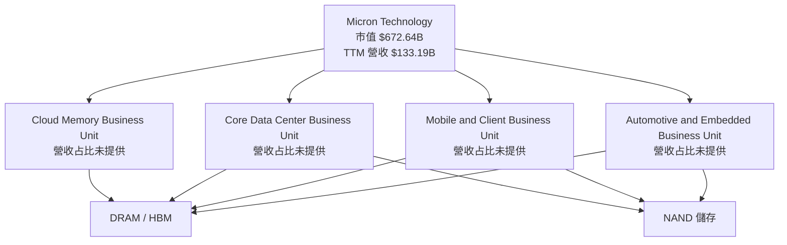
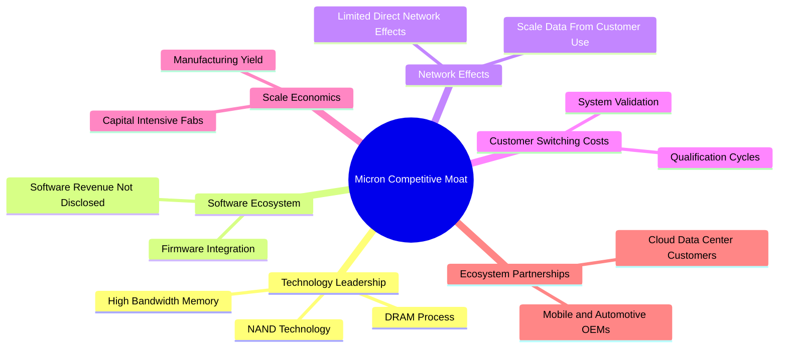
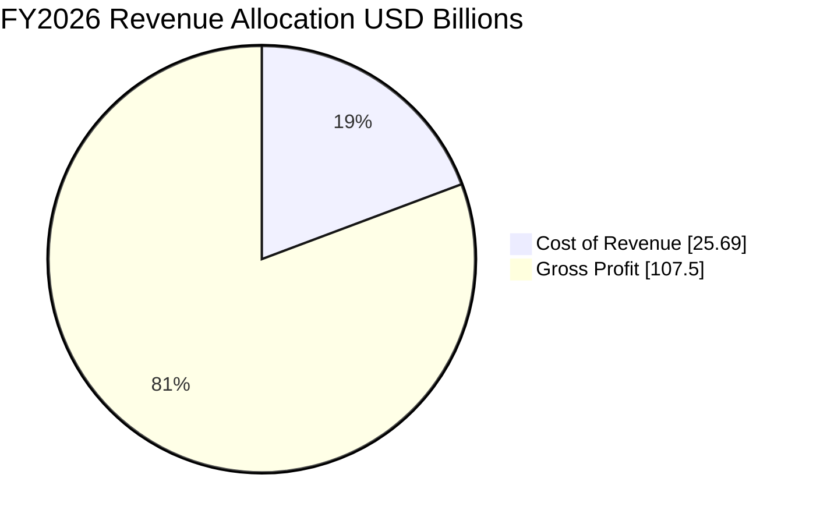
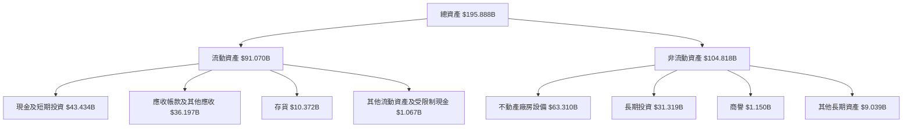
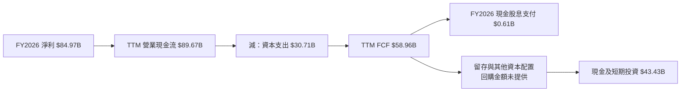
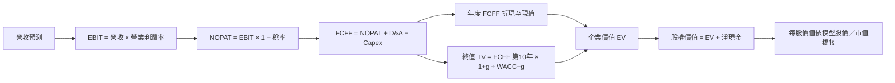
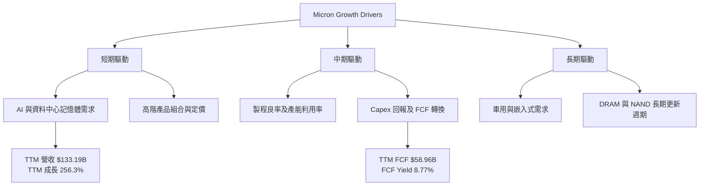
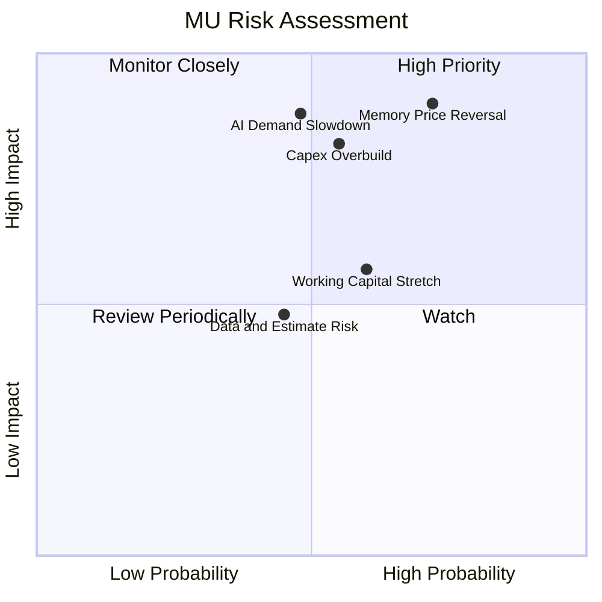
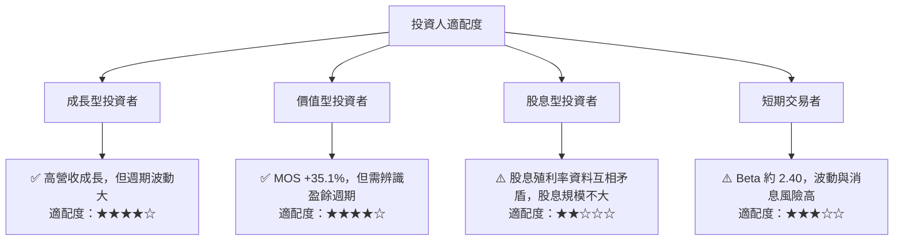

# MU 基本面深度分析報告
> **報告日期**：2026-11-21 ｜ **語言**：繁體中文 ｜ **數據來源**：SEC 申報資料 (XBRL)、Yahoo Finance、Finviz、StockAnalysis、Roic.ai ｜ **分析師**：CFA 級機構研究

## 目錄

| # | 章節 | 核心結論 |
|---|------|----------|
| 1 | 執行摘要 | 強烈買入；加權合理價值 $916.17；MOS +35.1% |
| 2 | 公司概覽與商業模式 | DRAM／NAND 技術、製程與規模構成護城河；產品收入占比未提供 |
| 3 | 損益表深度分析 | TTM 營收 $133.19B、TTM 成長 256.3%；最新一季年增 379.3% |
| 4 | 資產負債表分析 | 淨現金 $40.15B；流動性充足，但營運資金週期延長 |
| 5 | 現金流量深度分析 | TTM FCF $58.96B、FCF Yield 8.77%；資本支出仍高 |
| 6 | 獲利能力與資本效率 | ROIC 86.2% 高於 WACC 14.00%，目前創造股東價值 |
| 7 | 相對估值分析 | P/E 低於歷史中位數；同業估值與市場週期位置須一併考慮 |
| 8 | DCF 內在價值評估 | 基準 DCF $881.83／股；加權合理價值 $916.17／股 |
| 9 | 成長催化劑 | AI 記憶體需求、產品組合與資本投入效率是主要驅動 |
| 10 | 風險矩陣 | 記憶體價格循環、供需反轉與資本支出回報為主要風險 |
| 11 | 投資建議 | 依 MOS 評級為強烈買入；建議以估值區間及季度指標分批執行 |

---

## 1. 執行摘要

### 1.0 一頁式投資儀表板（Portfolio Manager 30 秒速讀）

| 項目 | 內容 |
|------|------|
| **投資論點（3 句）** | ① TTM 營收達 **$133.19B**，TTM 年增 **256.3%**，最新一季年增 **379.3%**，顯示記憶體需求及定價環境大幅改善。② TTM FCF 為 **$58.96B**、FCF Yield **8.77%**，且淨現金 **$40.15B**，提供資本投入與景氣下行緩衝。③ ROIC **86.2%** 高於 WACC **14.00%**；加權合理價值 **$916.17** 相對 2026-11-20 收盤價 **$594.51**，MOS 為 **+35.1%**。 |
| **綜合評分** | **8.0/10**（引用 1.1 評分卡） |
| **財務健康** | 🟢 淨現金 $40.15B、流動比率 3.314；但 CCC 從 155 天升至 185 天 |
| **ROIC vs WACC** | **86.2% vs 14.00%**；利差 72.2 個百分點，目前創造股東價值 |
| **FCF 趨勢** | 由 FY2025 的 $1.67B 升至 FY2026 的 $58.96B；TTM FCF Yield **8.77%** |
| **估值** | Forward P/E **2.846877x** ｜ EV/EBITDA **5.828x** ｜ FCF Yield **8.77%** |
| **DCF 內在價值（基準）** | **$881.83** ｜ 現價相對 DCF 折價 **32.6%**（折溢價基準為 DCF） |
| **安全邊際（MOS）** | **+35.1%＝($916.17 − $594.51) ÷ $916.17**；🟢 >25% 充足 |
| **預期報酬（基準情境 12M）** | 估值隱含上行空間 **+54.1%**；並非保證的 12 個月報酬預測 |
| **關鍵風險（前二）** | 記憶體供需及價格反轉；AI 需求與高資本支出的回報低於預期 |
| **評級 + 信心度** | 🟢 **強烈買入** ｜ 信心：中（景氣循環、估值假設及資料來源差異使信心不取最高） |

**評級依據：**加權合理價值 $916.17 對現價 $594.51 的 MOS 為 +35.1%，符合「MOS ≥25%」門檻；ROIC 86.2% 高於 WACC 14.00%。因此依規則 20 評級為**強烈買入**，沒有因質化因素調整評級。

### 1.1 綜合評分卡（全報告唯一）

| 維度 | 評分（1–10） | 主要依據（引用數字與其來源章節） |
|------|--------------|----------------------------------|
| 成長性 | 9.0 | TTM 營收成長 256.3%、最新一季年增 379.3%（第 3 章）；高速成長可持續性仍受循環影響 |
| 獲利能力 | 9.0 | TTM 營業利益率 74.6%、ROIC 86.2% 高於 WACC 14.00%、F-Score 8/9（第 3、6 章） |
| 財務健康 | 9.0 | 淨現金 $40.15B、流動比率 3.314；CCC 增至 185 天為扣分因素（第 4 章） |
| 估值 | 7.0 | MOS +35.1%、P/E 歷史百分位 7%；但半導體循環高峰的獲利可能使低 P/E 具有誤導性（第 7、8 章） |
| 護城河 | 8.0 | DRAM／NAND 製程與資本密集規模優勢；具體市占率與產品收入占比未提供（第 2 章） |
| 管理層與資本配置 | 6.0 | FY2026 資本支出 $30.71B、SBC $1.33B、Piotroski 稀釋股數測試未通過；回購資料未提供（第 3、5、6 章） |
| **綜合評分** | **8.0** | 六項算術平均： (9.0 + 9.0 + 9.0 + 7.0 + 8.0 + 6.0) ÷ 6 = **8.0** |

### 1.2 五大投資論點 + 三大核心風險

| 類型 | 項目 | 具體依據 | 信心度 |
|------|------|----------|--------|
| 🟢 **投資論點①** | AI 與高階記憶體推升需求 | 最新一季營收 $54.23B，單季年增 379.3%；季度收入由 $13.64B 升至 $54.23B | 🟢 高 |
| 🟢 **投資論點②** | 營業槓桿放大利潤 | TTM 營業利益率 74.6%，最新季度營業利益率 80.7%；固定成本被更高出貨與價格攤薄 | 🟢 高 |
| 🟢 **投資論點③** | 現金流及資產負債表有緩衝 | TTM FCF $58.96B、現金加短期投資 $43.43B、淨現金 $40.15B | 🟢 高 |
| 🟢 **投資論點④** | 資本效率目前顯著高於資本成本 | ROIC 86.2% vs WACC 14.00%；目前有正向經濟利差 | 🟢 中高 |
| 🟢 **投資論點⑤** | 多種估值方法支持現價以下有折價 | DCF 基準 $881.83、加權合理價值 $916.17；MOS +35.1% | 🟡 中 |
| 🟡 **風險①** | 記憶體景氣高峰後價格反轉 | TTM 營收年增 256.3%、最新季度年增 379.3%，基期快速墊高，需求及定價若正常化會壓低利潤 | 🟡 中 |
| 🔴 **風險②** | 高資本支出與供需錯配 | FY2026 Capex $30.71B；資本支出週期長，產能供給若早於需求增加，FCF 可能迅速下降 | 🔴 高 |
| 🔴 **風險③** | 營運資金佔用上升 | CCC 由 155 天升至 185 天，DSO 增 17 天、DIO 增 11 天，可能反映應收與庫存吸收更多現金 | 🔴 高 |

### 1.3 快速統計卡片

| 指標 | 公司實際值（期間） | 同業中位數 | 狀態 |
|------|--------------------|------------|------|
| 營收成長（TTM） | **256.3%** | — | 🟢 |
| 營收成長（最新一季年增） | **379.3%** | **377.9%** | 🟢 |
| 毛利率（TTM） | **80.7%** | **77.4%** | 🟢 |
| 營業利益率（TTM） | **74.6%** | — | 🟢 |
| ROIC（TTM） | **86.2%** | — | 🟢 |
| Forward P/E | **2.846877x** | **2.5x** | 🟡 |
| FCF Yield（TTM） | **8.77%** | — | 🟢 |
| Piotroski F-Score | **8 / 9** | — | 🟢 |

> 同業中位數依可用 Peer multiples 計算；不含 N/A 的 SKHY P/S 與 EV/EBITDA。

### 1.4 投資結論

```
╔══════════════════════════════════════════════════════════════════╗
║                    📊 投資結論摘要                               ║
╠══════════════════════════════════════════════════════════════════╣
║  評級：強烈買入（MOS +35.1%，ROIC 86.2% > WACC 14.00%）          ║
║  價格（2026-11-20 收盤）：$594.51                                ║
║  DCF 內在價值（基準）：$881.83（折價 32.6%）                     ║
║  安全邊際 MOS：+35.1%（＝($916.17−$594.51)÷$916.17）             ║
║  加權合理價值（8.8）：$916.17                                    ║
║  DCF 情境價值：                                                  ║
║    悲觀情境：$429.05（-27.8%）                                   ║
║    基準情境：$881.83（+48.3%）                                   ║
║    樂觀情境：$1,715.71（+188.6%）                                ║
║  綜合評分：8.0/10（引用 1.1）                                    ║
║  適合投資人：可承受高波動、能以季度數據驗證假設的成長型長線投資人║
╚══════════════════════════════════════════════════════════════════╝
```

---

## 2. 公司概覽與商業模式

### 2.1 業務結構與收入來源

Micron Technology, Inc. 設計、製造並銷售記憶體與儲存產品，業務涵蓋 DRAM（包括 HBM）及 NAND 儲存。公司概覽列出 Cloud Memory、Core Data Center、Mobile and Client、Automotive and Embedded 等事業單位，但各單位營收、營收占比及軟體／服務收入未提供，因此不以估算比例繪圖。



### 2.2 市場份額

市場份額數據未提供，因此不列市占率或市場份額圖。公司 TTM 營收為 $133.19B，最新一季營收年增 379.3%；同業比較顯示 MU 最新一季營收成長與 SKHY 的 327.9%、SNDK 的 377.9% 接近，且高於 WDC 的 55.5%。但收入成長率不能直接等同市場份額變化。

### 2.3 競爭護城河分析



### 2.4 護城河強度

| 護城河項目 | 強度（強／中／弱） | 證據（引用數字或事實） | 會削弱它的情況 |
|------------|--------------------|------------------------|----------------|
| 技術與製程 | 強 | 公司供應 DRAM、HBM、NAND；FY2026 研發支出 $5.65B | 競爭者追上製程、良率或產品性能，或技術轉換投資回報降低 |
| 規模效應 | 強 | FY2026 營收 $133.19B、PP&E $63.31B，記憶體製造具有高資本門檻 | 景氣下行導致產能利用率下降，固定成本反而放大虧損 |
| 客戶驗證與轉換成本 | 中 | 產品需進入資料中心、行動裝置與車用系統的客戶規格及驗證流程；具體轉換成本未提供 | 客戶多供應商策略、產品標準化或競品供貨改善 |
| 生態夥伴 | 中 | 業務涵蓋雲端、資料中心、行動與車用市場；合作夥伴及營收占比未提供 | 客戶集中、供應鏈替代、出口管制或地緣政治變化 |
| 軟體生態系統 | 弱 | 未提供可量化軟體收入、訂閱或平台鎖定數據 | 記憶體產品同質化，價格競爭成為主要決策因素 |
| 網路效應 | 弱 | 未提供直接網路效應或隨用戶規模提升而增值的量化證據 | 產業供需與價格循環主導回報，降低產品差異的價值 |

**1.1 護城河評分 8.0 分的理由：**製程、資本密集規模與客戶驗證具實際壁壘，但市占率、分部營收及客戶鎖定資料不足，且記憶體價格循環會使優勢的經濟效益波動。

---

## 3. 損益表深度分析

### 3.1 年度收入成長趨勢（近 4 年）

年度營收採公司財務報表列示；收入 YoY 依相鄰年度營收計算，四捨五入至一位小數。

```
╔══════════════════════════════════════════════════════════════════╗
║        Micron Technology 年度收入趨勢（FY2023–FY2026）          ║
╠══════════════════════════════════════════════════════════════════╣
║  FY2023  $15.54B  ███░░░░░░░░░░░░░░░░░░░  YoY: -49.5%  🔴      ║
║  FY2024  $25.11B  █████░░░░░░░░░░░░░░░░░  YoY: +61.6%  🟢      ║
║  FY2025  $37.38B  ███████░░░░░░░░░░░░░░  YoY: +48.9%  🟢      ║
║  FY2026 $133.19B  █████████████████████  YoY:+256.3%  🟢      ║
║                                                                  ║
║  FY2023–FY2026 三年營收 CAGR：+104.8%                            ║
║  計算：(133.19 ÷ 15.54)^(1/3) − 1 = 104.8%                     ║
╚══════════════════════════════════════════════════════════════════╝
```

FY2026 成長主要體現在最新財年營收 $133.19B，遠高於 FY2025 的 $37.38B。這種增速不宜直接外推：記憶體產業營收同時受出貨、產品組合與價格影響，低基期復甦也會放大 YoY。DCF 因此將第一年成長限制在 30%，並逐年降至 3%，而非沿用 256.3% TTM 成長率。

### 3.2 季度收入趨勢分析

季度數據依最近四季列示。QoQ 為本季營收除以上季營收減一；YoY 採財務資料提供的同季年增率。

| 財季 | 營收（$B） | QoQ 成長 | YoY 成長 | 備註 |
|------|------------:|---------:|---------:|------|
| Q1 FY2026 | 13.643 | — | 56.65% | 可用最近四季的比較基準 |
| Q2 FY2026 | 23.860 | +74.9% | 196.29% | 出貨及市場需求加速 |
| Q3 FY2026 | 41.456 | +73.7% | 345.72% | 成長仍加速，收入基數快速抬高 |
| Q4 FY2026 | 54.229 | +30.8% | 379.27% | QoQ 增速較前兩季收斂，但 YoY 仍高 |

QoQ 算式例：Q4 對 Q3 = ($54.229B ÷ $41.456B) − 1 = **30.8%**。連續季度大幅增長顯示需求與定價環境改善；但當收入基數迅速放大，若供需均衡回復，QoQ 增速下滑並不必然代表產品競爭力惡化，仍須結合 ASP、出貨量及產品組合觀察。分部數據未提供，無法拆解各產品對季度增長的貢獻。

### 3.3 利潤率演變分析

| 利潤率指標 | FY2023 | FY2024 | FY2025 | FY2026／TTM | 趨勢 | 評估 |
|------------|-------:|-------:|-------:|------------:|------|------|
| **毛利率** | -9.1%* | 22.3% | 39.8% | 80.7% | ↗️ 大幅回升 | 🟢 |
| **營業利益率** | -34.8% | 5.2% | 26.1% | 74.6% | ↗️ 營收復甦帶動槓桿 | 🟢 |
| **淨利率** | -37.5% | 3.1% | 22.8% | 63.8% | ↗️ 獲利急升 | 🟢 |

\* FY2023 毛利率依年度損益摘要所列毛利 -$1.42B ÷ 營收 $15.54B 計算；另一資料來源列示毛利 $0.415B，來源存在差異，該年度毛利率應視為有資料口徑限制。FY2024–FY2026 的年度毛利與營收來自 SEC 申報資料及彙整財務資料。

FY2026 毛利率與營業利益率上升，與營收從 FY2025 $37.38B 升至 $133.19B 同步。這表示產能利用率、產品組合及價格改善的營業槓桿效果顯著；不過資料未提供各項 ASP、出貨量、單位成本及分部毛利，不能將利潤改善單獨歸因於某一產品。FY2026 的利潤率也遠高於 FY2025，景氣正常化時可能向歷史中樞回落。

### 3.4 費用結構分析

FY2026 營收 $133.19B，毛利 $107.50B，因此由營收扣除毛利得到銷貨成本 $25.69B。這是可由財務數字直接推導的收入分解，不代表完整營業費用分類；SG&A 等費用細項未完整提供。



```
╔══════════════════════════════════════════════════════════════════╗
║             FY2026 營收與毛利拆分（$B）                         ║
╠══════════════════════════════════════════════════════════════════╣
║  營收        $133.19B  █████████████████████                    ║
║  毛利        $107.50B  █████████████████                        ║
║  銷貨成本     $25.69B  ████                                     ║
║  研發費用      $5.65B  （FY2026 另列研發費用）                   ║
╚══════════════════════════════════════════════════════════════════╝
```

### 3.5 季度 EPS 趨勢與盈餘品質（Quality of Earnings）

最近四季 EPS 實際值可由季度淨利與 EPS 歷史取得；但 EPS Est 欄位為 nan，不能判定超預期或不及預期。

| 財季 | EPS 實際 | EPS 預估 | 超預期／不及預期 | 可能業務背景 |
|------|---------:|---------:|------------------|--------------|
| Q1 FY2026 | $4.60 | N/A | N/A（估計值未提供） | 營收 $13.643B，獲利改善延續 |
| Q2 FY2026 | $12.07 | N/A | N/A（估計值未提供） | 營收 QoQ 成長 74.9% |
| Q3 FY2026 | $24.67 | N/A | N/A（估計值未提供） | 營收 QoQ 成長 73.7% |
| Q4 FY2026 | $32.85 | N/A | N/A（估計值未提供） | 營收 $54.229B，年增 379.27% |

| 盈餘品質項目 | 數值／佔比 | 評估 |
|--------------|------------|------|
| 股權薪酬 SBC / 營收 | $1.33B ÷ $133.19B = **1.00%** | 🟢 占比不高，但 SBC 仍是股東稀釋成本 |
| SBC / 營業現金流 | $1.33B ÷ $89.67B = **1.48%** | 🟢 相對現金流規模有限 |
| FCF / 淨利（現金轉換率） | $58.96B ÷ $84.97B = **69.4%** | 🟡 有實質現金支持，但 Capex 吸收大量營業現金 |
| 一次性／非經常性損益 | N/A（未提供可核實明細） | 🟡 無法排除一次性項目對淨利影響 |
| 有效稅率 | **14.8%** | 🟢 DCF 採用該年度有效稅率；未見足夠資訊判斷是否含一次性稅務利益 |
| 資本化支出 vs 費用化 | FY2026 Capex $30.71B；研發費用 $5.65B | 🟡 高 Capex 對 FCF 有實際現金影響；資本化政策細節未提供 |

**盈餘品質結論：**FY2026 營業現金流 $89.67B、FCF $58.96B 均為正，現金流與獲利方向一致；SBC 佔營收 1.00%，未達到足以單獨改變估值結論的程度，但仍需監控稀釋。FCF 僅為淨利的 69.4%，主要需考慮 $30.71B 的資本支出。EPS beat/miss 無法驗證，且非經常性損益明細缺漏，故不把單季 EPS 加速全數視為可持續盈餘。

---

## 4. 資產負債表分析

### 4.1 資產結構分解

FY2026 資產總額 $195.888B，流動資產 $91.070B，非流動資產以總資產減流動資產計為 $104.818B。



### 4.2 流動性與營運資金分析

| 指標 | 最新 TTM／FY2026 | 一年前 | 變化 | 解讀 |
|------|------------------:|-------:|------:|------|
| 流動比率 | 3.314 | N/A | N/A | 流動資產高於流動負債；一年前同口徑未提供 |
| 速動比率 | 2.898 | N/A | N/A | 排除部分存貨後仍有流動性緩衝 |
| DSO 應收帳款天數 | 87 天 | 70 天 | **+17 天** | 收款週期延長；快速擴張可能推高應收，但也需監控信用與回款 |
| DIO 存貨天數 | 147 天 | 136 天 | **+11 天** | 存貨持有時間增加；供應準備可能有其需要，但若需求轉弱會增加跌價風險 |
| DPO 應付帳款天數 | 50 天 | 51 天 | **−1 天** | 付款天數略減，供應商融資貢獻未增加 |
| CCC 現金轉換週期 | 185 天 | 155 天 | **+30 天** | 現金被營運資金占用時間拉長，削弱現金流轉換效率 |

營運資金天數來自程式計算，按期末餘額除以 TTM 流量再乘 365。CCC 拉長不一定單獨代表營運惡化，因業務快速擴張會使應收及存貨餘額同步上升；然而若後續收入放緩，DSO 和 DIO 同升會提高庫存滯銷、回款延遲及現金轉換惡化的風險。

### 4.3 債務結構分析

不同資料源的債務口徑有差異：Cost of capital 與 VERIFIED FIGURES 使用總債務 $3.28B、淨現金 $40.15B；Yahoo 財務快照另列總債務 $5.18B、淨現金 $38.26B。本報告依指定的 verified figures 使用 $3.28B 及 $40.15B，並將口徑差異視為資料核對事項，不將兩者混算。

```
╔══════════════════════════════════════════════════════════════════╗
║                Micron 債務健康診斷                              ║
╠══════════════════════════════════════════════════════════════════╣
║  總債務（採用指定口徑）：$3.28B   ██░░░░░░░░░░░░░░░░░░░          ║
║  現金+短期投資：          $43.43B ████████████████████           ║
║  淨現金：                 $40.15B ██████████████████░░  🟢       ║
║                                                                  ║
║  流動比率：3.314x  🟢                                             ║
║  速動比率：2.898x  🟢                                             ║
║  Debt/EBITDA：N/A（債務口徑差異，且未提供相同口徑 EBITDA）        ║
║  Interest Coverage：N/A（利息費用／利息保障倍數未提供）          ║
╚══════════════════════════════════════════════════════════════════╝
```

### 4.4 股東權益趨勢

| 財年 | 股東權益（$B） | YoY 變化 | 解讀 |
|------|---------------:|---------:|------|
| FY2023 | 44.12 | — | 營收及獲利下行期間 |
| FY2024 | 45.13 | +2.3% | 淨利回到正值但仍偏低 |
| FY2025 | 54.16 | +20.0% | 淨利 $8.54B 推升權益 |
| FY2026 | 138.38 | +155.5% | FY2026 淨利 $84.97B 大幅增加權益 |

```
╔══════════════════════════════════════════════════════════════════╗
║              股東權益趨勢（FY2023–FY2026）                      ║
╠══════════════════════════════════════════════════════════════════╣
║  FY2023  $44.12B  ███████░░░░░░░░░░░░░░                         ║
║  FY2024  $45.13B  ███████░░░░░░░░░░░░░░                         ║
║  FY2025  $54.16B  █████████░░░░░░░░░░░░                         ║
║  FY2026 $138.38B  █████████████████████                         ║
╚══════════════════════════════════════════════════════════════════╝
```

---

## 5. 現金流量深度分析

### 5.1 現金流量瀑布圖

現金流圖示呈現報表科目關係，不代表各項數額可以直接相加；股息流出已知，回購金額未提供。



### 5.2 FCF 轉換率趨勢

| 財年 | FCF（$B） | 淨利（$B） | FCF／淨利 | 評估 |
|------|----------:|-----------:|----------:|------|
| FY2023 | -6.12 | -5.83 | 105.0%* | 兩者均為負值，比例不代表健康現金轉換 |
| FY2024 | 0.121 | 0.778 | 15.6% | Capex 使自由現金流低於會計淨利 |
| FY2025 | 1.67 | 8.54 | 19.6% | 現金轉換仍偏低，與投資需求及循環位置相關 |
| FY2026／TTM | 58.96 | 84.97 | 69.4% | 營業現金流大幅改善，但 Capex 仍消耗現金 |

\* FY2023 比率按兩個負值相除計算；不宜解讀為高轉換品質。

### 5.3 自由現金流趨勢

| 財年 | FCF（$B） | FCF YoY | FCF Yield |
|------|----------:|--------:|----------|
| FY2023 | -6.12 | — | N/A |
| FY2024 | 0.121 | 轉正 | N/A |
| FY2025 | 1.67 | +1,280.2%* | N/A |
| FY2026／TTM | 58.96 | +3,430.5% | 8.77% |

\* FY2025 FCF 從 FY2024 很小的正值基數增加，YoY 百分比容易失真；FY2026 成長亦受低基期影響。

```
╔══════════════════════════════════════════════════════════════════╗
║               自由現金流趨勢（$B）                               ║
╠══════════════════════════════════════════════════════════════════╣
║  FY2023  -$6.12B  ◀██░░░░░░░░░░░░░░░░░░░                        ║
║  FY2024   $0.12B  ▏                                               ║
║  FY2025   $1.67B  █░░░░░░░░░░░░░░░░░░░                           ║
║  FY2026  $58.96B  █████████████████████  FCF Yield 8.77%         ║
╚══════════════════════════════════════════════════════════════════╝
```

### 5.4 資本配置評估

完整的回購、留存現金、資本投資與併購用途拆分未提供，因此不以圓餅圖呈現，避免將重疊用途錯當互斥比例。

| 配置項目 | FY2026 數值 | 分析 |
|----------|-----------:|------|
| 資本支出 | $30.71B | 代表產能與設備投資；可能支撐成長，但記憶體業資本週期長且回報具循環性 |
| 現金股息支付 | $0.61B | 相對 FCF 規模小；年度股息支付資料比市場資料中的 9.0% Dividend Yield 更可核對 |
| SBC | $1.33B | 非現金會計費用，但可能稀釋股東；Piotroski 稀釋股數測試未通過 |
| 股票回購 | N/A | 數據未提供 |
| 併購／其他投資 | N/A | 數據未提供 |

股息殖利率來源間出現不一致：市場彙整資料列 9.0%，但 FY2026 現金股息支付為 $0.61B，且 payout ratio 列 0.7%。在未核對股息頻率、公司行動與資料定義前，不將 9.0% 作為可持續股息收益的依據。

---

## 6. 獲利能力與資本效率

### 6.1 ROE / ROA / ROIC 趨勢

| 指標 | FY2023 | FY2024 | FY2025 | 最新 TTM | 評估 |
|------|-------:|-------:|-------:|---------:|------|
| ROE | N/A | N/A | N/A | **61.4%** | TTM 依 QUALITY FIGURES；其他資料來源另列 88.3%，口徑不一致，採品質指標區塊數值 |
| ROA | N/A | N/A | N/A | **N/A** | QUALITY FIGURES 未提供可抄錄的歷年 ROA 數值 |
| ROIC | N/A | N/A | N/A | **86.2%** | 顯著高於 14.00% WACC，現期價值創造明確 |
| 行業均值對比 | — | — | — | N/A | 同口徑行業均值未提供 |

### 6.2 ROIC vs WACC 分析（核心價值創造判斷）

本節 WACC 採指定資本成本資料的 **14.00%**，與第 8.2 節一致。ROIC 採指定 TTM ROIC **86.2%**。不以不完整的資產負債表資料自行重建 ROIC。

```
╔══════════════════════════════════════════════════════════════════╗
║                ROIC vs WACC 深度分析                            ║
╠══════════════════════════════════════════════════════════════════╣
║  WACC 輸入：                                                     ║
║  ├── 無風險利率（10Y 美債）：       4.91%                       ║
║  ├── 市場風險溢酬 ERP：              5.00%                       ║
║  ├── 原始 Beta：                     2.40                        ║
║  ├── 採用調整後 Beta：               1.93                        ║
║  ├── 股權成本 Ke：                   14.57%                      ║
║  ├── 稅前債務成本：                   3.23%                      ║
║  ├── 股權／債務權重：                 99.5%／0.5%                 ║
║  └── WACC：計算值 14.51%，採用值 14.00%（受 7%–14% 區間限制）    ║
║                                                                  ║
║  ROIC：                                                           ║
║  ├── TTM ROIC：                      86.2%                       ║
║  ├── WACC：                          14.00%                      ║
║  └── EVA 利差 = 86.2% − 14.00% = +72.2 個百分點                 ║
║                                                                  ║
║  ROIC  86.2%  ▓▓▓▓▓▓▓▓▓▓▓▓▓▓▓▓▓▓▓▓▓▓▓▓▓▓▓▓▓▓▓▓▓▓▓▓▓▓▓▓ 🟢     ║
║  WACC  14.0%  ▓▓▓▓▓▓░░░░░░░░░░░░░░░░░░░░░░░░░░░░░░░░░ ──      ║
║                                                                  ║
║  結論：ROIC 約為 WACC 的 6.2 倍，現期獲利高於資本成本；         ║
║  但景氣高峰盈利未必可永久維持，長期判斷需觀察週期中段 ROIC。     ║
╚══════════════════════════════════════════════════════════════════╝
```

### 6.3 杜邦三因素分解

| 因素 | 數值（TTM） | 解讀 |
|------|-------------|------|
| 淨利率 | **63.8%** | 淨利率是 ROE 高水準的重要來源，反映目前高盈利環境 |
| 資產週轉率 | **0.68x** | 每單位資產產生的營收；資產密集型製造業的投資需求較高 |
| 權益乘數 | **1.42x** | 槓桿程度有限，不是 ROE 的主要來源 |
| **ROE** | **61.4%** | 63.8% × 0.68 × 1.42 = **61.4%**（程式計算值，四捨五入有尾差） |

ROE 主要由淨利率而非財務槓桿推動，與公司淨現金狀態一致。景氣價格或產能利用率回落時，淨利率是 ROE 最敏感的傳導變數。

### 6.4 財務體質：Piotroski F-Score

**Piotroski F-Score：8 / 9**（TTM 至 2026-09-03 對比 TTM 至 2025-08-28）。

| 測試 | 結果 | 解讀 |
|------|------|------|
| ROA > 0 | ✅ 通過 | 期間整體資產報酬為正 |
| 營業現金流 > 0 | ✅ 通過 | 現金流為正 |
| ROA 高於一年前 | ✅ 通過 | 獲利能力改善 |
| 營業現金流 > 淨利（應計品質） | ✅ 通過 | 營業現金流高於淨利，獲利有現金流支持 |
| 長期負債 ÷ 總資產低於一年前 | ✅ 通過 | 相對負債負擔下降 |
| 流動比率高於一年前 | ✅ 通過 | 短期償債能力改善 |
| 稀釋股數未增加 | ❌ 未通過 | 股數稀釋測試失敗，顯示股東權益可能受稀釋 |
| 毛利率高於一年前 | ✅ 通過 | 定價／產品組合及成本條件改善 |
| 資產週轉率高於一年前 | ✅ 通過 | 資產使用效率改善 |

八項通過、稀釋股數一項未通過。F-Score 反映當期財務改善，但記憶體週期可能使盈利及營運指標快速逆轉，不能將其視為跨週期品質保證。

---

## 7. 相對估值分析

### 7.1 同業估值比較表格

同業倍數按 Yahoo Finance Peer multiples；SKHY 的 P/S 與 EV/EBITDA 為 N/A，保留 N/A，不以外部記憶數字替代。

| 估值指標 | **MU** | **SKHY** | **SNDK** | **WDC** | MU 評估 |
|----------|-------:|---------:|---------:|-------:|----------|
| **Trailing P/E** | 8.0x | 5.7x | 6.0x | 9.2x | 🟡 高於兩家記憶體同業，低於 WDC |
| **Forward P/E** | 2.846877x | 2.5x | 2.2x | 6.5x | 🟢 接近同業低位；預測 EPS 的循環持續性是關鍵 |
| **P/S Ratio** | 5.1x | N/A | 3.1x | 6.7x | 🟡 高於 SNDK、低於 WDC；可比性受 SKHY 幣別問題限制 |
| **EV/EBITDA** | 5.828x | N/A | 4.0x | 15.4x | 🟢 低於兩家可比較同業中位數 9.7x |
| **最新一季營收年增** | 379.3% | 327.9% | 377.9% | 55.5% | 🟢 高於 WDC，與 SKHY、SNDK 接近 |
| **毛利率（TTM）** | 80.7% | 77.4% | 80.0% | 52.6% | 🟢 高於所列同業 |

低 Forward P/E 反映市場資料中預期 EPS 大幅上升，但 MU 屬循環性半導體公司，峰值盈餘可能使 forward 倍數顯得異常低；因此不能只憑 2.846877x 判定便宜。EV/EBITDA 相對可比同業較低，但同樣受當前高景氣盈利分母影響。

### 7.2 歷史估值區間分析

```
╔══════════════════════════════════════════════════════════════════╗
║           MU 近五年 TTM 估值區間與目前位置                      ║
╠══════════════════════════════════════════════════════════════════╣
║  P/E：       範圍 7.4x ├────────●──────────────────┤ 138.5x     ║
║                            現值 8.0x｜中位數 17.4x｜百分位 7%   ║
║  P/S：       範圍 2.1x ├────────────●──────────────┤ 11.7x      ║
║                            現值 5.1x｜中位數 4.2x｜百分位 65%  ║
║  EV/EBITDA： 範圍 3.6x ├──────●────────────────────┤ 80.7x      ║
║                            現值 5.9x｜中位數 9.7x｜百分位 20%  ║
╚══════════════════════════════════════════════════════════════════╝
```

P/E 位於近五年百分位 7%，EV/EBITDA 位於 20%，但 P/S 位於 65%，高於自身中位數 4.2x。不同倍數給出的訊號不一致，主要因當前淨利率與 EBITDA 利潤率極高，獲利倍數的分母會在週期高峰迅速放大；P/S 對盈餘週期較不敏感，但其歷史位置並不支持全面低估的判斷。

### 7.3 情境價值（Bear / Base / Bull，照抄 DCF MODEL 的 Scenarios）

| 情境 | 第 1 年營收成長 | 期末營業利潤率 | WACC | 每股價值 | 相對現價 | 機率 | 會發生的條件 |
|------|----------------:|----------------:|-----:|---------:|---------:|-----:|--------------|
| 🔴 悲觀 | 15.0% | 22.2% | 15.00% | $429.05 | -27.8% | 25% | AI 記憶體需求放緩、供給增加壓低價格，長期利潤率低於基準 |
| 🟡 基準 | 30.0% | 26.1% | 14.00% | $881.83 | +48.3% | 50% | 短期需求仍高，但十年內營收增速與利潤率逐步收斂 |
| 🟢 樂觀 | 45.0% | 28.8% | 13.00% | $1,715.71 | +188.6% | 25% | AI／資料中心需求與高階產品組合超出基準，資本回報維持較久 |

### 7.4 相對估值隱含價格區間

```
╔══════════════════════════════════════════════════════════════════╗
║              估值方法每股價值與現價位置                          ║
╠══════════════════════════════════════════════════════════════════╣
║  $580.49 ── 現價 $594.51 ── $881.83 ── $970.50 ── $1,561.91    ║
║   同業P/S       ▲            DCF       同業EV/EBITDA    分析師共識║
╚══════════════════════════════════════════════════════════════════╝
```

| 方法 | 每股價值 | 與現價差異 | 依據 |
|------|---------:|-----------:|------|
| 同業 P/S | $580.49 | -2.4% | SNDK 與 WDC 的 P/S 中位數 4.9x × MU TTM 營收 |
| 同業 EV/EBITDA | $970.50 | +63.2% | SNDK 與 WDC 的 EV/EBITDA 中位數 9.7x × TTM EBITDA，再加淨現金 |
| 分析師共識目標價 | $1,561.91 | +162.7% | 45 位分析師平均目標價；參考值，不等同獨立估值 |

相對估值區間約由 $580.49 至 $970.50；分析師共識明顯高於其他方法，應視為市場觀點而非基本面底線。

---

## 8. DCF 內在價值評估（Discounted Cash Flow）

### 8.0 估值推理鏈（Thinking Logic：在算之前先想清楚）

**核心命題：**MU 價值主要由既有 DRAM／NAND 現金流底盤與資料中心／HBM 需求增長決定；目前分部收入占比未提供，無法量化拆分第二成長曲線或新產品選擇權。模型價值最敏感的變數，是營收與高營業利潤率能維持多久，及其最終收斂幅度。

| 決策點 | 本報告採用 | 理由（含數字） | 曾考慮但否決 | 否決理由 |
|--------|-----------|----------------|--------------|----------|
| 現金流定義 | FCFF | 與 WACC 折現並先求企業價值一致；模型使用 NOPAT + D&A − Capex | FCFE | 債務政策及融資變動未建模 |
| 預測期 N | 10 年 | 模型已指定 10 年；記憶體景氣超長期能見度有限，十年用於讓週期收斂 | 5 年 | 在高資本週期企業中，五年期較難表示成熟期現金流 |
| 終值方法 | Gordon Growth | WACC 14.00% 高於 g 3.0%，模型已提供基準終值 | 退出倍數 | DCF 模型未提供退出倍數輸入及其指定終值結果，不自行添加 |
| EBIT 基礎 | GAAP | 模型明示 GAAP EBIT | 非 GAAP | 可能加回 SBC，需另處理股東稀釋成本 |

**關鍵假設推導鏈：**

- **營收成長路徑（高敏感度）**：錨點＝TTM 營收年增 256.3%、FY2026 營收 $133.19B；調整＝當前成長受週期、基期與價格變化影響，不適宜永久外推；**採用第一年 30.0%，逐年線性降至第十年 3.0%**；曾考慮沿用 TTM 256.3%，因不符合成熟公司長期增長且會過度外推而否決。
- **期末營業利潤率（高敏感度）**：錨點＝TTM 營業利益率 74.6%，近五財年中位數（含 TTM）為模型使用的 26.1%；調整＝記憶體價格與產能利用率具週期性，將當前高峰利潤率逐步收斂；**採用 FY+10 26.1%**；曾考慮永久維持 74.6%，因忽略歷史週期而否決。
- **永續成長率 g（高敏感度）**：錨點＝模型指定 3.0%；調整＝終值成長需低於 WACC，並使成熟期增長不超過長期名目經濟增長的合理量級；**採用 3.0%**；曾考慮更高 g，因長期延續高於成熟經濟增長的需求不具可稽核依據而否決。
- **預測期 N（中敏感度）**：錨點＝模型指定 10 年；調整＝由當前 74.6% TTM 營業利潤率逐步降至 26.1%，並把成長率由 30% 降至 3%；**採用 10 年**；曾考慮更短期限，因模型要反映週期回歸而否決，但十年仍不代表預測確定性高。
- **Capex／營收（中敏感度）**：錨點＝TTM Capex／營收為 23.1%；調整＝模型假設資本支出占比逐步下降，至第十年 7.8%，即高於 1.1×D&A 的規則約束結果；**採用模型逐年路徑 23.1% 降至 7.8%**；曾考慮維持 23.1% 不變，因長期成熟後投資率不應永久保持當期水準而否決。
- **EBIT 基礎與 SBC（中敏感度）**：錨點＝FY2026 SBC $1.33B、TTM 營收 $133.19B；調整＝採 GAAP EBIT，SBC 已作為費用納入，不在 FCFF 再扣一次；**採用組合 (A)：GAAP EBIT、FCFF 不另扣 SBC、股數不再稀釋**；曾考慮額外扣 SBC，因會重複計成本而否決。
- **年稀釋率（中敏感度）**：錨點＝Piotroski 稀釋股數測試未通過；調整＝本模型指定組合 (A)，把 SBC 反映在 GAAP 費用而非另加股數稀釋；**採用 0% 額外年稀釋率**；曾考慮另外擴大股數，因會與 GAAP SBC 費用重複計入而否決。
- **終值方法（高敏感度）**：錨點＝第十年 FCFF $128.62B、WACC 14.00%、g 3.0%；調整＝使用永續成長法將成熟期現金流資本化；**採用 Gordon Growth**；曾考慮退出倍數，但缺少指定退出倍數輸入，不建立第二套模型。
- **WACC（高敏感度）**：錨點＝成本資本區塊計算值 14.51%；調整＝該資料註明 WACC 限制在 7%–14% 區間；**採用 14.00%**；曾考慮使用未限制的 14.51%，但規則要求直接採用指定採用值，不自行替換。

**最脆弱一環：**當前高利潤率能否在需求正常化後仍收斂至模型 26.1% 而非更低；若營收成長及利潤率更快回落，估值向悲觀情境 $429.05 靠攏，敏感性見 8.6。

**計算路徑圖：**



### 8.1 模型假設總表（Model Inputs）

| 假設項目 | 採用值 | 依據／來源 | 敏感度 |
|----------|--------|-------------|--------|
| 預測期長度 N | **10 年** | DCF MODEL 指定；收入增速與利潤率逐年收斂 | 🟡 中 |
| 營收成長 | **FY+1 30.0% 至 FY+10 3.0%** | TTM 成長 256.3% 但以 0%–30% 為範圍，逐年線性衰減 | 🔴 高 |
| 營業利潤率 | **FY+1 74.6% 至 FY+10 26.1%** | 起點為 TTM 營業利益率；終點為近五財年中位數（含 TTM） | 🔴 高 |
| 有效稅率 | **14.8%** | 最新年度有效稅率 | 🟢 低 |
| Capex／營收 | **FY+1 23.1% 至 FY+10 7.8%** | TTM Capex／營收起點，逐步降至高於 1.1×D&A 的限制 | 🟡 中 |
| D&A／營收 | **7.1%** | TTM 比率，固定 | 🟢 低 |
| 營運資金變動／營收增額 | **未建模** | DCF MODEL 明示 Working capital is not modelled | 🟢 低 |
| EBIT 基礎 | **GAAP** | DCF MODEL 指定 | 🟡 中 |
| SBC 處理 | **組合 (A)**：GAAP EBIT 已含 SBC；FCFF 不另扣 SBC | FY2026 SBC $1.33B；不重複扣除 | 🟡 中 |
| 年稀釋率 | **0% 額外稀釋** | 組合 (A)，採固定股數處理 | 🟡 中 |
| 永續成長率 g | **3.0%** | DCF MODEL 指定且低於 WACC 14.00% | 🔴 高 |
| 終值方法 | **Gordon Growth** | DCF MODEL 指定 | 🔴 高 |
| WACC | **14.00%** | 成本資本區塊採用值；計算值 14.51%，被限制於 7%–14% 區間 | 🔴 高 |
| 自由現金流定義 | **FCFF = NOPAT + D&A − Capex** | 工作資本不建模，依模型原式 | — |

**SBC 防重複說明：**本模型採用 **(A)**：GAAP EBIT 已含 SBC 費用，故 FCFF 不再減 SBC，且不再以年稀釋率擴大股數；SBC 影響在模型中計入一次。  
**預測期現金流與營運資金：**DCF 模型明示未建模營運資金，因此 8.3 不另列 ΔWC 金額；不能把未建模解讀為營運資金變動為零的實際預測。

### 8.2 折現率推導（WACC）

Beta 原始值 2.40，採用調整後 Beta **1.93**，公式為 ⅔ × 2.40 + ⅓；資本成本區塊列示無風險利率 4.91%、ERP 假設 5.00%。沒有提供無風險利率的觀察日期、規模或國別溢酬輸入，故不另加溢酬。

```
╔══════════════════════════════════════════════════════════════════╗
║                    WACC 推導（折現率）                           ║
╠══════════════════════════════════════════════════════════════════╣
║  股權成本 Ke（CAPM）：                                           ║
║  ├── 無風險利率 Rf（10Y 美債）：     4.91%                       ║
║  ├── 市場風險溢酬 ERP（假設）：       5.00%                       ║
║  ├── 原始 Beta（Yahoo）：             2.40                        ║
║  ├── 調整後 Beta：                    1.93                        ║
║  ├── 規模／國別溢酬：                 未另加；資料未提供          ║
║  └── Ke = 4.91% + 1.93 × 5.00% = 14.57%                         ║
║                                                                  ║
║  債務成本 Kd：                                                    ║
║  ├── 稅前 Kd：                        3.23%                       ║
║  ├── 有效稅率：                       14.8%                       ║
║  └── 稅後 Kd = 3.23% × (1−14.8%) = 2.75%                        ║
║                                                                  ║
║  資本結構：                                                       ║
║  ├── 股權權重 E：                     99.5%                       ║
║  ├── 債務權重 D：                      0.5%                       ║
║  ├── 計算 WACC：                      14.51%                      ║
║  └── 採用 WACC：                      14.00%（7%–14% 區間上限）   ║
╚══════════════════════════════════════════════════════════════════╝
```

**逐步演算（採用來源提供的資本權重）：**

1. **Ke（CAPM）** = Rf + β × ERP = 4.91% + 1.93 × 5.00% = **14.56%**；資本成本資料列為 **14.57%**，差異來自中間值未四捨五入，後續採用來源列示的 14.57%。
2. **稅前 Kd** = 利息 ÷ 計息負債 = **3.23%**（利息金額及平均計息負債明細未提供，不能另行重建）。
3. **稅後 Kd** = 3.23% × (1 − 14.8%) = 3.23% × 85.2% = **2.75%**。
4. **權重**：股權權重 = **99.5%**；債務權重 = **0.5%**；99.5% + 0.5% = **100.0%**。指定區塊採市值／債務權重，但未提供足以核對計息負債與市值的完整同口徑計算明細。
5. **未限制 WACC** = 99.5% × 14.57% + 0.5% × 2.75% = 14.49715% + 0.01375% = **14.51090% ≈ 14.51%**；依資料標註的 7%–14% 區間限制，**採用 WACC = 14.00%**。

因此第 6.2 與第 8 章均採 **14.00%**。由於來源沒有利息費用及平均計息負債明細，Kd 僅能引用指定的 3.23%，不能獨立審計其分母。

### 8.3 逐年自由現金流預測（基準情境）

**單位：$B；金額取一位小數以外的模型精度照抄至兩位；折現因子三位小數。**下表列示 DCF MODEL 原始數值。現金流為 FCFF，且模型不納入營運資金變動。

| 年度 | FY+1 | FY+2 | FY+3 | FY+4 | FY+5 | FY+6 | FY+7 | FY+8 | FY+9 | FY+10 |
|------|-----:|-----:|-----:|-----:|-----:|-----:|-----:|-----:|-----:|------:|
| 營收 | 173.14 | 219.89 | 272.67 | 329.93 | 389.32 | 447.71 | 501.44 | 546.57 | 579.36 | 596.74 |
| 營收 YoY | 30.0% | 27.0% | 24.0% | 21.0% | 18.0% | 15.0% | 12.0% | 9.0% | 6.0% | 3.0% |
| 營業利潤率 | 74.6% | 69.2% | 63.8% | 58.4% | 53.1% | 47.7% | 42.3% | 36.9% | 31.5% | 26.1% |
| EBIT（GAAP） | 129.14 | 152.17 | 174.02 | 192.80 | 206.55 | 213.43 | 212.05 | 201.71 | 182.62 | 155.98 |
| − 稅 | (19.13) | (22.54) | (25.77) | (28.55) | (30.59) | (31.61) | (31.40) | (29.87) | (27.05) | (23.10) |
| = NOPAT | 110.02 | 129.64 | 148.25 | 164.25 | 175.96 | 181.82 | 180.64 | 171.84 | 155.58 | 132.88 |
| + D&A | 12.35 | 15.69 | 19.45 | 23.54 | 27.78 | 31.94 | 35.78 | 39.00 | 41.34 | 42.58 |
| − Capex | (39.93) | (46.99) | (53.66) | (59.35) | (63.45) | (65.41) | (64.78) | (61.37) | (55.26) | (46.84) |
| − ΔWC | 未建模 | 未建模 | 未建模 | 未建模 | 未建模 | 未建模 | 未建模 | 未建模 | 未建模 | 未建模 |
| = FCFF | 82.44 | 98.34 | 114.04 | 128.44 | 140.28 | 148.36 | 151.64 | 149.46 | 141.65 | 128.62 |
| 折現因子 @14.00% | 0.877 | 0.769 | 0.675 | 0.592 | 0.519 | 0.456 | 0.400 | 0.351 | 0.308 | 0.270 |
| **FCFF 現值 PV** | **72.32** | **75.67** | **76.98** | **76.04** | **72.86** | **67.59** | **60.60** | **52.40** | **43.56** | **34.69** |

**預測期 PV 加總：**  
$72.32 + $75.67 + $76.98 + $76.04 + $72.86 + $67.59 + $60.60 + $52.40 + $43.56 + $34.69 = **$632.71B**

**逐步演算（FY+1，使用模型列示值）：**

1. **營收** = $133.19B × (1 + 30.0%) = **$173.14B**（模型數值）。
2. **EBIT** = $173.14B × 74.6% = **$129.14B**（模型數值；用未四捨五入營收與利潤率計算）。
3. **稅** = $129.14B × 14.8% = **$19.13B**（模型數值；中間值有四捨五入）。
4. **NOPAT** = EBIT − 稅 = $129.14B − $19.13B = **$110.02B**（原始模型精度產生約 $0.01B 尾差）。
5. **D&A** = $173.14B × 7.1% = **$12.35B**。
6. **Capex** = $173.14B × 23.1% = **$39.93B**。
7. **ΔWC** = **未建模**，依模型定義不列入計算，並非對實際營運資金需求作零值預測。
8. **FCFF** = NOPAT + D&A − Capex = $110.02B + $12.35B − $39.93B = **$82.44B**。
9. **折現因子** = 1 ÷ (1 + 14.00%)¹ = **0.877**；PV = $82.44B × 0.877 = **$72.32B**（因模型使用未四捨五入折現因子及現金流，尾數按模型列示）。

**合理性自檢：**

- 預測 FCFF FY+1 $82.44B 至 FY+10 $128.62B；九年間 CAGR = ($128.62 ÷ $82.44)^(1/9) − 1 = **約 5.1%**。歷史資料只提供 FY2023–FY2026 的年度 FCF，期間包含低谷與急升，不能用單一 CAGR 作穩態比較；FY2025 至 FY2026 FCF 大幅跳升主要受低基期與景氣復甦影響。
- FY+10 FCFF 利潤率 = $128.62B ÷ $596.74B = **21.6%**；FY2026 FCF 利潤率 = $58.96B ÷ $133.19B = **44.3%**。同業最佳 FCF 利潤率未提供，不能宣稱模型超越或低於產業最佳水準。
- 模型各年度 FCFF 均為正；主要風險不在模型內的負現金流，而在未建模營運資金、Capex 收斂速度及週期下行是否使現金流低於假設。

```
╔══════════════════════════════════════════════════════════════════╗
║            自由現金流：歷史實際 vs 模型預測                      ║
╠══════════════════════════════════════════════════════════════════╣
║  FY2024(實)   $0.12B  ▏                                         ║
║  FY2025(實)   $1.67B  █░░░░░░░░░░░░░░░░░░░                      ║
║  FY2026(實)  $58.96B  █████████████████████                     ║
║  FY+1 (預)   $82.44B  ████████████████████████████              ║
║  FY+10(預)  $128.62B  ████████████████████████████████████████  ║
╠══════════════════════════════════════════════════════════════════╣
║  模型假設 FY+1 至 FY+10 FCFF CAGR 約 5.1%；FY2026 實際值受週期與║
║  低基期影響，不能直接當作穩定長期增速。                         ║
╚══════════════════════════════════════════════════════════════════╝
```

### 8.4 終值計算（Terminal Value）

**適用性檢查：**WACC **14.00%** vs g **3.0%** → WACC > g？✅。

DCF MODEL 已提供 Gordon Growth 終值；未提供退出倍數輸入或退出倍數終值，故不自行建立第二套終值。兩種方法交叉驗證所需倍數缺漏。

| 方法 | 計算式 | 終值 TV | TV 現值 | 佔總 EV 比重 |
|------|--------|--------:|--------:|-------------:|
| Gordon Growth | $128.62B × (1 + 3.0%) ÷ (14.00% − 3.0%) | $1,204.36B | $324.87B | 33.9% |
| 退出倍數法 | N/A（DCF MODEL 未提供退出倍數） | N/A | N/A | N/A |

**逐步演算（Gordon Growth）：**

1. **FY+10 FCFF** = **$128.62B**，與 8.3 表格最後一欄一致。
2. **分子** = $128.62B × (1 + 3.0%) = **$132.4786B**。
3. **分母** = 14.00% − 3.0% = **11.00%**；依模型列示終值 = $128.62B × 1.03 ÷ 0.11 = **$1,204.36B**（按模型原始精度列示）。
4. **PV(TV)** = $1,204.36B × 0.270 = **$324.87B**（模型折現使用未四捨五入折現因子）。
5. **終值佔比** = $324.87B ÷ $957.57B = **33.9%**。

終值現值占 EV 33.9%，未超過 75% 警戒值，但仍對長期利潤率、WACC 與 g 敏感。退出倍數因未提供同口徑期末 EBITDA multiple 假設而不計算。

### 8.5 企業價值 → 每股內在價值（Bridge）

```
╔══════════════════════════════════════════════════════════════════╗
║              企業價值 → 每股內在價值 橋接表                      ║
╠══════════════════════════════════════════════════════════════════╣
║  預測期 FCF 現值合計              +$632.71B                       ║
║  終值現值 PV(TV)                  +$324.87B                       ║
║  = 企業價值 EV                     $957.57B                       ║
║  + 淨現金                          +$40.15B                        ║
║  = 股權價值（模型列示）            $997.73B                        ║
║                                                                  ║
║  每股價值換算：股權價值 × 價格 ÷ 市值                            ║
║  = $997.73B × $594.51 ÷ $672.64B = $881.83                      ║
║  當前股價（2026-11-20 收盤）       $594.51                        ║
║  折溢價（現價÷DCF內在價值−1）      -32.6%（折價）                 ║
╚══════════════════════════════════════════════════════════════════╝
```

**逐步演算（橋接）：**

1. **EV** = $632.71B + $324.87B = $957.58B；模型列示 EV **$957.57B**，存在 $0.01B 四捨五入尾差，後續依模型原值使用 **$957.57B**。
2. **股權價值** = 模型列示 EV $957.57B + 淨現金 $40.15B = 算術上 $997.72B；模型列示股權價值 **$997.73B**，為底層未四捨五入數的尾差，依規則引用模型原值。
3. **每股內在價值** = 股權價值 × 價格 ÷ 市值 = $997.73B × $594.51 ÷ $672.64B = **$881.83**（照抄 DCF MODEL 換算方式）。
4. **折溢價** = $594.51 ÷ $881.83 − 1 = **−32.6%**，即現價相對 DCF 基準價折價 32.6%。
5. **本節不計算 MOS**：MOS 僅以 8.8 加權合理價值為分母，避免把 DCF 單一方法估值誤作 MOS 基準。

**股數與資產負債表口徑：**模型使用「股權價值 × 價格 ÷ 市值」的換算式，沒有另列精確稀釋後股數；市場資料列流通股數約 1.13B，但該數字經四捨五入，不能替代模型換算。淨現金依模型採用 $40.15B，現金加短期投資 $43.43B、總債務 $3.28B；相應資料口徑與 Yahoo 快照所列債務存在差異。

### 8.6 敏感性分析（WACC × 永續成長率）

下表全部照抄 DCF MODEL；括號內相對現價上行空間為價格對比。基準格以粗體標示。

| g（列）／WACC（欄） | 12.00% | 13.00% | **14.00%（基準）** | 15.00% | 16.00% |
|-----------|---------:|---------:|--------------------:|---------:|---------:|
| 2.0% | $1,019.58 (+71.5%) | $930.16 (+56.5%) | $855.35 (+43.9%) | $791.82 (+33.2%) | $737.17 (+24.0%) |
| 2.5% | $1,041.16 (+75.1%) | $946.54 (+59.2%) | $868.01 (+46.0%) | $801.76 (+34.8%) | $745.08 (+25.3%) |
| **3.0%（基準）** | $1,065.13 (+79.2%) | $964.56 (+62.2%) | **$881.83 (+48.3%)** | $812.53 (+36.7%) | $753.60 (+26.8%) |
| 3.5% | $1,091.92 (+83.6%) | $984.47 (+65.6%) | $896.97 (+50.9%) | $824.24 (+38.6%) | $762.80 (+28.3%) |
| 4.0% | $1,122.07 (+88.7%) | $1,006.60 (+69.3%) | $913.61 (+53.7%) | $837.01 (+40.8%) | $772.76 (+30.0%) |

**逐步演算限制：**模型提供敏感性矩陣結果，但沒有提供每個替代 WACC 下的逐年 PV 合計、替代折現因子精度與未四捨五入橋接數。依「不得另建模型」要求，本報告不以表外重算製造第二套敏感性模型；矩陣值以程式計算結果為準。

**三情境 DCF（照抄模型情境）：**

| 情境 | 第 1 年營收成長 | FY+10 營業利潤率 | 永續成長 g | WACC | 每股內在價值 | 相對現價 | 主觀機率 |
|------|----------------:|------------------:|------------:|-----:|--------------:|---------:|---------:|
| 🔴 悲觀 | 15.0% | 22.2% | 3.0%（基準） | 15.00% | $429.05 | -27.8% | 25% |
| 🟡 基準 | 30.0% | 26.1% | 3.0%（基準） | 14.00% | $881.83 | +48.3% | 50% |
| 🟢 樂觀 | 45.0% | 28.8% | 3.0%（基準） | 13.00% | $1,715.71 | +188.6% | 25% |
| **機率加權** | — | — | — | — | **$977.10** | **+64.4%** | **100%** |

情境價值與機率加權值均依 DCF MODEL 照抄。模型未提供各情境完整 FY+10 營收、FCFF 與終值中間值，故無法在不另建模型的前提下展示每個情境完整重算鏈；不補造未提供的中間輸入。機率加權檢核：$429.05 × 25% + $881.83 × 50% + $1,715.71 × 25% = **$977.105**，模型列示 **$977.10**，差異為四捨五入尾差。

**敏感度結論：**

- 永續成長率 3.0% 至 4.0%、WACC 固定 14.0%：每股價值由 **$881.83** 升至 **$913.61**，增加 **$31.78／3.6%**。
- WACC 13.0% 至 14.0%、g 固定 3.0%：每股價值由 **$964.56** 降至 **$881.83**，減少 **$82.73／8.6%**。WACC 14.0% 至 15.0%則由 **$881.83** 降至 **$812.53**，減少 **$69.30／7.9%**。
- **期末營業利潤率每 +1pp：**敏感性矩陣沒有利潤率維度，無法引用模型既有數字量化；不自行重算。
- 在可提供的矩陣中，折現率變化影響幅度大於 g 每 +1pp；整體價值仍受營收與利潤率路徑主導，與 8.0 所述長期成長及收斂假設一致。

### 8.7 反推 DCF（Reverse DCF：市場在預期什麼）

固定輸入按基準模型：WACC 14.00%、稅率 14.8%、Capex／營收依 FY+1 23.1% 至 FY+10 7.8% 路徑、營運資金不建模、預測期 10 年、SBC 採組合 (A)。股數按模型「價格／市值」換算，不另假定股數變動。

| 求解的變數（一次一個） | 其餘變數設定 | 市場隱含值（令 DCF = 現價） | 公司歷史實際 | 判斷 |
|------------------------|--------------|------------------------------|--------------|------|
| 第 1 年營收成長 | 利潤率路徑、g、WACC 等固定基準 | **17.3%** | TTM 成長 256.3%，最新一季 YoY 379.3% | 🟢 相對當前增長假設保守，但預測起點仍低於基準 30% |
| 固定營業利潤率 | 其他輸入固定基準 | **27.9%** | TTM 營業利益率 74.6%；歷史中位數假設 26.1% | 🟡 市場隱含固定利潤率接近長期收斂值，未假設當前高峰永久化 |
| 永續成長率 g | 營收成長及利潤率固定基準 | 未計算 | — | N/A（模型未提供該變數反解值） |
| 預測期長度 N | 其他輸入固定基準 | 未計算 | — | N/A（模型未提供該變數反解值） |

**疊代軌跡：**DCF MODEL 僅列出營收成長 17.3% 及固定營業利潤率 27.9% 的求解結果，未提供試算步長、各試算點營收／FCFF／每股價值或收斂誤差，因此不能如實重建求解表。按模型提供的反推值，現價不需要維持第一年 30% 的基準成長；但以固定營業利潤率 27.9% 才與現價相符的反推結果，顯示市場可能已反映長期利潤率從目前高峰回落。

### 8.8 估值三角驗證與安全邊際

| 估值方法 | 隱含每股價值 | 上行空間（÷現價） | 權重 | 說明 |
|----------|--------------:|-------------------:|------:|------|
| DCF（基準） | $881.83 | +48.3% | 40% | 10 年 FCFF、WACC 14.00%、終值成長 3.0% |
| 同業 EV/EBITDA | $970.50 | +63.2% | 30% | SNDK、WDC 同業中位數 9.7x × TTM EBITDA，加淨現金 |
| 同業 P/S | $580.49 | -2.4% | 20% | SNDK、WDC 同業中位數 4.9x × TTM 營收 |
| 分析師共識目標價 | $1,561.91 | +162.7% | 10% | 45 位分析師平均目標價，參考權重 |
| **加權合理價值** | **$916.17** | **+54.1%** | **100%** | 循環性公司固定估值權重 |

**逐步演算（權重外顯）：**

- 加權合理價值  
  = $881.83 × 40% + $970.50 × 30% + $580.49 × 20% + $1,561.91 × 10%  
  = $352.732 + $291.150 + $116.098 + $156.191  
  = **$916.171 ≈ $916.17**。
- 權重合計 = 40% + 30% + 20% + 10% = **100%**。
- 公司類型為**循環性公司**；估值方法與權重按指定類型固定，沒有額外方法被剔除。

```
╔══════════════════════════════════════════════════════════════════╗
║                  估值區間與安全邊際                              ║
╠══════════════════════════════════════════════════════════════════╣
║  $429.05 ── $594.51 ── [$916.17] ── $881.83 ── $1,715.71       ║
║  悲觀DCF      現價       加權合理值       基準DCF       樂觀DCF    ║
║                                                                  ║
║  MOS = ($916.17 − $594.51) ÷ $916.17 = +35.1%                   ║
║  MOS 評估：🟢 >25% 充足                                          ║
║  上行空間 = ($916.17 − $594.51) ÷ $594.51 = +54.1%             ║
║  （MOS 分母為加權合理價值；上行空間分母為現價）                  ║
║                                                                  ║
║  建議買入區間：$429.05 – $824.55（現價以下悲觀情境至 MOS 10%界線）║
║  合理持有區間：$824.55 – $916.17                                 ║
║  減碼考慮區間：高於 $1,715.71（超過樂觀情境價值後重新評估）      ║
╚══════════════════════════════════════════════════════════════════╝
```

買入上限計算：MOS 至少 10% 對應價格上限 = $916.17 × (1 − 10%) = **$824.55**；MOS 以加權合理價值作為分母。買入區間下限引用悲觀情境 $429.05，不代表該價格必然出現或提供技術支撐。

> 🔎 **程式複算（Python，依本節各項自動重算）**
>
> 加權合理價值 = $881.83 × 40% + $970.50 × 30% + $580.49 × 20% + $1,561.91 × 10% = **$916.17**（權重合計 100%）
>
> 以價格 $594.51 計：MOS = **+35.1%**，上行空間 = **+54.1%**
>
> ✅ 與本節所寫數值一致。

### 8.9 DCF 模型的局限與失效條件

- **終值依賴度：**PV 終值 $324.87B ÷ EV $957.57B = **33.9%**；約三分之一 EV 來自 FY+10 之後的假設。
- **最脆弱假設：**第一年 30% 成長及營業利潤率由 74.6% 收斂至 26.1%。模型悲觀情境價值 $429.05，較現價低 27.8%；若週期快速轉差，基準估值可能高估。
- **週期與再投資：**MU 屬高資本支出、盈利循環明顯的企業。DCF 對當期高景氣獲利外推風險高，應搭配 EV/EBITDA、P/S 及跨週期獲利分析。
- **工作資本缺漏：**模型不納入 ΔWC，而實際 CCC 由 155 天升至 185 天；若擴張造成更高營運資金需求，DCF 可能高估 FCFF。
- **其他模型限制：**退出倍數、情境中間值及稀釋後精確股數未提供；每股價值按模型股價／市值公式換算，精確橋接的股數不可獨立核對。
- **與第 10 章的連結：**記憶體價格下跌會降低營收與利潤率；產能供給過剩會使 Capex 回收變差；AI 需求不如預期會降低增長假設。三者均直接壓低 DCF 現金流與終值。

### 8.10 複算檢核表（Audit Trail：輸出前自我驗算）

| # | 檢核項目 | 檢查方式 | 結果 |
|---|----------|----------|------|
| 1 | 所有 🔴高／🟡中 敏感度輸入有推導 | 對照 8.0 Step 3；已說明主要高敏感度假設與模型來源，部分替代值未提供 | ⚠️ 有限 |
| 2 | 每個假設都有來歷 | 8.1 各輸入均列資料錨點或模型來源 | ✅ |
| 3 | WACC 五步算式與權重核對 | 權重 99.5% + 0.5% = 100%；計算值 14.51%，採用 14.00% | ✅ |
| 4 | Kd 分母與 D 權重負債範圍一致 | 來源未提供利息及平均計息負債明細；不能獨立核對 | ⚠️ 資料不足 |
| 5 | WACC 與第 6.2 節相同 | 兩處均為 14.00% | ✅ |
| 6 | 預測年度數等於 N 且無省略 | N=10；表列 FY+1 至 FY+10 | ✅ |
| 7 | FY+1 代表年度算式可複算 | 使用模型列示值；中間未四捨五入數未提供，存在尾差 | ⚠️ 尾差 |
| 8 | 預測期 PV 加總 | 十項 PV 相加 = $632.71B | ✅ |
| 9 | WACC > g | 14.00% > 3.0% | ✅ |
| 10 | 終值以 FY+N FCFF、折現 N 期 | FY+10 FCFF $128.62B，折現因子 0.270 | ✅ |
| 11 | 橋接 EV 至每股價值 | 模型有 $0.01B 四捨五入差異；每股價值照抄模型公式 | ⚠️ 尾差已揭露 |
| 12 | SBC 組合相容 | GAAP EBIT、無額外 SBC 扣除、額外年稀釋率 0% | ✅ |
| 13 | 敏感性矩陣基準格一致 | g=3.0%、WACC=14.0% 為 $881.83，等於基準 DCF | ✅ |
| 14 | 矩陣有效格及示範格 | 所有提供格均 WACC > g；未另造矩陣重算格 | ⚠️ 未提供重算中間數 |
| 15 | 情境機率與加權算式 | 25% + 50% + 25% = 100%；與列示 $977.10 有 $0.005B 四捨五入尾差 | ✅ |
| 16 | 反推 DCF 一次放開一變數及疊代軌跡 | 提供兩個反推值，但試算軌跡未提供 | ⚠️ 未提供求解細節 |
| 17 | MOS 與折溢價基準一致 | MOS 用 $916.17；折溢價用 DCF $881.83 | ✅ |
| 18 | 完整輸出至第 11 章 | 本報告包含 11 章 | ✅ |
| 19 | 加權合理價值等於加權總和 | 加權值 $916.171，四捨五入 $916.17，未事後調整 | ✅ |
| 20 | 評級符合 MOS 門檻 | MOS +35.1%、ROIC 86.2% > WACC 14.00%；強烈買入 | ✅ |

**已揭露的限制：**WACC 的利息與平均計息負債明細、DCF 中間未四捨五入數值、替代情境重算輸入及反推試算軌跡未提供；因此未自行填補這些數字，也不把程式列示結果包裝成可從公開的中間值完全獨立重建。

---

## 9. 成長催化劑

### 9.1 催化劑時間軸

具體產品推出、產能投產日期與訂單時程未提供，以下以可觀察的投資期間作分類，不對未披露事件填入虛構日期。

| 期間 | 催化劑 | 可追蹤指標 |
|------|--------|------------|
| 短期：未來 1–4 季 | AI／資料中心記憶體需求與高階產品組合 | 季營收、毛利率、HBM／資料中心產品出貨及財測；分部數字目前未提供 |
| 中期：未來 1–3 年 | 產能利用率、良率與資本支出的回報 | Capex、D&A、FCF、CCC、產品供應與定價 |
| 長期：3 年以上 | 車用、嵌入式及資料中心需求擴張 | 分部營收、客戶認證、跨週期 ROIC；具體 TAM 未提供 |

### 9.2 TAM 市場規模分析

**N/A（TAM 數據未提供）。**MU TTM 營收為 $133.19B，TTM 成長 256.3%，最新一季年增 379.3%，顯示近期需求及產品價格變化對營收有顯著影響。因沒有可引用的 TAM 金額與年份，不能計算市場滲透率，也不能將公司營收成長直接當作 TAM 擴張幅度。

### 9.3 成長驅動力結構圖



---

## 10. 風險矩陣

### 10.1 風險評分矩陣

下列座標為分析師對相對機率及影響程度的定性評估，不是財務報表的機率預測。



### 10.2 風險清單詳細分析

| # | 風險項目 | 發生機率 | 財務衝擊 | 風險評分 | 緩解措施 |
|---|----------|----------|----------|----------|----------|
| 1 | 🔴 **記憶體價格及供需反轉** | 高（分析師定性評估） | 高：可使營收與 74.6% TTM 營業利益率同時回落 | 🔴 9.0/10 | 逐季追蹤 ASP、庫存、出貨及毛利率；在估值中保留悲觀情境 $429.05 |
| 2 | 🔴 **AI 及資料中心需求放緩** | 中高（分析師定性評估） | 高：最新一季年增 379.3%，若增長基礎是 AI 拉動，需求放緩會改變估值成長假設 | 🔴 8.5/10 | 監控雲端客戶資本支出、HBM 供貨／認證及管理層財測；分部量化資料需向後續申報核對 |
| 3 | 🔴 **Capex 擴張造成供給過剩或回報下降** | 中高（分析師定性評估） | 高：FY2026 Capex $30.71B，投資錯配會使折舊及現金流壓力延續 | 🔴 8.0/10 | 比較 Capex、D&A、增量營收及增量 FCF；若 Capex 上升而 ROIC 下滑，重新評估模型 |
| 4 | 🟡 **營運資金占用與收款延遲** | 中（分析師定性評估） | 中：CCC 增 30 天至 185 天，可能降低現金轉換 | 🟡 6.5/10 | 逐季追蹤 DSO、DIO、應收及存貨，檢查其增幅是否高於營收 |
| 5 | 🟡 **資料來源與口徑差異** | 中（分析師定性評估） | 中：債務、ROE、股息殖利率及季度利潤率來源存在差異 | 🟡 6.0/10 | 以 SEC 申報核對財報口徑；估值及資本成本採指定 verified figures |

---

## 11. 投資建議

### 11.1 最終評級與評分

依加權合理價值 $916.17、2026-11-20 收盤價 $594.51 計算，MOS 為 +35.1%；ROIC 86.2% 高於 WACC 14.00%，依規則 20 評為**強烈買入**，未調整評級。公司綜合評分為 **8.0/10**；六項分數依序為成長性 9.0、獲利能力 9.0、財務健康 9.0、估值 7.0、護城河 8.0、管理層與資本配置 6.0。

### 11.2 合理價值與隱含報酬率

| 估值 | 每股價值 | 相對現價 | 機率／權重 | 解讀 |
|------|---------:|---------:|-----------:|------|
| 加權合理價值 | **$916.17** | **+54.1%** | 估值權重 100% | MOS +35.1%，MOS 分母為合理價值 |
| DCF 悲觀情境 | $429.05 | -27.8% | 25% | 成長較慢、期末營業利潤率 22.2%、WACC 15.00% |
| DCF 基準情境 | $881.83 | +48.3% | 50% | 第一年度成長 30.0%、期末營業利潤率 26.1%、WACC 14.00% |
| DCF 樂觀情境 | $1,715.71 | +188.6% | 25% | 第一年度成長 45.0%、期末營業利潤率 28.8%、WACC 13.00% |
| 情境機率加權值 | $977.10 | +64.4% | 100% | 情境參考值；8.8 加權合理價值仍採估值方法固定權重計算 |

### 11.3 買入時機與觸發因素

```
╔══════════════════════════════════════════════════════════════════╗
║                  ✅ 買入觸發因素 Checklist                      ║
╠══════════════════════════════════════════════════════════════════╣
║  立即建立／持有條件：                                             ║
║  ✅ 現價低於加權合理價值 MOS 10% 界線 $824.55                    ║
║  ✅ ROIC 維持高於 WACC 14.00%                                    ║
║  ✅ FCF 維持正值，且未出現 Capex 大幅增加但營收停滯               ║
║                                                                  ║
║  加碼觸發條件：                                                   ║
║  ☐ 現價進入 $429.05–$594.51 區間，且核心財務指標未惡化           ║
║  ☐ CCC 從 185 天回落，應收與存貨增幅低於營收增幅                  ║
║  ☐ FCF 增長與營業利益率改善有現金流支持，而非只靠應計獲利         ║
║                                                                  ║
║  減碼／重新評估條件：                                             ║
║  ☐ 股價高於加權合理價值 $916.17，且營收或利潤率不再上修           ║
║  ☐ ROIC 跌至 WACC 14.00% 以下                                    ║
║  ☐ FCF 轉負、Capex 上升且需求與產能利用率走弱                     ║
╚══════════════════════════════════════════════════════════════════╝
```

### 11.4 投資人適配度分析



### 11.5 每季財報監控清單（Quarterly Watch List）

| 監控指標 | 目前基準 | 加碼觸發條件 | 減碼／重估觸發條件 |
|----------|----------|--------------|--------------------|
| 營收成長 | TTM 256.3%；最新一季 YoY 379.3% | 成長仍為正，且客戶需求及出貨支持營收 | 連續兩季最新一季 YoY 低於 17.3%（反推 DCF 隱含起始成長）並持續下滑 |
| 營業利益率 | TTM 74.6%；最新季度 80.7% | 毛利及營業利益率維持，並有出貨／產品組合支持 | TTM 營業利益率降至 26.1% 以下，或單季快速收縮且需求惡化 |
| Capex | TTM $30.71B；Capex／營收 23.1% | 投資帶動收入及現金流，ROIC 維持高於 WACC | Capex 增加但收入及增量 FCF 連續兩季不改善 |
| FCF | TTM $58.96B；FCF Yield 8.77% | FCF 持續為正，且 FCF／淨利改善 | FCF 轉負，或連續兩季 FCF／淨利低於 50% |
| DSO／DIO／CCC | 87／147／185 天 | CCC 回落至 185 天以下且應收、存貨增速正常化 | CCC 連續上升，或 DSO、DIO 同時高於目前基準 |
| ROIC vs WACC | 86.2% vs 14.00% | ROIC 維持大於 14.00% | ROIC 低於 14.00% |
| 稀釋股數與 SBC | F-Score 稀釋股數測試未通過；SBC $1.33B | SBC／營收持續低於 FY2026 約 1.00%，股數增幅收斂 | 稀釋持續增加且回購／股東回報未抵銷 |
| 財測與高階記憶體需求 | 分部量化數據未提供 | 管理層對出貨、供應與需求展望維持或上修 | 財測下修、客戶延遲拉貨或供需轉為過剩 |

### 11.6 反面論證：什麼會證明論點錯誤（What Would Change My Mind）

```
╔══════════════════════════════════════════════════════════════════╗
║              ⚠️ 論點失效條件（Disconfirming Evidence）           ║
╠══════════════════════════════════════════════════════════════════╣
║  本投資論點在下列情況成立時應重新檢視或退出：                    ║
║  ☐ 最新一季營收 YoY 連續兩季低於 17.3%，且管理層財測下修          ║
║     （17.3% 為反推 DCF 市場隱含第一年成長率）                     ║
║  ☐ TTM 營業利益率跌破 26.1%，並持續低於模型長期收斂值            ║
║  ☐ FCF 轉負，或 FCF／淨利連續兩季低於 50%                         ║
║  ☐ ROIC 跌破 WACC 14.00%，代表經濟利差轉為負值                    ║
║  ☐ CCC 高於 185 天且連續上升，應收與存貨增幅高於營收               ║
║  ☐ Capex 維持高位，但營收、FCF 與資產回報未能同步改善             ║
║  ☐ AI／資料中心需求下修，且高階產品組合無法支撐目前毛利率          ║
╚══════════════════════════════════════════════════════════════════╝
```

> **免責聲明：**本報告為 AI 自動生成，僅供研究參考，不構成投資建議。投資有風險，入市需謹慎。

---

## 資料與來源

| 項目 | 內容 |
|------|------|
| 價格 | 594.51 USD，2026-11-20 收盤（Yahoo Finance 日線） |
| 財務報表 | SEC 10-K filed 2026-10-09，最新季度 2026-09-03（FY2026 Q4） |
| 有回應的資料來源 | SEC 申報資料 (XBRL)、Yahoo Finance、Finviz、StockAnalysis、Roic.ai |
| 由程式計算 | TTM 數字、WACC、DCF 模型、估值方法與權重、加權合理價值、MOS、評級門檻、F-Score、杜邦分解、營運資金天數、綜合評分 |
| 撰寫模型 | openai / gpt-6-luna |

> 本區塊由產生報告的程式依實際取得的資料填寫，非模型撰寫。「由程式計算」的數字不是模型的估計；其餘判斷（評分、情境、策略）是模型的分析。
