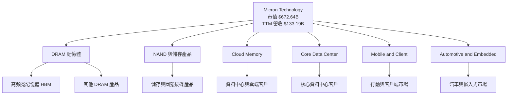
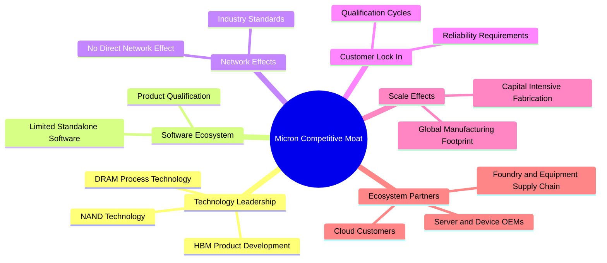
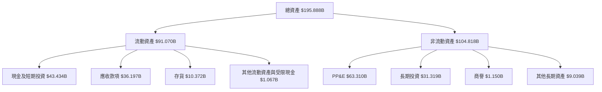
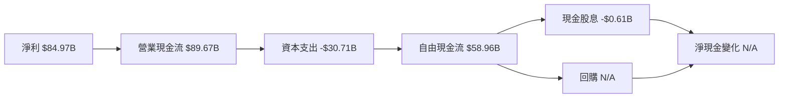
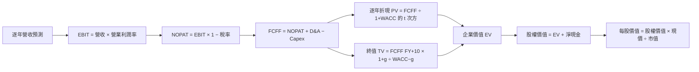
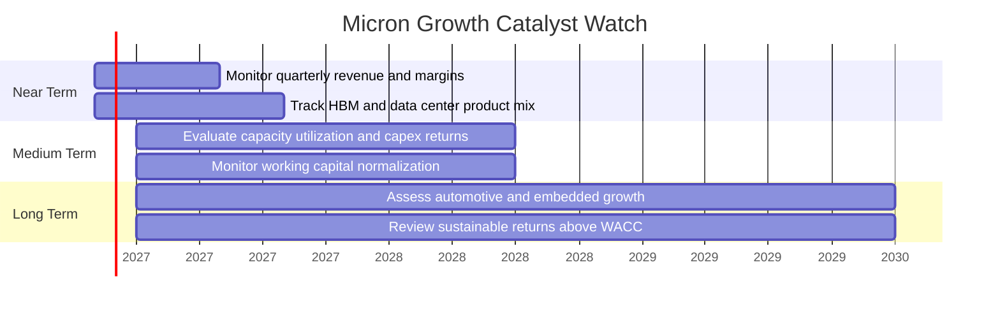
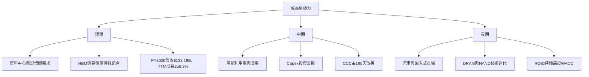
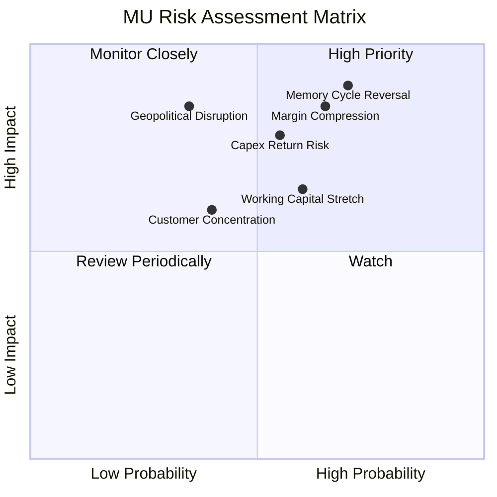
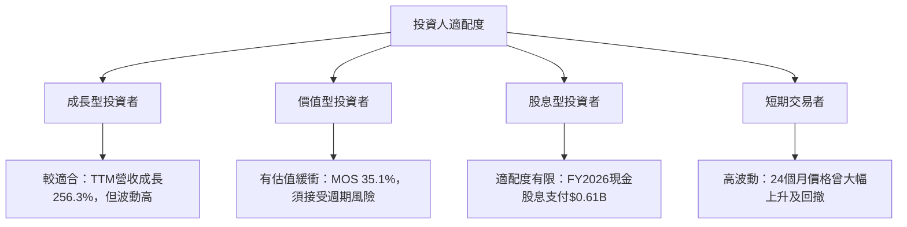

# MU 基本面深度分析報告
> **報告日期**：2026-11-22 ｜ **語言**：繁體中文 ｜ **數據來源**：SEC 申報資料 (XBRL)、Yahoo Finance、Finviz、StockAnalysis、Roic.ai ｜ **分析師**：CFA 級機構研究

## 目錄

| # | 章節 | 核心結論 |
|---|------|----------|
| 1 | 執行摘要 | 強烈買入；加權合理價值 $916.17；MOS +35.1% |
| 2 | 公司概覽與商業模式 | DRAM／NAND 記憶體業務受技術與資本規模支持，但營收組成數據未提供 |
| 3 | 損益表深度分析 | TTM 營收 $133.19B、TTM 成長 256.3%；近期利潤率急升，循環風險仍高 |
| 4 | 資產負債表分析 | 淨現金 $40.15B；CCC 由 155 天延長至 185 天 |
| 5 | 現金流量深度分析 | TTM FCF $58.96B、FCF Yield 8.77%；高資本支出反映產能投入 |
| 6 | 獲利能力與資本效率 | ROIC 86.2% 高於 WACC 14.00%，目前創造股東價值 |
| 7 | 相對估值分析 | P/E 低於自身五年中位數；同業倍數與週期獲利須審慎解讀 |
| 8 | DCF 內在價值評估 | 基準 DCF $881.83／股；加權合理價值 $916.17／股 |
| 9 | 成長催化劑 | AI 記憶體需求與產品組合是潛在動能；TAM 數據未提供 |
| 10 | 風險矩陣 | 記憶體週期、定價反轉、資本密集與地緣政治為主要風險 |
| 11 | 投資建議 | 依 MOS 評級為強烈買入；以財報門檻與估值區間分批管理 |

---

## 1. 執行摘要

Micron 最新 TTM 營收為 **$133.19B**，TTM 年增 **256.3%**，最新單季年增 **379.3%**；TTM 營業利益率 **74.6%**、FCF **$58.96B**、ROIC **86.2%**。另一方面，DRAM／NAND 價格及產品組合具高度循環性，且營運資金 CCC 已由一年前 **155 天**延長至 **185 天**。以 2026-11-20 收盤價 **$594.51**計，估值方法加權後合理價值 **$916.17**，MOS **+35.1%**，且 ROIC 高於 WACC **14.00%**；因此依 MOS 規則評級為 **強烈買入**，但估值成立高度依賴目前的高獲利水準能否逐步轉化為持續現金流。

### 1.0 一頁式投資儀表板

| 項目 | 內容 |
|------|------|
| **投資論點（3 句）** | ① TTM 營收 **$133.19B**、年增 **256.3%**，反映近期供需與產品組合改善。② TTM FCF **$58.96B**、FCF Yield **8.77%**，提供投資與資產負債表緩衝。③ ROIC **86.2%** 對比 WACC **14.00%**，當前資本回報顯著高於資金成本。 |
| **綜合評分** | **8.4/10**（引用 1.1 評分卡） |
| **財務健康** | 🟢 現金及短期投資 **$43.43B**、總債務 **$3.28B**、淨現金 **$40.15B**；但 CCC 增至 **185 天**。 |
| **ROIC vs WACC** | **86.2% vs 14.00%**；目前創造股東價值，差額 **72.2 個百分點**。 |
| **FCF 趨勢** | FY2023 FCF **-$6.12B**、FY2024 **$0.121B**、FY2025 **$1.67B**、FY2026 **$58.96B**；TTM FCF Yield **8.77%**。反映週期反彈與高利潤，不宜直線外推。 |
| **估值** | Forward P/E **2.85x** ｜ EV/EBITDA **5.83x** ｜ FCF Yield **8.77%** |
| **DCF 內在價值（基準）** | **$881.83** ｜ 現價相對 DCF 折價 **32.6%**（折溢價 = 現價÷DCF價值−1） |
| **安全邊際（MOS）** | **+35.1%**＝($916.17−$594.51)÷$916.17；🟢 >25% |
| **預期報酬（基準情境）** | 加權合理價值對現價上行空間 **+54.1%**；這是估值差距，不代表 12 個月報酬預測。 |
| **關鍵風險（前二）** | 記憶體供需反轉導致價格／毛利率收縮；高資本支出與 CCC 延長令現金轉換惡化。 |
| **評級 + 信心度** | 🟢 **強烈買入** ｜ 信心：中（評級由 MOS 規則決定；週期性及模型假設降低信心） |

### 1.1 綜合評分卡（全報告唯一）

| 維度 | 評分（1–10） | 主要依據（引用數字與其來源章節） |
|------|--------------|----------------------------------|
| 成長性 | 9.0 | TTM 營收成長 **256.3%**、最新一季年增 **379.3%**（第 3 章）；但屬低基期與週期反彈。 |
| 獲利能力 | 9.5 | TTM 營業利益率 **74.6%**、ROIC **86.2%**、Piotroski **8/9**（第 3、6 章）。 |
| 財務健康 | 9.0 | 淨現金 **$40.15B**、流動比率 **3.31**；CCC 卻升至 **185 天**（第 4 章）。 |
| 估值 | 8.0 | MOS **35.1%**；P/E **8.0x**，低於自身五年中位數 **17.4x**，但週期峰值獲利會壓低當期倍數（第 7、8 章）。 |
| 護城河 | 8.0 | DRAM／NAND 製程、規模與資本密集特性形成門檻；但產品具商品屬性、競爭者仍強（第 2 章）。 |
| 管理層與資本配置 | 7.0 | FY2026 Capex **$30.71B**、研發 **$5.65B**，支持產能及技術；Piotroski 稀釋股數測試未通過（第 3、5、6 章）。 |
| **綜合評分** | **8.4** | 六項算術平均：(9.0+9.5+9.0+8.0+8.0+7.0)÷6 = **8.4**。 |

### 1.2 五大投資論點 + 三大核心風險

| 類型 | 項目 | 具體依據 | 信心度 |
|------|------|----------|--------|
| 🟢 **投資論點①** | 營收與需求加速 | TTM 營收 **$133.19B**，TTM 年增 **256.3%**；最新一季年增 **379.3%**。若產業需求與定價仍支持出貨，營業槓桿可維持。 | 🟢 高 |
| 🟢 **投資論點②** | 高現金創造能力 | TTM OCF **$89.67B**、Capex **$30.71B**、FCF **$58.96B**；扣除擴產後仍留下大量現金。 | 🟢 高 |
| 🟢 **投資論點③** | 資本報酬高於資金成本 | ROIC **86.2%** 對比 WACC **14.00%**，目前資本配置創造價值；但高峰期 ROIC 不宜永久化。 | 🟢 中高 |
| 🟢 **投資論點④** | 淨現金提供週期緩衝 | 現金及短期投資 **$43.43B**、總債務 **$3.28B**、淨現金 **$40.15B**，可支持研發及資本支出。 | 🟢 高 |
| 🟢 **投資論點⑤** | 相對估值有折價空間 | P/E **8.0x**，自身五年中位數 **17.4x**；加權合理價值 **$916.17** 高於現價 **$594.51**。 | 🟡 中 |
| 🟡 **風險①** | 記憶體週期下行 | FY2023 營業利益 **-$5.41B**，顯示產業低谷可能令獲利迅速由高峰反轉。 | 🟡 中 |
| 🔴 **風險②** | 現金轉換週期拉長 | CCC 由 **155 天**增至 **185 天**，其中 DSO **70→87 天**、DIO **136→147 天**，需留意應收與存貨資金占用。 | 🔴 高衝擊 |
| 🟡 **風險③** | 擴產回報與股權稀釋 | FY2026 Capex **$30.71B**；Piotroski 的稀釋股數測試未通過。若產能投入快於需求，會壓低未來 ROIC 與 FCF。 | 🟡 中高 |

### 1.3 快速統計卡片

| 指標 | 公司實際值（期間） | 同業中位數 | 狀態 |
|------|--------------------|------------|------|
| 營收成長（TTM） | **256.3%** | — | 🟢 |
| 營收成長（最新一季年增） | **379.3%** | **327.9%** | 🟢 |
| 毛利率（TTM） | **80.7%** | **77.4%** | 🟢 |
| 營業利益率（TTM） | **74.6%** | — | 🟢 |
| ROIC（TTM） | **86.2%** | — | 🟢 |
| Forward P/E | **2.85x** | **2.5x** | 🟡 |
| FCF Yield（TTM） | **8.77%** | — | 🟢 |
| Piotroski F-Score | **8 / 9** | — | 🟢 |

*同業中位數依可比較資料計算：最新一季營收成長為 SK hynix、SanDisk、WDC 三家公司中位數；毛利率亦取三家公司中位數；Forward P/E 中位數為三家公司數值中位數。SK hynix 部分估值因幣別混合而未提供，不納入。*

### 1.4 投資結論

```text
╔══════════════════════════════════════════════════════════════════╗
║                    📊 投資結論摘要                               ║
╠══════════════════════════════════════════════════════════════════╣
║  評級：強烈買入（MOS +35.1%，ROIC 86.2% > WACC 14.00%）          ║
║  價格（2026-11-20 收盤）：$594.51                                ║
║  DCF 內在價值（基準）：$881.83（折價 32.6%）                     ║
║  安全邊際 MOS：+35.1%（以加權合理價值 $916.17 為分母）          ║
║  加權合理價值（8.8）：$916.17                                    ║
║  DCF 情境價值：                                                  ║
║    悲觀情境：$429.05（-27.8%）                                   ║
║    基準情境：$881.83（+48.3%）                                   ║
║    樂觀情境：$1,715.71（+188.6%）                                ║
║  綜合評分：8.4/10（引用 1.1）                                    ║
║  適合投資人：可承受高週期波動、以中長期持有為主的成長型投資人    ║
╚══════════════════════════════════════════════════════════════════╝
```

---

## 2. 公司概覽與商業模式

Micron Technology, Inc. 是記憶體與儲存半導體供應商，財務資料列出 Cloud Memory、Core Data Center、Mobile and Client、Automotive and Embedded 等業務單位，主要產品包含 DRAM、HBM 及 NAND／儲存產品。提供的財務資料沒有各板塊收入、毛利或市場份額拆分，因此不以未披露的比例呈現業務組合。

### 2.1 業務結構與收入來源



營收分部占比與軟體／服務營收數據未提供，故不製作分部收入圖或占比推算。公司收入主要來自半導體記憶體與儲存產品銷售。

### 2.2 市場份額

市場份額數據未提供。依可用數字，MU 的 TTM 營收為 **$133.19B**，最新單季營收年增 **379.3%**；相較 SK hynix 最新單季營收成長 **327.9%**、SanDisk **377.9%** 及 WDC **55.5%**，MU 近期營收增速位於同業高檔。這只能說明近期增長相對位置，不能替代市場份額或份額變化資料。

### 2.3 競爭護城河分析



### 2.4 護城河強度

| 護城河項目 | 強度（強／中／弱） | 證據（引用數字或事實） | 會削弱它的情況 |
|------------|--------------------|------------------------|----------------|
| 技術與產品 | 中至強 | 產品涵蓋 DRAM、HBM、NAND，FY2026 研發費用 **$5.65B**；技術投入與產品認證支撐競爭力。 | 競爭者在製程、良率、HBM 產品或交付能力追近。 |
| 軟體生態系統 | 弱 | 現有資料顯示核心為記憶體／儲存硬體，未提供獨立軟體收入或平台數據。 | 產品規格標準化，客戶採購更著重價格與供應。 |
| 網路效應 | 弱 | 未見直接網路效應或依使用者數增加而提升產品價值的財務證據。 | 產品逐漸商品化、替代供應商增加。 |
| 客戶鎖定 | 中 | 半導體產品需經客戶驗證及系統相容性測試；但客戶與產品認證數據未提供。 | 客戶多源採購或平台轉換成本下降。 |
| 規模效應 | 強 | FY2026 Capex **$30.71B**、PP&E **$63.31B**，呈現資本與製造規模門檻。 | 產能過剩、資產利用率下降，或投資回報低於資本成本。 |
| 生態夥伴 | 中 | 公司服務雲端、資料中心、行動、汽車與嵌入式市場；合作夥伴營收占比未提供。 | 客戶集中、供應鏈限制或地緣政治干擾。 |

第 1.1 節的護城河評分 **8.0/10**，主要反映技術投入與製造規模門檻；但商品化、缺少軟體及網路效應證據，限制護城河的穩定性。

---

## 3. 損益表深度分析

### 3.1 年度收入成長趨勢（近 4 年）

| 財年 | 營收 | YoY 成長 |
|------|------:|---------:|
| FY2023 | $15.54B | N/A（前一年比較值未列於此四年表） |
| FY2024 | $25.11B | **+61.6%** |
| FY2025 | $37.38B | **+48.9%** |
| FY2026 | $133.19B | **+256.3%** |

```text
╔══════════════════════════════════════════════════════════════════╗
║             Micron 年度收入趨勢（FY2023–FY2026）                 ║
╠══════════════════════════════════════════════════════════════════╣
║  FY2023  $15.54B  ███░░░░░░░░░░░░░░░░░░░░░  YoY: N/A           ║
║  FY2024  $25.11B  █████░░░░░░░░░░░░░░░░░░░  YoY: +61.6%        ║
║  FY2025  $37.38B  ███████░░░░░░░░░░░░░░░░  YoY: +48.9%         ║
║  FY2026 $133.19B  ████████████████████████  YoY: +256.3%       ║
║                                                                  ║
║  FY2023–FY2026 營收 CAGR：((133.19 ÷ 15.54)^(1/3)) − 1 ≈ 104.7% ║
╚══════════════════════════════════════════════════════════════════╝
```

FY2023–FY2026 CAGR 約 **104.7%**，主要由 FY2026 大幅反彈拉高，並非可直接外推的長期增速。收入從 FY2025 **$37.38B**升至 FY2026 **$133.19B**，意味當前估值對供需、產品組合與記憶體價格變化高度敏感。

### 3.2 季度收入趨勢分析

| 財季 | 營收 | QoQ 成長 | 最新提供的 YoY 成長 | 備註 |
|------|-----:|---------:|--------------------:|------|
| FY2026 Q1 | $13.64B | **+20.6%** | **+56.7%** | QoQ 以前季 FY2025 Q4 $11.315B 計；YoY 使用財季資料。 |
| FY2026 Q2 | $23.86B | **+74.9%** | **+196.3%** | 營收加速擴張。 |
| FY2026 Q3 | $41.46B | **+73.7%** | **+345.7%** | 高增速顯示需求及產品組合延續改善。 |
| FY2026 Q4 | $54.23B | **+30.8%** | **+379.3%** | QoQ 仍增長，YoY 受低基期與供需反彈影響。 |

QoQ 計算採相鄰季度營收相除減一；例如 FY2026 Q4 QoQ = ($54.229B÷$41.456B)−1 = **30.8%**。單季 YoY 與 TTM 成長定義不同：最新單季年增為 **379.3%**，TTM 年增為 **256.3%**。

### 3.3 利潤率演變分析

| 利潤率指標 | FY2023 | FY2024 | FY2025 | FY2026 | 趨勢 | 評估 |
|------------|-------:|-------:|-------:|-------:|------|------|
| **毛利率** | -9.1% | 22.3% | 39.8% | 80.7% | 低谷反彈後急升 | 🟢 |
| **營業利益率** | -34.8% | 5.2% | 26.1% | 74.6% | 固定成本吸收與產品組合改善 | 🟢 |
| **淨利率** | -37.5% | 3.1% | 22.8% | 63.8% | 淨利率隨營業槓桿大幅回升 | 🟢 |

*毛利率依年度毛利÷營收計算；營業利益率與淨利率依年度營業利益／淨利÷營收計算，四捨五入至一位小數。*

FY2026 營收 **$133.19B**，較 FY2025 **$37.38B**大幅增加；毛利 **$107.50B**、營業利益 **$99.34B**、淨利 **$84.97B**。高產能利用、價格回升及較高價值產品組合，能讓固定製造成本分攤至更多出貨，推升毛利率及營業利益率；但記憶體供需轉弱時，同一營運槓桿也可能反向放大獲利下跌。FY2023 營業虧損 **$5.41B**是循環風險的歷史佐證。

### 3.4 費用結構分析

營業成本與各項營運費用的完整分項資料未提供，無法製作具可核實比例的費用結構圓餅圖。已知 FY2026 研發費用為 **$5.65B**，較 FY2025 **$3.80B**增加約 **48.7%**；研發投入上升有助產品開發，但其對當期獲利的影響應與未來產品回報一併評估。Capex 屬現金流與資產投資，不直接當作當期費用計入此圖。

### 3.5 季度 EPS 趨勢與盈餘品質（Quality of Earnings）

| 季度 | EPS 實際 | EPS YoY 成長 | 超預期／不及預期 |
|------|---------:|-------------:|------------------|
| 2025-11-30 | $4.60 | +175.45% | 共識預估與實際值均缺漏，N/A |
| 2026-02-28 | $12.07 | +756.03% | 共識預估與實際值均缺漏，N/A |
| 2026-05-31 | $24.67 | +1,368.45% | 共識預估與實際值均缺漏，N/A |
| 2026-08-31 | $32.85 | +1,059.46% | 共識預估與實際值均缺漏，N/A |

資料庫提供的四季 EPS 預估值為 NaN，因此無法可靠判斷超預期或不及預期；但 EPS 實際值由 **$4.60**升至 **$32.85**，與營收及利潤率大幅改善方向一致。

| 盈餘品質項目 | 數值／佔比 | 評估 |
|--------------|------------|------|
| 股權薪酬 SBC / 營收 | $1.33B÷$133.19B = **1.00%** | 🟢 佔比不高；仍會稀釋股東，且稀釋股數測試未通過。 |
| SBC / 營業現金流 | $1.33B÷$89.67B = **1.48%** | 🟢 相對營業現金流規模有限。 |
| FCF / 淨利（現金轉換率） | $58.96B÷$84.97B = **69.4%** | 🟡 FCF 為正且規模大，但高 Capex 令淨利轉成 FCF 的比率低於 100%。 |
| 一次性／非經常性損益 | N/A（明細未提供） | 無法判斷非經常性項目是否拉高或壓低本期盈餘。 |
| 有效稅率 | **14.8%** | 未見資料顯示由稅務利益主導；一次性稅項拆分 N/A。 |
| 資本化支出 vs 費用化 | FY2026 Capex **$30.71B**；SBC 與研發費用為費用項目 | Capex 資本化後透過折舊進入損益；資產化是否造成費用遞延的明細不足。 |

**盈餘品質結論：** FY2026 OCF **$89.67B**及 FCF **$58.96B**支持獲利具有實際現金流，但 FCF／淨利僅 **69.4%**，主因是 **$30.71B**資本支出。SBC 佔營收約 **1.00%**，目前不構成主要獲利品質疑慮；不過庫存及應收天數上升，以及缺少一次性損益拆解，代表不能只以 GAAP 淨利作為估值錨點。

---

## 4. 資產負債表分析

### 4.1 資產結構分解

FY2026 資產負債表所列總資產 **$195.888B**；流動資產 **$91.070B**，其餘主要項目如下：



非流動資產金額為總資產減流動資產；其他流動資產與受限現金依列示項目加總。資料來源的資產分類可能有取整差異。

### 4.2 流動性與營運資金分析

| 指標 | 最新 TTM | 一年前 TTM | 變化 | 解讀 |
|------|---------:|----------:|------:|------|
| 流動比率 | 3.31 | N/A | N/A | 流動資產高於流動負債，短期償付能力具緩衝。 |
| 速動比率 | 2.90 | N/A | N/A | 扣除存貨後仍有流動性緩衝。 |
| DSO 應收帳款天數 | 87 天 | 70 天 | **+17 天** | 收款天數延長；需確認是否由銷售組合、交貨時間或客戶付款條款改變造成。 |
| DIO 存貨天數 | 147 天 | 136 天 | **+11 天** | 庫存占用增加，若需求轉弱，可能伴隨價格或存貨減值風險。 |
| DPO 應付帳款天數 | 50 天 | 51 天 | **-1 天** | 對供應商付款天數略縮短，沒有顯示透過延長付款期限抵銷營運資金壓力。 |
| CCC 現金轉換週期 | 185 天 | 155 天 | **+30 天** | 現金被應收與存貨占用時間變長，須監控後續季度能否回落。 |

流動比率與速動比率分別為 **3.314**及 **2.898**，顯示帳面短期償債能力充足；但 CCC 拉長 **30 天**，代表高營收擴張同時提高周轉資金需求，不應將現金充裕誤解為營運資金效率同步改善。

### 4.3 債務結構分析

以下採用 SEC／程式計算的 VERIFIED 數值；其他彙整欄位出現總債務 **$5.18B**等不一致值，優先採用一致的驗證數據：總債務 **$3.28B**、現金與短期投資 **$43.43B**、淨現金 **$40.15B**。

```text
╔══════════════════════════════════════════════════════════════════╗
║                   Micron 債務健康診斷                            ║
╠══════════════════════════════════════════════════════════════════╣
║  總債務：          $3.28B   █░░░░░░░░░░░░░░░░░░  🟢 低            ║
║  現金+短期投資：  $43.43B   ████████████████████  🟢 充足          ║
║  淨現金：         $40.15B   ██████████████████░░  🟢 強            ║
║  流動比率：         3.31x   流動資產高於流動負債                  ║
║  速動比率：         2.90x   扣除存貨後仍具流動性                  ║
║  Debt/EBITDA：      N/A     VERIFIED 的 EBITDA 負債指標未提供     ║
║  利息保障倍數：     N/A     利息費用及同口徑計算基礎未完整提供    ║
╚══════════════════════════════════════════════════════════════════╝
```

不得以彙整資料中的其他債務數字反推或混搭 Debt/EBITDA、利息保障倍數。

### 4.4 股東權益趨勢

| 財年 | 股東權益 | YoY 變化 |
|------|---------:|---------:|
| FY2023 | $44.12B | N/A |
| FY2024 | $45.13B | +2.3% |
| FY2025 | $54.16B | +20.0% |
| FY2026 | $138.38B | +155.5% |

```text
╔══════════════════════════════════════════════════════════════════╗
║                 股東權益變化（FY2023–FY2026）                    ║
╠══════════════════════════════════════════════════════════════════╣
║  FY2023  $44.12B  ███████░░░░░░░░░░░░░░░░░░                    ║
║  FY2024  $45.13B  ████████░░░░░░░░░░░░░░░░░                    ║
║  FY2025  $54.16B  ██████████░░░░░░░░░░░░░░░░                  ║
║  FY2026 $138.38B  █████████████████████████                    ║
╚══════════════════════════════════════════════════════════════════╝
```

FY2026 股東權益大幅增加，與當年 **$84.97B**淨利及資產負債表擴張相符；仍需用現金流與資本回報衡量新增資本的使用效率。

---

## 5. 現金流量深度分析

### 5.1 現金流量瀑布圖

| 現金流項目 | FY2026／TTM 金額 |
|------------|-----------------:|
| 淨利 | $84.97B |
| 營業現金流 | $89.67B |
| 資本支出 | -$30.71B |
| 自由現金流 | $58.96B |
| 現金股息支付 | -$0.61B |
| 回購 | N/A（資料未提供） |
| 淨現金變化 | N/A（期初期末現金、短期投資與其他現金流變動需完整橋接） |



### 5.2 FCF 轉換率趨勢

| 財年 | FCF | 淨利 | FCF／淨利 |
|------|----:|-----:|----------:|
| FY2023 | -$6.12B | -$5.83B | **105.0%** |
| FY2024 | $0.121B | $0.778B | **15.6%** |
| FY2025 | $1.67B | $8.54B | **19.6%** |
| FY2026 | $58.96B | $84.97B | **69.4%** |

FY2023 比率雖約 105%，但分子分母均為負值，不能視為健康的現金轉換。FY2024–FY2025 Capex 高於現金流增長所支撐的水平，FY2026 現金流大幅改善，但仍有約三成淨利未轉成 FCF，主要要從資本支出及營運資金變動追蹤。

### 5.3 自由現金流趨勢

```text
╔══════════════════════════════════════════════════════════════════╗
║              自由現金流趨勢（FY2023–FY2026）                     ║
╠══════════════════════════════════════════════════════════════════╣
║  FY2023  -$6.12B  ◀███░░░░░░░░░░░░░░░░░░  負值                  ║
║  FY2024   $0.12B  ░░░░░░░░░░░░░░░░░░░░░░  FCF Yield N/A          ║
║  FY2025   $1.67B  █░░░░░░░░░░░░░░░░░░░░░  FCF Yield N/A          ║
║  FY2026  $58.96B  ████████████████████████  FCF Yield 8.77%       ║
╠══════════════════════════════════════════════════════════════════╣
║  FY2026 FCF = TTM OCF $89.67B − Capex $30.71B = $58.96B         ║
╚══════════════════════════════════════════════════════════════════╝
```

### 5.4 資本配置評估

回購、併購、現金留存及資本支出以外的完整資本配置比例未提供，不能製作各用途占比圓餅圖。FY2026 Capex 為 **$30.71B**、現金股息支付 **$0.61B**、SBC **$1.33B**；資本投入優先支持製造產能，股息相對現金流規模較小。SBC 是非現金費用，不能與現金資本配置直接相加比較。

| 項目 | FY2026 金額 | 解讀 |
|------|------------:|------|
| Capex | $30.71B | 產能及製造投資，回報取決於後續利用率與產品價格。 |
| 股息支付 | $0.61B | 相較 FCF $58.96B 占比有限。 |
| 回購 | N/A | 回購資料未提供。 |
| SBC | $1.33B | 對應員工股權薪酬，形成股東稀釋成本。 |

---

## 6. 獲利能力與資本效率

### 6.1 ROE／ROA／ROIC 趨勢

| 指標 | FY2023 | FY2024 | FY2025 | TTM／FY2026 | 評估 |
|------|-------:|-------:|-------:|------------:|------|
| ROE | N/A | N/A | N/A | **61.4%** | TTM 高回報；品質與持續性受週期獲利影響。 |
| ROA | N/A | N/A | N/A | **N/A**（QUALITY FIGURES 未提供當前值） | 其他彙整來源報 44.6%，但與驗證品質區塊口徑不同，不以其替代。 |
| ROIC | N/A | N/A | N/A | **86.2%** | 高於資本成本，現階段創造價值。 |

ROE 數據存在來源口徑差異：彙整行情資料列示 **88.3%**，QUALITY FIGURES 的杜邦計算給出 **61.4%**。本報告品質指標、杜邦與 ROE 評估採用 QUALITY FIGURES 的 **61.4%**，避免混用口徑。可比行業均值未提供，故不列。

### 6.2 ROIC vs WACC 分析（核心價值創造判斷）

```text
╔══════════════════════════════════════════════════════════════════╗
║                ROIC vs WACC 深度分析                            ║
╠══════════════════════════════════════════════════════════════════╣
║  WACC 採用值：14.00%（資本成本區塊的封頂採用值）                 ║
║  ├── 無風險利率（10Y 美債）：4.91%                               ║
║  ├── 股權風險溢酬 ERP：5.00%                                     ║
║  ├── Beta（調整後）：1.93；原始 Beta：2.40                      ║
║  ├── 股權成本：4.91% + 1.93 × 5.00% = 14.56%，區塊列示 14.57%  ║
║  ├── 稅前債務成本：3.23%；稅率 14.8%                            ║
║  ├── 股權／債務權重：99.5%／0.5%                                 ║
║  └── 未封頂計算 WACC 14.51%，採用 WACC 14.00%                  ║
║                                                                  ║
║  ROIC（TTM）：86.2%                                               ║
║  EVA spread = ROIC − WACC = 86.2% − 14.0% = +72.2 個百分點       ║
║                                                                  ║
║  ROIC 86.2%  ▓▓▓▓▓▓▓▓▓▓▓▓▓▓▓▓▓▓▓▓▓▓▓▓▓▓▓▓▓▓▓▓▓▓▓▓▓▓▓▓ 🟢       ║
║  WACC 14.0%  ▓▓▓▓▓▓▓░░░░░░░░░░░░░░░░░░░░░░░░░░░░░░░░          ║
║                                                                  ║
║  ROIC/WACC = 86.2% ÷ 14.0% = 6.16x                               ║
║  結論：目前回報率顯著高於資本成本；此差距可能隨週期下行收窄。  ║
╚══════════════════════════════════════════════════════════════════╝
```

區塊列示未封頂 WACC **14.51%**，並註明因限制於 **7%–14%** 區間，實際採用 **14.00%**。本章以及 DCF 均使用 **14.00%**，不是另行改算的折現率。Beta 採用調整後 **1.93**，其調整方式為 ⅔×原始 Beta **2.40** + ⅓×1 = **1.93**。對 ROIC **86.2%**而言，現況顯示價值創造；評估持續性時應檢查記憶體價格回落後 ROIC 是否仍高於 WACC。

### 6.3 杜邦三因素分解

| 因素 | 數值（TTM） | 解讀 |
|------|-------------|------|
| 淨利率 | **63.8%** | 高獲利率是目前 ROE 的主要來源。 |
| 資產週轉率 | **0.68** | 資產每年周轉約 0.68 次；資本密集型製造需較大資產基礎。 |
| 權益乘數 | **1.42** | 槓桿程度適中，ROE 並非主要靠高財務槓桿支撐。 |
| **ROE** | **61.4%** | 63.8% × 0.68 × 1.42 ≈ 61.4%（輸入與結果採用 QUALITY FIGURES 列示值）。 |

### 6.4 財務體質：Piotroski F-Score

Piotroski F-Score 為 **8/9**。品質計算說明，若個別測試缺少輸入會排除；本次列示九項測試，實際分母為 9。

| 測試 | 結果 | 解讀 |
|------|------|------|
| ROA > 0 | ✅ 通過 | 獲利為正。 |
| 營業現金流 > 0 | ✅ 通過 | 經營活動產生正現金流。 |
| ROA 高於一年前 | ✅ 通過 | 盈利能力改善。 |
| 營業現金流 > 淨利（應計品質） | ✅ 通過 | 現金流高於淨利，有利盈餘品質。 |
| 長期負債 ÷ 總資產低於一年前 | ✅ 通過 | 相對資產的長期負債下降。 |
| 流動比率高於一年前 | ✅ 通過 | 短期流動性改善。 |
| 稀釋股數未增加 | ❌ 未通過 | 代表股數稀釋未能通過檢驗；需監控 SBC 與股數變化。 |
| 毛利率高於一年前 | ✅ 通過 | 毛利率改善與定價／組合反彈相符。 |
| 資產週轉率高於一年前 | ✅ 通過 | 資產使用效率改善。 |

整體分數支持財務表現改善，但唯一未通過項目是稀釋股數；不應把 SBC 視為完全沒有股東成本。

---

## 7. 相對估值分析

### 7.1 同業估值比較表格

| 估值指標 | **MU** | **SK hynix（SKHY）** | **SanDisk（SNDK）** | **WDC** | 本公司評估 |
|----------|-------:|----------------------:|--------------------:|-------:|-----------|
| **Trailing P/E** | **8.0x** | 5.7x | 0.1x | 9.2x | 🟡 位於同業區間內；單一週期高峰的低 P/E 可能高估便宜程度。 |
| **Forward P/E** | **2.85x** | 2.5x | 2.2x | 6.5x | 🟡 略高於同業中位數 2.5x；前瞻獲利預估需留意週期峰值風險。 |
| **P/S Ratio** | **5.1x** | N/A | 3.1x | 6.7x | 🟡 高於 SNDK、低於 WDC；SKHY 幣別混合，不比較。 |
| **EV/EBITDA** | **5.83x** | N/A | 4.0x | 15.4x | 🟡 低於 WDC、高於 SNDK；SKHY 幣別混合，不比較。 |
| **最新單季營收 YoY** | **379.3%** | 327.9% | 377.9% | 55.5% | 🟢 MU 當期增速高於所列同業，但成長不可直接線性外推。 |
| **毛利率（TTM）** | **80.7%** | 77.4% | 80.0% | 52.6% | 🟢 MU 略高於同業中位數 **77.4%**。 |

SKHY 的 P/S 及 EV/EBITDA 因資料幣別混合而不適用。SNDK P/E **0.1x**及各公司 forward P/E 受週期盈利預期影響，不能單獨視為穩定的相對估值訊號。

### 7.2 歷史估值區間分析

```text
╔══════════════════════════════════════════════════════════════════╗
║             MU 歷史估值位置（自身五年區間）                     ║
╠══════════════════════════════════════════════════════════════════╣
║  P/E        7.4x ├─● 8.0x────────────中位數 17.4x──────┤138.5x ║
║                         百分位：7%                                ║
║  P/S        2.1x ├────────中位數 4.2x────● 5.1x────────┤11.7x  ║
║                         百分位：65%                               ║
║  EV/EBITDA  3.6x ├──● 5.9x────────中位數 9.7x─────────┤80.7x  ║
║                         百分位：20%                               ║
╚══════════════════════════════════════════════════════════════════╝
```

P/E **8.0x**位於自身五年區間第 **7 百分位**，EV/EBITDA **5.9x**位於第 **20 百分位**；P/S **5.1x**則高於歷史中位數 **4.2x**，處於第 **65 百分位**。三者訊號不完全一致，且當期高峰獲利會壓低 P/E，因此應同時看 P/S、FCF 與循環正常化獲利。

### 7.3 情境價值（Bear / Base / Bull）

| 情境 | 第 1 年營收成長 | 期末營業利潤率 | WACC | 每股價值 | 相對現價 | 機率 | 會發生的條件 |
|------|----------------:|----------------:|-----:|---------:|---------:|-----:|--------------|
| 🔴 悲觀 | 15.0% | 22.2% | 15.00% | **$429.05** | **-27.8%** | 25% | 需求降溫、價格回落、擴產造成供給增加，長期利潤率降至情境假設。 |
| 🟡 基準 | 30.0% | 26.1% | 14.00% | **$881.83** | **+48.3%** | 50% | 近期成長逐年放緩，利潤率向近五個財年中位數收斂。 |
| 🟢 樂觀 | 45.0% | 28.8% | 13.00% | **$1,715.71** | **+188.6%** | 25% | 需求與高價值產品出貨延續，且風險折現率較低。 |

情境價格及假設為 DCF MODEL 預先計算值，不能視為分析師另行重算的短期目標價。

### 7.4 相對估值隱含價格區間

```text
╔══════════════════════════════════════════════════════════════════╗
║              相對估值與加權估值參考（每股）                     ║
╠══════════════════════════════════════════════════════════════════╣
║  $580.49          $594.51          $881.83         $970.50        ║
║  同業 P/S         現價             基準 DCF        同業 EV/EBITDA ║
║                                                                  ║
║  分析師共識目標價：$1,561.91                                      ║
╚══════════════════════════════════════════════════════════════════╝
```

| 方法 | 每股價值 | 依據 |
|------|---------:|------|
| 同業 EV/EBITDA | **$970.50** | SNDK、WDC 同業中位數 **9.7x** × TTM EBITDA，加回淨現金。 |
| 同業 P/S | **$580.49** | SNDK、WDC 同業中位數 **4.9x** × TTM 營收。 |
| 分析師共識 | **$1,561.91** | 45 位分析師平均目標價；屬參考值，不代表基本面保證。 |

相對估值方法顯示範圍從 **$580.49**至 **$970.50**，反映採用營收倍數或 EBITDA 倍數會導致不同結果；分析師共識高於上述相對估值方法，需以其盈利預測與時間框架作額外查核。

---

## 8. DCF 內在價值評估（Discounted Cash Flow）

### 8.0 估值推理鏈（Thinking Logic）

#### Step 1 — 價值由哪些變數決定？

MU 的價值可分為現有 DRAM／NAND 記憶體現金流、資料中心與 HBM 等產品需求，以及製造產能與產品組合帶來的增長；各板塊收入占比未提供，故不能把其中任何一項虛構成獨立收入曲線。模型最敏感的核心，是 **營收成長及 GAAP 營業利潤率能否在十年內由週期高位向長期水平收斂**；敏感度表顯示 WACC 與 g 也對估值有顯著影響。

#### Step 2 — 模型選擇

| 決策點 | 本報告採用 | 理由（含數字） | 曾考慮但否決 | 否決理由 |
|--------|-----------|----------------|--------------|----------|
| 現金流定義 | FCFF | 與 WACC 折現、先求 EV 再加淨現金一致。 | FCFE | 財務數據提供 WACC 與企業層級 FCFF 模型。 |
| 預測期 N | 10 年 | DCF MODEL 固定預測 10 年，營收成長由 30.0% 線性降至 3.0%。 | 5 年 | 無法反映模型指定的長期收斂路徑。 |
| 終值方法 | Gordon Growth | 終值成長率 g=3.0%，WACC=14.00%。 | 另行退出倍數 | DCF MODEL 沒有預先計算退出倍數終值；不自建另一模型。 |
| EBIT 基礎 | GAAP EBIT | 採模型列示的 GAAP 營業利益。 | 非 GAAP EBIT | 避免額外加入模型未提供的調整。 |

#### Step 3 — 關鍵假設推導鏈

- **營收成長**：錨點＝TTM 年增 **256.3%**、FY2023–FY2026 營收 CAGR 約 **104.7%** → 兩者均被低基期與週期反彈放大，模型將第一年增速限制在 **30.0%**，再逐年降至 **3.0%** → **採用 FY+1 30.0%、FY+10 3.0%** → 曾考慮直接沿用 TTM **256.3%**，但會將極端單年增速延伸至未來，故否決。
- **期末營業利潤率**：錨點＝TTM 營業利益率 **74.6%**；FY2025 為 **26.1%** → 74.6% 是週期高位，模型向近五個財年中位數收斂 → **FY+1 74.6%，FY+10 26.1%** → 曾考慮永久採用 74.6%，但與歷史週期波動不符，否決。
- **終值成長率 g**：錨點＝模型基準 **3.0%**，低於 WACC **14.00%** → 以長期成熟成長假設取代短期高增速 → **採用 3.0%** → 不採用高於 3.0% 的永久高增長，避免終值建立在難以持續的高成長。
- **預測期 N**：錨點＝模型設定 **10 年**，由 30.0% 成長逐步降到 3.0% → 讓超額成長在預測期內收斂 → **採用 10 年** → 未採用較短期限，因現有模型已提供十年逐年預測，不可自行改期。
- **Capex／營收**：錨點＝TTM **23.1%** → 擴產支出率高於長期成熟水平；模型逐年下降至 FY+10 **7.8%** → **由 23.1% 線性收斂至 7.8%** → 不以當期高 Capex 比例永久外推，因模型明定逐步收斂。
- **GAAP EBIT 與 SBC**：錨點＝GAAP EBIT 已把 SBC 列為費用 → 不再從 FCFF 扣 SBC，並固定股數 → **採用組合 (A)：GAAP EBIT + 不另扣 SBC + 年稀釋率 0%** → 否決「GAAP EBIT 再扣 SBC」以免重複計算。
- **WACC**：錨點＝未封頂計算 **14.51%**；資本成本區塊指定在 7%–14% 範圍內封頂 → **採用 14.00%** → 不使用未封頂 14.51%，因數據區塊已明確指定採用值。
- **營運資金**：錨點＝CCC 最新 **185 天**、一年前 **155 天** → 模型未提供逐年 ΔWC 假設 → **DCF 不建模營運資金變動** → 不自行估算 ΔWC 比例，以免填入未提供的模型輸入。

#### Step 4 — 最脆弱的一環

最脆弱假設是當前極高營業利潤率能否在逐步下降後仍維持模型所列路徑；若定價及產品組合快速逆轉，悲觀情境每股價值 **$429.05**，低於現價 **27.8%**。

#### Step 5 — 計算路徑圖



### 8.1 模型假設總表（Model Inputs）

| 假設項目 | 採用值 | 依據／來源 | 敏感度 |
|----------|--------|-------------|--------|
| 預測期長度 N | **10 年** | DCF MODEL 固定預測期。 | 🟡 中 |
| 營收成長 | FY+1 **30.0%**，FY+10 **3.0%**，逐年線性下降 | TTM 成長 **256.3%**，模型限制第一年最高 30.0%。 | 🔴 高 |
| 營業利潤率（GAAP EBIT） | FY+1 **74.6%** → FY+10 **26.1%** | TTM **74.6%**，向最近五個財年中位數 **26.1%**收斂。 | 🔴 高 |
| 有效稅率 | **14.8%** | 最新年度有效稅率。 | 🟢 低 |
| Capex／營收 | FY+1 **23.1%** → FY+10 **7.8%** | TTM Capex／營收 **23.1%**；模型按年收斂。 | 🟡 中 |
| D&A／營收 | **7.1%** | TTM 比例，模型維持不變。 | 🟢 低 |
| 營運資金變動／營收增額 | **不建模** | DCF MODEL 明定未建模營運資金。 | 🟢 低 |
| EBIT 基礎 | **GAAP** | DCF MODEL 使用 GAAP EBIT。 | 🟡 中 |
| SBC 處理 | **組合 (A)**：GAAP 已含 SBC；FCFF 不另扣 SBC | 模型明定 GAAP EBIT、固定股數。 | 🟡 中 |
| 年稀釋率 | **0%**（固定股數） | 與組合 (A) 一致；模型不另放大股數。 | 🟡 中 |
| 永續成長率 g | **3.0%** | DCF MODEL 假設，且低於 WACC。 | 🔴 高 |
| 終值方法 | Gordon Growth | DCF MODEL 直接採用該終值。 | 🔴 高 |
| WACC | **14.00%** | 程式計算未封頂 14.51%，依 7%–14% 區間採 14.00%。 | 🔴 高 |

**現金流定義：**FCFF = NOPAT + D&A − Capex；營運資金未建模，故不加入 ΔWC 列。本模型採用 **(A)**，因此 SBC 影響已透過 GAAP 費用計入一次，不再扣除 SBC，也不額外稀釋股數。

### 8.2 折現率推導（WACC）

```text
╔══════════════════════════════════════════════════════════════════╗
║                    WACC 推導（折現率）                           ║
╠══════════════════════════════════════════════════════════════════╣
║  股權成本 Ke（CAPM）：                                           ║
║  ├── 無風險利率 Rf：4.91%（10Y Treasury；觀測日未提供）          ║
║  ├── ERP：5.00%（資本成本輸入假設）                              ║
║  ├── 原始 Beta：2.40；調整後 Beta：1.93                          ║
║  ├── 規模／國別溢酬：0.00%（資本成本輸入未另列溢酬）             ║
║  └── Ke = 4.91% + 1.93 × 5.00% = 14.56%，區塊列示 14.57%       ║
║                                                                  ║
║  債務成本 Kd：                                                    ║
║  ├── 稅前 Kd：3.23%（資本成本區塊列示）                          ║
║  ├── 有效稅率：14.8%                                              ║
║  └── 稅後 Kd = 3.23% × (1−14.8%) = 2.75%                        ║
║                                                                  ║
║  資本結構：股權 99.5%，債務 0.5%（資本成本區塊列示）             ║
║  未封頂 WACC：14.51%；採用 WACC：14.00%（依 7%–14% 區間封頂）   ║
╚══════════════════════════════════════════════════════════════════╝
```

逐步演算：

1. **Ke（CAPM）** = Rf + β×ERP = 4.91% + 1.93×5.00% = 4.91% + 9.65% = **14.56%**；資本成本區塊列示 **14.57%**，差異為底層精度及四捨五入。
2. **稅前 Kd** = **3.23%**，直接採用資本成本輸入；利息費用及計息負債平均餘額的完整明細未提供，故不另行推導分子、分母。
3. **稅後 Kd** = 3.23%×(1−14.8%) = 3.23%×0.852 = **2.75196% ≈ 2.75%**。
4. **權重** = 股權 **99.5%**、債務 **0.5%**；兩者合計 **100.0%**。資本成本區塊採用市值／債務的市場權重；但可供獨立重建市值與同口徑計息負債的完整輸入未列出，因此沿用區塊權重，不自行重算。
5. **未封頂 WACC** = 99.5%×14.57% + 0.5%×2.75196% = 14.49715% + 0.0137598% = **14.5109098% ≈ 14.51%**；因區間封頂，**採用 WACC = 14.00%**。

區塊未提供 10 年期無風險利率的觀測日期、平均計息負債及完整股權市值計算所用股數，因此本節不能完整獨立重建資本結構；DCF 仍依指定採用 WACC **14.00%**，與第 6.2 節一致。

### 8.3 逐年自由現金流預測（基準情境）

單位：$B；折現因子依模型保留三位小數。下表各格照錄 DCF MODEL，避免使用已四捨五入的假設反推或替換模型輸出。

| 年度 | FY+1 | FY+2 | FY+3 | FY+4 | FY+5 | FY+6 | FY+7 | FY+8 | FY+9 | FY+10 |
|------|-----:|-----:|-----:|-----:|-----:|-----:|-----:|-----:|-----:|------:|
| 營收 | 173.14 | 219.89 | 272.67 | 329.93 | 389.32 | 447.71 | 501.44 | 546.57 | 579.36 | 596.74 |
| 營收 YoY | 30.0% | 27.0% | 24.0% | 21.0% | 18.0% | 15.0% | 12.0% | 9.0% | 6.0% | 3.0% |
| 營業利潤率 | 74.6% | 69.2% | 63.8% | 58.4% | 53.1% | 47.7% | 42.3% | 36.9% | 31.5% | 26.1% |
| EBIT（GAAP） | 129.14 | 152.17 | 174.02 | 192.80 | 206.55 | 213.43 | 212.05 | 201.71 | 182.62 | 155.98 |
| − 稅 | (19.13) | (22.54) | (25.77) | (28.55) | (30.59) | (31.61) | (31.40) | (29.87) | (27.05) | (23.10) |
| = NOPAT | 110.02 | 129.64 | 148.25 | 164.25 | 175.96 | 181.82 | 180.64 | 171.84 | 155.58 | 132.88 |
| + D&A | 12.35 | 15.69 | 19.45 | 23.54 | 27.78 | 31.94 | 35.78 | 39.00 | 41.34 | 42.58 |
| − Capex | (39.93) | (46.99) | (53.66) | (59.35) | (63.45) | (65.41) | (64.78) | (61.37) | (55.26) | (46.84) |
| − ΔWC | 不建模 | 不建模 | 不建模 | 不建模 | 不建模 | 不建模 | 不建模 | 不建模 | 不建模 | 不建模 |
| **= FCFF** | **82.44** | **98.34** | **114.04** | **128.44** | **140.28** | **148.36** | **151.64** | **149.46** | **141.65** | **128.62** |
| 折現因子 @14.00% | 0.877 | 0.769 | 0.675 | 0.592 | 0.519 | 0.456 | 0.400 | 0.351 | 0.308 | 0.270 |
| **FCFF 現值 PV** | **72.32** | **75.67** | **76.98** | **76.04** | **72.86** | **67.59** | **60.60** | **52.40** | **43.56** | **34.69** |

**預測期 FCF 現值合計：**

$72.32 + $75.67 + $76.98 + $76.04 + $72.86 + $67.59 + $60.60 + $52.40 + $43.56 + $34.69 = **$632.71B**

**逐步演算（FY+1，模型列示值）：**

1. **營收** = 基期營收 $133.19B×(1+30.0%) = **$173.14B**（模型列示值；使用未取整底層輸入計算）。
2. **EBIT** = FY+1 營收×GAAP 營業利潤率 = **$129.14B**（依 DCF MODEL 列示值）。
3. **稅** = EBIT×有效稅率 **14.8%** = **$19.13B**（依模型列示值）。
4. **NOPAT** = EBIT−稅 = $129.14B−$19.13B = **$110.02B**（底層未取整數會造成顯示值相差 $0.01B）。
5. **D&A** = 營收×D&A／營收比例 **7.1%** = **$12.35B**（模型列示值）。
6. **Capex** = 營收×Capex／營收比例 **23.1%** = **$39.93B**（模型列示值）。
7. **ΔWC** = **不建模**（DCF MODEL 未提供營運資金預測）。
8. **FCFF** = NOPAT + D&A − Capex = $110.02B+$12.35B−$39.93B = **$82.44B**。
9. **折現因子** = 1÷(1+14.00%)¹ = **0.877**；PV = $82.44B×0.877 = **$72.32B**（依未取整因子計算）。

**合理性自檢：**

- DCF 預測 FCFF 由 FY+1 **$82.44B**升至 FY+10 **$128.62B**；由於模型期間的收入擴大且 Capex 率下滑，現金流增長高於單看營收年增率；與 FY2023–FY2026 實際 FCF CAGR 作比較會受 FY2023 負 FCF 影響而無法形成有經濟意義的 CAGR。
- FY+10 FCF 利潤率 = $128.62B÷$596.74B = **21.6%**；目前 TTM FCF 利潤率 = $58.96B÷$133.19B = **44.3%**。同業最佳 FCF 利潤率資料未提供，不作比較。
- 模型列示十年 FCFF 均為正；預測對估值具正貢獻，但仍高度依賴營業利潤率和 Capex 率收斂。

```text
╔══════════════════════════════════════════════════════════════════╗
║            自由現金流：歷史實際 vs 模型預測                      ║
╠══════════════════════════════════════════════════════════════════╣
║  FY2024(實)   $0.12B  ░░░░░░░░░░░░░░░░░░░░░  FCF近零            ║
║  FY2025(實)   $1.67B  █░░░░░░░░░░░░░░░░░░░░░  FCF低              ║
║  FY2026(實)  $58.96B  █████████████████░░░░░  TTM FCF            ║
║  FY+1 (預)   $82.44B  ██████████████████████░  模型 FCFF          ║
║  FY+10(預) $128.62B  █████████████████████████  模型 FCFF         ║
╠══════════════════════════════════════════════════════════════════╣
║  模型末年 FCF 利潤率 21.6%，低於目前 TTM 44.3%；                 ║
║  歷史 FCF 受記憶體週期與擴產影響，不能用單一 CAGR 外推。         ║
╚══════════════════════════════════════════════════════════════════╝
```

### 8.4 終值計算（Terminal Value）

**適用性檢查：** WACC **14.00%** vs g **3.0%** → WACC > g？✅

| 方法 | 計算式 | 終值 TV | TV 現值 | 佔總 EV 比重 |
|------|--------|--------:|--------:|--------------:|
| Gordon Growth | $128.62B×(1+3.0%)÷(14.00%−3.0%) | $1,204.36B | $324.87B | 33.9% |
| 退出倍數法 | N/A（DCF MODEL 未提供退出倍數終值） | N/A | N/A | N/A |

**逐步演算（Gordon Growth）：**

1. **FY+N FCFF** = FY+10 **$128.62B**。
2. **分子** = $128.62B×(1+3.0%) = $128.62B×1.03 = **$132.4786B**。
3. **分母** = 14.00%−3.00% = **11.00%**；TV = $132.4786B÷0.11 = **$1,204.35B**，DCF MODEL 列示 **$1,204.36B**（底層未取整值差異）。
4. **PV(TV)** = $1,204.36B×FY+10 折現因子 0.270 = **$324.87B**（模型以未取整折現因子計算）。
5. **終值佔比** = $324.87B÷$957.57B = **33.9%**。

終值佔 EV **33.9%**，未超過 75% 警示線；惟終值仍受永續成長率與終值年度 FCFF 假設影響。DCF MODEL 未提供退出倍數，不另加建模型。

### 8.5 企業價值 → 每股內在價值（Bridge）

```text
╔══════════════════════════════════════════════════════════════════╗
║              企業價值 → 每股內在價值 橋接表                      ║
╠══════════════════════════════════════════════════════════════════╣
║  預測期 FCF 現值合計            +$632.71B                        ║
║  終值現值 PV(TV)                +$324.87B                        ║
║  = 企業價值 EV                   $957.57B                        ║
║  + 淨現金                         +$40.15B                        ║
║  = 股權價值                       $997.73B                        ║
║  每股價值：股權價值×現價÷市值     $881.83                         ║
║  當前股價（2026-11-20 收盤）      $594.51                         ║
║  折溢價：現價÷DCF價值−1           -32.6%（折價）                  ║
╚══════════════════════════════════════════════════════════════════╝
```

逐步橋接：

1. **EV** = 預測期 PV $632.71B + PV(TV) $324.87B = **$957.58B**；DCF MODEL 列示 EV **$957.57B**，差額 **$0.01B**來自表格取整。
2. **股權價值** = EV **$957.57B** + 淨現金 **$40.15B** = **$997.72B**；DCF MODEL 列示 **$997.73B**，同樣有 **$0.01B**取整差異。
3. **每股內在價值** = 股權價值×價格÷市值 = $997.73B×$594.51÷$672.64B = **$881.83**（依 DCF MODEL 指定公式及底層精度）。
4. **折溢價** = 現價÷本節 DCF 內在價值−1 = $594.51÷$881.83−1 = **-32.6%**。
5. **本節不計算 MOS**；MOS 僅以第 8.8 節加權合理價值為分母。

股數／每股換算採 DCF MODEL 指定的 **股權價值×價格÷市值**公式；不是自行以未提供的稀釋股數重新除算。現金與債務採用 DCF MODEL 淨現金 **$40.15B**；模型未另列少數股東權益扣除項。

### 8.6 敏感性分析（WACC × 永續成長率）

| g（列）／WACC（欄） | 12.00% | 13.00% | **14.00%（基準）** | 15.00% | 16.00% |
|-----------|-------:|-------:|-------------------:|-------:|-------:|
| **2.0%** | $1,019.58 (+71.5%) | $930.16 (+56.5%) | $855.35 (+43.9%) | $791.82 (+33.2%) | $737.17 (+24.0%) |
| **2.5%** | $1,041.16 (+75.1%) | $946.54 (+59.2%) | $868.01 (+46.0%) | $801.76 (+34.9%) | $745.08 (+25.3%) |
| **3.0%** | $1,065.13 (+79.2%) | $964.56 (+62.2%) | **$881.83 (+48.3%)** | $812.53 (+36.7%) | $753.60 (+26.8%) |
| **3.5%** | $1,091.92 (+83.6%) | $984.47 (+65.6%) | $896.97 (+50.9%) | $824.24 (+38.6%) | $762.80 (+28.3%) |
| **4.0%** | $1,122.07 (+88.7%) | $1,006.60 (+69.3%) | $913.61 (+53.7%) | $837.01 (+40.8%) | $772.76 (+30.0%) |

矩陣數值照錄 DCF MODEL，基準格 **$881.83**與 8.5 一致。括號上行空間以最新收盤價 **$594.51**作分母，按一位小數呈現。

**逐步演算限制：** DCF MODEL 提供完整敏感度矩陣結果，但沒有提供各格重新折現後的預測期 PV 明細，因此不能在不重新建立模型的情況下重算某個非基準格的完整 TV、PV(TV) 及 EV。依要求不另建模型，以下僅引用已計算結果，不捏造中間值。

**三情境 DCF：**悲觀／基準／樂觀每股價值及各自假設已在第 7.3 節照錄。DCF MODEL 未提供每個情境的 FY+10 營收、FCFF、TV 等中間橋接數字，故不能再用未披露數字補成另一條計算鏈。可核實的機率加權值為：

$429.05×25% + $881.83×50% + $1,715.71×25%  
= $107.2625 + $440.9150 + $428.9275  
= **$977.105 ≈ $977.10**（模型列示值）。

**敏感度結論：**

- g 由 **3.0%**升至 **4.0%**（WACC 14.00%），價值由 **$881.83**變為 **$913.61**，增加 **$31.78／3.6%**。
- WACC 由 **14.00%**升至 **15.00%**（g=3.0%），價值由 **$881.83**降至 **$812.53**，減少 **$69.30／7.9%**。
- 營業利潤率每增加 1 個百分點的每股價值變化：**N/A（DCF MODEL 未提供該敏感度，不能另行試算）**。
- 在所列已量化的單一變數範圍內，WACC 變動的每股價值影響較 g 的 1 個百分點變動大；這與 8.0 所述營收、利潤率及折現率共同主導估值的判斷一致。

### 8.7 反推 DCF（Reverse DCF：市場在預期什麼）

DCF MODEL 已提供兩項反推結果：在其餘條件維持基準時，令模型價值等於現價所隱含的第一年營收成長 **17.3%**；以及固定營業利潤率 **27.9%**。資料沒有提供完整固定輸入列表或試算迭代軌跡，因此只照錄已解出的變數，不擴寫未計算欄位。

| 求解的變數（一次一個） | 其餘變數設定 | 市場隱含值（令 DCF = 現價） | 可比基準 | 判斷 |
|------------------------|--------------|------------------------------|----------|------|
| 第一年營收成長 | 其他基準假設固定 | **17.3%** | DCF 基準第一年 **30.0%**；TTM 成長 **256.3%** | 基準模型採用值高於反推值；現價不要求模型維持 30% 的第一年成長。 |
| 固定營業利潤率 | 其他基準假設固定 | **27.9%** | 基準路徑由 **74.6%**降至 **26.1%** | 反推固定利潤率接近長期末年假設，低於當前 TTM 利潤率。 |
| 永續成長率 g | 未計算 | 未計算 | N/A | DCF MODEL 未提供此項反推結果。 |
| 高成長持續年數 N | 未計算 | 未計算 | N/A | DCF MODEL 未提供此項反推結果。 |

**試算軌跡：**DCF MODEL 僅提供收斂值，沒有試算點、逐格營收、FCFF 與每股價值軌跡。為遵守不得另建 DCF 的規定，不編造中間試算點。反推結果表示：以模型口徑看，現價對第一年營收成長的要求低於基準模型 **30.0%**，但該結果不能視作對實際盈利的保證。

### 8.8 估值三角驗證與安全邊際

| 估值方法 | 隱含每股價值 | 上行空間（÷現價） | 權重 | 說明 |
|----------|--------------:|-------------------:|------:|------|
| DCF（基準） | **$881.83** | **+48.3%** | **40%** | 十年 FCFF、WACC 14.00%、終值成長 3.0%。 |
| 同業 EV/EBITDA | **$970.50** | **+63.2%** | **30%** | 同業中位數 9.7x × TTM EBITDA，加回淨現金。 |
| 同業 P/S | **$580.49** | **-2.4%** | **20%** | 同業中位數 4.9x × TTM 營收。 |
| 分析師共識目標價 | **$1,561.91** | **+162.7%** | **10%** | 45 位分析師平均目標價，作為輔助參考。 |
| **加權合理價值** | **$916.17** | **+54.1%** | **100%** | 公司類型為週期性公司；固定權重依估值區塊。 |

**逐步演算（權重外顯）：**

$881.83×40% + $970.50×30% + $580.49×20% + $1,561.91×10%  
= $352.732 + $291.150 + $116.098 + $156.191  
= **$916.171 ≈ $916.17**

權重合計 **40%+30%+20%+10%=100%**。該組權重依公司類型 **cyclical** 固定；未計算方法不適用於本表，四個列示方法均保留，不自行增刪或調整權重。

```text
╔══════════════════════════════════════════════════════════════════╗
║                  估值區間與安全邊際                              ║
╠══════════════════════════════════════════════════════════════════╣
║  $429.05 ───── $594.51 ───── [$916.17] ───── $881.83 ── $1,715.71║
║  悲觀DCF         現價          加權合理值        基準DCF     樂觀DCF║
║                                                                  ║
║  安全邊際 MOS = (916.17−594.51)÷916.17 = +35.1%                 ║
║  MOS 評估：🟢 >25%                                               ║
║  上行空間 = (916.17−594.51)÷594.51 = +54.1%                     ║
║  折溢價（相對基準 DCF）= 594.51÷881.83−1 = -32.6%                ║
║                                                                  ║
║  建議買入區間：$594.51–$824.55（上限對應 MOS 10%）              ║
║  合理持有區間：$824.55–$916.17                                  ║
║  減碼考慮區間：高於 $1,715.71，並重新檢查營運假設               ║
╚══════════════════════════════════════════════════════════════════╝
```

買入區間上限以 **MOS 10%**計算：價格上限 = $916.17×(1−10%) = **$824.553 ≈ $824.55**，高於現價，符合買入評級區間一致性要求。持有及減碼區間是估值管理參考，並非保證價格目標。

**MOS 複算：**($916.17−$594.51)÷$916.17 = $321.66÷$916.17 = **35.1%**。  
**上行空間複算：**($916.17−$594.51)÷$594.51 = $321.66÷$594.51 = **54.1%**。

> 🔎 **程式複算（Python，依本節各項自動重算）**
>
> 加權合理價值 = $881.83 × 40% + $970.50 × 30% + $580.49 × 20% + $1,561.91 × 10% = **$916.17**（權重合計 100%）
>
> 以價格 $594.51 計：MOS = **+35.1%**，上行空間 = **+54.1%**
>
> ✅ 與本節所寫數值一致。

### 8.9 DCF 模型的局限與失效條件

- **終值依賴度：**PV(TV) **$324.87B**÷EV **$957.57B** = **33.9%**；終值不是估值唯一來源，但仍受 FY+10 FCFF 及 g 影響。
- **最脆弱假設：**第一年營收成長採 **30.0%**、初期營業利益率採 **74.6%**；若需求與定價大幅逆轉，悲觀情境價值為 **$429.05**。另一脆弱點是 Capex／營收由 TTM **23.1%**降至 FY+10 **7.8%**。
- **適用性：**FY2026 FCF 為正 **$58.96B**，但記憶體行業在 FY2023 曾有營業虧損 **$5.41B**及 FCF **-$6.12B**，代表週期性會降低單一時點 DCF 可靠度。建議與 P/S、EV/EBITDA、週期正常化利潤率交叉檢驗。
- **風險連結：**供給過剩會打擊收入成長及營業利潤率；產能利用率下降會令 Capex 回報惡化；回款或庫存週期繼續拉長會令不含 ΔWC 的 DCF 偏樂觀。

### 8.10 複算檢核表（Audit Trail）

| # | 檢核項目 | 檢查方式 | 結果 |
|---|----------|----------|------|
| 1 | 所有高／中敏感度輸入均有推導邏輯 | 對照 8.0、8.1，說明錨點、調整、採用及替代假設 | ✅ |
| 2 | 每個假設均有來歷 | 8.1 逐項附來源或說明未建模 | ✅ |
| 3 | WACC 五步與資本結構計算 | 14.51%未封頂值與14.00%封頂採用值均列出 | ✅（沿用資本成本區塊權重） |
| 4 | Kd 分母與債務權重口徑可核實 | 完整平均計息負債及 E／D 原始基數未提供 | ❌ 輸入不足，未自行推導或替換 |
| 5 | WACC 與第 6.2 節一致 | 兩處均採用 14.00% | ✅ |
| 6 | 逐年表格年度數等於 N | FY+1 至 FY+10 共 10 年，無省略 | ✅ |
| 7 | FY+1 代表年度計算 | 依模型列示值示範，底層未取整輸入未公開 | ✅（取整值可能有尾差） |
| 8 | 預測期 PV 加總 | 十年 PV 加總為 $632.71B | ✅ |
| 9 | WACC > g | 14.00% > 3.00% | ✅ |
| 10 | 終值基期及折現期 | 使用 FY+10 FCFF，折現 10 期 | ✅ |
| 11 | EV 至每股價值橋接 | 模型列示值有 $0.01B 取整差異；每股值採指定公式 | ✅（差異在 1% 以內） |
| 12 | SBC 組合相容 | GAAP EBIT、不另扣 SBC、固定股數 | ✅ |
| 13 | 矩陣基準格與 8.5 一致 | 基準格及 DCF 每股價值均為 $881.83 | ✅ |
| 14 | 敏感度矩陣有效格 | 所列 WACC 均大於最大 g 4.0% | ✅ |
| 15 | 三情境機率相加 | 25%+50%+25%=100%，機率加權約 $977.10 | ✅ |
| 16 | 反推 DCF 迭代軌跡 | 程式結果有反推值，未提供逐次試算點 | ❌ 不虛構軌跡 |
| 17 | MOS、折溢價基準一致 | MOS 用 $916.17；折溢價用 $881.83 | ✅ |
| 18 | 報告完整至第 11 章 | 11 章均列出 | ✅ |
| 19 | 加權合理價值等於加權總和 | 計算為 $916.171，列示 $916.17 | ✅ |
| 20 | 評級符合 MOS 門檻 | MOS +35.1%、ROIC 86.2% > WACC 14.00% | ✅ 強烈買入 |

**未通過事項說明：**資本成本原始債務分母、完整市值基數與反推 DCF 逐點迭代資料未提供，因此沿用程式列示結果，不以未披露輸入自行補建；這限制了獨立重建程度，DCF 信心度以中等看待。

---

## 9. 成長催化劑

### 9.1 催化劑時間軸

資料沒有精確的產品發布或客戶量產日程，以下以投資觀察時間尺度而非公司正式時程呈現。



### 9.2 TAM 市場規模分析

**N/A（TAM 數據未提供）。**目前可核實的公司營收指標為 TTM **$133.19B**及最新一季年增 **379.3%**，顯示公司正處於快速擴張階段，但不能單由營收成長推算市場總量或滲透率。後續應追蹤產品分部營收、可服務市場與市占率資料。

### 9.3 成長驅動力結構圖



公司沒有提供各驅動因素營收貢獻，因此圖中不標註分部占比。短期關鍵在需求、價格與產品組合；中長期關鍵是新增產能能否以足夠利用率產生超過資本成本的回報。

---

## 10. 風險矩陣

### 10.1 風險評分矩陣

以下座標為分析師定性風險排序，不是公司財務數據或統計預測。



### 10.2 風險清單詳細分析

| # | 風險項目 | 發生機率 | 財務衝擊 | 風險評分 | 緩解措施 |
|---|----------|----------|----------|----------|----------|
| 1 | 🔴 **記憶體供需與價格週期反轉** | 高；分析師估計 60% | 高；收入與利潤率可能明顯低於 FY2026 | 🔴 高 | 分批建倉；追蹤每季收入、庫存、毛利率與供給擴張。FY2023 曾有營業虧損 **$5.41B**。 |
| 2 | 🔴 **營業利潤率由高位收縮** | 中高；估計 55% | 高；TTM 營業利益率 **74.6%**若大幅回落，估值分子同步下降 | 🔴 高 | 使用第 8 章悲觀情境 **$429.05**作壓力參考，監控毛利與價格。 |
| 3 | 🟠 **Capex 回報不及預期** | 中；估計 45% | 高；FY2026 Capex **$30.71B**，若產能利用率不足會壓低 ROIC | 🟠 中高 | 比對 Capex、折舊、出貨與增量營收，要求 ROIC 持續高於 WACC。 |
| 4 | 🟠 **營運資金占用增加** | 中高；估計 55% | 中高；CCC **185 天**，較去年增加 **30 天** | 🟠 中高 | 追蹤 DSO、DIO 是否回落；若應收、存貨連續增加，重新評估 FCF。 |
| 5 | 🟠 **地緣政治與供應鏈風險** | 中；估計 35% | 高；跨國製造及銷售可能受貿易限制或供應中斷影響 | 🟠 中高 | 追蹤出口管制、區域產能配置與關鍵供應商狀況。 |
| 6 | 🟡 **股權稀釋** | 中；估計 35% | 中；SBC **$1.33B**、Piotroski 稀釋股數測試未通過 | 🟡 中 | 追蹤稀釋股數增幅及 SBC／營收比例。 |

機率為分析師定性估計，非公司指引或歷史統計概率；財務衝擊因缺少分部及彈性資料，未假裝提供精確損失百分比。

---

## 11. 投資建議

### 11.1 最終評級與評分

依第 8.8 節 MOS **+35.1%**及 ROIC **86.2%**高於 WACC **14.00%**，按規則 20 評級為 **強烈買入**，不作質化調整。第 1.1 節綜合評分為 **8.4/10**，六項分數依序為成長性 **9.0**、獲利能力 **9.5**、財務健康 **9.0**、估值 **8.0**、護城河 **8.0**、管理層與資本配置 **7.0**。

### 11.2 合理價值與隱含報酬率

| 估值參考 | 每股價值 | 相對現價 | 機率／權重 | 解讀 |
|----------|---------:|---------:|-----------:|------|
| 加權合理價值 | **$916.17** | **+54.1%** | 固定估值方法權重合計 100% | MOS 基準及整體合理價值。 |
| 🔴 悲觀 DCF | **$429.05** | **-27.8%** | 25% | 低成長、低期末利潤率及較高 WACC。 |
| 🟡 基準 DCF | **$881.83** | **+48.3%** | 50% | 基準營收增長、利潤率逐步收斂。 |
| 🟢 樂觀 DCF | **$1,715.71** | **+188.6%** | 25% | 高成長、較高末期利潤率與較低 WACC。 |
| 機率加權 DCF 情境值 | **$977.10** | **+64.4%** | 100% | 情境參考；第 8.8 節加權合理價值仍採指定方法權重。 |

### 11.3 買入時機與觸發因素

```text
╔══════════════════════════════════════════════════════════════════╗
║                  ✅ 買入觸發因素 Checklist                      ║
╠══════════════════════════════════════════════════════════════════╣
║  分批買入／持有條件：                                            ║
║  ✅ 股價低於 $824.55：相對 $916.17 加權合理價值仍有至少 10% MOS ║
║  ✅ ROIC 維持高於採用 WACC 14.00%                               ║
║  ✅ FCF 維持正值，並以 OCF−Capex 口徑追蹤                        ║
║                                                                  ║
║  加碼觸發條件（出現以下任一）：                                  ║
║  ☐ CCC 由 185 天回落，DSO 與 DIO 同時改善                       ║
║  ☐ 營收成長與毛利率保持正向，且 Capex 回報未使 ROIC 跌破 WACC  ║
║  ☐ 股價回落至加權合理價值的 75% 以下（約 $687.13）              ║
║                                                                  ║
║  減碼／重新評估觸發條件（出現以下任一）：                       ║
║  ☐ 股價高於樂觀情境 $1,715.71，且營運數據未同步上修             ║
║  ☐ ROIC 跌至 14.00% 以下，或 FCF 轉負                           ║
║  ☐ CCC 持續上升且營收增長同步減速                               ║
╚══════════════════════════════════════════════════════════════════╝
```

$687.13 為加權合理價值的 75%：$916.17×75% = **$687.13**，用於界定額外估值緩衝，不是模型提供的目標價。買入區間上限 **$824.55**則對應 10% MOS。

### 11.4 投資人適配度分析



### 11.5 每季財報監控清單（Quarterly Watch List）

| 監控指標 | 最新參考值 | 加碼觀察門檻 | 減碼／重新估值門檻 |
|----------|-----------:|-------------|--------------------|
| 營收成長 | TTM **256.3%**；最新單季 YoY **379.3%** | 需求與營收增長維持，且沒有連續減速伴隨庫存上升 | 連續兩季營收 YoY 低於 0%，或明顯低於公司指引 |
| 營業利益率 | TTM **74.6%**；最新季驗證值 **80.7%** | 利潤率穩定、沒有以降價換出貨 | 較 TTM **74.6%**收縮逾 **15 個百分點** |
| FCF | TTM **$58.96B** | 維持正值，且 Capex 增長可由 OCF 支應 | FCF 轉負，或連續兩季 FCF／淨利低於 **30%** |
| Capex | TTM **$30.71B** | 投資帶來產能利用率與營收同步提升 | Capex 上升但營收及毛利率下降 |
| CCC | **185 天**，去年 **155 天** | CCC、DSO、DIO 開始回落 | CCC 再增加 **20 天**以上且應收、存貨同步升高 |
| 淨現金 | **$40.15B** | 維持正淨現金並足以支應擴產 | 淨現金大幅下降，且仍需高額擴產 |
| SBC／稀釋股數 | SBC／營收 **1.00%**；稀釋股數測試未通過 | SBC／營收維持低位、稀釋速度放緩 | SBC／營收持續高於 **2.0%**或稀釋股數連續增加 |
| ROIC vs WACC | **86.2% vs 14.00%** | ROIC 高於 WACC 且差距具支撐 | ROIC 跌破 **14.00%** |
| 估值 | 加權合理價值 **$916.17**；MOS **35.1%** | 價格低於 **$824.55**仍符合 MOS 10% 門檻 | 價格高於估值且營運假設未上修 |

### 11.6 反面論證：什麼會證明論點錯誤（What Would Change My Mind）

```text
╔══════════════════════════════════════════════════════════════════╗
║              ⚠️ 論點失效條件（Disconfirming Evidence）           ║
╠══════════════════════════════════════════════════════════════════╣
║  本投資論點在下列情況成立時應重新檢視或退出：                    ║
║  ☐ 最新單季營收 YoY 連續兩季低於 0%                              ║
║  ☐ TTM 營業利益率較 74.6%收縮超過 15 個百分點                   ║
║  ☐ FCF 轉負，或 FCF／淨利連續兩季低於 30%                       ║
║  ☐ ROIC 跌破 WACC 14.00%                                        ║
║  ☐ CCC 高於 205 天且 DSO、DIO 同時惡化                           ║
║  ☐ 新增 Capex 未能支撐營收與營業利益，令資本回報低於資金成本    ║
╚══════════════════════════════════════════════════════════════════╝
```

**最終判斷：**按目前提供的財務數據與指定估值權重，MU 評級為 **強烈買入**，加權合理價值 **$916.17**、MOS **+35.1%**。但 FY2026 利潤率及營收成長處於極高水準，投資論點是否成立，最終要由後續季度的營收、定價、存貨、CCC、Capex 回報及 ROIC 是否仍高於 **14.00%**驗證。

> **免責聲明**：本報告為 AI 自動生成，僅供研究參考，不構成投資建議。投資有風險，入市需謹慎。

---

## 資料與來源

| 項目 | 內容 |
|------|------|
| 價格 | 594.51 USD，2026-11-20 收盤（Yahoo Finance 日線） |
| 財務報表 | SEC 10-K filed 2026-10-09，最新季度 2026-09-03（FY2026 Q4） |
| 有回應的資料來源 | SEC 申報資料 (XBRL)、Yahoo Finance、Finviz、StockAnalysis、Roic.ai |
| 由程式計算 | TTM 數字、WACC、DCF 模型、估值方法與權重、加權合理價值、MOS、評級門檻、F-Score、杜邦分解、營運資金天數、綜合評分 |
| 撰寫模型 | openai / gpt-6-luna |

> 本區塊由產生報告的程式依實際取得的資料填寫，非模型撰寫。「由程式計算」的數字不是模型的估計；其餘判斷（評分、情境、策略）是模型的分析。
