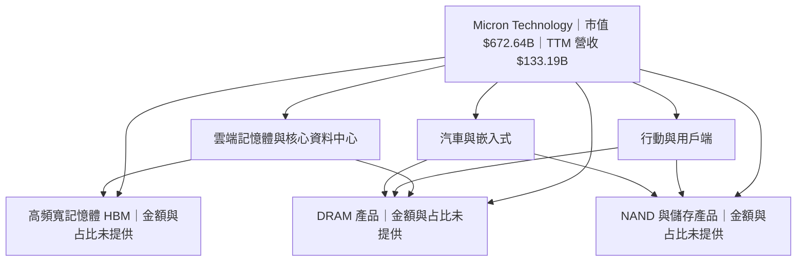
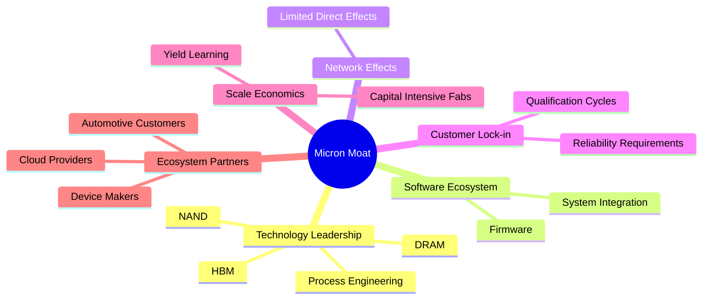
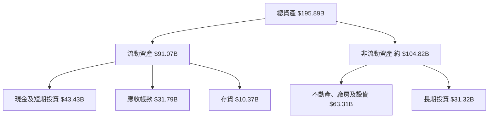
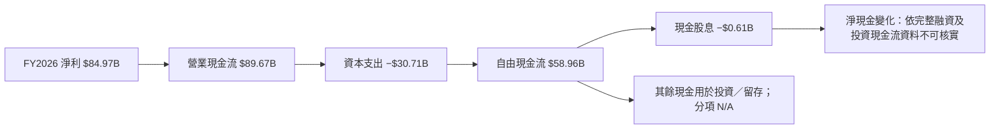
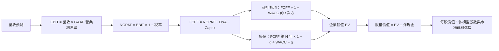
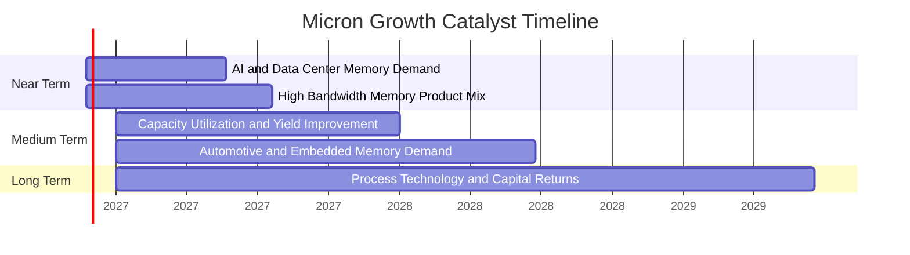
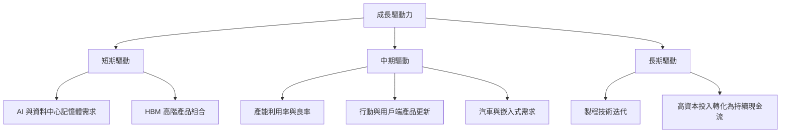
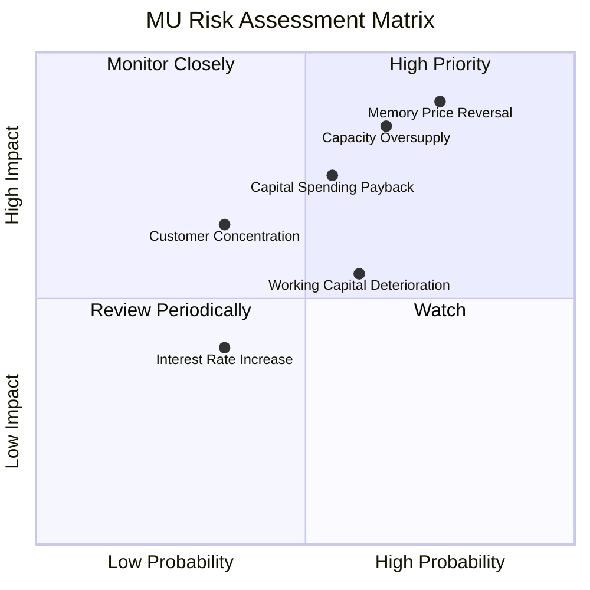
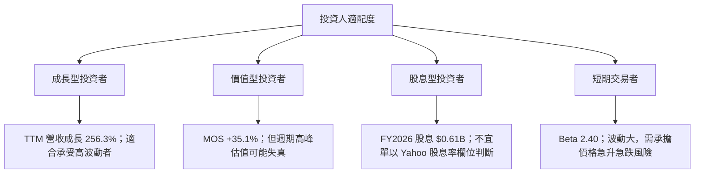

# MU 基本面深度分析報告
> **報告日期**：2026-11-23 ｜ **語言**：繁體中文 ｜ **數據來源**：SEC 申報資料 (XBRL)、Yahoo Finance、Finviz、StockAnalysis、Roic.ai ｜ **分析師**：CFA 級機構研究

## 目錄

| # | 章節 | 核心結論 |
|---|------|----------|
| 1 | 執行摘要 | 強烈買入；加權合理價值 $916.17；MOS +35.1% |
| 2 | 公司概覽與商業模式 | 記憶體產品具規模與技術門檻，市場份額資料未提供 |
| 3 | 損益表深度分析 | TTM 營收 $133.19B，TTM 成長 256.3%；利潤率處於週期高檔 |
| 4 | 資產負債表分析 | 淨現金 $40.15B；流動性充足，但營運資金週期拉長 |
| 5 | 現金流量深度分析 | TTM FCF $58.96B、FCF Yield 8.77%；資本支出仍高 |
| 6 | 獲利能力與資本效率 | ROIC 86.2% 高於 WACC 14.00%，目前創造股東價值 |
| 7 | 相對估值分析 | 相對歷史 P/E 偏低；估值高度依賴記憶體景氣能否延續 |
| 8 | DCF 內在價值評估 | 基準 DCF $881.83；加權合理價值 $916.17；MOS +35.1% |
| 9 | 成長催化劑 | AI／資料中心記憶體需求與高頻寬記憶體產品為主要質化催化劑 |
| 10 | 風險矩陣 | 景氣反轉、價格回落與資本支出回收是前三大風險 |
| 11 | 投資建議 | 強烈買入；建議買入區間 $594.51–$824.55，並嚴格監控週期反轉 |

## 1. 執行摘要

Micron Technology（MU）最新一季年增營收 379.3%，TTM 營收 $133.19B、TTM FCF $58.96B；但記憶體產業具高度循環性，最新利潤率不宜直接外推。ROIC 86.2% 明顯高於採用的 WACC 14.00%，而估值方法加權後合理價值為 $916.17，較 2026-11-20 收盤價 $594.51 高 54.1%，MOS 為 35.1%；依規則 20 評級為**強烈買入**。核心疑慮是模型假設獲利率由高點逐年回落、但營收仍維持多年擴張，且實際記憶體報價與供需可能快速逆轉。

### 1.0 一頁式投資儀表板（Portfolio Manager 30 秒速讀）

| 項目 | 內容 |
|------|------|
| **投資論點（3 句）** | ① TTM 營收 $133.19B、TTM 成長 256.3%，顯示需求與價格處於強勢階段。② TTM FCF $58.96B、FCF Yield 8.77%，現金創造能力顯著改善。③ ROIC 86.2% 對比 WACC 14.00%，當期資本報酬遠高於資本成本，但可能受週期高峰影響。 |
| **綜合評分** | **7.8/10**（引用 1.1 評分卡） |
| **財務健康** | 🟢 現金及短期投資 $43.43B、總債務 $3.28B、淨現金 $40.15B；應收及存貨週轉值得監察。 |
| **ROIC vs WACC** | **86.2% vs 14.00%**（創造價值；ROIC 高出 72.2 個百分點） |
| **FCF 趨勢** | 大幅改善；TTM FCF Yield **8.77%**。FY2026 FCF $58.96B，遠高於 FY2025 $1.67B。 |
| **估值** | Forward P/E 2.85x ｜ EV/EBITDA 5.83x ｜ FCF Yield 8.77% |
| **DCF 內在價值（基準）** | **$881.83** ｜ 現價相對 DCF 折價 **32.6%** |
| **安全邊際（MOS）** | **+35.1%**＝($916.17 − $594.51) ÷ $916.17（基準為第 8.8 節加權合理價值）｜ 🟢 >25% |
| **預期報酬（基準情境 12M）** | **+48.3%**（DCF 基準情境 $881.83，相對現價；非保證一年報酬） |
| **關鍵風險（前二）** | 記憶體供需與報價反轉；高資本支出在價格下行時造成 FCF 快速收縮。 |
| **評級 + 信心度** | 🟢 **強烈買入** ｜ 信心：中（價值有吸引力，但週期與模型假設敏感） |

### 1.1 綜合評分卡（全報告唯一）

| 維度 | 評分（1–10） | 主要依據（引用數字與其來源章節） |
|------|--------------|----------------------------------|
| 成長性 | 9.0 | TTM 營收成長 256.3%、最新一季年增 379.3%（第 3 章）；當前增長可能受週期及低基期影響。 |
| 獲利能力 | 9.0 | TTM 營業利益率 74.6%、ROIC 86.2%、Piotroski 8/9（第 3、6 章）。 |
| 財務健康 | 8.0 | 淨現金 $40.15B、流動比率 3.314、CCC 185 天（第 4 章）；現金轉換週期較一年前增加 30 天。 |
| 估值 | 7.0 | MOS +35.1%，P/E 位於自身 5 年歷史第 7 百分位，但估值依賴景氣持續（第 7、8 章）。 |
| 護城河 | 7.0 | DRAM、HBM、NAND 製造與研發規模有進入門檻；產品具商品週期、公司別市場份額數字未提供（第 2 章）。 |
| 管理層與資本配置 | 7.0 | FY2026 資本支出 $30.71B、SBC $1.33B、稀釋股數測試未通過（第 3、5、6 章）；擴產回報有執行風險。 |
| **綜合評分** | **7.8** | 六項算術平均：(9.0 + 9.0 + 8.0 + 7.0 + 7.0 + 7.0) ÷ 6 = 7.8。 |

### 1.2 五大投資論點 + 三大核心風險

| 類型 | 項目 | 具體依據 | 信心度 |
|------|------|----------|--------|
| 🟢 **投資論點①** | 營收與需求大幅擴張 | TTM 營收 $133.19B，TTM 年增 256.3%；最新一季年增 379.3%。這反映價格與出貨同時改善，但不能視為穩態成長。 | 🟢 高 |
| 🟢 **投資論點②** | 現金流快速增厚 | TTM OCF $89.67B、Capex $30.71B，FCF $58.96B；自由現金流已足以支撐擴產、資產負債表及股東回報。 | 🟢 高 |
| 🟢 **投資論點③** | 高資本報酬 | ROIC 86.2% 對比 WACC 14.00%；若回落後仍高於資本成本，公司仍具價值創造能力。 | 🟡 中 |
| 🟢 **投資論點④** | 淨現金提供下行緩衝 | 現金及短期投資 $43.43B、總債務 $3.28B、淨現金 $40.15B。 | 🟢 高 |
| 🟢 **投資論點⑤** | 相對自身歷史估值不高 | P/E 8.0x，低於自身 5 年中位數 17.4x；但記憶體高峰獲利會壓低當期 P/E。 | 🟡 中 |
| 🟡 **風險①** | 記憶體週期反轉 | 價格下跌可使營收與毛利同步收縮，當期 74.6% TTM 營業利益率並非保證可持續。 | 🔴 高衝擊 |
| 🔴 **風險②** | 擴產與資本支出回收落空 | FY2026 Capex $30.71B；若供給擴張快於需求，折舊及供需壓力將壓低 FCFF。 | 🔴 高衝擊 |
| 🟡 **風險③** | 營運資金效率惡化 | CCC 從 155 天升至 185 天；應收帳款及庫存佔用現金增加。 | 🟡 中度 |

### 1.3 快速統計卡片

| 指標 | 公司實際值（期間） | 同業中位數 | 狀態 |
|------|--------------------|------------|------|
| 營收成長（TTM） | **256.3%** | — | 🟢 |
| 營收成長（最新一季年增） | **379.3%** | 327.9%（SKHY、SNDK、WDC） | 🟢 |
| 毛利率（TTM） | **80.7%** | 77.4%（可計算同業：SKHY、SNDK、WDC；SKHY 毛利率為 77.4%） | 🟢 |
| 營業利益率（TTM） | **74.6%** | — | 🟢 |
| ROIC（TTM） | **86.2%** | — | 🟢 |
| Forward P/E | **2.85x** | 2.5x（SKHY）、2.2x（SNDK）、6.5x（WDC）；中位數 2.5x | 🟡 |
| FCF Yield（TTM） | **8.77%** | — | 🟢 |
| Piotroski F-Score | **8 / 9** | — | 🟢 |

### 1.4 投資結論

╔══════════════════════════════════════════════════════════════════╗  
║                    📊 投資結論摘要                               ║  
╠══════════════════════════════════════════════════════════════════╣  
║ 評級：強烈買入（依 8.8 MOS +35.1%、ROIC 86.2% > WACC 14.00%）   ║  
║ 價格（2026-11-20 收盤）：$594.51                                ║  
║ DCF 內在價值（基準）：$881.83（現價折價 32.6%）                  ║  
║ 安全邊際 MOS：+35.1%（＝($916.17−$594.51)÷$916.17）             ║  
║ 加權合理價值（8.8）：$916.17                                    ║  
║ DCF 情境價值：悲觀 $429.05（−27.8%）                            ║  
║               基準 $881.83（+48.3%）                            ║  
║               樂觀 $1,715.71（+188.6%）                         ║  
║ 綜合評分：7.8/10（引用 1.1）                                    ║  
║ 適合投資人：能承受高度週期波動、採分批配置的成長與價值投資人    ║  
╚══════════════════════════════════════════════════════════════════╝

## 2. 公司概覽與商業模式

### 2.1 業務結構與收入來源

公司業務包括 DRAM（含 HBM）、NAND 與儲存產品，應用於雲端／資料中心、行動與用戶端、汽車與嵌入式市場。可用資料未提供各業務單位營收金額、占比或軟體服務收入，因此不推算比例。

### 2.2 市場份額

市場份額資料未提供，因此不呈現比例或市場份額圖。MU TTM 營收 $133.19B，最新一季年增 379.3%，同業資料中的 SKHY、SNDK 年增亦超過 300%，顯示供需改善並非單一公司現象；缺乏可比的分部營收及市場出貨量，無法據此判斷份額變化。

### 2.3 競爭護城河分析

### 2.4 護城河強度

| 護城河項目 | 強度（強／中／弱） | 證據（引用數字或事實） | 會削弱它的情況 |
|------------|--------------------|------------------------|----------------|
| 技術與製程 | 中至強 | 產品覆蓋 DRAM、HBM、NAND；FY2026 研發支出 $5.65B。 | 競爭者製程、良率或產品效能追上。 |
| 軟體生態系統 | 弱至中 | 未提供獨立軟體收入；記憶體通常依賴系統整合及驗證。 | 客戶可快速替換供應商、方案差異縮小。 |
| 網路效應 | 弱 | 記憶體產品不具典型消費者網路效應。 | 不適用；主要競爭優勢並非網路效應。 |
| 客戶鎖定 | 中 | 記憶體產品須經客戶認證，但未提供客戶留存率或合約數據。 | 認證週期縮短、供應多元化或價格差異擴大。 |
| 規模效應 | 強 | FY2026 Capex $30.71B、總資產 $195.89B，產能投資與製造規模要求高。 | 產能過剩、低利用率、製造成本失控。 |
| 生態夥伴 | 中 | 服務雲端、行動、汽車與嵌入式等多種終端市場。 | 大型客戶自研、替代技術或採購轉向競爭者。 |

1.1「護城河」評分為 7.0/10：主要依據是高資本門檻、製程技術與客戶認證，但記憶體仍是週期性產品，且未提供可量化市場份額或客戶鎖定資料。

## 3. 損益表深度分析

### 3.1 年度收入成長趨勢（近 4 年）

| 財年 | 營收 | YoY | 評估 |
|------|------|-----|------|
| FY2023 | $15.54B | — | 🔴 |
| FY2024 | $25.11B | +61.6% | 🟢 |
| FY2025 | $37.38B | +48.9% | 🟢 |
| FY2026 | $133.19B | +256.3% | 🟢 |

╔══════════════════════════════════════════════════════════════════╗  
║              Micron 年度收入趨勢（FY2023–FY2026）                ║  
╠══════════════════════════════════════════════════════════════════╣  
║ FY2023  $15.54B  ███░░░░░░░░░░░░░░░░░░░░░  YoY：N/A             ║  
║ FY2024  $25.11B  █████░░░░░░░░░░░░░░░░░░░  YoY：+61.6%           ║  
║ FY2025  $37.38B  ███████░░░░░░░░░░░░░░░░  YoY：+48.9%           ║  
║ FY2026 $133.19B  ████████████████████████  YoY：+256.3%          ║  
║ 三年 CAGR：($133.19B ÷ $15.54B)^(1/3) − 1 = 約 104.7%          ║  
╚══════════════════════════════════════════════════════════════════╝

FY2026 的成長遠高於前兩年，與記憶體價格、產品組合及需求週期回升相符；超高增幅亦意味基期效應與週期價格可能放大表面成長，不應直接視作長期趨勢。

### 3.2 季度收入趨勢分析

| 季度 | 營收 | QoQ | YoY | 備註 |
|------|------|-----|-----|------|
| 2025-11-30 | $13.64B | — | — | 近四季比較起點。 |
| 2026-02-28 | $23.86B | +74.9% | +196.3% | 需求及定價改善，YoY 為單季年增。 |
| 2026-05-31 | $41.46B | +73.8% | +345.7% | 季增與年增皆高，增長斜率仍大。 |
| 2026-09-03 | $54.23B | +30.8% | +379.3% | 季增放緩但年增續升，基期與營收規模擴大。 |

QoQ 計算示例：($54.23B ÷ $41.46B) − 1 = 30.8%。季度營收依序增加，但連續高增長也會令市場對供給擴張及價格持續性更敏感。

### 3.3 利潤率演變分析

以下以年度損益表數值計算；FY2023 毛利、營業利益在不同來源有差異，表中採用年度損益表列示的毛利 −$1.42B、營業利益 −$5.41B。

| 利潤率指標 | FY2023 | FY2024 | FY2025 | FY2026 | 趨勢 | 評估 |
|------------|--------|--------|--------|--------|------|------|
| **毛利率** | −9.1% | 22.3% | 39.8% | 80.7% | 低谷後快速反彈 | 🟢 |
| **營業利益率** | −34.8% | 5.2% | 26.1% | 74.6% | 產能利用、價格與產品組合改善 | 🟢 |
| **淨利率** | −37.5% | 3.1% | 22.8% | 63.8% | 盈餘反彈速度高於營收 | 🟢 |

FY2026 毛利率 80.7% 與營業利益率 74.6% 代表高價格／高附加價值產品與營運槓桿同時發揮作用。記憶體固定成本占比高，產能利用率及售價上升時利潤率擴張快；反之，價格下跌時也可能快速反轉。FY2023 的資料來源差異增加歷史比較的不確定性。

### 3.4 費用結構分析

FY2026 研發支出為 $5.65B，約佔營收 4.2%（$5.65B ÷ $133.19B）。可用資料未提供完整銷管費、其他營業費用及費用分類，因此不製作缺少完整分項的費用結構圓餅圖。研發投入有助於製程與產品迭代，但其回報仍取決於良率、客戶導入及產品售價。

### 3.5 季度 EPS 趨勢與盈餘品質（Quality of Earnings）

| 季度 | EPS 實際 | EPS 年增 | QoQ EPS 成長 | 超預期／不及預期 |
|------|----------|---------|--------------|------------------|
| 2025-11-30 | $4.60 | +175.45% | — | N/A：預估值缺失 |
| 2026-02-28 | $12.07 | +756.03% | +162.4% | N/A：預估值缺失 |
| 2026-05-31 | $24.67 | +1,368.45% | +104.4% | N/A：預估值缺失 |
| 2026-09-03 | $32.85 | +1,059.46% | +33.1% | N/A：預估值缺失 |

EPS 預估及實際驚喜值欄位為缺值，不能可靠判斷過去四季是否超預期；實際 EPS 連續上升，但 QoQ 增幅由 162.4% 降至 33.1%，與高基期及營收規模擴大一致。

| 盈餘品質項目 | 數值／佔比 | 評估 |
|--------------|-----------|------|
| 股權薪酬 SBC / 營收 | FY2026：$1.33B ÷ $133.19B = **1.0%** | 🟢 佔比不高，但長期累積稀釋仍需追蹤。 |
| SBC / 營業現金流 | $1.33B ÷ $89.67B = **1.5%** | 🟢 相對 OCF 低；SBC 非現金，不代表股東沒有稀釋成本。 |
| FCF / 淨利（現金轉換率） | $58.96B ÷ $84.97B = **69.4%** | 🟡 現金轉換為正且可觀，但低於 100%，Capex 是重要原因。 |
| 一次性／非經常性損益 | N/A：未提供可核對的完整調整項 | 🟡 不能假設淨利完全沒有一次性項目。 |
| 有效稅率異常 | **14.8%**（模型採用） | 🟡 低於部分市場常見稅率，但未提供年度調節明細，需留意稅率正常化。 |
| 資本化支出 vs 費用化 | FY2026 Capex $30.71B；資本化明細 N/A | 🟡 資本密集產業必須投入設備；折舊與利用率會影響未來利潤。 |

**盈餘品質結論**：FY2026 OCF $89.67B 支持淨利 $84.97B，代表營業現金流對盈餘有良好支撐；FCF/淨利為 69.4%，主要須結合高達 $30.71B 的資本支出解讀。SBC 佔營收 1.0%，現階段不是主要盈餘品質風險，但 Piotroski 的「稀釋股數未增加」測試未通過。盈餘含金量整體偏高，惟高峰期利潤率與稅率不宜機械化外推。

## 4. 資產負債表分析

### 4.1 資產結構分解

FY2026 總資產 $195.89B，流動資產 $91.07B；非流動資產以總資產減流動資產計約 $104.82B。以下僅展示有資料的總額及主要已披露項目，不將未列細項自行分配。

### 4.2 流動性與營運資金分析

| 流動性指標 | FY2023 | FY2024 | FY2025 | FY2026 | 評估 |
|------------|--------|--------|--------|--------|------|
| 流動比率 | 4.46 | 2.63 | 2.52 | 3.31 | 🟢 FY2026 回升；仍須注意應收與存貨占用。 |
| 速動比率 | N/A | N/A | N/A | 2.898 | 🟢 現金及速動資產可支應短期義務。 |

以下營運資金天數照錄程式計算的品質指標：

| 指標 | 最新 TTM | 一年前 TTM | 變化 | 解讀 |
|------|----------|------------|------|------|
| DSO 應收帳款天數 | 87 天 | 70 天 | +17 天 | 🟡 收款天數變長；可能與營收快速擴大、帳期或季度結算時點有關，需檢查逾期及客戶組合。 |
| DIO 存貨天數 | 147 天 | 136 天 | +11 天 | 🟡 存貨週轉略慢；需分辨備貨支持放量或需求未消化。 |
| DPO 應付帳款天數 | 50 天 | 51 天 | −1 天 | 🟡 付款天數近乎持平，供應商融資沒有顯著增加。 |
| CCC 現金轉換週期 | 185 天 | 155 天 | +30 天 | 🟡 營運資金佔用增加，成長轉化成自由現金的效率需要持續追蹤。 |

### 4.3 債務結構分析

╔══════════════════════════════════════════════════════════════════╗  
║                    Micron 債務健康診斷                           ║  
╠══════════════════════════════════════════════════════════════════╣  
║ 總債務（核實值）： $3.28B                                        ║  
║ 現金及短期投資：  $43.43B                                        ║  
║ 淨現金：          $40.15B  🟢                                    ║  
║ Debt / EBITDA：   N/A（核實債務及 EBITDA 期間／口徑不一致）       ║  
║ 利息保障倍數：    N/A（利息費用資料未提供）                       ║  
║ 結論：淨現金提供擴產與週期低谷的資金緩衝；                     ║  
║       但債務來源數字有差異，使用淨現金時採核實值。               ║  
╚══════════════════════════════════════════════════════════════════╝

### 4.4 股東權益趨勢

| 財年 | 股東權益 |
|------|----------|
| FY2023 | $44.12B |
| FY2024 | $45.13B |
| FY2025 | $54.16B |
| FY2026 | $138.38B |

╔══════════════════════════════════════════════════════════════════╗  
║              股東權益趨勢（FY2023–FY2026）                       ║  
╠══════════════════════════════════════════════════════════════════╣  
║ FY2023  $44.12B  ████████░░░░░░░░░░░░░░░░                       ║  
║ FY2024  $45.13B  ████████░░░░░░░░░░░░░░░░                       ║  
║ FY2025  $54.16B  ██████████░░░░░░░░░░░░░░                       ║  
║ FY2026 $138.38B  ████████████████████████                       ║  
╚══════════════════════════════════════════════════════════════════╝

FY2026 權益大幅上升與盈餘累積相符；年度資料未提供完整權益變動表，不能將變化全數歸因於淨利。

## 5. 現金流量深度分析

### 5.1 現金流量瀑布圖

FY2026 OCF 高於淨利 $4.70B，代表盈餘有營業現金支持；扣除 $30.71B Capex 後仍有 $58.96B FCF。股息 $0.61B，相對 FCF 約 1.0%，保留較多內部資金支援擴產與資產負債表。

### 5.2 FCF 轉換率趨勢

| 財年 | 淨利 | FCF | FCF / 淨利 | 解讀 |
|------|------|-----|------------|------|
| FY2023 | −$5.83B | −$6.12B | 105.0% | 虧損年度比率意義有限；現金流亦為負。 |
| FY2024 | $0.78B | $0.12B | 15.6% | 淨利微薄，資本支出使 FCF 低於淨利。 |
| FY2025 | $8.54B | $1.67B | 19.6% | 盈利回升但擴產支出仍吸收大部分現金。 |
| FY2026 | $84.97B | $58.96B | 69.4% | 現金轉換大幅改善；Capex 仍約佔 OCF 34.2%。 |

### 5.3 自由現金流趨勢

| 財年 | FCF | FCF Yield |
|------|-----|-----------|
| FY2023 | −$6.12B | N/A |
| FY2024 | $0.12B | N/A |
| FY2025 | $1.67B | N/A |
| FY2026 TTM | $58.96B | 8.77% |

╔══════════════════════════════════════════════════════════════════╗  
║                 自由現金流：歷史實際趨勢                         ║  
╠══════════════════════════════════════════════════════════════════╣  
║ FY2023  −$6.12B  ◀░░░░░░░░░░░░░░░░░░░░░░                        ║  
║ FY2024   $0.12B  ░░░░░░░░░░░░░░░░░░░░░░                         ║  
║ FY2025   $1.67B  ▓░░░░░░░░░░░░░░░░░░░░░                         ║  
║ FY2026  $58.96B  ████████████████████████  FCF Yield：8.77%      ║  
╚══════════════════════════════════════════════════════════════════╝

### 5.4 資本配置評估

| 資本配置項目 | FY2026 數值 | 解讀 |
|--------------|-------------|------|
| 資本支出 | $30.71B | 高額投資反映半導體製造資本密集；需以未來利用率、良率及現金流驗證回報。 |
| 現金股息 | $0.61B | 約佔 FCF 1.0%，派息占比低。 |
| 股票回購 | N/A | 未提供可核實回購數字。 |
| 現金留存／其他投資 | N/A | 未提供足以完整拆分的現金流項目。 |

資本配置項目沒有完整互斥分項，故不以可能重複計算的數字製作圓餅圖。公司資本配置目前以再投資為主；主要考驗是擴產投入能否在週期高峰之後仍賺取高於資本成本的回報。

## 6. 獲利能力與資本效率

### 6.1 ROE / ROA / ROIC 趨勢

| 指標 | FY2023 | FY2024 | FY2025 | FY2026／TTM | 評估 |
|------|--------|--------|--------|-------------|------|
| ROE | N/A | N/A | N/A | 61.4%（品質指標） | 🟢 高，但週期高峰會放大回報。 |
| ROA | N/A | N/A | N/A | N/A（單一口徑年度歷史未提供） | — |
| ROIC | N/A | N/A | N/A | 86.2% | 🟢 明顯高於 14.00% WACC。 |

未提供一致口徑的歷年 ROIC／ROA／ROE 序列及同業均值，因此不填補或自行估算歷史及行業比較欄位。

### 6.2 ROIC vs WACC 分析（核心價值創造判斷）

╔══════════════════════════════════════════════════════════════════╗  
║                  ROIC vs WACC 深度分析                           ║  
╠══════════════════════════════════════════════════════════════════╣  
║ 無風險利率（10Y 美債）：4.91%                                    ║  
║ 市場風險溢酬 ERP：5.00%                                          ║  
║ 原始 Beta：2.40；採用調整後 Beta：1.93                           ║  
║ 股權成本：4.91% + 1.93 × 5.00% = 14.56%（資料採用 14.57%）      ║  
║ 稅前債務成本：3.23%；稅率：14.8%                                 ║  
║ 資本權重：股權 99.5%／債務 0.5%                                  ║  
║ WACC 計算值 14.51%，因模型設定上限而採用 **14.00%**              ║  
║                                                                  ║  
║ ROIC（TTM）：86.2%                                                ║  
║ EVA 利差：86.2% − 14.00% = **+72.2 個百分點**                    ║  
║ ROIC / WACC：86.2% ÷ 14.00% = **6.16 倍**                        ║  
║                                                                  ║  
║ 結論：以目前 TTM 報酬衡量，公司正在創造股東價值；                ║  
║       若週期回落令 ROIC 低於 14.00%，該結論將失效。              ║  
╚══════════════════════════════════════════════════════════════════╝

ROIC 86.2% 及 WACC 14.00% 均採核實資料。成本資本資料指出未限制前計算 WACC 為 14.51%，但採用值受 7%–14% 區間限制至上限 14.00%；資本成本計算明細依原始輸入採用，不以其他資料源的負債口徑另算 WACC。

### 6.3 杜邦三因素分解

| 因素 | 數值（TTM） | 解讀 |
|------|-------------|------|
| 淨利率 | 63.8% | 週期高景氣下盈利能力高。 |
| 資產週轉率 | 0.68 | 資產密集型製造業，需以高利潤率抵銷較低週轉。 |
| 權益乘數 | 1.42 | 槓桿不是高 ROE 的主要來源。 |
| **ROE** | **61.4%** | **63.8% × 0.68 × 1.42 = 61.4%**（四捨五入）。 |

ROE 主要由淨利率驅動，並非依靠高財務槓桿；若記憶體價格或產品組合回落，ROE 仍會顯著下降。

### 6.4 財務體質：Piotroski F-Score

Piotroski F-Score 為 **8 / 9**；其中稀釋股數測試未通過，其餘八項通過。

| 測試 | 結果 | 解讀 |
|------|------|------|
| ROA > 0 | ✅ 通過 | TTM 獲利為正。 |
| 營業現金流 > 0 | ✅ 通過 | TTM OCF $89.67B。 |
| ROA 高於一年前 | ✅ 通過 | 獲利能力較前期改善。 |
| 營業現金流 > 淨利 | ✅ 通過 | OCF 高於淨利，盈餘有現金流支持。 |
| 長期負債 ÷ 總資產低於一年前 | ✅ 通過 | 槓桿相對資產下降。 |
| 流動比率高於一年前 | ✅ 通過 | 流動性測試改善。 |
| 稀釋股數未增加 | ❌ 未通過 | 股數增加可能稀釋每股價值，需關注 SBC 及股數變化。 |
| 毛利率高於一年前 | ✅ 通過 | 毛利率改善，與價格及產品組合相符。 |
| 資產週轉率高於一年前 | ✅ 通過 | 資產產出效率改善。 |

## 7. 相對估值分析

### 7.1 同業估值比較表格

同業倍數依 Yahoo Finance 的 Peer multiples；SKHY 的 P/S、EV/EBITDA 因幣別混雜不可用，不補值。

| 估值指標 | **MU** | **SKHY** | **SNDK** | **WDC** | MU 評估 |
|----------|--------|----------|----------|--------|---------|
| **Trailing P/E** | 8.0x | 5.7x | 0.1x | 9.2x | 🟡 MU 落在同業區間；週期峰值盈餘可能令 P/E 偏低。 |
| **Forward P/E** | 2.85x | 2.5x | 2.2x | 6.5x | 🟢 低於 WDC，接近記憶體同業低倍數；預估盈餘風險高。 |
| **P/S Ratio** | 5.05x | N/A | 3.1x | 6.7x | 🟡 MU 高於 SNDK，低於 WDC；SKHY 不可比較。 |
| **EV/EBITDA** | 5.83x | N/A | 4.0x | 15.4x | 🟢 相對 WDC 低，但盈利週期可能扭曲倍數。 |
| **最新一季營收 YoY** | 379.3% | 327.9% | 377.9% | 55.5% | 🟢 MU 增長高於所列可比公司。 |
| **毛利率（TTM）** | 80.7% | 77.4% | 80.0% | 52.6% | 🟢 MU 高於同業列示值；週期高峰可使排名變動。 |

### 7.2 歷史估值區間分析

╔══════════════════════════════════════════════════════════════════╗  
║               MU 自身 5 年歷史估值位置（TTM）                    ║  
╠══════════════════════════════════════════════════════════════════╣  
║ P/E：        7.4x ──● 8.0x ───────── 中位數 17.4x ── 138.5x   ║  
║              當前歷史百分位：7%                                  ║  
║ P/S：        2.1x ─────────● 5.1x ── 中位數 4.2x ─── 11.7x   ║  
║              當前歷史百分位：65%                                 ║  
║ EV/EBITDA：  3.6x ──● 5.9x ───────── 中位數 9.7x ── 80.7x    ║  
║              當前歷史百分位：20%                                 ║  
╚══════════════════════════════════════════════════════════════════╝

P/E 與 EV/EBITDA 均低於自身歷史中位數，但此比較的關鍵限制是當前盈餘處於高景氣階段；P/S 高於歷史中位數，反映股價已對營收恢復作出部分定價。

### 7.3 情境價值（Bear / Base / Bull，照抄 DCF MODEL 的 Scenarios）

| 情境 | 第 1 年營收成長 | 期末營業利潤率 | WACC | 每股價值 | 相對現價 | 機率 | 會發生的條件 |
|------|----------------|----------------|------|----------|----------|------|--------------|
| 🔴 悲觀 | 15.0% | 22.2% | 15.00% | $429.05 | −27.8% | 25% | AI／資料中心需求降溫、供給增加壓低價格，且資本成本升高。 |
| 🟡 基準 | 30.0% | 26.1% | 14.00% | $881.83 | +48.3% | 50% | 短期維持增長，長期利潤率回歸歷史中位水準。 |
| 🟢 樂觀 | 45.0% | 28.8% | 13.00% | $1,715.71 | +188.6% | 25% | 高階記憶體供需緊俏延續，營收與成熟期利潤率高於基準。 |

### 7.4 相對估值隱含價格區間

╔══════════════════════════════════════════════════════════════════╗  
║            估值方法隱含每股價值（美元）                          ║  
╠══════════════════════════════════════════════════════════════════╣  
║ 同業 P/S              $580.49  │ 現價 $594.51 略高於此方法      ║  
║ DCF 基準              $881.83  │ 40% 權重                       ║  
║ 同業 EV/EBITDA        $970.50  │ 30% 權重                       ║  
║ 分析師共識            $1,561.91│ 10% 權重，參考性較高            ║  
╚══════════════════════════════════════════════════════════════════╝

同業 EV/EBITDA 依同業中位數 9.7x（SNDK、WDC）乘 MU TTM EBITDA，再加回淨現金；同業 P/S 依中位數 4.9x（SNDK、WDC）乘 MU TTM 營收。DCF 基準採 10 年 FCFF；分析師共識為 45 位分析師平均目標價。

## 8. DCF 內在價值評估（Discounted Cash Flow）

### 8.0 估值推理鏈（Thinking Logic：在算之前先想清楚）

**Step 1 — 價值由哪些變數決定？**  
MU 的估值可拆為既有 DRAM／NAND 業務的營收與利潤率、HBM 等高階產品帶來的成長，以及高資本支出與週期性的風險折價。各業務收入占比未提供，因此不能定量拆分；模型中主導估值的變數是營收路徑、營業利潤率與 WACC，敏感度矩陣顯示 WACC 對每股價值的影響尤其明顯。

**Step 2 — 模型選擇**

| 決策點 | 本報告採用 | 理由（含數字） | 曾考慮但否決 | 否決理由 |
|--------|-----------|----------------|--------------|----------|
| 現金流定義 | FCFF | 使用 GAAP EBIT、NOPAT、D&A 與 Capex，對應 WACC 折現。 | FCFE | 資本結構及債務政策不是營運現金流本身。 |
| 預測期 N | 10 年 | DCF MODEL 明列 10 年，讓高景氣逐步正常化。 | 5 年 | 不能照資料之外另改既定模型期數。 |
| 終值方法 | Gordon Growth 主法 | 模型採 g = 3.0%、WACC = 14.00%。 | 單獨退出倍數法 | 模型未提供終值退出倍數及其估值結果，不自行補造。 |
| EBIT 基礎 | GAAP | 模型明列 GAAP EBIT，SBC 已列費用。 | 非 GAAP EBIT | 需另外調整 SBC，資料模型並未採用。 |

**Step 3 — 關鍵假設推導鏈**

- **營收成長**：錨點＝TTM 營收年增 256.3% → 調整＝高基期、記憶體週期及持續性不確定，將第一年成長限制在模型 0%–30% 上限 → **採用第 1 年 30.0%，第 10 年 3.0%，線性下降** → 曾考慮延續 256.3%，因將單一景氣高峰外推十年而否決。
- **營業利潤率**：錨點＝TTM GAAP 營業利益率 74.6%，近五財年中位數含 TTM 為模型採用的終值錨 → 調整＝不把高峰利潤率永久化 → **FY+1 74.6%，逐年下降至 FY+10 26.1%** → 曾考慮維持 74.6% 至期末，因記憶體週期性使該假設偏樂觀而否決。
- **永續成長率 g**：錨點＝資料未提供長期管理層指引 → 採用模型 3.0%，低於長期名目經濟成長假設上緣且遠低於 WACC → 曾考慮更高 g，因增加終值占比且使估值過度依賴遠期而否決。
- **預測期 N**：錨點＝模型明列 10 年 → 採用 10 年，以逐步正常化反映週期轉成熟 → 曾考慮縮短或延長，因必須遵循核實模型而不自行改期數。
- **Capex／營收**：錨點＝TTM 約 23.1% → 模型令其由 FY+1 23.1% 下降至 FY+10 7.8%，終值接近 1.1 倍 D&A → 若產能需求或新廠投資仍高，Capex 可能高於模型；不另採用當期比率作十年固定值。
- **EBIT 與 SBC**：錨點＝FY2026 SBC $1.33B，GAAP EBIT 已扣除 SBC → 採模型組合 **(A) GAAP EBIT + 固定股數**，不另扣 SBC，年稀釋率 0% → 否決額外扣 SBC 或再提高股數，避免重複反映成本。
- **WACC**：錨點＝核實計算值 14.51%，採用上限限制後 14.00% → 反映高 Beta 與高股權成本 → 曾考慮使用未受限 14.51%，但模型明定採 7%–14% 區間上限。
- **有效稅率、D&A／營收**：錨點＝有效稅率 14.8%、TTM D&A／營收 7.1%；模型採用兩者固定值。  
- **ΔWC／營收增額**：營運資金天數資料顯示 CCC 185 天，但 DCF MODEL 明確不建模營運資金變動，因此不自行加入 ΔWC。
- **終值方法**：採 Gordon Growth，g 3.0%；替代退出倍數法因模型未提供倍數與結果，列為 N/A，不另造數字。

**Step 4 — 最脆弱假設**  
最脆弱一環是高成長由 30% 線性降至 3%、同時營業利潤率由 74.6% 降至 26.1% 的十年路徑；若需求及產品價格更快轉弱，估值會向悲觀情境 $429.05 靠近。

**Step 5 — 計算路徑**

### 8.1 模型假設總表（Model Inputs）

金額單位為美元；假設及逐年數值照 DCF MODEL 引用，不重新建模。

| 假設項目 | 採用值 | 依據／來源 | 敏感度 |
|----------|--------|-------------|--------|
| 預測期長度 N | 10 年 | DCF MODEL；十年逐步正常化 | 🟡 中 |
| 營收成長 | 第 1 年 30.0%，第 10 年 3.0%，線性下降 | TTM 年增 256.3%，模型上限 30% 並逐年淡出 | 🔴 高 |
| 營業利潤率 | 74.6% → 26.1% | TTM 起點、近五財年中位數（含 TTM）為期末值 | 🔴 高 |
| 有效稅率 | 14.8% | 最新年度有效稅率 | 🟢 低 |
| Capex / 營收 | 23.1% → 7.8% | TTM 比率起點，模型逐步淡化至 D&A 的 1.1 倍附近 | 🔴 高 |
| D&A / 營收 | 7.1% | TTM | 🟢 低 |
| 營運資金變動 | 不建模 | DCF MODEL 明列 Working capital is not modelled | 🟡 中 |
| EBIT 基礎 | GAAP EBIT | DCF MODEL | 🟡 中 |
| SBC 處理 | 組合 (A)：GAAP EBIT 含 SBC，不另扣 SBC | FY2026 SBC $1.33B；模型固定股數 | 🟡 中 |
| 年稀釋率 | 0%（固定股數） | 組合 (A)，避免與 GAAP 費用重複計入 | 🟡 中 |
| 永續成長率 g | 3.0% | DCF MODEL；低於 14.00% WACC | 🔴 高 |
| 終值方法 | Gordon Growth | DCF MODEL；退出倍數數字未提供 | 🔴 高 |
| WACC | 14.00% | 計算 14.51%，受 7%–14% 限制而採 14.00% | 🔴 高 |

本模型使用 **FCFF = NOPAT + D&A − Capex**，不含 ΔWC 列；這是依 DCF MODEL 原設計照錄，而非認定營運資金變動為零。模型採組合 (A)，故 SBC 影響已計入一次；不再扣 SBC，也不另作稀釋。

### 8.2 折現率推導（WACC）

╔══════════════════════════════════════════════════════════════════╗  
║                    WACC 推導（折現率）                           ║  
╠══════════════════════════════════════════════════════════════════╣  
║ 股權成本 Ke（CAPM）：                                            ║  
║ 無風險利率 Rf（10Y 美債）：4.91%                                 ║  
║ 市場風險溢酬 ERP：5.00%                                          ║  
║ Beta 原始值 2.40；調整值 ⅔ × 2.40 + ⅓ × 1 = 1.93               ║  
║ Ke = 4.91% + 1.93 × 5.00% = 14.56%（核實值 14.57%）           ║  
║                                                                  ║  
║ 稅前債務成本：3.23%                                              ║  
║ 稅率：14.8%                                                      ║  
║ 稅後 Kd = 3.23% × (1 − 14.8%) = 2.75%                           ║  
║ 股權／債務權重：99.5%／0.5%                                      ║  
║ 未限制計算 WACC：14.51%；區間限制採用值：**14.00%**              ║  
╚══════════════════════════════════════════════════════════════════╝

逐步演算（依成本資本資料已計算的輸入，不另改 WACC）：

1. **Ke（CAPM）**＝4.91% + 1.93 × 5.00%＝**14.56%**；核實輸入列示 **14.57%**，差異來自未四捨五入中間值。
2. **稅前 Kd**＝核實資料列示 **3.23%**；利息費用與平均計息負債明細未提供，故不另建分子／分母算式。
3. **稅後 Kd**＝3.23% × (1 − 14.8%)＝**2.75%**。
4. **權重**＝核實股權／債務權重 **99.5%／0.5%**，權重合計 100.0%；市值與計息負債詳細口徑未提供一致的可複算明細。
5. **WACC 計算值／採用值**＝核實計算 14.51%；受 7%–14% 區間限制，**採用 14.00%**。不把四捨五入後的 CAPM 近似值用來替代已核實 WACC。

Beta 原始值 2.40 高，採用調整後 Beta 1.93；規模／國別風險溢酬未列示，故不添加。無風險利率為資料列示的 10 年期美債 4.91%，其觀察日期未另提供。第 6.2 節與本章均採用 WACC 14.00%。

### 8.3 逐年自由現金流預測（基準情境）

以下照 DCF MODEL 逐年轉錄；金额單位為 $B。模型的「Tax」欄使用已計算值，逐年表格中的 FCFF 不加入 ΔWC。

| 年度 | FY+1 | FY+2 | FY+3 | FY+4 | FY+5 | FY+6 | FY+7 | FY+8 | FY+9 | FY+10 |
|------|------|------|------|------|------|------|------|------|------|-------|
| 營收 | 173.14 | 219.89 | 272.67 | 329.93 | 389.32 | 447.71 | 501.44 | 546.57 | 579.36 | 596.74 |
| 營收 YoY | 30.0% | 27.0% | 24.0% | 21.0% | 18.0% | 15.0% | 12.0% | 9.0% | 6.0% | 3.0% |
| 營業利潤率 | 74.6% | 69.2% | 63.8% | 58.4% | 53.1% | 47.7% | 42.3% | 36.9% | 31.5% | 26.1% |
| 營業利益 EBIT（GAAP） | 129.14 | 152.17 | 174.02 | 192.80 | 206.55 | 213.43 | 212.05 | 201.71 | 182.62 | 155.98 |
| − 稅（14.8%） | (19.13) | (22.54) | (25.77) | (28.55) | (30.59) | (31.61) | (31.40) | (29.87) | (27.05) | (23.10) |
| = NOPAT | 110.02 | 129.64 | 148.25 | 164.25 | 175.96 | 181.82 | 180.64 | 171.84 | 155.58 | 132.88 |
| + D&A | 12.35 | 15.69 | 19.45 | 23.54 | 27.78 | 31.94 | 35.78 | 39.00 | 41.34 | 42.58 |
| − Capex | (39.93) | (46.99) | (53.66) | (59.35) | (63.45) | (65.41) | (64.78) | (61.37) | (55.26) | (46.84) |
| **= FCFF** | **82.44** | **98.34** | **114.04** | **128.44** | **140.28** | **148.36** | **151.64** | **149.46** | **141.65** | **128.62** |
| 折現因子 @14.00% | 0.877 | 0.769 | 0.675 | 0.592 | 0.519 | 0.456 | 0.400 | 0.351 | 0.308 | 0.270 |
| **FCFF 現值 PV** | **72.32** | **75.67** | **76.98** | **76.04** | **72.86** | **67.59** | **60.60** | **52.40** | **43.56** | **34.69** |

預測期 FCF 現值合計：  
**$72.32 + $75.67 + $76.98 + $76.04 + $72.86 + $67.59 + $60.60 + $52.40 + $43.56 + $34.69 = $632.71B**

**逐步演算（FY+1，模型採用數字）：**

1. **營收**＝$133.19B × (1 + 30.0%)＝$173.15B，模型表列 **$173.14B**（中間值未四捨五入）。
2. **EBIT**＝$173.14B × 74.6%＝**$129.14B**。
3. **稅**＝模型列示 **$19.13B**（使用未四捨五入 EBIT／稅率中間值）。
4. **NOPAT**＝模型列示 EBIT 扣稅後 **$110.02B**。
5. **D&A**＝$173.14B × 7.1%＝**$12.35B**（模型列值）。
6. **Capex**＝$173.14B × 23.1%＝**$39.93B**（模型列值）。
7. **ΔWC**＝**不建模**，依 DCF MODEL 原設定。
8. **FCFF**＝$110.02B + $12.35B − $39.93B＝**$82.44B**。
9. **折現因子**＝1 ÷ (1 + 14.00%)¹＝0.877；**PV**＝$82.44B × 0.877＝**$72.32B**（依未四捨五入因子）。

**合理性自檢**

- 預測期 FCFF CAGR：由 FY+1 $82.44B 至 FY+10 $128.62B，9 年 CAGR 約 **5.1%**；歷史 FCF CAGR 因 FY2023 為負值，數學上不適合直接比較。
- FY+10 FCF 利潤率＝$128.62B ÷ $596.74B＝**21.6%**；目前 TTM FCF 利潤率＝$58.96B ÷ $133.19B＝**44.3%**；同業最佳 FCF 利潤率資料未提供。模型隱含利潤率比目前低，反映 Capex／營收下降但營業利潤率也回歸。
- 模型預測各年度 FCFF 均為正；折現價值仍依賴營運與利潤率逐步正常化的假設。

╔══════════════════════════════════════════════════════════════════╗  
║           自由現金流：歷史實際 vs 模型預測（$B）                 ║  
╠══════════════════════════════════════════════════════════════════╣  
║ FY2024（實） $0.12B   ░░░░░░░░░░░░░░░░░░░░░░                   ║  
║ FY2025（實） $1.67B   ▓░░░░░░░░░░░░░░░░░░░░░                   ║  
║ FY2026（實） $58.96B  ███████████░░░░░░░░░░░░                   ║  
║ FY+1（預）   $82.44B  ███████████████░░░░░░░░                   ║  
║ FY+10（預） $128.62B  ████████████████████████                   ║  
╠══════════════════════════════════════════════════════════════════╣  
║ 歷史 FCF 波動極大；預測由模型營運假設產生，不可視為已實現結果。 ║  
╚══════════════════════════════════════════════════════════════════╝

### 8.4 終值計算（Terminal Value）

適用性檢查：**WACC 14.00% vs g 3.0% → WACC > g？✅**

| 方法 | 計算式 | 終值 TV | TV 現值 | 佔總 EV 比重 |
|------|--------|---------|---------|--------------|
| Gordon Growth | $128.62 × (1 + 3.0%) ÷ (14.00% − 3.0%) | $1,204.36B | $324.87B | 33.9% |
| 退出倍數法 | N/A：DCF MODEL 未提供退出倍數及相應估值 | N/A | N/A | N/A |

逐步演算：

1. **FY+N FCFF**＝FY+10 **$128.62B**。
2. **分子**＝$128.62B × (1 + 3.0%)＝模型列示 **$132.48B**（使用未四捨五入現金流）。
3. **分母**＝14.00% − 3.0%＝**11.00%**；**TV**＝$132.48B ÷ 11.00%＝**$1,204.36B**（依模型未四捨五入中間值）。
4. **PV(TV)**＝$1,204.36B × 0.270＝**$324.87B**。
5. **終值佔比**＝$324.87B ÷ $957.57B＝**33.9%**。

### 8.5 企業價值 → 每股內在價值（Bridge）

╔══════════════════════════════════════════════════════════════════╗  
║              企業價值 → 每股內在價值 橋接表                      ║  
╠══════════════════════════════════════════════════════════════════╣  
║ 預測期 FCF 現值合計             +$632.71B                        ║  
║ 終值現值 PV(TV)                 +$324.87B                        ║  
║ = 企業價值 EV                    $957.57B                        ║  
║ + 淨現金（現金減債務）           +$40.15B                         ║  
║ = 股權價值                       $997.73B（模型列值）             ║  
║ 每股內在價值（模型列值）         **$881.83**                      ║  
║ 當前股價（2026-11-20）            $594.51                          ║  
║ 折溢價：現價 ÷ DCF 價值 − 1       **−32.6%（折價）**               ║  
╚══════════════════════════════════════════════════════════════════╝

逐步演算及複核：

1. **EV**＝$632.71B + $324.87B＝$957.58B；模型列 **$957.57B**，差額為顯示位數四捨五入。
2. **股權價值**＝EV $957.57B + 淨現金 $40.15B＝$997.72B；模型列 **$997.73B**，亦有 $0.01B 顯示精度差異。
3. **每股內在價值**＝DCF MODEL 列示公式「股權價值 × 價格 ÷ 市值」，結果 **$881.83**。該模型以市值及股價橋接，未提供可獨立核實的股數替代計算。
4. **折溢價**＝$594.51 ÷ $881.83 − 1＝**−32.6%**。
5. **本節不計算 MOS**：MOS 一律按第 8.8 節加權合理價值為分母。

股數與資產負債表橋接明細未完整提供；DCF MODEL 已列淨現金 $40.15B 及每股價值，故照錄而不以其他來源的債務／現金口徑替換。模型數字存在 $0.01B 級四捨五入尾差，必須保留標註，不將尾差隱去。

### 8.6 敏感性分析（WACC × 永續成長率）

以下照 DCF MODEL 的每股價值矩陣抄錄；括號內上行空間以現價 $594.51 計算。基準格為 **WACC 14.00%、g 3.0%**。

| g（列）／WACC（欄） | 12.00% | 13.00% | **14.00%（基準）** | 15.00% | 16.00% |
|-----------|------:|------:|------------------:|------:|------:|
| 2.0% | $1,019.58（+71.5%） | $930.16（+56.5%） | $855.35（+43.9%） | $791.82（+33.2%） | $737.17（+24.0%） |
| 2.5% | $1,041.16（+75.1%） | $946.54（+59.2%） | $868.01（+46.0%） | $801.76（+34.9%） | $745.08（+25.3%） |
| **3.0%（基準）** | $1,065.13（+79.1%） | $964.56（+62.2%） | **$881.83（+48.3%）** | $812.53（+36.7%） | $753.60（+26.8%） |
| 3.5% | $1,091.92（+83.7%） | $984.47（+65.6%） | $896.97（+50.9%） | $824.24（+38.6%） | $762.80（+28.3%） |
| 4.0% | $1,122.07（+88.7%） | $1,006.60（+69.3%） | $913.61（+53.7%） | $837.01（+40.8%） | $772.76（+30.0%） |

**逐步演算（非基準格：WACC 15.00%、g 3.0%，WACC > g ✅）**  
新 WACC 下逐年現金流與終值均須折現；該格模型直接計算結果為每股 **$812.53**。逐年折現現值總額及該格終值現值的中間值未在 DCF MODEL 敏感度輸出中提供，因此不能在不另建模型的前提下補造中間步驟。此處保留模型格值，將審計限制明示。

**三情境 DCF（營運假設、折現率同時改變）**

| 情境 | 第 1 年營收成長 | 期末營業利潤率 | WACC | 每股價值 | 相對現價 | 機率 |
|------|----------------|----------------|------|----------|----------|------|
| 🔴 悲觀 | 15.0% | 22.2% | 15.00% | $429.05 | −27.8% | 25% |
| 🟡 基準 | 30.0% | 26.1% | 14.00% | $881.83 | +48.3% | 50% |
| 🟢 樂觀 | 45.0% | 28.8% | 13.00% | $1,715.71 | +188.6% | 25% |

三情境的完整 FY+N 營收、FCFF、終值中間數字未由 DCF MODEL 提供；按要求照抄其情境價值，不另行自建模型。機率加權值（僅背景參考）：  
**$429.05 × 25% + $881.83 × 50% + $1,715.71 × 25% = $977.105 ≈ $977.10**（模型列示 $977.10；四捨五入尾差）。

**敏感度結論**

- **g 每 +1pp**（以 WACC 14% 的 2.0% 至 3.0%）：$855.35 → $881.83，增加 **$26.48／3.1%**；以 3.0% 至 4.0%：$881.83 → $913.61，增加 **$31.78／3.6%**。
- **WACC 每 +1pp**（g 3.0%）：$881.83 → $812.53，下降 **$69.30／7.9%**。
- **期末營業利潤率每 +1pp**：敏感度矩陣未單獨計算，**N/A**；不能以情境差異反推單一利潤率彈性。
- 就已提供矩陣而言，WACC 變化的每股美元影響明顯；這與 8.0 所述估值受 WACC、營收與利潤率共同支配一致，但模型未提供其他變數的完整偏導數比較。

### 8.7 反推 DCF（Reverse DCF：市場在預期什麼）

固定基準值包括：WACC 14.00%、稅率 14.8%、Capex 路徑 23.1% 至 7.8%、ΔWC 不建模、預測期 10 年、GAAP EBIT、固定股數及 g 3.0%。反推數值只採 DCF MODEL 已提供項目。

| 求解變數（一次一個） | 固定其餘變數 | 市場隱含值 | 對照錨點 | 判斷 |
|----------------------|--------------|-----------|----------|------|
| 第 1 年營收成長 | 其餘輸入固定於基準 | 17.3% | 基準值 30.0%；TTM 成長 256.3% | 🟡 相較基準更保守，但仍需持續增長。 |
| 固定營業利潤率 | 其他輸入固定於基準 | 27.9% | TTM 74.6%，模型期末 26.1% | 🟡 市場隱含利潤率遠低於當前高點。 |
| 永續成長率 g | N/A：未提供反解 | N/A | — | 不推算。 |
| 預測期長度 N | N/A：未提供反解 | N/A | — | 不推算。 |

DCF MODEL 未提供反推求解軌跡或逐級試算表，不能聲稱已用特定增量試算收斂。可依據的結論是：在模型其餘基準輸入固定時，現價對應第 1 年營收成長 17.3% 或固定營業利潤率 27.9%。這比模型當前 30.0% 成長起點及 74.6% TTM 利潤率更保守，但不代表市場已排除景氣下行風險。

### 8.8 估值三角驗證與安全邊際

| 估值方法 | 隱含每股價值 | 上行空間（÷現價） | 權重 | 說明 |
|----------|--------------|-------------------|------|------|
| DCF（基準） | $881.83 | +48.3% | 40% | 10 年 FCFF、WACC 14.00%、終值成長 3.0%。 |
| 同業 EV/EBITDA | $970.50 | +63.2% | 30% | SNDK、WDC 同業中位數 9.7x，乘 TTM EBITDA 並加淨現金。 |
| 同業 P/S | $580.49 | −2.4% | 20% | SNDK、WDC 同業中位數 4.9x 乘 TTM 營收。 |
| 分析師共識目標價 | $1,561.91 | +162.7% | 10% | 45 位分析師平均目標價；參考性較高。 |
| **加權合理價值** | **$916.17** | **+54.1%** | **100%** | 週期性公司固定權重；不另調整或折讓。 |

加權合理價值完整算式：  
**$881.83 × 40% + $970.50 × 30% + $580.49 × 20% + $1,561.91 × 10% = $916.171 ≈ $916.17**

公司類型為週期性公司，方法權重依程式固定。相對估值以同業中位數倍數；模型未列其他相對估值方法，不增列或自行改權重。

╔══════════════════════════════════════════════════════════════════╗  
║                  估值區間與安全邊際                              ║  
╠══════════════════════════════════════════════════════════════════╣  
║ $429.05 ── $594.51 ── [$916.17] ── $881.83 ── $1,715.71        ║  
║ 悲觀DCF      現價       加權合理值    基準DCF       樂觀DCF       ║  
║                                                                  ║  
║ MOS = ($916.17 − $594.51) ÷ $916.17 = **+35.1%**               ║  
║ 評估：🟢 >25% 充足                                              ║  
║ 上行空間 = ($916.17 − $594.51) ÷ $594.51 = **+54.1%**          ║  
║ 折溢價（相對 DCF $881.83）= $594.51 ÷ $881.83 − 1 = **−32.6%** ║  
║                                                                  ║  
║ 建議買入區間：$594.51 – $824.55                                  ║  
║ （上限＝$916.17 × 90%，對應 MOS 至少 10%；非價格保證）           ║  
║ 合理持有區間：$824.55 – $1,715.71                               ║  
║ 減碼考慮區間：高於 $1,715.71，須以基本面而非單純目標價判斷       ║  
╚══════════════════════════════════════════════════════════════════╝

> 🔎 **程式複算（Python，依本節各項自動重算）**
>
> 加權合理價值 = $881.83 × 40% + $970.50 × 30% + $580.49 × 20% + $1,561.91 × 10% = **$916.17**（權重合計 100%）
>
> 以價格 $594.51 計：MOS = **+35.1%**，上行空間 = **+54.1%**
>
> ✅ 與本節所寫數值一致。

### 8.9 DCF 模型的局限與失效條件

- **終值依賴度**：終值現值佔 EV **33.9%**，低於多數高度依賴終值的模型，但仍有約三分之一企業價值取決於 FY+10 之後現金流。
- **最脆弱假設**：10 年營收路徑及利潤率正常化。情境模型中，悲觀假設給出 $429.05，較現價低 27.8%；因此若供給增速超過終端需求，基準 DCF 可能高估。
- **Capex 與營運資金**：模型 Capex／營收由 23.1% 降至 7.8%，且不建模營運資金。實際 CCC 已由 155 天升至 185 天，若資金占用持續增加，模型 FCF 會偏高。
- **週期性限制**：記憶體價格、利用率與產品組合變化會令獲利劇烈波動；DCF 應與 EV/EBITDA、P/S 及週期中位獲利交叉檢驗。
- **與第 10 章連結**：供給過剩直接衝擊營收成長與營業利潤率；資本支出回收失敗衝擊 Capex 與 FCFF；折現率上升則依敏感度矩陣直接壓低每股價值。

### 8.10 複算檢核表（Audit Trail）

| # | 檢核項目 | 檢查方式 | 結果 |
|---|----------|----------|------|
| 1 | 所有高／中敏感度假設均有推導 | 對照 8.0 與 8.1；有列錨點、調整與採用理由，替代假設部分資料未提供 | ⚠️ 部分未提供 |
| 2 | 每個假設都有來歷 | 8.1 逐項列明資料來源或模型原值 | ✅ |
| 3 | WACC 五步與算式 | 採核實 WACC；利息費用、完整資本權重推導未提供 | ⚠️ 只能核對採用值 |
| 4 | Kd 分母與權重的 D 口徑一致 | 可用資料未提供平均計息負債及一致的期末債務口徑 | ⚠️ 未能完整核查 |
| 5 | WACC 與第 6.2 節同值 | 兩處均採 14.00% | ✅ |
| 6 | 逐年表格年度數為 N | FY+1 至 FY+10，共 10 年，無省略 | ✅ |
| 7 | FY+1 FCFF 與 PV | $110.02 + $12.35 − $39.93 = $82.44；乘模型因子約得 $72.32 | ✅（允許顯示精度差異） |
| 8 | 預測期 PV 加總 | 十項相加為 $632.71B | ✅ |
| 9 | WACC > g | 14.00% > 3.0% | ✅ |
| 10 | 終值基期及折現期數 | FY+10 FCFF、折現 10 期 | ✅ |
| 11 | 橋接算式 | EV 與股權價值有 $0.01B 四捨五入尾差；每股值沿用模型 | ⚠️ 已標註 |
| 12 | SBC 三要素組合 | GAAP EBIT、無 −SBC 列、固定股數／年稀釋率 0% | ✅ |
| 13 | 矩陣基準格等於 8.5 | 14.00%、g 3.0% 為 $881.83 | ✅ |
| 14 | 矩陣有效性 | 所有列示 WACC 均高於 g | ✅ |
| 15 | 情境機率加總 | 25% + 50% + 25% = 100%；加權結果照列 $977.10 | ✅ |
| 16 | 反推每列只放開一個變數 | 有兩項已提供反推值；迭代軌跡未提供 | ⚠️ 不宣稱已複算 |
| 17 | MOS 與折溢價定義 | MOS 以 $916.17；DCF 折溢價以 $881.83 | ✅ |
| 18 | 完整輸出至第 11 章 | 章節 1–11 齊全 | ✅ |
| 19 | 加權合理價值加總 | 權重相加 100%，總和 $916.171≈$916.17 | ✅ |
| 20 | 評級符合 MOS 門檻 | MOS +35.1%、ROIC > WACC，強烈買入 | ✅ |

**需註記事項**：DCF 模型中的企業價值、股權價值及每股公式有 $0.01B 顯示精度尾差；另缺少足以獨立重建 WACC、敏感度中間值及反推迭代軌跡的資料，故不另造數字。報告結論信心度為中。

## 9. 成長催化劑

### 9.1 催化劑時間軸

下列是基於公司業務與財務數據的質化觀察，不代表已公告的具體產品出貨日期。

### 9.2 TAM 市場規模分析

N/A（TAM 數據未提供）。FY2026 TTM 營收 $133.19B、TTM 年增 256.3%，顯示目前業務規模與增長均大幅提升；但沒有可引用的 DRAM、HBM 或 NAND 市場規模及年份，不能計算市場滲透率。

### 9.3 成長驅動力結構圖

## 10. 風險矩陣

### 10.1 風險評分矩陣

機率與衝擊座標為分析師的質化判斷，不是公司披露的統計機率。

### 10.2 風險清單詳細分析

| # | 風險項目 | 發生機率 | 財務衝擊 | 風險評分 | 緩解措施 |
|---|----------|----------|----------|----------|----------|
| 1 | 🔴 **記憶體報價與週期反轉** | 高（質化估計） | 高；基準 DCF $881.83，悲觀情境 $429.05（−27.8%） | 🔴 9.0/10 | 追蹤報價、庫存、產能利用率與毛利率；避免依高峰 EPS 單獨定價。 |
| 2 | 🔴 **供給擴張及產能過剩** | 中高（質化估計） | 高；FY2026 Capex $30.71B，若新增供給超過需求，回報及 FCFF 下行。 | 🔴 8.5/10 | 監控 Capex／營收、折舊增幅、客戶承諾與新廠利用率。 |
| 3 | 🟠 **資本支出與營運資金回收延遲** | 中高（質化估計） | 中高；CCC 185 天，較一年前增加 30 天。 | 🟠 7.5/10 | 追蹤 DSO、DIO、CCC；若存貨及應收持續快於營收增長，降低估值信心。 |
| 4 | 🟡 **客戶集中或客戶自研替代** | 中（質化估計） | 中高；客戶集中度及分部營收未提供，不能精確量化。 | 🟡 6.5/10 | 監控主要客戶收入集中度、供應合約與新產品認證狀況。 |
| 5 | 🟡 **股數稀釋** | 中（已觀察到 F-Score 測試未通過） | 中；若 SBC／股數增長快於每股盈餘，稀釋股東回報。 | 🟡 5.5/10 | 每季追蹤稀釋股數及 SBC／營收。 |
| 6 | 🟡 **折現率上升** | 中（質化估計） | 中高；g 3.0% 時，WACC 由 14% 升至 15%，DCF 每股值由 $881.83 降至 $812.53。 | 🟡 6.0/10 | 以分批買入與情境估值管理利率敏感度。 |

## 11. 投資建議

### 11.1 最終評級與評分

MU 依 MOS +35.1%、ROIC 86.2% 高於 WACC 14.00%，規則 20 評級為**強烈買入**，未作質化調整。綜合評分為 **7.8/10**，引用 1.1 的成長性 9.0、獲利能力 9.0、財務健康 8.0、估值 7.0、護城河 7.0、管理層與資本配置 7.0；評分描述公司品質，不替代評級。

### 11.2 合理價值與隱含報酬率

| 方法／情境 | 每股價值 | 相對現價 | 機率／權重 | 解讀 |
|------------|----------|----------|------------|------|
| 加權合理價值（8.8） | **$916.17** | **+54.1%** | 方法加權 100% | 用於 MOS 計算，MOS +35.1%。 |
| DCF 悲觀 | $429.05 | −27.8% | 25% | 高成長放緩、末期利潤率與 WACC 惡化。 |
| DCF 基準 | $881.83 | +48.3% | 50% | 營收及利潤率依模型逐步正常化。 |
| DCF 樂觀 | $1,715.71 | +188.6% | 25% | 高成長及較高成熟期利潤率持續。 |

### 11.3 買入時機與觸發因素

╔══════════════════════════════════════════════════════════════════╗  
║                  ✅ 買入觸發因素 Checklist                       ║  
╠══════════════════════════════════════════════════════════════════╣  
║ 目前配置條件：                                                   ║  
║ ✅ 現價 $594.51 低於加權合理價值 $916.17，MOS +35.1%。          ║  
║ ✅ TTM FCF $58.96B、FCF Yield 8.77%，且淨現金 $40.15B。         ║  
║ ✅ ROIC 86.2% 高於採用 WACC 14.00%。                            ║  
║                                                                  ║  
║ 加碼觸發條件：                                                   ║  
║ ☐ 股價回落但 FCF、毛利率與營收指引維持穩定，並非供需惡化所致。  ║  
║ ☐ CCC 由 185 天回落，DSO／DIO 不再同步惡化。                    ║  
║ ☐ Capex 增長可由新增收入及客戶需求支撐。                        ║  
║                                                                  ║  
║ 減碼／停損檢視條件：                                             ║  
║ ☐ TTM FCF 轉負，或連續兩季明顯低於資本支出需求。                ║  
║ ☐ 營業利益率持續下滑，且營收成長同時低於基準模型路徑。          ║  
║ ☐ 供給增加造成價格及利用率下跌，ROIC 接近或低於 14.00%。        ║  
╚══════════════════════════════════════════════════════════════════╝

### 11.4 投資人適配度分析

### 11.5 每季財報監控清單（Quarterly Watch List）

| 監控指標 | 最新基準 | 加碼觀察條件 | 減碼／重新評估條件 |
|----------|----------|--------------|-------------------|
| 營收成長 | TTM +256.3%；最新一季 YoY +379.3% | 指引及實際收入仍支持正成長，並非單靠一次性價格波動。 | 連續兩季營收年增低於 17.3%（反推市場隱含第 1 年成長）且趨勢向下。 |
| 營業利益率 | TTM 74.6%；最新季 80.7%（成本資本／DCF 資料列示不同口徑） | 高利潤率伴隨現金流及出貨品質改善。 | 從高點連續下滑、且新增供給令價格壓力擴大。 |
| 資本支出 | FY2026 $30.71B | Capex 支持已驗證的需求與產品投放。 | Capex 高企但營收、利用率與 FCFF 同步下滑。 |
| 自由現金流 | TTM $58.96B；FCF Yield 8.77% | FCF 維持正值並支撐再投資。 | FCF 轉負，或 FCF／淨利持續低於 FY2026 的 69.4%。 |
| 應收與存貨天數 | DSO 87 天、DIO 147 天 | DSO／DIO 穩定或回落。 | CCC 高於 185 天且存貨增加快於營收。 |
| SBC 與稀釋股數 | FY2026 SBC $1.33B；稀釋股數測試未通過 | SBC／營收維持約 1.0% 水準且股數增長受控。 | SBC／營收明顯上升或稀釋股數加速增加。 |
| 研發支出 | FY2026 $5.65B | 研發投資轉化為新產品及客戶採用。 | 投入上升但產品組合、收入或毛利長期無改善。 |
| 財測與訂單 | 公司財測細節未提供 | 比較公司管理層實際指引與後續營收及利潤率。 | 指引下修且供需、庫存資料同步惡化。 |

### 11.6 反面論證：什麼會證明論點錯誤（What Would Change My Mind）

╔══════════════════════════════════════════════════════════════════╗  
║              ⚠️ 論點失效條件（Disconfirming Evidence）           ║  
╠══════════════════════════════════════════════════════════════════╣  
║ 本投資論點在下列情況成立時應重新檢視或退出：                    ║  
║ ☐ 連續兩季營收年增低於反推市場隱含的 17.3%，且仍在下修。        ║  
║ ☐ 營業利益率持續下跌，FY2026 高利潤率無法轉化為正常化現金流。  ║  
║ ☐ TTM FCF 轉負，或資本支出上升而收入及現金轉換同步轉弱。       ║  
║ ☐ ROIC 跌破 14.00% WACC，表示資本報酬不再覆蓋資本成本。        ║  
║ ☐ CCC 持續高於 185 天，且應收帳款及存貨增長快於營收。          ║  
║ ☐ 股權稀釋加速，使每股盈餘與現金流增長落後於公司總量增長。      ║  
╚══════════════════════════════════════════════════════════════════╝

> **免責聲明**：本報告為 AI 自動生成，僅供研究參考，不構成投資建議。投資有風險，入市需謹慎。

---

## 資料與來源

| 項目 | 內容 |
|------|------|
| 價格 | 594.51 USD，2026-11-20 收盤（Yahoo Finance 日線） |
| 財務報表 | SEC 10-K filed 2026-10-09，最新季度 2026-09-03（FY2026 Q4） |
| 有回應的資料來源 | SEC 申報資料 (XBRL)、Yahoo Finance、Finviz、StockAnalysis、Roic.ai |
| 由程式計算 | TTM 數字、WACC、DCF 模型、估值方法與權重、加權合理價值、MOS、評級門檻、F-Score、杜邦分解、營運資金天數、綜合評分 |
| 撰寫模型 | openai / gpt-6-luna |

> 本區塊由產生報告的程式依實際取得的資料填寫，非模型撰寫。「由程式計算」的數字不是模型的估計；其餘判斷（評分、情境、策略）是模型的分析。
