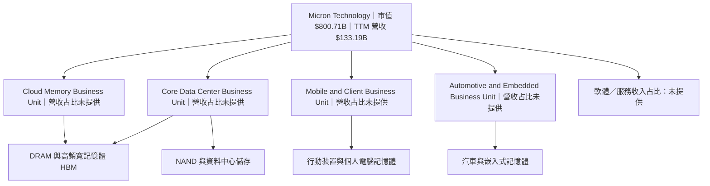
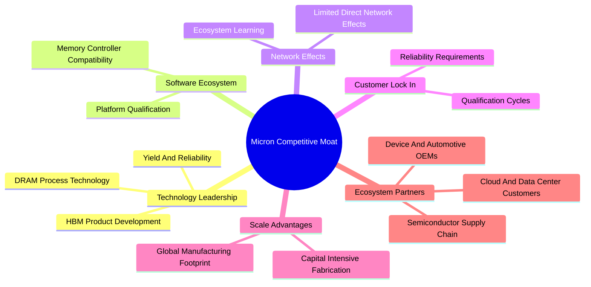
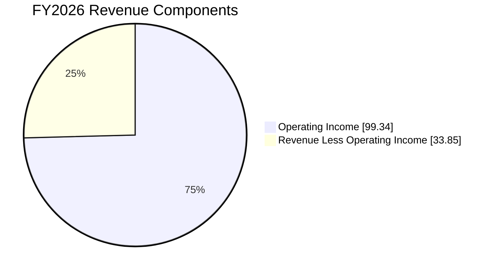
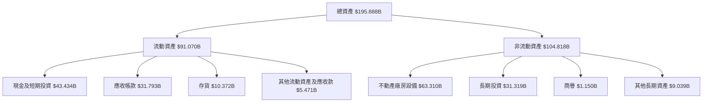
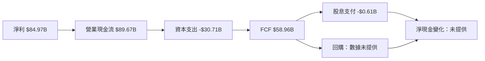
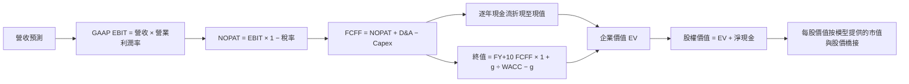
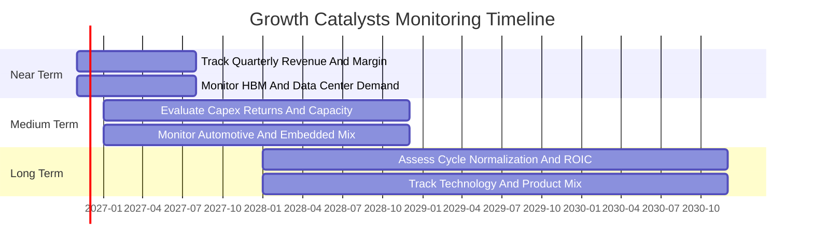
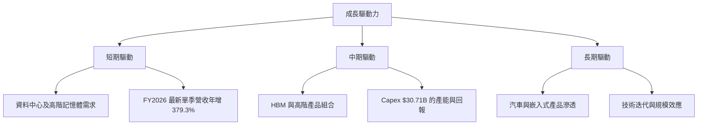
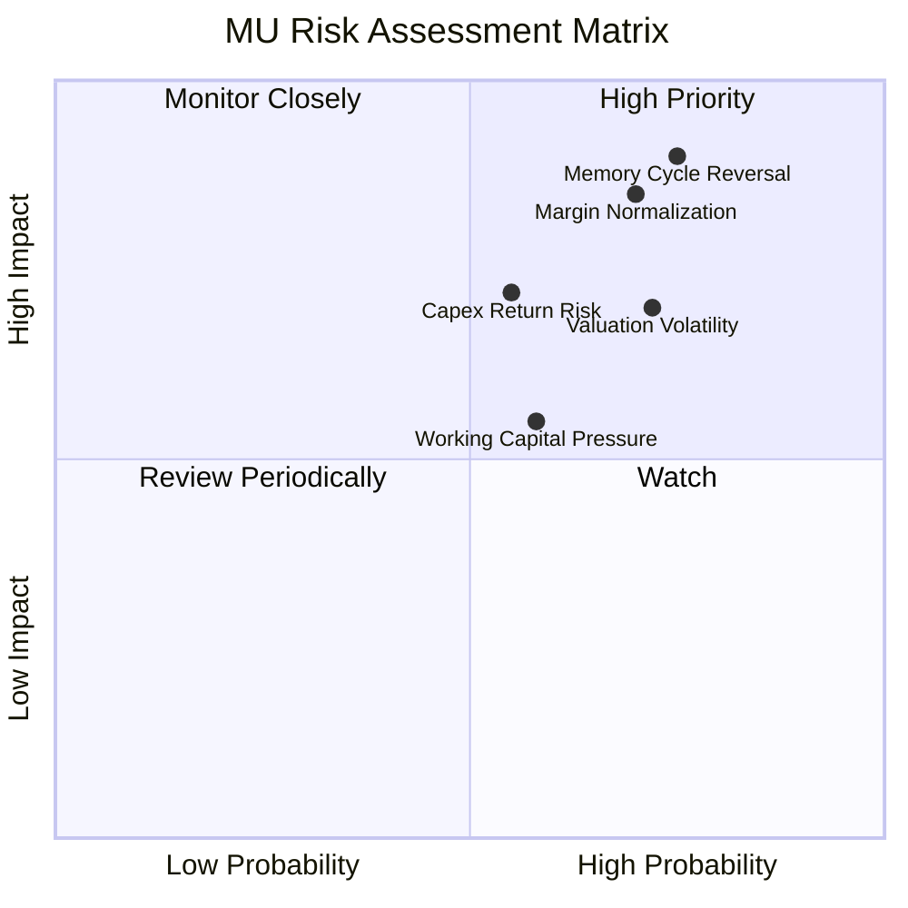
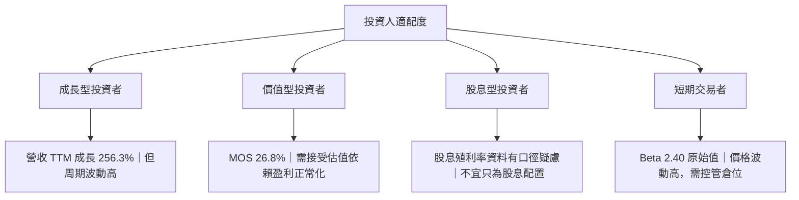

# MU 基本面深度分析報告
> **報告日期**：2026-11-24 ｜ **語言**：繁體中文 ｜ **數據來源**：SEC 申報資料 (XBRL)、Yahoo Finance、Finviz、StockAnalysis、Roic.ai ｜ **分析師**：CFA 級機構研究

## 目錄

| # | 章節 | 核心結論 |
|---|------|----------|
| 1 | 執行摘要 | 強烈買入；加權合理價值 $967.41；MOS +26.8% |
| 2 | 公司概覽與商業模式 | 記憶體技術、製程與資本規模形成護城河，但市場份額數據未提供 |
| 3 | 損益表深度分析 | TTM 營收 $133.19B，TTM 成長 256.3%；利潤率處於高峰區間 |
| 4 | 資產負債表分析 | 淨現金 $40.15B；但現金轉換週期同比延長 30 天 |
| 5 | 現金流量深度分析 | TTM FCF $58.96B；現金流充沛但資本支出高 |
| 6 | 獲利能力與資本效率 | ROIC 86.2% 對比 WACC 14.00%，目前大幅創造價值 |
| 7 | 相對估值分析 | 估值低於同業 EV/EBITDA 中位數，但周期高峰盈餘可能扭曲低 P/E |
| 8 | DCF 內在價值評估 | 基準 DCF $881.83；模型敏感度高，終值與利潤率假設關鍵 |
| 9 | 成長催化劑 | AI／資料中心記憶體需求、HBM 及高階產品組合是主要質化催化劑 |
| 10 | 風險矩陣 | 記憶體周期反轉、利潤率回落及資本支出回報為前三大風險 |
| 11 | 投資建議 | 目前評級強烈買入；依加權合理價值設定買入與風險監控區間 |

---

## 1. 執行摘要

MU 的 TTM 營收為 **$133.19B**，TTM 年增 **256.3%**，最新單季營收年增 **379.3%**；TTM 營業利益率 **74.6%**、ROIC **86.2%**，遠高於 **14.00% WACC**。TTM FCF 為 **$58.96B**、FCF Yield **7.36%**，資產負債表有 **$40.15B 淨現金**。另一方面，營收及利潤率正處於異常強勢的周期階段，現金轉換週期同比增加 30 天，且股價近月波動顯著。程式計算的加權合理價值為 **$967.41**，高於 **2026-11-23 收盤價 $707.70**，MOS 為 **+26.8%**；依規則 20，評級為 **強烈買入**，且 ROIC > WACC。這項評級高度依賴當前獲利持續性，並非對周期風險的忽略。

### 1.0 一頁式投資儀表板（Portfolio Manager 30 秒速讀）

| 項目 | 內容 |
|------|------|
| **投資論點（3 句）** | ① TTM 營收年增 **256.3%**，最新單季年增 **379.3%**，反映記憶體供需及高階產品需求快速擴張。② ROIC **86.2%** 對比 WACC **14.00%**，目前資本報酬大幅高於資本成本。③ TTM FCF **$58.96B**、淨現金 **$40.15B**，為高資本支出周期提供資金緩衝。 |
| **綜合評分** | **7.8/10**（引用 1.1 評分卡） |
| **財務健康** | 🟢 淨現金 **$40.15B**、流動比率 **3.314**；但 CCC 同比增加 **30 天**，應收與庫存占用需追蹤。 |
| **ROIC vs WACC** | **86.2% vs 14.00%**：當前創造股東價值，ROIC 高於 WACC **72.2 個百分點**。 |
| **FCF 趨勢** | FY2023 的 **-$6.12B** 回升至 FY2026 的 **$58.96B**；TTM FCF Yield **7.36%**。 |
| **估值** | Forward P/E **3.42x** ｜ EV/EBITDA **7.0x** ｜ FCF Yield **7.36%** |
| **DCF 內在價值（基準）** | **$881.83** ｜ 現價相對 DCF 折價 **19.7%**（DCF 折溢價定義：現價 ÷ DCF − 1） |
| **安全邊際（MOS）** | **+26.8%＝($967.41 − $707.70) ÷ $967.41**｜🟢 >25% 充足 |
| **預期報酬（基準情境 12M）** | **+24.6%**（DCF 基準情境；相對現價） |
| **關鍵風險（前二）** | 記憶體價格與供需周期反轉；目前極高利潤率向歷史中位數回落。 |
| **評級 + 信心度** | 🟢 **強烈買入** ｜ 信心：中（估值折價有支持，但周期和 DCF 假設不確定性高） |

### 1.1 綜合評分卡（全報告唯一）

| 維度 | 評分（1–10） | 主要依據（引用數字與其來源章節） |
|------|--------------|----------------------------------|
| 成長性 | 9.5 | TTM 營收成長 **256.3%**、最新單季年增 **379.3%**；見第 3 章。高分反映現況，不代表可持續。 |
| 獲利能力 | 9.0 | TTM 營業利益率 **74.6%**、ROIC **86.2%**、Piotroski **8/9**；見第 3、6 章。 |
| 財務健康 | 8.5 | 淨現金 **$40.15B**、流動比率 **3.314**；CCC 從 **155 天** 增至 **185 天**；見第 4 章。 |
| 估值 | 7.0 | MOS **26.8%**；同業 EV/EBITDA 中位數回推值 **$1,095.47**，但周期盈餘使低 P/E 不宜直接視為便宜；見第 7、8 章。 |
| 護城河 | 7.5 | 高階 DRAM／HBM 與製程、資本投入門檻形成優勢，但市場份額及分部營收數據未提供；見第 2 章。 |
| 管理層與資本配置 | 5.5 | FY2026 Capex **$30.71B**、SBC **$1.33B**；稀釋股數測試未通過，回購金額未提供；見第 3、5 章。 |
| **綜合評分** | **7.8** | 六項算術平均：**(9.5 + 9.0 + 8.5 + 7.0 + 7.5 + 5.5) ÷ 6 = 7.833… ≈ 7.8** |

### 1.2 五大投資論點 + 三大核心風險

| 類型 | 項目 | 具體依據 | 信心度 |
|------|------|----------|--------|
| 🟢 **投資論點①** | AI／資料中心記憶體需求推升成長 | TTM 營收 **$133.19B**，TTM 年增 **256.3%**；最新單季年增 **379.3%**。若高階記憶體需求持續，產品組合與定價可能延續改善。 | 🟢 高 |
| 🟢 **投資論點②** | 周期高峰下現金創造能力強 | TTM 營業現金流 **$89.67B**，Capex **$30.71B**，FCF **$58.96B**；足以支持擴產與資產負債表韌性。 | 🟢 高 |
| 🟢 **投資論點③** | 資本報酬大幅超過資本成本 | ROIC **86.2%** 對比 WACC **14.00%**；目前回報差 **72.2pp**。 | 🟢 高 |
| 🟢 **投資論點④** | 淨現金提供周期緩衝 | 現金與短期投資 **$43.43B**，總債務 **$3.28B**，淨現金 **$40.15B**。 | 🟢 高 |
| 🟢 **投資論點⑤** | 多方法估值指向現價下方有折價 | DCF 基準 **$881.83**；加權合理價值 **$967.41**；現價 **$707.70**。 | 🟡 中 |
| 🟡 **風險①** | 供需周期轉向 | FY2026 營業利益率 **74.6%**，遠高於 FY2025 **26.1%**；需求或供應變化可快速壓縮價格與利潤率。 | 🔴 高衝擊 |
| 🔴 **風險②** | 高估當前可持續獲利能力 | 估值採用高 TTM 營收及利潤作為起點，DCF 假設營業利潤率由 **74.6%** 衰退至 **26.1%**，顯示正常化風險已是模型核心。 | 🔴 高衝擊 |
| 🟡 **風險③** | 營運資金占用增加 | CCC 從 **155 天** 增至 **185 天**，DSO 增 **17 天**、DIO 增 **11 天**，可能反映收款及庫存資金占用增加。 | 🟡 中度 |

### 1.3 快速統計卡片

| 指標 | 公司實際值（期間） | 同業中位數 | 狀態 |
|------|--------------------|------------|------|
| 營收成長（TTM） | **256.3%** | — | 🟢 |
| 營收成長（最新一季年增） | **379.3%** | **327.9%**（SKHY、SNDK、WDC 中位數） | 🟢 |
| 毛利率（TTM） | **80.7%** | **77.4%**（同業中位數） | 🟢 |
| 營業利益率（TTM） | **74.6%** | — | 🟢 |
| ROIC（TTM） | **86.2%** | — | 🟢 |
| Forward P/E | **3.42x** | **3.0x**（同業中位數） | 🟢 |
| FCF Yield（TTM） | **7.36%** | — | 🟢 |
| Piotroski F-Score | **8 / 9** | — | 🟢 |

### 1.4 投資結論

```text
╔══════════════════════════════════════════════════════════════════╗
║                    📊 投資結論摘要                               ║
╠══════════════════════════════════════════════════════════════════╣
║  評級：強烈買入（依 MOS 門檻；未作質化下調）                     ║
║  價格（2026-11-23 收盤）：$707.70                                ║
║  DCF 內在價值（基準）：$881.83（現價折價 19.7%）                ║
║  安全邊際 MOS：+26.8%（＝($967.41−$707.70)÷$967.41）           ║
║  加權合理價值（8.8）：$967.41                                    ║
║  DCF 情境價值：                                                   ║
║    悲觀情境：$429.05（-39.4%）                                   ║
║    基準情境：$881.83（+24.6%）                                   ║
║    樂觀情境：$1,715.71（+142.4%）                                ║
║  綜合評分：7.8/10（引用 1.1）                                    ║
║  適合投資人：能承受半導體周期波動、以多年期配置成長資產者        ║
╚══════════════════════════════════════════════════════════════════╝
```

---

## 2. 公司概覽與商業模式

### 2.1 業務結構與收入來源

Micron Technology, Inc. 設計、製造及銷售記憶體與儲存產品，營運涵蓋雲端記憶體、核心資料中心、行動與客戶端、汽車與嵌入式等業務單位。產品包括 DRAM、HBM、NAND 與儲存產品。資料未提供各業務單位收入金額或占比，因此下圖不分配未經披露的比例。



### 2.2 市場份額

市場份額數據未提供，無法以可靠數字比較 Micron 在 DRAM、HBM 或 NAND 的占比。可以觀察到公司 TTM 營收 **$133.19B**、最新單季年增 **379.3%**，高於同業最新單季營收成長中位數 **327.9%**；但這反映營收成長，不等同市場份額變化。

### 2.3 競爭護城河分析



### 2.4 護城河強度

| 護城河項目 | 強度（強／中／弱） | 證據（引用數字或事實） | 會削弱它的情況 |
|------------|--------------------|------------------------|----------------|
| 技術與產品能力 | 中至強 | 公司提供 DRAM、HBM、NAND；TTM 毛利率 **80.7%**，但未提供各產品毛利率及市場份額。 | 競爭者追上製程、良率或 HBM 供應能力。 |
| 軟體生態系統 | 弱至中 | 記憶體產品需與客戶平台相容，但沒有可量化軟體收入或生態黏著數據。 | 客戶標準化降低差異，產品被視為可替代元件。 |
| 網路效應 | 弱 | 財務數據未顯示典型雙邊平台網路效應。 | 市場競爭主要回歸供給、成本與價格。 |
| 客戶鎖定 | 中 | 產品資格認證、可靠性要求可形成轉換摩擦；但客戶集中度及合約資料未提供。 | 客戶多源採購、重新認證時間縮短。 |
| 規模效應 | 強 | FY2026 Capex **$30.71B**，顯示產業資本需求高；規模可攤薄製造與研發成本。 | 投資報酬下滑或產能擴張超過需求。 |
| 生態夥伴 | 中 | 公司服務雲端、資料中心、行動、汽車等終端市場；具體合作及份額未提供。 | 客戶轉向替代架構，或供應鏈變化降低合作優勢。 |

第 1.1 節「護城河」評分 **7.5/10**，主要依據是高資本門檻、技術與客戶資格認證；評分未更高，是因市場份額及分部營收證據缺失，且記憶體產品仍具周期性商品特徵。

---

## 3. 損益表深度分析

### 3.1 年度收入成長趨勢（近4年）

年度收入資料：FY2023 **$15.54B**、FY2024 **$25.11B**、FY2025 **$37.38B**、FY2026 **$133.19B**。FY2026 較 FY2025 成長 **256.3%**；FY2023 至 FY2026 CAGR 約 **104.7%**，計算為 \((133.19 ÷ 15.54)^{1/3} − 1\)。此速度包含周期復甦、價格與產品組合改善，不宜直接外推為長期趨勢。

```text
╔══════════════════════════════════════════════════════════════════╗
║            Micron 年度收入趨勢（FY2023–FY2026）                  ║
╠══════════════════════════════════════════════════════════════════╣
║  FY2023  $15.54B  ███░░░░░░░░░░░░░░░░░░░  YoY：-49.5% 🔴      ║
║  FY2024  $25.11B  ████░░░░░░░░░░░░░░░░░░  YoY：+61.6% 🟢      ║
║  FY2025  $37.38B  ██████░░░░░░░░░░░░░░░░  YoY：+48.9% 🟢      ║
║  FY2026 $133.19B  ██████████████████████  YoY：+256.3% 🟢     ║
╠══════════════════════════════════════════════════════════════════╣
║  FY2023–FY2026 三年收入 CAGR：約 +104.7%                         ║
╚══════════════════════════════════════════════════════════════════╝
```

FY2023 的年度營收成長率採 StockAnalysis 年度序列所列 **-49.48%**；四年營收與增長序列呈現周期低谷後的恢復，再至 FY2026 急速放大。收入與利潤率同步改善，表示不只是出貨成長，也有價格及產品組合的營業槓桿；但數據不足以把增長精確拆解為數量、價格與產品組合。

### 3.2 季度收入趨勢分析

| 季度 | 營收 | QoQ 成長 | YoY 成長 | 備註 |
|------|------:|---------:|---------:|------|
| FY2026 Q1 | $13.643B | — | 56.65% | 與前季的完整序列未在同一表格列出，QoQ 不計。 |
| FY2026 Q2 | $23.860B | **74.9%** | **196.29%** | 需求與定價加速；年增率依 StockAnalysis 季度資料。 |
| FY2026 Q3 | $41.456B | **73.7%** | **345.72%** | 營收連續擴張；年增率反映較低比較基期。 |
| FY2026 Q4 | $54.229B | **30.8%** | **379.3%** | 最新單季年增率以 VERIFIED FIGURES 為準；QoQ 成長仍高但低於前兩季。 |

QoQ 算式：Q2 **($23.860B ÷ $13.643B) − 1 = 74.9%**；Q3 **($41.456B ÷ $23.860B) − 1 = 73.7%**；Q4 **($54.229B ÷ $41.456B) − 1 = 30.8%**。Q4 QoQ 增長放緩與基期擴大相符，但仍應持續檢視訂單、產能與 ASP。來源資料對最新季度營業利益率有 **74.6%** 與 **80.7%** 兩種口徑；本報告依 VERIFIED FIGURES 採用其最新季度營業利益率 **80.7%**，並不將此與毛利率混用。

### 3.3 利潤率演變分析

| 利潤率指標 | FY2023 | FY2024 | FY2025 | FY2026 TTM | 趨勢 | 評估 |
|------------|--------:|--------:|--------:|-----------:|------|------|
| **毛利率** | -9.1% | 22.3% | 39.8% | 80.7% | 由周期低谷迅速回升 | 🟢 但周期性高峰風險高 |
| **營業利益率** | -34.8% | 5.2% | 26.1% | 74.6% | 營收恢復帶動營業槓桿 | 🟢 現況；🟡 可持續性 |
| **淨利率** | -37.5% | 3.1% | 22.8% | 63.8% | 由虧損轉為高獲利 | 🟢 需觀察稅率與周期 |

FY2023–FY2026 毛利率使用年度損益表的毛利與營收計算；FY2023 毛利數據與另一來源的年度序列存在差異，故應視為跨來源財報口徑不一致的提醒。FY2026 營收升至 **$133.19B**，營業利益 **$99.34B**，代表固定成本被更高產能與營收吸收，且產品定價／組合改善推升營業槓桿。此種幅度的利潤率躍升也使 FY2026 不宜直接作為長期正常化利潤率。

### 3.4 費用結構分析

可取得的 FY2026 數字包括營收 **$133.19B**、營業利益 **$99.34B**、研發費用 **$5.65B**。剩餘營業成本合計為營收扣除營業利益，即 **$33.85B**；但未提供費用明細拆分，不能將其完整分配為製造、銷售管理或其他項目。



```text
╔══════════════════════════════════════════════════════════════════╗
║                    FY2026 營收與營業利益                         ║
╠══════════════════════════════════════════════════════════════════╣
║  營收 $133.19B       ██████████████████████████                 ║
║  營業利益 $99.34B    ███████████████████░░░░░░░                 ║
║  差額 $33.85B        ███████░░░░░░░░░░░░░░░░░                   ║
║  研發費用 $5.65B     為已披露營業費用之一；費用分類不完整      ║
╚══════════════════════════════════════════════════════════════════╝
```

### 3.5 季度 EPS 趨勢與盈餘品質（Quality of Earnings）

| 季度 | EPS 實際值 | EPS YoY | 超預期／不及預期 |
|------|-----------:|--------:|------------------|
| FY2026 Q1 | $4.60 | 175.45% | EPS 預估值 N/A，無法判定 |
| FY2026 Q2 | $12.07 | 756.03% | EPS 預估值 N/A，無法判定 |
| FY2026 Q3 | $24.67 | 1,368.45% | EPS 預估值 N/A，無法判定 |
| FY2026 Q4 | $32.85 | 1,059.46% | EPS 預估值 N/A，無法判定 |

EPS 數值及年增率採 StockAnalysis 季度資料。EPS 實際值連續上升，但 EPS Est 為 nan，因此不能把資料源標記的驚喜符號解讀為確實超預期或不及預期。

| 盈餘品質項目 | 數值／佔比 | 評估 |
|--------------|------------|------|
| 股權薪酬 SBC / 營收 | **1.00%**（$1.33B ÷ $133.19B） | 🟢 占比較低；仍是股東稀釋成本，且 F-Score 的稀釋股數測試未通過。 |
| SBC / 營業現金流 | **1.48%**（$1.33B ÷ $89.67B） | 🟢 佔比有限；不代表 SBC 沒有經濟成本。 |
| FCF / 淨利（現金轉換率） | **69.4%**（$58.96B ÷ $84.97B） | 🟡 FCF 低於淨利，主要需納入高額 Capex 的影響。 |
| 一次性／非經常性損益 | **N/A** | 缺少可核對的非經常項目明細，不能判定是否美化盈餘。 |
| 有效稅率異常 | **14.8%** | DCF 採用最新年度有效稅率；未提供長期稅率序列，須留意稅率回歸。 |
| 資本化支出 vs 費用化 | Capex **$30.71B**；研發費用 **$5.65B** | Capex 透過資產折舊逐期進入損益，不能只看當期淨利評估資金需求；資本化明細未提供。 |

**盈餘品質結論**：FY2026 營業現金流 **$89.67B** 高於淨利 **$84.97B**，有正面的現金流支持；但扣除 **$30.71B** Capex 後，FCF 僅為淨利的 **69.4%**。SBC 占營收約 **1.00%**，不是主要獲利品質疑慮，但稀釋股數未通過 F-Score 測試，表示每股股東回報仍需追蹤。整體而言，GAAP 獲利有現金流支持，然而周期高峰盈利與高資本投入使長期盈餘應採正常化折現。

---

## 4. 資產負債表分析

### 4.1 資產結構分解

FY2026 總資產 **$195.888B**，流動資產 **$91.070B**，非流動資產為兩者差額 **$104.818B**。細項按 StockAnalysis 資產負債表來源列示。



### 4.2 流動性與營運資金分析

流動比率 **3.314**、速動比率 **2.898**；現金與短期投資 **$43.43B**。相較流動負債 **$27.48B**，流動性具緩衝，但應收帳款與存貨日數上升，說明現金覆蓋不等同營運資金效率改善。

| 指標 | 最新 TTM | 一年前 TTM | 變化 | 解讀 |
|------|----------:|----------:|------:|------|
| DSO 應收帳款天數 | 87 天 | 70 天 | **+17 天** | 收款週期延長，可能反映銷售快速增加與期末應收擴大；需追蹤逾期及客戶條款。 |
| DIO 存貨天數 | 147 天 | 136 天 | **+11 天** | 存貨持有時間增加，可能是供應備貨或需求與生產不同步；若需求放緩，存在庫存與價格風險。 |
| DPO 應付帳款天數 | 50 天 | 51 天 | **-1 天** | 對供應商付款天數略降，未見延後付款來抵銷存貨與應收資金占用。 |
| CCC 現金轉換週期 | 185 天 | 155 天 | **+30 天** | 營運資金週期拉長，增長期會提高資金需求；與強勁 CFO 並存，需看後續是否反轉。 |

### 4.3 債務結構分析

本節採 VERIFIED FIGURES 的債務與淨現金口徑：總債務 **$3.28B**、現金及短期投資 **$43.43B**、淨現金 **$40.15B**。其他市場資料列出的總債務與淨現金數值不同；為保持口徑一致，本節不混用該等數字。Debt/EBITDA 與利息保障倍數缺少與本口徑一致的輸入，故不計算。

```text
╔══════════════════════════════════════════════════════════════════╗
║                   Micron 債務健康診斷                            ║
╠══════════════════════════════════════════════════════════════════╣
║  總債務：        $3.28B    ░░░░░░░░░░░░░░░░░░░░  🟢             ║
║  現金+短期投資： $43.43B   ████████████████████  🟢             ║
║  淨現金：        $40.15B   ██████████████████░░  🟢             ║
║                                                                  ║
║  Debt/EBITDA：未計算（債務口徑與 EBITDA 口徑不一致）             ║
║  Interest Coverage：N/A（利息費用及一致口徑未提供）             ║
║  流動比率：3.314x；速動比率：2.898x                              ║
╚══════════════════════════════════════════════════════════════════╝
```

### 4.4 股東權益趨勢

FY2023–FY2026 股東權益依年度資產負債表資料列示。FY2026 較 FY2025 大幅增加，與淨利回升一致；這是資產負債表帳面變化，不能單獨視為每股價值增長，仍需考量股數及投資回報。

```text
╔══════════════════════════════════════════════════════════════════╗
║                 Micron 股東權益趨勢                              ║
╠══════════════════════════════════════════════════════════════════╣
║  FY2023  $44.12B  ████████░░░░░░░░░░░░░░                         ║
║  FY2024  $45.13B  ████████░░░░░░░░░░░░░░                         ║
║  FY2025  $54.16B  ██████████░░░░░░░░░░░░                         ║
║  FY2026 $138.38B  █████████████████████████                      ║
╚══════════════════════════════════════════════════════════════════╝
```

---

## 5. 現金流量深度分析

### 5.1 現金流量瀑布圖

回購金額及淨現金變化拆分未提供；圖中不虛構用途或資金流向。



### 5.2 FCF 轉換率趨勢

| 財年 | FCF | 淨利 | FCF / 淨利 | 解讀 |
|------|----:|-----:|-----------:|------|
| FY2023 | -$6.12B | -$5.83B | 低於 0%；數值約 105.0% | 虧損年度的比值解讀有限，FCF 為負反映周期與投資壓力。 |
| FY2024 | $0.121B | $0.778B | 15.6% | 獲利恢復初期，現金流尚未同步轉強。 |
| FY2025 | $1.67B | $8.54B | 19.6% | 淨利上升快於自由現金流，Capex 消耗現金。 |
| FY2026 TTM | $58.96B | $84.97B | 69.4% | 現金流大幅改善，但仍低於淨利，反映高 Capex。 |

FY2023 比值以 **(-$6.12B) ÷ (-$5.83B) ≈ 105.0%** 計算；因分子、分母皆為負值，不代表正向現金轉換，故不宜與獲利年份直接比較。

### 5.3 自由現金流趨勢

```text
╔══════════════════════════════════════════════════════════════════╗
║                Micron 自由現金流：歷史實際                       ║
╠══════════════════════════════════════════════════════════════════╣
║  FY2023  -$6.12B  ◀████░░░░░░░░░░░░░░░░░  FCF 為負             ║
║  FY2024   $0.12B  ░░░░░░░░░░░░░░░░░░░░░░  FCF Yield N/A         ║
║  FY2025   $1.67B  █░░░░░░░░░░░░░░░░░░░░░  FCF Yield N/A         ║
║  FY2026  $58.96B  ██████████████████████░  FCF Yield 7.36%      ║
╠══════════════════════════════════════════════════════════════════╣
║  FY2026 TTM FCF = 營業現金流 $89.67B − Capex $30.71B = $58.96B  ║
╚══════════════════════════════════════════════════════════════════╝
```

### 5.4 資本配置評估

已披露 FY2026 Capex **$30.71B**、股息支付 **$0.61B**、SBC **$1.33B**。回購及其他投資的金額未提供，故不繪製含推估比例的配置圓餅圖。Capex 約為 FCF 的 **52.1%**（$30.71B ÷ $58.96B），顯示公司仍須持續投入資本維持及擴張供應能力；投資成效應以未來 ROIC 是否高於 WACC 檢驗。股息支付相較 FCF 規模有限，但股息殖利率來源資料列示 **8.0%**、派息率 **0.7%**，與一般口徑不易調和，故股息率不作為核心估值依據。

| 配置項目 | FY2026 可得數字 | 評估 |
|----------|----------------:|------|
| Capex | $30.71B | 🟡 支出大；須以增量產能及回報衡量。 |
| 股息支付 | $0.61B | 🟢 相對 FCF 低，不致明顯限制投資。 |
| SBC | $1.33B | 🟡 需關注股數稀釋；F-Score 稀釋股數項未通過。 |
| 回購 | N/A | 回購金額未提供。 |
| 其他投資／留存現金 | N/A | 缺少完整資本配置明細。 |

---

## 6. 獲利能力與資本效率

### 6.1 ROE / ROA / ROIC 趨勢

| 指標 | FY2023 | FY2024 | FY2025 | 最新 TTM | 評估 |
|------|-------:|-------:|-------:|---------:|------|
| ROE | N/A | N/A | N/A | **61.4%** | TTM 報酬高；依 QUALITY FIGURES 口徑。其他資料來源列 **88.3%**，因口徑不一致不混用。 |
| ROA | N/A | N/A | N/A | **44.6%** | 最新數值高，但歷史序列未提供。 |
| ROIC | N/A | N/A | N/A | **86.2%** | 大幅高於 WACC；若獲利回歸周期中位數，ROIC 可能快速收斂。 |

行業均值對比：N/A（同一來源、同一口徑的行業 ROE／ROA／ROIC 數值未提供）。

### 6.2 ROIC vs WACC 分析（核心價值創造判斷）

```text
╔══════════════════════════════════════════════════════════════════╗
║                ROIC vs WACC 深度分析                            ║
╠══════════════════════════════════════════════════════════════════╣
║  WACC（採用值）：14.00%                                          ║
║  ├── 無風險利率（10Y美債）：4.92%                               ║
║  ├── 市場風險溢酬 ERP：5.00%                                    ║
║  ├── Beta used (adjusted)：1.93（原始 Beta 2.40）                ║
║  ├── 股權成本 Ke：14.58%                                        ║
║  ├── 稅前債務成本：3.23%；稅後約 2.75%                          ║
║  ├── 股權／債務權重：99.6%／0.4%                                ║
║  └── 未受限計算 WACC 14.53%；依 7%–14% 區間採用 14.00%         ║
║                                                                  ║
║  ROIC（TTM）：86.2%                                              ║
║  ROIC−WACC：86.2%−14.00%=+72.2pp                                ║
║  ROIC / WACC：86.2%÷14.00%=6.16x                                ║
║                                                                  ║
║  ROIC 86.2%  ▓▓▓▓▓▓▓▓▓▓▓▓▓▓▓▓▓▓▓▓▓▓▓▓▓▓▓▓▓▓▓▓▓▓▓▓▓▓▓░░       ║
║  WACC 14.0%  ▓▓▓▓▓▓░░░░░░░░░░░░░░░░░░░░░░░░░░░░░░░░░░         ║
║  結論：目前顯著創造股東價值；但此幅度建立於周期高峰盈餘。     ║
╚══════════════════════════════════════════════════════════════════╝
```

來源計算的未受限 WACC 為 **14.53%**，由於模型將 WACC 限制在 **7%–14%** 區間，採用 **14.00%**。因此 ROIC 超額報酬為 **86.2% − 14.00% = 72.2pp**。這表示當前每單位投入資本的稅後營業回報顯著高於資本成本，但不應把高峰 TTM ROIC 當成永久報酬；周期正常化若令 ROIC 跌至 14.00% 以下，價值創造結論即會反轉。

### 6.3 杜邦三因素分解

| 因素 | 數值（TTM） | 解讀 |
|------|-------------|------|
| 淨利率 | **63.8%** | 高獲利率是 ROE 的主要來源，且可能受周期高峰利潤率影響。 |
| 資產週轉率 | **0.68** | 反映資產密集型製造業特性；資產基礎大，收入回升可提高利用率。 |
| 權益乘數 | **1.42** | 槓桿並非 ROE 的主要推動來源。 |
| **ROE** | **61.4%** | QUALITY FIGURES：63.8% × 0.68 × 1.42 = 61.4%；個別因素四捨五入後乘積可能有尾差。 |

### 6.4 財務體質：Piotroski F-Score

**Piotroski F-Score：8 / 9**。資料區塊註明缺少輸入的測試可不列入分母；本次九項測試中一項未通過。

| 測試 | 結果 | 解讀 |
|------|------|------|
| ROA > 0 | ✅ 通過 | TTM 獲利為正。 |
| 營業現金流 > 0 | ✅ 通過 | TTM 營業現金流 **$89.67B**。 |
| ROA 高於一年前 | ✅ 通過 | 盈利狀況較前期改善。 |
| 營業現金流 > 淨利 | ✅ 通過 | CFO **$89.67B** 高於淨利 **$84.97B**。 |
| 長期負債 ÷ 總資產低於一年前 | ✅ 通過 | 槓桿指標較一年前改善。 |
| 流動比率高於一年前 | ✅ 通過 | 財務流動性改善。 |
| 稀釋股數未增加 | ❌ 未通過 | 股數增加的測試未通過，提示 SBC 或其他股權發行可能稀釋每股價值。 |
| 毛利率高於一年前 | ✅ 通過 | 與產品定價、產品組合或利用率改善一致。 |
| 資產週轉率高於一年前 | ✅ 通過 | 產能利用與營收擴張推動資產效率改善。 |

---

## 7. 相對估值分析

### 7.1 同業估值比較表格

同業數值按 Peer multiples 原值引用；MU 自身估值倍數取市場估值資料。SKHY 的 P/S、EV/EBITDA 因混合幣別為 N/A，不以推估數字填補。

| 估值指標 | **MU** | **SKHY** | **SNDK** | **WDC** | MU 評估 |
|----------|------:|---------:|---------:|-------:|-----------|
| **Trailing P/E** | **9.5x** | 6.9x | 5.6x | 10.5x | 🟡 高於 SKHY、SNDK，低於 WDC；周期高峰 EPS 會壓低 P/E。 |
| **Forward P/E** | **3.42x** | 3.0x | 2.4x | 7.4x | 🟢 低於 WDC，接近同業低倍數區；預期盈餘高度依賴周期持續性。 |
| **P/S Ratio** | **6.0x** | N/A | 3.4x | 7.7x | 🟡 位於 SNDK 與 WDC 之間；同業中位數約 5.6x。 |
| **EV / EBITDA** | **7.0x** | N/A | 4.5x | 17.6x | 🟢 低於同業中位數約 11.0x；同業間差異大。 |
| **最新單季營收年增** | **379.3%** | 327.9% | 377.9% | 55.5% | 🟢 MU 高於 SKHY、接近 SNDK，顯著高於 WDC。 |
| **TTM 毛利率** | **80.7%** | 77.4% | 80.0% | 52.6% | 🟢 高於列示同業；仍需確認此高毛利能否延續。 |

### 7.2 歷史估值區間分析

P/E 現值 **9.5x**，低於五年中位數 **17.4x**，位於五年區間 **7.4x–138.5x** 的 **13 百分位**；EV/EBITDA **7.1x**，低於中位數 **9.7x**，為 **35 百分位**。P/S **6.1x** 高於中位數 **4.2x**，為 **75 百分位**，顯示市場仍對營收基礎給予較高評價。

```text
╔══════════════════════════════════════════════════════════════════╗
║              MU 歷史估值位置（五年 TTM）                         ║
╠══════════════════════════════════════════════════════════════════╣
║  P/E       7.4x ├─● 9.5x──────────────┼ 中位數 17.4x ── 138.5x ║
║                       現值：13 百分位                             ║
║  EV/EBITDA 3.6x ├────● 7.1x────┼ 中位數 9.7x────────── 80.7x   ║
║                       現值：35 百分位                             ║
║  P/S       2.1x ├──────中位數 4.2x────● 6.1x─────── 11.7x       ║
║                       現值：75 百分位                             ║
╚══════════════════════════════════════════════════════════════════╝
```

MU 的 P/E 與 EV/EBITDA 位於自身歷史偏低區，但半導體周期高峰的盈餘分母可能暫時放大，低倍數不等同周期調整後便宜。P/S 位於歷史偏高位置，反映市場已對當前收入質量及成長給予較高估值。

### 7.3 情境價值（Bear / Base / Bull，照抄 DCF MODEL 的 Scenarios）

| 情境 | 第 1 年營收成長 | 期末營業利潤率 | WACC | 每股價值 | 相對現價 | 機率 | 會發生的條件 |
|------|----------------:|---------------:|-----:|---------:|---------:|-----:|--------------|
| 🔴 悲觀 | 15.0% | 22.2% | 15.00% | $429.05 | -39.4% | 25% | 高峰需求退潮、價格與產能利用率回落，長期利潤率低於基準假設。 |
| 🟡 基準 | 30.0% | 26.1% | 14.00% | $881.83 | +24.6% | 50% | 短期仍高速成長，但十年內收入成長與營業利潤率逐步正常化。 |
| 🟢 樂觀 | 45.0% | 28.8% | 13.00% | $1,715.71 | +142.4% | 25% | HBM 等高階需求延續、擴產供給受控、產品組合與定價優於基準。 |

### 7.4 相對估值隱含價格區間

下列估值法、每股價值與權重依估值資料原值列示；同業估值法使用同業中位數倍數，而非 MU 自身目前倍數。

```text
╔══════════════════════════════════════════════════════════════════╗
║                  相對估值隱含價值位置                            ║
╠══════════════════════════════════════════════════════════════════╣
║  $655.06             $707.70          $881.83      $1,095.47   ║
║  同業 P/S            現價              DCF 基準      同業 EV/EBITDA║
║  權重 20%                            權重 40%      權重 30%    ║
║  分析師共識目標價 $1,550.24；權重 10%                              ║
╚══════════════════════════════════════════════════════════════════╝
```

| 方法 | 每股價值 | 相對現價 | 依據 |
|------|---------:|---------:|------|
| DCF（基準） | $881.83 | +24.6% | 十年 FCFF、WACC 14.00%、永續成長 3.0%。 |
| 同業 EV/EBITDA | $1,095.47 | +54.8% | SNDK、WDC 同業中位數 **11.0x** × TTM EBITDA，加回淨現金。 |
| 同業 P/S | $655.06 | -7.4% | SNDK、WDC 同業中位數 **5.6x** × TTM 營收。 |

---

## 8. DCF 內在價值評估（Discounted Cash Flow）

### 8.0 估值推理鏈（Thinking Logic：在算之前先想清楚）

**Step 1 — 價值來源與主導變數。**  
MU 價值由既有 DRAM／NAND 業務現金流，以及高階 HBM 與資料中心產品帶來的成長共同決定；但分部營收占比未提供，不能把各項業務拆成不同估值。模型以整體 TTM 營收 **$133.19B** 為起點，最敏感的是營收增長與營業利潤率正常化，尤其模型把營業利益率由 **74.6%** 降至第十年 **26.1%**。

**Step 2 — 模型選擇。**

| 決策點 | 本報告採用 | 理由（含數字） | 曾考慮但否決 | 否決理由 |
|--------|-----------|----------------|--------------|----------|
| 現金流定義 | FCFF | 以 WACC 折現並先得企業價值，再加淨現金橋接至股權價值。 | FCFE | 無需假設未來融資結構，FCFF 較合適。 |
| 預測期 N | 10 年 | DCF 模型固定提供十年逐年預測；可表達高周期獲利向正常化收斂。 | 5 年 | 無法照搬固定模型所提供的十年現金流序列。 |
| 終值方法 | Gordon Growth 為主 | 提供永續成長率 **3.0%**，且 WACC **14.00% > 3.0%**。 | 退出倍數 | DCF 模型未提供終值退出倍數，不能自行另建。 |
| EBIT 基礎 | GAAP | DCF 模型明確採 GAAP EBIT。 | 非 GAAP | 避免把 SBC 加回後漏計股東成本。 |

**Step 3 — 關鍵假設四段式推導。**

- **營收成長**：錨點＝TTM 年增 **256.3%**、最新單季年增 **379.3%**；調整＝超高增長率包含周期反彈及低基期，不可長期線性延續；**採用第 1 年 30.0%，線性降至第 10 年 3.0%**；曾考慮長期採用接近近期單季增速，因周期及基期效應否決。
- **期末營業利潤率**：錨點＝TTM **74.6%**，最近五財年中位數由模型固定為 **26.1%**；調整＝依模型逐年正常化，反映記憶體價格及利用率回歸；**採用第 10 年 26.1%**；曾考慮維持 TTM 利潤率，因與長期周期業務假設不符而否決。
- **永續成長率 g**：錨點＝長期成熟經濟名目成長常以低個位數作上限參考；該數值是模型假設而非公司財測；**採用 3.0%**，低於 WACC 14.00%；曾考慮更高永續增長，因需長期高於經濟成熟速度而否決。
- **預測期 N**：錨點＝模型提供 **10 年**逐年現金流；調整＝不另改模型年數；**採用 10 年**；曾考慮縮短或延長，因無法在不重建模型下沿用程式輸出而否決。
- **Capex／營收**：錨點＝TTM **23.1%**；調整＝模型逐步下降至第十年 **7.8%**，並依模型設定與折舊比例銜接；**採用 FY+1 23.1% 至 FY+10 7.8%**；曾考慮維持 23.1%，因不符合成熟後資本強度下降的模型假設而否決。
- **EBIT 基礎與 SBC**：錨點＝模型使用 GAAP EBIT；調整＝GAAP EBIT 已將 SBC 計為費用；**採用組合 (A)：GAAP EBIT、FCFF 不另扣 SBC、股數不再稀釋**；否決再扣 SBC 或再加股數稀釋，避免同一項成本被重複計算。
- **年稀釋率**：錨點＝組合 (A) 固定股數；調整＝不再另反映稀釋；**採用 0%**；曾考慮股數逐年增加，因與該模型既定 SBC 處理組合不相容。
- **終值方法**：錨點＝DCF 模型提供 Gordon Growth；調整＝只採已計算的 Gordon Growth 終值；**採用 Gordon Growth**；曾考慮退出倍數，因模型未提供可核對的退出倍數及結果而不自行補值。
- **WACC**：錨點＝未受限計算 **14.53%**；調整＝依程式設定的 **7%–14%** 區間上限；**採用 14.00%**；曾考慮直接用 14.53%，因估值模型規定需採用受限後的 WACC 而否決。
- **有效稅率**：錨點＝最新年度有效稅率 **14.8%**；**採用 14.8%**。此項為模型輸入，不代表長期稅率不會變化。
- **D&A／營收**：錨點＝TTM **7.1%**；**採用 7.1%** 並維持固定。
- **營運資金**：模型未建模營運資金變動；不自行補入 ΔWC 假設，屬模型限制。

**Step 4 — 最脆弱假設。**  
最脆弱環節是高峰期營收基礎如何轉成可持續的營業利益率；若營收增長與利潤率更快回落，估值可能落向悲觀情境 **$429.05**，而非基準 **$881.83**。

**Step 5 — 計算路徑圖。**



### 8.1 模型假設總表（Model Inputs）

| 假設項目 | 採用值 | 依據／來源 | 敏感度 |
|----------|--------|-------------|--------|
| 預測期長度 **N** | **10 年** | DCF 模型指定逐年預測 FY+1 至 FY+10。 | 🟡 中 |
| 營收增長 | **FY+1 30.0% → FY+10 3.0%** | TTM 增長 **256.3%**；模型將增長限制於 0%–30%，再線性遞減。 | 🔴 高 |
| 營業利潤率 | **74.6% → 26.1%** | FY+1 取 TTM 利潤率，FY+10 取模型提供的近五財年中位數。 | 🔴 高 |
| 有效稅率 | **14.8%** | 最新年度有效稅率。 | 🟢 低 |
| Capex / 營收 | **23.1% → 7.8%** | TTM 比率起步；逐步降至模型設定的長期水平。 | 🔴 高 |
| D&A / 營收 | **7.1%** | TTM 比率，模型固定。 | 🟢 低 |
| 營運資金變動 | **未建模** | DCF 模型明確說明 Working capital is not modelled。 | 🟡 中 |
| EBIT 基礎 | **GAAP** | DCF 模型輸入。 | 🟡 中 |
| SBC 處理 | **組合 (A)** | GAAP EBIT 已含 SBC，不另扣 SBC。 | 🟡 中 |
| 年稀釋率 | **0%** | 模型固定股數，與 SBC 組合 (A) 一致。 | 🟡 中 |
| 永續成長率 g | **3.0%** | DCF 模型輸入；低於 WACC。 | 🔴 高 |
| 終值方法 | **Gordon Growth** | 模型提供 Gordon Growth 終值；退出倍數未提供。 | 🔴 高 |
| WACC | **14.00%** | 受限後成本資本，推導見 8.2。 | 🔴 高 |

**FCFF 定義**：採 FCFF 對應 WACC 折現。該程式模型的實際定義為 **FCFF = NOPAT + D&A − Capex**，未建模營運資金。**本模型採用 (A)，故 SBC 影響已計入一次**：GAAP EBIT 已含 SBC，不另扣 SBC，亦不再逐年增加股數。

### 8.2 折現率推導（WACC）

```text
╔══════════════════════════════════════════════════════════════════╗
║                    WACC 推導（折現率）                           ║
╠══════════════════════════════════════════════════════════════════╣
║  股權成本 Ke（CAPM）：                                           ║
║  ├── 無風險利率 Rf（10Y 美債）：4.92%                            ║
║  ├── 市場風險溢酬 ERP：5.00%（假設值；成本資本輸入）             ║
║  ├── 原始 Beta：2.40；調整後 Beta：1.93                          ║
║  ├── 調整方式：⅔ × 2.40 + ⅓ × 1.00 = 1.93                      ║
║  ├── 規模／國別溢酬：0.00%（模型未提供額外溢酬）                 ║
║  └── Ke = 4.92% + 1.93 × 5.00% = 14.58%                        ║
║                                                                  ║
║  債務成本 Kd：                                                    ║
║  ├── 稅前 Kd（輸入值）：3.23%                                    ║
║  ├── 有效稅率：14.8%                                             ║
║  └── 稅後 Kd = 3.23% × (1 − 14.8%) = 2.75284% ≈ 2.75%          ║
║                                                                  ║
║  資本結構（市值基礎，成本資本輸入）：                             ║
║  ├── 股權權重：99.6%                                             ║
║  ├── 債務權重：0.4%                                              ║
║  ├── 未受限 WACC：14.58% × 99.6% + 2.75284% × 0.4% = 14.53%    ║
║  └── ✅ 採用 WACC：14.00%（受限於 7%–14% 區間）                 ║
╚══════════════════════════════════════════════════════════════════╝
```

逐步演算：
1. **Ke** = **4.92% + 1.93 × 5.00% = 14.57%**；成本資本來源列示 Ke **14.58%**，差異來自中間參數未顯示精度，DCF 採用輸入的 **14.58%**。
2. **稅前 Kd** = **3.23%**（成本資本輸入值）。利息費用與平均計息負債明細未提供，無法依利息／負債獨立重建。
3. **稅後 Kd** = **3.23% × (1 − 14.8%) = 2.75284% ≈ 2.75%**。
4. **權重** = 股權 **99.6%**、債務 **0.4%**；兩者合計 **100.0%**。市值及計息負債的明細權重來源為成本資本輸入，未另行重估。
5. **計算值 WACC** = **14.58% × 99.6% + 2.75284% × 0.4% = 14.53269136% ≈ 14.53%**；受 **7%–14%** 範圍限制，採用 **14.00%**。

Rf 的具體觀察日期、ERP 的外部引用依據、利息費用及平均計息負債的明細未提供。為遵守 VERIFIED FIGURES，直接採用指定成本資本輸入，未另行估算或改算 WACC。此 **14.00%** 與第 6.2 節一致。

### 8.3 逐年自由現金流預測（基準情境）

金額單位 **$B**；折現因子保留三位小數。以下逐年數字照 DCF 模型列示。營運資金未建模，故不另加入 ΔWC 列；組合 (A) 下不設 SBC 扣除列。

| 年度 | FY+1 | FY+2 | FY+3 | FY+4 | FY+5 | FY+6 | FY+7 | FY+8 | FY+9 | FY+10 |
|------|-----:|-----:|-----:|-----:|-----:|-----:|-----:|-----:|-----:|------:|
| 營收 | 173.14 | 219.89 | 272.67 | 329.93 | 389.32 | 447.71 | 501.44 | 546.57 | 579.36 | 596.74 |
| 營收 YoY | 30.0% | 27.0% | 24.0% | 21.0% | 18.0% | 15.0% | 12.0% | 9.0% | 6.0% | 3.0% |
| 營業利潤率 | 74.6% | 69.2% | 63.8% | 58.4% | 53.1% | 47.7% | 42.3% | 36.9% | 31.5% | 26.1% |
| EBIT（GAAP） | 129.14 | 152.17 | 174.02 | 192.80 | 206.55 | 213.43 | 212.05 | 201.71 | 182.62 | 155.98 |
| − 稅 | (19.13) | (22.54) | (25.77) | (28.55) | (30.59) | (31.61) | (31.40) | (29.87) | (27.05) | (23.10) |
| = NOPAT | 110.02 | 129.64 | 148.25 | 164.25 | 175.96 | 181.82 | 180.64 | 171.84 | 155.58 | 132.88 |
| + D&A | 12.35 | 15.69 | 19.45 | 23.54 | 27.78 | 31.94 | 35.78 | 39.00 | 41.34 | 42.58 |
| − Capex | (39.93) | (46.99) | (53.66) | (59.35) | (63.45) | (65.41) | (64.78) | (61.37) | (55.26) | (46.84) |
| **= FCFF** | **82.44** | **98.34** | **114.04** | **128.44** | **140.28** | **148.36** | **151.64** | **149.46** | **141.65** | **128.62** |
| 折現因子 @14.00% | 0.877 | 0.769 | 0.675 | 0.592 | 0.519 | 0.456 | 0.400 | 0.351 | 0.308 | 0.270 |
| **FCFF 現值 PV** | **72.32** | **75.67** | **76.98** | **76.04** | **72.86** | **67.59** | **60.60** | **52.40** | **43.56** | **34.69** |

**預測期 FCF 現值合計**：  
**$72.32 + $75.67 + $76.98 + $76.04 + $72.86 + $67.59 + $60.60 + $52.40 + $43.56 + $34.69 = $632.71B**

**FY+1 逐步演算**（以模型已列示的四捨五入數據示範；各行可能有小幅尾差）：
1. **營收** = **$133.19B × (1 + 30.0%) = $173.15B**；模型列示 **$173.14B**，差異來自未四捨五入的基礎精度。
2. **EBIT** = **$173.14B × 74.6% = $129.16B**；模型列示 **$129.14B**，因比例及基礎未四捨五入數不同。
3. **稅** = **$129.14B × 14.8% = $19.11B**；模型列示 **$19.13B**，差異同樣源自未顯示精度。
4. **NOPAT** = 模型列示 **$129.14B − $19.13B = $110.01B**；模型列示 **$110.02B**，為原始未四捨五入數造成的尾差。
5. **D&A** = 模型列示 **$12.35B**（按未四捨五入預測數計算）。
6. **Capex** = 模型列示 **$39.93B**（按未四捨五入預測數計算）。
7. **ΔWC** = **未建模**。
8. **FCFF** = **$110.02B + $12.35B − $39.93B = $82.44B**。
9. **折現因子** = **1 ÷ (1 + 14.00%)¹ ≈ 0.877**；**PV = $82.44B × 0.877 ≈ $72.32B**。

**合理性自檢**：
- 預測期 FCF CAGR：FY+1 至 FY+10 **約 5.1%**，計算為 \((128.62 ÷ 82.44)^{1/9} − 1\)；歷史實際 FCF CAGR 因 FY2023 負值而不具可比性，FY2024–FY2026 亦有極低基期，不能把短期歷史 CAGR 當正常化錨點。
- FY+10 FCF 利潤率 = **$128.62B ÷ $596.74B = 21.6%**；當前 TTM FCF 利潤率 = **$58.96B ÷ $133.19B = 44.3%**。同業最佳水準未提供，不能作量化比較；模型假設第十年利潤率低於當前。
- 模型十年 FCFF 均為正值；最大限制是未建模營運資金變動，可能低估快速成長時的資金需求。

```text
╔══════════════════════════════════════════════════════════════════╗
║            自由現金流：歷史實際 vs 模型預測                      ║
╠══════════════════════════════════════════════════════════════════╣
║  FY2023(實)  -$6.12B  ◀██░░░░░░░░░░░░░░░░░░                     ║
║  FY2024(實)   $0.12B  ░░░░░░░░░░░░░░░░░░░░                     ║
║  FY2025(實)   $1.67B  █░░░░░░░░░░░░░░░░░░░                      ║
║  FY2026(實)  $58.96B  ████████████████████░░                     ║
║  FY+1 (預)   $82.44B  ████████████████████████████               ║
║  FY+10(預)  $128.62B  ████████████████████████████████████████   ║
╠══════════════════════════════════════════════════════════════════╣
║  FY+1 至 FY+10 FCFF CAGR 約 5.1%；FCFF 利潤率由 47.6% 降至 21.6%║
╚══════════════════════════════════════════════════════════════════╝
```

模型列示 FY+1 FCFF **$82.44B**，其營收為 **$173.14B**，對應 FCFF 利潤率約 **47.6%**。歷史 TTM FCF 利潤率為 **44.3%**，模型起始仍略高，之後因營收成長減速及利潤率下滑而收斂。

### 8.4 終值計算（Terminal Value）

**適用性檢查**：**WACC 14.00% vs g 3.0% → WACC > g？✅**

| 方法 | 計算式 | 終值 TV | TV 現值 | 佔總 EV 比重 |
|------|--------|---------:|--------:|-------------:|
| Gordon Growth | $128.62B × (1 + 3.0%) ÷ (14.00% − 3.0%) | $1,204.36B | $324.87B | 33.9% |
| 退出倍數法 | N/A（DCF 模型未提供終值倍數與該法估值） | N/A | N/A | N/A |

逐步演算：
1. **FY+N FCFF** = **FY+10 $128.62B**。
2. **分子** = **$128.62B × (1 + 3.0%) = $132.4786B**，四捨五入 **$132.48B**。
3. **分母** = **14.00% − 3.0% = 11.00%**；TV = **$132.4786B ÷ 11.00% = $1,204.35B**，模型原值列 **$1,204.36B**（未四捨五入輸入精度造成約 $0.01B 差異）。
4. **PV(TV)** = 模型原值 **$1,204.36B × 第十年折現因子（未四捨五入）= $324.87B**。表面上以顯示折現因子 **0.270** 相乘會得到不同尾數；模型使用未四捨五入折現因子。
5. **終值佔比** = **$324.87B ÷ $957.57B = 33.9%**（依模型列示占比）。

終值 PV 占 EV **33.9%**，未超過 75% 警示線，但仍是重要價值來源。退出倍數法因沒有給定退出倍數與估值結果，不另造倍數以填補模型缺口。

### 8.5 企業價值 → 每股內在價值（Bridge）

```text
╔══════════════════════════════════════════════════════════════════╗
║              企業價值 → 每股內在價值 橋接表                      ║
╠══════════════════════════════════════════════════════════════════╣
║  預測期 FCF 現值合計            +$632.71B                        ║
║  終值現值 PV(TV)                +$324.87B                        ║
║  ─────────────────────────────────────────────                  ║
║  = 企業價值 EV                   $957.57B                        ║
║  + 淨現金                       +$40.15B                         ║
║  = 股權價值                      $997.73B                        ║
║  每股內在價值（模型輸出）        $881.83                         ║
║  當前股價（2026-11-23 收盤）      $707.70                         ║
║  折溢價（現價÷DCF內在價值−1）    -19.7%（現價折價）              ║
╚══════════════════════════════════════════════════════════════════╝
```

逐步演算：
1. **EV**：模型分項顯示 **$632.71B + $324.87B = $957.58B**；模型列示 EV 為 **$957.57B**，存在 **$0.01B** 的顯示尾差，應歸因未四捨五入數，而非另行改模型值。
2. **股權價值** = 模型列示 EV **$957.57B + 淨現金 $40.15B = $997.72B**；模型列示 **$997.73B**，同樣差 **$0.01B**。
3. **每股內在價值** = 模型指定 **股權價值 × 價格 ÷ 市值**：**$997.73B × $707.70 ÷ $800.71B = $881.83**。
4. **折溢價** = **$707.70 ÷ $881.83 − 1 = -19.7%**，即現價相對 DCF 基準值折價。
5. **本節不計算 MOS**：安全邊際一律以 8.8 的加權合理價值為分母。

股數橋接依 DCF 模型指定的「股權價值 × 價格 ÷ 市值」方法；該模型沒有另列稀釋股數，不能據此聲稱是某一精確季度稀釋股數。現金與債務合併為模型使用的淨現金 **$40.15B**。

### 8.6 敏感性分析（WACC × 永續成長率）

| g（列）／WACC（欄） | 12.00% | 13.00% | **14.00%（基準）** | 15.00% | 16.00% |
|-----------|------:|------:|-------------------:|------:|------:|
| **2.0%** | $1,019.58 (+44.1%) | $930.16 (+31.4%) | $855.35 (+20.9%) | $791.82 (+11.9%) | $737.17 (+4.2%) |
| **2.5%** | $1,041.16 (+47.1%) | $946.54 (+33.7%) | $868.01 (+22.7%) | $801.76 (+13.3%) | $745.08 (+5.3%) |
| **3.0%（基準）** | $1,065.13 (+50.5%) | $964.56 (+36.3%) | **$881.83 (+24.6%)** | $812.53 (+14.8%) | $753.60 (+6.5%) |
| **3.5%** | $1,091.92 (+54.3%) | $984.47 (+39.1%) | $896.97 (+26.7%) | $824.24 (+16.5%) | $762.80 (+7.8%) |
| **4.0%** | $1,122.07 (+58.5%) | $1,006.60 (+42.2%) | $913.61 (+29.1%) | $837.01 (+18.3%) | $772.76 (+9.2%) |

表格數值均照模型敏感度矩陣引用，格內百分比以現價 **$707.70** 為分母計算並四捨五入至一位小數。基準格 **$881.83** 與第 8.5 節一致。資料未提供各敏感度格的預測期 PV 明細，故不能在不重建模型的情況下獨立展示非基準格的完整 PV／EV 算式。

**三情境 DCF（按模型原值）**

| 情境 | 第 1 年營收成長 | 期末營業利潤率 | 永續成長 g | WACC | 每股內在價值 | 相對現價 | 主觀機率 |
|------|----------------:|---------------:|-----------:|-----:|-------------:|---------:|---------:|
| 🔴 悲觀 | 15.0% | 22.2% | N/A | 15.00% | $429.05 | -39.4% | 25% |
| 🟡 基準 | 30.0% | 26.1% | 3.0% | 14.00% | $881.83 | +24.6% | 50% |
| 🟢 樂觀 | 45.0% | 28.8% | N/A | 13.00% | $1,715.71 | +142.4% | 25% |
| **機率加權** | — | — | — | — | **$977.10** | **+38.1%** | **100%** |

模型未列悲觀與樂觀情境的永續成長率，亦未列三種情境的逐項 FY+10 營收、FCFF、終值計算，故這些輸入及完整推導鏈為 **N/A（模型明細未提供）**，不另行反推。機率加權可複算：**$429.05 × 25% + $881.83 × 50% + $1,715.71 × 25% = $977.105 ≈ $977.10**（模型列值）。

**敏感度結論**：
- g 從 **2.0%** 升至 **3.0%**、WACC 固定 14.00%：**$855.35 → $881.83，增加 $26.48**。
- WACC 從 **13.00%** 升至 **14.00%**、g 固定 3.0%：**$964.56 → $881.83，下降 $82.73**。
- 期末營業利潤率每 +1pp 的獨立估值變化：N/A（敏感度矩陣未提供該變數的單因子測試）。
- 現有資料顯示 WACC 的 1pp 變動影響大於 g 的 1pp 測試區間變動；營收與利潤率仍是模型核心業務敏感度，但不能在缺少單因子輸出的情況下量化排名。

### 8.7 反推 DCF（Reverse DCF：市場在預期什麼）

反推 DCF 由模型提供的單變數解直接引用；其餘參數固定為基準值，但完整固定參數清單及疊代軌跡未提供，不另行自建模型。

| 求解的變數（一次一個） | 其餘變數設定 | 市場隱含值（令 DCF = 現價） | 公司歷史實際 | 判斷 |
|------------------------|--------------|------------------------------|--------------|------|
| 年 1 營收成長率 | 其餘維持基準模型 | **22.9%** | TTM 年增 **256.3%**；最新單季年增 **379.3%** | 🟡 市場隱含增長低於基準第 1 年 30.0%，但仍代表高速成長。 |
| 固定營業利潤率 | 其餘維持基準模型 | **32.4%** | TTM **74.6%**，模型正常化至 **26.1%** | 🟡 隱含水準介於目前與模型期末值之間。 |
| 永續成長率 g | 未提供解 | **未計算** | — | N/A（模型未提供）。 |
| 高成長持續年數 N | 未提供解 | **未計算** | — | N/A（模型未提供）。 |

模型所附結果為：年 1 營收成長率 **22.9%**（基準 30.0%）；固定營業利益率 **32.4%**（基準路徑 74.6% 至 26.1%）。逐級試算的中間點、對應 FY+10 營收及 FCFF 未提供，因此不能補造收斂軌跡。就可用結果而言，市場價格不要求基準模型的 30% 首年增長，但仍隱含企業維持可觀的中長期盈利能力。

### 8.8 估值三角驗證與安全邊際

| 估值方法 | 隱含每股價值 | 上行空間（÷現價） | 權重 | 說明 |
|----------|--------------:|-------------------:|------:|------|
| DCF（基準） | $881.83 | +24.6% | 40% | 十年 FCFF、WACC 14.00%、g 3.0%。 |
| 同業 EV/EBITDA | $1,095.47 | +54.8% | 30% | SNDK、WDC 中位數 **11.0x** × TTM EBITDA，加回淨現金。 |
| 同業 P/S | $655.06 | -7.4% | 20% | SNDK、WDC 中位數 **5.6x** × TTM 營收。 |
| 分析師共識目標價 | $1,550.24 | +119.1% | 10% | 45 位分析師平均目標價；作為參考，不視為獨立基本面估值。 |
| **加權合理價值** | **$967.41** | **+36.7%** | **100%** | 周期性公司權重依估值模型固定。 |

**逐步演算**：  
**$881.83 × 40% + $1,095.47 × 30% + $655.06 × 20% + $1,550.24 × 10%**  
**= $352.732 + $328.641 + $131.012 + $155.024**  
**= $967.409 ≈ $967.41**。權重合計 **40% + 30% + 20% + 10% = 100%**。公司類型為周期性公司；相對估值方法依區塊提供的同業 EV/EBITDA 與 P/S 執行，沒有加入未提供的同業 P/E 估值法。

```text
╔══════════════════════════════════════════════════════════════════╗
║                  估值區間與安全邊際                              ║
╠══════════════════════════════════════════════════════════════════╣
║  $429.05 ─── $707.70 ─── [$967.41] ─── $881.83 ─── $1,715.71   ║
║  悲觀DCF       現價         加權合理值      基準DCF      樂觀DCF  ║
║                                                                  ║
║  MOS = ($967.41 − $707.70) ÷ $967.41 = +26.8%                   ║
║  MOS 評估：🟢 >25% 充足 ｜ 🟡 10–25% 有限 ｜ 🔴 <10% 無          ║
║  上行空間 = ($967.41 − $707.70) ÷ $707.70 = +36.7%              ║
║  （MOS 分母為加權合理價值；上行空間分母為現價）                 ║
║                                                                  ║
║  建議買入區間：$707.70 – $870.67（加權價值 MOS 至少約 10%）     ║
║  合理持有區間：$870.67 – $967.41                                 ║
║  減碼考慮區間：高於 $1,715.71（超過模型樂觀情境）                ║
╚══════════════════════════════════════════════════════════════════╝
```

價格上限計算：MOS 10% 對應價格為 **$967.41 × (1 − 10%) = $870.669 ≈ $870.67**；強烈買入 MOS 25% 對應價格為 **$967.41 × (1 − 25%) = $725.56**。現價 **$707.70** 低於後者，與 MOS **26.8%** 相符。

> 🔎 **程式複算（Python，依本節各項自動重算）**
>
> 加權合理價值 = $881.83 × 40% + $1,095.47 × 30% + $655.06 × 20% + $1,550.24 × 10% = **$967.41**（權重合計 100%）
>
> 以價格 $707.70 計：MOS = **+26.8%**，上行空間 = **+36.7%**
>
> ✅ 與本節所寫數值一致。

### 8.9 DCF 模型的局限與失效條件

- **終值依賴度**：終值現值占 EV **33.9%**，約三分之一企業價值來自第十年後現金流假設。
- **最脆弱假設**：其一，FY+1 營收成長 **30.0%** 的延續性；其二，GAAP 營業利潤率由 **74.6%** 緩降至 **26.1%** 的正常化路徑。若悲觀情境成立，模型值為 **$429.05**。
- **模型適用性**：目前 FCF 為正，DCF 可使用；但記憶體周期性高，單一年份 FCF／利潤率不宜視為穩態。另模型不計營運資金，可能低估成長時的現金占用。
- **替代方法**：以同業 EV/EBITDA **$1,095.47**、同業 P/S **$655.06** 交叉檢驗；並應優先使用經周期正常化的獲利，而非僅依高峰 P/E。
- **風險連結**：需求反轉主要衝擊營收成長與利潤率；產能投資回報不足會影響 Capex／營收；融資成本上升則提高 WACC。這些變化均可使 DCF 下修。

### 8.10 複算檢核表（Audit Trail：輸出前自我驗算）

| # | 檢核項目 | 檢查方式 | 結果 |
|---|----------|----------|------|
| 1 | 高／中敏感度輸入都有推導 | 對照 8.0 Step 3 與 8.1 | ✅ 已列出；模型未披露的替代值不補造。 |
| 2 | 每個假設都有來歷 | 核對 8.1 依據欄 | ✅ 已填；部分由模型固定，並標明來源。 |
| 3 | WACC 算式與受限值 | 重算權重及成本 | ✅ 99.6% + 0.4% = 100%；未受限約 14.53%，採 14.00%。 |
| 4 | Kd 與 D 範圍一致 | 核對計息負債分項 | ⚠️ 利息費用及計息負債明細不足；遵循直接提供的成本資本輸入，不另算。 |
| 5 | WACC 與第 6.2 節同值 | 比較兩處 | ✅ 均為 14.00%。 |
| 6 | 預測年數 | 核對 FY+1 至 FY+10 | ✅ 共 10 年，無省略年度。 |
| 7 | FY+1 現金流演算 | 以未四捨五入數重算 | ⚠️ 可用顯示值重算至約值；單項存在模型未四捨五入尾差。 |
| 8 | 預測期 PV 加總 | 加總十個 PV | ✅ **$632.71B**。 |
| 9 | WACC > g | 比較 14.00% 與 3.0% | ✅ 成立。 |
| 10 | 終值基期與折現期 | 核對 FY+10 與十期折現 | ✅ 以 FY+10 FCFF 為基礎，折現十期。 |
| 11 | EV、股權價值與每股值 | 檢查橋接 | ⚠️ 模型列示相加有約 **$0.01B** 尾差；已明列，不把不同數值寫成相等。 |
| 12 | SBC 組合一致 | GAAP、無 SBC 列、固定股數 | ✅ 組合 (A)。 |
| 13 | 敏感度基準格 | 對照第 8.5 節 | ✅ 基準格 **$881.83**。 |
| 14 | 敏感度格有效性 | WACC 與 g 比較 | ✅ 所列矩陣格均為 WACC > g。 |
| 15 | 三情境機率加權 | 25% + 50% + 25% | ✅ 合計 100%；權重算式約 $977.10。 |
| 16 | Reverse DCF 單變數 | 核對模型提供的求解值 | ⚠️ 僅引用兩個模型解；疊代軌跡未提供，未自行製造。 |
| 17 | MOS 與折溢價定義 | 核對 1.0、8.5、8.8 | ✅ MOS 以 $967.41 為分母；DCF 折溢價以 $881.83 為基準。 |
| 18 | 報告章節完整性 | 核對至第 11 章 | ✅ 已完整列出。 |
| 19 | 加權價值相加 | 重算各估值方法加權值 | ✅ **$967.409 ≈ $967.41**，無事後調整。 |
| 20 | 評級符合 MOS 門檻 | MOS 26.8% 且 ROIC > WACC | ✅ 強烈買入，未作一級調整。 |

模型 EV／股權價值橋接約 **$0.01B** 的尾差、WACC 的 Beta 輸入精度差異，以及 Reverse DCF 缺少疊代軌跡，均已在相關段落披露；未用自造數字掩蓋缺口。

---

## 9. 成長催化劑

### 9.1 催化劑時間軸

日期以觀察與驗證時間範圍表示，不代表公司已公布的確切催化日期。



### 9.2 TAM 市場規模分析

N/A（TAM 數據未提供）。Micron TTM 營收 **$133.19B**、TTM 年增 **256.3%**，顯示公司近期銷售擴張顯著，但沒有市場總額、公司滲透率或可引用的市場規模資料，不能量化 TAM 或市占率。AI／資料中心、行動及汽車嵌入式等方向屬質化成長來源，應以分部營收、產品出貨及毛利率驗證。

### 9.3 成長驅動力結構圖



---

## 10. 風險矩陣

### 10.1 風險評分矩陣

機率與衝擊座標為研究判斷的定性排序，並非財務資料庫直接輸出的統計機率。



### 10.2 風險清單詳細分析

| # | 風險項目 | 發生機率 | 財務衝擊 | 風險評分 | 緩解措施 |
|---|----------|----------|----------|----------|----------|
| 1 | 🔴 **記憶體供需周期反轉** | 中高（定性約 60%） | 高：FY2026 營業利益率 **74.6%**，若回歸 FY2025 **26.1%** 附近，利潤將大幅收縮；精確收入衝擊 N/A。 | 🔴 高 | 分批建倉；追蹤產品價格、供給與庫存，不以單季年增率外推長期。 |
| 2 | 🔴 **利潤率正常化快於預期** | 中高（定性約 55%） | 高：基準 DCF 假設期末營業利潤率 **26.1%**；悲觀情境價值 **$429.05**。 | 🔴 高 | 每季檢視毛利率、營業利潤率與資本利用率；低於門檻時下修估值。 |
| 3 | 🟠 **Capex 回報不足** | 中（定性約 45%） | 中高：TTM Capex **$30.71B**；若新增資產回報低於 WACC **14.00%**，擴產可能摧毀價值。 | 🟠 中高 | 以增量 ROIC、產能利用率與 FCF 衡量投資，避免只看營收成長。 |
| 4 | 🟡 **應收與庫存資金占用上升** | 中（定性約 50%） | 中：DSO **+17 天**、DIO **+11 天**、CCC **+30 天**。 | 🟡 中 | 追蹤應收帳齡、庫存周轉與 CFO／淨利轉換。 |
| 5 | 🟡 **高波動與估值重估** | 高（定性約 65%） | 中高：股價歷史月收盤由 2026-06 **$1,153.93** 至 2026-11 **$707.70**；價格資料呈現明顯波動。 | 🟡 中高 | 使用限價與分批配置；以加權價值與盈利假設更新目標區間。 |

風險機率百分比是分析師定性量化，不是財務資料所提供的客觀發生率；財務衝擊若缺乏公司敏感度資料，不虛構收入減幅。

---

## 11. 投資建議

### 11.1 最終評級與評分

依加權合理價值 **$967.41**、現價 **$707.70** 計算，MOS 為 **26.8%**；同時 ROIC **86.2%** 高於 WACC **14.00%**，依規則 20 評級為 **強烈買入**，未作質化調整。公司綜合評分引用第 1.1 節為 **7.8/10**；其中估值與高峰周期可持續性的信心低於財務現況本身。

### 11.2 合理價值與隱含報酬率

| 估值項目 | 每股價值 | 相對 2026-11-23 收盤價 $707.70 | 機率／權重 |
|----------|---------:|--------------------------------:|----------:|
| 加權合理價值 | **$967.41** | **+36.7% 上行空間；MOS +26.8%** | 100% 權重加總 |
| DCF 悲觀情境 | $429.05 | -39.4% | 25% |
| DCF 基準情境 | $881.83 | +24.6% | 50% |
| DCF 樂觀情境 | $1,715.71 | +142.4% | 25% |
| DCF 機率加權參考值 | $977.10 | +38.1% | 只作模型參考；8.8 採用基準值加權方法 |

### 11.3 買入時機與觸發因素

```text
╔══════════════════════════════════════════════════════════════════╗
║                  ✅ 買入觸發因素 Checklist                      ║
╠══════════════════════════════════════════════════════════════════╣
║  目前觀察到的支持條件：                                          ║
║  ✅ 現價 $707.70 低於強烈買入 MOS 25% 對應價 $725.56            ║
║  ✅ ROIC 86.2% 高於 WACC 14.00%                                  ║
║  ✅ TTM FCF $58.96B，淨現金 $40.15B                              ║
║                                                                  ║
║  加碼觸發條件（出現以下任一）：                                  ║
║  ☐ 股價回落且加權價值假設未惡化，MOS 擴大至 30% 以上            ║
║  ☐ 營收維持正向年增，且營業利益率未快速下滑                      ║
║  ☐ CCC 回落，DSO 與 DIO 上升趨勢停止                             ║
║                                                                  ║
║  減碼／重新評估條件（出現以下任一）：                            ║
║  ☐ 營業利益率連續兩季下滑且預期繼續低於 26.1%                   ║
║  ☐ TTM FCF 轉負，或 ROIC 降至 WACC 14.00% 以下                  ║
║  ☐ 股價進入模型樂觀值 $1,715.71 以上但盈利假設未上修             ║
╚══════════════════════════════════════════════════════════════════╝
```

強烈買入評級的 MOS 門檻為 **25%**，對應價格為 **$967.41 × 75% = $725.56**；目前價格 **$707.70** 位於此區間內。若股價反彈，$870.67 為約 10% MOS 的價格上限；越過後應重新評估買入安全邊際，而不是僅依原評級持續追價。

### 11.4 投資人適配度分析



### 11.5 每季財報監控清單（Quarterly Watch List）

| 監控指標 | 最新基準 | 加碼觸發 | 減碼／重估觸發 |
|----------|----------|----------|----------------|
| 營收年增 | 最新單季 **379.3%** | 年增維持正值，且季營收持續擴張 | 連續兩季年增低於 **0%**，或季度營收明顯轉降 |
| 營業利益率 | TTM **74.6%**；最新季度資料來源口徑不一致 | 營業利益率穩定且高於 DCF 期末正常化值 **26.1%** | 連續兩季低於 **26.1%**，重新評估盈利假設 |
| 毛利率 | TTM **80.7%** | 高階產品組合改善且毛利率保持穩定 | 毛利率連續下降，並伴隨營收減速 |
| 營業現金流 | TTM **$89.67B** | CFO 維持為正且與淨利相符 | CFO 持續低於淨利或轉負 |
| Capex | TTM **$30.71B** | 資本支出帶來可觀產能利用與 FCF 成長 | Capex 上升而營收、FCF 未改善 |
| FCF | TTM **$58.96B** | FCF 維持正值且轉換率改善 | FCF 轉負，或 FCF／淨利低於目前 **69.4%** 並持續惡化 |
| 應收／存貨 | DSO **87 天**；DIO **147 天** | CCC 從 **185 天** 回落 | CCC 持續上升、應收與存貨同時惡化 |
| ROIC | TTM **86.2%** | 高於 WACC **14.00%** | ROIC 跌破 WACC，代表資本報酬不再覆蓋成本 |
| 股數與 SBC | FY2026 SBC **$1.33B**；稀釋股數測試未通過 | 股數穩定，SBC／營收不升高 | 股數持續增加或 SBC 占營收明顯提高 |
| 公司財測／訂單 | N/A（未提供公司指引） | 財測支持收入與利潤率假設 | 財測下修或需求展望轉弱 |

### 11.6 反面論證：什麼會證明論點錯誤（What Would Change My Mind）

```text
╔══════════════════════════════════════════════════════════════════╗
║              ⚠️ 論點失效條件（Disconfirming Evidence）           ║
╠══════════════════════════════════════════════════════════════════╣
║  本投資論點在下列情況成立時應重新檢視或退出：                    ║
║  ☐ 最新單季營收年增連續兩季低於 0%                               ║
║  ☐ 營業利益率連續兩季低於模型第十年正常化值 26.1%                ║
║  ☐ TTM FCF 轉負，或 FCF／淨利持續低於目前 69.4%                  ║
║  ☐ ROIC 跌破 WACC 14.00%，且沒有可見的回升路徑                   ║
║  ☐ CCC 持續高於 185 天，且應收與存貨增加快於營收                 ║
║  ☐ Capex 持續增加但 FCF、產能利用率及資本報酬沒有改善            ║
║  ☐ 股數持續增加，SBC 占營收比率明顯高於目前約 1.00%              ║
╚══════════════════════════════════════════════════════════════════╝
```

> **免責聲明**：本報告為 AI 自動生成，僅供研究參考，不構成投資建議。投資有風險，入市需謹慎。

---

## 資料與來源

| 項目 | 內容 |
|------|------|
| 價格 | 707.70 USD，2026-11-23 收盤（Yahoo Finance 日線） |
| 財務報表 | SEC 10-K filed 2026-10-09，最新季度 2026-09-03（FY2026 Q4） |
| 有回應的資料來源 | SEC 申報資料 (XBRL)、Yahoo Finance、Finviz、StockAnalysis、Roic.ai |
| 由程式計算 | TTM 數字、WACC、DCF 模型、估值方法與權重、加權合理價值、MOS、評級門檻、F-Score、杜邦分解、營運資金天數、綜合評分 |
| 撰寫模型 | openai / gpt-6-luna |

> 本區塊由產生報告的程式依實際取得的資料填寫，非模型撰寫。「由程式計算」的數字不是模型的估計；其餘判斷（評分、情境、策略）是模型的分析。
