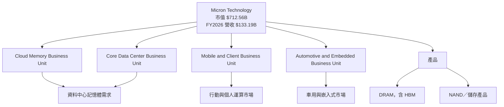
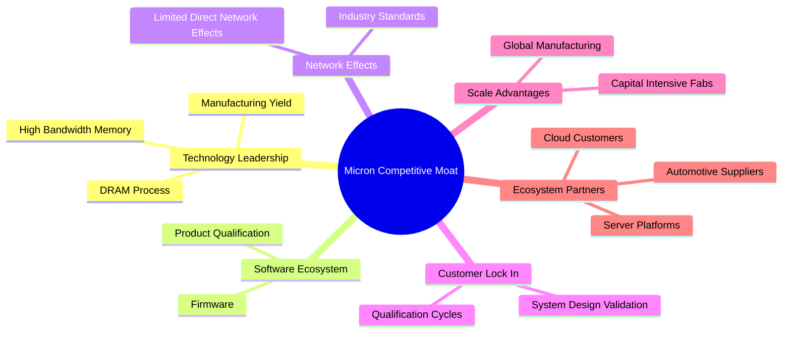
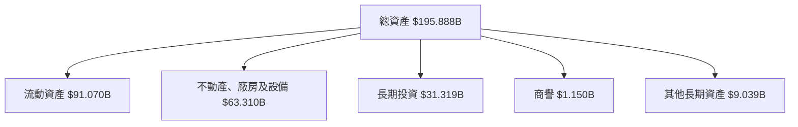
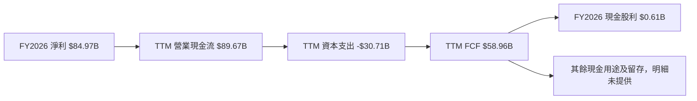
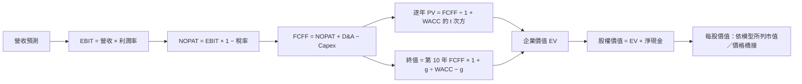
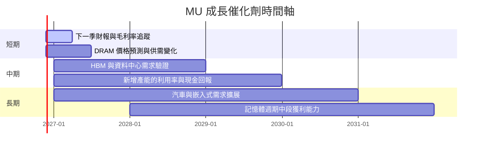
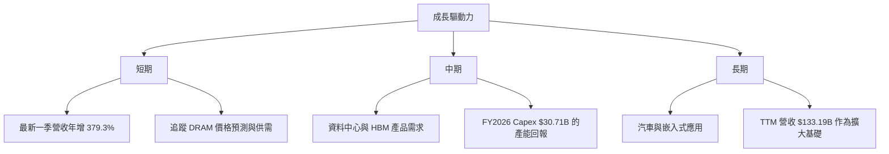
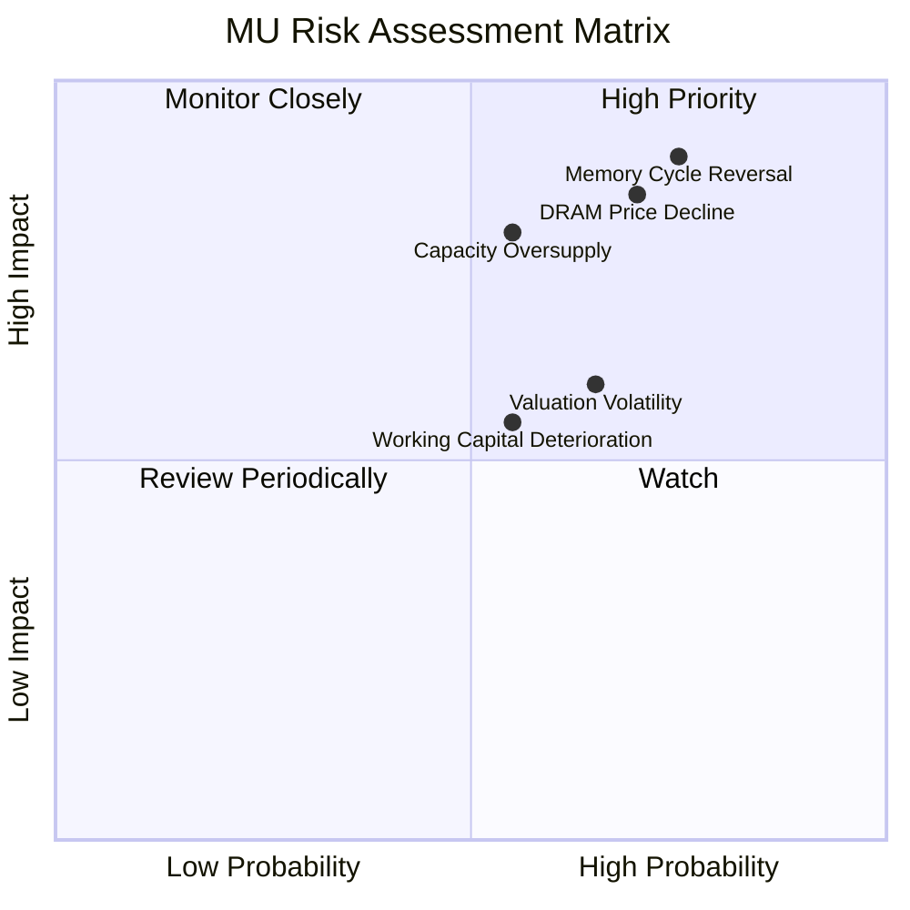
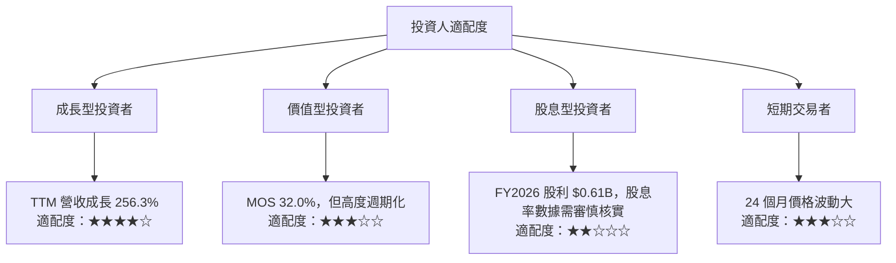

# MU 基本面深度分析報告
> **報告日期**：2026-11-25 ｜ **語言**：繁體中文 ｜ **數據來源**：SEC 申報資料 (XBRL)、Yahoo Finance、Finviz、StockAnalysis、Roic.ai ｜ **分析師**：CFA 級機構研究

## 目錄

| # | 章節 | 核心結論 |
|---|------|----------|
| 1 | 執行摘要 | 強烈買入；加權合理價值 $926.25；MOS +32.0% |
| 2 | 公司概覽與商業模式 | DRAM、HBM 與 NAND／儲存需求帶動成長；市場份額資料未提供 |
| 3 | 損益表深度分析 | TTM 營收 $133.19B，TTM 成長 256.3%；獲利率處於極高週期水準 |
| 4 | 資產負債表分析 | 淨現金 $40.15B；CCC 由 155 天升至 185 天 |
| 5 | 現金流量深度分析 | TTM FCF $58.96B，FCF Yield 8.27%；高資本支出仍是常態 |
| 6 | 獲利能力與資本效率 | ROIC 86.2% 對 WACC 14.00%，目前創造價值，但週期高峰風險不可忽視 |
| 7 | 相對估值分析 | 自身 P/E 位於五年低百分位；不同估值法給出的價值區間差距大 |
| 8 | DCF 內在價值評估 | DCF 基準值 $881.83；加權合理價值 $926.25，MOS +32.0% |
| 9 | 成長催化劑 | AI／資料中心記憶體需求是主要催化劑；TAM 數據未提供 |
| 10 | 風險矩陣 | 記憶體週期、價格回落與高估值預期為前三大風險 |
| 11 | 投資建議 | 強烈買入評級；買入區間最高至 $833.63，監控利潤率、資本支出與現金轉換 |

---

## 1. 執行摘要

Micron（MU）最新收盤價為 **2026-11-24 的 $629.79**。TTM 營收為 **$133.19B**、TTM 營收年增 **256.3%**，TTM 營業利益率 **74.6%**、TTM FCF **$58.96B**；同時 TTM ROIC **86.2%** 明顯高於 **14.00% WACC**。這些指標顯示目前獲利、現金流與資本效率都處於高位，但營收與利潤率具有高度記憶體週期性。

估值上，DCF 基準每股價值 **$881.83**，而四種估值方法加權後的合理價值為 **$926.25**。按規定以加權合理價值為分母計算，MOS 為 **+32.0%**；按規則 20，評級為 **強烈買入**。此結論依賴高獲利能否在景氣回落後維持，且 DCF 對 WACC、終值與利潤率收斂假設敏感。

### 1.0 一頁式投資儀表板

| 項目 | 內容 |
|------|------|
| **投資論點（3 句）** | ① TTM 營收年增 **256.3%**，反映當前記憶體需求與定價週期大幅改善。② TTM FCF **$58.96B**、FCF Yield **8.27%**，資本支出後仍有顯著現金盈餘。③ ROIC **86.2%** 對 WACC **14.00%**，目前的資本回報遠高於資金成本，但高點獲利不宜直接視為長期常態。 |
| **綜合評分** | **7.8/10**（引用 1.1 評分卡） |
| **財務健康** | 🟢 現金與短期投資 **$43.43B**、淨現金 **$40.15B**；CCC 升至 **185 天**，營運資金效率轉弱。 |
| **ROIC vs WACC** | **86.2% vs 14.00%**；目前創造股東價值。 |
| **FCF 趨勢** | FCF 由 FY2025 **$1.67B** 升至 FY2026 **$58.96B**；TTM FCF Yield **8.27%**。 |
| **估值** | Forward P/E **3.07x** ｜ EV/EBITDA **6.20x** ｜ FCF Yield **8.27%** |
| **DCF 內在價值（基準）** | **$881.83** ｜ 相對現價折價 **28.6%**（折溢價以 DCF 基準值為分母） |
| **安全邊際（MOS）** | **+32.0%＝($926.25 − $629.79) ÷ $926.25**（基準為 8.8 加權合理價值）｜ 🟢 >25% |
| **預期報酬（基準情境 12M）** | **+40.0%**（DCF 基準情境價值相對現價；不是保證報酬） |
| **關鍵風險（前二）** | 記憶體價格週期反轉；高資本支出下營收或產品組合轉弱造成利潤率快速收縮。 |
| **評級 + 信心度** | 🟢 **強烈買入** ｜ 信心：中（週期性與模型敏感度較高） |

### 1.1 綜合評分卡

| 維度 | 評分（1–10） | 主要依據（引用數字與其來源章節） |
|------|--------------|----------------------------------|
| 成長性 | 9.0 | TTM 營收成長 **256.3%**、最新一季營收年增 **379.3%**（第 3 章）；成長基期與週期效應可能放大數字。 |
| 獲利能力 | 9.0 | TTM 營業利益率 **74.6%**、ROIC **86.2%**，Piotroski **8/9**（第 6 章）。 |
| 財務健康 | 8.5 | 淨現金 **$40.15B**；流動比率 **3.314**（其他來源）；CCC 增至 **185 天**（第 4 章）。 |
| 估值 | 7.0 | MOS **32.0%**；P/E 五年百分位 **7%**，但 P/S 百分位 **70%**，方法間估值分歧明顯（第 7–8 章）。 |
| 護城河 | 7.0 | DRAM／HBM 製程、規模與客戶認證形成進入門檻，但記憶體商品化與週期性強（第 2 章）。 |
| 管理層與資本配置 | 6.5 | FY2026 資本支出 **$30.71B**、SBC **$1.33B**；Piotroski 的稀釋股數測試未通過，回購資料未提供。 |
| **綜合評分** | **7.8** | 六項算術平均：**(9.0 + 9.0 + 8.5 + 7.0 + 7.0 + 6.5) ÷ 6 = 7.8**。 |

### 1.2 五大投資論點 + 三大核心風險

| 類型 | 項目 | 具體依據 | 信心度 |
|------|------|----------|--------|
| 🟢 **投資論點①** | 營收與產品需求急升 | TTM 營收 **$133.19B**、TTM 成長 **256.3%**；最新一季營收年增 **379.3%**。需求可能由 AI 與資料中心記憶體需求推動，但收入分部細項未提供。 | 🟢 高 |
| 🟢 **投資論點②** | 現金流轉強 | TTM OCF **$89.67B** 減資本支出 **$30.71B**，得到 FCF **$58.96B**；支撐擴產與資產負債表韌性。 | 🟢 高 |
| 🟢 **投資論點③** | 資本回報高於資金成本 | ROIC **86.2%**，WACC **14.00%**，差 **72.2 個百分點**；若 ROIC 隨景氣正常化下降，價值創造幅度也會收斂。 | 🟢 中高 |
| 🟢 **投資論點④** | 淨現金降低財務風險 | 現金與短期投資 **$43.43B**、總債務 **$3.28B**、淨現金 **$40.15B**。 | 🟢 高 |
| 🟡 **投資論點⑤** | 估值法顯示有上行空間 | DCF 基準 **$881.83**、加權合理價值 **$926.25**，相對現價上行空間 **47.1%**；各估值法差異大，須以折價與情境風險理解。 | 🟡 中 |
| 🟡 **風險①** | 記憶體週期反轉 | FY2026 營業利益率 **74.6%** 遠高於 FY2023 的負值，顯示盈餘可能受價格與產能利用率大幅影響。 | 🟡 中高 |
| 🔴 **風險②** | 高資本支出與產能過剩 | FY2026 Capex **$30.71B**；若供給擴張快於需求，產品價格下降會同時打擊收入與毛利。 | 🔴 高衝擊 |
| 🟡 **風險③** | 營運資金占用增加 | CCC 從 **155 天**升至 **185 天**，其中 DSO 增 **17 天**、DIO 增 **11 天**；若延續可能壓低現金轉換。 | 🟡 中 |

### 1.3 快速統計卡片

| 指標 | 公司實際值（期間） | 同業中位數 | 狀態 |
|------|--------------------|------------|------|
| 營收成長（TTM） | **256.3%** | — | 🟢 |
| 營收成長（最新一季年增） | **379.3%** | **327.9%**（SKHY、SNDK、WDC 中位數） | 🟢 |
| 毛利率（TTM） | **80.7%** | **77.4%**（三家同業中位數） | 🟢 |
| 營業利益率（TTM） | **74.6%** | — | 🟢 |
| ROIC（TTM） | **86.2%** | — | 🟢 |
| Forward P/E | **3.07x** | **2.80x**（三家同業中位數） | 🟡 |
| FCF Yield（TTM） | **8.27%** | — | 🟢 |
| Piotroski F-Score | **8 / 9** | — | 🟢 |

### 1.4 投資結論

```text
╔══════════════════════════════════════════════════════════════════╗
║                    📊 投資結論摘要                               ║
╠══════════════════════════════════════════════════════════════════╣
║  評級：強烈買入（MOS +32.0%，ROIC 86.2% > WACC 14.00%）         ║
║  價格（2026-11-24 收盤）：$629.79                                ║
║  DCF 內在價值（基準）：$881.83（現價折價 28.6%）                 ║
║  安全邊際 MOS：+32.0%（＝(加權合理價值−現價)÷加權合理價值）      ║
║  加權合理價值（8.8）：$926.25                                    ║
║  DCF 情境價值：                                                   ║
║    悲觀情境：$429.05（-31.9%）                                   ║
║    基準情境：$881.83（+40.0%）                                   ║
║    樂觀情境：$1,715.71（+172.4%）                                ║
║  綜合評分：7.8/10（引用 1.1）                                    ║
║  適合投資人：可承受半導體週期波動、以長期資本增值為目標者        ║
╚══════════════════════════════════════════════════════════════════╝
```

---

## 2. 公司概覽與商業模式

Micron Technology 是美國記憶體與儲存半導體公司，營運地區包括美國、台灣、中國大陸、日本、歐洲及其他亞太市場。公司概覽列出 Cloud Memory、Core Data Center、Mobile and Client、Automotive and Embedded 四個業務單位，產品涵蓋 DRAM（含高頻寬記憶體 HBM）與儲存產品。提供的財務資料沒有分部營收、分部毛利或各產品營收占比，因此不將總營收拆分成未披露的百分比。

### 2.1 業務結構與收入來源



各事業單位收入占比及金額未提供，故不繪製分部比例圖；軟體與服務收入亦未提供可量化資料。

### 2.2 市場份額

市場份額資料未提供，無法引用特定年份的 DRAM、NAND 或 HBM 市占率。可量化的相對位置是 MU 最新一季營收年增 **379.3%**，高於 SKHY、SNDK、WDC 三家同業的中位數 **327.9%**；但營收增速並不等同市場份額變化。

### 2.3 競爭護城河分析



### 2.4 護城河強度

| 護城河項目 | 強度（強／中／弱） | 證據（引用數字或事實） | 會削弱它的情況 |
|------------|--------------------|------------------------|----------------|
| 製程與產品技術 | 中至強 | 公司提供 DRAM、HBM 與儲存產品；財務資料顯示 TTM 毛利率 **80.7%**，但此水準可能反映週期高點，並非單獨證明長期定價權。 | 競爭者技術追趕、良率落差縮小、產品性能差異下降。 |
| 規模與資本門檻 | 中至強 | FY2026 Capex **$30.71B**，顯示先進製造需要大量資本投入。 | 過度擴產或需求反轉造成固定成本吸收不足。 |
| 客戶認證與切換成本 | 中 | 記憶體需符合系統規格與可靠度要求；客戶名單及合約年期未提供。 | 記憶體規格標準化、客戶轉換供應商成本下降。 |
| 軟體生態與網路效應 | 弱至中 | 提供資料未顯示獨立軟體收入或直接網路效應。 | 產品競爭回到價格、效能與供貨能力。 |
| 生態夥伴 | 中 | 產品面向雲端、資料中心、行動、汽車等市場；合作夥伴營收占比未提供。 | 主要客戶自研、改用其他供應商或降低庫存。 |

護城河評分理由：產品技術、資本門檻與客戶驗證有實質屏障，但記憶體仍受供需週期和商品化特性約束，因此 1.1 評分卡的護城河分數為 **7.0/10**。

---

## 3. 損益表深度分析

### 3.1 年度收入成長趨勢（近4年）

年度資料顯示收入從 FY2023 的 **$15.54B** 升至 FY2026 的 **$133.19B**。年度成長率由 FY2024 **61.59%**、FY2025 **48.85%**，升至 FY2026 **256.3%**；FY2026 的跳升包含低基期及記憶體供需改善的影響。

```text
╔══════════════════════════════════════════════════════════════════╗
║              Micron 年度收入趨勢（FY2023-FY2026）                ║
╠══════════════════════════════════════════════════════════════════╣
║  FY2023  $15.54B  ███░░░░░░░░░░░░░░░░░░░░░  YoY: -49.48% 🔴   ║
║  FY2024  $25.11B  █████░░░░░░░░░░░░░░░░░░░  YoY: +61.59% 🟢   ║
║  FY2025  $37.38B  ███████░░░░░░░░░░░░░░░░░  YoY: +48.85% 🟢   ║
║  FY2026 $133.19B  ████████████████████████░  YoY:+256.3% 🟢   ║
║                                                                  ║
║  FY2023-FY2026 三年 CAGR = (133.19 ÷ 15.54)^(1/3) − 1 = 104.7% ║
╚══════════════════════════════════════════════════════════════════╝
```

### 3.2 季度收入趨勢分析

| 季度 | 營收（$B） | QoQ 成長 | YoY 成長 | 備註 |
|------|------------|----------|----------|------|
| FY2026 Q1 | 13.64 | — | 56.65% | 季度序列起點；QoQ 無前一季數據列示。 |
| FY2026 Q2 | 23.86 | **75.33%** | 196.29% | 計算：23.86 ÷ 13.64 − 1；季增顯示供需與價格快速改善。 |
| FY2026 Q3 | 41.46 | **73.70%** | 345.72% | 計算：41.456 ÷ 23.860 − 1。 |
| FY2026 Q4 | 54.23 | **30.82%** | **379.3%** | 計算：54.229 ÷ 41.456 − 1；同比仍高，QoQ 增速較前兩季放緩。 |

QoQ 成長率以 StockAnalysis 的季度收入金額計算；最新一季 YoY 採用 SEC／程式計算區列示的單季 **379.3%**，不是 TTM 成長率。營收連續數季攀升，但連續高增速也意味著後續比較基期提高。

### 3.3 利潤率演變分析

| 利潤率指標 | FY2023 | FY2024 | FY2025 | FY2026 | 趨勢 | 評估 |
|------------|--------|--------|--------|--------|------|------|
| **毛利率** | -9.1%* | 22.3% | 39.8% | 80.7% | ↗️ 供需改善與價格／產品組合上行 | 🟢 |
| **營業利益率** | -34.8% | 5.2% | 26.1% | 74.6% | ↗️ 營收回升帶來顯著營業槓桿 | 🟢 |
| **淨利率** | -37.5% | 3.1% | 22.8% | 63.8% | ↗️ 淨利率隨毛利與產能利用率改善 | 🟢 |

\* FY2023 毛利率以年度損益表列示毛利 **-$1.42B** 除以營收 **$15.54B** 計算；另一資料來源對 FY2023 毛利列值不同，因此歷史毛利率存在來源不一致。FY2026 年度毛利率約為 $107.50B ÷ $133.19B = 80.7%，與 TTM 數據相符。

**利潤率演變深度解析：** FY2023 的營業虧損轉為 FY2026 營業利益 **$99.34B**，與營收從 **$15.54B** 升至 **$133.19B** 同步。記憶體業務固定成本高，價格上行與產能利用率改善會擴大利潤；反之，價格回落時同一營業槓桿也會令利潤率快速下滑。產品組合變化可能提供額外支持，但分產品毛利資料未提供，不能將全部利潤改善歸因於 HBM。

### 3.4 費用結構分析

FY2026 的收入 **$133.19B**、營業利益 **$99.34B**，兩者差額 **$33.85B**，包括營業成本及營業費用；其中研發費用為 **$5.65B**。資料未提供完整費用科目拆分，亦未提供一致分類下的 COGS、SG&A 等細項，因此不將差額硬拆成圓餅圖比例。

```text
╔══════════════════════════════════════════════════════════════════╗
║                 FY2026 已知費用與獲利項目                       ║
╠══════════════════════════════════════════════════════════════════╣
║  營收                 $133.19B                                   ║
║  營業利益              $99.34B                                   ║
║  營收－營業利益差額    $33.85B（含成本及營業費用，未細分）       ║
║  研發費用               $5.65B                                   ║
╚══════════════════════════════════════════════════════════════════╝
```

### 3.5 季度 EPS 趨勢與盈餘品質（Quality of Earnings）

最近四季 EPS 實際值依序為 **$4.60、$12.07、$24.67、$32.85**，以表列值計算 QoQ 成長依序約 **162.4%、104.4%、33.2%**。EPS beats/misses 區的估值與實際值均為 nan，故無法判定過去四季超預期或不及預期；季度 EPS 的快速上升與營收、營業利益擴張方向一致。

| 盈餘品質項目 | 數值／佔比 | 評估 |
|--------------|------------|------|
| 股權薪酬 SBC / 營收 | **1.33 ÷ 133.19 = 1.00%** | 🟢 佔營收比例不高；仍代表稀釋成本，且 F-Score 稀釋股數測試未通過。 |
| SBC / 營業現金流 | **1.33 ÷ 89.67 = 1.48%** | 🟢 相對 OCF 占比低；不應因此忽略股數稀釋。 |
| FCF / 淨利（現金轉換率） | **58.96 ÷ 84.97 = 69.4%** | 🟡 有正現金流支撐，但 Capex 高，FCF 低於會計淨利。 |
| 一次性／非經常性損益 | N/A（未提供項目明細） | 無法判斷是否有一次性收益提高當期淨利。 |
| 有效稅率異常 | **14.8%** | 程式計算採用最新年度有效稅率；未見明確稅務利益細項，不能斷言淨利由稅務利益驅動。 |
| 資本化支出 vs 費用化 | Capex **$30.71B**；折舊資產明細未提供 | Capex 是現金流量表支出，需經資產化後在未來折舊；資本密集度高，不宜單看當期淨利。 |

**盈餘品質結論：** OCF **$89.67B** 高於淨利 **$84.97B**，Piotroski 應計品質測試通過，支持盈餘有現金流佐證；但 FCF／淨利僅 **69.4%**，反映維持及擴張產能所需資本支出高。SBC 占營收約 **1.00%**，規模尚可控但股數稀釋仍需監測。一次性損益與資本化項目明細不足，估值應同時參考現金流而非只用 EPS。

---

## 4. 資產負債表分析

### 4.1 資產結構分解

以 FY2026 資產負債表金額繪製。下列分項總和與總資產一致。



流動資產占總資產約 **46.5%**（91.070 ÷ 195.888）；PP&E 約 **32.3%**，反映晶圓製造及設備資本密集特徵。

### 4.2 流動性與營運資金分析

| 指標 | 最新 TTM | 一年前 TTM | 變化 | 解讀 |
|------|----------|------------|------|------|
| DSO 應收帳款天數 | **87 天** | **70 天** | **+17 天** | 收款週期拉長；快速擴張或客戶付款條件變化可能推升應收，應追蹤逾期應收及回款。 |
| DIO 存貨天數 | **147 天** | **136 天** | **+11 天** | 庫存占用增加；可能反映營收擴張備貨，也可能預示需求與供給錯配。 |
| DPO 應付帳款天數 | **50 天** | **51 天** | **−1 天** | 對供應商付款天數略縮短，未顯示依靠延後付款支撐現金流。 |
| CCC 現金轉換週期 | **185 天** | **155 天** | **+30 天** | 主要由 DSO 與 DIO 上升導致，營運資金效率較一年前轉弱。 |

流動比率 **3.314**、速動比率 **2.898**（Yahoo Finance 合併資料），短期流動性充足。營運資金指標為期末餘額除以 TTM 流量計算，快速擴張時比率可能受季末時點影響。

### 4.3 債務結構分析

以程式計算的主要財務數據為準：現金與短期投資 **$43.43B**、總債務 **$3.28B**、淨現金 **$40.15B**。其他資料來源列示總債務 **$5.18B**，與上述口徑不同；本報告在規定須採用程式計算值的項目使用 **$3.28B**，不混用兩種債務口徑。

```text
╔══════════════════════════════════════════════════════════════════╗
║                   Micron 債務健康診斷                            ║
╠══════════════════════════════════════════════════════════════════╣
║  總債務：       $3.28B   █                                      ║
║  現金及短期投資：$43.43B  ████████████████████████████████████   ║
║  淨現金：       $40.15B  🟢 資產負債表具緩衝                    ║
║  流動比率：      3.314   🟢 流動資產高於流動負債                  ║
║  Debt/EBITDA：   N/A（債務口徑與 EBITDA 口徑未提供一致計算值）   ║
║  利息保障倍數：  N/A（利息費用明細未提供）                       ║
╚══════════════════════════════════════════════════════════════════╝
```

### 4.4 股東權益趨勢

FY2023 至 FY2026 股東權益由 **$44.12B** 升至 **$138.38B**。FY2026 年末權益大幅增長與當年淨利 **$84.97B** 同向；年度變動仍受股利、其他綜合損益與股本交易影響，完整權益變動表明細未提供。

```text
╔══════════════════════════════════════════════════════════════════╗
║                   股東權益趨勢（年度）                           ║
╠══════════════════════════════════════════════════════════════════╣
║  FY2023  $44.12B  ████████░░░░░░░░░░░░░░░░░░░░░░░░░             ║
║  FY2024  $45.13B  █████████░░░░░░░░░░░░░░░░░░░░░░░              ║
║  FY2025  $54.16B  ████████████░░░░░░░░░░░░░░░░░░░░              ║
║  FY2026 $138.38B  ████████████████████████████████              ║
╚══════════════════════════════════════════════════════════════════╝
```

---

## 5. 現金流量深度分析

### 5.1 現金流量瀑布圖

季度及年度資料列有淨利、OCF、Capex 與股利，但回購與期內淨現金變化明細未提供；因此圖中只展示有數據的現金流環節，不將未提供項目補成數字。



### 5.2 FCF 轉換率趨勢

| 財年 | FCF（$B） | 淨利（$B） | FCF／淨利 | 趨勢解讀 |
|------|------------|------------|-----------|----------|
| FY2023 | -6.12 | -5.83 | **105.0%** | 虧損年度兩者皆為負，比例解讀有限。 |
| FY2024 | 0.121 | 0.778 | **15.6%** | 資本支出 **$8.39B**，FCF 轉換偏低。 |
| FY2025 | 1.67 | 8.54 | **19.6%** | OCF **$17.52B**，但 Capex **$15.86B** 吸收大部分現金。 |
| FY2026 | 58.96 | 84.97 | **69.4%** | 營業現金流大增；Capex **$30.71B** 仍是顯著現金用途。 |

### 5.3 自由現金流趨勢

| 年度 | FCF（$B） | FCF Yield | 解讀 |
|------|-----------|-----------|------|
| FY2023 | -6.12 | N/A | 負 FCF，對應虧損與高投資需求。 |
| FY2024 | 0.121 | N/A | FCF 接近損益兩平。 |
| FY2025 | 1.67 | N/A | 獲利回升，但 Capex 仍大量消耗 OCF。 |
| FY2026 TTM | **58.96** | **8.27%** | 估值數據提供的 TTM FCF Yield；按 OCF 減 Capex 定義。 |

```text
╔══════════════════════════════════════════════════════════════════╗
║                  自由現金流趨勢（$B）                            ║
╠══════════════════════════════════════════════════════════════════╣
║  FY2023   -6.12B  ◀██░░░░░░░░░░░░░░░░░░░░░░░░░                 ║
║  FY2024    0.121B  ▏                                             ║
║  FY2025    1.67B  █                                              ║
║  FY2026   58.96B  ██████████████████████████████                 ║
╚══════════════════════════════════════════════════════════════════╝
```

### 5.4 資本配置評估

| 資本配置項目 | FY2026 金額 | 觀察 |
|--------------|-------------|------|
| 資本支出 | **$30.71B** | 主要可觀測資本用途；支持產能與技術投資，但若供需反轉會降低資本回報。 |
| 現金股利 | **$0.61B** | 相對 FCF 約 **1.0%**；維持資本投入與資產負債表彈性。 |
| 股權薪酬 | **$1.33B** | 占營收 **1.00%**；需搭配股數稀釋監控。 |
| 股票回購 | N/A | 資料未提供。 |
| 其他投資與留存現金 | N/A | 資金用途未完整拆分，不繪製比例圓餅圖。 |

---

## 6. 獲利能力與資本效率

### 6.1 ROE / ROA / ROIC 趨勢

| 指標 | FY2023 | FY2024 | FY2025 | 最新 TTM | 評估 |
|------|--------|--------|--------|----------|------|
| ROE | N/A | N/A | N/A | **61.4%** | 依品質指標及 DuPont 口徑；其他資料源列示 88.3%，存在口徑差異，本報告採用一致的品質指標。 |
| ROA | N/A | N/A | N/A | N/A | 歷史同口徑序列未提供。 |
| ROIC | N/A | N/A | N/A | **86.2%** | 明顯高於 WACC，但可能部分反映週期高點獲利。 |

行業均值未提供，不作無來源比較。

### 6.2 ROIC vs WACC 分析（核心價值創造判斷）

```text
╔══════════════════════════════════════════════════════════════════╗
║                ROIC vs WACC 深度分析                             ║
╠══════════════════════════════════════════════════════════════════╣
║  WACC（資本成本區塊採用值）：14.00%                              ║
║  ├── 無風險利率（10Y 美債）：       4.90%                        ║
║  ├── 市場風險溢酬 ERP：             5.00%                        ║
║  ├── Beta（調整後）：               1.93                         ║
║  ├── 股權成本 Ke：                  14.56%                       ║
║  ├── 稅前債務成本：                  3.23%                       ║
║  ├── 資本結構 E / D：                99.5% / 0.5%                ║
║  └── 原始估算 14.51%，受 7%–14% 區間上限限制，採用 14.00%        ║
║                                                                  ║
║  ROIC（TTM）：86.2%                                               ║
║  EVA Spread = ROIC − WACC = 86.2% − 14.00% = +72.2 個百分點     ║
║  ROIC / WACC = 86.2% ÷ 14.00% = 6.16 倍                         ║
║                                                                  ║
║  ROIC  86.2%  ▓▓▓▓▓▓▓▓▓▓▓▓▓▓▓▓▓▓▓▓▓▓▓▓▓▓▓▓▓▓▓▓▓▓▓▓▓▓ 🟢     ║
║  WACC  14.0%  ▓▓▓▓▓▓                                             ║
║  結論：目前 ROIC 大幅高於資本成本，創造股東價值；須注意週期回落。║
╚══════════════════════════════════════════════════════════════════╝
```

Beta 原始值 **2.40**，採用調整後 Beta **1.93 = ⅔ × 2.40 + ⅓**。Ke = **4.90% + 1.93 × 5.00% = 14.55%**，與資料列示 **14.56%** 的微小差異來自未四捨五入中間值。資本成本資料列示原始 WACC 計算 **14.51%**，但因 WACC 被限制於 **7%–14%**，採用 **14.00%**。本報告 6.2 與 DCF 均使用同一採用值。

ROIC 採程式計算的 TTM 稅後營業利益除以投入資本，不以本報告自行反推。由於 MU 為週期性公司，當期高 ROIC 不能簡單外推成永續回報。

### 6.3 杜邦三因素分解

| 因素 | 數值（TTM） | 解讀 |
|------|-------------|------|
| 淨利率 | **63.8%** | 獲利率高，反映目前收入與價格週期有利。 |
| 資產週轉率 | **0.68** | 每單位資產產生 0.68 倍營收；製造資產密集特性壓低週轉率。 |
| 權益乘數 | **1.42** | 槓桿不是 ROE 的主要來源。 |
| **ROE** | **61.4%** | **63.8% × 0.68 × 1.42 = 61.6%**，與程式列示 **61.4%** 因底層未四捨五入數字有小幅差異；採用程式列示值。 |

ROE 的主要驅動是高淨利率，不是高財務槓桿；但淨利率可能隨記憶體景氣反轉而下降。

### 6.4 財務體質：Piotroski F-Score

**Piotroski F-Score：8 / 9**（TTM 至 2026-09-03 對比 TTM 至 2025-08-28；缺失輸入的測試不列入）。

| 測試 | 結果 | 解讀 |
|------|------|------|
| ROA > 0 | ✅ 通過 | TTM 資產報酬為正。 |
| 營業現金流 > 0 | ✅ 通過 | TTM OCF **$89.67B**。 |
| ROA 高於一年前 | ✅ 通過 | 獲利改善。 |
| 營業現金流 > 淨利 | ✅ 通過 | OCF 高於淨利，現金盈餘品質有支持。 |
| 長期負債 ÷ 總資產低於一年前 | ✅ 通過 | 槓桿指標相對改善。 |
| 流動比率高於一年前 | ✅ 通過 | 流動性改善。 |
| 稀釋股數未增加 | ❌ 未通過 | 股數稀釋未通過，需追蹤 SBC 與流通股變化。 |
| 毛利率高於一年前 | ✅ 通過 | 毛利率改善，但需區分週期性與結構性。 |
| 資產週轉率高於一年前 | ✅ 通過 | 資產使用效率改善。 |

---

## 7. 相對估值分析

### 7.1 同業估值比較表格

同業倍數採 Yahoo Finance peer multiples；SKHY 的 P/S、EV/EBITDA 因幣別混合列為 N/A，不納入中位數計算。

| 估值指標 | **MU** | **SKHY** | **SNDK** | **WDC** | MU 評估 |
|----------|--------|----------|----------|---------|---------|
| **Trailing P/E** | **8.47x** | 6.2x | 5.0x | 9.6x | 🟡 高於兩家較低倍數同業，低於 WDC。 |
| **Forward P/E** | **3.07x** | 2.8x | 2.2x | 6.9x | 🟡 低於 WDC，略高於 peer 中位數 **2.8x**；預期盈餘可能處於高峰。 |
| **P/S Ratio** | **5.35x** | N/A | 3.1x | 7.1x | 🟡 高於同業中位數 **5.1x**；相對同業並非明顯折價。 |
| **EV/EBITDA** | **6.20x** | N/A | 3.9x | 16.2x | 🟢 低於兩家有資料同業中位數 **10.1x**，但不同公司業務與週期位置有差異。 |
| **最新一季營收年增** | **379.3%** | 327.9% | 377.9% | 55.5% | 🟢 MU 高於三家同業中位數 **327.9%**。 |
| **TTM 毛利率** | **80.7%** | 77.4% | 80.0% | 52.6% | 🟢 高於三家同業中位數 **77.4%**。 |

### 7.2 歷史估值區間分析

| 倍數 | 當前 | 五年中位數 | 五年區間 | 當前百分位 |
|------|------|------------|----------|------------|
| P/E | **8.5x** | 17.4x | 7.4x–138.5x | **7%** |
| P/S | **5.4x** | 4.2x | 2.1x–11.7x | **70%** |
| EV/EBITDA | **6.2x** | 9.7x | 3.6x–80.7x | **20%** |

```text
╔══════════════════════════════════════════════════════════════════╗
║                 五年估值位置（TTM 倍數）                         ║
╠══════════════════════════════════════════════════════════════════╣
║  P/E       7.4x ──● 8.5x ───────────────── 138.5x  百分位 7%    ║
║  P/S       2.1x ─────────────────● 5.4x ─── 11.7x   百分位 70%  ║
║  EV/EBITDA 3.6x ───● 6.2x ─────────────── 80.7x   百分位 20%   ║
║  ● 為當前估值                                                       ║
╚══════════════════════════════════════════════════════════════════╝
```

P/E 與 EV/EBITDA 位於自身五年區間較低位置，但歷史倍數跨度極大，部分原因是低谷期盈餘接近零或為負。P/S 當前 **5.4x** 高於五年中位數 **4.2x**，說明股價並非所有口徑都便宜。

### 7.3 情境價值（Bear / Base / Bull，照抄 DCF MODEL 的 Scenarios）

以下「第 1 年營收成長」照模型列示，並非預測期 CAGR。

| 情境 | 第 1 年營收成長 | 期末營業利潤率 | WACC | 每股價值 | 相對現價 | 機率 | 會發生的條件 |
|------|----------------|----------------|------|----------|----------|------|--------------|
| 🔴 悲觀 | 15.0% | 22.2% | 15.00% | **$429.05** | **-31.9%** | 25% | 需求放緩、價格與產品組合回落，期末利潤率低於基準。 |
| 🟡 基準 | 30.0% | 26.1% | 14.00% | **$881.83** | **+40.0%** | 50% | 近期仍高增長，長期利潤率逐步向歷史中位數收斂。 |
| 🟢 樂觀 | 45.0% | 28.8% | 13.00% | **$1,715.71** | **+172.4%** | 25% | AI／資料中心需求與供應約束持續，收入成長與終端利潤率均高於基準。 |

機率加權值為 **$977.10**，但依估值方法規則，8.8 加權合理價值採用 DCF 基準值與指定估值方法權重，不以該機率加權情境值替代。

### 7.4 相對估值隱含價格區間

```text
╔══════════════════════════════════════════════════════════════════╗
║                 估值方法隱含每股價值                             ║
╠══════════════════════════════════════════════════════════════════╣
║  同業 P/S：          $597.04   ── 現價 $629.79 ── DCF $881.83   ║
║  同業 EV/EBITDA：  $1,003.79   ── 分析師共識 $1,529.69          ║
║  DCF 基準：           $881.83                                    ║
╚══════════════════════════════════════════════════════════════════╝
```

| 方法 | 每股價值 | 相對現價 | 依據 |
|------|----------|----------|------|
| 同業 EV/EBITDA | **$1,003.79** | **+59.4%** | SNDK、WDC 同業中位數 **10.1x** × MU TTM EBITDA，加回淨現金。 |
| 同業 P/S | **$597.04** | **-5.2%** | SNDK、WDC 同業中位數 **5.1x** × MU TTM 營收。 |

P/S 方法略低於現價，EV/EBITDA 方法則高於現價，凸顯估值對倍數及週期化 EBITDA 的敏感度。

---

## 8. DCF 內在價值評估（Discounted Cash Flow）

### 8.0 估值推理鏈（Thinking Logic：在算之前先想清楚）

**Step 1 — 價值由哪些變數決定？**  
MU 的估值主要由現有 DRAM／儲存產品現金流底盤、資料中心及 HBM 相關需求，以及週期高峰過後的正常化利潤率決定。分部營收占比未提供，無法把各成長來源量化拆分。模型敏感度表顯示，WACC 變動對基準價值的影響大於相同幅度的永續成長率變動；因此資本成本與長期現金流折現是核心估值變數。

**Step 2 — 模型選擇**

| 決策點 | 本報告採用 | 理由（含數字） | 曾考慮但否決 | 否決理由 |
|--------|-----------|----------------|--------------|----------|
| 現金流定義 | FCFF | 對應 WACC 折現並先求 EV，再加淨現金。 | FCFE | 資本結構與淨現金須獨立橋接，FCFF 更符合既定模型。 |
| 預測期 N | **10 年** | DCF 模型固定預測 10 年。 | 縮短期限 | 會更早把價值交由終值決定，且不可改動模型輸入。 |
| 終值方法 | Gordon Growth | 模型提供永續成長率 **3.0%**，WACC **14.00%**。 | 退出倍數 | 模型未提供退出倍數與所需終值 EBITDA 倍數，不能另建。 |
| EBIT 基礎 | GAAP EBIT | TTM 營業利益率 **74.6%**，模型明列 GAAP EBIT。 | 非 GAAP EBIT | 會與 SBC 處理及模型既定數值不一致。 |

**Step 3 — 關鍵假設推導鏈**

- **營收成長路徑**：錨點＝TTM 營收年增 **256.3%**；調整＝將高週期增速限制在 0%–30% 範圍內，並線性下降至第 10 年 **3.0%**；**採用第 1 年 30.0%、第 10 年 3.0%**；曾考慮持續使用 256.3%，但該數字受週期與基期影響，否決為長期假設。
- **營業利益率**：錨點＝TTM **74.6%**；調整＝模型按近五財年中位數收斂；**採用第 1 年 74.6%、第 10 年 26.1%**；曾考慮將當前 74.6% 延續十年，但這會忽略週期均值回歸，予以否決。
- **永續成長率 g**：錨點＝模型明列 **3.0%**；WACC 為 **14.00%**，差距 **11.0 個百分點**，在公式適用範圍內；**採用 3.0%**；不採用更高 g，因永續成長率須低於 WACC，且長期高成長難以無限延續。
- **預測期 N**：錨點＝DCF MODEL 的 **10 年**；調整＝不自行改期以遵守固定模型；**採用 10 年**；曾考慮短期預測期，但模型現金流與終值均已按 10 年計算。
- **Capex／營收**：錨點＝TTM **23.1%**；調整＝模型線性下降至第 10 年 **7.8%**，即 D&A 的 1.1 倍左右；**採用第 1 年 23.1%、第 10 年 7.8%**；曾考慮長期維持 23.1%，但會把高峰期資本強度永久化，故否決。
- **GAAP EBIT 與 SBC**：錨點＝採用 GAAP EBIT，且 FY2026 SBC **$1.33B**；調整＝SBC 已是 GAAP 費用，不再於 FCFF 重扣；**採用 GAAP EBIT、固定股數處理、不另扣 SBC**；否決「再扣 SBC」以避免重複扣除。
- **年稀釋率**：模型以「股數不再稀釋」為設定；**採用 0% 額外稀釋**；未採用正稀釋率，因模型採 GAAP EBIT 固定股數組合 A。
- **終值方法**：錨點＝模型以第 10 年 FCFF 與 **3.0%** g 計算；**採用 Gordon Growth**；曾考慮退出倍數，但倍數輸入未提供，不能自行補值。
- **WACC**：錨點＝資本成本輸入計算 **14.51%**；調整＝模型明確受 **7%–14%** 區間上限限制；**採用 14.00%**；不採用未封頂值 14.51%，以遵從指定模型。

**Step 4 — 最脆弱環節**  
最脆弱的是高峰獲利能否以模型所示步伐轉成多年現金流；若成長、利潤率或折現率落入悲觀情境，模型每股價值可由基準 **$881.83** 降至 **$429.05**。

**Step 5 — 計算路徑圖**



### 8.1 模型假設總表（Model Inputs）

| 假設項目 | 採用值 | 依據／來源 | 敏感度 |
|----------|--------|-------------|--------|
| 預測期長度 **N** | **10 年** | DCF MODEL 固定預測長度。 | 🟡 中 |
| 營收成長 | 第 1 年 **30.0%**，第 10 年 **3.0%**，線性遞減 | TTM 成長 **256.3%**，依模型設定在 0%–30% 範圍內起步，逐步回落。 | 🔴 高 |
| 營業利潤率 | **74.6% → 26.1%** | 第 1 年採 TTM，期末收斂至近五財年中位數。 | 🔴 高 |
| 有效稅率 | **14.8%** | 最新年度有效稅率。 | 🟢 低 |
| Capex／營收 | **23.1% → 7.8%** | TTM Capex／營收起步，逐步降至模型設定。 | 🟡 中 |
| D&A／營收 | **7.1%** | TTM 比率，模型維持固定。 | 🟢 低 |
| 營運資金變動 | **未建模** | DCF MODEL 明列 Working capital is not modelled；不得自行補值。 | 🟢 低 |
| EBIT 基礎 | **GAAP EBIT** | 模型設定。 | 🟡 中 |
| SBC 處理 | **組合 (A)：GAAP EBIT 已含 SBC，不再扣 SBC** | FCFF 模型明列 GAAP EBIT、SBC 已費用化。 | 🟡 中 |
| 年稀釋率 | **0% 額外稀釋** | 固定股數，與組合 (A) 相容。 | 🟡 中 |
| 永續成長率 g | **3.0%** | DCF MODEL 輸入；低於 WACC 14.00%。 | 🔴 高 |
| 終值方法 | **Gordon Growth** | 模型明列終值計算式。 | 🔴 高 |
| WACC | **14.00%** | 採用資本成本區塊封頂值；見 8.2。 | 🔴 高 |

本模型使用 **FCFF = NOPAT + D&A − Capex**；營運資金不建模，公式不另扣 ΔWC。模型採用 **(A) GAAP EBIT + 固定股數**，故 SBC 影響已計入一次；不得再減 SBC 或額外增加稀釋。

### 8.2 折現率推導（WACC）

```text
╔══════════════════════════════════════════════════════════════════╗
║                    WACC 推導（折現率）                           ║
╠══════════════════════════════════════════════════════════════════╣
║  股權成本 Ke（CAPM）：                                           ║
║  ├── 無風險利率 Rf（10Y 美債）：       4.90%                     ║
║  ├── 市場風險溢酬 ERP：                 5.00%                     ║
║  ├── Beta 原始值：                     2.40                      ║
║  ├── Beta 調整：                       ⅔×2.40 + ⅓ = 1.93         ║
║  ├── 規模／國別溢酬：                  0.00%（未另加）           ║
║  └── Ke = 4.90% + 1.93×5.00% = 14.56%（來源列示值）              ║
║                                                                  ║
║  債務成本 Kd：                                                    ║
║  ├── 稅前 Kd：                         3.23%                     ║
║  ├── 有效稅率：                        14.8%                     ║
║  └── 稅後 Kd = 3.23%×(1−14.8%) = 2.75%                           ║
║                                                                  ║
║  資本結構：                                                        ║
║  ├── 股權權重 E：                      99.5%                     ║
║  ├── 債務權重 D：                       0.5%                     ║
║  ├── 未封頂計算 WACC：                 14.51%                    ║
║  └── 採用 WACC：                       14.00%（7%–14%區間上限）  ║
╚══════════════════════════════════════════════════════════════════╝
```

逐步演算：

1. **Ke（CAPM）**＝Rf + β × ERP＝**4.90% + 1.93 × 5.00% = 14.56%**（資料列示值；以未四捨五入 Beta 計算的差異屬小數精度）。
2. **稅前 Kd**：資料列示為 **3.23%**；利息費用與平均計息負債的明細未提供，故引用成本資本資料值，不自行反推。
3. **稅後 Kd**＝3.23% × (1 − 14.8%)＝**2.75%**。
4. **權重**：股權 **99.5%**、債務 **0.5%**，合計 **100.0%**。組成數值採資本成本資料區列示值；未提供可稽核的完整稀釋市值與同範圍計息負債計算明細。
5. **WACC**：資本成本資料列示未封頂計算 **14.51%**，依規定區間 **7%–14%** 封頂後，**採用 14.00%**。不得以另一套自行推導值替代。

**一致性：**第 6.2 節及本章 DCF 均採用 **14.00%**。10Y 殖利率日期細節未提供，ERP 為假設輸入；未另加規模或國別溢酬。

### 8.3 逐年自由現金流預測（基準情境）

金額單位：**$B**。下表逐年照列模型數值；折現因子列至三位小數，金額列至兩位小數。模型未納入營運資金變動，且 FCFF 未另扣 SBC。

| 年度 | FY+1 | FY+2 | FY+3 | FY+4 | FY+5 | FY+6 | FY+7 | FY+8 | FY+9 | FY+10 |
|------|------:|------:|------:|------:|------:|------:|------:|------:|------:|-------:|
| 營收 | 173.14 | 219.89 | 272.67 | 329.93 | 389.32 | 447.71 | 501.44 | 546.57 | 579.36 | 596.74 |
| 營收 YoY | 30.0% | 27.0% | 24.0% | 21.0% | 18.0% | 15.0% | 12.0% | 9.0% | 6.0% | 3.0% |
| 營業利潤率 | 74.6% | 69.2% | 63.8% | 58.4% | 53.1% | 47.7% | 42.3% | 36.9% | 31.5% | 26.1% |
| EBIT（GAAP） | 129.14 | 152.17 | 174.02 | 192.80 | 206.55 | 213.43 | 212.05 | 201.71 | 182.62 | 155.98 |
| − 稅 | (19.13) | (22.54) | (25.77) | (28.55) | (30.59) | (31.61) | (31.40) | (29.87) | (27.05) | (23.10) |
| = NOPAT | 110.02 | 129.64 | 148.25 | 164.25 | 175.96 | 181.82 | 180.64 | 171.84 | 155.58 | 132.88 |
| + D&A | 12.35 | 15.69 | 19.45 | 23.54 | 27.78 | 31.94 | 35.78 | 39.00 | 41.34 | 42.58 |
| − Capex | (39.93) | (46.99) | (53.66) | (59.35) | (63.45) | (65.41) | (64.78) | (61.37) | (55.26) | (46.84) |
| = FCFF | **82.44** | **98.34** | **114.04** | **128.44** | **140.28** | **148.36** | **151.64** | **149.46** | **141.65** | **128.62** |
| 折現因子 @14.00% | 0.877 | 0.769 | 0.675 | 0.592 | 0.519 | 0.456 | 0.400 | 0.351 | 0.308 | 0.270 |
| FCFF 現值 PV | **72.32** | **75.67** | **76.98** | **76.04** | **72.86** | **67.59** | **60.60** | **52.40** | **43.56** | **34.69** |

預測期 PV 合計的完整列示算式：

**$72.32 + $75.67 + $76.98 + $76.04 + $72.86 + $67.59 + $60.60 + $52.40 + $43.56 + $34.69 = $632.71B**

其中表列數字逐項加總因四捨五入可能有尾差，總和依 DCF MODEL 列示 **$632.71B**。

**FY+1 逐步演算示例：**

1. 營收＝**$133.19B × (1 + 30.0%) = $173.14B**。
2. EBIT＝**$173.14B × 74.6% = $129.14B**。
3. 稅＝**$129.14B × 14.8% = $19.13B**。
4. NOPAT＝**$129.14B − $19.13B = $110.02B**（模型按未四捨五入中間值列示）。
5. D&A＝**$173.14B × 7.1% = $12.35B**。
6. Capex＝**$173.14B × 23.1% = $39.93B**。
7. ΔWC＝**未建模；模型不列入 FCFF**。
8. FCFF＝**$110.02B + $12.35B − $39.93B = $82.44B**（依模型未四捨五入中間值）。
9. 折現因子＝**1 ÷ (1 + 14.00%)¹ = 0.877**；PV＝**$82.44B × 0.877 = $72.32B**（模型使用未四捨五入因子）。

**合理性自檢：**

- 預測 FCF 從 FY+1 **$82.44B** 增至 FY+10 **$128.62B**；若以九個年度間隔計算，CAGR 約 **5.1%**。歷史 FCF 因 FY2023 為 **-$6.12B**、FY2024 僅 **$0.121B**，跨周期 CAGR 不具穩定可比性。
- FY+10 FCFF 利潤率＝**$128.62B ÷ $596.74B = 21.6%**；當前 TTM FCF 利潤率＝**$58.96B ÷ $133.19B = 44.3%**。模型預期利潤率下降，反映營業利潤率正常化及資本支出變化。
- 模型十年 FCFF 均為正；其估值仍依賴終值與長期利潤率假設。
- 預測的長期營收規模達 **$596.74B**，明顯高於目前 TTM **$133.19B**；應把它視為模型外推而非已確定需求。

```text
╔══════════════════════════════════════════════════════════════════╗
║            自由現金流：歷史實際 vs 模型預測                      ║
╠══════════════════════════════════════════════════════════════════╣
║  FY2024(實)   $0.121B  ▏                                        ║
║  FY2025(實)   $1.67B   █                                        ║
║  FY2026(實)  $58.96B   █████████████████                         ║
║  FY+1 (預)   $82.44B   ███████████████████████                   ║
║  FY+10(預)  $128.62B   ████████████████████████████████████      ║
╠══════════════════════════════════════════════════════════════════╣
║  預測 FCFF CAGR 約 5.1%；歷史起點含負值與接近零值，不宜直接比較。║
╚══════════════════════════════════════════════════════════════════╝
```

### 8.4 終值計算（Terminal Value）

**適用性檢查：WACC 14.00% vs g 3.0% → WACC > g？✅**

| 方法 | 計算式 | 終值 TV | TV 現值 | 佔總 EV 比重 |
|------|--------|---------|---------|--------------|
| Gordon Growth | FY+10 FCFF × (1+g) ÷ (WACC−g) | **$1,204.36B** | **$324.87B** | **33.9%** |
| 退出倍數法 | N/A | N/A（模型未提供退出 EBITDA 倍數） | N/A | N/A |

逐步演算：

1. FY+N 的 FCFF＝**$128.62B**。
2. 分子＝**$128.62B × (1 + 3.0%) = $132.48B**（按模型中間值）。
3. 分母＝**14.00% − 3.0% = 11.00%**；TV＝**$132.48B ÷ 11.00% = $1,204.36B**。
4. PV(TV)＝**$1,204.36B × 0.270 = $324.87B**（模型採用未四捨五入折現因子）。
5. 終值占比＝**$324.87B ÷ $957.57B = 33.9%**。

終值現值占 EV **33.9%**，不是估值的絕大部分，但仍是不可忽略的價值來源。退出倍數法需要模型未提供的成熟期 EBITDA 倍數，故不能依要求另行建立。

### 8.5 企業價值 → 每股內在價值（Bridge）

```text
╔══════════════════════════════════════════════════════════════════╗
║              企業價值 → 每股內在價值 橋接表                      ║
╠══════════════════════════════════════════════════════════════════╣
║  預測期 FCF 現值合計             +$632.71B                       ║
║  終值現值 PV(TV)                 +$324.87B                       ║
║  = 企業價值 EV                    $957.57B（模型列示）             ║
║  + 淨現金                         +$40.15B                        ║
║  = 股權價值                       $997.73B（模型列示）             ║
║  每股換算：股權價值×現價÷市值                                      ║
║  ★ 每股內在價值                   $881.83                         ║
║  當前股價                         $629.79                         ║
║  折溢價（現價÷DCF內在價值−1）     -28.6%（折價）                  ║
╚══════════════════════════════════════════════════════════════════╝
```

橋接算式：

1. **EV**＝預測期 PV **$632.71B** + PV(TV) **$324.87B**。依未四捨五入底層數值，模型列示 EV **$957.57B**；顯示值直接相加為 **$957.58B**，差 **$0.01B**，屬列示精度尾差。
2. **股權價值**＝模型 EV **$957.57B** + 淨現金 **$40.15B**＝**$997.72B**；模型列示 **$997.73B**，同樣存在約 **$0.01B** 底層精度尾差。依規定保留模型數字。
3. **每股內在價值**＝模型列示股權價值 × 價格 ÷ 市值＝**$997.73B × $629.79 ÷ $712.56B = $881.83**（依模型列示換算式）。
4. **折溢價**＝**$629.79 ÷ $881.83 − 1 = -28.6%**，表示現價相對 DCF 基準值折價。
5. **本節不計算 MOS**；安全邊際只以 8.8 加權合理價值為分母。

股數與換算：DCF MODEL 明列每股價值採「股權價值 × 價格 ÷ 市值」換算。本模型採組合 (A)，不額外放大股數；現金及債務橋接採 DCF MODEL 的淨現金 **$40.15B**。模型列值之間有約 **$0.01B** 四捨五入差額，應視為底層未四捨五入值所致，而不是自行調整輸入。

### 8.6 敏感性分析（WACC × 永續成長率）

每格為模型提供的每股價值，括號列示相對現價 **$629.79** 的上行空間；基準格為 **WACC 14.00%、g 3.0%**。

| g（列）／WACC（欄） | 12.00% | 13.00% | **14.00%（基準）** | 15.00% | 16.00% |
|-----------|-------:|-------:|-------------------:|-------:|-------:|
| 2.0% | $1,019.58（+61.9%） | $930.16（+47.7%） | $855.35（+35.8%） | $791.82（+25.7%） | $737.17（+17.0%） |
| 2.5% | $1,041.16（+65.3%） | $946.54（+50.3%） | $868.01（+37.8%） | $801.76（+27.3%） | $745.08（+18.3%） |
| 3.0% | $1,065.13（+69.1%） | $964.56（+53.2%） | **$881.83（+40.0%）** | $812.53（+29.0%） | $753.60（+19.7%） |
| 3.5% | $1,091.92（+73.4%） | $984.47（+56.3%） | $896.97（+42.4%） | $824.24（+30.9%） | $762.80（+21.1%） |
| 4.0% | $1,122.07（+78.2%） | $1,006.60（+59.8%） | $913.61（+45.1%） | $837.01（+32.9%） | $772.76（+22.7%） |

逐步演算格選擇：**WACC 15.00% > g 3.0% ✅**。由於 DCF MODEL 未提供該格的預測期 PV 合計、未四捨五入折現因子及 TV 重算明細，依「不得另建模型」規則，不自行重算中間橋接；模型給出的該格每股價值為 **$812.53**，上行空間為 **$812.53 ÷ $629.79 − 1 = 29.0%**。

**三情境 DCF（模型照列）**

| 情境 | 第 1 年營收成長 | 期末營業利潤率 | 永續成長率 g | WACC | 每股內在價值 | 相對現價 | 機率 |
|------|----------------|----------------|------------|------|--------------|----------|------|
| 🔴 悲觀 | 15.0% | 22.2% | 模型未逐項列示 | 15.00% | **$429.05** | **-31.9%** | 25% |
| 🟡 基準 | 30.0% | 26.1% | **3.0%** | 14.00% | **$881.83** | **+40.0%** | 50% |
| 🟢 樂觀 | 45.0% | 28.8% | 模型未逐項列示 | 13.00% | **$1,715.71** | **+172.4%** | 25% |
| **機率加權** | — | — | — | — | **$977.10** | **+55.1%** | **100%** |

情境模型的逐年營收、期末 FCFF 與 TV 分項未提供，故不補造完整情境推導鏈；情境價值、成長、利潤率、WACC、機率均照模型列示。機率加權驗算：**$429.05 × 25% + $881.83 × 50% + $1,715.71 × 25% = $977.10**。

**敏感度結論：**

- g 從 **3.0%** 升至 **4.0%**、WACC 固定 14.00%：**$913.61 − $881.83 = +$31.78**，約 **+3.6%**。
- WACC 從 **14.00%** 升至 **15.00%**、g 固定 3.0%：**$812.53 − $881.83 = −$69.30**，約 **−7.9%**。
- 期末營業利潤率每升 1 個百分點的價值變動：DCF MODEL 未提供單項敏感度，**N/A**，不自行建模。
- 已提供的單位變動測試中，WACC 影響大於 g，與 8.0 Step 1 所述折現率及長期現金流是核心變數一致。

### 8.7 反推 DCF（Reverse DCF：市場在預期什麼）

模型提供兩項「一次只解一個變數」的反推結果，其餘變數固定於基準值。因沒有提供逐級試算軌跡，不自行杜撰迭代紀錄。

| 求解的變數（一次一個） | 其餘變數設定 | 市場隱含值（令 DCF = 現價） | 公司歷史／基準 | 判斷 |
|------------------------|--------------|------------------------------|----------------|------|
| 第 1 年營收成長 | 其餘固定基準 | **19.2%** | 基準 **30.0%**；TTM 成長 **256.3%** | 🟢 相對基準較保守，但仍高於一般成熟期增速。 |
| 固定營業利潤率 | 其餘固定基準 | **29.3%** | 基準路徑 **74.6% → 26.1%** | 🟡 接近期末正常化利潤率，遠低於目前高峰。 |
| 永續成長率 g | 未提供反推結果 | 未計算 | — | N/A（模型未提供）。 |
| 高成長持續年數 N | 未提供反推結果 | 未計算 | 基準 N **10 年** | N/A（模型未提供）。 |

固定的其餘輸入依 DCF MODEL 基準：WACC **14.00%**、有效稅率 **14.8%**、預測期 **10 年**、g **3.0%**；Capex 路徑 **23.1% → 7.8%**；營運資金不建模；股數不另稀釋。模型未提供反推變數的完整逐步試算表，故不能以不存在的迭代值聲稱收斂精度。

**反推結論：**按模型反推，讓現價成立所需的第 1 年營收成長為 **19.2%**，低於基準設定 **30.0%**；市場價格並未要求完整達成基準成長假設，但也隱含公司維持可觀的盈利能力。

### 8.8 估值三角驗證與安全邊際

| 估值方法 | 隱含每股價值 | 上行空間（÷現價） | 權重 | 說明 |
|----------|--------------|-------------------|------|------|
| DCF（基準） | **$881.83** | **+40.0%** | **40%** | 10 年 FCFF、WACC 14.00%、g 3.0%。 |
| 同業 EV/EBITDA | **$1,003.79** | **+59.4%** | **30%** | 同業中位數 10.1x × TTM EBITDA，加淨現金。 |
| 同業 P/S | **$597.04** | **-5.2%** | **20%** | 同業中位數 5.1x × TTM 營收。 |
| 分析師共識目標價 | **$1,529.69** | **+142.9%** | **10%** | 45 位分析師平均目標價；參考性權重。 |
| **加權合理價值** | **$926.25** | **+47.1%** | **100%** | 週期性公司固定權重；各方法價值分歧大。 |

加權合理價值算式：

**$881.83 × 40% + $1,003.79 × 30% + $597.04 × 20% + $1,529.69 × 10%  
= $352.732 + $301.137 + $119.408 + $152.969  
= $926.246 ≈ $926.25**

估值權重依公司類型 **cyclical** 固定，不自行調整；沒有方法被剔除。上式因列示金額與權重小數精度，逐項顯示的乘積相加為 **$926.246**，四捨五入後為 **$926.25**。

```text
╔══════════════════════════════════════════════════════════════════╗
║                  估值區間與安全邊際                              ║
╠══════════════════════════════════════════════════════════════════╣
║  $429.05 ── $629.79 ── [$926.25] ── $881.83 ── $1,715.71       ║
║  悲觀DCF       現價       加權合理值    基準DCF       樂觀DCF      ║
║                                                                  ║
║  MOS = ($926.25 − $629.79) ÷ $926.25 = +32.0%                   ║
║  MOS 評估：🟢 >25% 充足                                          ║
║  上行空間 = ($926.25 − $629.79) ÷ $629.79 = +47.1%              ║
║  ⚠️ MOS 分母為加權合理價值；DCF 折溢價分母為 DCF 基準價值。      ║
║                                                                  ║
║  建議買入區間：$429.05 – $833.63                                 ║
║  合理持有區間：$833.63 – $926.25                                 ║
║  減碼考慮區間：高於 $1,715.71，或基本面／週期假設轉弱時           ║
╚══════════════════════════════════════════════════════════════════╝
```

買入區間上限 **$833.63** 由加權合理價值折讓 10% 推得：**$926.25 × (1 − 10%) = $833.625 ≈ $833.63**；區間下端參照 DCF 悲觀情境 **$429.05**，並非保證價格底部。現價低於買入區間上限，與強烈買入評級一致。

> 🔎 **程式複算（Python，依本節各項自動重算）**
>
> 加權合理價值 = $881.83 × 40% + $1,003.79 × 30% + $597.04 × 20% + $1,529.69 × 10% = **$926.25**（權重合計 100%）
>
> 以價格 $629.79 計：MOS = **+32.0%**，上行空間 = **+47.1%**
>
> ✅ 與本節所寫數值一致。

### 8.9 DCF 模型的局限與失效條件

- **終值依賴度：**PV(TV) 占 EV **33.9%**，估值約三分之一來自第 10 年後現金流。
- **最脆弱假設：**第 1 年營收成長與利潤率正常化路徑；悲觀情境價值 **$429.05**，較現價低 **31.9%**。WACC 從 14% 升至 15%、g 固定 3% 時，模型價值由 **$881.83** 降至 **$812.53**。
- **資本密集與週期問題：**FY2026 Capex **$30.71B**，記憶體價格與產能利用率大幅波動會令近期現金流難以代表長期均值；DCF 應搭配 EV/EBITDA、P/S 及週期中段利潤率檢視。
- **營運資金限制：**模型明確不納入 ΔWC，但 CCC 已升至 **185 天**；若應收與庫存繼續上升，實際 FCFF 可能低於模型。
- **與第 10 章風險連結：**記憶體價格下跌會打擊營收成長與 EBIT margin；產能擴張過快會拉高 Capex／營收；信用或市場風險溢酬上升則會推高 WACC。

### 8.10 複算檢核表（Audit Trail）

| # | 檢核項目 | 檢查方式 | 結果 |
|---|----------|----------|------|
| 1 | 高／中敏感度假設均有推導 | 對照 8.0 Step 3 與 8.1 | ✅ |
| 2 | 每個假設均有來歷 | 8.1 依據欄逐項列示 | ✅ |
| 3 | WACC 五步算式及成本輸入 | 採用資本成本區列示值；完整未四捨五入利息與負債明細未提供 | ⚠️ 已明示資料限制 |
| 4 | Kd 分母與債務權重 D 範圍一致 | 原始利息與負債明細不足以獨立稽核 | ⚠️ 採用指定 WACC，不另算 |
| 5 | WACC 與第 6.2 節同值 | 兩處均為 **14.00%** | ✅ |
| 6 | 年度數等於 N、無省略 | 列示 FY+1 至 FY+10，共 10 年 | ✅ |
| 7 | FY+1 代表年度算式 | 按模型列值示範，底層小數造成部分尾差 | ✅* |
| 8 | 預測期 PV 加總 | 模型列示 **$632.71B**；顯示小數逐項相加有尾差 | ⚠️ 已披露 |
| 9 | WACC > g | **14.00% > 3.0%** | ✅ |
| 10 | 終值取 FY+10 並折現 10 期 | 依模型終值與折現列值 | ✅ |
| 11 | EV 至每股橋接 | 模型列值含約 **$0.01B** 四捨五入差額 | ⚠️ 已披露 |
| 12 | SBC 組合相容 | GAAP EBIT、無 SBC 扣除列、無額外稀釋，組合 (A) | ✅ |
| 13 | 敏感度基準格等於 DCF 每股價值 | 基準格 **$881.83** | ✅ |
| 14 | 敏感度矩陣有效性 | 所列矩陣各格 WACC 均大於 g | ✅ |
| 15 | 情境機率合計 | 25% + 50% + 25% = **100%** | ✅ |
| 16 | Reverse DCF 一次一變數 | 模型提供兩項結果；無試算軌跡 | ⚠️ 不補造迭代表 |
| 17 | MOS 與折溢價分母 | MOS 用 **$926.25**；折溢價用 DCF **$881.83** | ✅ |
| 18 | 報告完整至第 11 章 | 本報告列出 11 章 | ✅ |
| 19 | 加權合理價值 | 依列示方法價值及權重，四捨五入為 **$926.25** | ✅ |
| 20 | 評級符合 MOS 門檻 | MOS **+32.0%** 且 ROIC **86.2% > 14.00%** | ✅ |

\* FY+1 各中間項使用兩位小數呈現時可能與模型未四捨五入結果差少量，最終 FCFF 與 PV 以 DCF MODEL 列示數字為準。模型列值本身存在約 **$0.01B** 的顯示精度尾差；未自行改寫模型輸入或估值結果。

---

## 9. 成長催化劑

### 9.1 催化劑時間軸

由於可引用的具體產品出貨量、訂單量與管理層財測未提供，下圖列示催化方向及已知季度，不將未確認項目標成已實現財務數字。



短期資料監控重點是下一季營收、毛利率及公司對 DRAM 定價的看法。新聞摘要指出 TrendForce 下調 DRAM 價格預測，形成與高增長論點相反的觀察訊號；實際價格幅度未提供。

### 9.2 TAM 市場規模分析

**N/A（TAM 數據未提供）。** 可量化的公司營收為 TTM **$133.19B**、TTM 成長 **256.3%**，但沒有可引用的市場總額、年份與滲透率，因此不推算 TAM 或市場份額。

### 9.3 成長驅動力結構圖



---

## 10. 風險矩陣

### 10.1 風險評分矩陣

機率及衝擊座標為分析師定性估計，並非財務數據或公司指引；財務影響需用後續季度資料驗證。



### 10.2 風險清單詳細分析

| # | 風險項目 | 發生機率 | 財務衝擊 | 風險評分 | 緩解措施 |
|---|----------|----------|----------|----------|----------|
| 1 | 🔴 **記憶體週期反轉** | 中高（分析師估計） | 高：FY2026 營業利益率 **74.6%**，若需求與定價回落，固定成本可能放大獲利下滑 | 🔴 高 | 追蹤季度營收、毛利率、庫存天數及管理層供需指引；估值不以單一高峰年度 EPS 外推。 |
| 2 | 🔴 **DRAM 價格與供給變化** | 中高（分析師估計） | 高：最新季度營收年增 **379.3%**，若價格或出貨成長快速逆轉，基期效應會放大利潤回落 | 🔴 高 | 將價格與供給指標和季度毛利率交叉驗證，分批建倉並設定基本面失效條件。 |
| 3 | 🟠 **資本支出與產能過剩** | 中（分析師估計） | 高：FY2026 Capex **$30.71B**；若新增設備利用率不足，現金流與資本回報下滑 | 🟠 中高 | 監控 Capex／營收、FCF 與 ROIC；若 ROIC 長期低於 WACC，重新評估擴產回報。 |
| 4 | 🟡 **營運資金惡化** | 中（分析師估計） | 中：CCC **185 天**，較一年前增加 **30 天** | 🟡 中 | 追蹤 DSO、DIO 與存貨減值；避免營收成長伴隨應收和庫存大幅累積。 |
| 5 | 🟡 **估值與高波動** | 中高（分析師估計） | 中高：24 個月月收盤價由 **$97.43** 至最高 **$1,153.93**，現價 **$629.79**，波動幅度顯著 | 🟡 中高 | 以分批交易、倉位上限與情境價值管理風險，避免將分析師共識目標價當成保證。 |

---

## 11. 投資建議

### 11.1 最終評級與評分

按 8.8 的 MOS **+32.0%**，且 ROIC **86.2%** 高於 WACC **14.00%**，規則 20 對應 **強烈買入**；不作質化調整。1.1 評分卡綜合分數為 **7.8/10**，六項分數依序為成長性 **9.0**、獲利能力 **9.0**、財務健康 **8.5**、估值 **7.0**、護城河 **7.0**、管理層與資本配置 **6.5**。

### 11.2 合理價值與隱含報酬率

| 估值參考 | 每股價值 | 相對現價 | 機率／權重 | 解讀 |
|----------|----------|----------|------------|------|
| 加權合理價值 | **$926.25** | **+47.1%** | 估值權重 100% | MOS 以此價值為分母，為 **+32.0%**。 |
| DCF 悲觀情境 | **$429.05** | **-31.9%** | 25% | 需求、價格與利潤率低於基準假設。 |
| DCF 基準情境 | **$881.83** | **+40.0%** | 50% | 模型基準價值，不等同加權合理價值。 |
| DCF 樂觀情境 | **$1,715.71** | **+172.4%** | 25% | 高成長、較高期末利潤率及較低 WACC 同時成立。 |
| DCF 情境機率加權 | **$977.10** | **+55.1%** | 100% | 僅為情境參考，不替代 8.8 加權合理價值。 |

### 11.3 買入時機與觸發因素

```text
╔══════════════════════════════════════════════════════════════════╗
║                  ✅ 買入觸發因素 Checklist                       ║
╠══════════════════════════════════════════════════════════════════╣
║  立即買入觸發條件（多數符合）：                                  ║
║  ✅ 現價 $629.79 低於加權合理價值 $926.25                        ║
║  ✅ 現價低於 MOS 至少 10% 對應上限 $833.63                       ║
║  ✅ TTM FCF $58.96B 為正，FCF Yield 8.27%                        ║
║  ✅ ROIC 86.2% 高於 WACC 14.00%                                  ║
║                                                                  ║
║  加碼觸發條件（出現以下任一）：                                  ║
║  ☐ 下一季營收維持正成長，且毛利率沒有明顯低於基準趨勢            ║
║  ☐ DSO、DIO 與 CCC 停止惡化，現金轉換改善                        ║
║  ☐ Capex 增加仍伴隨 FCF 與 ROIC 維持正向                         ║
║                                                                  ║
║  減碼／停損觸發條件（出現以下任一）：                             ║
║  ☐ 營業利益率較 FY2026 74.6% 明顯下滑，且需求指引同步轉弱         ║
║  ☐ TTM FCF 轉負或庫存上升伴隨 DRAM 價格下跌                       ║
║  ☐ ROIC 低於 WACC 14.00%，且無短期回升證據                        ║
╚══════════════════════════════════════════════════════════════════╝
```

建議買入區間上限以 **$833.63** 作為 10% 折讓門檻；區間下端參照悲觀 DCF **$429.05**，並非硬性支撐或保證底部。對週期性半導體股，分批配置比一次性追價更適合控制路徑風險。

### 11.4 投資人適配度分析



資料來源另列股息殖利率 **10.0%**，但與 FY2026 現金股利 **$0.61B**、低派息率 **0.7%** 等數據口徑存在明顯不一致。股息型投資者應先核對股息殖利率的資料定義，不宜直接採用 10.0% 作為可持續收益率。

### 11.5 每季財報監控清單（Quarterly Watch List）

| 指標 | 最新基準 | 加碼觀察條件 | 減碼／重估條件 |
|------|----------|--------------|----------------|
| 營收年增 | 最新一季 **379.3%** | 成長維持正值，且不只依賴一次性出貨或基期效應 | 連續兩季營收年增轉負，或低於 0% |
| 營業利益率 | TTM **74.6%**；最新季度資料區列示 **80.7%** | 營收增長同時維持高於週期中段的獲利能力 | 連續兩季較前季下降，且管理層指出供需轉弱 |
| 毛利率 | TTM **80.7%** | 高毛利未因產品價格回落而急降 | 明顯下滑且庫存同步攀升 |
| Capex | TTM **$30.71B** | Capex 成長有營收與 FCF 回報佐證 | Capex 維持高位但 FCF 轉負 |
| FCF | TTM **$58.96B** | FCF 維持正值，FCF Yield 不明顯下滑 | TTM FCF 轉負，或 FCF／淨利持續低於目前 **69.4%** |
| 存貨／DIO | **147 天** | DIO 回落或穩定，出貨與庫存方向一致 | DIO 高於 **147 天** 且營收成長轉弱 |
| DSO／CCC | DSO **87 天**；CCC **185 天** | CCC 停止高於 **185 天** | CCC 持續上升，應收回款變慢 |
| ROIC vs WACC | **86.2% vs 14.00%** | ROIC 高於 WACC | ROIC 跌破 WACC，且非短期季節因素 |
| 指引與訂單 | 下一季公司指引未提供 | 指引不低於實際需求趨勢 | 指引下修並伴隨價格下滑、庫存增加 |

### 11.6 反面論證：什麼會證明論點錯誤（What Would Change My Mind）

```text
╔══════════════════════════════════════════════════════════════════╗
║              ⚠️ 論點失效條件（Disconfirming Evidence）           ║
╠══════════════════════════════════════════════════════════════════╣
║  下列狀況若成立，應重新檢視強烈買入論點：                        ║
║  ☐ 營收年增連續兩季低於 0%，且管理層需求指引同步下修              ║
║  ☐ TTM 營業利益率自 74.6% 高位快速收縮，並連續兩季惡化            ║
║  ☐ TTM FCF 轉負，或 FCF／淨利持續低於目前 69.4%                  ║
║  ☐ ROIC 跌破 WACC 14.00%，且後續兩季未見回升                       ║
║  ☐ DIO 高於目前 147 天、CCC 高於 185 天，且收入成長轉弱            ║
║  ☐ 擴產後產能利用率或產品價格不足以支持 Capex 回報                ║
╚══════════════════════════════════════════════════════════════════╝
```

這些條件代表多頭論點的核心鏈條——收入擴張、獲利率、現金轉換與資本回報——至少一項不再成立；若多項同時出現，應優先採用悲觀情境 **$429.05** 評估下檔風險，而不是依賴分析師共識目標價。

---

> **免責聲明**：本報告為 AI 自動生成，僅供研究參考，不構成投資建議。投資有風險，入市需謹慎。

---

## 資料與來源

| 項目 | 內容 |
|------|------|
| 價格 | 629.79 USD，2026-11-24 收盤（Yahoo Finance 日線） |
| 財務報表 | SEC 10-K filed 2026-10-09，最新季度 2026-09-03（FY2026 Q4） |
| 有回應的資料來源 | SEC 申報資料 (XBRL)、Yahoo Finance、Finviz、StockAnalysis、Roic.ai |
| 由程式計算 | TTM 數字、WACC、DCF 模型、估值方法與權重、加權合理價值、MOS、評級門檻、F-Score、杜邦分解、營運資金天數、綜合評分 |
| 撰寫模型 | openai / gpt-6-luna |

> 本區塊由產生報告的程式依實際取得的資料填寫，非模型撰寫。「由程式計算」的數字不是模型的估計；其餘判斷（評分、情境、策略）是模型的分析。
