# MU 基本面深度分析報告
> **報告日期**：2026-11-26 ｜ **語言**：繁體中文 ｜ **數據來源**：SEC 申報資料 (XBRL)、Yahoo Finance、Finviz、StockAnalysis、Roic.ai ｜ **分析師**：CFA 級機構研究

## 目錄

| # | 章節 | 核心結論 |
|---|------|----------|
| 1 | 執行摘要 | 強烈買入；加權合理價值 $919.13；MOS +34.6% |
| 2 | 公司概覽與商業模式 | 記憶體技術、製造規模與客戶認證形成護城河，但產品週期使優勢不等於穩定定價權 |
| 3 | 損益表深度分析 | TTM 營收 $133.19B、年增 256.3%；本輪週期的利潤率處於高位 |
| 4 | 資產負債表分析 | 淨現金 $40.15B；營運資金週期由 155 天升至 185 天 |
| 5 | 現金流量深度分析 | TTM FCF $58.96B，FCF Yield 8.67%；資本支出仍高 |
| 6 | 獲利能力與資本效率 | ROIC 86.2% 對 WACC 14.00%，目前大幅創造經濟價值 |
| 7 | 相對估值分析 | 本益比低於自身五年中位數，但記憶體週期高峰盈餘令低倍數有陷阱風險 |
| 8 | DCF 內在價值評估 | 基準 DCF $881.83／股；加權合理價值 $919.13／股 |
| 9 | 成長催化劑 | AI 記憶體需求與高頻寬記憶體是主要驅動；TAM 數字未提供 |
| 10 | 風險矩陣 | 記憶體價格反轉、資本支出與供應擴張、地緣與營運風險為主要風險 |
| 11 | 投資建議 | 依 MOS 評級為強烈買入；需以週期性風險管理部位與持續追蹤財報 |

---

## 1. 執行摘要

截至 2026-11-25 收盤，MU 股價為 **$601.25**。TTM 營收 **$133.19B**、TTM 年增 **256.3%**，最新一季單季年增 **379.3%**；TTM FCF 為 **$58.96B**、FCF Yield **8.67%**，ROIC **86.2%** 高於採用的 WACC **14.00%**。DCF 基準價值 **$881.83**，三角驗證後加權合理價值 **$919.13**，MOS **+34.6%**；依規則 20 評級為 **🟢強烈買入**。此結論的主要保留是周期股高峰利潤率可能回落，以及 DCF 對長期營業利潤率與資本支出收斂路徑敏感。

### 1.0 一頁式投資儀表板（Portfolio Manager 30 秒速讀）

| 項目 | 內容 |
|------|------|
| **投資論點（3 句）** | ① TTM 營收年增 **256.3%**，最新一季單季年增 **379.3%**，反映記憶體需求與定價週期快速改善。② TTM FCF **$58.96B**、FCF Yield **8.67%**，提供資本投資與財務緩衝。③ ROIC **86.2%** 對 WACC **14.00%**，本期資本報酬遠高於資金成本，但不應將週期高點外推為常態。 |
| **綜合評分** | **8.0/10**（引用 1.1 六項算術平均） |
| **財務健康** | 🟢 淨現金 **$40.15B**、Piotroski **8/9**；但 CCC 增至 **185 天**，營運資金效率轉弱 |
| **ROIC vs WACC** | **86.2% vs 14.00%**；目前大幅創造股東價值 |
| **FCF 趨勢** | FCF 由 FY2025 **$1.67B** 升至 TTM **$58.96B**；FCF Yield **8.67%** |
| **估值** | Forward P/E **2.93x** ｜ EV/EBITDA **5.9x** ｜ FCF Yield **8.67%** |
| **DCF 內在價值（基準）** | **$881.83** ｜ 現價相對 DCF 折價 **31.8%**（依 $601.25 ÷ $881.83 − 1） |
| **安全邊際（MOS）** | **+34.6%**＝($919.13 − $601.25) ÷ $919.13（分母為加權合理價值）｜ 🟢 >25% |
| **預期報酬（基準情境 12M）** | DCF 基準情境相對現價上行 **+46.7%**；加權合理價值上行 **+52.9%**。皆為估值差，不等同保證 12 個月報酬。 |
| **關鍵風險（前二）** | 記憶體 ASP／毛利率週期反轉；高資本支出與供給擴張造成供需失衡 |
| **評級 + 信心度** | 🟢 **強烈買入** ｜ 信心：中（估值有安全邊際，但週期與 DCF 假設不確定性高） |

### 1.1 綜合評分卡（全報告唯一）

| 維度 | 評分（1–10） | 主要依據（引用數字與其來源章節） |
|------|--------------|----------------------------------|
| 成長性 | 9.0 | TTM 營收年增 **256.3%**，最新一季單季年增 **379.3%**（第 3 章）；但增幅包含低基期與記憶體週期反彈 |
| 獲利能力 | 9.0 | TTM 營業利益率 **74.6%**、ROIC **86.2%**、F-Score **8/9**（第 3、6 章） |
| 財務健康 | 8.5 | 淨現金 **$40.15B**、Piotroski **8/9**；CCC 年增 **30 天**，因此不評滿分（第 4、6 章） |
| 估值 | 8.0 | MOS **34.6%**；P/E **8.1x** 低於自身五年中位數 **17.4x**，但高峰期盈餘可能使 P/E 顯得偏低（第 7、8 章） |
| 護城河 | 7.0 | DRAM／HBM 製程、資本密集製造及客戶認證有進入障礙；公司市場份額與分部營收比例未提供（第 2 章） |
| 管理層與資本配置 | 6.5 | FY2026 Capex **$30.71B**、SBC **$1.33B**；F-Score 中稀釋股數項未通過，回購與資本回報細節不足（第 3、5 章） |
| **綜合評分** | **8.0** | 六項算術平均：(**9.0 + 9.0 + 8.5 + 8.0 + 7.0 + 6.5**) ÷ 6 = **8.0** |

### 1.2 五大投資論點 + 三大核心風險

| 類型 | 項目 | 具體依據 | 信心度 |
|------|------|----------|--------|
| 🟢 **投資論點①** | 營收與獲利處於快速擴張階段 | TTM 營收 **$133.19B**、年增 **256.3%**；最新一季收入 **$54.23B**，單季年增 **379.3%** | 🟢 高 |
| 🟢 **投資論點②** | 現金創造能力顯著提升 | TTM OCF **$89.67B**、Capex **$30.71B**、FCF **$58.96B** | 🟢 高 |
| 🟢 **投資論點③** | 資本效率遠超資金成本 | ROIC **86.2%**，WACC **14.00%**，差距 **72.2 個百分點** | 🟢 高 |
| 🟢 **投資論點④** | 資產負債表可承受景氣波動 | 淨現金 **$40.15B**；總債務 **$3.28B**（以 VERIFIED FIGURES 為準） | 🟢 高 |
| 🟢 **投資論點⑤** | 相對估值與自身歷史相比偏低 | P/E **8.1x**，低於自身五年中位數 **17.4x**；當前歷史百分位 **7%** | 🟡 中 |
| 🟡 **風險①** | 記憶體週期反轉 | TTM 營業利益率 **74.6%**；若供給增加而價格下跌，獲利與估值均可能快速收縮 | 🔴 高衝擊 |
| 🔴 **風險②** | 營運資金占用加重 | CCC 由 **155 天**升至 **185 天**，DSO 增 **17 天**、DIO 增 **11 天** | 🟡 中度 |
| 🔴 **風險③** | 擴產與資本密集度 | TTM Capex **$30.71B**，占營收約 **23.1%**；若需求錯配，折舊與閒置產能將壓低回報 | 🔴 高衝擊 |

### 1.3 快速統計卡片

| 指標 | 公司實際值（期間） | 同業中位數 | 狀態 |
|------|--------------------|------------|------|
| 營收成長（TTM） | **256.3%** | — | 🟢 |
| 營收成長（最新一季年增） | **379.3%** | **327.9%**（SKHY、SNDK、WDC 中位數） | 🟢 |
| 毛利率（TTM） | **80.7%** | **77.4%** | 🟢 |
| 營業利益率（TTM） | **74.6%** | — | 🟢 |
| ROIC（TTM） | **86.2%** | — | 🟢 |
| Forward P/E | **2.93x** | **2.7x**（三家中位數） | 🟢 |
| FCF Yield（TTM） | **8.67%** | — | 🟢 |
| Piotroski F-Score | **8 / 9** | — | 🟢 |

### 1.4 投資結論

```text
╔══════════════════════════════════════════════════════════════════╗
║                    📊 投資結論摘要                               ║
╠══════════════════════════════════════════════════════════════════╣
║  評級：🟢 強烈買入（依 MOS 門檻；未作質化調整）                   ║
║  價格（2026-11-25 收盤）：$601.25                                ║
║  DCF 內在價值（基準）：$881.83（現價折價 31.8%）                 ║
║  安全邊際 MOS：+34.6%（＝(加權合理價值−現價)÷加權合理價值）      ║
║  加權合理價值（8.8）：$919.13                                    ║
║  DCF 情境價值：                                                   ║
║    悲觀情境：$429.05（-28.6%）                                   ║
║    基準情境：$881.83（+46.7%）                                   ║
║    樂觀情境：$1,715.71（+185.4%）                                ║
║  綜合評分：8.0/10（引用 1.1）                                    ║
║  適合投資人：能承受高波動、願意追蹤記憶體供需週期的成長型投資人  ║
╚══════════════════════════════════════════════════════════════════╝
```

---

## 2. 公司概覽與商業模式

### 2.1 業務結構與收入來源

Micron Technology, Inc. 從事 DRAM 與 NAND 記憶體及儲存產品業務，資料所列營運單位包括雲端記憶體、核心資料中心、行動與客戶端、汽車與嵌入式。分部營收與各類產品占比未提供，因此不以推估比例繪圖。

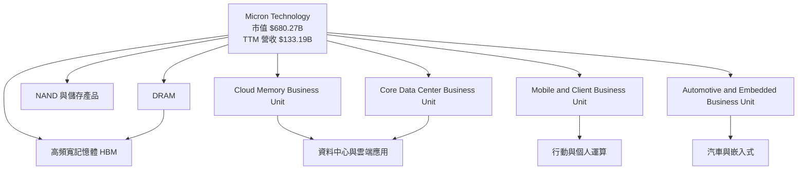

### 2.2 市場份額

市場份額數據未提供，故不列市占比例。以財務規模而言，Micron TTM 營收 **$133.19B**，營收年增 **256.3%**；最新一季單季年增 **379.3%**，高於 Peer multiples 列出的 SKHY、SNDK、WDC 三家最新季度營收成長率中位數 **327.9%**。這反映當期成長動能相對突出，但不能直接推論市場份額同步增加。

### 2.3 競爭護城河分析

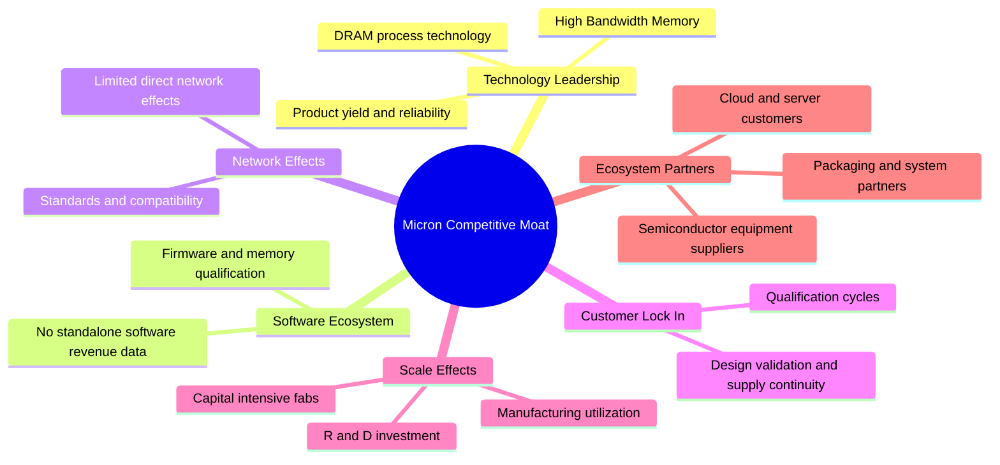

### 2.4 護城河強度

| 護城河項目 | 強度（強／中／弱） | 證據（引用數字或事實） | 會削弱它的情況 |
|------------|--------------------|------------------------|----------------|
| 技術與製程能力 | 中至強 | 公司提供 DRAM、HBM、NAND；FY2026 研發費用 **$5.65B** | 競爭者技術追上、良率落後或產品迭代失速 |
| 客戶認證與切換成本 | 中 | 記憶體需經客戶平台驗證；分部客戶集中度資料未提供 | 客戶多供應商策略、規格標準化、產品性能差距縮小 |
| 規模與資本投入 | 中至強 | TTM Capex **$30.71B**；固定資產與產能投入高 | 產能過剩、利用率下滑、擴產回報低於資金成本 |
| 軟體／生態系 | 弱至中 | 財務資料未顯示獨立軟體收入 | 競品提供更完整平台整合或記憶體替代方案 |
| 網路效應 | 弱 | 記憶體產品並非典型直接網路效應商業模式 | 市場轉向替代架構或規格變更 |
| 供應鏈與合作夥伴 | 中 | 公司跨美國、台灣、中國大陸、日本、歐洲等市場營運 | 地緣政治、勞資、出口限制或供應鏈中斷 |

1.1 的「護城河」評分 **7.0/10**，理由是高研發與資本需求、製程能力及客戶驗證提供進入障礙，但產品具週期性且市場份額／分部收入證據不足。

---

## 3. 損益表深度分析

### 3.1 年度收入成長趨勢（近 4 年）

年度營收取財務報表列示值，單位為美元。FY2026 營收 **$133.19B** 與 VERIFIED FIGURES TTM 相同。

```text
╔══════════════════════════════════════════════════════════════════╗
║             Micron 年度收入趨勢（FY2023-FY2026）                ║
╠══════════════════════════════════════════════════════════════════╣
║  FY2023  $15.54B   ███░░░░░░░░░░░░░░░░░░░░░  YoY: —            ║
║  FY2024  $25.11B   █████░░░░░░░░░░░░░░░░░░░  YoY: +61.6%       ║
║  FY2025  $37.38B   ███████░░░░░░░░░░░░░░░░░  YoY: +48.9%       ║
║  FY2026 $133.19B   █████████████████████████ YoY: +256.3%      ║
║                                                                  ║
║  FY2023-FY2026 三年 CAGR：((133.19 ÷ 15.54)^(1/3) − 1) = 104.7% ║
╚══════════════════════════════════════════════════════════════════╝
```

FY2026 的營收跳升與最新季度成長加速一致，可能反映記憶體需求、產品組合與價格週期共同改善；但三年 CAGR 受到 FY2023 低基期影響，不能視為可持續長期增速。

### 3.2 季度收入趨勢分析

下表使用最近四季季度收入資料。QoQ 由本季除以前季減一計算；最新季度 YoY 採資料列示的單季年增率。

| 季度 | 營收（$B） | QoQ 成長 | YoY 成長 | 備註 |
|------|------------:|---------:|---------:|------|
| 2025-11-30 | 13.64 | — | — | 季度序列起點 |
| 2026-02-28 | 23.86 | +74.9% | +196.3% | 年增率為 StockAnalysis 單季數據 |
| 2026-05-31 | 41.46 | +73.8% | +345.7% | 單季收入持續擴大 |
| 2026-08-31 | 54.23 | +30.8% | +379.3% | VERIFIED FIGURES 最新季度單季年增率 |

收入連續季增顯示週期復甦仍在推進；然而收入增長不應直接外推，因記憶體產業供給反應快，ASP 與出貨量可能在供需轉向時同步逆轉。

### 3.3 利潤率演變分析

以下以年度損益表列示的營收、毛利、營業利益及淨利計算。FY2023 毛利資料來源存在差異：年度損益表列 **-$1.42B**，StockAnalysis 列 **$0.415B**；本表採年度損益表列示值，並因此將該年度毛利率標記為資料口徑需留意。

| 利潤率指標 | FY2023 | FY2024 | FY2025 | FY2026 | 趨勢 | 評估 |
|------------|-------:|-------:|-------:|-------:|------|------|
| **毛利率** | -9.1%* | 22.3% | 39.8% | 80.7% | 大幅回升 | 🟢 |
| **營業利益率** | -34.8% | 5.2% | 26.1% | 74.6% | 大幅回升 | 🟢 |
| **淨利率** | -37.5% | 3.1% | 22.8% | 63.8% | 大幅回升 | 🟢 |

\* FY2023 毛利率依年度損益表所列毛利 -$1.42B ÷ 營收 $15.54B；另一資料源列示毛利 $0.415B，兩者不一致。

利潤率回升的機制通常包括產品價格改善、產能利用率提高、產品組合優化及高固定成本下的營業槓桿。FY2026 營業利益率 **74.6%** 代表當期收益能力極高，但也使未來回歸常態的風險上升。年度營業利益由 FY2025 **$9.77B** 增至 FY2026 **$99.34B**，增幅遠高於營收增幅，反映利潤率擴張是獲利加速的重要來源。

### 3.4 費用結構分析

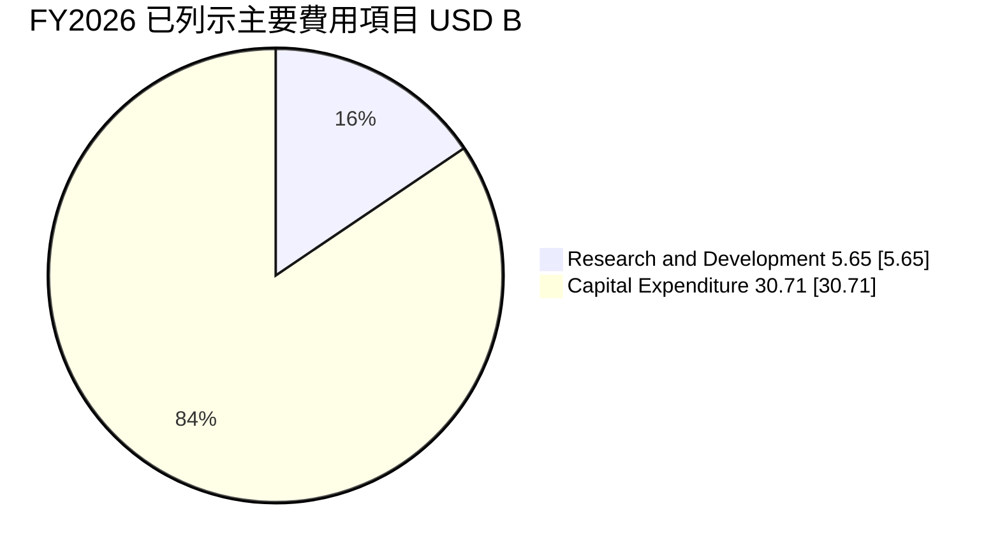

研發費用與資本支出分屬損益表與現金流量表，不能與營收或彼此直接視為同一種費用分攤。FY2026 研發費用 **$5.65B**，Capex **$30.71B**；未提供完整銷管、折舊及其他費用拆分，因此不繪製完整損益費用比例圖。

```text
╔══════════════════════════════════════════════════════════════════╗
║                 FY2026 費用與投資支出概覽                       ║
╠══════════════════════════════════════════════════════════════════╣
║  研發費用 $5.65B    ████░░░░░░░░░░░░░░░░  約為營收 4.2%        ║
║  資本支出 $30.71B   ████████████████████  約為營收 23.1%       ║
║  營收     $133.19B  （基數）                                     ║
╚══════════════════════════════════════════════════════════════════╝
```

### 3.5 季度 EPS 趨勢與盈餘品質（Quality of Earnings）

| 季度 | EPS 實際值 | EPS 預估 | 超預期／不及預期 | 主要觀察 |
|------|-----------:|---------:|------------------|----------|
| 2025-11-30 | $4.60 | N/A | N/A | 分析師估值資料缺失 |
| 2026-02-28 | $12.07 | N/A | N/A | EPS 隨營收與利潤率提高 |
| 2026-05-31 | $24.67 | N/A | N/A | 季度獲利進一步擴張 |
| 2026-08-31 | $32.85 | N/A | N/A | 最新季度實際 EPS；無可用一致預估 |

提供的 EPS surprise 紀錄中四季預估均為 NaN，故無法判定實際超預期或不及預期；不能將實際 EPS 成長誤寫成財報 beat。

| 盈餘品質項目 | 數值／佔比 | 評估 |
|--------------|-----------|------|
| 股權薪酬 SBC / 營收 | $1.33B ÷ $133.19B = **1.0%** | 🟢 占比不高，但仍是股東經濟成本 |
| SBC / 營業現金流 | $1.33B ÷ $89.67B = **1.5%** | 🟢 相對 OCF 佔比較低 |
| FCF / 淨利 | $58.96B ÷ $84.97B = **69.4%** | 🟡 現金轉換良好，但低於 100%，Capex 與營運資金仍消耗現金 |
| 一次性／非經常性損益 | N/A（未提供分項調節表） | 無法量化一次性項目對當期盈餘的影響 |
| 有效稅率 | **14.8%**（最新年度） | 稅率資料可用；未見稅務利益明細，不能判定是否有一次性稅務推升 |
| 資本化支出 vs 費用化 | Capex **$30.71B**；完整資本化明細 N/A | 高資本投入形成產能資產，短期不全數列作費用，折舊將影響後續利潤 |

**盈餘品質結論：** OCF **$89.67B** 明顯高於淨利 **$84.97B**，而 SBC 僅占營收 **1.0%**，支持當期獲利具現金流支撐。另一方面，FCF／淨利為 **69.4%**，且 Capex 高達 **$30.71B**；盈餘品質整體良好，但現金轉換仍受再投資與營運資金影響，應避免將高峰期 GAAP 盈餘直接資本化為永久盈餘。

---

## 4. 資產負債表分析

### 4.1 資產結構分解

資產科目來自 FY2026 年度資產負債表，美元金額以 B 表示。

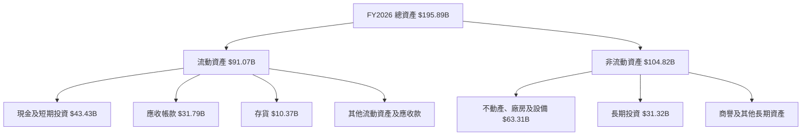

非流動資產 **$104.82B** 為總資產減流動資產所得；長期投資與其他長期資產以年度資產負債表列項為準。資產結構反映公司兼具較高流動性與大量製造資產；製造資產能支撐供應能力，也帶來折舊及產能利用率風險。

### 4.2 流動性與營運資金分析

| 指標 | 最新 TTM | 一年前 TTM | 變化 | 解讀 |
|------|----------|------------|------|------|
| DSO 應收帳款天數 | 87 天 | 70 天 | +17 天 | 收款週期拉長，營收快速放大可能推升應收；需追蹤逾期與客戶付款條件 |
| DIO 存貨天數 | 147 天 | 136 天 | +11 天 | 存貨占用增加；可能是擴產與備貨，也可能是需求預測偏高 |
| DPO 應付帳款天數 | 50 天 | 51 天 | -1 天 | 對供應商付款期略縮短，未顯示透過延長付款取得更多資金 |
| CCC 現金轉換週期 | 185 天 | 155 天 | +30 天 | 現金被營運資金占用的時間增加，對高速擴張期的現金管理是負面訊號 |

補充市場資料列示流動比率 **3.314**、速動比率 **2.898**；但與資料包中的多項債務／現金口徑不完全一致，使用時應以 SEC 最新報表核對。營運資金天數依 QUALITY FIGURES 原值照錄，不能由報表摘要自行重算取代。

### 4.3 債務結構分析

債務總額及淨現金採 VERIFIED FIGURES：現金加短期投資 **$43.43B**、總債務 **$3.28B**、淨現金 **$40.15B**。其他合併資料列示總債務 **$5.18B**，與該區塊不一致；本報告的核心比率及 DCF 橋接遵循 VERIFIED FIGURES 數值，不將不同口徑混用。

```text
╔══════════════════════════════════════════════════════════════════╗
║                   Micron 債務健康診斷                            ║
╠══════════════════════════════════════════════════════════════════╣
║  總債務：        $3.28B    ██░░░░░░░░░░░░░░░░░░  VERIFIED       ║
║  現金+短期投資： $43.43B   ████████████████████  VERIFIED       ║
║  淨現金：        $40.15B   ██████████████████░░  🟢             ║
║  Debt/EBITDA：   N/A（採用 EBITDA 與債務口徑不一致，未補算）      ║
║  利息保障倍數：  N/A（利息費用絕對值未提供）                      ║
║  流動性注意：CCC 185 天，較一年前增加 30 天                       ║
╚══════════════════════════════════════════════════════════════════╝
```

### 4.4 股東權益趨勢

| 年度 | 股東權益（$B） | YoY 變化 |
|------|---------------:|---------:|
| FY2023 | 44.12 | — |
| FY2024 | 45.13 | +2.3% |
| FY2025 | 54.16 | +20.0% |
| FY2026 | 138.38 | +155.5% |

```text
╔══════════════════════════════════════════════════════════════════╗
║                 股東權益變化（FY2023-FY2026）                    ║
╠══════════════════════════════════════════════════════════════════╣
║  FY2023  $44.12B  ██████░░░░░░░░░░░░░░░░                         ║
║  FY2024  $45.13B  ███████░░░░░░░░░░░░░░░                         ║
║  FY2025  $54.16B  ████████░░░░░░░░░░░░░░                         ║
║  FY2026 $138.38B  ████████████████████████                       ║
╚══════════════════════════════════════════════════════════════════╝
```

FY2026 權益增加與高額淨利累積相符，但股東權益增幅遠低於股價漲幅；不能將帳面權益成長直接視為每股價值成長，仍需考慮股數變動與未來週期獲利。

---

## 5. 現金流量深度分析

### 5.1 現金流量瀑布圖

已知的最新年度與 TTM 現金流數字如下；股息已列示，回購金額及淨現金變化分項未提供，因此不以未經證實的數字補足瀑布。

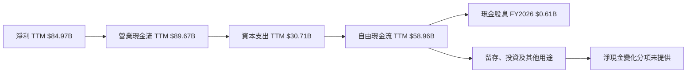

### 5.2 FCF 轉換率趨勢

| 年度 | FCF（$B） | 淨利（$B） | FCF／淨利 | 解讀 |
|------|----------:|-----------:|----------:|------|
| FY2023 | -6.12 | -5.83 | 105.0%* | 淨利與 FCF 均為負，比例不宜作為正常現金轉換指標 |
| FY2024 | 0.121 | 0.778 | 15.6% | Capex 與營運週期令 FCF 明顯低於淨利 |
| FY2025 | 1.67 | 8.54 | 19.6% | 盈利已恢復，現金轉換尚未跟上 |
| FY2026／TTM | 58.96 | 84.97 | 69.4% | 營業現金流大幅提升，但高資本支出仍消耗部分現金 |

\* 負數相除的百分比僅供算術參考，不代表經濟含義上的正常轉換率。

### 5.3 自由現金流趨勢

| 年度 | FCF（$B） | 變化 |
|------|----------:|------|
| FY2023 | -6.12 | 景氣與獲利低谷 |
| FY2024 | 0.121 | 接近損益兩平 |
| FY2025 | 1.67 | 轉正但仍不高 |
| FY2026／TTM | 58.96 | 大幅改善 |

```text
╔══════════════════════════════════════════════════════════════════╗
║            自由現金流：歷史實際（美元）                          ║
╠══════════════════════════════════════════════════════════════════╣
║  FY2023   -$6.12B  ◀███░░░░░░░░░░░░░░░░░░  FCF 為負             ║
║  FY2024   +$0.12B   ░░░░░░░░░░░░░░░░░░░░░  接近損益兩平         ║
║  FY2025   +$1.67B   █░░░░░░░░░░░░░░░░░░░░░  小幅轉正             ║
║  FY2026   +$58.96B  ████████████████████░  FCF Yield 8.67%      ║
║  TTM      +$58.96B  營業現金流 $89.67B − Capex $30.71B           ║
╚══════════════════════════════════════════════════════════════════╝
```

FCF 從 FY2025 **$1.67B** 升至 TTM **$58.96B**，反映獲利回升與現金流改善；但資料期間與 FY2026 財年標示存在口徑差異，趨勢解讀應以 SEC 現金流量表確認。

### 5.4 資本配置評估

| 項目 | 最近資料 | 分析 |
|------|---------:|------|
| Capex | TTM **$30.71B** | 支持製程、產能與產品供應；但需求不如預期時會拉低資本回報 |
| 現金股息 | FY2026 **$0.61B** | 相對 FCF **$58.96B** 占比有限 |
| SBC | FY2026 **$1.33B** | 占營收 **1.0%**；仍造成股東稀釋 |
| 回購 | N/A | 未提供可核實的同期回購金額 |
| 現金留存 | 淨現金 **$40.15B** | 提供投資、償債及景氣低谷緩衝 |

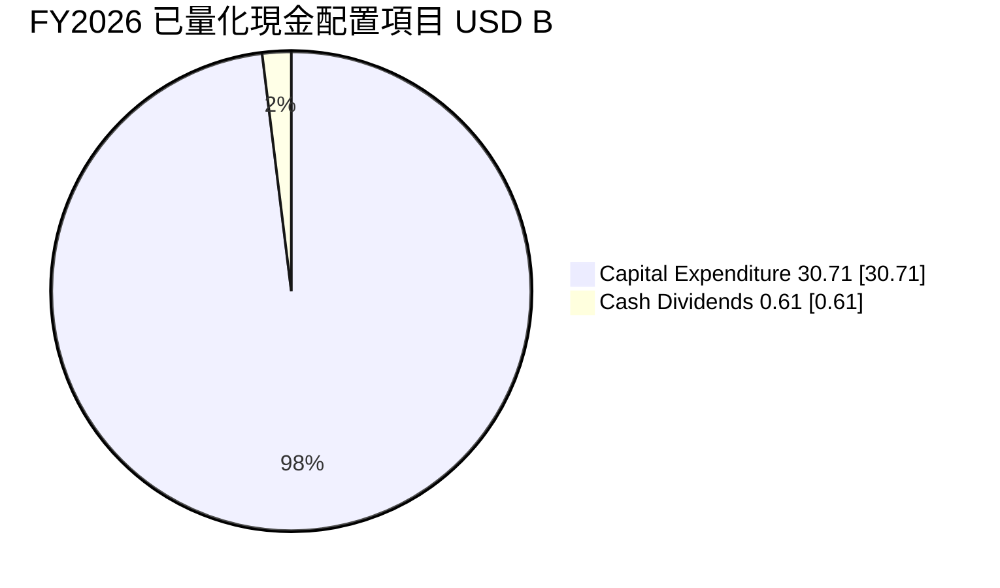

圓餅僅列出已量化 Capex 與股息，不代表 FCF 的全部用途；回購、收購與其他投資用途缺少完整數字。

---

## 6. 獲利能力與資本效率

### 6.1 ROE／ROA／ROIC 趨勢

| 指標 | FY2023 | FY2024 | FY2025 | 最新 TTM | 評估 |
|------|-------:|-------:|-------:|---------:|------|
| ROE | N/A | N/A | N/A | **61.4%**（QUALITY FIGURES） | 高；但受週期高峰淨利推升 |
| ROA | N/A | N/A | N/A | **44.6%**（補充資料） | 高；不同資料口徑不一致 |
| ROIC | N/A | N/A | N/A | **86.2%** | 遠高於 WACC，代表當期投入資本回報高 |
| Piotroski F-Score | — | — | — | **8/9** | 財務改善訊號正面，但不是週期持續性的保證 |

補充市場資料列示 ROE **88.3%**，而 QUALITY FIGURES 的杜邦 ROE 為 **61.4%**；本報告對杜邦及品質分析採 QUALITY FIGURES 原值，並不混用兩種口徑。未提供可一致比較的歷年 ROIC／ROA 資料，故不虛構歷史趨勢或行業均值。

### 6.2 ROIC vs WACC 分析（核心價值創造判斷）

```text
╔══════════════════════════════════════════════════════════════════╗
║                ROIC vs WACC 深度分析                            ║
╠══════════════════════════════════════════════════════════════════╣
║  資本成本輸入（Cost of capital）：                                ║
║  ├── 無風險利率（10Y 美債）：          4.85%                     ║
║  ├── 市場風險溢酬 ERP：                5.00%                     ║
║  ├── 原始 Beta：                       2.40                      ║
║  ├── 調整後 Beta：                     1.93                      ║
║  ├── 股權成本 Ke：                     14.51%                    ║
║  ├── 稅前債務成本：                    3.23%                     ║
║  ├── 稅率：                            14.8%                     ║
║  ├── 股權／債務權重：                  99.5%／0.5%                ║
║  └── WACC：計算值 14.45%，採用值 14.00%（上限限制）              ║
║                                                                  ║
║  最新 TTM ROIC：                        86.2%                    ║
║  EVA Spread：                           86.2% − 14.00% = 72.2pp  ║
║                                                                  ║
║  ROIC  86.2%  ▓▓▓▓▓▓▓▓▓▓▓▓▓▓▓▓▓▓▓▓▓▓▓▓▓▓▓▓▓▓▓▓▓▓▓▓▓▓▓▓░░  🟢 ║
║  WACC  14.0%  ▓▓▓▓▓▓▓░░░░░░░░░░░░░░░░░░░░░░░░░░░░░░░░░░░░  ── ║
║  EVA   +72.2pp ██████████████████████████████████████░░░░░░  🟢 ║
║                                                                  ║
║  結論：ROIC 約為 WACC 的 6.2 倍，當期大幅創造股東價值；          ║
║  但週期高點 ROIC 不應直接外推為中長期常態。                      ║
╚══════════════════════════════════════════════════════════════════╝
```

ROIC／WACC 比值算式：**86.2% ÷ 14.00% = 6.16 倍，約 6.2 倍**。WACC 採 VERIFIED FIGURES 指定的 **14.00%**，而非另行估算值。該區塊提供的 CAPM 股權成本 **14.51%**、權重 **99.5%／0.5%** 及債務成本 **3.23%** 導出未限制計算值 **14.45%**；由於 WACC 被限制於 **7%–14%**，最終採用 **14.00%**。

### 6.3 杜邦三因素分解

| 因素 | 數值（TTM） | 解讀 |
|------|-------------|------|
| 淨利率 | **63.8%** | 高利潤率是本期 ROE 的主要驅動 |
| 資產週轉率 | **0.68** | 資產密集型製造業的資產周轉特徵 |
| 權益乘數 | **1.42** | 槓桿並非主要推升 ROE 的因素 |
| **ROE** | **61.4%** | QUALITY FIGURES 原值；原表列為 63.8% × 0.68 × 1.42 = 61.4% |

ROE 主要由 **63.8% 淨利率**驅動，而非高財務槓桿；但此淨利率包含本輪記憶體週期的高峰因素。

### 6.4 財務體質：Piotroski F-Score

Piotroski F-Score：**8 / 9**。九項測試中有八項通過；分母按原資料口徑，不自行調整。

| 測試 | 結果 | 解讀 |
|------|------|------|
| ROA > 0 | ✅ 通過 | TTM 盈利為正 |
| 營業現金流 > 0 | ✅ 通過 | 營運產生現金 |
| ROA 高於一年前 | ✅ 通過 | 週期與獲利改善 |
| 營業現金流 > 淨利（應計品質） | ✅ 通過 | 現金流高於淨利，支持盈餘品質 |
| 長期負債 ÷ 總資產低於一年前 | ✅ 通過 | 槓桿負擔相對改善 |
| 流動比率高於一年前 | ✅ 通過 | 短期償債能力改善 |
| 稀釋股數未增加 | ❌ 未通過 | 股數稀釋表示每股價值可能被攤薄 |
| 毛利率高於一年前 | ✅ 通過 | 定價、組合或產能利用率改善 |
| 資產週轉率高於一年前 | ✅ 通過 | 資產使用效率提高 |

未通過項目是稀釋股數測試，與 SBC／股數變化需持續監控；高分反映近期財務狀況改善，不代表記憶體景氣已脫離週期。

---

## 7. 相對估值分析

### 7.1 同業估值比較表格

倍數依 Peer multiples 區塊照列；同業樣本包含 SKHY、SNDK、WDC。SKHY 的 P/S、EV/EBITDA 因混合幣別未提供，保留 N/A。

| 估值指標 | **MU** | **SKHY** | **SNDK** | **WDC** | MU 評估 |
|----------|-------:|--------:|--------:|-------:|-----------|
| **Trailing P/E** | **8.1x** | 6.2x | 4.7x | 9.6x | 🟡 接近同業分布；產業週期造成低盈餘倍數解讀風險 |
| **Forward P/E** | **2.93x** | 2.7x | 2.1x | 6.8x | 🟢 接近同業中位數 2.7x；遠期盈餘預估高度週期敏感 |
| **P/S Ratio** | **5.2x** | N/A | 2.9x | 7.0x | 🟡 高於 SNDK、低於 WDC；同業中位數 5.0x |
| **EV/EBITDA** | **5.9x** | N/A | 3.7x | 16.1x | 🟢 低於兩家可比同業中位數 9.9x，但 EBITDA 可能在週期高峰 |
| **最新季度營收 YoY** | **379.3%** | 327.9% | 377.9% | 55.5% | 🟢 高於三家中位數 327.9% |
| **毛利率 TTM** | **80.7%** | 77.4% | 80.0% | 52.6% | 🟢 高於可比同業中位數 77.4% |

MU 自身歷史 P/E、P/S、EV/EBITDA 以 VERIFIED FIGURES 原值為準；上表 MU P/S 採歷史估值區塊 **5.2x**。同業倍數比較不是週期調整後估值，若景氣高點盈餘回落，當前低 P/E 可能高估相對便宜程度。

### 7.2 歷史估值區間分析

```text
╔══════════════════════════════════════════════════════════════════╗
║             MU 五年歷史估值位置（TTM multiples）                 ║
╠══════════════════════════════════════════════════════════════════╣
║  P/E        7.4x ├─●─────────────── 138.5x                       ║
║                    現值 8.1x；中位數 17.4x；百分位 7%             ║
║                                                                  ║
║  P/S        2.1x ├────────●──────── 11.7x                       ║
║                    現值 5.2x；中位數 4.2x；百分位 65%             ║
║                                                                  ║
║  EV/EBITDA  3.6x ├─●─────────────── 80.7x                       ║
║                    現值 5.9x；中位數 9.7x；百分位 20%             ║
╚══════════════════════════════════════════════════════════════════╝
```

P/E 處於自身五年區間第 **7 百分位**，EV/EBITDA 在第 **20 百分位**，但 P/S 位於第 **65 百分位**且高於五年中位數 **4.2x**。此組合顯示市場以低倍數評價當期高峰盈餘，並未同等程度地將當期營收倍數視為便宜。

### 7.3 情境價值（Bear / Base / Bull，照抄 DCF MODEL）

| 情境 | 第 1 年營收成長 | 期末營業利潤率 | WACC | 每股價值 | 相對現價 | 機率 | 會發生的條件 |
|------|----------------:|----------------:|-----:|---------:|---------:|-----:|--------------|
| 🔴 悲觀 | 15.0% | 22.2% | 15.00% | **$429.05** | -28.6% | 25% | AI／資料中心需求放緩、供應增加壓低 ASP，利潤率回落較快 |
| 🟡 基準 | 30.0% | 26.1% | 14.00% | **$881.83** | +46.7% | 50% | 近期需求延續，之後成長與利潤率逐步回歸五年歷史水準 |
| 🟢 樂觀 | 45.0% | 28.8% | 13.00% | **$1,715.71** | +185.4% | 25% | AI 記憶體供應持續緊俏、產品組合與定價優於基準且風險溢酬下降 |

### 7.4 相對估值隱含價格區間

```text
╔══════════════════════════════════════════════════════════════════╗
║        各估值方法每股價值（與 2026-11-25 現價比較）              ║
╠══════════════════════════════════════════════════════════════════╣
║  $584.72 ───── $601.25 ───────── $881.83 ───── $988.30 ── $1,529.69
║  同業 P/S       現價             DCF 基準      同業 EV/EBITDA  共識
╚══════════════════════════════════════════════════════════════════╝
```

- **同業 EV/EBITDA：$988.30／股**；採 SNDK、WDC 中位數 **9.9x** × MU TTM EBITDA，再加回淨現金。
- **同業 P/S：$584.72／股**；採 SNDK、WDC 中位數 **5.0x** × MU TTM 營收。
- **DCF 基準：$881.83／股**；10 年 FCFF、WACC 14.00%、永續成長率 3.0%。
- **分析師共識：$1,529.69／股**；45 位分析師平均目標價，作參考而非獨立基本面驗證。

現價 **$601.25** 略高於同業 P/S 隱含價，低於 DCF、EV/EBITDA 與共識目標價。估值區間跨度大，核心差異在於未來利潤率的正常化幅度。

---

## 8. DCF 內在價值評估（Discounted Cash Flow）

### 8.0 估值推理鏈（Thinking Logic）

#### Step 1 — 價值由哪些變數決定？

MU 的估值主要由記憶體營收增長、週期正常化後 GAAP 營業利潤率，以及高 Capex 逐步下降後的 FCFF 共同決定。雲端、資料中心、行動、客戶端、汽車與嵌入式分部營收占比未提供，故不能把營收拆成有數字支持的業務占比。模型的主導變數是營業利潤率與 WACC／永續成長率的差距：基準 DCF 終值現值占 EV **33.9%**，而 8.6 矩陣顯示同一 g 下提高 WACC 會明顯壓低價值。

#### Step 2 — 模型選擇

| 決策點 | 本報告採用 | 理由（含數字） | 曾考慮但否決 | 否決理由 |
|--------|-----------|----------------|--------------|----------|
| 現金流定義 | FCFF | 以營業現金流、Capex與企業價值連結，並以 WACC 折現 | FCFE | 區塊提供模型為 FCFF；不得另建模型 |
| 預測期 N | 10 年 | DCF MODEL 固定 10 年，營收成長由 30.0% 線性降至 3.0% | 5 年 | 不符合指定模型，且須將成熟過程另行假設 |
| 終值方法 | Gordon Growth | 採永續成長率 **3.0%**，WACC **14.00%** | 退出倍數法 | DCF MODEL 未提供退出倍數與該法計算結果，不能另造 |
| EBIT 基礎 | GAAP EBIT | TTM GAAP 營業利益率 **74.6%**；模型沿用 GAAP | 非 GAAP | 非 GAAP EBIT 與調整項目未提供 |

#### Step 3 — 關鍵假設四段式推導

- **第 1 年營收成長**：錨點為 Revenue growth (TTM vs prior TTM) **256.3%**；此數字處於週期反彈與低基期背景，不能延續十年，因此模型採區間上限內的 **30.0%**；曾考慮直接採用 256.3%，但因無法合理代表前瞻年度而否決。
- **第 10 年營收成長**：錨點為長期成熟公司增長低於短期週期增長；模型採 **3.0%**，由第 1 年逐年線性淡出；曾考慮維持兩位數成長至期末，但這會忽略成熟化。
- **預測期 N**：模型設定 **10 年**，讓營收成長、利潤率及 Capex 完成逐步收斂；曾考慮較短預測期，但模型區塊已固定 10 年，不能自行替換。
- **營業利潤率**：錨點為 TTM **74.6%**，模型由 FY+1 **74.6%** 降至 FY+10 **26.1%**，後者為包含 TTM 的近五年中位數；此安排反映高峰毛利及利用率回歸正常；曾考慮長期維持 74.6%，因忽略周期性而否決。
- **Capex／營收**：錨點為 TTM **23.1%**，模型由 FY+1 **23.1%** 降至 FY+10 **7.8%**，即約 1.1 倍 D&A／營收；此假設代表高擴產階段逐步成熟；曾考慮將當期 Capex 比例維持十年，因會不合理地永久延續高投資強度而否決。
- **D&A／營收**：錨點為 TTM **7.1%**；採用 **7.1%** 固定。此項為模型假設，不代表折舊絕對金額固定。
- **稅率**：錨點為最新年度有效稅率 **14.8%**；模型採用 **14.8%**。未另加入稅務利益假設。
- **永續成長率 g**：採用 **3.0%**，低於 WACC **14.00%**，亦與成熟期低個位數名目增長相容；曾考慮更高永續成長率，因長期不能高於經濟體名目成長而否決。
- **GAAP 與 SBC／稀釋**：模型採 **(A) GAAP EBIT + 固定股數**。GAAP EBIT 已把 SBC 作為費用，不再額外扣 SBC；模型亦不另加年稀釋。這使 SBC 成本計入一次，但若未來股數實際增加，DCF 的每股價值可能偏高。
- **ΔWC**：資料模型明確不建模營運資金變動；該項沒有設定數字，不自行補入。
- **WACC**：錨點為 Cost of capital 指定計算值 **14.45%**，受 **7%–14%** 區間限制後採 **14.00%**；曾考慮直接使用 14.45%，因模型規則指定封頂而否決。

#### Step 4 — 最脆弱一環

最脆弱的假設是從 TTM **74.6%** 營業利潤率起步、再用十年線性回落至 **26.1%** 的整條路徑；若價格週期轉弱令近端利潤率更快下滑，DCF 價值將下降，悲觀情境已給出 **$429.05／股**。

#### Step 5 — 計算路徑圖

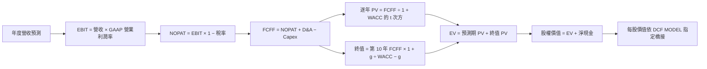

### 8.1 模型假設總表（Model Inputs）

| 假設項目 | 採用值 | 依據／來源 | 敏感度 |
|----------|--------|-------------|--------|
| 預測期長度 **N** | **10 年** | DCF MODEL 固定預測期 | 🟡 中 |
| 營收成長率 | FY+1 **30.0%**，FY+10 **3.0%**，線性淡出 | TTM 成長 **256.3%**；模型明列短期上限及期末值 | 🔴 高 |
| 營業利潤率 | FY+1 **74.6%** → FY+10 **26.1%** | TTM 營業利益率及含 TTM 近五年中位數 | 🔴 高 |
| 有效稅率 | **14.8%** | 最新年度有效稅率 | 🟢 低 |
| Capex／營收 | FY+1 **23.1%** → FY+10 **7.8%** | TTM 比率淡出至約 1.1× D&A | 🔴 高 |
| D&A／營收 | **7.1%** | TTM 比率，模型固定 | 🟢 低 |
| 營運資金變動 | **未建模** | DCF MODEL 明確排除 | N/A |
| EBIT 基礎 | **GAAP EBIT** | 模型採 GAAP 營業利益率 | 🟡 中 |
| SBC 處理 | GAAP 已費用化，不再扣 SBC | 模型組合 A | 🟡 中 |
| 年稀釋率 | **0%（不另行稀釋）** | 模型組合 A；股數成本不再另計 | 🟡 中 |
| 永續成長率 g | **3.0%** | DCF MODEL 指定；小於 WACC | 🔴 高 |
| 終值方法 | Gordon Growth | DCF MODEL 唯一提供之可複算主方法 | 🔴 高 |
| WACC | **14.00%** | 指定成本資本；計算值 14.45% 封頂至 14.00% | 🔴 高 |

FCFF 定義：**FCFF = NOPAT + D&A − Capex**；依模型不列 ΔWC、不另扣 SBC。股數採固定處理，並非將股數年年擴大。

### 8.2 折現率推導（WACC）

```text
╔══════════════════════════════════════════════════════════════════╗
║                    WACC 推導（折現率）                           ║
╠══════════════════════════════════════════════════════════════════╣
║  股權成本 Ke（CAPM）：                                           ║
║  ├── 無風險利率 Rf：                    4.85%                    ║
║  ├── 市場風險溢酬 ERP：                 5.00%                    ║
║  ├── 原始 Beta（Yahoo）：               2.40                     ║
║  ├── 採用 Beta：                        1.93                     ║
║  ├── Beta 調整：                        ⅔ × 2.40 + ⅓ × 1 = 1.93  ║
║  ├── 規模／國別溢酬：                   0.00%（未另加）           ║
║  └── Ke：資料列示 14.51%                                         ║
║                                                                  ║
║  債務成本 Kd：                                                   ║
║  ├── 稅前 Kd：                          3.23%                    ║
║  ├── 有效稅率：                         14.8%                    ║
║  └── 稅後 Kd：                          3.23% × (1 − 14.8%)       ║
║                                                                  ║
║  資本結構：                                                       ║
║  ├── 股權權重：                         99.5%                    ║
║  ├── 債務權重：                         0.5%                     ║
║  ├── 未限制計算值：                     14.45%                   ║
║  └── ✅ 採用 WACC：                     14.00%（7%–14% 上限）     ║
╚══════════════════════════════════════════════════════════════════╝
```

WACC 五步計算如下：

1. **Ke（CAPM）**＝4.85% + 1.93 × 5.00%＝資料區塊列示 **14.51%**。原始 Beta **2.40**，採用調整 Beta **1.93**，調整方式為三分之二原始 Beta 加三分之一的 1；資料列示值與以兩位小數逐步計算可能有尾差，依規則採原值。
2. **稅前 Kd**＝資料列示利息 ÷ 計息負債的成本資本值 **3.23%**。利息與平均計息負債絕對值未提供，故不反推金額或假造分母。
3. **稅後 Kd**＝3.23% × (1 − 14.8%)＝**2.752%**，顯示至 **2.75%**。
4. **權重**＝股權 **99.5%**、債務 **0.5%**；相加 **99.5% + 0.5% = 100.0%**。股權採市值基礎，市值為 **$680.27B**；債務權重採成本資本區塊指定值，不混用資產負債表帳面權益。
5. **未限制 WACC**＝99.5% × 14.51% + 0.5% × 2.752%＝**14.448%**，資料列示 **14.45%**；受上限約束後採用 **14.00%**。第 6.2 與本章一致使用 **14.00%**。

### 8.3 逐年自由現金流預測（基準情境）

下表逐年照錄 DCF MODEL。單位為 USD B；折現因子保留三位小數。模型不計 ΔWC，因此不出現該列；模型採 GAAP EBIT 與固定股數，不另列 SBC 扣減。

| 年度 | FY+1 | FY+2 | FY+3 | FY+4 | FY+5 | FY+6 | FY+7 | FY+8 | FY+9 | FY+10 |
|------|-----:|-----:|-----:|-----:|-----:|-----:|-----:|-----:|-----:|------:|
| 營收 | 173.14 | 219.89 | 272.67 | 329.93 | 389.32 | 447.71 | 501.44 | 546.57 | 579.36 | 596.74 |
| 營收 YoY | 30.0% | 27.0% | 24.0% | 21.0% | 18.0% | 15.0% | 12.0% | 9.0% | 6.0% | 3.0% |
| 營業利潤率 | 74.6% | 69.2% | 63.8% | 58.4% | 53.1% | 47.7% | 42.3% | 36.9% | 31.5% | 26.1% |
| EBIT（GAAP） | 129.14 | 152.17 | 174.02 | 192.80 | 206.55 | 213.43 | 212.05 | 201.71 | 182.62 | 155.98 |
| − 稅 | (19.13) | (22.54) | (25.77) | (28.55) | (30.59) | (31.61) | (31.40) | (29.87) | (27.05) | (23.10) |
| = NOPAT | 110.02 | 129.64 | 148.25 | 164.25 | 175.96 | 181.82 | 180.64 | 171.84 | 155.58 | 132.88 |
| + D&A | 12.35 | 15.69 | 19.45 | 23.54 | 27.78 | 31.94 | 35.78 | 39.00 | 41.34 | 42.58 |
| − Capex | (39.93) | (46.99) | (53.66) | (59.35) | (63.45) | (65.41) | (64.78) | (61.37) | (55.26) | (46.84) |
| **= FCFF** | **82.44** | **98.34** | **114.04** | **128.44** | **140.28** | **148.36** | **151.64** | **149.46** | **141.65** | **128.62** |
| 折現因子 @14.00% | 0.877 | 0.769 | 0.675 | 0.592 | 0.519 | 0.456 | 0.400 | 0.351 | 0.308 | 0.270 |
| **FCFF 現值 PV** | **72.32** | **75.67** | **76.98** | **76.04** | **72.86** | **67.59** | **60.60** | **52.40** | **43.56** | **34.69** |

> **模型算式示範：FY+1**
>
> 1. 營收：$133.19B × (1 + 30.0%) = **$173.147B**，模型列示 **$173.14B**。
> 2. EBIT：$173.14B × 74.6% = **$129.16B**；DCF MODEL 列示 **$129.14B**，差異來自內部未四捨五入輸入。
> 3. 稅：$129.14B × 14.8% = **$19.11B**；DCF MODEL 列示 **$19.13B**，採模型原值。
> 4. NOPAT：模型列示 EBIT − 稅 = **$110.02B**。
> 5. D&A：模型列示 **$12.35B**，基於約 7.1% 營收比率。
> 6. Capex：模型列示 **$39.93B**，基於約 23.1% 營收比率。
> 7. ΔWC：**未建模**，沒有輸入值，不填零以外的推估數字；模型公式直接排除。
> 8. FCFF：$110.02B + $12.35B − $39.93B = **$82.44B**。
> 9. 折現因子：1 ÷ (1 + 14.00%)¹ = **0.877**；PV：$82.44B × 0.877 ≈ **$72.32B**（模型使用未四捨五入因子）。

模型所列預測期 PV 合計為 **$632.71B**。依逐年已顯示、四捨五入至兩位小數之 PV 相加為：

**$72.32 + $75.67 + $76.98 + $76.04 + $72.86 + $67.59 + $60.60 + $52.40 + $43.56 + $34.69 = $632.71B**。

> **合理性自檢**
>
> - 預測 FCFF 由 **$82.44B** 升至 **$128.62B**；此處未提供與模型同口徑的 FY+1 至 FY+10 FCFF CAGR 及歷史可比 CAGR，故不給未核實的比較值。
> - FY+10 FCFF 利潤率＝$128.62B ÷ $596.74B＝**21.6%**；目前 TTM FCF／營收＝$58.96B ÷ $133.19B＝**44.3%**。同業最佳 FCF 利潤率資料未提供，不能作同口徑排名。
> - 模型十年 FCFF 均為正；預測現金流正值不代表經濟週期風險消失，因基準模型仍假設較高近端利潤率。

```text
╔══════════════════════════════════════════════════════════════════╗
║            自由現金流：歷史實際 vs 模型預測                      ║
╠══════════════════════════════════════════════════════════════════╣
║  FY2024(實)   $0.12B   ░░░░░░░░░░░░░░░░░░░░  低基期             ║
║  FY2025(實)   $1.67B   █░░░░░░░░░░░░░░░░░░░  轉正               ║
║  TTM(實)     $58.96B   █████████░░░░░░░░░░░  OCF $89.67B         ║
║  FY+1(預)    $82.44B   █████████████░░░░░░░  模型預測           ║
║  FY+10(預)  $128.62B   ████████████████████  模型預測           ║
╠══════════════════════════════════════════════════════════════════╣
║  注意：歷史 TTM 與模型 FY+1 的期間及會計口徑並非完全同期間比較   ║
╚══════════════════════════════════════════════════════════════════╝
```

### 8.4 終值計算（Terminal Value）

**適用性檢查：WACC 14.00% vs g 3.0% → WACC > g？✅**

| 方法 | 計算式 | 終值 TV | TV 現值 | 佔總 EV 比重 |
|------|--------|---------:|--------:|-------------:|
| Gordon Growth | FCFF(FY+10) × (1+g) ÷ (WACC−g) | **$1,204.36B** | **$324.87B** | **33.9%** |
| 退出倍數法 | N/A（DCF MODEL 未提供該方法計算值） | N/A | N/A | N/A |

逐步演算如下：

1. FY+N FCFF＝FY+10 **$128.62B**。
2. 分子＝$128.62B × (1 + 3.0%)＝**$132.4786B**。
3. 分母＝14.00% − 3.0%＝**11.00%**；TV＝$128.62B × 1.03 ÷ 0.11＝模型列示 **$1,204.36B**。
4. PV(TV)＝模型列示 **$324.87B**；折現因子依 DCF MODEL 列示 **0.270**，顯示位數相乘有四捨五入尾差，估值採模型原值。
5. 終值佔比＝$324.87B ÷ $957.57B＝**33.9%**。

終值現值占 EV **33.9%**，模型並非主要由終值單獨支撐；但退出倍數法缺少模型結果，無法做兩種終值法的交叉校驗。

### 8.5 企業價值 → 每股內在價值（Bridge）

```text
╔══════════════════════════════════════════════════════════════════╗
║              企業價值 → 每股內在價值 橋接表                      ║
╠══════════════════════════════════════════════════════════════════╣
║  預測期 FCF 現值合計             +$632.71B                       ║
║  終值現值 PV(TV)                 +$324.87B                       ║
║  ─────────────────────────────────────────────                  ║
║  = 企業價值 EV                    $957.57B                       ║
║  + 淨現金                         +$40.15B                       ║
║  = 股權價值                       $997.73B                       ║
║  每股價值                         $881.83                         ║
║  當前股價                         $601.25                         ║
║  折溢價（現價÷DCF價值−1）          -31.8%（折價）                 ║
╚══════════════════════════════════════════════════════════════════╝
```

逐步演算：

1. **EV**＝預測期 PV $632.71B + PV(TV) $324.87B＝算術合計 **$957.58B**；DCF MODEL 列示 **$957.57B**，差 **$0.01B**，屬各列未四捨五入的尾差，以下估值照錄模型。
2. **股權價值**＝模型 EV $957.57B + 淨現金 $40.15B＝算術值 **$997.72B**；DCF MODEL 列示 **$997.73B**，同為模型未四捨五入數值尾差，採用模型股權價值。
3. 每股內在價值按模型指定公式：**股權價值 × 價格 ÷ 市值**；DCF MODEL 列示結果為 **$881.83／股**。原資料未提供精確未四捨五入股數橋接參數，不能改用其他股數公式替代。
4. 折溢價＝$601.25 ÷ $881.83 − 1＝**-31.8%**，即現價相對 DCF 基準折價。
5. **本節不計算 MOS**；MOS 僅於 8.8 以加權合理價值為分母計算。

淨現金及債務取自 VERIFIED FIGURES，與其他資料源列示的總債務 **$5.18B** 不一致。模型每股價值照錄 **$881.83**；SBC 採 GAAP 已費用化及固定股數處理。

### 8.6 敏感性分析（WACC × 永續成長率）

矩陣每股價值照錄 DCF MODEL；百分比為相對 **$601.25** 現價的上行空間，四捨五入至一位小數。

| g（列）／WACC（欄） | 12.00% | 13.00% | **14.00%（基準）** | 15.00% | 16.00% |
|-----------|------:|------:|------------------:|------:|------:|
| **2.0%** | $1,019.58 (+69.6%) | $930.16 (+54.7%) | $855.35 (+42.3%) | $791.82 (+31.7%) | $737.17 (+22.6%) |
| **2.5%** | $1,041.16 (+73.2%) | $946.54 (+57.4%) | $868.01 (+44.4%) | $801.76 (+33.4%) | $745.08 (+23.9%) |
| **3.0%** | $1,065.13 (+77.2%) | $964.56 (+60.5%) | **$881.83 (+46.7%)** | $812.53 (+35.2%) | $753.60 (+25.4%) |
| **3.5%** | $1,091.92 (+81.6%) | $984.47 (+63.8%) | $896.97 (+49.3%) | $824.24 (+37.1%) | $762.80 (+26.9%) |
| **4.0%** | $1,122.07 (+86.8%) | $1,006.60 (+67.5%) | $913.61 (+52.0%) | $837.01 (+39.3%) | $772.76 (+28.5%) |

逐步演算示範：模型提供 WACC **14.00%**、g **2.5%** 格的每股價值為 **$868.01**；此值直接照錄敏感度矩陣。由於規則要求不得自行重建敏感度模型，沒有以四捨五入後的年度現金流另算 PV／終值，避免得到與程式模型不同的數字。

**三情境 DCF**

| 情境 | 第 1 年成長 | 期末營業利潤率 | WACC | 每股價值 | 相對現價 | 機率 |
|------|------------:|----------------:|-----:|---------:|---------:|-----:|
| 🔴 悲觀 | 15.0% | 22.2% | 15.00% | **$429.05** | -28.6% | 25% |
| 🟡 基準 | 30.0% | 26.1% | 14.00% | **$881.83** | +46.7% | 50% |
| 🟢 樂觀 | 45.0% | 28.8% | 13.00% | **$1,715.71** | +185.4% | 25% |

情境表以外的逐年營收、期末 FCFF 與 TV 分解未在 DCF MODEL 提供；依規則 19，不另建悲觀／樂觀現金流模型。機率加權值依模型列示 **$977.10**；但該值僅供情境背景參考，8.8 固定以基準 DCF 價值納入估值權重。

**敏感度結論：**

- g 從 **2.0%** 升至 **4.0%**、WACC 固定 **14.00%**：每股價值由 **$855.35** 升至 **$913.61**，增加 **$58.26**，約 **6.8%**。
- WACC 從 **13.00%** 升至 **15.00%**、g 固定 **3.0%**：每股價值由 **$964.56** 降至 **$812.53**，下降 **$152.03**，約 **15.8%**。
- 期末營業利潤率每增加 1pp 的單變數敏感度未提供，標示 **N/A（DCF MODEL 未提供該敏感度）**。
- 就已提供矩陣範圍而言，WACC 變化對價值影響大於 g 變化；這與 8.0 所述估值對折現率與終值假設敏感一致。

### 8.7 反推 DCF（Reverse DCF：市場在預期什麼）

DCF MODEL 僅提供兩項「一次放開一個變數」的反推結果，照錄如下；其餘變數固定基準值及反推試算軌跡未提供，不自行重建。

| 求解的變數 | 固定條件 | 市場隱含值 | 對照基準／歷史值 | 判斷 |
|------------|----------|-----------:|-----------------|------|
| 第 1 年營收成長 | 其他變數維持基準模型 | **17.7%** | 基準 **30.0%**；TTM 成長 **256.3%** | 🟢 相對基準保守，但需避免把單年週期高增長視為常態 |
| 固定營業利潤率 | 其他變數維持基準模型 | **28.1%** | 基準路徑 **74.6% → 26.1%** | 🟡 接近成熟期利潤率假設 |
| 永續成長率 g | N/A | 未計算 | — | N/A（模型未提供） |
| 高成長持續年數 N | N/A | 未計算 | 基準 N = 10 年 | N/A（模型未提供） |

求解方法的逐步試算表未隨模型提供，因此無法展示不同成長率試算點及逐點價值；不編造收斂軌跡。反推結果的含義是：在其他基準輸入固定時，現價可由低於基準的 **17.7%** 第一年成長率解釋，或由 **28.1%** 固定營業利潤率解釋。市場並非必須預期所有基準假設同時成立才支持現價。

### 8.8 估值三角驗證與安全邊際

| 估值方法 | 隱含每股價值 | 上行空間（÷現價） | 權重 | 說明 |
|----------|--------------:|-------------------:|-----:|------|
| DCF（基準） | **$881.83** | +46.7% | 40% | 10 年 FCFF，WACC 14.00%、g 3.0% |
| 同業 EV/EBITDA | **$988.30** | +64.4% | 30% | SNDK、WDC 中位數 9.9x × TTM EBITDA，加淨現金 |
| 同業 P/S | **$584.72** | -2.7% | 20% | SNDK、WDC 中位數 5.0x × TTM 營收 |
| 分析師共識目標價 | **$1,529.69** | +154.4% | 10% | 45 位分析師平均目標價，作為參考 |
| **加權合理價值** | **$919.13** | **+52.9%** | **100%** | 週期型公司固定估值權重 |

加權算式（方法權重合計 100%）：

**$881.83 × 40% + $988.30 × 30% + $584.72 × 20% + $1,529.69 × 10% = $919.13**（依模型列示值；以未四捨五入分項計算存在尾差）。

公司類型為 **cyclical／週期型**，權重依該類型固定；本表沒有同業 Forward P/E 估值方法，因此不另增該方法。相對估值使用同業中位數，沒有改用 MU 自身倍數。

```text
╔══════════════════════════════════════════════════════════════════╗
║                  估值區間與安全邊際                              ║
╠══════════════════════════════════════════════════════════════════╣
║  $429.05 ─── $601.25 ─── [$919.13] ─── $881.83 ─── $1,715.71   ║
║  悲觀DCF       現價       加權合理值       基準DCF      樂觀DCF   ║
║                                                                  ║
║  安全邊際 MOS = ($919.13 − $601.25) ÷ $919.13 = +34.6%          ║
║  MOS 評估：🟢 >25% 充足 ｜ 🟡 10-25% 有限 ｜ 🔴 <10% 無         ║
║  上行空間 = ($919.13 − $601.25) ÷ $601.25 = +52.9%              ║
║                                                                  ║
║  建議買入區間：$601.25 – $827.22                                 ║
║  （上限 = $919.13 × 90%，即保留至少 10% MOS 的價格）              ║
║  合理持有參考：$827.22 – $919.13                                 ║
║  減碼考慮：高於 $1,715.71 的樂觀情境價值時重新評估               ║
╚══════════════════════════════════════════════════════════════════╝
```

買入上限算式：**$919.13 × (1 − 10%) = $827.217 ≈ $827.22**。MOS 計算只以加權合理價值 **$919.13** 為分母；DCF 折溢價則以 DCF 基準價值 **$881.83** 為分母。

> 🔎 **程式複算（Python，依本節各項自動重算）**
>
> 加權合理價值 = $881.83 × 40% + $988.30 × 30% + $584.72 × 20% + $1,529.69 × 10% = **$919.13**（權重合計 100%）
>
> 以價格 $601.25 計：MOS = **+34.6%**，上行空間 = **+52.9%**
>
> ✅ 與本節所寫數值一致。

### 8.9 DCF 模型的局限與失效條件

- **終值依賴度：**PV(TV) 占 EV **33.9%**，估值有三分之一左右取決於預測期之後的假設。
- **最脆弱假設：**FY+1 營業利潤率以 **74.6%** 起步、Capex／營收由 **23.1%** 向 **7.8%** 收斂。若需求或定價快速反轉，價值可能向悲觀情境 **$429.05** 靠攏。
- **適用性：**MU 為高度週期、資本密集型公司，當期 FCF 已轉為 **$58.96B** 正值，DCF 可用但可信度低於穩定訂閱型公司。可搭配 P/S、EV/EBITDA 週期中值及供需情境觀察；資料不足以建立可靠 SOTP。
- **模型限制：**營運資金未建模；SBC 以 GAAP 費用化處理但不另作股數稀釋；股數及資產負債表數字有資料口徑差異。均可能造成每股內在價值偏高或偏低。
- **風險連結：**記憶體價格下滑會直接壓低營業利潤率與營收；擴產會影響 Capex 假設；地緣與台灣勞資不確定性可能影響供應與 WACC。

### 8.10 複算檢核表（Audit Trail）

| # | 檢核項目 | 檢查方式 | 結果 |
|---|----------|----------|------|
| 1 | 高／中敏感度輸入有推導或資料限制說明 | 對照 8.0 Step 3 與 8.1 | ✅ |
| 2 | 所有假設有來歷 | 8.1 依據欄逐項檢查 | ✅ |
| 3 | WACC 組成與採用值 | 引用指定輸入，計算值 14.45% 封頂至 14.00% | ✅ |
| 4 | Kd 分母與債務權重口徑 | 絕對利息與平均計息負債未提供；引用既有 Kd 與權重，不自造分母 | ⚠️ 輸入值採來源原值，無法獨立複核絕對負債明細 |
| 5 | WACC 與第 6.2 節同值 | 兩處均為 14.00% | ✅ |
| 6 | 逐年表格年度數 = N | FY+1 至 FY+10 共 10 年 | ✅ |
| 7 | FY+1 代表年度算式 | 使用模型原值與未四捨五入差異說明 | ⚠️ 模型原表未四捨五入值不可見 |
| 8 | 預測期 PV 加總 | 顯示十項加總 = $632.71B | ✅ |
| 9 | WACC > g | 14.00% > 3.0% | ✅ |
| 10 | 終值基礎與折現期間 | FY+10 FCFF，折現 10 期；結果照錄模型 | ✅ |
| 11 | EV 至每股橋接 | 模型總額有 $0.01B 尾差；內在價值照錄 $881.83 | ⚠️ 尾差由模型表格四捨五入造成 |
| 12 | SBC 合法組合 | GAAP EBIT、無 SBC 再扣、固定股數 | ✅ 組合 A |
| 13 | 敏感性基準格等於 DCF 基準 | 矩陣 14%／3% = $881.83 | ✅ |
| 14 | 矩陣有效性 | 全部格子 WACC > g | ✅ |
| 15 | 情境機率相加 | 25% + 50% + 25% = 100% | ✅ |
| 16 | Reverse DCF 一次解一變數 | 只列模型提供的 17.7% 與 28.1%；無試算軌跡 | ⚠️ 原模型未提供疊代細節 |
| 17 | MOS 與折溢價分母 | MOS 用 $919.13；折溢價用 $881.83 | ✅ |
| 18 | 完整至第 11 章 | 全部章節均有輸出 | ✅ |
| 19 | 加權合理價值與權重 | 引用模型加權值 $919.13；分項 rounded 數存在尾差 | ⚠️ 使用程式原值 |
| 20 | MOS 評級 | MOS +34.6%，ROIC 86.2% > WACC 14.00%，評級強烈買入 | ✅ |

---

## 9. 成長催化劑

### 9.1 催化劑時間軸

財務資料未提供公司正式產品量產時程，以下以近、中、長期研究框架排列，不代表公司指引。

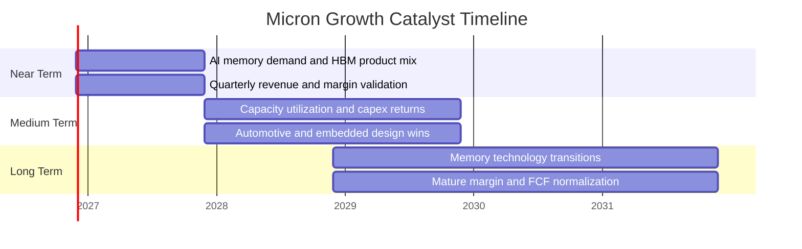

### 9.2 TAM 市場規模分析

**N/A（TAM 數據未提供）**。以可核實數字而言，Micron TTM 營收 **$133.19B**、TTM 成長 **256.3%**，最新一季單季營收年增 **379.3%**。AI 記憶體與資料中心是值得追蹤的需求方向，但沒有可引用的市場規模或滲透率數據，故不估算 TAM。

### 9.3 成長驅動力結構圖

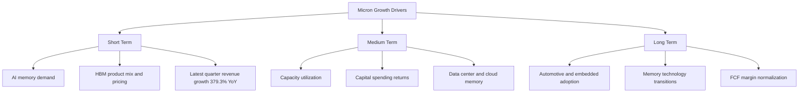

---

## 10. 風險矩陣

### 10.1 風險評分矩陣

座標為研究分析的質化風險位置，不代表財務資料中公布的機率統計值。

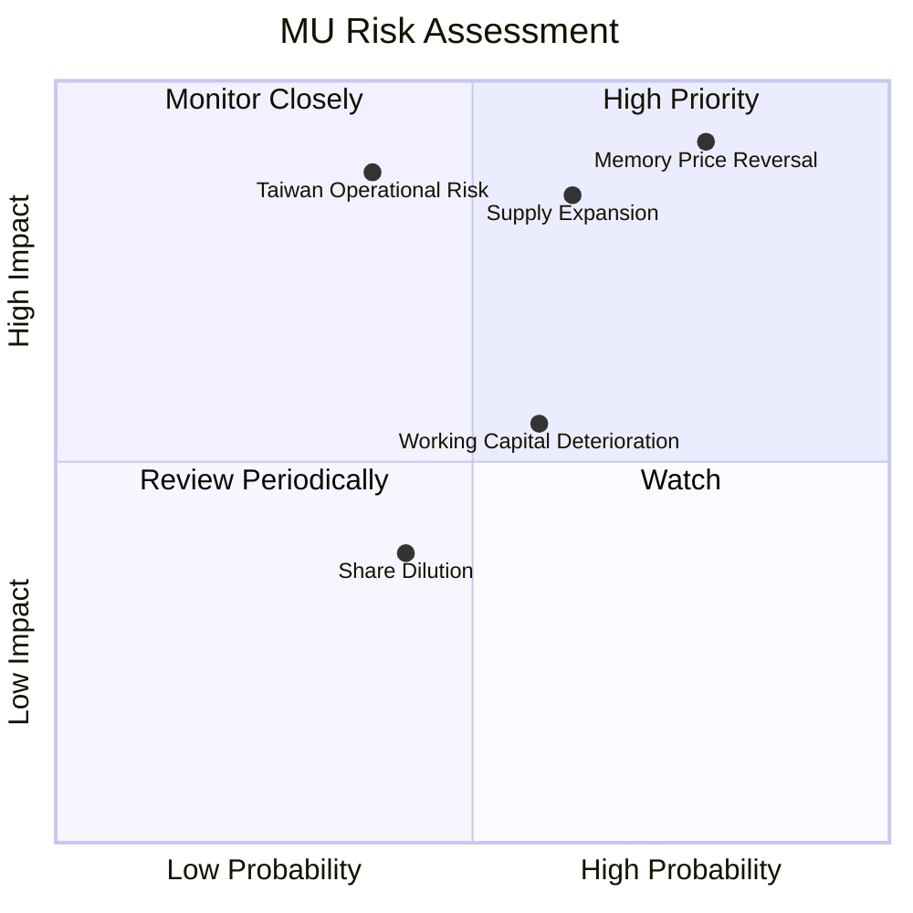

### 10.2 風險清單詳細分析

| # | 風險項目 | 發生機率 | 財務衝擊 | 風險評分 | 緩解措施 |
|---|----------|----------|----------|----------|----------|
| 1 | 🔴 **記憶體價格週期反轉** | 高（質化） | 高；TTM 營業利益率 **74.6%**，毛利率回落會壓縮營業槓桿 | 🔴 9/10 | 逐季追蹤 DRAM／NAND ASP、毛利率、庫存與管理層供需展望；分批持倉 |
| 2 | 🔴 **供應擴張與 Capex 回報下降** | 中高（質化） | 高；TTM Capex **$30.71B**，占營收約 **23.1%** | 🔴 8/10 | 追蹤 Capex／營收、產能利用率、折舊與 ROIC；若 ROIC 跌破 WACC，重估資本配置 |
| 3 | 🟠 **台灣營運與勞資不確定性** | 中（質化） | 高；近期新聞指出勞資爭議可能威脅擴張，但金額影響未提供 | 🟠 7/10 | 追蹤擴產時程、員工流動、供應鏈備援與公司公告 |
| 4 | 🟡 **營運資金效率惡化** | 中（質化） | 中；CCC **185 天**，年增 **30 天** | 🟡 6/10 | 追蹤 DSO、DIO 與應收帳齡；避免用短期營收成長掩蓋現金占用 |
| 5 | 🟡 **股數稀釋／SBC** | 中低（質化） | 中低；SBC **$1.33B**，F-Score 的稀釋股數項未通過 | 🟡 4/10 | 追蹤稀釋股數、SBC／營收與每股 FCF 成長 |

---

## 11. 投資建議

### 11.1 最終評級與評分

MU 評級為 **🟢強烈買入**：MOS **+34.6%**，且 ROIC **86.2%** 高於 WACC **14.00%**，符合規則 20，沒有作質化調整。綜合評分為 **8.0/10**，引用 1.1 六項分數：成長性 **9.0**、獲利能力 **9.0**、財務健康 **8.5**、估值 **8.0**、護城河 **7.0**、管理層與資本配置 **6.5**。

### 11.2 合理價值與隱含報酬率

| 估值依據 | 每股價值 | 相對現價 | 機率／權重 | 解讀 |
|----------|---------:|---------:|-----------:|------|
| 加權合理價值 | **$919.13** | **+52.9%** | 方法權重 100% | 8.8 三角驗證結果 |
| 🔴 悲觀 DCF | **$429.05** | **-28.6%** | 25% | 成長放緩、期末利潤率下降、WACC 上升 |
| 🟡 基準 DCF | **$881.83** | **+46.7%** | 50% | 基準成長、利潤率正常化 |
| 🟢 樂觀 DCF | **$1,715.71** | **+185.4%** | 25% | 營收成長、期末利潤率及資本成本均優於基準 |

加權合理價值不是短期目標保證；情境估值的範圍寬，反映 MU 的週期彈性及長期利潤率不確定性。

### 11.3 買入時機與觸發因素

```text
╔══════════════════════════════════════════════════════════════════╗
║                  ✅ 買入觸發因素 Checklist                      ║
╠══════════════════════════════════════════════════════════════════╣
║  立即買入／分批建立條件：                                         ║
║  ✅ 股價不高於 $827.22，對 $919.13 加權合理價值仍有至少 10% MOS  ║
║  ✅ 最新季度營收與毛利率未顯示連續兩季急速反轉                   ║
║  ✅ FCF 持續為正，且 ROIC 高於 14.00% 採用 WACC                  ║
║                                                                  ║
║  加碼觸發條件：                                                   ║
║  ☐ CCC 由 185 天開始回落，DSO／DIO 不再同步惡化                 ║
║  ☐ 營業利益率雖正常化，但仍維持在 DCF 基準長期路徑附近          ║
║  ☐ Capex 投入轉化為產能利用與 FCF，而非只增加庫存與折舊          ║
║                                                                  ║
║  減碼／停損觸發條件：                                             ║
║  ☐ 股價高於樂觀情境 $1,715.71，且獲利預期未同步上修              ║
║  ☐ 記憶體 ASP 下跌使毛利率連續兩季收縮                           ║
║  ☐ FCF 轉負、ROIC 跌破 14.00% WACC，或淨現金明顯下降             ║
╚══════════════════════════════════════════════════════════════════╝
```

### 11.4 投資人適配度分析

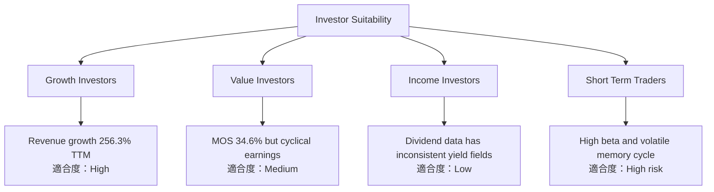

- **成長型投資人：**較適合能承受周期波動的投資人；營收增速高，但不宜將 **256.3% TTM 成長**當作長期成長率。
- **價值型投資人：**低於自身歷史中位數的 P/E 與 **34.6% MOS**具吸引力；需先確認週期高峰盈餘不會令表面低估失真。
- **股息型投資人：**資料列示股息殖利率 **10.0%**，但 FY2026 現金股息僅 **$0.61B**，數據口徑明顯需要核對，不宜單憑 10.0% 作投資依據。
- **短期交易者：**Beta 高、股價曾大幅波動，可能有交易機會，也有顯著跳空與週期反轉風險。

### 11.5 每季財報監控清單（Quarterly Watch List）

| 監控指標 | 目前基準 | 觸發加碼條件 | 觸發減碼／重估條件 |
|----------|---------|--------------|--------------------|
| 單季營收 YoY | 最新 **379.3%** | 成長延續且非單靠價格短期拉升 | 連續兩季低於 **100%** 且管理層下修展望 |
| 營業利益率 | TTM **74.6%**；最新季度 VERIFIED FIGURES **80.7%** | 高峰回落幅度可控、長期路徑仍接近 DCF | 兩季內下降超過 **15 個百分點**，且無產品組合改善 |
| 毛利率 | TTM **80.7%** | 維持高毛利並伴隨實際現金流 | 連續兩季下滑或價格下降快於成本 |
| Capex | TTM **$30.71B**；約營收 **23.1%** | Capex 支出帶來產能利用及 FCFF 增長 | Capex 增長但營收、利用率及 FCF 轉弱 |
| FCF | TTM **$58.96B** | 持續為正，現金轉換保持在可接受範圍 | FCF 轉負或 FCF／淨利低於 **40%** |
| 存貨與 CCC | DIO **147 天**；CCC **185 天** | CCC 開始回落、庫存週轉改善 | CCC 高於 **200 天**或 DIO 連續上升 |
| 應收帳款 | DSO **87 天** | DSO 走平或下降 | DSO 超過 **100 天**且應收增速高於營收 |
| ROIC 對 WACC | ROIC **86.2%**；WACC **14.00%** | ROIC 明顯高於資金成本 | ROIC 跌破 **14.00%** |
| 稀釋與 SBC | SBC **$1.33B**；占營收 **1.0%** | 稀釋股數穩定、每股 FCF 增長 | 稀釋股數連續增加，SBC／營收超過 **2%** |
| 財測與訂單 | 未提供可核實管理層財測 | 公司展望支持需求與毛利延續 | 下修收入、毛利率或資本回報指引 |

### 11.6 反面論證：什麼會證明論點錯誤（What Would Change My Mind）

```text
╔══════════════════════════════════════════════════════════════════╗
║              ⚠️ 論點失效條件（Disconfirming Evidence）           ║
╠══════════════════════════════════════════════════════════════════╣
║  本投資論點在下列情況成立時應重新檢視或退出：                    ║
║  ☐ 單季營收年增連續兩季低於 100%，且公司下修需求展望             ║
║  ☐ 營業利益率在兩季內由高位收縮超過 15 個百分點                 ║
║  ☐ FCF 轉負，或 FCF／淨利低於 40% 且沒有明確擴產回報解釋         ║
║  ☐ ROIC 跌破採用 WACC 14.00%，顯示資本投資不再創造價值          ║
║  ☐ CCC 超過 200 天並伴隨應收逾期或存貨減值                       ║
║  ☐ SBC／營收超過 2%，或稀釋股數增加快於每股 FCF 成長             ║
║  ☐ HBM／AI 記憶體需求不能轉化為毛利與現金流，僅增加資本需求       ║
╚══════════════════════════════════════════════════════════════════╝
```

> **免責聲明**：本報告為 AI 自動生成，僅供研究參考，不構成投資建議。投資有風險，入市需謹慎。

---

## 資料與來源

| 項目 | 內容 |
|------|------|
| 價格 | 601.25 USD，2026-11-25 收盤（Yahoo Finance 日線） |
| 財務報表 | SEC 10-K filed 2026-10-09，最新季度 2026-09-03（FY2026 Q4） |
| 有回應的資料來源 | SEC 申報資料 (XBRL)、Yahoo Finance、Finviz、StockAnalysis、Roic.ai |
| 由程式計算 | TTM 數字、WACC、DCF 模型、估值方法與權重、加權合理價值、MOS、評級門檻、F-Score、杜邦分解、營運資金天數、綜合評分 |
| 撰寫模型 | openai / gpt-6-luna |

> 本區塊由產生報告的程式依實際取得的資料填寫，非模型撰寫。「由程式計算」的數字不是模型的估計；其餘判斷（評分、情境、策略）是模型的分析。
