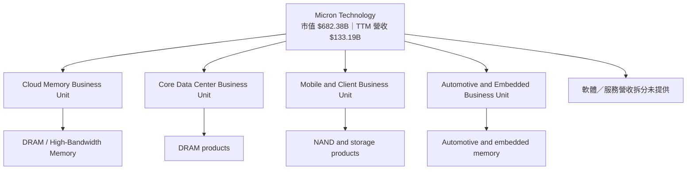
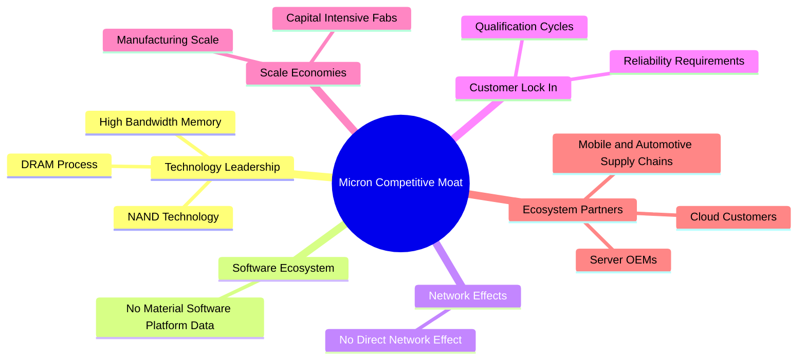
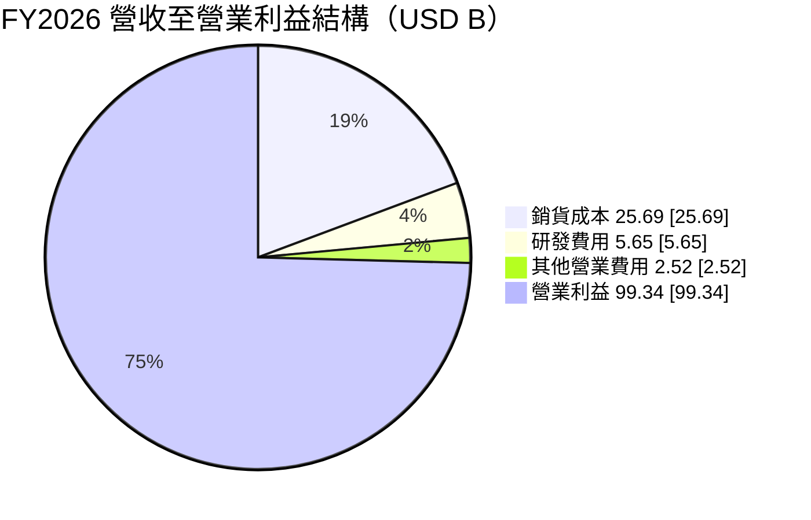
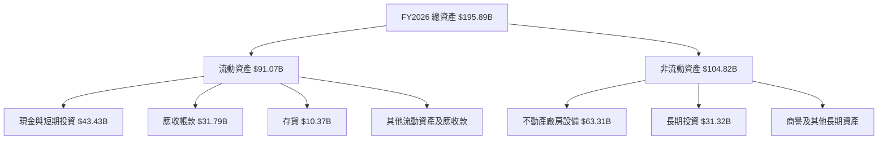
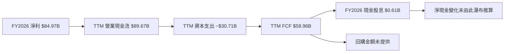
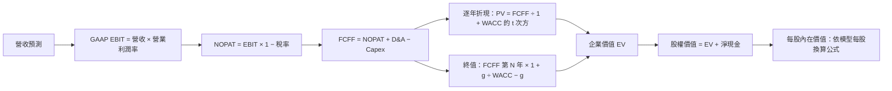
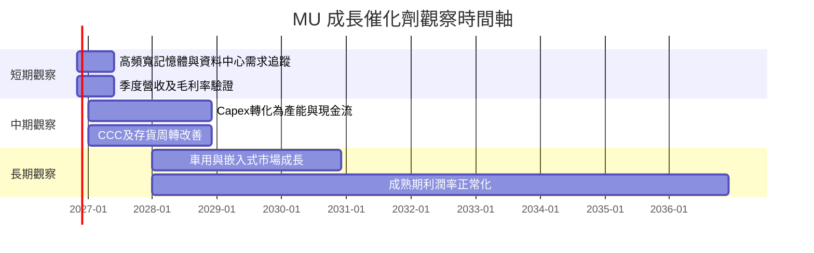
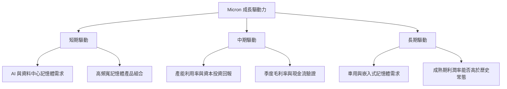
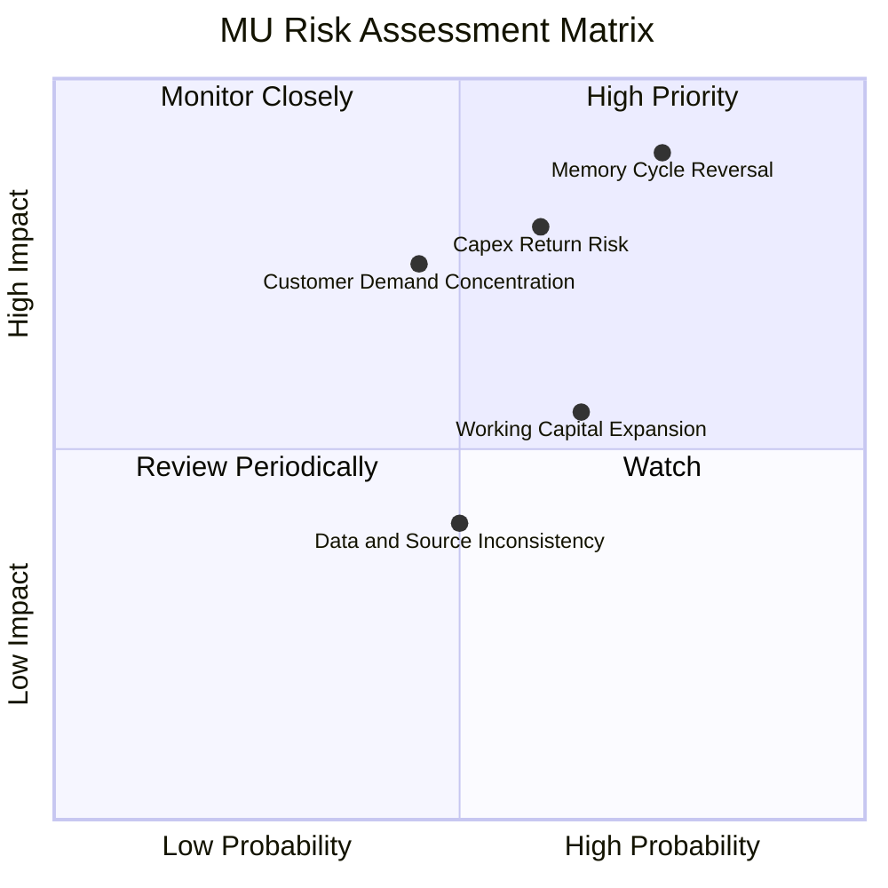
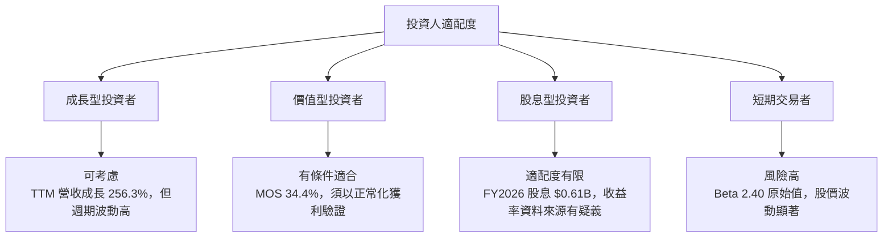

# MU 基本面深度分析報告
> **報告日期**：2026-11-27 ｜ **語言**：繁體中文 ｜ **數據來源**：SEC 申報資料 (XBRL)、Yahoo Finance、Finviz、StockAnalysis、Roic.ai ｜ **分析師**：CFA 級機構研究

## 目錄

| # | 章節 | 核心結論 |
|---|------|----------|
| 1 | 執行摘要 | 強烈買入；加權合理價值 $916.77；MOS +34.4% |
| 2 | 公司概覽與商業模式 | DRAM／NAND 記憶體供應商；市場份額與部門營收拆分未提供 |
| 3 | 損益表深度分析 | TTM 營收 $133.19B、TTM 成長 256.3%；利潤率處於週期高檔 |
| 4 | 資產負債表分析 | 淨現金 $40.15B，營運資金週期較一年前拉長 |
| 5 | 現金流量深度分析 | TTM FCF $58.96B，資本支出仍高 |
| 6 | 獲利能力與資本效率 | ROIC 86.2% 高於 WACC 14.00%，目前創造股東價值 |
| 7 | 相對估值分析 | P/E 低於自身歷史中位數；估值受記憶體週期高峰盈餘影響 |
| 8 | DCF 內在價值評估 | 基準 DCF $879.10；加權合理價值 $916.77 |
| 9 | 成長催化劑 | AI／高頻寬記憶體需求與資料中心需求為主要觀察方向 |
| 10 | 風險矩陣 | 記憶體週期反轉、資本支出回報與客戶需求是主要風險 |
| 11 | 投資建議 | MOS 支持強烈買入；需以季度毛利率、Capex、FCF 驗證 |

---

## 1. 執行摘要

### 1.0 一頁式投資儀表板

| 項目 | 內容 |
|------|------|
| **投資論點（3 句）** | ① TTM 營收達 **$133.19B**，較前一 TTM 增長 **256.3%**，反映記憶體價格、產品組合與需求回升共同推動營收擴張。② TTM FCF 為 **$58.96B**、FCF Yield **8.64%**，大額資本支出後仍產生現金。③ ROIC **86.2%** 高於 WACC **14.00%**，但目前利潤率與成長率可能包含週期高峰因素。 |
| **綜合評分** | **7.8/10**（引用 1.1 評分卡） |
| **財務健康** | 🟢 現金與短期投資 **$43.43B**、總債務 **$3.28B**、淨現金 **$40.15B**；但現金轉換週期由 155 天增至 185 天。 |
| **ROIC vs WACC** | **86.2% vs 14.00%**；按目前 TTM 回報率衡量，創造價值。 |
| **FCF 趨勢** | TTM FCF **$58.96B**；FY2025 為 **$1.67B**，FY2026 增至 **$58.96B**，主要受現金獲利大幅回升帶動；FCF Yield **8.64%**。 |
| **估值** | Forward P/E **2.93x** ｜ EV/EBITDA **5.90x** ｜ FCF Yield **8.64%**。低倍數需以週期正常化盈餘檢驗。 |
| **DCF 內在價值（基準）** | **$879.10**；相對 DCF 現價折價 **31.6%**（現價 ÷ DCF 價值 − 1）。 |
| **安全邊際（MOS）** | **+34.4%**＝($916.77 − $601.25) ÷ $916.77；🟢 高於 25%，加權合理價值基準來自 8.8。 |
| **預期報酬（基準情境 12M）** | DCF 基準情境相對現價 **+46.2%**；此為模型情境價差，非保證報酬。 |
| **關鍵風險（前二）** | 記憶體供需週期反轉；高資本支出未能轉化為可持續回報。 |
| **評級 + 信心度** | 🟢 **強烈買入** ｜ 信心：中。DCF 與同業估值支持上行，但資料包的現金／債務、ROE、季度利潤率欄位存在來源差異，且模型對高峰期獲利正常化高度敏感。 |

本報告評級是由估值與資本回報推導：加權合理價值 **$916.77** 對比 2026-11-25 收盤價 **$601.25**，MOS **+34.4%**；ROIC **86.2%** 高於 WACC **14.00%**。依 MOS 門檻應為強烈買入，未作質化調整。此結論不等於認定目前週期高峰利潤率可長期維持。

### 1.1 綜合評分卡（全報告唯一）

| 維度 | 評分（1–10） | 主要依據（引用數字與其來源章節） |
|------|--------------|----------------------------------|
| 成長性 | 9.0 | TTM 營收成長 **256.3%**、最新一季年增 **379.3%**；但成長率有強烈週期與低基期效應（第 3 章）。 |
| 獲利能力 | 9.0 | TTM 營業利益率 **74.6%**、ROIC **86.2%**、Piotroski **8/9**（第 3、6 章）。 |
| 財務健康 | 9.0 | 淨現金 **$40.15B**、流動比率 **3.314**；CCC 由 **155 天**升至 **185 天**（第 4 章）。 |
| 估值 | 8.0 | MOS **34.4%**，但盈餘處於週期高檔且市場價格波動大（第 7、8 章）。 |
| 護城河 | 7.0 | 記憶體製程、資本密集與客戶認證有利既有供應商；但產品具週期性，且市場份額數據未提供（第 2 章）。 |
| 管理層與資本配置 | 5.0 | FY2026 Capex **$30.71B**、SBC **$1.33B**；Piotroski 稀釋股數測試未通過，回購資料未提供（第 3、5、6 章）。 |
| **綜合評分** | **7.8** | 六項算術平均：**(9.0 + 9.0 + 9.0 + 8.0 + 7.0 + 5.0) ÷ 6 = 7.8**。 |

### 1.2 五大投資論點 + 三大核心風險

| 類型 | 項目 | 具體依據 | 信心度 |
|------|------|----------|--------|
| 🟢 **投資論點①** | 營收與獲利快速回升 | TTM 營收 **$133.19B**、TTM 年增 **256.3%**；最新一季營收年增 **379.3%**。若需求與定價維持，新增收入可帶來營業槓桿。 | 🟢 高 |
| 🟢 **投資論點②** | 現金流與淨現金充足 | TTM FCF **$58.96B**，現金加短期投資 **$43.43B**、總債務 **$3.28B**，具備承受週期下行的資產負債表緩衝。 | 🟢 高 |
| 🟢 **投資論點③** | 當前資本回報高於資本成本 | ROIC **86.2%**，WACC **14.00%**，差額 **72.2 個百分點**。若高回報能延續，資本擴張可增加經濟價值。 | 🟢 中高 |
| 🟢 **投資論點④** | 估值方法合成仍有折價 | 加權合理價值 **$916.77**，較現價 **$601.25** 高 **52.5%**；MOS 為 **34.4%**。 | 🟢 中 |
| 🟢 **投資論點⑤** | 財務質量指標偏正面 | Piotroski **8/9**；營業現金流 **$89.67B** 高於淨利 **$84.97B**，但應收與 CCC 上升須追蹤。 | 🟢 中 |
| 🟡 **風險①** | 記憶體週期反轉 | 營業利益率 TTM **74.6%**，DCF 假設逐步降至第 10 年 **26.1%**；若價格先行回落，盈餘可大幅低於現況。 | 🟡 中高 |
| 🔴 **風險②** | 資本支出回報與供給過剩 | TTM Capex **$30.71B**，約為營收 **23.1%**；若產能投放快於需求，折舊與價格壓力將侵蝕 FCF。 | 🔴 高 |
| 🟡 **風險③** | 營運資金占用增加 | DSO **87 天**、DIO **147 天**、CCC **185 天**，均顯示收入擴張伴隨更高資金占用。 | 🟡 中 |

### 1.3 快速統計卡片

| 指標 | 公司實際值（期間） | 同業中位數 | 狀態 |
|------|--------------------|------------|------|
| 營收成長（TTM） | **256.3%** | — | 🟢 |
| 營收成長（最新一季年增） | **379.3%** | **327.9%**（SKHY、SNDK、WDC 中位數） | 🟢 |
| 毛利率（TTM） | **80.7%** | **77.4%**（三家中位數） | 🟢 |
| 營業利益率（TTM） | **74.6%** | — | 🟢 |
| ROIC（TTM） | **86.2%** | — | 🟢 |
| Forward P/E | **2.93x** | **2.7x**（SKHY、SNDK、WDC 中位數） | 🟢 |
| FCF Yield（TTM） | **8.64%** | — | 🟢 |
| Piotroski F-Score | **8 / 9** | — | 🟢 |

同業中位數計算採用 Peer multiples 所列三家公司；Forward P/E 中位數為 2.7x、2.1x、6.8x 的中位數 **2.7x**。SKHY 的 P/S 與 EV/EBITDA 因幣別混合未提供，未納入相關比較。

### 1.4 投資結論

```
╔══════════════════════════════════════════════════════════════════╗
║                    📊 投資結論摘要                               ║
╠══════════════════════════════════════════════════════════════════╣
║  評級：強烈買入（MOS +34.4%，且 ROIC 86.2% > WACC 14.00%）       ║
║  價格（2026-11-25 收盤）：$601.25                                ║
║  DCF 內在價值（基準）：$879.10（相對 DCF 折價 31.6%）           ║
║  安全邊際 MOS：+34.4%（＝(加權合理價值−現價)÷加權合理價值）    ║
║  加權合理價值（8.8）：$916.77                                    ║
║  DCF 情境價值：                                                  ║
║    悲觀情境：$427.72（-28.9%）                                   ║
║    基準情境：$879.10（+46.2%）                                   ║
║    樂觀情境：$1,710.40（+184.5%）                                ║
║  綜合評分：7.8/10（引用 1.1）                                    ║
║  適合投資人：可承受週期波動的成長型、長線持有者                  ║
╚══════════════════════════════════════════════════════════════════╝
```

---

## 2. 公司概覽與商業模式

### 2.1 業務結構與收入來源

Micron Technology, Inc. 設計、製造並銷售半導體記憶體及儲存產品。公司概覽列出 Cloud Memory、Core Data Center、Mobile and Client、Automotive and Embedded 四個業務單位；財務數據未提供各單位營收或占比，因此不對其拆分金額作估算。



數據未提供四個業務單位的營收、占比與各自毛利率，亦未提供可拆分的軟體／服務收入。因而總營收與產品類別可描述，但無法量化各部門對成長或利潤率的貢獻。

### 2.2 市場份額

市場份額數據未提供，無法根據可引用資料繪製份額圖或列示市占率。Micron TTM 營收為 **$133.19B**，最新一季營收年增 **379.3%**；同業 SKHY、SNDK 最新一季營收年增分別為 **327.9%**、**377.9%**，WDC 為 **55.5%**。這些增速顯示相關供應商皆受產業景氣影響，但不能直接推導市占變化。

### 2.3 競爭護城河分析



記憶體的競爭優勢主要來自製程、良率、產品可靠性、資本投入能力與客戶認證週期，而非典型軟體網路效應。技術進步與產能投資可提高供應能力，但也可能加劇產業供給循環；缺乏可驗證的市占與客戶集中度數據，故不將護城河描述為永久性定價權。

### 2.4 護城河強度

| 護城河項目 | 強度（強／中／弱） | 證據（引用數字或事實） | 會削弱它的情況 |
|------------|--------------------|------------------------|----------------|
| 技術與製程 | 中 | 公司供應 DRAM、HBM、NAND；TTM 毛利率 **80.7%**，但此數字可能處於週期高檔。 | 競爭者追上製程或良率，產品性能差距縮小。 |
| 軟體生態系統 | 弱 | 財務與公司資料未顯示有大型軟體平台收入。 | 記憶體規格商品化，軟硬體綁定不足。 |
| 網路效應 | 弱 | 記憶體產品本身不具明顯直接網路效應；相關數字未提供。 | 替代供應商經認證後即可競標。 |
| 客戶鎖定與認證 | 中 | 半導體產品通常須符合客戶平台規格；具體客戶轉換成本數字未提供。 | 客戶多源化、規格相容、價格差距擴大。 |
| 規模效應 | 強 | TTM Capex **$30.71B**，顯示產業具高度資本密集性；資金與製造規模是進入門檻之一。 | 產能過剩導致規模不再帶來良好資本回報。 |
| 生態夥伴 | 中 | 業務涵蓋雲端、資料中心、行動與車用市場；各渠道收入占比未提供。 | 客戶自研、供應鏈重組或地緣政治限制。 |

**1.1「護城河」評分 7.0/10**，依據是資本密集、製程與客戶認證形成進入障礙；扣分原因為記憶體產品週期性強、網路效應弱，且缺少市占及客戶集中度數據。

---

## 3. 損益表深度分析

### 3.1 年度收入成長趨勢（近 4 年）

年度營收資料為 FY2023–FY2026。YoY 依所列年度營收計算，顯示記憶體產業下行與反彈幅度都很大。

```
╔══════════════════════════════════════════════════════════════════╗
║             Micron 年度收入趨勢（FY2023–FY2026）                 ║
╠══════════════════════════════════════════════════════════════════╣
║  FY2023  $15.54B  ███░░░░░░░░░░░░░░░░░░░░░  YoY: -49.5% 🔴    ║
║  FY2024  $25.11B  █████░░░░░░░░░░░░░░░░░░░  YoY: +61.6% 🟢    ║
║  FY2025  $37.38B  ███████░░░░░░░░░░░░░░░░░  YoY: +48.9% 🟢    ║
║  FY2026 $133.19B  █████████████████████████ YoY:+256.3% 🟢    ║
║                                                                  ║
║  FY2023 至 FY2026 累計 CAGR：約 104.7%                          ║
╚══════════════════════════════════════════════════════════════════╝
```

FY2023 至 FY2026 三年 CAGR 約 **104.7%**，但此結果不是穩態成長率：FY2023 營收曾降至 **$15.54B**，其後逐步復甦，FY2026 營收跳升至 **$133.19B**。如此高的 CAGR 不能直接外推；DCF 將第 1 年成長設為 30%，並逐年降至第 10 年 3%，比延續歷史 CAGR 更符合成熟化推理。

### 3.2 季度收入趨勢分析

| 季度 | 營收 | QoQ 成長 | YoY 成長 | 備註 |
|------|------:|---------:|---------:|------|
| 2025-11 | $13.64B | +20.6% | +56.7% | 以 2025-08 季 **$11.315B** 為 QoQ 基準；YoY 為單季年增。 |
| 2026-02 | $23.86B | +74.9% | +196.3% | 營收擴張加速；可能反映需求與產品組合改善。 |
| 2026-05 | $41.46B | +73.7% | +345.7% | 連續大幅季增，週期反彈與基期因素並存。 |
| 2026-08 | $54.23B | +30.8% | +379.3% | QoQ 仍增加，但增速較前兩季低；YoY 仍極高。 |

QoQ 使用相鄰季度營收計算，YoY 採資料列出的最新一季同比數據。季度營收從 **$13.64B** 增至 **$54.23B**，業務擴張明確；然而連續高增速也提高市場對價格、供應與客戶拉貨變化的敏感度。

### 3.3 利潤率演變分析

| 利潤率指標 | FY2023 | FY2024 | FY2025 | FY2026 | 趨勢 | 評估 |
|------------|--------:|--------:|--------:|--------:|------|------|
| **毛利率** | -9.1% | 22.3% | 39.8% | 80.7% | 由負轉正並大幅擴張 | 🟢 |
| **營業利益率** | -34.8% | 5.2% | 26.1% | 74.6% | 固定成本吸收與定價／產品組合轉好 | 🟢 |
| **淨利率** | -37.5% | 3.1% | 22.8% | 63.8% | 淨利隨週期復甦急升 | 🟢 |

以上年度比率由年度毛利、營業利益、淨利除以年度營收計算，金額取自年度損益表。FY2026 毛利 **$107.50B**、營業利益 **$99.34B**、淨利 **$84.97B**。毛利率與營業利益率的快速擴張，與記憶體價格回升、產品組合改善及固定製造成本吸收有關；但由 FY2023 的負利潤率升至 FY2026 高位，也說明利潤率具明顯週期性，不能把當期水準當作常態。

另有季度資料源欄位不一致：以 FY2026 Q4 損益表的營業利益 **$43.75B** 除以營收 **$54.23B**，可得約 **80.7%**；而合併財務摘要的「最新季度營業利益率」另列 **80.7%**，另一個市場資料欄位則列 **74.6%**。本報告後續採用 VERIFIED FIGURES 指定的最新季度 **80.7%**，TTM **74.6%**。

### 3.4 費用結構分析

FY2026 營收 **$133.19B**、毛利 **$107.50B**、營業利益 **$99.34B**、研發費用 **$5.65B**。以營收減毛利推算銷貨成本，以毛利減營業利益推算營業費用總額，再扣除研發得到其他營業費用殘額；下圖是依年度表列數值計算的簡化營業損益結構，不代表完整現金費用分類。



```
╔══════════════════════════════════════════════════════════════════╗
║            FY2026 營收與營業利益簡化結構（USD B）                ║
╠══════════════════════════════════════════════════════════════════╣
║  營收          133.19  █████████████████████████                 ║
║  毛利          107.50  ████████████████████                      ║
║  營業利益       99.34  ██████████████████                        ║
║  研發費用        5.65  █                                         ║
║  銷貨成本       25.69  █████                                     ║
║  其他營業費用    2.52  ░                                         ║
╚══════════════════════════════════════════════════════════════════╝
```

### 3.5 季度 EPS 趨勢與盈餘品質（Quality of Earnings）

最近四季 EPS 實際值依 StockAnalysis 季度表列示；EPS 預期值與驚喜幅度資料缺失，因此不能判定超預期或不及預期。

| 季度 | EPS 實際 | EPS 預估 | 超預期／不及預期 |
|------|---------:|---------:|----------------|
| 2025-11 | $4.60 | N/A | N/A（估計值與驚喜數據未提供） |
| 2026-02 | $12.07 | N/A | N/A（估計值與驚喜數據未提供） |
| 2026-05 | $24.67 | N/A | N/A（估計值與驚喜數據未提供） |
| 2026-08 | $32.85 | N/A | N/A（估計值與驚喜數據未提供） |

| 盈餘品質項目 | 數值/佔比 | 評估 |
|--------------|-----------|------|
| 股權薪酬 SBC / 營收 | **1.00%**（$1.33B ÷ $133.19B） | 🟡 SBC 絕對額相對收入不高，但仍造成股東稀釋；Piotroski 稀釋股數測試未通過。 |
| SBC / 營業現金流 | **1.48%**（$1.33B ÷ $89.67B） | 🟢 占營業現金流比重有限；不代表 SBC 沒有經濟成本。 |
| FCF / 淨利（現金轉換率） | **69.4%**（$58.96B ÷ $84.97B） | 🟡 正向但低於 100%，主因大額 Capex 吸收現金；若資本支出仍高，FCF 成長會落後淨利。 |
| 一次性／非經常性損益 | N/A | 未提供可核實的非經常性項目拆分，不能判定是否美化或壓低當期盈餘。 |
| 有效稅率 | **14.8%** | 來自最新年度有效稅率；缺乏多年稅務調節明細，不能排除年度稅率波動。 |
| 資本化支出 vs 費用化 | TTM Capex **$30.71B**；資本化政策細項 N/A | Capex 形成資產並經折舊進入費用；若產能回報不足，當期 EBITDA 可能高估資本投入後的經濟盈餘。 |

SBC 的比例有限但不是零成本；估值的主要品質折讓來自產業週期與資本支出，而非 SBC。TTM 營業現金流 **$89.67B** 高於淨利 **$84.97B**，但扣除 **$30.71B** Capex 後 FCF 對淨利轉換率為 **69.4%**。GAAP 盈餘具現金流支撐，但自由現金流受製造投資需求顯著影響。

---

## 4. 資產負債表分析

### 4.1 資產結構分解

FY2026 總資產 **$195.89B**、流動資產 **$91.07B**；非流動資產為兩者差額 **$104.82B**。細項依 StockAnalysis 年度資產負債表，單位為 USD B。



其他流動項目及部分長期資產細分在資料中分列不同項目；本圖僅列有明確金額且可辨識的項目。應收帳款及存貨合計約 **$42.17B**，顯示營收大幅擴張伴隨相當規模的營運資金需求。

### 4.2 流動性與營運資金分析

| 指標 | 最新 TTM | 一年前 TTM | 變化 | 解讀 |
|------|----------|------------|------|------|
| 流動比率 | **3.314** | N/A | N/A | 流動資產高於流動負債，短期償付緩衝充足；一年前同口徑比率未列入品質數據。 |
| 速動比率 | **2.898** | N/A | N/A | 排除存貨後仍具流動性；未提供同口徑歷史序列。 |
| DSO 應收帳款天數 | **87 天** | **70 天** | **+17 天** | 收款週期拉長；收入擴張可能推高期末應收，但也需檢查信用條款與回款品質。 |
| DIO 存貨天數 | **147 天** | **136 天** | **+11 天** | 存貨天數增加，可能反映備貨與產能爬坡；若需求轉弱，存貨減值與折價風險上升。 |
| DPO 應付帳款天數 | **50 天** | **51 天** | **−1 天** | 付款期大致持平，沒有明顯延長供應商付款以美化現金流的訊號。 |
| CCC 現金轉換週期 | **185 天** | **155 天** | **+30 天** | 應收及存貨天數增加是主因，資金回收效率較一年前下降。 |

品質數據的 DSO／DIO／DPO／CCC 依期末資產負債項目與 TTM 流量計算，按要求照列。CCC 變長與業務擴張可能同時發生，不能單獨視為需求轉弱；關鍵是未來應收回款、存貨去化及庫存跌價是否惡化。

### 4.3 債務結構分析

以下採用 VERIFIED FIGURES 的現金、短期投資、債務與淨現金數字；市場資料區另有總債務 **$5.18B**、淨現金 **$38.26B**，與 SEC／程式計算數據不一致。此處依規則優先採用已驗證數字，差異須在後續申報資料中核對。

```
╔══════════════════════════════════════════════════════════════════╗
║                    Micron 債務健康診斷                           ║
╠══════════════════════════════════════════════════════════════════╣
║  總債務：             $3.28B  █                                  ║
║  現金＋短期投資：    $43.43B  ████████████████████               ║
║  淨現金：            $40.15B  ██████████████████  🟢             ║
║                                                                  ║
║  流動比率：           3.314x  🟢                                 ║
║  速動比率：           2.898x  🟢                                 ║
║  Debt/EBITDA：        0.03x   🟢（$3.28B ÷ $109.28B）            ║
║  利息保障倍數：       N/A（利息費用資料未提供）                  ║
╚══════════════════════════════════════════════════════════════════╝
```

Debt/EBITDA 以 TTM EBITDA **$109.28B** 及 VERIFIED FIGURES 總債務 **$3.28B** 計算，約 **0.03x**。這是極低的帳面槓桿，但記憶體產業的風險主要仍是週期與固定資本投入，而不是當下債務償付。

### 4.4 股東權益趨勢

| 年度 | 股東權益 | 年增變化 |
|------|---------:|---------:|
| FY2023 | $44.12B | — |
| FY2024 | $45.13B | +2.3% |
| FY2025 | $54.16B | +20.0% |
| FY2026 | $138.38B | +155.5% |

```
╔══════════════════════════════════════════════════════════════════╗
║                   Micron 股東權益趨勢（USD B）                   ║
╠══════════════════════════════════════════════════════════════════╣
║  FY2023  $44.12B  ████████                                      ║
║  FY2024  $45.13B  ████████                                      ║
║  FY2025  $54.16B  ██████████                                    ║
║  FY2026 $138.38B  █████████████████████████                     ║
╚══════════════════════════════════════════════════════════════════╝
```

FY2026 權益增加與大幅獲利回升相符；單一年度快速增長不能線性外推。股東權益、ROE 及現金債務在不同資料源間存在差異，估值與財務比率以本報告明確採用的 VERIFIED FIGURES 為準。

---

## 5. 現金流量深度分析

### 5.1 現金流量瀑布圖



營業現金流高於淨利 **$4.70B**，但 Capex 達 **$30.71B**，所以 FCF 低於淨利。現金股息支付約 **$0.61B**；回購及完整現金變化未提供，不以剩餘現金流反推。

### 5.2 FCF 轉換率趨勢

| 年度 | FCF | 淨利 | FCF／淨利 | 解讀 |
|------|----:|----:|----------:|------|
| FY2023 | −$6.12B | −$5.83B | N/A（分母為負） | 週期下行時仍有高資本支出，FCF 為負。 |
| FY2024 | $0.12B | $0.78B | 15.6% | 損益轉正但現金轉換仍低，Capex 吸收現金。 |
| FY2025 | $1.67B | $8.54B | 19.6% | 淨利回升快於 FCF，投資支出仍重。 |
| FY2026 | $58.96B | $84.97B | 69.4% | 現金產生能力大幅改善，但仍未達淨利等額轉換。 |

### 5.3 自由現金流趨勢

```
╔══════════════════════════════════════════════════════════════════╗
║                Micron 自由現金流趨勢（USD B）                    ║
╠══════════════════════════════════════════════════════════════════╣
║  FY2023  -$6.12B  ◀██░░░░░░░░░░░░░░░░░░░  FCF 為負             ║
║  FY2024   $0.12B  ░░░░░░░░░░░░░░░░░░░░░░  近乎損益兩平         ║
║  FY2025   $1.67B  █░░░░░░░░░░░░░░░░░░░░░  FCF Yield 未提供     ║
║  FY2026  $58.96B  ███████████████████████  FCF Yield 8.64%      ║
╚══════════════════════════════════════════════════════════════════╝
```

FY2026 FCF 的躍升反映營運現金流由 FY2025 **$17.52B** 增至 **$89.67B**，同時 Capex 由 **$15.86B** 增至 **$30.71B**。這是營業復甦大於資本支出增幅的結果；後續若營收或價格下滑，而Capex仍維持高位，FCF 可能快速收縮。

### 5.4 資本配置評估

資料未提供回購金額與留存盈餘的完整用途拆分，因此不以圓餅圖推算資本配置比例。

| 項目 | FY2026／TTM 金額 | 評估 |
|------|------------------:|------|
| Capex | **$30.71B** | 高額投入產能及設備；回報取決於需求、價格與產能利用率。 |
| 現金股息 | **$0.61B** | 相較 TTM FCF **$58.96B** 規模有限。 |
| 股票回購 | N/A | 資料未提供，不能判定回購是否抵銷 SBC 稀釋。 |
| SBC | **$1.33B** | 約為 TTM 營收 1.00%，但稀釋股數測試未通過。 |
| 留存現金 | N/A | 未提供完整現金用途拆解。 |

---

## 6. 獲利能力與資本效率

### 6.1 ROE / ROA / ROIC 趨勢

| 指標 | 歷史數據 | 評估 |
|------|----------|------|
| ROE（TTM） | **61.4%**（QUALITY FIGURES） | 高回報，但其中可能包含週期高峰淨利率；此處採用品質數據的 ROE。 |
| ROA（TTM） | **N/A（品質區塊未提供數值）** | 其他彙整欄位另列 44.6%，但不替換 QUALITY FIGURES 指標。 |
| ROIC（TTM） | **86.2%** | 明顯高於 14.00% WACC；不能假設此高峰值長期維持。 |
| 歷年 ROIC／ROE 系列 | N/A | 未提供與當前定義一致的完整歷史序列。 |

市場資料另列 ROE **88.3%**、ROA **44.6%**，與 QUALITY FIGURES 的 ROE **61.4%** 不一致。為遵守品質指標照抄要求，本文 ROE 採 **61.4%**，不與其他口徑混用。

### 6.2 ROIC vs WACC 分析（核心價值創造判斷）

WACC 按資本成本數據原值採 **14.00%**。資料另明示未限制前計算值 **14.45%**，因內部規則設有 **7%–14%** 上限而採用 14.00%。此處不另建 WACC。

```
╔══════════════════════════════════════════════════════════════════╗
║                ROIC vs WACC 深度分析                            ║
╠══════════════════════════════════════════════════════════════════╣
║  WACC 來源：Cost of capital 資料                                ║
║  ├── 無風險利率（10Y 美債）：       4.85%                       ║
║  ├── 市場風險溢酬（假設）：          5.00%                       ║
║  ├── 原始 Beta：                     2.40                        ║
║  ├── 調整後 Beta：                   1.93                        ║
║  ├── 股權成本 Ke：                  14.51%                      ║
║  ├── 稅前債務成本：                  3.23%                       ║
║  ├── 有效稅率：                     14.8%                       ║
║  ├── 股權／債務權重：                99.5%／0.5%                  ║
║  ├── 未限制計算值：                 14.45%                      ║
║  └── ✅ 採用 WACC：                 14.00%（限制區間上緣）      ║
║                                                                  ║
║  ROIC（TTM）：                       86.2%                       ║
║  EVA spread = ROIC − WACC：         72.2 個百分點                ║
║  ROIC / WACC：                       6.16x                       ║
║                                                                  ║
║  ROIC  86.2%  ▓▓▓▓▓▓▓▓▓▓▓▓▓▓▓▓▓▓▓▓▓▓▓▓▓▓▓▓▓▓▓▓  🟢            ║
║  WACC  14.0%  ▓▓▓▓▓░░░░░░░░░░░░░░░░░░░░░░░░░░░  ──            ║
╠══════════════════════════════════════════════════════════════════╣
║  結論：以 TTM 回報計算，Micron 正創造股東價值；週期正常化後仍需驗證。║
╚══════════════════════════════════════════════════════════════════╝
```

ROIC 與 WACC 差額計算為 **86.2% − 14.0% = 72.2 個百分點**；倍數為 **86.2% ÷ 14.0% = 6.16x**。當期差距很大，但 ROIC 以 TTM 稅後營業利益計算，對記憶體價格與高峰利潤率敏感；若資本回報下滑，EVA 將同步收窄。

### 6.3 杜邦三因素分解

| 因素 | 數值（TTM） | 解讀 |
|------|-------------|------|
| 淨利率 | **63.8%** | 高淨利率是 ROE 的主要來源，但與當期記憶體週期高度相關。 |
| 資產週轉率 | **0.68** | 每單位資產的營收轉換效率；資本密集型製造業需結合產能利用率觀察。 |
| 權益乘數 | **1.42** | 槓桿程度不高，ROE 並非主要靠財務槓桿推高。 |
| **ROE** | **61.4%** | QUALITY FIGURES 原值：63.8% × 0.68 × 1.42 = 約 61.4%（原數字依未四捨五入底層值計算）。 |

### 6.4 財務體質：Piotroski F-Score

Piotroski F-Score 為 **8 / 9**。有缺漏輸入的測試不計入；本次列出的九項結果中一項未通過。

| 測試 | 結果 | 解讀 |
|------|------|------|
| ROA > 0 | ✅ 通過 | TTM 獲利為正。 |
| 營業現金流 > 0 | ✅ 通過 | TTM 營業現金流 **$89.67B**。 |
| ROA 高於一年前 | ✅ 通過 | 獲利能力改善。 |
| 營業現金流 > 淨利 | ✅ 通過 | **$89.67B > $84.97B**，現金流支撐盈餘。 |
| 長期負債 ÷ 總資產低於一年前 | ✅ 通過 | 槓桿相對改善。 |
| 流動比率高於一年前 | ✅ 通過 | 流動性指標改善。 |
| 稀釋股數未增加 | ❌ 未通過 | 股數有增加，代表 SBC 或其他股權發行造成稀釋。 |
| 毛利率高於一年前 | ✅ 通過 | 毛利率較一年前提高。 |
| 資產週轉率高於一年前 | ✅ 通過 | 資產使用效率改善。 |

F-Score 的正向訊號主要反映獲利、現金流、流動性及毛利率復甦；未通過的股數測試提醒投資者，股東回報不應只看總利潤，亦應追蹤每股盈餘與稀釋後股數。

---

## 7. 相對估值分析

### 7.1 同業估值比較表格

| 估值指標 | **MU** | **SKHY** | **SNDK** | **WDC** | MU 評估 |
|----------|-------:|---------:|---------:|--------:|-----------|
| **Trailing P/E** | **8.1x** | 6.2x | 4.7x | 9.6x | 🟡 位於同業範圍中間；週期高峰 EPS 會壓低倍數。 |
| **Forward P/E** | **2.93x** | 2.7x | 2.1x | 6.8x | 🟢 低於 WDC、高於 SKHY／SNDK；遠期盈餘預測可能偏高。 |
| **P/S Ratio** | **5.12x** | N/A | 2.9x | 7.0x | 🟡 介於同業兩端；SKHY 因混合幣別未提供。 |
| **EV/EBITDA** | **5.90x** | N/A | 3.7x | 16.1x | 🟢 低於 WDC、高於 SNDK；不宜忽略週期高峰 EBITDA。 |
| **最新一季營收年增** | **379.3%** | 327.9% | 377.9% | 55.5% | 🟢 MU 增速高，但單季同比並非 TTM 成長率。 |
| **毛利率（TTM）** | **80.7%** | 77.4% | 80.0% | 52.6% | 🟢 MU 略高於 SNDK 與 SKHY；應注意產業景氣差異。 |

同業倍數完全採 Yahoo Peer multiples；SKHY 的 P/S 與 EV/EBITDA 為 N/A，未以其他來源替代。MU 的低 P/E、EV/EBITDA 不等同低估定論，因當期盈餘受記憶體週期高峰放大。

### 7.2 歷史估值區間分析

| 指標 | 現值 | 五年中位數 | 五年區間 | 當前百分位 |
|------|-----:|----------:|----------|-----------:|
| P/E | **8.1x** | **17.4x** | 7.4x–138.5x | **7%** |
| P/S | **5.2x** | **4.2x** | 2.1x–11.7x | **65%** |
| EV/EBITDA | **5.9x** | **9.7x** | 3.6x–80.7x | **20%** |

```
╔══════════════════════════════════════════════════════════════════╗
║               MU 歷史估值位置（五年 TTM）                        ║
╠══════════════════════════════════════════════════════════════════╣
║  P/E       7.4x ├●8.1x────────17.4x──────────138.5x             ║
║                    現值百分位 7%                                  ║
║  P/S       2.1x ────────4.2x────●5.2x────────11.7x              ║
║                                  現值百分位 65%                   ║
║  EV/EBITDA 3.6x ───●5.9x──────9.7x───────────80.7x              ║
║                         現值百分位 20%                            ║
╚══════════════════════════════════════════════════════════════════╝
```

P/E 與 EV/EBITDA 位於自身歷史偏低區域，而 P/S 高於歷史中位數。差異主要來自當期利潤率與盈餘急升：若利潤率回歸，P/E 的低百分位可能迅速回升，故收入倍數與週期正常化獲利更有參考價值。

### 7.3 情境價值（Bear / Base / Bull）

以下數字照 DCF MODEL 的情境結果列示，百分比相對 2026-11-25 收盤價 **$601.25**。

| 情境 | 第 1 年營收成長 | 期末營業利潤率 | WACC | 每股價值 | 相對現價 | 機率 | 會發生的條件 |
|------|----------------:|----------------:|-----:|---------:|---------:|-----:|--------------|
| 🔴 悲觀 | 15.0% | 22.2% | 15.00% | **$427.72** | **−28.9%** | 25% | 記憶體價格及需求降溫較快，利潤率回歸低於基準，資本成本維持高位。 |
| 🟡 基準 | 30.0% | 26.1% | 14.00% | **$879.10** | **+46.2%** | 50% | 近期需求延續，但長期成長與利潤率逐年正常化。 |
| 🟢 樂觀 | 45.0% | 28.8% | 13.00% | **$1,710.40** | **+184.5%** | 25% | AI／資料中心記憶體需求強於預期，成長與成熟期利潤率均高於基準。 |

情境不是預測保證。悲觀與樂觀情境的差距很大，主要反映記憶體週期及折現率對長期現金流的高槓桿影響。

### 7.4 相對估值隱含價格區間

```
╔══════════════════════════════════════════════════════════════════╗
║             估值方法隱含股價（USD／股）                         ║
╠══════════════════════════════════════════════════════════════════╣
║  $582.92       $601.25       $879.10       $985.24       $1,529.69║
║  同業 P/S       現價           DCF        同業 EV/EBITDA   分析師共識║
╚══════════════════════════════════════════════════════════════════╝
```

| 方法 | 每股價值 | 相對現價 | 依據 |
|------|---------:|---------:|------|
| DCF（基準） | **$879.10** | +46.2% | 10 年 FCFF、WACC 14.00%、終值成長率 3.0%。 |
| 同業 EV/EBITDA | **$985.24** | +63.9% | SNDK、WDC 中位數 **9.9x** × TTM EBITDA，再加回淨現金。 |
| 同業 P/S | **$582.92** | −3.0% | SNDK、WDC 中位數 **5.0x** × TTM 營收。 |
| 分析師共識目標價 | **$1,529.69** | +154.4% | 45 位分析師平均目標價；屬外部參考，分散度與預測期限需注意。 |

同業估值回推股價呈現明顯分歧：P/S 方法約等於現價，而 EV/EBITDA 方法高出現價。這反映倍數選擇對週期峰值 EBITDA 的敏感性。

---

## 8. DCF 內在價值評估（Discounted Cash Flow）

### 8.0 估值推理鏈（Thinking Logic）

**Step 1 — 價值來源與主導變數**

MU 的價值可拆為：現有 DRAM／NAND 記憶體營收底盤（TTM **$133.19B**，包括雲端、資料中心、行動與車用業務）、成長中的高頻寬記憶體與資料中心需求（個別營收占比未提供），以及尚未量化的長期新應用選擇權。以現有資料不能給各部分任意分配比重。估值主導變數是**長期營業利潤率與 WACC**：DCF 由 TTM 營業利益率 **74.6%** 漸降至第 10 年 **26.1%**，且終值現值占 EV **33.9%**，因此週期正常化假設直接影響現金流與終值。

**Step 2 — 模型選擇**

| 決策點 | 本報告採用 | 理由（含數字） | 曾考慮但否決 | 否決理由 |
|--------|-----------|----------------|--------------|----------|
| 現金流定義 | FCFF | 與 WACC 折現、先求 EV 再加淨現金一致；Net cash **$40.15B**。 | FCFE | 債務融資變動不應直接混入企業營運現金流。 |
| 預測期 N | 10 年 | DCF MODEL 固定預測 **10 年**，讓週期高峰利潤率逐步衰減。 | 5 年 | 已有模型採 10 年，不能自行更改；5 年更容易把終值推至近端。 |
| 終值方法 | Gordon Growth | WACC **14.00%** 高於 g **3.0%**，模型可計算。 | 退出倍數 | DCF MODEL 未提供退出倍數終值，不能另建模型。 |
| EBIT 基礎 | GAAP EBIT | 模型說明採 GAAP EBIT，SBC 已列為費用。 | 非 GAAP EBIT | 會將已計入費用的 SBC 加回，與固定股數假設不一致。 |

**Step 3 — 關鍵假設推導鏈**

- **營收成長路徑**：錨點＝TTM 營收年增 **256.3%**、最新一季同比 **379.3%**；調整＝基期與記憶體週期高峰使近期成長不可直線外推，模型限制第 1 年成長不高於 30%，並線性衰減；**採用 FY+1 30.0%，FY+10 3.0%**；曾考慮延續 256.3% TTM 增長，但否決，因為那是週期反彈期數字且遠高於長期成熟企業成長。
- **期末營業利潤率**：錨點＝TTM GAAP EBIT margin **74.6%**，五年歷史中位數（含 TTM）為模型所用終點 **26.1%**；調整＝逐年向歷史中位數回歸；**採用 74.6% 線性降至 26.1%**；曾考慮維持 74.6%，但否決，因五年中位數低於當前 TTM 且記憶體有價格週期。
- **預測期 N**：錨點＝DCF MODEL 設定 **10 年**；調整＝讓高峰期現金流逐步轉成成熟期，不改動已計算模型；**採用 10 年**；曾考慮 5 年，但資料包模型固定 10 年，不能替換。
- **Capex／營收**：錨點＝TTM Capex／營收 **23.1%**；調整＝資本支出率從高位逐年下降，末年不低於約 1.1 倍 D&A；**採用 FY+1 23.1% 降至 FY+10 7.8%**；曾考慮維持 23.1%，但否決，因模型假設成熟期投資強度降低。
- **有效稅率**：錨點＝最新年度有效稅率 **14.8%**；**採用 14.8%**；未另調整，亦不假設額外稅務利益。
- **D&A／營收**：錨點＝TTM **7.1%**；**採用 7.1% 固定**。折舊攤銷率未隨 Capex 一起下調，為模型設定。
- **ΔWC**：FCFF 公式雖一般可含營運資金變動，但 DCF MODEL 明確未建模營運資金；**採用不另列 ΔWC**。歷史 CCC 由 155 天增至 185 天，故此簡化可能高估現金流。
- **GAAP EBIT、SBC 與股數**：錨點＝FY2026 SBC **$1.33B**、TTM 營收 **$133.19B**；**採用組合 (A)：GAAP EBIT＋固定股數，不另扣 SBC，年稀釋率 0%**。模型明示 SBC 已在 GAAP EBIT 費用化，股數不再稀釋；曾考慮再扣 SBC 或加年稀釋率，但會重複計算同一股東成本。
- **永續成長率 g**：錨點＝長期成熟企業成長假設；資料未提供管理層長期財測或宏觀長期名目 GDP 數字；**採用模型值 3.0%**，低於 WACC 14.00%；曾考慮較高的 4.0%，但未採用，以避免終值更依賴較樂觀假設。
- **終值方法**：錨點＝第 10 年 FCFF **$128.62B**；採 Gordon Growth，**WACC 14.00%、g 3.0%**。退出倍數沒有模型值，故不自行補入另一套估值。
- **WACC**：錨點＝資本成本資料明列 WACC **14.00%**；計算值 **14.45%** 被 7%–14% 範圍上限限制；**採用 14.00%**，不使用另行推估折現率。

**Step 4 — 最脆弱假設**

最脆弱環節是週期高峰後的營業利潤率路徑；若需求、定價或產品組合較基準更快轉弱，情境模型顯示悲觀每股價值 **$427.72**，低於現價 **28.9%**。

**Step 5 — 計算路徑圖**



### 8.1 模型假設總表（Model Inputs）

| 假設項目 | 採用值 | 依據／來源 | 敏感度 |
|----------|--------|-------------|--------|
| 預測期長度 N | **10 年** | DCF MODEL 固定預測期。 | 🟡 中 |
| 營收成長路徑 | **FY+1 30.0% → FY+10 3.0%** | TTM 成長 256.3%，模型限制初始增長在 0%–30%，再線性衰減。 | 🔴 高 |
| 營業利潤率 | **74.6% → 26.1%** | 目前 TTM 營業利益率，逐步回歸模型所用五年中位數。 | 🔴 高 |
| 有效稅率 | **14.8%** | 最新年度有效稅率。 | 🟢 低 |
| Capex／營收 | **23.1% → 7.8%** | TTM Capex／營收起點，逐步回落至模型終值設定。 | 🟡 中 |
| D&A／營收 | **7.1%** | TTM 比率，模型固定。 | 🟢 低 |
| 營運資金變動 | **未建模** | DCF MODEL 明示 Working capital is not modelled；不自行補估。 | 🟢 低（模型限制） |
| EBIT 基礎 | **GAAP EBIT** | DCF MODEL 明示 GAAP，SBC 已為費用。 | 🟡 中 |
| SBC 處理 | **組合 (A)：不另扣 SBC** | SBC 已計入 GAAP EBIT；固定股數，不重複扣除。 | 🟡 中 |
| 年稀釋率 | **0%** | 模型假設固定股數，與組合 (A) 相容。 | 🟡 中 |
| 永續成長率 g | **3.0%** | DCF MODEL 原值，且低於 WACC。 | 🔴 高 |
| 終值方法 | **Gordon Growth** | 模型提供 TV；未提供退出倍數法結果。 | 🔴 高 |
| WACC | **14.00%** | Cost of capital 模型值；未限制值 14.45%，受 7%–14%區間限制。 | 🔴 高 |

FCFF 定義為模型指定的 **FCFF = NOPAT + D&A − Capex**；營運資金變動不建模。**本模型採用組合 (A)，故 SBC 影響已透過 GAAP EBIT 計入一次；不再另扣 SBC，亦不另計股數稀釋。**

### 8.2 折現率推導（WACC）

```text
╔══════════════════════════════════════════════════════════════════╗
║                    WACC 推導（折現率）                           ║
╠══════════════════════════════════════════════════════════════════╣
║  股權成本 Ke（CAPM）：                                           ║
║  ├── 無風險利率 Rf：                 4.85%                      ║
║  ├── 市場風險溢酬 ERP：               5.00%                      ║
║  ├── 原始 Beta（Yahoo）：             2.40                       ║
║  ├── 調整後 Beta：                    1.93                       ║
║  ├── 調整方式：                       ⅔ × 2.40 + ⅓ × 1          ║
║  └── 股權成本 Ke：                    14.51%                     ║
║                                                                  ║
║  債務成本 Kd：                                                   ║
║  ├── 稅前 Kd：                        3.23%                      ║
║  ├── 有效稅率：                       14.8%                      ║
║  └── 稅後 Kd：                        3.23% × (1−14.8%) = 2.75% ║
║                                                                  ║
║  資本結構（市場權重）：                                          ║
║  ├── 股權權重 E：                     99.5%                      ║
║  ├── 債務權重 D：                      0.5%                      ║
║  ├── 未限制 WACC：                    14.45%                     ║
║  └── ✅ 採用 WACC：                   14.00%（限制於 7%–14%）   ║
╚══════════════════════════════════════════════════════════════════╝
```

**逐步演算與資料限制：**

1. **Ke（CAPM）**：Cost of capital 提供 Ke **14.51%**；原始 Beta **2.40** 經調整為 **1.93**，方式為 **⅔ × 2.40 + ⅓ × 1 = 1.9333… ≈ 1.93**。以表列一位小數輸入計算，**4.85% + 1.93 × 5.00% = 14.50%**；資料包採用 **14.51%**，反映未四捨五入 Beta，報告依規則照用 **14.51%**。
2. **稅前 Kd**：資料提供利息／債務的稅前成本 **3.23%**；利息費用與同口徑平均計息負債金額未列示，不能自行反推。
3. **稅後 Kd**：**3.23% × (1 − 14.8%) = 3.23% × 0.852 = 2.75196% ≈ 2.75%**。
4. **權重**：依 Cost of capital 區塊原值，E 權重 **99.5%**、D 權重 **0.5%**；**99.5% + 0.5% = 100.0%**。市值資料為 **$682.38B**；債務權重以區塊所列資本結構權重為準，不重建另一套權重。
5. **未限制 WACC**：資料包列示計算值 **14.45%**；因 WACC 被限制在 **7%–14%**，**採用值 = min(14.45%, 14.00%) = 14.00%**。

本章與第 6.2 節及 DCF 模型均使用 **14.00%**。平均計息負債、利息費用明細與債務權重的完整底層橋接未提供，因此不以資產負債表中不同口徑債務重算 WACC。

### 8.3 逐年自由現金流預測（基準情境）

以下逐年數字照 DCF MODEL 列示，金額單位 **USD B**，折現因子三位小數。模型採 GAAP EBIT、固定股數，不另扣 SBC；ΔWC 未建模。

| 年度 | FY+1 | FY+2 | FY+3 | FY+4 | FY+5 | FY+6 | FY+7 | FY+8 | FY+9 | FY+10 |
|------|-----:|-----:|-----:|-----:|-----:|-----:|-----:|-----:|-----:|------:|
| 營收 | 173.14 | 219.89 | 272.67 | 329.93 | 389.32 | 447.71 | 501.44 | 546.57 | 579.36 | 596.74 |
| 營收 YoY | 30.0% | 27.0% | 24.0% | 21.0% | 18.0% | 15.0% | 12.0% | 9.0% | 6.0% | 3.0% |
| 營業利潤率 | 74.6% | 69.2% | 63.8% | 58.4% | 53.1% | 47.7% | 42.3% | 36.9% | 31.5% | 26.1% |
| EBIT（GAAP） | 129.14 | 152.17 | 174.02 | 192.80 | 206.55 | 213.43 | 212.05 | 201.71 | 182.62 | 155.98 |
| − 稅 | (19.13) | (22.54) | (25.77) | (28.55) | (30.59) | (31.61) | (31.40) | (29.87) | (27.05) | (23.10) |
| = NOPAT | 110.02 | 129.64 | 148.25 | 164.25 | 175.96 | 181.82 | 180.64 | 171.84 | 155.58 | 132.88 |
| + D&A | 12.35 | 15.69 | 19.45 | 23.54 | 27.78 | 31.94 | 35.78 | 39.00 | 41.34 | 42.58 |
| − Capex | (39.93) | (46.99) | (53.66) | (59.35) | (63.45) | (65.41) | (64.78) | (61.37) | (55.26) | (46.84) |
| − ΔWC | 未建模 | 未建模 | 未建模 | 未建模 | 未建模 | 未建模 | 未建模 | 未建模 | 未建模 | 未建模 |
| **= FCFF** | **82.44** | **98.34** | **114.04** | **128.44** | **140.28** | **148.36** | **151.64** | **149.46** | **141.65** | **128.62** |
| 折現因子 @14.00% | 0.877 | 0.769 | 0.675 | 0.592 | 0.519 | 0.456 | 0.400 | 0.351 | 0.308 | 0.270 |
| **FCFF 現值 PV** | **72.32** | **75.67** | **76.98** | **76.04** | **72.86** | **67.59** | **60.60** | **52.40** | **43.56** | **34.69** |

**預測期現值合計：**

**$72.32 + $75.67 + $76.98 + $76.04 + $72.86 + $67.59 + $60.60 + $52.40 + $43.56 + $34.69 = $632.71B**

**逐步演算（FY+1）：**

1. **營收** = $133.19B × (1 + 30.0%) = **$173.147B ≈ $173.14B**（模型表列值）。
2. **EBIT** = $173.14B × 74.6% = **$129.16B**，模型列示 **$129.14B**；差異來自模型使用未四捨五入的輸入。
3. **稅** = 模型列示 EBIT **$129.14B** × 14.8% ≈ **$19.11B**；模型列示 **$19.13B**，同樣受底層精度及列示精度影響。
4. **NOPAT** = 模型列示 **$110.02B**；照抄 DCF MODEL。
5. **D&A** = 模型列示 **$12.35B**（約為營收的 7.1%）。
6. **Capex** = 模型列示 **$39.93B**（約為營收的 23.1%）。
7. **ΔWC** = **未建模**。
8. **FCFF** = $110.02B + $12.35B − $39.93B = **$82.44B**。
9. **折現因子** = 1 ÷ (1 + 14.00%)^1 = **0.877**；PV = **$82.44B × 0.877 = $72.30B**，DCF MODEL 未四捨五入折現因子計得 **$72.32B**，報告保留模型原值。

**合理性自檢：**

- 預測 FCFF 從 **$82.44B** 增至第 10 年 **$128.62B**；10 年 CAGR 約 **4.6%**（依列示首末值估算）。FY2025 FCF 為 **$1.67B**、FY2026 為 **$58.96B**，歷史短期 CAGR 受接近零基數影響，不能作有效穩態比較。
- FY+10 FCFF 利潤率 **21.6%**（$128.62B ÷ $596.74B），低於目前 TTM FCF 利潤率 **44.3%**（$58.96B ÷ $133.19B）；同業最佳正常化 FCF 利潤率數據未提供。
- 模型預測年度 FCFF 均為正；但由於 ΔWC 未建模，現金流可能高估營運資金占用較大的年度。

```
╔══════════════════════════════════════════════════════════════════╗
║            自由現金流：歷史實際 vs 模型預測                      ║
╠══════════════════════════════════════════════════════════════════╣
║  FY2024(實)   $0.12B  ░░░░░░░░░░░░░░░░░░░░░  FCF 接近損平      ║
║  FY2025(實)   $1.67B  █░░░░░░░░░░░░░░░░░░░░  FCF Yield N/A      ║
║  FY2026(實)  $58.96B  ███████████░░░░░░░░░  FCF Yield 8.64%    ║
║  FY+1 (預)   $82.44B  ███████████████░░░░░  FCFF                ║
║  FY+10(預)  $128.62B  ██████████████████████  FCFF              ║
╠══════════════════════════════════════════════════════════════════╣
║  模型把高峰營業利潤率逐步壓回 26.1%，但未建模 ΔWC，需留意偏差。║
╚══════════════════════════════════════════════════════════════════╝
```

### 8.4 終值計算（Terminal Value）

**適用性檢查：WACC 14.00% vs g 3.0% → WACC > g？✅**

DCF MODEL 提供 Gordon Growth 終值；未提供退出倍數終值或該方法所需 EBITDA 倍數，因此不自行補算。

| 方法 | 計算式 | 終值 TV | TV 現值 | 佔總 EV 比重 |
|------|--------|--------:|--------:|--------------:|
| Gordon Growth | FCFF(FY+10) × (1 + g) ÷ (WACC − g) | **$1,204.36B** | **$324.87B** | **33.9%** |
| 退出倍數法 | 模型未提供退出倍數終值 | N/A | N/A | N/A |

**逐步演算：**

1. **FY+10 FCFF** = **$128.62B**。
2. **分子** = $128.62B × (1 + 3.0%) = **$132.4786B**。
3. **分母** = 14.00% − 3.0% = **11.00%**；TV = $132.4786B ÷ 11.00% = **$1,204.35B**，模型依未四捨五入數值列 **$1,204.36B**。
4. **PV(TV)** = 模型終值 **$1,204.36B × 0.270 = $325.18B**；模型採未四捨五入折現因子列為 **$324.87B**。
5. **終值佔 EV** = **$324.87B ÷ $957.57B = 33.9%**。

終值現值占 EV **33.9%**，未達 75% 警示門檻，但仍是企業價值的重要部分。退出倍數交叉驗證未提供，故不應將其假裝成已完成的估值方法。

### 8.5 企業價值 → 每股內在價值（Bridge）

模型對每股價值採用其原列公式：**股權價值 × 股價 ÷ 市值**；不另以未提供的稀釋股數替代。橋接金額依 DCF MODEL 原值照列。

```
╔══════════════════════════════════════════════════════════════════╗
║              企業價值 → 每股內在價值 橋接表                      ║
╠══════════════════════════════════════════════════════════════════╣
║  預測期 FCF 現值合計             +$632.71B                       ║
║  終值現值 PV(TV)                 +$324.87B                       ║
║  ─────────────────────────────────────────────                  ║
║  = 企業價值 EV                    $957.57B                       ║
║  + 淨現金                         +$40.15B                       ║
║  ─────────────────────────────────────────────                  ║
║  = 股權價值                       $997.73B                       ║
║  每股換算：股權價值 × 股價 ÷ 市值                               ║
║  ★ 每股內在價值                  $879.10                         ║
║    當前股價                      $601.25                         ║
║    折溢價（現價÷DCF價值−1）       −31.6%（折價）                 ║
╚══════════════════════════════════════════════════════════════════╝
```

**逐步演算（橋接）：**

1. **EV**：$632.71B + $324.87B = **$957.58B**；模型列示 **$957.57B**，相差 $0.01B，屬逐項顯示四捨五入尾差。
2. **股權價值**：模型列示 EV **$957.57B** + 淨現金 **$40.15B** = **$997.72B**；模型列示 **$997.73B**，同樣為底層未四捨五入值造成的尾差。
3. **每股內在價值**：模型公式 **$997.73B × $601.25 ÷ $682.38B = $879.10**。
4. **折溢價** = $601.25 ÷ $879.10 − 1 = **−31.6%**。
5. **本節不計算 MOS**：MOS 只以 8.8 加權合理價值為分母。

模型用到的現金、債務及淨現金取 VERIFIED FIGURES，沒有以其他資產負債表口徑替換；稀釋股數的明確數值未列在 DCF MODEL 每股換算式中，故依其原公式計算。此模型明示 GAAP EBIT 與固定股數，不再另加年稀釋率。

### 8.6 敏感性分析（WACC × 永續成長率）

以下敏感度矩陣照 DCF MODEL 原值列示，括號內上行空間以 **$601.25** 現價計算；粗體為基準格。

| g（列）／WACC（欄） | 12.00% | 13.00% | **14.00%（基準）** | 15.00% | 16.00% |
|-----------|--------:|--------:|------------------:|--------:|--------:|
| 2.0% | $1,016.43 (+69.2%) | $927.28 (+54.2%) | $852.70 (+41.8%) | $789.37 (+31.3%) | $734.89 (+22.3%) |
| 2.5% | $1,037.93 (+72.7%) | $943.61 (+56.9%) | $865.33 (+43.9%) | $799.28 (+32.9%) | $742.78 (+23.5%) |
| **3.0%（基準）** | $1,061.83 (+76.6%) | $961.57 (+59.9%) | **$879.10 (+46.2%)** | $810.02 (+34.7%) | $751.27 (+25.0%) |
| 3.5% | $1,088.54 (+81.1%) | $981.43 (+63.2%) | $894.19 (+48.7%) | $821.69 (+36.7%) | $760.44 (+26.5%) |
| 4.0% | $1,118.59 (+86.1%) | $1,003.49 (+66.9%) | $910.79 (+51.5%) | $834.43 (+38.8%) | $770.37 (+28.1%) |

**逐步演算限制與示範格：**選格 **WACC = 15.00% > g = 3.0% ✅**。矩陣由程式模型提供，未提供每年未四捨五入 FCFF 與各折現因子，不能獨立重建新 WACC 下的逐年 PV。原矩陣該格照抄為 **$810.02**；其變化方向與較高折現率降低現值一致。為避免把不完整輸入冒充精算，本報告不另造一套「PV 合計→TV→股權價值」的替代算式。

**三情境 DCF（照 DCF MODEL 原值）**

| 情境 | 第 1 年營收成長 | 期末營業利潤率 | WACC | 每股內在價值 | 相對現價 | 主觀機率 |
|------|----------------:|----------------:|-----:|--------------:|---------:|---------:|
| 🔴 悲觀 | 15.0% | 22.2% | 15.00% | $427.72 | −28.9% | 25% |
| 🟡 基準 | 30.0% | 26.1% | 14.00% | $879.10 | +46.2% | 50% |
| 🟢 樂觀 | 45.0% | 28.8% | 13.00% | $1,710.40 | +184.5% | 25% |
| **機率加權** | — | — | — | **$974.08** | **+62.0%** | **100%** |

**模型提供的情境推導資訊**僅包含每股價值、成長、期末利潤率、WACC 與機率；未提供三情境各自逐年營收、FY+10 FCFF、終值與完整橋接，因此不自行補造。機率加權核對：**$427.72 × 25% + $879.10 × 50% + $1,710.40 × 25% = $974.08**。

**敏感度結論：**

- g 由 **2.0%** 升至 **3.0%**、WACC 固定 14.00%：價值由 **$852.70** 升至 **$879.10**，增加 **$26.40**，約 **3.1%**。
- WACC 由 **13.00%** 升至 **14.00%**、g 固定 3.0%：價值由 **$961.57** 降至 **$879.10**，減少 **$82.47**，約 **8.6%**。
- 期末營業利潤率每增加 1 個百分點的價值變化：**N/A（敏感度數據未提供；不得另建模型）**。
- 在已提供的 WACC 與 g 矩陣比較中，WACC 的 1 個百分點變動對價值影響較大；與 8.0 指出的「長期利潤率與 WACC 主導估值」一致，但矩陣未獨立測試利潤率變動。

### 8.7 反推 DCF（Reverse DCF：市場在預期什麼）

反推結果照 DCF MODEL 提供數字。模型只給兩個單變數解；其餘輸入固定於基準值，但沒有提供固定輸入逐項展開與逐次試算軌跡。依規則不得自行填入試算點或增加未提供的反推變數。

| 求解的變數（一次一個） | 其餘變數設定 | 市場隱含值（令 DCF = 現價） | 公司歷史實際／基準 | 判斷 |
|------------------------|--------------|------------------------------|---------------------|------|
| 年 1 營收成長率 | 其餘基準假設固定 | **17.8%** | DCF 基準 **30.0%**；TTM 成長 **256.3%** | 🟢 相對基準保守，但不能將週期高峰 TTM 增速視為常態。 |
| 固定營業利潤率 | 其他基準假設固定 | **28.2%** | 基準路徑 **74.6% → 26.1%** | 🟡 隱含長期平均盈利遠低於當前高峰，但略高於模型末年利潤率。 |
| 永續成長率 g | N/A（模型未提供反推解） | 未計算 | 基準 **3.0%** | N/A |
| 預測期長度 N | N/A（模型未提供反推解） | 未計算 | 基準 **10 年** | N/A |

逐次試算點、收斂誤差及每次試算的 FY+N 營收／FCFF 未提供，無法忠實列出逐格迭代軌跡。可確認的反推訊息是：模型在其他假設固定時，市場現價對應 **17.8%** 的第一年營收成長，低於基準假設 **30.0%**。但固定營業利潤率反推值 **28.2%** 仍要求長期獲利能力維持在接近成熟期中高水準，價格並非單純押注成長，而是同時押注利潤率不會完全回歸深度低谷。

### 8.8 估值三角驗證與安全邊際

| 估值方法 | 隱含每股價值 | 上行空間（÷現價） | 權重 | 說明 |
|----------|--------------:|------------------:|-----:|------|
| DCF（基準） | **$879.10** | +46.2% | 40% | 10 年 FCFF、WACC 14.00%、g 3.0%。 |
| 同業 EV/EBITDA | **$985.24** | +63.9% | 30% | SNDK、WDC 中位數 9.9x × TTM EBITDA，加回淨現金。 |
| 同業 P/S | **$582.92** | −3.0% | 20% | SNDK、WDC 中位數 5.0x × TTM 營收。 |
| 分析師共識目標價 | **$1,529.69** | +154.4% | 10% | 45 位分析師平均目標價。 |
| **加權合理價值** | **$916.77** | **+52.5%** | **100%** | 週期性公司固定權重；不是研究員另行選擇。 |

**加權演算：**

**$879.10 × 40% + $985.24 × 30% + $582.92 × 20% + $1,529.69 × 10%  
= $351.64 + $295.572 + $116.584 + $152.969  
= $916.765 ≈ $916.77**

權重合計 **40% + 30% + 20% + 10% = 100%**。此處四個方法均由估值方法資料列出，沒有另外新增或剔除方法。

```
╔══════════════════════════════════════════════════════════════════╗
║                  估值區間與安全邊際                              ║
╠══════════════════════════════════════════════════════════════════╣
║  $427.72 ───── $601.25 ───── [$916.77] ───── $879.10 ── $1,710.40║
║  悲觀DCF       現價          加權合理值       基準DCF     樂觀DCF ║
║                                                                  ║
║  安全邊際 MOS = ($916.77 − $601.25) ÷ $916.77 = +34.4%          ║
║  MOS 評估：🟢 >25% 充足                                        ║
║  上行空間 = ($916.77 − $601.25) ÷ $601.25 = +52.5%              ║
║                                                                  ║
║  建議買入區間：$601.25 – $825.09                                 ║
║  合理持有區間：$825.09 – $916.77                                 ║
║  減碼考慮區間：高於 $1,710.40（樂觀情境價值）                   ║
╚══════════════════════════════════════════════════════════════════╝
```

買入上限 **$825.09** 由 MOS 至少 10% 推導：**$916.77 × (1 − 10%) = $825.093 ≈ $825.09**。現價低於加權合理價值且 MOS 為 **34.4%**；上述分段為估值管理參考，不代表模型保證股價觸及。

> 🔎 **程式複算（Python，依本節各項自動重算）**
>
> 加權合理價值 = $879.10 × 40% + $985.24 × 30% + $582.92 × 20% + $1,529.69 × 10% = **$916.77**（權重合計 100%）
>
> 以價格 $601.25 計：MOS = **+34.4%**，上行空間 = **+52.5%**
>
> ✅ 與本節所寫數值一致。

### 8.9 DCF 模型的局限與失效條件

- **終值依賴度**：終值現值占 EV **33.9%**，仍有三分之一企業價值依賴預測期後現金流與永續成長假設。
- **最脆弱假設**：一是營業利潤率由 TTM **74.6%** 降至第 10 年 **26.1%** 的回歸路徑；二是 WACC **14.00%** 與 g **3.0%**。模型情境中悲觀價值 **$427.72**，基準價值 **$879.10**，樂觀價值 **$1,710.40**，區間顯示假設風險重大。
- **營運資金缺項**：模型不含 ΔWC；而 CCC 已從 **155 天**升至 **185 天**。若營運資金占用進一步增加，模型 FCFF 可能高估。
- **週期性限制**：記憶體價格與產能供給易造成年度營收和利潤率大幅波動。若 FCF 轉負或資本回報走低，應提高收入倍數及週期正常化獲利分析權重。
- **資料限制**：模型每股換算公式以市值及現價換算，未提供可直接核對的稀釋股數橋接；退出倍數交叉驗證亦未提供。
- **第 10 章連結**：價格下跌與需求疲弱將直接衝擊營收成長、利潤率與 Capex 回報；供給擴張則可能抬高折舊與存貨，影響 FCFF。

### 8.10 複算檢核表（Audit Trail）

| # | 檢核項目 | 檢查方式 | 結果 |
|---|----------|----------|------|
| 1 | 高／中敏感度輸入有推導鏈 | 8.0 Step 3 逐項列出模型輸入、錨點、採用值與替代值理由。 | ✅ |
| 2 | 每個假設有來歷 | 8.1「依據／來源」欄逐項說明；ΔWC 明示未建模。 | ✅ |
| 3 | WACC 算式與計算值 | 採用 Cost of capital 原值；顯示稅後 Kd、權重與 14.45% 限制至 14.00%。 | ✅（精度受底層輸入限制） |
| 4 | Kd 分母與債務權重同範圍 | 利息費用及平均計息負債明細未提供，不能獨立核對。 | ⚠️ 數據未提供，未重算 |
| 5 | WACC 與第 6.2 節一致 | 兩節均採 **14.00%**。 | ✅ |
| 6 | 逐年欄位數等於 N | FY+1 至 FY+10 共 10 年，無省略。 | ✅ |
| 7 | FY+1 算式可複算 | 顯示 GAAP EBIT、稅、NOPAT、D&A、Capex、FCFF 與 PV；模型底層未四捨五入值未公開。 | ⚠️ 可核對公式，列示數有精度尾差 |
| 8 | 預測期 PV 加總 | 十年 PV 列示值相加為 **$632.71B**。 | ✅ |
| 9 | WACC > g | **14.00% > 3.0%**。 | ✅ |
| 10 | 終值基期與折現期 | 採 FY+10 FCFF **$128.62B**，折現十期；模型列示 TV、PV(TV)。 | ✅ |
| 11 | EV 至每股橋接 | 模型原值 EV **$957.57B**、股權價值 **$997.73B**、每股 **$879.10**；逐項顯示有約 $0.01B 尾差。 | ⚠️ 模型原值照列，尾差來自未四捨五入底層值 |
| 12 | SBC 組合相容 | 組合 (A)：GAAP EBIT、不另扣 SBC、年稀釋率 0%。 | ✅ |
| 13 | 敏感度矩陣基準格 | g 3.0%、WACC 14.00% = **$879.10**，與 8.5 一致。 | ✅ |
| 14 | 矩陣有效性 | 所列 WACC 均高於 g，各格有效。 | ✅ |
| 15 | 三情境機率加權 | 25% + 50% + 25% = 100%；模型機率加權值 **$974.08**。 | ✅ |
| 16 | 反推 DCF 單變數 | 只列模型提供的年 1 成長與固定利潤率兩個單變數結果；未造試算軌跡。 | ⚠️ 原始試算軌跡未提供 |
| 17 | MOS 與折溢價口徑 | MOS 以 8.8 加權值 **$916.77**；折溢價以 8.5 DCF **$879.10**。 | ✅ |
| 18 | 報告完整至第 11 章 | 已完整列出 11 章。 | ✅ |
| 19 | 加權合理價值 | 四項估值方法依權重相加為 **$916.77**，未作事後調整。 | ✅ |
| 20 | 評級符合規則 20 | MOS **34.4%** 且 ROIC **86.2% > 14.00% WACC**，採強烈買入。 | ✅ |

未能獨立驗證的項目為平均計息負債／利息費用底層資料、DCF 模型未四捨五入輸入、反推試算軌跡與退出倍數終值；均已標示限制，未自行補造數字。

---

## 9. 成長催化劑

### 9.1 催化劑時間軸

公司資料及新聞摘要未列出可核實的產品出貨時間表、管理層量化財測或特定客戶訂單完成日期，因此下圖以研究追蹤期區間呈現觀察方向，不把它解讀為公司已承諾的交付時程。



### 9.2 TAM 市場規模分析

**N/A（TAM 數據未提供）**。目前可核對的規模指標為 TTM 營收 **$133.19B**、TTM 成長 **256.3%**，以及最新一季營收年增 **379.3%**。這些數字說明公司處於快速擴張階段，但不足以計算市場滲透率或 TAM。

### 9.3 成長驅動力結構圖

下圖為定性分析，不代表各項業務收入占比。



成長的品質需由收入之外的指標確認：若新增需求伴隨毛利率穩定、DSO／DIO不再惡化及 Capex 回報改善，才代表成長能轉化為股東現金回報。

---

## 10. 風險矩陣

### 10.1 風險評分矩陣

下列座標為分析師定性機率與衝擊評估，不是財務資料中的預測機率；財務影響幅度在數據未提供時不虛構。



### 10.2 風險清單詳細分析

| # | 風險項目 | 發生機率 | 財務衝擊 | 風險評級 | 緩解措施 |
|---|----------|----------|----------|----------|----------|
| 1 | 🔴 **記憶體週期反轉與價格下跌** | 中高；無可靠百分比資料 | 高；TTM 營業利益率 **74.6%**，DCF 第 10 年假設降至 **26.1%**，下行可能壓縮獲利及估值。 | 🔴 高 | 逐季監控毛利率、營收年增、庫存與客戶需求；分批建倉，不把 FY2026 高峰 EPS 當常態。 |
| 2 | 🔴 **Capex 高企但產能回報不足** | 中高；無可靠百分比資料 | 高；TTM Capex **$30.71B**，約營收 **23.1%**。供給過剩會同時壓低價格並拖累資產回報。 | 🔴 高 | 比較 Capex 增長與營收、FCF、ROIC；若 ROIC 接近或跌破 WACC，重估長期產能投資。 |
| 3 | 🟡 **營運資金與庫存占用上升** | 中；數據顯示正在發生 | 中；CCC 已由 **155 天**升至 **185 天**，DSO 增 **17 天**、DIO 增 **11 天**。 | 🟡 中高 | 追蹤應收回款、庫存跌價與 CCC；若 DSO／DIO 連續上升且 FCF 轉弱，降低估值假設。 |
| 4 | 🟡 **需求與客戶訂單集中風險** | 中；客戶集中度未提供 | 高；若大型雲端或終端客戶延後採購，收入與產品組合可能快速改變。 | 🟡 中高 | 每季核對管理層需求展望、訂單能見度與各終端市場收入；避免依賴單一應用敘事。 |
| 5 | 🟡 **資料口徑差異影響判斷** | 中；資料源已出現差異 | 中；例如總債務有 **$3.28B** 與 **$5.18B** 兩種口徑，ROE 有 **61.4%** 與 **88.3%** 欄位差異。 | 🟡 中 | 以 SEC 10-K／10-Q 為主，統一 TTM 期間與債務定義；下一次財報重新核對現金、負債、股數與季度指標。 |

---

## 11. 投資建議

### 11.1 最終評級與評分

**評級：強烈買入**，依規則 20 的 MOS **+34.4%**，且 ROIC **86.2%** 高於 WACC **14.00%**；未作一級調整。公司品質綜合評分為 **7.8/10**，六項分數依序為成長性 **9.0**、獲利能力 **9.0**、財務健康 **9.0**、估值 **8.0**、護城河 **7.0**、管理層與資本配置 **5.0**，引用第 1.1 評分卡。

### 11.2 合理價值與隱含報酬率

| 估值參考 | 每股價值 | 相對現價 $601.25 | 機率／權重 |
|----------|---------:|-----------------:|-----------:|
| 加權合理價值 | **$916.77** | **+52.5%** | 估值方法加權 100% |
| DCF 悲觀情境 | **$427.72** | **−28.9%** | 25% |
| DCF 基準情境 | **$879.10** | **+46.2%** | 50% |
| DCF 樂觀情境 | **$1,710.40** | **+184.5%** | 25% |
| DCF 機率加權值 | **$974.08** | **+62.0%** | 情境機率加權，非 8.8 MOS 基準 |

MOS 仍固定以 **$916.77** 加權合理價值計算，而非 DCF 機率加權值。目標價差距很大，反映記憶體週期盈利與長期折現假設的不確定性。

### 11.3 買入時機與觸發因素

```
╔══════════════════════════════════════════════════════════════════╗
║                  ✅ 買入觸發因素 Checklist                      ║
╠══════════════════════════════════════════════════════════════════╣
║  立即買入觸發條件（多數符合）：                                  ║
║  ✅ 現價 $601.25 低於加權合理價值 $916.77                       ║
║  ✅ MOS +34.4%，高於強烈買入 25% 門檻                           ║
║  ✅ ROIC 86.2% 高於 WACC 14.00%                                 ║
║  ✅ TTM FCF $58.96B、淨現金 $40.15B                              ║
║                                                                  ║
║  加碼觸發條件（出現以下任一並確認基本面）：                      ║
║  ☐ 季度營收維持同比正增長，且毛利率未連續大幅下滑              ║
║  ☐ CCC 由 185 天回落，或 DSO／DIO 不再連續惡化                  ║
║  ☐ Capex 增長未快於營業現金流，FCF 維持正值                     ║
║                                                                  ║
║  減碼／重新評估條件（出現以下任一）：                            ║
║  ☐ ROIC 跌破 WACC 14.00%                                        ║
║  ☐ TTM FCF 轉負，或營業利益率快速向長期低位收縮                 ║
║  ☐ DSO、DIO、CCC 同步上升並伴隨營收或毛利率轉弱                 ║
║  ☐ 股價高於樂觀情境 $1,710.40，且基本面未上修                   ║
╚══════════════════════════════════════════════════════════════════╝
```

MOS 對應的 10% 折價買入上限約 **$825.09**；目前股價低於此水準。買入應採分批方式，因過去兩年價格曾大幅波動，且 52 週高低價分別為 **$1,254.61** 與 **$215.75**。

### 11.4 投資人適配度分析



股息殖利率欄位列為 **10.0%**，但年度股息支付為 **$0.61B**、payout ratio **0.7%**，兩者口徑明顯需要核對，因此不以 10.0% 作為股息型投資論點。短線交易者亦須留意股價歷史波動與高 Beta。

### 11.5 每季財報監控清單（Quarterly Watch List）

| 監控指標 | 最新參考值 | 觸發加碼／正向訊號 | 觸發減碼／負向訊號 |
|----------|-----------:|--------------------|--------------------|
| 營收年增率 | 最新一季 **379.3%** | 增長延續且收入來源不過度集中。 | 連續兩季同比低於 0%，或下滑伴隨毛利率收縮。 |
| TTM 營業利益率 | **74.6%** | 高位逐步正常化但現金流仍穩定。 | 相較峰值快速收縮，且管理層需求展望同步轉弱。 |
| 毛利率 | TTM **80.7%** | 高於同業中位數 **77.4%** 並維持穩定。 | 連續兩季下滑並低於同業中位數。 |
| Capex | TTM **$30.71B** | Capex 投入後營收、FCF、ROIC 同步改善。 | Capex 上升但 FCF 下降或轉負。 |
| FCF | TTM **$58.96B** | 維持正值且 FCF／淨利轉換率改善。 | TTM FCF 轉負，或連續季度下滑且營運資金惡化。 |
| DSO／DIO／CCC | **87／147／185 天** | CCC 回落，應收與庫存周轉改善。 | DSO、DIO 同時上升或 CCC 明顯超過 185 天且持續擴大。 |
| 股數與 SBC | SBC **$1.33B**；F-Score 股數測試未通過 | 稀釋股數穩定、SBC 占營收下降。 | 稀釋持續擴大且回購未能抵銷。 |
| ROIC vs WACC | **86.2% vs 14.00%** | ROIC 明顯高於 WACC。 | ROIC 跌破 WACC，重估資本配置與終值。 |
| 財測與訂單能見度 | N/A（定量管理層財測未提供） | 公司財測支持營收與毛利率假設。 | 財測下修或客戶延後拉貨。 |

### 11.6 反面論證：什麼會證明論點錯誤（What Would Change My Mind）

```
╔══════════════════════════════════════════════════════════════════╗
║              ⚠️ 論點失效條件（Disconfirming Evidence）           ║
╠══════════════════════════════════════════════════════════════════╣
║  本投資論點在下列情況成立時應重新檢視或退出：                    ║
║  ☐ 核心營收連續兩季同比轉負，且管理層需求展望同步下修            ║
║  ☐ TTM 營業利益率由 74.6% 快速下降，並持續向 DCF 26.1% 以下走低 ║
║  ☐ TTM FCF 轉負，或 FCF／淨利轉換率持續低於目前 69.4%           ║
║  ☐ ROIC 跌破 WACC 14.00%，顯示增量投資不再創造經濟價值          ║
║  ☐ CCC 高於目前 185 天並持續延長，且應收／存貨同步增加           ║
║  ☐ 股數稀釋加快，SBC 增長未由每股現金流與每股盈餘提升抵銷       ║
║  ☐ Capex 長期維持高位而營收、FCF、毛利率未能提供相應回報         ║
╚══════════════════════════════════════════════════════════════════╝
```

**最終判斷：**以加權合理價值 **$916.77**、MOS **34.4%**、ROIC **86.2%** 對比 WACC **14.00%**，MU 符合強烈買入門檻；但投資論點成立與否，關鍵不在單季高增速，而在未來季度能否維持正 FCF、控制營運資金、令資本支出持續創造高於資本成本的回報。

> **免責聲明**：本報告為 AI 自動生成，僅供研究參考，不構成投資建議。投資有風險，入市需謹慎。

---

## 資料與來源

| 項目 | 內容 |
|------|------|
| 價格 | 601.25 USD，2026-11-25 收盤（Yahoo Finance 日線） |
| 財務報表 | SEC 10-K filed 2026-10-09，最新季度 2026-09-03（FY2026 Q4） |
| 有回應的資料來源 | SEC 申報資料 (XBRL)、Yahoo Finance、Finviz、StockAnalysis、Roic.ai |
| 由程式計算 | TTM 數字、WACC、DCF 模型、估值方法與權重、加權合理價值、MOS、評級門檻、F-Score、杜邦分解、營運資金天數、綜合評分 |
| 撰寫模型 | openai / gpt-6-luna |

> 本區塊由產生報告的程式依實際取得的資料填寫，非模型撰寫。「由程式計算」的數字不是模型的估計；其餘判斷（評分、情境、策略）是模型的分析。
