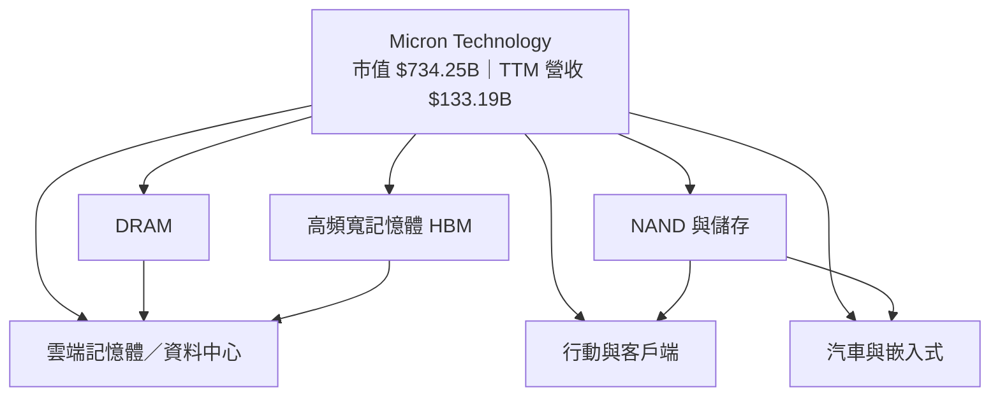
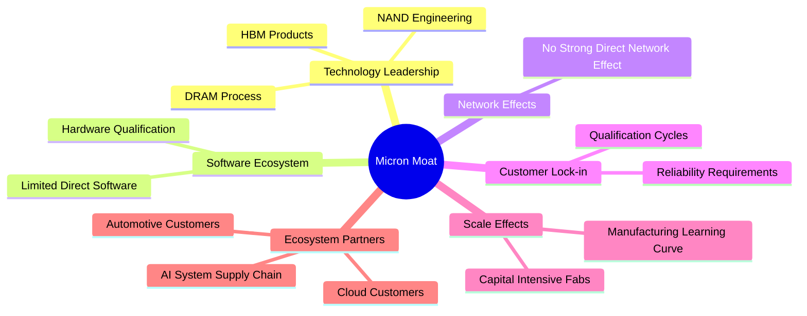
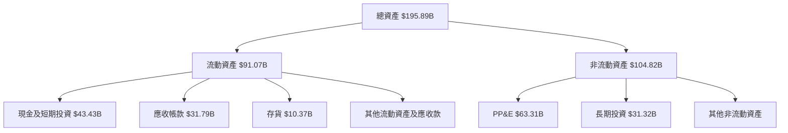
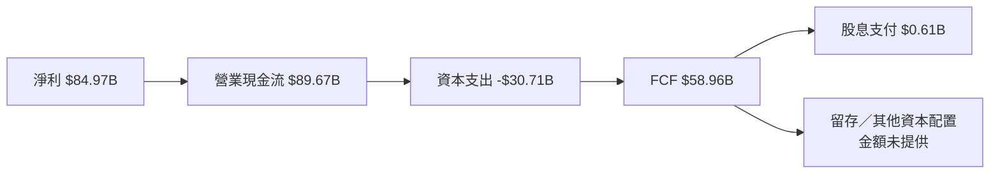
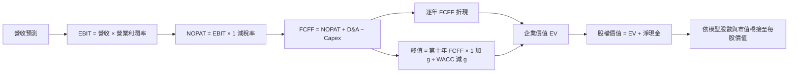
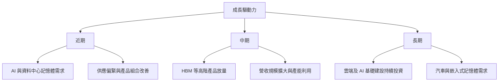
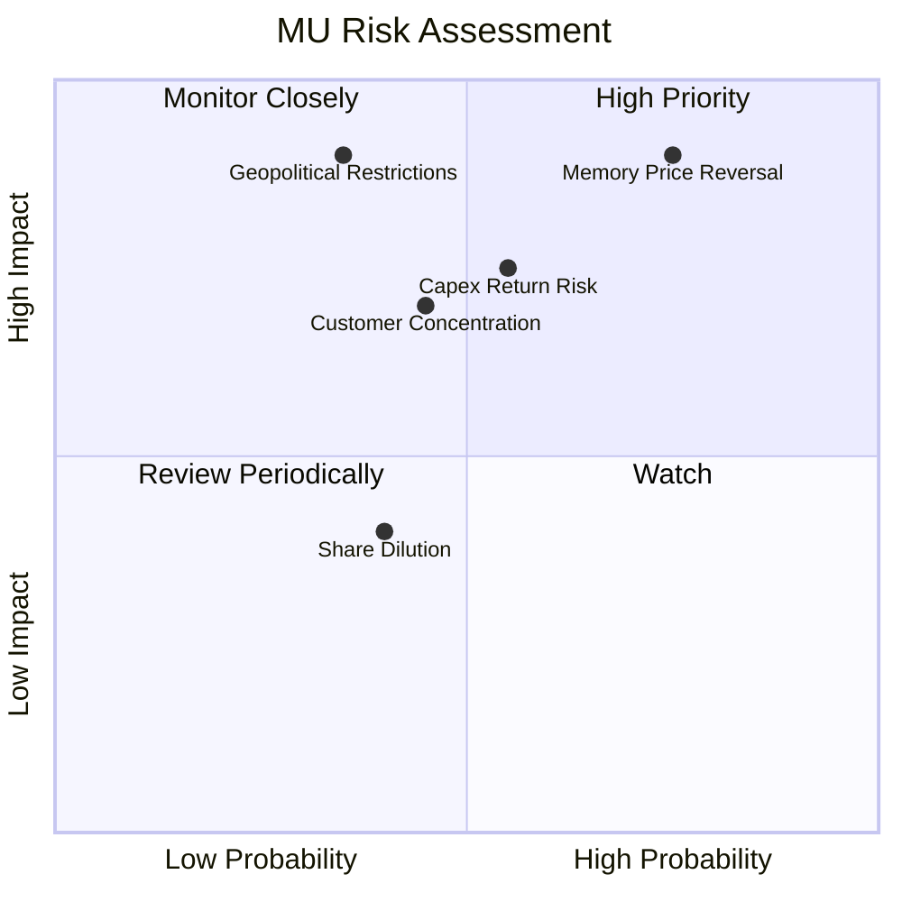
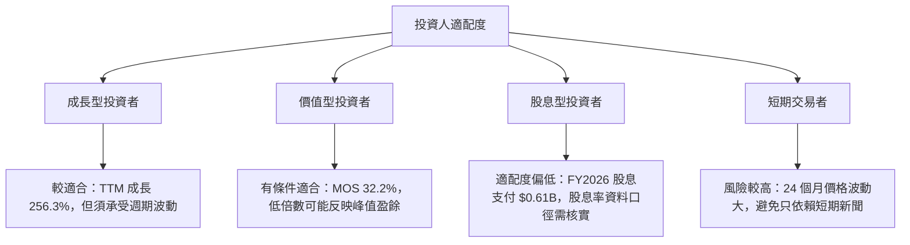

# MU 基本面深度分析報告
> **報告日期**：2026-11-28 ｜ **語言**：繁體中文 ｜ **數據來源**：SEC 申報資料 (XBRL)、Yahoo Finance、Finviz、StockAnalysis、Roic.ai ｜ **分析師**：CFA 級機構研究

## 目錄

| # | 章節 | 核心結論 |
|---|------|----------|
| 1 | 執行摘要 | 強烈買入；加權合理價值 $954.00；MOS +32.2% |
| 2 | 公司概覽與商業模式 | DRAM／NAND 資料未提供分部佔比；規模與製程能力構成主要競爭基礎 |
| 3 | 損益表深度分析 | TTM 營收 $133.19B、TTM 成長 256.3%；最新季度年增 379.3% |
| 4 | 資產負債表分析 | 淨現金 $40.15B；營運資金週期較一年前延長 30 天 |
| 5 | 現金流量深度分析 | TTM FCF $58.96B，FCF Yield 8.03%；資本支出高且隨需求週期變動 |
| 6 | 獲利能力與資本效率 | ROIC 86.2% 高於 WACC 14.00%，目前創造股東價值 |
| 7 | 相對估值分析 | P/E 低於同業區間，但記憶體週期高峰盈餘可能令低倍數失真 |
| 8 | DCF 內在價值評估 | 基準 DCF $879.10；加權合理價值 $954.00；終值與利潤率假設敏感 |
| 9 | 成長催化劑 | AI／高頻寬記憶體需求及供給偏緊是主要催化因素；TAM 數據未提供 |
| 10 | 風險矩陣 | 記憶體價格反轉、資本密集與客戶／供應鏈風險為前三大風險 |
| 11 | 投資建議 | 強烈買入；買入區間依 MOS 門檻推導，並以毛利率、FCF、ROIC 為監控核心 |

---

## 1. 執行摘要

截至 **2026-11-27 收盤價 $646.95**，MU 的 TTM 營收為 **$133.19B**，TTM 營收年增 **256.3%**，TTM FCF 為 **$58.96B**、FCF Yield **8.03%**；ROIC **86.2%** 高於採用的 WACC **14.00%**。程式計算的基準 DCF 每股價值為 **$879.10**，四種估值方法的加權合理價值為 **$954.00**，MOS **+32.2%**。依 MOS 評級規則為「強烈買入」；目前尚無需質化調整一級。主要保留意見是記憶體獲利具有週期性，最新高利潤率不宜視為穩態。

### 1.0 一頁式投資儀表板

| 項目 | 內容 |
|------|------|
| **投資論點（3 句）** | ① TTM 營收年增 **256.3%**，最新季度單季年增 **379.3%**，顯示需求與價格／產品組合共同推升收入。② TTM FCF **$58.96B**、FCF Yield **8.03%**，營運現金流可支應高額資本支出。③ ROIC **86.2%** 對比 WACC **14.00%**，目前資本回報大幅高於資本成本。 |
| **綜合評分** | **8.0/10**（引用 1.1 六項算術平均） |
| **財務健康** | 🟢 現金與短期投資 $43.43B、總債務 $3.28B，淨現金 $40.15B；CCC 由 155 天升至 185 天，營運資金占用增加。 |
| **ROIC vs WACC** | **86.2% vs 14.00%**；現階段創造股東價值，差距 72.2 個百分點。 |
| **FCF 趨勢** | FY2023 的 -$6.12B、FY2025 的 $1.67B 升至 FY2026 的 $58.96B；TTM FCF Yield **8.03%**。 |
| **估值** | Forward P/E **3.16x** ｜ EV/EBITDA **6.37x** ｜ FCF Yield **8.03%** |
| **DCF 內在價值（基準）** | **$879.10** ｜ 現價相對 DCF 折價 **26.4%** |
| **安全邊際（MOS）** | **+32.2%**＝($954.00 − $646.95) ÷ $954.00｜🟢 充足 |
| **預期報酬（基準情境 12M）** | DCF 基準情境相對現價 **+35.9%**；此為模型估值差，不代表期間保證。 |
| **關鍵風險（前二）** | 記憶體供需反轉使 ASP／毛利率下行；資本支出高峰與現金轉換週期延長。 |
| **評級 + 信心度** | 🟢 **強烈買入** ｜ 信心：中（估值吸引，但週期與資料口徑風險高） |

### 1.1 綜合評分卡

| 維度 | 評分（1–10） | 主要依據（引用數字與其來源章節） |
|------|--------------|----------------------------------|
| 成長性 | 9.0 | TTM 營收成長 256.3%、最新季度單季年增 379.3%（第 3 章）；但高基期與週期性限制長期外推。 |
| 獲利能力 | 9.0 | TTM 營業利益率 74.6%、ROIC 86.2%，遠高於 WACC 14.00%；F-Score 8/9（第 6 章）。 |
| 財務健康 | 9.0 | 淨現金 $40.15B；F-Score 8/9；但 CCC 185 天，高於一年前 155 天（第 4 章）。 |
| 估值 | 8.0 | MOS +32.2%；Forward P/E 3.16x；但同業週期高峰與自身估值中位數比較需審慎（第 7、8 章）。 |
| 護城河 | 7.0 | DRAM／NAND 製程、資本規模與客戶認證具進入障礙；記憶體商品化及週期競爭限制定價持久性（第 2 章）。 |
| 管理層與資本配置 | 6.0 | FY2026 Capex $30.71B，SBC $1.33B；F-Score 顯示稀釋股數未通過測試，回購資料未提供（第 3、5 章）。 |
| **綜合評分** | **8.0** | 六項算術平均：(9+9+9+8+7+6) ÷ 6 = 8.0。 |

### 1.2 五大投資論點 + 三大核心風險

| 類型 | 項目 | 具體依據 | 信心度 |
|------|------|----------|--------|
| 🟢 **投資論點①** | AI 記憶體需求推升營收 | TTM 營收 $133.19B，年增 256.3%；最新季度單季年增 379.3%。 | 🟢 高 |
| 🟢 **投資論點②** | 現金流已由低谷轉正 | TTM OCF $89.67B，Capex $30.71B，FCF $58.96B。 | 🟢 高 |
| 🟢 **投資論點③** | 高資本回報創造價值 | ROIC 86.2%，高於 WACC 14.00%。 | 🟢 高 |
| 🟢 **投資論點④** | 資產負債表具逆週期承受力 | 現金與短期投資 $43.43B，債務 $3.28B，淨現金 $40.15B。 | 🟢 高 |
| 🟢 **投資論點⑤** | 估值方法交叉後仍有折價 | 加權合理價值 $954.00，較現價上行空間 47.5%。 | 🟡 中 |
| 🟡 **風險①** | 記憶體價格週期反轉 | 最新季度營業利益率達 80.7%，若供給回升或價格下跌，利潤率可能快速回落。 | 🟡 中 |
| 🔴 **風險②** | 資本支出與庫存／應收款占用 | FY2026 Capex $30.71B；CCC 由 155 天增至 185 天。 | 🔴 高衝擊 |
| 🟡 **風險③** | 股本稀釋與資料口徑差異 | F-Score 稀釋股數測試未通過；不同資料欄位的 ROE、債務、季度營業利益率存在差異。 | 🟡 中 |

### 1.3 快速統計卡片

| 指標 | 公司實際值（期間） | 同業中位數 | 狀態 |
|------|--------------------|------------|------|
| 營收成長（TTM） | **256.3%** | — | 🟢 |
| 營收成長（最新一季年增） | **379.3%** | **327.9%**（SKHY、SNDK、WDC 中位數） | 🟢 |
| 毛利率（TTM） | **80.7%** | **77.4%**（三家中位數） | 🟢 |
| 營業利益率（TTM） | **74.6%** | — | 🟢 |
| ROIC（TTM） | **86.2%** | — | 🟢 |
| Forward P/E | **3.16x** | **3.0x**（SKHY、SNDK、WDC 中位數） | 🟡 |
| FCF Yield（TTM） | **8.03%** | — | 🟢 |
| Piotroski F-Score | **8 / 9** | — | 🟢 |

> Peer multiples 中 SKHY、SNDK、WDC 的 Forward P/E 中位數為 3.0x；三家最新季度營收成長中位數為 327.9%，毛利率中位數為 77.4%。

### 1.4 投資結論

```text
╔══════════════════════════════════════════════════════════════════╗
║                    📊 投資結論摘要                               ║
╠══════════════════════════════════════════════════════════════════╣
║  評級：強烈買入（依 MOS 規則；未作質化調整）                     ║
║  價格（2026-11-27 收盤）：$646.95                                ║
║  DCF 內在價值（基準）：$879.10（現價折價 26.4%）                 ║
║  安全邊際 MOS：+32.2%（＝(加權合理價值−現價)÷加權合理價值）     ║
║  加權合理價值（8.8）：$954.00                                    ║
║  DCF 情境價值：                                                   ║
║    悲觀情境：$427.72（-33.9%）                                   ║
║    基準情境：$879.10（+35.9%）                                   ║
║    樂觀情境：$1,710.40（+164.4%）                                ║
║  綜合評分：8.0/10（引用 1.1）                                    ║
║  適合投資人：可承受高波動的成長型、週期股長線投資人              ║
╚══════════════════════════════════════════════════════════════════╝
```

---

## 2. 公司概覽與商業模式

### 2.1 業務結構與收入來源

公司資料將 Micron 列為雲端記憶體、核心資料中心、行動與客戶端、汽車與嵌入式等業務單位，並提供 DRAM、HBM 及 NAND／儲存產品。不過，分部營收與產品營收佔比未提供，故不繪製含金額或比例的分部圖。



### 2.2 市場份額

市場份額數據未提供，無法據此量化 Micron 在 DRAM、HBM 或 NAND 的份額。公司 TTM 營收 $133.19B、成長 256.3%，且最新季度年增 379.3%，顯示規模與需求擴張；但單憑營收不能推算市場份額或份額變化。

### 2.3 競爭護城河分析



### 2.4 護城河強度

| 護城河項目 | 強度（強／中／弱） | 證據（引用數字或事實） | 會削弱它的情況 |
|------------|--------------------|------------------------|----------------|
| 技術與製程 | 中至強 | 公司供應 DRAM、HBM、NAND；FY2026 R&D $5.65B。 | 競爭者縮小製程或良率差距、產品迭代落後。 |
| 規模效應 | 強 | FY2026 Capex $30.71B，固定成本與建廠投入高。 | 需求下滑導致產能利用率下降、折舊負擔上升。 |
| 客戶認證與可靠性 | 中 | 資料中心、汽車及嵌入式產品需符合客戶設計及可靠性要求；客戶別數據未提供。 | 客戶多源供應、轉換成本降低或產品性能不符。 |
| 軟體生態系統 | 弱 | 核心為硬體產品，軟體訂閱或平台收入數據未提供。 | 記憶體規格標準化使供應商差異縮小。 |
| 網路效應 | 弱 | 未見可量化的直接網路效應數據。 | 商品化與價格競爭持續加劇。 |
| 生態夥伴 | 中 | AI、雲端、系統與裝置供應鏈帶來合作機會；營收分部細項未提供。 | 供應鏈替代、客戶自研或採購策略改變。 |

**護城河分數理由**：1.1 評為 **7.0/10**，依據是高資本門檻、製程與客戶認證優勢；但記憶體產品週期性與商品化使競爭優勢不等同於穩定的軟體型護城河。

---

## 3. 損益表深度分析

### 3.1 年度收入成長趨勢（近4年）

FY2023 至 FY2026 營收由 $15.54B 升至 $133.19B；三年 CAGR 約 104.7%。CAGR 是依年度營收端點計算的衍生值，成長受到低基期與記憶體價格週期影響，不能直接視為長期常態。

```text
╔══════════════════════════════════════════════════════════════════╗
║             Micron 年度收入趨勢（FY2023-FY2026）                 ║
╠══════════════════════════════════════════════════════════════════╣
║  FY2023  $15.54B  ███░░░░░░░░░░░░░░░░░░░░░  基期                 ║
║  FY2024  $25.11B  █████░░░░░░░░░░░░░░░░░░░  YoY: +61.6% 🟢      ║
║  FY2025  $37.38B  ███████░░░░░░░░░░░░░░░░░  YoY: +48.9% 🟢      ║
║  FY2026 $133.19B  █████████████████████████ YoY: +256.3% 🟢     ║
╠══════════════════════════════════════════════════════════════════╣
║  FY2023-FY2026 營收 CAGR：約 +104.7%                              ║
╚══════════════════════════════════════════════════════════════════╝
```

FY2026 的 256.3% 是 TTM 對前一 TTM 成長率；由於 FY2026 年度營收欄與 TTM 數值相同，報表年度序列呈現相同量級。成長加速與 AI／資料中心記憶體需求及價格環境一致，但單一年度增幅包含週期反彈因素。

### 3.2 季度收入趨勢分析

| 季度 | 營收 | QoQ 成長 | YoY 成長 | 備註 |
|------|------:|---------:|---------:|------|
| 2025-11-30 | $13.64B | — | — | 可比年度季度明細不足以可靠補列 YoY。 |
| 2026-02-28 | $23.86B | +74.9% | +196.3% | 對應資料列提供的季度年增率。 |
| 2026-05-31 | $41.46B | +73.8% | +345.7% | 營收規模延續擴張。 |
| 2026-08-31 | $54.23B | +30.8% | +379.3% | QoQ 成長仍高，年增率反映較低的去年同期基數。 |

QoQ 依季度營收直接計算，例如 $54.23B ÷ $41.46B − 1 = 30.8%。需注意，季度營收來源標示的期間日期與財報截止日文字存在差異，年度及季度數據應以正式 10-K／10-Q 核對。

### 3.3 利潤率演變分析

| 利潤率指標 | FY2023 | FY2024 | FY2025 | FY2026 | 趨勢 | 評估 |
|------------|--------:|--------:|--------:|--------:|------|------|
| **毛利率** | -9.1% | 22.3% | 39.8% | 80.7% | 由虧損翻正並大幅擴張 | 🟢 |
| **營業利益率** | -34.8% | 5.2% | 26.1% | 74.6% | 固定成本吸收與定價／組合改善推升 | 🟢 |
| **淨利率** | -37.5% | 3.1% | 22.8% | 63.8% | 營業槓桿擴大，屬週期高獲利敏感區 | 🟡 |

計算口徑為年度毛利、營業利益及淨利除以年度營收。FY2026 毛利率 80.7% 也與資料包列示的 TTM 毛利率一致。利潤率快速改善代表產能利用率、產品組合與價格的共同效果；若價格下行，固定成本高的晶圓製造模式可能造成反向營業槓桿。

### 3.4 費用結構分析

FY2026 可直接取得的 R&D 為 **$5.65B**，但完整營業費用細項、SG&A、折舊、利息與稅額拆分未提供，無法製作完整費用結構圓餅圖。若以營收作分母，R&D／營收為約 4.2%；由於營業成本與其他費用分類未完整列出，不補推各項費用比例。

### 3.5 季度 EPS 趨勢與盈餘品質（Quality of Earnings）

最近四季 EPS 實際值依序為 $4.60、$12.07、$24.67、$32.85；相應單季年增率為 175.45%、756.03%、1368.45%、1059.46%。EPS 逐季上升與營收、營業利益擴張一致。**分析師 EPS 預估值缺失**，因此無法可靠判定四季各自是超預期或不及預期；來源列出的 EPS Est 為 nan，不應據此把缺值判成真正 miss。

| 盈餘品質項目 | 數值／佔比 | 評估 |
|--------------|-----------|------|
| 股權薪酬 SBC／營收 | FY2026 $1.33B ÷ $133.19B = **1.0%** | 🟡 佔比不高，但仍會稀釋股東；F-Score 的稀釋股數測試未通過。 |
| SBC／營業現金流 | $1.33B ÷ $89.67B = **1.5%** | 🟢 相對現金流規模有限；SBC 為非現金加回項，不代表沒有股東成本。 |
| FCF／淨利（現金轉換率） | $58.96B ÷ $84.97B = **69.4%** | 🟡 FCF 顯著為正，但高 Capex 使現金轉換低於淨利。 |
| 一次性／非經常性損益 | 無足夠細項可量化 | N/A；不據現有資料宣稱無一次性項目。 |
| 有效稅率異常 | **14.8%**（DCF 採用值） | 🟡 非極端低稅率，但單年有效稅率不一定代表長期稅負。 |
| 資本化支出 vs 費用化 | FY2026 Capex $30.71B；資本化明細 N/A | 高額投資增加未來折舊，需追蹤產能利用率及資產回報。 |

**盈餘品質結論**：FY2026 OCF $89.67B、FCF $58.96B，且 Piotroski 應計品質測試通過，支持獲利具有現金流基礎；但 FCF／淨利為 69.4%、SBC 造成稀釋，加上記憶體價格週期可能令峰值盈餘高於中週期水準。估值不宜僅以當期 EPS 低倍數判斷便宜。

---

## 4. 資產負債表分析

### 4.1 資產結構分解

FY2026 總資產 $195.89B。流動資產 $91.07B；其餘非流動資產約 $104.82B（由總資產減流動資產推導）。主要非流動項目包含 PP&E $63.31B、長期投資 $31.32B。



圖中非流動資產為總資產減流動資產；因部分其他項目明細口徑不一致，未把所有子項強行加總至總額。

### 4.2 流動性與營運資金分析

| 指標 | 最新 TTM | 一年前 TTM | 變化 | 解讀 |
|------|----------|------------|------|------|
| DSO 應收帳款天數 | 87 天 | 70 天 | +17 天 | 收款天數增加，可能反映營收規模快速擴大；仍須觀察應收帳款是否快於營收增長。 |
| DIO 存貨天數 | 147 天 | 136 天 | +11 天 | 庫存占用增加，可能為供應準備或週期風險，需結合產品需求與存貨跌價觀察。 |
| DPO 應付帳款天數 | 50 天 | 51 天 | -1 天 | 付款天數大致持平，未見明顯延長供應商付款的跡象。 |
| CCC 現金轉換週期 | 185 天 | 155 天 | +30 天 | 營運資金現金被占用時間延長，與高成長伴隨的應收及庫存擴張相符。 |

流動比率 3.314、速動比率 2.898，FY2026 現金及短期投資 $43.43B，短期償債能力具緩衝。需留意數據來源中的「總債務」有 $3.28B 與其他彙整欄位 $5.18B 兩種口徑；本報告的核心淨現金與 DCF 採 VERIFIED FIGURES 的 $3.28B。

### 4.3 債務結構分析

```text
╔══════════════════════════════════════════════════════════════════╗
║                   Micron 債務健康診斷                            ║
╠══════════════════════════════════════════════════════════════════╣
║  總債務：        $3.28B    ██░░░░░░░░░░░░░░░░░░  低於現金        ║
║  現金+短期投資： $43.43B   ████████████████████  流動性充足      ║
║  淨現金：        $40.15B   ██████████████████░░  🟢              ║
║  流動比率：      3.314x    🟢                                   ║
║  速動比率：      2.898x    🟢                                   ║
║  Debt/EBITDA：   約 0.03x（3.28 ÷ 109.28）                      ║
║  利息保障倍數：  N/A（利息費用／EBIT 對應數據未完整提供）       ║
╚══════════════════════════════════════════════════════════════════╝
```

### 4.4 股東權益趨勢

| 財年 | 股東權益 | 年變化 |
|------|---------:|-------:|
| FY2023 | $44.12B | — |
| FY2024 | $45.13B | +2.3% |
| FY2025 | $54.16B | +20.0% |
| FY2026 | $138.38B | +155.5% |

FY2026 權益大幅增加，與當期 $84.97B 淨利及資產規模擴張相符；具體分紅、其他綜合損益與增發等權益變動拆分未提供。股權擴張同時可能提升帳面資本與降低部分槓桿指標，但不能替代對每股盈餘及稀釋股數的追蹤。

---

## 5. 現金流量深度分析

### 5.1 現金流量瀑布圖

FY2026 淨利 $84.97B、營業現金流 $89.67B、資本支出 $30.71B、FCF $58.96B；股息支付 $0.61B。回購金額與淨現金年度變動拆分未提供，故不繪製未有數值的流向。



### 5.2 FCF 轉換率趨勢

| 財年 | FCF | 淨利 | FCF／淨利 |
|------|----:|-----:|----------:|
| FY2023 | -$6.12B | -$5.83B | 105.0% |
| FY2024 | $0.12B | $0.78B | 15.6% |
| FY2025 | $1.67B | $8.54B | 19.6% |
| FY2026 | $58.96B | $84.97B | 69.4% |

FY2023 的比率因淨利為負，經濟解讀有限。FY2026 現金轉換改善，反映營運現金流大幅增加；Capex 亦升至 $30.71B，說明獲利轉現同時仍需高額產能投入。

### 5.3 自由現金流趨勢

```text
╔══════════════════════════════════════════════════════════════════╗
║                 自由現金流：歷史實際                            ║
╠══════════════════════════════════════════════════════════════════╣
║  FY2023  -$6.12B  ◀負值                                          ║
║  FY2024   $0.12B  ▏                                               ║
║  FY2025   $1.67B  █                                               ║
║  FY2026  $58.96B  ████████████████████  FCF Yield 8.03%           ║
╠══════════════════════════════════════════════════════════════════╣
║  FCF = OCF − Capex；FY2026：$89.67B − $30.71B = $58.96B          ║
╚══════════════════════════════════════════════════════════════════╝
```

### 5.4 資本配置評估

資本配置金額可確認的項目為 FY2026 Capex $30.71B、股息支付 $0.61B、SBC $1.33B；回購與其他投資的現金金額未提供，不以圓餅圖補造比例。

| 項目 | FY2026 金額 | 評估 |
|------|------------:|------|
| 資本支出 | $30.71B | 佔營收約 23.1%；支撐製程與產能，但拉高週期下行時的固定成本風險。 |
| 股息支付 | $0.61B | 相對 FCF 約 1.0%，資本配置負擔低。 |
| 股權薪酬 | $1.33B | 非現金支出，但透過股數稀釋形成持有人成本。 |
| 回購 | N/A | 金額資料未提供。 |
| 留存／其他投資 | N/A | 無法完整拆分。 |

---

## 6. 獲利能力與資本效率

### 6.1 ROE／ROA／ROIC 趨勢

| 指標 | 可用數值 | 評估 |
|------|---------|------|
| ROE（TTM，品質指標口徑） | 61.4% | 高回報；以權益乘數 1.42 看，並非主要由高槓桿驅動。 |
| ROA（TTM） | 44.6% | 資產獲利能力高；與高週期利潤環境有關。 |
| ROIC（TTM） | 86.2% | 明顯高於 WACC 14.00%，目前創造經濟價值。 |
| 歷史年度 ROE／ROA／ROIC 序列 | N/A | 未提供一致口徑的完整年度序列；不以其他來源異質數字補齊。 |
| 行業均值對比 | N/A | 未提供可核實的同口徑行業均值。 |

財務彙整區另列 ROE 88.3%，與品質指標 DuPont 的 61.4% 不一致；本節採品質指標提供的 61.4%，避免混用口徑。

### 6.2 ROIC vs WACC 分析（核心價值創造判斷）

```text
╔══════════════════════════════════════════════════════════════════╗
║                ROIC vs WACC 深度分析                            ║
╠══════════════════════════════════════════════════════════════════╣
║  資本成本輸入（來源：Cost of capital）                           ║
║  ├── 無風險利率（10Y 美債）：       4.94%                        ║
║  ├── 市場風險溢酬 ERP：             5.00%                        ║
║  ├── Beta 原始值：                  2.40                         ║
║  ├── Beta 採用值（調整後）：        1.93                         ║
║  ├── 股權成本 Ke：                 14.60%                       ║
║  ├── 稅前債務成本：                 3.23%                        ║
║  ├── 有效稅率：                    14.8%                         ║
║  ├── 股權／債務權重：               99.6%／0.4%                  ║
║  └── ✅ 採用 WACC：                 14.00%                       ║
║      計算值 14.54%，受 7%–14% 上限約束                           ║
║                                                                  ║
║  ROIC（TTM）：                     86.2%                         ║
║  ROIC − WACC：                     72.2 個百分點                 ║
║  ROIC／WACC：                      6.2 倍                        ║
║                                                                  ║
║  ROIC 86.2%  ▓▓▓▓▓▓▓▓▓▓▓▓▓▓▓▓▓▓▓▓▓▓▓▓▓▓▓▓▓▓▓▓▓▓▓▓▓▓▓▓▓▓       ║
║  WACC 14.0%  ▓▓▓▓▓▓▓░░░░░░░░░░░░░░░░░░░░░░░░░░░░░░░░░░░       ║
║                                                                  ║
║  結論：目前 ROIC 顯著高於資本成本，正向創造股東價值；           ║
║  但記憶體週期下行時 ROIC 可能迅速回落，不能線性外推。            ║
╚══════════════════════════════════════════════════════════════════╝
```

WACC 依程式計算為 14.54%，因規定區間上限而採用 14.00%；本報告第 8 章沿用此折現率。原始 Beta 2.40 較高，採用調整後 Beta 1.93，調整方式為 ⅔ × 2.40 + ⅓ × 1。10 年期美債日期未提供，因此不另補寫日期。

### 6.3 杜邦三因素分解

| 因素 | 數值（TTM） | 解讀 |
|------|-------------|------|
| 淨利率 | 63.8% | 高獲利主要反映週期景氣及營業槓桿。 |
| 資產週轉率 | 0.68 | 資產周轉效率與高固定資產製造模式相符。 |
| 權益乘數 | 1.42 | 財務槓桿不是 ROE 的主要放大來源。 |
| **ROE** | **61.4%** | **63.8% × 0.68 × 1.42 = 61.4%**（四捨五入）。 |

### 6.4 財務體質：Piotroski F-Score

**Piotroski F-Score：8 / 9**。依提供的品質指標，九項測試逐項如下；一項未通過，並非數據缺漏。

| 測試 | 結果 | 解讀 |
|------|------|------|
| ROA > 0 | ✅ 通過 | TTM 獲利為正。 |
| 營業現金流 > 0 | ✅ 通過 | TTM OCF $89.67B。 |
| ROA 高於一年前 | ✅ 通過 | 獲利能力改善。 |
| 營業現金流 > 淨利 | ✅ 通過 | 應計品質測試通過。 |
| 長期負債／總資產低於一年前 | ✅ 通過 | 相對負債壓力下降。 |
| 流動比率高於一年前 | ✅ 通過 | 流動性改善。 |
| 稀釋股數未增加 | ❌ 未通過 | 股數增加會攤薄每股經濟利益。 |
| 毛利率高於一年前 | ✅ 通過 | 反映價格、組合與產能利用改善。 |
| 資產週轉率高於一年前 | ✅ 通過 | 資產使用效率改善。 |

---

## 7. 相對估值分析

### 7.1 同業估值比較表格

公司本身估值採資料包當前倍數；同業倍數嚴格使用 Peer multiples。SKHY 的 P/S、EV/EBITDA 為混合幣別，故不列數字。

| 估值指標 | **MU** | **SKHY** | **SNDK** | **WDC** | 本公司評估 |
|----------|------:|---------:|---------:|--------:|-----------|
| **Trailing P/E** | 8.7x | 6.6x | 5.5x | 10.3x | 🟡 位於同業範圍內；週期高峰盈餘會壓低 P/E。 |
| **Forward P/E** | 3.16x | 3.0x | 2.4x | 7.3x | 🟡 接近同業低倍數區，但遠期盈利估計需留意週期風險。 |
| **P/S Ratio** | 5.51x | N/A | 3.4x | 7.6x | 🟡 介於可比同業之間；SKHY 因混合幣別不比較。 |
| **EV/EBITDA** | 6.37x | N/A | 4.3x | 17.3x | 🟡 低於 WDC、高於 SNDK；SKHY 因混合幣別不比較。 |
| **最新季度營收年增** | 379.3% | 327.9% | 377.9% | 55.5% | 🟢 MU 增長高於三家同業的中位數 327.9%。 |
| **TTM 毛利率** | 80.7% | 77.4% | 80.0% | 52.6% | 🟢 高於可比同業中位數 77.4%。 |

### 7.2 歷史估值區間分析

```text
╔══════════════════════════════════════════════════════════════════╗
║                   MU 五年估值區間                                ║
╠══════════════════════════════════════════════════════════════════╣
║  P/E：       7.4x ─────────● 8.7x──────────── 138.5x            ║
║                              現值；歷史百分位 13%                 ║
║  五年中位數：17.4x                                               ║
║                                                                  ║
║  P/S：       2.1x ─────────────────────● 5.6x── 11.7x           ║
║                                        現值；百分位 75%           ║
║  五年中位數：4.2x                                                ║
║                                                                  ║
║  EV/EBITDA： 3.6x ───────● 6.4x─────────────── 80.7x            ║
║                             現值；百分位 25%                      ║
║  五年中位數：9.7x                                                ║
╚══════════════════════════════════════════════════════════════════╝
```

P/E 與 EV/EBITDA 位於自身歷史區間偏低位置，P/S 則高於歷史中位數且處於 75 百分位。這種指標分歧主要提示：當盈餘在週期上行階段急升，P/E 會機械式下降；故不能單獨視為低估證據。

### 7.3 情境價值（Bear / Base / Bull）

| 情境 | 第 1 年營收成長 | 期末營業利潤率 | WACC | 每股價值 | 相對現價 | 機率 | 會發生的條件 |
|------|----------------:|----------------:|-----:|----------:|----------:|-----:|--------------|
| 🔴 悲觀 | 15.0% | 22.2% | 15.00% | $427.72 | -33.9% | 25% | AI／資料中心需求放緩、價格下行，利潤率回歸更低水準。 |
| 🟡 基準 | 30.0% | 26.1% | 14.00% | $879.10 | +35.9% | 50% | 需求仍增長，但長期利潤率逐步回歸近五年中位數。 |
| 🟢 樂觀 | 45.0% | 28.8% | 13.00% | $1,710.40 | +164.4% | 25% | 供應持續受限、高階產品放量且終端價格維持韌性。 |

此表為程式生成的 DCF 情境結果；情境機率加權價值為 $974.08，僅作參考，不取代第 8.8 節指定的基準 DCF 加權估值方法。

### 7.4 相對估值隱含價格區間

```text
╔══════════════════════════════════════════════════════════════════╗
║              估值方法隱含每股價值（USD）                         ║
╠══════════════════════════════════════════════════════════════════╣
║  同業 P/S $639.82 ─ 現價 $646.95 ─ DCF $879.10 ─ EV/EBITDA $1,071.41 ║
║                                  分析師共識 $1,529.69            ║
╚══════════════════════════════════════════════════════════════════╝
```

同業 EV/EBITDA 使用 SNDK、WDC 中位數 **10.8x** 乘 MU TTM EBITDA，再加淨現金；同業 P/S 使用 SNDK、WDC 中位數 **5.5x** 乘 TTM 營收。DCF 為 $879.10；分析師共識均值為 $1,529.69（45 位分析師）。方法間分歧大，反映週期盈餘與長期成長假設差異。

---

## 8. DCF 內在價值評估（Discounted Cash Flow）

### 8.0 估值推理鏈（Thinking Logic）

**Step 1 — 價值來源與主導變數**

Micron 的估值核心是現有 DRAM／NAND 業務的現金流底盤，以及資料中心與 HBM 等需求成長；各業務收入佔比未提供，不能量化分拆。最能主導估值的假設是營業利潤率與折現率：基準模型將 TTM 營業利益率 74.6% 逐步降至第十年 26.1%，且 WACC／終值成長率會改變遠期現金流現值。

**Step 2 — 模型選擇**

| 決策點 | 本報告採用 | 理由（含數字） | 曾考慮但否決 | 否決理由 |
|--------|-----------|----------------|--------------|----------|
| 現金流定義 | FCFF | 對應 WACC 折現並求企業價值；公式為 NOPAT + D&A − Capex | FCFE | 資料所列模型以企業現金流及淨現金橋接。 |
| 預測期 N | 10 年 | 程式模型固定 10 年，逐年營收成長由 30% 衰減至 3% | 5 年 | 既有 DCF 模型指定 10 年，不能自行替換。 |
| 終值方法 | Gordon Growth | 模型採 g=3.0%、WACC=14.00% | 退出倍數作主估值 | 程式 DCF 基準值以 Gordon Growth 計算；未提供退出倍數 DCF 橋接結果。 |
| EBIT 基礎 | GAAP EBIT | TTM GAAP 營業利益率 74.6% | 非 GAAP EBIT | 模型指定使用 GAAP EBIT。 |

**Step 3 — 關鍵假設推導鏈**

- **營收成長**：錨點為 TTM 營收年增 256.3%、最新季度單季年增 379.3%；基期極高且週期反彈可能不可持續，因此將第一年成長限制在模型上限 30%，逐年線性降至第十年 3%。採用值為 30% → 3%；曾考慮延續 256.3%，但因把週期增幅長期外推不合理而不採。
- **營業利潤率**：錨點為 TTM 74.6%；模型令其逐年降至近五個財年中位數 26.1%，反映產業正常化。採用值為 74.6% → 26.1%；不採用長期維持 74.6%，因單期高峰利潤率不能視為穩態。
- **永續成長率 g**：錨點為長期成熟企業成長假設；模型採 3.0%，低於 WACC 14.00%。不採用高於 3.0% 的基準值，避免終值過度擴張；敏感度表另測 2.0%–4.0%。
- **預測期 N**：採模型固定 10 年；由於記憶體週期可跨多年度，採較長過渡期讓營收與利潤率淡出。替代 5 年模型未採用，因不符合既定 DCF MODEL。
- **Capex／營收**：錨點為 TTM 23.1%；模型逐步降至第十年 7.8%，並以折舊 1.1 倍作成熟期下限參照。採用 23.1% → 7.8%；不採長期維持 23.1%，因成熟期資本支出假設會過度壓低終值。
- **EBIT 與 SBC**：採 GAAP EBIT，已含 SBC 費用；模型不再扣 SBC，也不增加股數稀釋，採組合 (A)。替代非 GAAP 加回 SBC 未採用，以免重複或遺漏股東成本。
- **年稀釋率**：配合組合 (A) 固定股數處理；模型未另計年稀釋。實際 F-Score 的稀釋股數測試未通過，故此為模型簡化而非宣稱公司無稀釋。
- **有效稅率**：採 14.8%，為模型提供值；沒有用更高的假設替代，因缺乏同口徑長期稅率序列。
- **D&A／營收**：採 TTM 7.1% 並保持固定；以當前比例為錨，缺乏可核實的長期折舊率預測。
- **營運資金變動**：模型未建模 ΔWC。由於 CCC 已增至 185 天，這會使模型略偏樂觀；不自行填造歷史 ΔWC 比率。
- **WACC**：採用程式給定 14.00%，計算值 14.54% 受 7%–14% 區間限制；不另建一個 WACC。
- **終值方法**：採 Gordon Growth，因模型直接指定且 g=3.0% 小於 WACC 14.00%；未用退出倍數取代基準。

**Step 4 — 最脆弱的一環**

最脆弱的是高峰營業利潤率向 26.1% 收斂的路徑與 Capex 下降假設；若營收成長和利潤率衰減快於模型，估值會向悲觀情境 $427.72 靠攏。

**Step 5 — 計算路徑圖**



### 8.1 模型假設總表（Model Inputs）

| 假設項目 | 採用值 | 依據／來源 | 敏感度 |
|----------|--------|-------------|--------|
| 預測期長度 **N** | 10 年 | DCF MODEL 指定；營收成長逐年淡出。 | 🟡 中 |
| 營收成長 | FY+1 30.0% → FY+10 3.0% | TTM 成長 256.3%，模型限制在 0%–30%。 | 🔴 高 |
| 營業利潤率 | FY+1 74.6% → FY+10 26.1% | 由 TTM 值淡出至近五財年中位數。 | 🔴 高 |
| 有效稅率 | 14.8% | 最新年度有效稅率。 | 🟢 低 |
| Capex／營收 | FY+1 23.1% → FY+10 7.8% | TTM 23.1%，逐步降至折舊的 1.1 倍參照。 | 🟡 中 |
| D&A／營收 | 7.1% | TTM 比率，模型固定。 | 🟢 低 |
| 營運資金變動 | 未建模 | DCF MODEL 明示不納入；CCC 最新 185 天。 | 🟢 低 |
| EBIT 基礎 | GAAP EBIT | DCF MODEL 明示；TTM 營業利益率 74.6%。 | 🟡 中 |
| SBC 處理 | 組合 (A)：GAAP 已費用化，不再扣 SBC | FY2026 SBC $1.33B；模型不另扣除。 | 🟡 中 |
| 年稀釋率 | 模型固定股數、不另稀釋 | 與組合 (A) 相容；實際稀釋股數測試未通過。 | 🟡 中 |
| 永續成長率 g | 3.0% | DCF MODEL 指定，低於 WACC。 | 🔴 高 |
| 終值方法 | Gordon Growth | DCF MODEL 指定。 | 🔴 高 |
| WACC | 14.00% | 計算值 14.54%，被 7%–14% 區間上限限制。 | 🔴 高 |

**SBC 一致性**：本模型採用 **(A) GAAP EBIT + 固定股數**，因此 SBC 影響已計入一次；FCFF 不再另減 SBC，股數亦不作逐年放大。模型與實際稀釋情況可能存在差異。

**FCFF 定義**：依既有模型採 **FCFF = NOPAT + D&A − Capex**，不含 ΔWC 列；這與一般完整 FCFF 公式相比是模型簡化。

### 8.2 折現率推導（WACC）

```text
╔══════════════════════════════════════════════════════════════════╗
║                    WACC 推導（折現率）                           ║
╠══════════════════════════════════════════════════════════════════╣
║  股權成本 Ke（CAPM）：                                           ║
║  ├── 無風險利率 Rf（10Y 美債）：      4.94%                      ║
║  ├── 市場風險溢酬 ERP：               5.00%                      ║
║  ├── 原始 Beta：                      2.40                       ║
║  ├── 調整後 Beta：                    1.93                       ║
║  │   調整方式：⅔ × 2.40 + ⅓ × 1 = 1.93                         ║
║  ├── 規模／國別溢酬：                 0.00%（未提供額外溢酬）    ║
║  └── Ke = 4.94% + 1.93 × 5.00% = 14.60%（資料列示值）           ║
║                                                                  ║
║  債務成本：                                                      ║
║  ├── 稅前 Kd：                        3.23%                      ║
║  ├── 有效稅率：                      14.8%                       ║
║  └── 稅後 Kd = 3.23% × (1−14.8%) = 2.75%（約）                  ║
║                                                                  ║
║  資本結構權重：股權 99.6%／債務 0.4%                             ║
║  ├── 資料列示計算 WACC：             14.54%                      ║
║  └── 區間限制後採用 WACC：           14.00%                      ║
╚══════════════════════════════════════════════════════════════════╝
```

WACC 組成的計算資料由程式提供，依要求照用 **計算值 14.54%**，並採用上限 **14.00%**。輸入資料不足以獨立重建市場資本額、期末計息負債、利息費用及平均債務餘額的完整五步算式；因此不以其他欄位補算一個新的 WACC。第 6.2 節與本節均採 **14.00%**。

### 8.3 逐年自由現金流預測（基準情境）

金額為 $B；模型原列數字照錄，折現因子保留 3 位小數。表格數字因呈現精度有限，內部計算可能使用未四捨五入底數；逐年值不以顯示值重新建模。

| 年度 | FY+1 | FY+2 | FY+3 | FY+4 | FY+5 | FY+6 | FY+7 | FY+8 | FY+9 | FY+10 |
|------|------:|------:|------:|------:|------:|------:|------:|------:|------:|-------:|
| 營收 | 173.14 | 219.89 | 272.67 | 329.93 | 389.32 | 447.71 | 501.44 | 546.57 | 579.36 | 596.74 |
| 營收 YoY | 30.0% | 27.0% | 24.0% | 21.0% | 18.0% | 15.0% | 12.0% | 9.0% | 6.0% | 3.0% |
| 營業利潤率 | 74.6% | 69.2% | 63.8% | 58.4% | 53.1% | 47.7% | 42.3% | 36.9% | 31.5% | 26.1% |
| EBIT | 129.14 | 152.17 | 174.02 | 192.80 | 206.55 | 213.43 | 212.05 | 201.71 | 182.62 | 155.98 |
| − 稅 | (19.13) | (22.54) | (25.77) | (28.55) | (30.59) | (31.61) | (31.40) | (29.87) | (27.05) | (23.10) |
| NOPAT | 110.02 | 129.64 | 148.25 | 164.25 | 175.96 | 181.82 | 180.64 | 171.84 | 155.58 | 132.88 |
| + D&A | 12.35 | 15.69 | 19.45 | 23.54 | 27.78 | 31.94 | 35.78 | 39.00 | 41.34 | 42.58 |
| − Capex | (39.93) | (46.99) | (53.66) | (59.35) | (63.45) | (65.41) | (64.78) | (61.37) | (55.26) | (46.84) |
| **= FCFF** | **82.44** | **98.34** | **114.04** | **128.44** | **140.28** | **148.36** | **151.64** | **149.46** | **141.65** | **128.62** |
| 折現因子 @14.00% | 0.877 | 0.769 | 0.675 | 0.592 | 0.519 | 0.456 | 0.400 | 0.351 | 0.308 | 0.270 |
| **FCFF 現值 PV** | **72.32** | **75.67** | **76.98** | **76.04** | **72.86** | **67.59** | **60.60** | **52.40** | **43.56** | **34.69** |

預測期現值加總：

**$72.32 + $75.67 + $76.98 + $76.04 + $72.86 + $67.59 + $60.60 + $52.40 + $43.56 + $34.69 = $632.71B**

**逐步演算示例（FY+1）**：

1. 營收：$133.19B × (1 + 30.0%)，模型列示 **$173.14B**。
2. EBIT：營收 × 74.6%，模型列示 **$129.14B**。
3. 稅：EBIT × 14.8%，模型列示 **$19.13B**。
4. NOPAT：EBIT − 稅，模型列示 **$110.02B**。
5. D&A：營收 × 7.1%，模型列示 **$12.35B**。
6. Capex：營收 × 23.1%，模型列示 **$39.93B**。
7. ΔWC：**未建模**，因此沒有該列。
8. FCFF：NOPAT + D&A − Capex，模型列示 **$82.44B**。
9. 折現：模型折現因子 0.877；PV 列示 **$72.32B**。

> 由於模型逐年表格僅提供四捨五入後數值，FY+1 依顯示數字直接相乘會出現小幅尾差；報告保留模型輸出，不用另一套手算結果替換。這是可稽核性的限制，並非聲稱每一項顯示值的乘法都精確相等。

**合理性自檢**：

- 預測 FCF CAGR：FY+1 至 FY+10 為約 5.1%（以 $82.44B 至 $128.62B、9 個年度間隔計）；FY2023 至 FY2026 FCF CAGR 因起點為負值而不適合計算，故不能作有意義的正負 CAGR 比較。
- FY+10 FCFF 利潤率：$128.62B ÷ $596.74B = **21.6%**；當前 TTM FCF 利潤率：$58.96B ÷ $133.19B = **44.3%**。同業最佳可比 FCF 利潤率未提供。
- 預測期間各年 FCFF 均為正；不代表價格或產能利用率下行時仍能維持正值。

```text
╔══════════════════════════════════════════════════════════════════╗
║            自由現金流：歷史實際 vs 模型預測                      ║
╠══════════════════════════════════════════════════════════════════╣
║  FY2023（實）  -$6.12B  負值                                     ║
║  FY2024（實）   $0.12B  ▏                                         ║
║  FY2025（實）   $1.67B  █                                         ║
║  FY2026（實）  $58.96B  ████████████████                          ║
║  FY+1（預）    $82.44B  ██████████████████████                    ║
║  FY+10（預）  $128.62B  ███████████████████████████████           ║
╠══════════════════════════════════════════════════════════════════╣
║  FY2023 負 FCF 使歷史 CAGR 不具可比性；預測採逐年利潤率正常化。   ║
╚══════════════════════════════════════════════════════════════════╝
```

### 8.4 終值計算（Terminal Value）

**適用性檢查**：WACC **14.00%** vs g **3.00%** → **WACC > g ✅**

| 方法 | 計算式 | 終值 TV | TV 現值 | 佔總 EV 比重 |
|------|--------|---------:|--------:|-------------:|
| Gordon Growth | 128.62 × (1 + 3.0%) ÷ (14.00% − 3.0%) | $1,204.36B | $324.87B | 33.9% |
| 退出倍數法 | N/A | N/A | N/A | N/A |

退出倍數法的 DCF 終值交叉驗證數據未提供，因此不另造一個 EBITDA 退出倍數。終值現值佔 EV 33.9%，低於 75% 警戒線，但仍對長期假設敏感。

**逐步演算**：

1. FY+10 FCFF：**$128.62B**。
2. 分子：$128.62B × (1 + 3.0%)，模型列示為終值公式的分子。
3. 分母：14.00% − 3.0% = **11.00%**；終值模型列示 **$1,204.36B**。
4. PV(TV)：$1,204.36B × 0.270 = **$324.87B**（模型列示）。
5. 終值佔比：$324.87B ÷ $957.57B = **33.9%**（依模型列示）。

### 8.5 企業價值 → 每股內在價值（Bridge）

```text
╔══════════════════════════════════════════════════════════════════╗
║              企業價值 → 每股內在價值 橋接表                      ║
╠══════════════════════════════════════════════════════════════════╣
║  預測期 FCF 現值合計              +$632.71B                      ║
║  終值現值 PV(TV)                  +$324.87B                      ║
║  = 企業價值 EV                     $957.57B（模型列示）           ║
║  + 淨現金                          +$40.15B                       ║
║  = 股權價值                        $997.73B（模型列示）           ║
║  每股換算：股權價值 × 價格 ÷ 市值                                ║
║  ★ DCF 基準每股內在價值            $879.10                        ║
║  當前股價（2026-11-27）            $646.95                        ║
║  折溢價：現價 ÷ DCF 價值 − 1       -26.4%（折價）                ║
╚══════════════════════════════════════════════════════════════════╝
```

**逐步演算與限制**：

1. EV：模型列示預測期 PV $632.71B，PV(TV) $324.87B，EV 列示 **$957.57B**。兩項以顯示精度相加為 $957.58B，與原列 EV 差 $0.01B，屬未四捨五入底數差異。
2. 股權價值：模型使用 EV 加淨現金 $40.15B，列示 **$997.73B**；依顯示值直接相加為 $997.72B，差 $0.01B。
3. 每股內在價值：依模型指定公式 **股權價值 × 價格 ÷ 市值**，採模型列示 **$879.10**。市值與股數皆為四捨五入呈現，故不以簡化股數重算替換。
4. 折溢價：$646.95 ÷ $879.10 − 1 = **-26.4%**。
5. 本節不計算 MOS；MOS 只以第 8.8 節加權合理價值為分母。

現金與債務採 VERIFIED FIGURES 的淨現金 $40.15B（現金及短期投資 $43.43B 減債務 $3.28B）。股數橋接按 DCF MODEL 的價格／市值換算方式，不另推一個未四捨五入股數。

### 8.6 敏感性分析（WACC × 永續成長率）

每股價值為程式提供的敏感度表；上行空間按每格價值相對現價 $646.95 計算並四捨五入至一位小數。

| g（列）／WACC（欄） | 12.00% | 13.00% | **14.00%（基準）** | 15.00% | 16.00% |
|-----------|------:|------:|------------------:|------:|------:|
| **2.0%** | $1,016.43（+57.1%） | $927.28（+43.3%） | $852.70（+31.8%） | $789.37（+22.0%） | $734.89（+13.6%） |
| **2.5%** | $1,037.93（+60.4%） | $943.61（+45.9%） | $865.33（+33.8%） | $799.28（+23.5%） | $742.78（+14.8%） |
| **3.0%** | $1,061.83（+64.1%） | $961.57（+48.6%） | **$879.10（+35.9%）** | $810.02（+25.2%） | $751.27（+16.1%） |
| **3.5%** | $1,088.54（+68.3%） | $981.43（+51.7%） | $894.19（+38.2%） | $821.69（+27.0%） | $760.44（+17.5%） |
| **4.0%** | $1,118.59（+72.9%） | $1,003.49（+55.1%） | $910.79（+40.8%） | $834.43（+29.0%） | $770.37（+19.1%） |

**逐步演算示例**：所選格 WACC **13.00% > g 3.00% ✅**。該格模型輸出為每股 $961.57；模型重新折現後的預測期 PV、終值 PV、EV 與股權價值中間數據未在敏感度區塊列出，故不自行另建模型補算。相對現價上行空間為 ($961.57 − $646.95) ÷ $646.95 = **48.6%**。

**三情境 DCF（依模型情境照錄）**

| 情境 | 第 1 年營收成長 | 期末營業利潤率 | WACC | 每股內在價值 | 相對現價 | 主觀機率 |
|------|----------------:|----------------:|-----:|--------------:|----------:|---------:|
| 🔴 悲觀 | 15.0% | 22.2% | 15.00% | $427.72 | -33.9% | 25% |
| 🟡 基準 | 30.0% | 26.1% | 14.00% | $879.10 | +35.9% | 50% |
| 🟢 樂觀 | 45.0% | 28.8% | 13.00% | $1,710.40 | +164.4% | 25% |
| **機率加權** | — | — | — | **$974.08** | **+50.6%** | **100%** |

情境的逐年營收、FY+10 FCFF 與終值拆解未在 DCF MODEL 的 Scenarios 輸出中列示；依規則不另造中間值。模型提供的情境值可供直接比較，但並非逐行可重算的情境現金流表。機率加權算式：**$427.72 × 25% + $879.10 × 50% + $1,710.40 × 25% = $974.08**。

**敏感度結論**

- g 由 2.0% 升至 3.0%（WACC 14%）：$852.70 → $879.10，增加 **$26.40／3.1%**。
- WACC 由 13.0% 升至 14.0%（g 3%）：$961.57 → $879.10，下降 **$82.47／8.6%**。
- 期末營業利潤率每 +1pp：N/A，模型未提供利潤率敏感度矩陣，不自行估算。
- 在已列敏感度中，WACC 變動的價格影響大於 g 由 2% 至 3% 的影響；與 8.0 所述的遠期現金流及折現率主導估值一致。

### 8.7 反推 DCF（Reverse DCF：市場在預期什麼）

市場價格反推數據由模型提供。反推表的中間試算軌跡、除指定變數外的詳細固定參數及求解演算法沒有完整輸出，故不虛構迭代點。

| 求解的變數（一次一個） | 其餘變數設定 | 市場隱含值（令 DCF = 現價） | 公司歷史實際 | 判斷 |
|------------------------|--------------|------------------------------|--------------|------|
| 第一年營收成長 | 其他輸入採基準值 | **20.1%**（基準 30.0%） | TTM 成長 256.3%，但屬週期高增幅 | 🟡 市場隱含成長低於基準模型，較保守 |
| 固定營業利潤率 | 其他輸入採基準值 | **30.0%** | TTM 74.6% | 🟡 顯著低於當前高峰利潤率 |
| 永續成長率 g | N/A | 未計算 | — | 未提供模型解。 |
| 高成長持續年數 N | N/A | 未計算 | — | 未提供模型解。 |

模型指出市場現價隱含第一年營收成長 20.1%，低於基準 30.0%；若其餘基準條件成立，現價並未要求營收延續 256.3% 的週期增幅。但固定營業利潤率反推 30.0% 的求解口徑與「基準利潤率逐年由 74.6% 降至 26.1%」不同，應視為單變數反推結果，不宜與基準路徑直接等同。

### 8.8 估值三角驗證與安全邊際

| 估值方法 | 隱含每股價值 | 上行空間（÷現價） | 權重 | 說明 |
|----------|--------------:|-------------------:|------:|------|
| DCF（基準） | $879.10 | +35.9% | 40% | 10 年 FCFF、WACC 14.00%、g 3.0%。 |
| 同業 EV/EBITDA | $1,071.41 | +65.6% | 30% | SNDK、WDC 同業中位數 10.8x × TTM EBITDA，加淨現金。 |
| 同業 P/S | $639.82 | -1.1% | 20% | SNDK、WDC 同業中位數 5.5x × TTM 營收。 |
| 分析師共識目標價 | $1,529.69 | +136.4% | 10% | 45 位分析師平均目標價；參考性權重。 |
| **加權合理價值** | **$954.00** | **+47.5%** | **100%** | 公司類型為週期股，權重按固定方法配置。 |

加權算式：  
**$879.10 × 40% + $1,071.41 × 30% + $639.82 × 20% + $1,529.69 × 10% = $954.00**。  
權重合計：40% + 30% + 20% + 10% = **100%**。四種方法皆有數值，無方法因無法計算而剔除。

```text
╔══════════════════════════════════════════════════════════════════╗
║                  估值區間與安全邊際                              ║
╠══════════════════════════════════════════════════════════════════╣
║  $427.72 ─ $646.95 ─ [$954.00] ─ $879.10 ─ $1,710.40            ║
║  悲觀DCF     現價       加權合理值     基準DCF       樂觀DCF       ║
║                                                                  ║
║  MOS = ($954.00 − $646.95) ÷ $954.00 = +32.2%                   ║
║  MOS 評估：🟢 >25% 充足 ｜ 🟡 10-25% 有限 ｜ 🔴 <10% 無         ║
║  上行空間 = ($954.00 − $646.95) ÷ $646.95 = +47.5%              ║
║                                                                  ║
║  建議買入區間：最高約 $858.60（MOS ≥10% 的價格上限）             ║
║  持有／觀察區：$858.60–$954.00                                   ║
║  減碼考慮區：高於 $1,710.40，需重新核驗基本面與估值               ║
╚══════════════════════════════════════════════════════════════════╝
```

買入上限按 MOS 門檻反推：$954.00 × (1 − 10%) = **$858.60**；強烈買入門檻 25% 對應價格上限 $954.00 × (1 − 25%) = $715.50。現價低於此價位。

> 🔎 **程式複算（Python，依本節各項自動重算）**
>
> 加權合理價值 = $879.10 × 40% + $1,071.41 × 30% + $639.82 × 20% + $1,529.69 × 10% = **$954.00**（權重合計 100%）
>
> 以價格 $646.95 計：MOS = **+32.2%**，上行空間 = **+47.5%**
>
> ✅ 與本節所寫數值一致。

### 8.9 DCF 模型的局限與失效條件

- **終值依賴度**：PV(TV) 佔 EV **33.9%**，約三分之一企業價值來自 FY+10 後現金流。
- **最脆弱假設**：FY+1 仍有 30% 營收成長；利潤率由 74.6% 緩降至 26.1%。若需求或價格轉弱，悲觀情境價值為 **$427.72**，低於現價 33.9%。
- **資本密集與營運資金**：Capex 由營收 23.1% 降至 7.8%，且模型不含 ΔWC；最新 CCC 185 天，若應收與庫存繼續增加，實際自由現金流可能低於模型。
- **模型適用性**：公司當前 FCF 為正且獲利高，但記憶體週期波動大；DCF 對中週期利潤率不確定性較敏感，應搭配 EV/EBITDA、P/S 與供需追蹤。
- **與風險矩陣連結**：供給增加及 ASP 下跌衝擊營收成長與毛利率；建廠延誤或需求不足使 Capex 回報下降；地緣政治與出口限制可能影響客戶需求及供應安排。

### 8.10 複算檢核表（Audit Trail）

| # | 檢核項目 | 檢查方式 | 結果 |
|---|----------|----------|------|
| 1 | 所有 🔴高／🟡中敏感度輸入有四段式推導 | 逐項對照 8.0、8.1 | ✅ |
| 2 | 每個假設都有來歷 | 8.1 依據欄逐列檢查 | ✅ |
| 3 | WACC 五步算式齊全且精確相乘相加 | 原始成分資料列示 14.54%，但完整市值及債務底數未提供；採用上限 14.00% | ⚠️ 已依指定值採用；未重算 |
| 4 | Kd 分母與債務權重同一計息負債範圍 | 平均債務與期末計息債務明細未提供 | ⚠️ 無法獨立複核，採用既有 WACC |
| 5 | WACC 與第 6.2 節同值 | 比對 6.2 與 8.2 | ✅ 14.00% |
| 6 | 逐年表格年度數等於 N 且無省略 | FY+1 至 FY+10 共 10 年 | ✅ |
| 7 | FY+1 九步算式可按顯示數值精確複算 | 模型顯示值為四捨五入，存在小幅尾差 | ⚠️ 已保留模型原值並揭露限制 |
| 8 | 預測期 PV 加總 | 10 項相加 = $632.71B | ✅ |
| 9 | WACC > g | 14.00% > 3.00% | ✅ |
| 10 | 終值以 FY+N FCFF 為基礎並折現 N 期 | FY+10 FCFF、因子 0.270 | ✅ |
| 11 | 橋接 EV 至每股價值無跳步 | 模型提供橋接及 per-share 公式；顯示值有 $0.01B 尾差 | ⚠️ 已揭露四捨五入差 |
| 12 | SBC 組合相容 | GAAP EBIT、不扣 SBC、不另稀釋（A） | ✅ |
| 13 | 敏感度基準格等於 8.5 | 14%／3% = $879.10 | ✅ |
| 14 | 敏感度格有效 | 所有測試格 WACC 均大於 g | ✅ |
| 15 | 三情境機率相加及加權 | 25% + 50% + 25% = 100%；加權 $974.08 | ✅ |
| 16 | 反推每列只放開一個變數 | 可用反推結果只有兩項；迭代軌跡未提供 | ⚠️ 未補造求解過程 |
| 17 | MOS 基準及折溢價基準正確 | MOS 用 $954.00；折溢價用 $879.10 | ✅ |
| 18 | 報告完整至第 11 章 | 檢查章節 | ✅ |
| 19 | 加權合理價值等於方法加權總和 | 四項加總 = $954.00 | ✅ |
| 20 | 評級符合 MOS 門檻 | MOS +32.2%，且 ROIC > WACC | ✅ 強烈買入 |

需注意的限制已於表內標示：個別 DCF 輸出只提供四捨五入數字及部分求解結果，無法以呈現精度完全重建每一個內部中間值；本報告保留程式輸出，不以自行假設替換。

---

## 9. 成長催化劑

### 9.1 催化劑時間軸

精確季度或日期未提供，不以任意時間標籤製作 gantt 日期。可監控的催化因素包括：

| 時間範圍 | 催化劑 | 可追蹤數據 |
|----------|--------|-----------|
| 近期 | HBM／資料中心記憶體需求及供應緊張 | 季度營收、毛利率、資料中心相關分部數據；分部收入明細未提供。 |
| 中期 | 新增產能與產品組合提升 | Capex、產能利用率、單位成本及高階產品營收；部分數據未提供。 |
| 長期 | AI 伺服器、雲端、汽車與嵌入式應用擴張 | 長期客戶需求、產品滲透與市場容量數據；TAM 未提供。 |

近期新聞摘要提到供應偏緊與 2028 年短缺預期，但同時有市場觀點預期價格下跌。這些新聞屬方向性線索，不替代公司財測或正式供需數據。

### 9.2 TAM 市場規模分析

**N/A（TAM 數據未提供）**。Micron TTM 營收 $133.19B，TTM 成長 256.3%，最新季度年增 379.3%，顯示目前需求擴張；但沒有可引用的 DRAM、HBM 或 NAND TAM 金額及年份，不估算市場規模或滲透率。

### 9.3 成長驅動力結構圖



---

## 10. 風險矩陣

### 10.1 風險評分矩陣

以下機率與衝擊座標為研究判斷而非財報數值；數值資料未直接提供風險發生機率。



### 10.2 風險清單詳細分析

| # | 風險項目 | 發生機率 | 財務衝擊 | 風險評分 | 緩解措施 |
|---|----------|----------|----------|----------|----------|
| 1 | 🔴 **記憶體供需與價格反轉** | 中高；非公司量化指引 | 高；最新季度營業利益率 80.7%，降價可能造成利潤率快速收縮 | 🔴 高 | 追蹤季度 ASP、毛利率、庫存與供給計畫；分批持有，避免以高峰盈餘外推。 |
| 2 | 🔴 **資本支出與投資回報落差** | 中 | 高；FY2026 Capex $30.71B，約佔營收 23.1% | 🔴 高 | 追蹤 Capex／營收、產能利用與 FCF；若 FCF 轉負，重新評估估值。 |
| 3 | 🟠 **應收與存貨占用上升** | 中 | 中高；CCC 由 155 天升至 185 天 | 🟠 中高 | 每季監控 DSO、DIO、CCC 與存貨跌價。 |
| 4 | 🟠 **地緣政治／出口限制及供應鏈風險** | 中 | 高；營運跨美國、台灣、中國及其他地區 | 🟠 中高 | 追蹤出口管制、客戶集中與生產地風險；建立替代供應安排。 |
| 5 | 🟡 **股數稀釋** | 中 | 中；F-Score 稀釋股數測試未通過，FY2026 SBC $1.33B | 🟡 中 | 監控稀釋股數增幅與 SBC／營收比。 |

---

## 11. 投資建議

### 11.1 最終評級與評分

依加權合理價值 $954.00 與 2026-11-27 收盤 $646.95 計算，MOS 為 **+32.2%**；ROIC **86.2%** 高於 WACC **14.00%**，故依規則 20 評級為 **強烈買入**，未作一級調整。綜合評分引用 1.1 為 **8.0/10**，六項分數依序為成長性 9.0、獲利能力 9.0、財務健康 9.0、估值 8.0、護城河 7.0、管理層與資本配置 6.0。

### 11.2 合理價值與隱含報酬率

| 估值項目 | 每股價值 | 相對現價 | 權重／機率 |
|----------|---------:|---------:|-----------:|
| 加權合理價值 | $954.00 | +47.5% | — |
| 悲觀 DCF | $427.72 | -33.9% | 25% |
| 基準 DCF | $879.10 | +35.9% | 50% |
| 樂觀 DCF | $1,710.40 | +164.4% | 25% |

### 11.3 買入時機與觸發因素

```text
╔══════════════════════════════════════════════════════════════════╗
║                  ✅ 買入觸發因素 Checklist                      ║
╠══════════════════════════════════════════════════════════════════╣
║  目前支持分批布局的條件：                                        ║
║  ✅ 現價 $646.95 低於加權合理價值 $954.00                         ║
║  ✅ MOS +32.2%，高於強烈買入門檻 25%                              ║
║  ✅ ROIC 86.2% 高於 WACC 14.00%                                  ║
║                                                                  ║
║  加碼觸發條件：                                                  ║
║  ☐ 毛利率維持在高水準，且營收成長不只依賴單季價格上漲            ║
║  ☐ CCC 由 185 天回落，或 DSO／DIO 增速低於營收增速               ║
║  ☐ FCF 持續為正，Capex／營收逐步下降                             ║
║                                                                  ║
║  減碼／停損觸發條件：                                            ║
║  ☐ 營業利益率快速收縮且公司下修需求或價格展望                    ║
║  ☐ TTM FCF 轉負，或資本支出上升但產能利用率／現金回報惡化        ║
║  ☐ ROIC 下滑至 WACC 附近或低於 WACC                              ║
╚══════════════════════════════════════════════════════════════════╝
```

現價低於依 10% MOS 推導的買入上限 $858.60；但記憶體股波動高，宜採分批進場與持倉上限管理，不宜把單次估值結果視為確定價格底部。

### 11.4 投資人適配度分析



### 11.5 每季財報監控清單（Quarterly Watch List）

| 監控指標 | 最新基準 | 觸發加碼 | 觸發減碼／重新評估 |
|----------|---------|----------|--------------------|
| 營收成長 | TTM +256.3%；最新季度單季 YoY +379.3% | 成長維持正向，並由高階產品與需求支持 | 連續兩季單季 YoY 低於 20% 或營收環比轉負 |
| 毛利率 | TTM 80.7% | 高位穩定、未伴隨庫存或應收異常擴張 | 較當前水平收縮超過 10 個百分點 |
| 營業利益率 | TTM 74.6%；最新季度 80.7% | 下降速度符合模型逐步正常化 | 單季快速跌破 40% 且無需求改善訊號 |
| Capex／營收 | TTM 約 23.1% | 比率回落且產出與 FCF 未惡化 | Capex 上升、但 FCF 轉負或投資回報下降 |
| FCF | TTM $58.96B | 保持正值，現金轉換率改善 | TTM FCF 轉負，或 FCF／淨利低於 30% |
| 營運資金 | DSO 87 天、DIO 147 天、CCC 185 天 | CCC 回落至 155 天附近或更低 | CCC 繼續上升且庫存增加快於營收 |
| ROIC | 86.2% | 維持高於 14.00% WACC | ROIC 跌至 WACC 以下 |
| 稀釋與 SBC | FY2026 SBC $1.33B；F-Score 稀釋測試未通過 | SBC／營收及稀釋股數增速下降 | 股數持續增加且每股 FCF 不增長 |
| 財測與產品需求 | 正式分部財測未提供 | 公司維持需求、價格與供應展望 | 下修營收／毛利率展望或取消產能需求預期 |

門檻為研究監控規則，並非公司財測；應搭配公司正式季度指引修正。

### 11.6 反面論證：什麼會證明論點錯誤（What Would Change My Mind）

```text
╔══════════════════════════════════════════════════════════════════╗
║              ⚠️ 論點失效條件（Disconfirming Evidence）           ║
╠══════════════════════════════════════════════════════════════════╣
║  本投資論點在下列情況成立時應重新檢視或退出：                    ║
║  ☐ 最新季度營收年增連續兩季低於 20%                               ║
║  ☐ TTM 營業利益率由 74.6%快速收縮，且連續兩季低於 40%            ║
║  ☐ TTM FCF 轉負，或 FCF／淨利低於 30%                             ║
║  ☐ ROIC 跌破採用 WACC 14.00%                                     ║
║  ☐ CCC 高於 185 天且 DSO／DIO 同時上升                            ║
║  ☐ SBC／營收持續高於 2%，且稀釋股數增加快於每股 FCF               ║
║  ☐ 供給增加導致記憶體價格與毛利率下行，基準 DCF 假設失效          ║
╚══════════════════════════════════════════════════════════════════╝
```

> **免責聲明**：本報告為 AI 自動生成，僅供研究參考，不構成投資建議。投資有風險，入市需謹慎。

---

## 資料與來源

| 項目 | 內容 |
|------|------|
| 價格 | 646.95 USD，2026-11-27 收盤（Yahoo Finance 日線） |
| 財務報表 | SEC 10-K filed 2026-10-09，最新季度 2026-09-03（FY2026 Q4） |
| 有回應的資料來源 | SEC 申報資料 (XBRL)、Yahoo Finance、Finviz、StockAnalysis、Roic.ai |
| 由程式計算 | TTM 數字、WACC、DCF 模型、估值方法與權重、加權合理價值、MOS、評級門檻、F-Score、杜邦分解、營運資金天數、綜合評分 |
| 撰寫模型 | openai / gpt-6-luna |

> 本區塊由產生報告的程式依實際取得的資料填寫，非模型撰寫。「由程式計算」的數字不是模型的估計；其餘判斷（評分、情境、策略）是模型的分析。
