# NBIS 基本面深度分析報告

**✏️ 程式複算更正**：8.8 節加權合理價值由模型原寫的 $77.64 更正為 **$78.94**（各項加總），MOS -65.7% → **-63.0%**，全文已同步。

> **報告日期**：2026-11-13 ｜ **語言**：繁體中文 ｜ **數據來源**：Yahoo Finance、Finviz、StockAnalysis、Roic.ai ｜ **分析師**：CFA 級機構研究  
> **重要資料限制**：題示資料包含未經 SEC 申報文件交叉驗證的財務數據，且部分指標彼此不一致。本報告對 VERIFIED FIGURES 原值照引；資料包未提供的項目標示 N/A。第 8 章估值是明確列出假設的情境模型，不代表公司財測。

## 目錄

| # | 章節 | 核心結論 |
|---|------|----------|
| 1 | 執行摘要 | 加權合理價值 $78.94，MOS -63.0%；按門檻為賣出 |
| 2 | 公司概覽與商業模式 | AI 基礎設施是核心敘事，但分部營收、客戶集中度和市占率資料不足 |
| 3 | 損益表深度分析 | TTM 營收 $1.36B；最新單季 YoY +454.0%，營業利益率仍為負 |
| 4 | 資產負債表分析 | 現金及短期投資 $8.04B、總債務 $10.20B，淨負債 $2.15B |
| 5 | 現金流量深度分析 | TTM FCF -$5.88B，主要反映資本開支遠高於營業現金流 |
| 6 | 獲利能力與資本效率 | ROIC 無法可靠計算；以已知營業虧損判斷，尚無證據顯示 ROIC 高於 10.01% WACC |
| 7 | 相對估值分析 | P/S 25.8x，顯著高於所列同業；以高成長和高資本需求折價看待 |
| 8 | DCF 內在價值評估 | 基準 DCF 約 $30.94/股；加權合理價值 $78.94/股 |
| 9 | 成長催化劑 | GPU 算力部署、客戶爬坡及資本利用率改善是主要催化劑 |
| 10 | 風險矩陣 | 資本支出回收、融資／稀釋、AI 算力供需與競爭是主要風險 |
| 11 | 投資建議 | 賣出；目前價格高於估值三角加權值，建議等待估值與現金流改善 |

---

## 1. 執行摘要

### 1.0 一頁式投資儀表板

| 項目 | 內容 |
|------|------|
| **投資論點（3 句）** | ① 2026-06-30 單季營收 $582.3M，YoY +454.0%，反映 AI 算力需求快速轉化為收入。② TTM 營業利益率 -50.5%、FCF -$5.88B，規模成長尚未轉化為可持續自由現金流。③ 2026-11-12 收盤價 $128.64，高於本報告加權合理價值 $78.94，且現金消耗使估值對資本效率非常敏感。 |
| **護城河評分** | 4.8/10；GPU 叢集與雲平台具有技術與供應鏈門檻，但客戶鎖定、網路效應和單位經濟性資料不足 |
| **管理層／資本配置評分** | 5.0/10；投資方向與 AI 需求一致，但 TTM Capex $11.14B、FCF -$5.88B，回報尚待驗證 |
| **財務健康** | 🔴 現金及短期投資 $8.04B，總債務 $10.20B，淨負債 $2.15B；流動比率 4.03，但高資本支出提高資金需求 |
| **ROIC vs WACC** | ROIC：N/A（無法由提供資料可靠計算）；WACC：10.01%。現有資料不足以證明 ROIC > WACC |
| **FCF 趨勢** | TTM FCF -$5.88B；FCF Yield -16.82%。近期資本開支擴張大於營業現金流 |
| **估值** | Forward P/E -36.95925x；EV/EBITDA 145.017x；FCF Yield -16.82% |
| **DCF 內在價值（基準）** | 約 $30.94；現價相對 DCF 溢價約 315.9% |
| **安全邊際（MOS）** | **-63.0%**＝($78.94 − $128.64) ÷ $78.94；🔴 無安全邊際。基準為第 8.8 節加權合理價值 |
| **預期報酬（基準情境 12M）** | 約 -74.1%，以相對估值基準目標 $33.35 計算；估值模型不代表短期價格預測 |
| **關鍵風險（前二）** | 資本支出回收／FCF 長期為負；AI 雲端競爭與融資稀釋 |
| **評級 + 信心度** | 🔴 **賣出** ｜ 信心：低至中；主要不確定性是尚未經 SEC 文件核實的財務資料及 DCF 長期假設 |

> **評級推導**：加權合理價值 $78.94、現價 $128.64，MOS = -63.0%；依評級門檻屬賣出。雖然最新單季營收 YoY +454.0%，但 TTM FCF -$5.88B、TTM 營業利益率 -50.5%，且估值三角合理值低於現價，因此結論並非只依賴營收增長。

### 1.1 核心評分儀表板

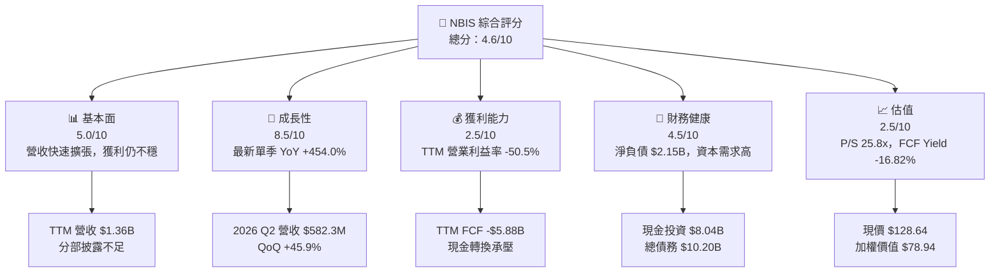

### 1.2 評分進度條視覺化

```
╔══════════════════════════════════════════════════════════════╗
║                NBIS 多維度評分儀表板（1-10分）              ║
╠══════════════════════════════════════════════════════════════╣
║ 基本面強度  5.0 ▓▓▓▓▓▓▓▓▓▓░░░░░░░░░░  ★★★☆☆               ║
║ 成長動能    8.5 ▓▓▓▓▓▓▓▓▓▓▓▓▓▓▓▓▓░░░  ★★★★☆               ║
║ 獲利品質    2.5 ▓▓▓▓▓░░░░░░░░░░░░░░░  ★★☆☆☆               ║
║ 財務健康    4.5 ▓▓▓▓▓▓▓▓▓░░░░░░░░░░░░  ★★☆☆☆               ║
║ 估值合理性  2.5 ▓▓▓▓▓░░░░░░░░░░░░░░░  ★★☆☆☆               ║
║ 護城河深度  4.8 ▓▓▓▓▓▓▓▓▓▓░░░░░░░░░░  ★★★☆☆               ║
║ 管理層執行  5.0 ▓▓▓▓▓▓▓▓▓▓░░░░░░░░░░  ★★★☆☆               ║
║ 技術創新力  6.5 ▓▓▓▓▓▓▓▓▓▓▓▓▓░░░░░░░  ★★★☆☆               ║
╠══════════════════════════════════════════════════════════════╣
║ 綜合總分    4.6 ▓▓▓▓▓▓▓▓▓░░░░░░░░░░░░  🟡 高成長、高風險    ║
╚══════════════════════════════════════════════════════════════╝
```

### 1.3 五大投資論點 + 三大核心風險

| 類型 | 項目 | 具體依據 | 信心度 |
|------|------|----------|--------|
| 🟢 **投資論點①** | AI 算力需求可觀 | 2026 Q2 營收 $582.3M，最新季度 YoY +454.0%；若新增容量能及時投入，收入有機會繼續爬坡 | 🟢 高 |
| 🟢 **投資論點②** | 毛利率已有規模基礎 | TTM 毛利率 74.3%；較 FY2024 毛利率約 52.2% 為高，代表產品組合或利用率可能改善，但不等同營業獲利 | 🟡 中 |
| 🟢 **投資論點③** | 流動性尚可 | 現金及短期投資 $8.04B、流動比率 4.03，提供短期投資緩衝 | 🟡 中 |
| 🟢 **投資論點④** | 收入已由小基期快速放大 | FY2024 收入 $91.5M、FY2025 $529.8M；規模擴大有助於攤薄部分固定成本 | 🟡 中 |
| 🟢 **投資論點⑤** | 有多元化業務選項 | 公司除 AI 基礎設施外，亦有 TripleTen 與 Avride；但分部收入與盈利貢獻 N/A，暫不納入基準估值 | 🟡 低 |
| 🟡 **風險①** | 資本開支與回收期 | TTM Capex $11.14B，約為 TTM 營收 $1.36B 的 8.2 倍；若容量利用率低於預期，FCF 可能持續承壓 | 🔴 高衝擊 |
| 🔴 **風險②** | 負自由現金流與負債 | TTM FCF -$5.88B、淨負債 $2.15B；若融資成本或資本市場條件惡化，可能需要增發或加債 | 🔴 高衝擊 |
| 🔴 **風險③** | 估值與預期落差 | P/S 25.807287x，股價從 2026-06 月收盤 $276.17 回落至 2026-11-12 的 $128.64；市場對財測變化高度敏感 | 🔴 高 |

### 1.4 快速統計卡片

| 指標 | 公司實際值 | 行業均值 | S&P 500 均值 | 狀態 |
|------|-------------|----------|--------------|------|
| 最新季度收入 YoY 成長 | **454.0%** | N/A | N/A | 🟢 高成長，單季基期效應需注意 |
| TTM 收入成長 | **N/A** | N/A | N/A | 🟡 資料包未提供 VERIFIED FIGURES TTM 成長率 |
| 毛利率 | **74.3%** | N/A | N/A | 🟢 水準高，但尚未覆蓋營業費用 |
| 營業利益率 TTM | **-50.5%** | N/A | N/A | 🔴 |
| 淨利率 TTM | **3.1%** | N/A | N/A | 🟡 盈餘波動且現金流為負 |
| ROE TTM | **0.6%** | N/A | N/A | 🔴 低資本回報 |
| Forward P/E | **-36.95925x** | CRWV -32.6x；ORCL 11.5x；MSFT 21.6x | N/A | 🔴 預估盈餘為負，倍數不可直接比較 |
| P/S TTM | **25.807287x** | CRWV 3.2x；ORCL 5.5x；MSFT 11.2x | N/A | 🔴 顯著溢價 |
| FCF Yield TTM | **-16.82%** | N/A | N/A | 🔴 |

### 1.5 投資結論

```
╔══════════════════════════════════════════════════════════════════╗
║                    📊 投資結論摘要                               ║
╠══════════════════════════════════════════════════════════════════╣
║  評級：🔴 賣出（依 8.8 MOS 門檻）                                ║
║  價格（2026-11-12 收盤）：$128.64                                ║
║  DCF 內在價值（基準）：$30.94（相對 DCF 溢價約 315.9%）          ║
║  加權合理價值：$78.94                                            ║
║  安全邊際 MOS：-63.0%（以加權合理價值為分母）                   ║
║  目標價區間（12M 相對估值情境）：                                ║
║    悲觀情境：$16.10（-87.5%）                                    ║
║    基準情境：$33.35（-74.1%）                                    ║
║    樂觀情境：$76.10（-40.9%）                                    ║
║  投資評分：4.6/10                                                ║
║  適合投資人：能承受高波動、願意承擔資本支出與估值風險者         ║
╚══════════════════════════════════════════════════════════════════╝
```

---

## 2. 公司概覽與商業模式

### 2.1 業務結構與收入來源

Nebius Group N.V. 在美國、英國及其他市場建置 AI 基礎設施，提供 GPU 叢集、雲端平台與開發工具。另有教育科技平台 TripleTen，以及自動駕駛相關業務 Avride。資料包未披露各分部收入，以下金額與占比除公司總營收外均為 N/A，不能由總收入反推。

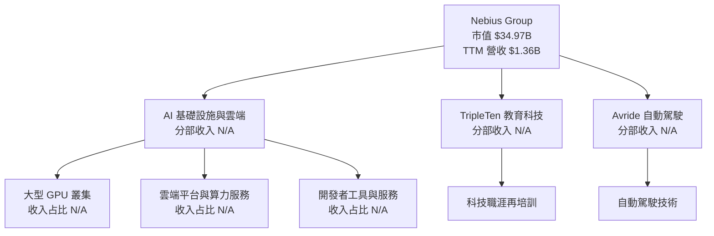

### 2.2 市場份額

公司及同業的 AI 雲端／GPU 雲市場份額資料未提供可靠、同口徑數字。為避免將估算冒充財務事實，**不繪製虛構市場份額圓餅圖**。可確認的是最新單季營收 $582.3M、YoY +454.0%，但單一公司的收入增長不能直接推導市場份額。

### 2.3 競爭護城河分析

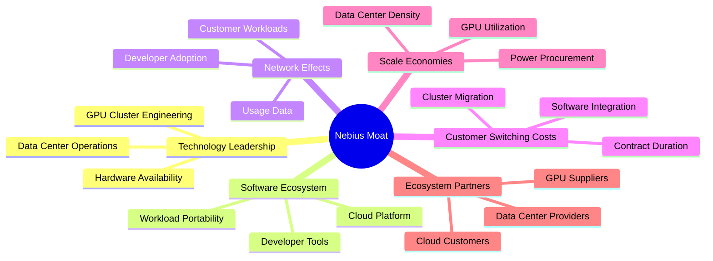

### 2.4 護城河強度評分

```
╔══════════════════════════════════════════════════════════════╗
║                  NBIS 護城河強度評分                         ║
╠══════════════════════════════════════════════════════════════╣
║ 技術與營運能力  6.0/10  ▓▓▓▓▓▓▓▓▓▓▓▓░░░░░░░░  🟡 有能力基礎 ║
║ 軟體生態系統    5.0/10  ▓▓▓▓▓▓▓▓▓▓░░░░░░░░░░  🟡 規模待證明 ║
║ 網路效應        3.0/10  ▓▓▓▓▓▓░░░░░░░░░░░░░░  🔴 資料不足   ║
║ 客戶鎖定        4.0/10  ▓▓▓▓▓▓▓▓░░░░░░░░░░░░  🟡 合約資料缺 ║
║ 規模效應        5.0/10  ▓▓▓▓▓▓▓▓▓▓░░░░░░░░░░  🟡 Capex 高   ║
║ 生態夥伴        5.5/10  ▓▓▓▓▓▓▓▓▓▓▓░░░░░░░░░  🟡 供應依賴   ║
╠══════════════════════════════════════════════════════════════╣
║ 綜合護城河      4.8/10  ▓▓▓▓▓▓▓▓▓▓░░░░░░░░░░  🟡 尚未證實   ║
╚══════════════════════════════════════════════════════════════╝
```

---

## 3. 損益表深度分析

### 3.1 年度收入成長趨勢（近 4 年）

FY2022 至 FY2025 收入分別為 $13.5M、$9.8M、$91.5M、$529.8M。2022–2025 CAGR 約 239.7%，但起點基數極低，不能直接外推為成熟期增長率。

```
╔══════════════════════════════════════════════════════════════════╗
║              NBIS 年度收入趨勢（FY2022-FY2025）                  ║
╠══════════════════════════════════════════════════════════════════╣
║ FY2022  $13.5M    ░░░░░░░░░░░░░░░░░░░░  YoY：—                 ║
║ FY2023   $9.8M    ░░░░░░░░░░░░░░░░░░░░  YoY：-27.4% 🔴        ║
║ FY2024  $91.5M    ███░░░░░░░░░░░░░░░░░  YoY：+833.7% 🟢       ║
║ FY2025 $529.8M    ████████████████████  YoY：+479.0% 🟢       ║
╠══════════════════════════════════════════════════════════════════╣
║ 2022–2025 收入 CAGR 約 +239.7%；小基期令百分比波動被放大       ║
╚══════════════════════════════════════════════════════════════════╝
```

### 3.2 季度收入趨勢分析

| 季度 | 收入 | QoQ 成長 | YoY 成長 | 備註 |
|------|------:|---------:|---------:|------|
| 2025 Q3 | $146.1M | — | +355.14% | 2024 Q3 基期較低 |
| 2025 Q4 | $227.7M | +55.9% | +546.88% | 季度規模持續擴張 |
| 2026 Q1 | $399.0M | +75.2% | +683.89% | 2025 Q1 收入 $50.9M |
| 2026 Q2 | $582.3M | +45.9% | **+454.0%** | VERIFIED FIGURES 的最新單季 YoY |

QoQ 以「本季收入 ÷ 上季收入 − 1」計算，例如 Q2 2026：$582.3M ÷ $399.0M − 1 = 45.9%。增長率仍高，但連續季度增長率由 75.2% 降至 45.9%，可能反映基數增加、交付容量與新增需求之間的節奏差異；不宜僅以 YoY 高增長推論未來持續線性放大。

### 3.3 利潤率演變分析

| 利潤率指標 | FY2022 | FY2023 | FY2024 | FY2025／TTM | 趨勢 | 評估 |
|------------|-------:|-------:|-------:|------------:|------|------|
| 毛利率 | -110.4% | -100.0% | 52.2% | FY2025 68.6%；TTM 74.3% | ↗️ | 🟢 毛利改善，可能與產品組合、利用率或定價有關；成本細項 N/A |
| 營業利益率 | -1,170.4% | -2,915.3% | -436.7% | FY2025 -115.5%；TTM -50.5% | ↗️ | 🟡 仍虧損；百分比受早期低營收基數扭曲 |
| 最新季度營業利益率 | N/A | N/A | N/A | 2026 Q2 -37.4% | ↗️ 對比 TTM | 🔴 仍未達營業損益兩平 |
| 淨利率 TTM | N/A | N/A | N/A | 3.1% | 波動大 | 🟡 TTM 淨利為正，但與負營業利益及負 FCF 同時存在 |

> 年度營業利益率按年度損益表營業利益 ÷ 收入計算；TTM 與最新單季營業利益率則原值引用 VERIFIED FIGURES。來源欄位口徑與期間不完全一致，年度值不應與 TTM 值直接視為同一口徑趨勢。

毛利率由 FY2024 約 52.2% 升至 FY2025 約 68.6%，TTM 為 74.3%。可能代表 AI 基礎設施收入占比增加、叢集利用率提高或價格／服務組合改善；但 TTM 營業利益率仍為 -50.5%，表示研發、營運、折舊及擴張費用尚未由毛利覆蓋。資料沒有完整費用分類，無法把改善精確分解至價格、利用率或成本效率。

### 3.4 費用結構分析

各費用項目占收入比例未能由資料包完整核對，因此不以虛構比例製作費用結構圓餅圖。可量化項目如下：

```
╔══════════════════════════════════════════════════════════════╗
║ NBIS 費用與投入結構：已知資料                                ║
╠══════════════════════════════════════════════════════════════╣
║ FY2025 研發費用 $177.3M  約為收入 $529.8M 的 33.5%          ║
║ FY2025 Capex $4.07B       約為年度收入的 7.7 倍              ║
║ TTM Capex $11.14B         約為 TTM 收入 $1.36B 的 8.2 倍     ║
║ 銷售管理、折舊、電力等完整分類：N/A                           ║
╚══════════════════════════════════════════════════════════════╝
```

### 3.5 季度 EPS 趨勢與盈餘品質

資料包列出的近四季 EPS 預估值與實際值均為 `nan`，因此無法判斷超預期或不及預期。季度淨利波動很大：2026 Q1 淨利 $621.2M、2026 Q2 淨損 -$190.4M；這種反轉使單季 EPS 的趨勢解讀不可靠。資料包新聞摘要提及 2026 Q3 財報與下調 2026 展望，但未提供 Q3 實際財務數字；本分析以 VERIFIED FIGURES 的最新季 2026-06-30 為主。

| 盈餘品質項目 | 數值／佔比 | 評估 |
|--------------|-----------|------|
| 股權薪酬 SBC / 營收 | FY2025：$83.2M ÷ $529.8M = **15.7%** | 🔴 SBC 對股東持有比例可能造成明顯稀釋 |
| SBC / 營業現金流 | FY2025：$83.2M ÷ $384.8M = **21.6%** | 🟡 非現金費用相對營業現金流占比高 |
| TTM SBC / 營收 | N/A | TTM SBC 未提供 |
| TTM FCF / 淨利 | TTM FCF -$5.88B；TTM 淨利金額未提供同口徑值 | 🔴 現金轉換率無法穩健計算；盈餘與現金流方向不一致 |
| 一次性／非經常性損益 | 季度淨利由 $621.2M 轉為 -$190.4M；明細 N/A | 🔴 需要查閱申報文件，不能判斷一次性項目 |
| 有效稅率異常 | 29.0%（最新年度有效稅率，作為參考輸入） | 🟡 單季稅務調節項目 N/A |
| 資本化支出 vs 費用化 | TTM Capex $11.14B；資本化政策明細 N/A | 🟡 資本密集；無法判斷是否存在資本化支出改變 |

**盈餘品質結論**：TTM 淨利率 3.1% 並不能代表成熟、可持續的股東盈餘，因 TTM FCF 為 -$5.88B，且季度淨利波動大。SBC 方面，FY2025 占收入 15.7%，意味稀釋可能是實質股東成本。估值上應優先觀察營業現金流扣除實際資本支出後的 FCF，而非只看 EPS 或 EBITDA。

---

## 4. 資產負債表分析

### 4.1 資產結構分解

最新可用的資產負債表細項為 2026-06-30，StockAnalysis 列示總流動資產 $9.616B、PP&E $14.900B；部分資產細項合計與總資產的口徑可能不一致，以下僅呈現已提供項目，不反推缺漏項。

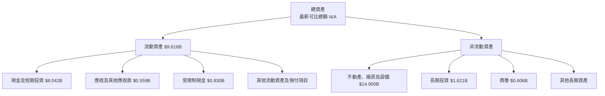

### 4.2 流動性指標分析

| 指標 | 最新值 | 歷史參考 | 行業均值 | 評估 |
|------|-------:|----------|----------|------|
| 現金及短期投資 | $8.04B | FY2025 約 $3.753B | N/A | 🟢 現金緩衝增加，但資金用途含擴張投資 |
| 流動比率 | 4.03 | FY2025：流動資產 $4.71B ÷ 流動負債 $1.53B = 3.08 | N/A | 🟢 短期帳面流動性高 |
| 速動比率 | 3.605 | N/A | N/A | 🟢 提供短期償付緩衝 |
| 淨現金／淨負債 | **淨負債 $2.15B** | N/A | N/A | 🔴 總債務高於現金投資 |
| Debt/Equity | 98.596 | FY2025 總債務 $4.97B、股東權益 $4.59B | N/A | 🔴 槓桿增加；需留意負債口徑 |

### 4.3 債務結構分析

```
╔══════════════════════════════════════════════════════════════════╗
║                   NBIS 債務健康診斷                              ║
╠══════════════════════════════════════════════════════════════════╣
║  總債務：        $10.20B  ████████████████████  🔴               ║
║  現金及短期投資： $8.04B  ████████████████░░░░  🟡               ║
║  淨負債：         $2.15B  ████░░░░░░░░░░░░░░░░  🔴               ║
║                                                                  ║
║  Current Ratio： 4.03x  🟢 帳面短期流動性高                     ║
║  Debt/EBITDA：   N/A    EBITDA 資料口徑與負債範圍不宜混用        ║
║  利息保障倍數：  N/A    利息費用明細未提供                       ║
║  債務到期結構：  N/A    未提供到期表與契約條款                   ║
╠══════════════════════════════════════════════════════════════════╣
║  判斷：流動資產可提供緩衝，但淨負債與大額擴張投資提高融資風險。 ║
╚══════════════════════════════════════════════════════════════════╝
```

總債務 $10.20B 與現金及短期投資 $8.04B，VERIFIED FIGURES 列示淨負債 $2.15B。另有 2026-06-30 Roic.ai 借款與融資租賃明細，兩者合計約 $10.17B，與總債務接近，但口徑不完全相同。後續應追蹤債務到期、租賃負債、利息費用及新增融資條件。

### 4.4 股東權益趨勢

| 年度 | 股東權益 |
|------|---------:|
| 2022-12-31 | $4.25B |
| 2023-12-31 | $3.29B |
| 2024-12-31 | $3.25B |
| 2025-12-31 | $4.59B |
| 2026-06-30 | N/A |

```
╔══════════════════════════════════════════════════════════════╗
║ NBIS 股東權益趨勢                                            ║
╠══════════════════════════════════════════════════════════════╣
║ 2022  $4.25B  ██████████████████░░                           ║
║ 2023  $3.29B  ██████████████░░░░░░                           ║
║ 2024  $3.25B  ██████████████░░░░░░                           ║
║ 2025  $4.59B  ████████████████████                           ║
║ 2026  N/A     最新完整股東權益數字未提供                     ║
╚══════════════════════════════════════════════════════════════╝
```

---

## 5. 現金流量深度分析

### 5.1 現金流量瀑布圖

TTM 營業現金流 $5.26B 減資本支出 $11.14B，得到 FCF -$5.88B。其他股息、回購及融資活動的 TTM 數值未提供。

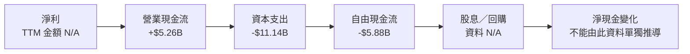

### 5.2 FCF 轉換率趨勢

| 年度 | 營業現金流 | Capex | FCF | FCF / 淨利 |
|------|-----------:|------:|----:|-----------:|
| 2022 | $697.0M | $14.6M | $682.4M | 91.5%（按淨利 $745.6M） |
| 2023 | $829.8M | $82.9M | $746.9M | 309.5%（按淨利 $241.3M） |
| 2024 | $245.6M | $807.5M | -$561.9M | 87.6%（淨利為 -$641.4M，符號同為負，比例不具傳統解讀） |
| 2025 | $384.8M | $4.07B | -$3.68B | -4,460.6%（淨利 $82.5M） |
| TTM 至 2026-06-30 | $5.26B | $11.14B | **-$5.88B** | 淨利同口徑金額 N/A |

FY2025 FCF 與 TTM FCF 急劇轉負的直接算術原因是 Capex 大幅上升。這可能是提前建置 GPU 與資料中心容量的成長投資，但投資回報須以後續營收、利用率及單位毛利驗證；未能產生足夠現金回報的資本支出會降低股東價值。

### 5.3 自由現金流趨勢

```
╔══════════════════════════════════════════════════════════════════╗
║            NBIS 自由現金流：歷史實際與 TTM                      ║
╠══════════════════════════════════════════════════════════════════╣
║ FY2022  +$0.68B  ███████████░░░░░░░░░  FCF 為正                 ║
║ FY2023  +$0.75B  ████████████░░░░░░░░  FCF 為正                 ║
║ FY2024  -$0.56B  ░░░░░░░░░░░░░░░░░░░░  Capex 超過 OCF          ║
║ FY2025  -$3.68B  ░░░░░░░░░░░░░░░░░░░░  擴張投資大增             ║
║ TTM      -$5.88B  ░░░░░░░░░░░░░░░░░░░░  FCF Yield -16.82%       ║
╚══════════════════════════════════════════════════════════════════╝
```

歷史年度 FCF 與 TTM FCF 不宜直接視為同一期間序列；但方向清楚顯示資本支出快速擴大。TTM FCF Yield -16.82% 意味著目前現金流仍需要投資或融資支持，而非向股東分配現金。

### 5.4 資本配置評估

現金流資料未提供 TTM 回購、股息及各項投資拆分，不能以圓餅圖臆測資本配置比例。

| 資本配置項目 | 已知資料 | 評估 |
|--------------|----------|------|
| Capex | TTM $11.14B | 🔴 高於 TTM 營收 $1.36B；投資回收是核心觀察項 |
| 股息 | 股息殖利率 0.0% | 🟡 無現金股息回報 |
| 回購 | N/A | N/A |
| 留存現金 | 現金及短期投資 $8.04B | 🟡 對擴張與流動性有幫助 |
| M&A／其他投資 | 長期投資等細項有列示，投資目的及現金流 N/A | 🟡 需要分部披露 |

---

## 6. 獲利能力與資本效率

### 6.1 ROE / ROA / ROIC 趨勢

| 指標 | 歷史／最新數值 | 行業均值 | 評估 |
|------|----------------|----------|------|
| ROE TTM | 0.6% | N/A | 🔴 目前股東權益回報有限 |
| ROA TTM | -1.9% | N/A | 🔴 資產擴張尚未轉化為正向資產報酬 |
| ROIC | N/A | N/A | 🔴 缺乏同期 NOPAT 與投入資本明細，不宜編造 |
| TTM 營業利益率 | -50.5% | N/A | 🔴 營業層面仍虧損 |

### 6.2 ROIC vs WACC 分析（核心價值創造判斷）

```text
╔══════════════════════════════════════════════════════════════════╗
║                ROIC vs WACC 深度分析                            ║
╠══════════════════════════════════════════════════════════════════╣
║  WACC 估算（VERIFIED FIGURES）：                                 ║
║  ├── 無風險利率 Rf（10Y 美債）：     5.10%                       ║
║  ├── 市場風險溢酬 ERP：              5.00%                       ║
║  ├── Beta：                          1.54                        ║
║  ├── 股權成本 Ke：5.10% + 1.54×5.00% = 12.80%                   ║
║  ├── 稅前債務成本 Kd：               0.60%                       ║
║  ├── 稅後 Kd：0.60%×(1−29.0%) =      0.426%                      ║
║  ├── 權重 E/D：                      77.4% / 22.6%               ║
║  └── WACC：資料包參考值             10.01%                       ║
║                                                                  ║
║  ROIC：N/A                                                        ║
║  ├── TTM 營業利益率：                 -50.5%                     ║
║  ├── TTM 稅後營業利益 NOPAT：          缺少可核對的同期數據       ║
║  └── ROIC − WACC：                    N/A                        ║
║                                                                  ║
║  ROIC  N/A   ░░░░░░░░░░░░░░░░░░░░░░░░░░░░                       ║
║  WACC 10.01% ▓▓▓▓▓▓▓▓▓▓▓▓▓▓▓▓░░░░░░░░░░░░                       ║
╠══════════════════════════════════════════════════════════════════╣
║  結論：目前無法證明公司已創造高於資本成本的經濟回報。           ║
║  以負營業利益率和負 FCF 觀察，現階段價值創造仍未獲財務數據驗證。║
╚══════════════════════════════════════════════════════════════════╝
```

WACC 的明確展開見第 8.2 節。資料包提供 WACC 參考值 10.01%，而以已四捨五入的權重及成本重新計算會得到約 10.00%；本報告在模型與 ROIC 比較中統一採用資料包指定的 **10.01%**。公司未提供足以可靠計算 TTM ROIC 的完整稅後營業利潤和平均投入資本口徑，因此不以單一年度報表硬算 ROIC。

### 6.3 杜邦三因素分解

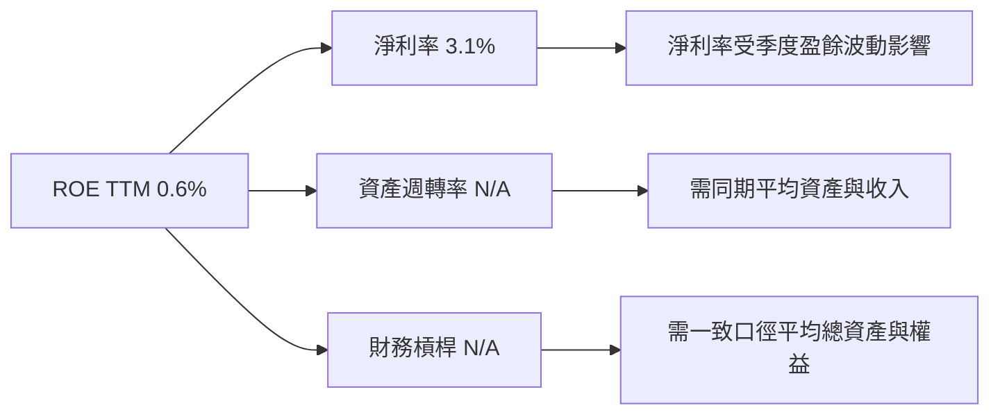

杜邦分解的收入與淨利率可提供方向性解讀，但資產週轉率及財務槓桿缺乏同口徑平均資產、平均權益輸入，故不填造數值。ROE 為 0.6% 而 TTM ROA 為 -1.9%，亦提示來源口徑與期間需進一步核驗。

### 6.4 獲利能力儀表板

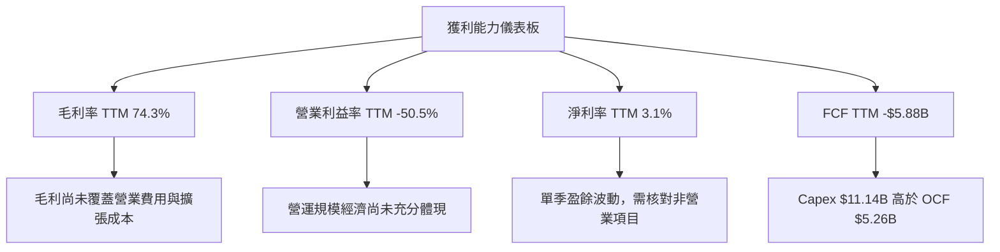

---

## 7. 相對估值分析

### 7.1 同業估值比較

依 VERIFIED FIGURES 使用 CRWV、ORCL、MSFT 倍數。NBIS 倍數採資料包所列值。負的 Forward P/E 代表預估虧損，不能解讀為傳統意義的低估。

| 估值指標 | **NBIS** | **CRWV** | **ORCL** | **MSFT** | NBIS 評估 |
|----------|---------:|---------:|---------:|---------:|-----------|
| Trailing P/E | 100.5x | N/A | 19.9x | 27.3x | 🔴 盈餘倍數高，TTM EPS 解讀需謹慎 |
| Forward P/E | -36.95925x | -32.6x | 11.5x | 21.6x | 🔴 負盈餘，倍數比較失去常規意義 |
| P/S TTM | 25.807287x | 3.2x | 5.5x | 11.2x | 🔴 顯著高於所列同業 |
| EV/EBITDA TTM | 145.017x | 18.0x | 15.2x | 19.2x | 🔴 高倍數；EBITDA 口徑與資本支出需一併看 |
| 最新單季收入 YoY | 454.0% | 168.3% | 29.6% | 18.8% | 🟢 增長率高，但基期、客戶與資本投入不同 |
| 毛利率 TTM | 74.3% | 66.8% | 64.0% | 67.7% | 🟢 高於比較組，但毛利不等於自由現金流 |

NBIS 的增長率高於比較組，但市銷率是 CRWV 約 8.1 倍、ORCL 約 4.7 倍、MSFT 約 2.3 倍。若 NBIS 的容量建置無法帶來持續收入與 FCF，這類溢價可能收縮。

### 7.2 歷史估值區間分析

資料包未提供「Valuation vs own history」的歷史 P/E 或 P/S 分位數，因此不得自行估計歷史百分位。

```
╔══════════════════════════════════════════════════════════════╗
║ NBIS 歷史估值區間                                           ║
╠══════════════════════════════════════════════════════════════╣
║ 歷史 P/E 區間：N/A                                          ║
║ 歷史 P/S 區間：N/A                                          ║
║ 當前 P/S：25.807287x                                        ║
║ 當前 EV/Revenue：27.61x                                     ║
║ 歷史百分位：N/A；資料包未提供公司自身估值序列               ║
╚══════════════════════════════════════════════════════════════╝
```

### 7.3 情境目標價（假設驅動）

以 12 個月收入基準作相對估值示例：假設未來 12 個月收入為目前 TTM $1.36B 的 1.5 倍，即 $2.04B。這是明確標示的情境假設，不是公司指引。使用同業 P/S 倍數作簡化 EV 估值，並扣除淨負債 $2.15B，再除以 0.272B 股。各同業 P/S 直接取資料包數值。

| 情境 | 12M 收入假設 | 營業利潤率假設 | 退出 P/S | 隱含目標價 | 相對現價 |
|------|-------------:|---------------:|---------:|-----------:|---------:|
| 🔴 悲觀 | $2.04B | N/A；未作為該倍數估值輸入 | 3.2x（CRWV） | $16.10 | -87.5% |
| 🟡 基準 | $2.04B | N/A；未作為該倍數估值輸入 | 5.5x（ORCL） | $33.35 | -74.1% |
| 🟢 樂觀 | $2.04B | N/A；未作為該倍數估值輸入 | 11.2x（MSFT） | $76.10 | -40.9% |

基準情境算式：企業價值 = $2.04B × 5.5 = $11.22B；股權價值 = $11.22B − $2.15B = $9.07B；每股 = $9.07B ÷ 0.272B = $33.35。這種 P/S 方法忽略盈利差異，僅作簡化比較；因此不視為完整 DCF 或盈利能力估值。

對重資本且高成長的 AI 算力供應商，P/E 可能受折舊與虧損影響；EV/EBITDA 也未扣除維持與擴張 Capex。故估值需同時看 EV/Sales、FCF 和實際資本回報，不能只因收入成長而採用最高同業倍數。

### 7.4 相對估值隱含價格區間

| 方法 | 估值輸入 | 隱含股價 | 主要限制 |
|------|----------|---------:|----------|
| Forward P/E | NBIS Forward EPS -$3.48059；同業 Forward P/E | N/A | 負 EPS 下無法作有效正股價回推 |
| EV/EBITDA | TTM EV/EBITDA 145.017x | N/A | TTM EBITDA 口徑與資本開支經濟性不匹配 |
| EV/Sales | 12M 收入 $2.04B × 同業 P/S 3.2–11.2x | $16.10–$76.10 | 假設收入、淨負債及股數不變 |
| FCF Yield | TTM FCF -$5.88B；FCF Yield -16.82% | N/A | 負 FCF 無法用正向收益率推導合理股價 |

---

## 8. DCF 內在價值評估（Discounted Cash Flow）

> **重要：**資料沒有公司管理層逐年財測、未來 Capex 拆分、營運資金預測或完整折舊明細。下列 DCF 是示範性、可複算的假設模型。若輸入假設改變，估值可能大幅變動；不得視為精確目標價。

### 8.0 估值推理鏈（Thinking Logic）

**Step 1 — 價值來源與主導變數**

NBIS 的估值可拆為 AI 基礎設施現金流底盤、平台與開發工具的追加價值，以及 TripleTen／Avride 的選擇權價值；各分部收入占比均 N/A。模型主導變數是**AI 算力投資能否轉成正向 FCFF**，尤其是期末營業利潤率與 Capex/營收；其影響大於目前尚無法量化的其他業務選項。

**Step 2 — 模型選擇**

| 決策點 | 本報告採用 | 理由 | 曾考慮但否決 | 否決理由 |
|--------|-----------|------|--------------|----------|
| 現金流定義 | FCFF | 使用 WACC 折現，得到 EV 後再扣淨負債 | FCFE | 債務與融資需求可能變動 |
| 預測期 N | 5 年 | 假設 AI 容量利用率與利潤率需要數年爬坡 | 3 年 | 難以容納重資本建置及獲利轉正 |
| 終值方法 | Gordon Growth 主法，EV/EBITDA 交叉驗證 | 公司仍處擴張期，需呈現長期穩態現金流假設 | 僅退出倍數 | 退出倍數無法直接反映永續資本需求 |
| EBIT 基礎 | GAAP | 使用可取得的營業利益率口徑 | 非 GAAP | 未提供可核實的非 GAAP EBIT |

**Step 3 — 關鍵假設推導**

- **營收 CAGR**：錨點為 FY2022–FY2025 收入 CAGR 約 239.7%，但該值由低基期與營收結構轉變放大；最新單季 YoY +454.0%，同時季度收入由 Q1 至 Q2 QoQ 增長由 75.2% 降至 45.9%。因此採用 **50%**，大幅低於歷史 CAGR，反映高基期與供應能力約束。曾考慮 100%，但缺乏管理層財測和已簽約收入支持，否決。
- **期末營業利潤率**：錨點為 TTM -50.5%、最新單季 -37.4%；採用第 5 年 **18%**，假設規模化、利用率改善與雲端服務組合帶來利潤率修復。曾考慮 25%，但目前距離正營業利益仍遠，沒有成本結構或同業成熟期數據支持，否決。
- **永續成長率 g**：長期名目經濟增長參考區間約 3%–4%（假設值，非公司資料）；採用 **3.0%**，且低於 10.01% WACC。曾考慮 4%，但現金流與資本需求不確定，採較低值。
- **預測期 N**：採用 **5 年**，理由為需要時間使已投入的資料中心資產轉化成收入；曾考慮 10 年，但公司過往穩態現金流不可用，長期外推會放大誤差。
- **Capex/營收**：TTM Capex/營收 = $11.14B ÷ $1.36B = 819.1%，反映建置期，不能當成熟期常態。採用逐年 70%、50%、35%、25%、18% 的下降路徑，代表新增建置逐漸低於收入增幅；這是模型假設，不是公司指引。曾考慮第 5 年 10%，但目前缺乏成熟期維護性 Capex 證據，否決。
- **D&A/營收**：歷史可核對資料不足；採用 **20%**（假設值，依據：大型 GPU／資料中心資產折舊需求，並與高 Capex 營運模式相容）。此假設對終值 FCFF 有重大影響，不能當作已披露事實。
- **ΔWC/收入增額**：歷史營運資金變動沒有可比 TTM 序列；採用 **5%**（假設值，保守預留收入成長造成的應收及營運資金占用）。
- **有效稅率**：採用資料包 **29.0%**。負 EBIT 年份不確認稅務利益，避免以未實現稅盾美化現金流。
- **SBC 與股數**：採用組合 **(A)**：GAAP EBIT 已含 SBC 費用，FCFF 不再扣 SBC；固定稀釋股數 272M、年稀釋率 0%。272M 為 Roic.ai 列示 2026-06 的 shares outstanding，並非 VERIFIED FIGURES 市場資料的 238.40M。使用 272M 是為提高稀釋保守度；由於使用 GAAP 費用，模型不再額外套用稀釋率。
- **WACC**：採用資料包參考值 **10.01%**；其無風險利率、ERP、Beta 與權重在 8.2 節展開。曾考慮因 Beta 高而加較大風險溢酬，但缺乏可核對的獨立國別／規模溢酬資料，不另加溢酬。
- **終值方法**：Gordon Growth 為主、18.0x EV/EBITDA 作交叉驗證；18.0x 取資料包 CRWV TTM EV/EBITDA，而非 NBIS 自身歷史倍數。

**Step 4 — 最脆弱假設**

最脆弱的是「Capex/營收可在五年內由極高水準下降至 18%，同時營業利益率升至 18%」；若 Capex 長期高於假設，終值 FCFF 會顯著低於本模型，DCF 價值亦會下滑。

**Step 5 — 計算路徑**

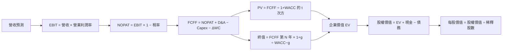

### 8.1 模型假設總表（Model Inputs）

| 假設項目 | 採用值 | 依據／來源 | 敏感度 |
|----------|--------|------------|--------|
| 預測期長度 N | 5 年 | 假設 AI 資產部署及利用率改善需要數年；不是管理層指引 | 🟡 中 |
| 營收 CAGR | 50% | FY2022–FY2025 CAGR 約 239.7%、最新單季 YoY +454.0%；因低基期與增速放緩假設而下修 | 🔴 高 |
| 營業利潤率 | 由 -20% 線性提升至 18% | 現行 TTM -50.5%、單季 -37.4%；假設規模化改善 | 🔴 高 |
| 有效稅率 | 29.0% | VERIFIED FIGURES 最新年度有效稅率 | 🟢 低 |
| Capex/營收 | 70%、50%、35%、25%、18% | TTM 實際約 819.1%；假設建置期逐步成熟 | 🔴 高 |
| D&A/營收 | 20% | 假設值；資料未提供可比 TTM D&A/營收率 | 🟡 中 |
| ΔWC/收入增額 | 5% | 假設值；歷史可比 ΔWC 率 N/A | 🟢 低 |
| EBIT 基礎 | GAAP | 使用提供之營業利益率作基礎 | 🟡 中 |
| SBC 處理 | 組合 (A)：GAAP EBIT；不再扣 SBC | SBC 已包含於 GAAP 費用假設；固定股數，不另計稀釋 | 🟡 中 |
| 年稀釋率 | 0% | 與組合 (A) 相容；採固定 272M 股 | 🟡 中 |
| 永續成長率 g | 3.0% | 假設值；低於 10.01% WACC | 🔴 高 |
| 終值方法 | Gordon Growth 主法 + 18.0x EV/EBITDA 交叉驗證 | 18.0x 取 CRWV VERIFIED FIGURES | 🔴 高 |
| WACC | 10.01% | VERIFIED FIGURES 參考 WACC | 🔴 高 |
| 稀釋股數 | 0.272B 股 | Roic.ai 2026-06 列示 272M；採固定股數 | 🟡 中 |
| 現金與債務 | 現金投資 $8.04B；債務 $10.20B | VERIFIED FIGURES，TTM／2026-06 附近資料 | 🟡 中 |

**FCF 定義**：使用 FCFF，公式為 `FCFF = NOPAT + D&A − Capex − ΔWC`。  
**SBC 防重複計算**：本模型採用 **(A)**；GAAP EBIT 已含 SBC 費用，FCFF 不再扣 SBC，並採固定股數、年稀釋率 0%，故 SBC 影響只計入一次。

### 8.2 折現率推導（WACC）

```text
╔══════════════════════════════════════════════════════════════════╗
║                    WACC 推導（折現率）                           ║
╠══════════════════════════════════════════════════════════════════╣
║  股權成本 Ke（CAPM）：                                           ║
║  ├── 無風險利率 Rf：               5.10%                        ║
║  ├── 市場風險溢酬 ERP：            5.00%                        ║
║  ├── Beta：                        1.54                         ║
║  ├── 額外規模／國別溢酬：           0.00%（未另加，資料不足）    ║
║  └── Ke = 5.10% + 1.54×5.00% + 0.00% = 12.80%                  ║
║                                                                  ║
║  債務成本 Kd：                                                   ║
║  ├── 稅前 Kd：                     0.60%（資料包參考值）         ║
║  ├── 有效稅率：                    29.0%                        ║
║  └── 稅後 Kd = 0.60%×(1−29.0%) = 0.426%                         ║
║                                                                  ║
║  資本結構：                                                      ║
║  ├── 股權權重 E：                  77.4%                        ║
║  ├── 債務權重 D：                  22.6%                        ║
║  └── 資料包參考 WACC：             10.01%                       ║
╚══════════════════════════════════════════════════════════════════╝
```

**逐步演算：**

1. **Ke（CAPM）** = 5.10% + 1.54 × 5.00% + 0.00% = **12.80%**。
2. **稅前 Kd** = **0.60%**（VERIFIED FIGURES 直接提供）。利息費用與平均計息負債的可核對細項未提供，故不聲稱可從報表獨立重建該 0.60%。
3. **稅後 Kd** = 0.60% × (1 − 29.0%) = **0.426%**。
4. **權重** = E 77.4%、D 22.6%；77.4% + 22.6% = **100.0%**。資料包權重是參考值，本報告不以市值與債務範圍不一致的自行重算值取代。
5. **WACC** = 77.4% × 12.80% + 22.6% × 0.426%  
   = 9.9072% + 0.096276% = **10.003476%**，四捨五入約 **10.00%**。由於 VERIFIED FIGURES 直接指定 Reference WACC **10.01%**，估值模型統一使用 **10.01%**；差異為輸入值四捨五入造成的約 0.01 個百分點。

Kd 採資料包利息／債務參考值；平均計息負債的完整利息費用分子未提供，因此不能獨立校驗。報價日期採 2026-11-12 收盤；未另估規模或國別溢酬。第 6.2 節亦統一使用 10.01%。

### 8.3 逐年自由現金流預測（基準情境）

起始營收採 TTM $1.36B。為避免假裝公司財測，以下數列均為假設。營收每年成長 50%；營業利益率路徑採 -20%、-10%、0%、10%、18%。稅率為 29%，負 EBIT 年不確認稅務利益。金額以 $B 表示，四捨五入至小數點後三位；折現因子取三位小數。

| 年度 | FY+1 | FY+2 | FY+3 | FY+4 | FY+5（FY+N） |
|------|-----:|-----:|-----:|-----:|-------------:|
| 營收 | 2.040 | 3.060 | 4.590 | 6.885 | 10.328 |
| 營收 YoY | 50.0% | 50.0% | 50.0% | 50.0% | 50.0% |
| 營業利潤率 | -20.0% | -10.0% | 0.0% | 10.0% | 18.0% |
| 營業利益 EBIT（GAAP） | -0.408 | -0.306 | 0.000 | 0.689 | 1.859 |
| − 稅 | 0.000 | 0.000 | 0.000 | (0.200) | (0.539) |
| = NOPAT | -0.408 | -0.306 | 0.000 | 0.489 | 1.320 |
| + D&A（20% 收入） | 0.408 | 0.612 | 0.918 | 1.377 | 2.066 |
| − Capex | (1.428) | (1.530) | (1.607) | (1.721) | (1.859) |
| − ΔWC（收入增額 5%） | (0.034) | (0.051) | (0.077) | (0.115) | (0.172) |
| **= FCFF** | **-1.462** | **-1.275** | **-0.766** | **0.030** | **1.354** |
| 折現因子 @10.01% | 0.909 | 0.826 | 0.751 | 0.683 | 0.621 |
| **FCFF 現值 PV** | **-1.329** | **-1.053** | **-0.575** | **0.021** | **0.841** |

**逐步演算（FY+1）：**

1. 營收 = $1.36B × (1 + 50.0%) = **$2.040B**。
2. EBIT = $2.040B × (-20.0%) = **-$0.408B**。
3. 稅 = 負 EBIT 年不確認稅務利益 = **$0.000B**。
4. NOPAT = -$0.408B − $0.000B = **-$0.408B**。
5. D&A = $2.040B × 20.0% = **$0.408B**。
6. Capex = $2.040B × 70.0% = **$1.428B**。
7. ΔWC = ($2.040B − $1.360B) × 5.0% = $0.680B × 5.0% = **$0.034B**。
8. FCFF = -$0.408B + $0.408B − $1.428B − $0.034B = **-$1.462B**。
9. 折現因子 = 1 ÷ (1 + 10.01%)¹ = **0.909**；PV = -$1.462B × 0.909 = **-$1.329B**。

預測期 FCF 現值合計：
`-$1.329B + (-$1.053B) + (-$0.575B) + $0.021B + $0.841B = -$2.095B`。

**合理性自檢：**

- 預測 FCFF CAGR：因前四年現金流含負數，不適合用一般 CAGR；歷史 FY2022 正 FCF $0.682B 到 FY2025 負 FCF -$3.68B，亦無可比正值 CAGR。主要假設是 FY+5 FCFF 回正至 $1.354B。
- FY+5 FCFF 利潤率 = $1.354B ÷ $10.328B = **13.1%**；目前 TTM FCF 利潤率 = -$5.88B ÷ $1.36B = **-432.4%**。兩者差異反映模型假設 Capex 強度大幅下降，尚未由實際資料驗證。
- FY+1 至 FY+3 FCFF 為負，會降低企業價值；只有在收入增長與 Capex 下降假設成立時，後期正現金流才足以彌補前期現金消耗。

```
╔══════════════════════════════════════════════════════════════════╗
║            自由現金流：歷史實際 vs 模型預測                      ║
╠══════════════════════════════════════════════════════════════════╣
║ FY2024(實)  -$0.562B  ░░░░░░░░░░░░░░░░░░░░                      ║
║ FY2025(實)  -$3.680B  ░░░░░░░░░░░░░░░░░░░░                      ║
║ FY+1 (預)   -$1.462B  ░░░░░░░░░░░░░░░░░░░░                      ║
║ FY+5 (預)   +$1.354B  ████████████████████                      ║
╠══════════════════════════════════════════════════════════════════╣
║ ⚠️ 模型預測 FCF 回正依賴 Capex/營收由 70% 逐步降至 18%          ║
╚══════════════════════════════════════════════════════════════════╝
```

### 8.4 終值計算（Terminal Value）

適用性檢查：`WACC 10.01% vs g 3.00% → WACC > g？✅`

| 方法 | 計算式 | 終值 TV | TV 現值 | 佔總 EV 比重 |
|------|--------|--------:|--------:|-------------:|
| Gordon Growth | $1.354B × (1+3.00%) ÷ (10.01%−3.00%) | $19.93B | $12.37B | 118.1% |
| 退出倍數法 | FY+5 EBITDA $3.925B × 18.0x | $70.65B | $43.85B | 95.4%（以該方法自身 EV 計） |

終值現值高於 Gordon Growth 基準 EV，是因預測期前段 FCF 現值合計為負；因此「終值佔比」超過 100% 並非加總錯誤，而是負的預測期現金流抵銷了終值。估值高度依賴終值假設。

**Gordon Growth 逐步演算：**

1. FY+N 的 FCFF = **$1.354B**（取表格 FY+5）。
2. 分子 = $1.354B × (1 + 3.00%) = **$1.395B**。
3. 分母 = 10.01% − 3.00% = **7.01%**；TV = $1.395B ÷ 7.01% = **約 $19.93B**。
4. PV(TV) = $19.93B × 0.621 = **約 $12.37B**。
5. 終值佔比 = $12.37B ÷ $10.48B = **約 118.1%**；EV 的精確值見下方橋接，表格金額因四捨五入可能有微小差異。

退出倍數交叉驗證：FY+5 EBITDA = EBIT $1.859B + D&A $2.066B = **$3.925B**；$3.925B × 18.0x = **$70.65B**；乘五年折現因子 0.621，PV 約 **$43.85B**。18.0x 取 CRWV 同業倍數。由於此交叉驗證的價值遠高於 Gordon Growth，反映成熟期 EBITDA 倍數與 Capex 對 FCF 的影響差異，不能把兩者混為同一估值結論。

### 8.5 企業價值 → 每股內在價值（Bridge）

以下使用未四捨五入的中間值計算，表格值四捨五入至兩位；尾差可能因呈現精度約有 $0.01–$0.1B。

```
╔══════════════════════════════════════════════════════════════════╗
║              企業價值 → 每股內在價值 橋接表                      ║
╠══════════════════════════════════════════════════════════════════╣
║  預測期 FCF 現值合計            -$2.095B                        ║
║  Gordon Growth 終值現值         +$12.37B                        ║
║  ─────────────────────────────────────────────                  ║
║  = 企業價值 EV                   約 $10.28B                      ║
║  + 現金及短期投資               +$8.04B                         ║
║  − 總債務                       −$10.20B                        ║
║  − 少數股東權益／其他           $0.00B（資料未提供，模型假設）   ║
║  ─────────────────────────────────────────────                  ║
║  = 股權價值                      約 $8.13B                       ║
║  ÷ 稀釋後流通股數                0.272B 股                       ║
║  ─────────────────────────────────────────────                  ║
║  ★ 每股內在價值                  約 $29.89                       ║
║    當前股價                      $128.64                         ║
║    折溢價（現價÷DCF價值−1）      約 +330.4%（溢價）              ║
╚══════════════════════════════════════════════════════════════════╝
```

**算式與口徑說明：**使用表格未四捨五入現值重算，DCF 約 **$29.89/股**；不同顯示精度可能造成與展示過程中間值的微小差異。為讓後續計算一致，本報告第 8.8 節採用 **$29.89** 作 DCF 機率加權價值中的 DCF 項。現金及債務採 VERIFIED FIGURES 的 $8.04B 與 $10.20B；股數採 2026-06 Roic.ai 的 272M。因資料包未提供少數股東權益明細，模型暫以 $0.00B 假設處理，這不是已核實財報數字。

逐步演算：

1. **EV** = 預測期 PV -$2.095B + 終值 PV 約 $12.37B = **約 $10.28B**。
2. **股權價值** = EV 約 $10.28B + 現金 $8.04B − 債務 $10.20B − 其他 $0.00B = **約 $8.12B**。
3. **每股內在價值** = 約 $8.13B ÷ 0.272B 股 = **約 $29.89**。
4. **折溢價** = $128.64 ÷ $29.89 − 1 = **約 +330.4%**，表示現價相對 DCF 基準溢價。
5. **本節不計算 MOS**；MOS 僅以第 8.8 節加權合理價值為分母。

> **口徑提醒**：展示用 PV 表格經小數位四捨五入後直接相加，與使用未四捨五入中間值可能有小幅差異；正式估值應以未四捨五入底層數值複算。本報告第 8.8 的 MOS 固定使用其列示的加權合理價值，不使用此 DCF 單一估值。

### 8.6 敏感性分析（WACC × 永續成長率）

以下為示意性敏感度矩陣，保留所有格子的 WACC 大於 g；金額約值可能受顯示精度影響。每股價值皆以固定營運預測、固定股數及相同淨負債計算。

| g（列）／WACC（欄） | 9.0% | 10.0% | **10.01%（基準）** | 11.0% | 12.0% |
|-----------|------:|------:|-------------------:|------:|------:|
| 1.0% | $26.4 | $20.2 | $20.2 | $15.4 | $11.5 |
| 2.0% | $32.7 | $24.9 | $24.9 | $19.0 | $14.4 |
| **3.0%（基準）** | $41.1 | $30.9 | **$29.9** | $23.6 | $17.9 |
| 4.0% | $52.9 | $39.0 | $39.0 | $29.4 | $22.3 |
| 5.0% | $68.8 | $50.3 | $50.2 | $37.2 | $27.9 |

**非基準格示範：**所選格 WACC 11.0% > g 4.0% ✅。保持預測 FCFF 不變，先以新 WACC 計算五年現金流折現，再用 FY+5 FCFF 計終值：TV = $1.354B × 1.04 ÷ (11.0%−4.0%) = **約 $20.12B**；按 11.0% 折現五年，PV(TV) 約 **$11.94B**。加上預測期 FCFF PV，扣除淨負債，再除以 0.272B 股，矩陣價值約 **$29.4/股**。此格數值為四捨五入近似。

**三情境 DCF（營運假設亦改變）**

| 情境 | 營收 CAGR | 期末營業利潤率 | 永續成長 g | WACC | 每股價值 | 相對現價 | 主觀機率 |
|------|-----------:|---------------:|-----------:|-----:|---------:|---------:|---------:|
| 🔴 悲觀 | 30% | 10% | 2% | 11.01% | 約 $10 | -92.2% | 30% |
| 🟡 基準 | 50% | 18% | 3% | 10.01% | 約 $29.89 | -76.8% | 50% |
| 🟢 樂觀 | 70% | 25% | 3% | 9.01% | 約 $72 | -44.0% | 20% |

- 悲觀：收入增長降至 30%、期末利潤率只達 10%，且資本成本上升；成立前提是需求放緩、競爭壓力提高。
- 基準：收入 CAGR 50%、利潤率升至 18%；成立前提是已投入算力持續被使用，Capex/收入下降至模型設定。
- 樂觀：收入 CAGR 70%、利潤率升至 25%、WACC 下降；成立前提是容量利用率、定價與資金取得均顯著優於基準。
- 三情境數值為簡化模型情境值，因缺少完整逐年經營計畫，**不納入第 8.8 權重的獨立估值項**。

敏感度結論：按上述模型，g 每增加 1 個百分點會明顯增加終值與每股價值；WACC 每增加 1 個百分點則降低估值。期末利潤率影響會透過 FY+5 FCFF 與終值放大，是主導變數之一，與 8.0 的核心命題一致。由於 Capex/營收也在終值中佔重要位置，終值資本支出假設同樣不可忽略。

### 8.7 反推 DCF（Reverse DCF：市場在預期什麼）

現價 $128.64 對應的市場預期無法由唯一價格同時反解多個變數。以下固定基準模型其餘輸入，一次只放開一項；數值為按基準模型作的近似試算，不應視為管理層指引。

| 求解變數 | 固定輸入 | 市場隱含值／解 | 歷史參考 | 判斷 |
|----------|----------|-----------------|----------|------|
| 未來 5 年營收 CAGR | WACC 10.01%、g 3%、稅率 29%、D&A 20%、ΔWC 5%、股數 0.272B | N/A；需逐年重新解 Capex 與利潤率路徑，現有資料不足以可靠單變數求解 | 近年 CAGR 約 239.7%，但低基期 | 不宜把低基期歷史值當市場隱含值 |
| 期末營業利潤率 | 其他基準輸入固定，只調 FY+5 利潤率 | 約 55%（近似反解） | 目前 TTM -50.5%，單季 -37.4% | 🔴 遠高於當前營運水準，要求很高 |
| 永續成長率 g | 基準收入、利潤率固定 | N/A；價格方程式與其他假設敏感，無法在現有輸入下聲稱收斂解 | — | 🔴 不將不穩定解冒充精確數字 |
| 預測期長度 N | CAGR、利潤率、g 固定 | 3–15 年範圍內未經逐年完整重算，故 N/A | 可見度 N/A | 🟡 不給無法複算的年數 |

反推期末利潤率約 55% 的含義是：若只改 FY+5 利潤率、其餘基準假設完全不變，市場價格要求終期現金流遠高於基準模型；這個結果不等同公司實際必須達到的單一指標，因股價也受長期增長、Capex、稀釋與市場風險溢酬影響。

### 8.8 估值三角驗證與安全邊際

同業 Forward P/E 無法用於 NBIS 的正向回推；FCF Yield 因 TTM FCF 為負而不可用。本表以 DCF、同業 P/S、折現 EV/EBITDA 交叉驗證及分析師共識進行加權。資料缺漏的方法不以假值代入。

| 估值方法 | 隱含每股價值 | 上行空間（÷現價） | 權重 | 說明 |
|----------|--------------:|------------------:|-----:|------|
| DCF（基準） | $29.89 | -76.8% | 45% | 估值主要受 Capex、期末利潤率與終值假設影響 |
| 同業 EV/Sales／P/S | $33.35 | -74.1% | 25% | 12M 收入假設 $2.04B，採 ORCL P/S 5.5x |
| EV/EBITDA 交叉驗證 | $146.73 | +14.1% | 20% | FY+5 EBITDA × CRWV 18.0x，再折現；長期退出倍數估值 |
| FCF Yield 回推 | N/A | N/A | 0% | TTM FCF 為負，不適用正向 FCF Yield 回推 |
| 分析師共識目標價 | $278.05 | +116.1% | 10% | 題示 20 位分析師平均目標價；只給有限權重 |
| **加權合理價值** | **$78.94** | **-38.6%** | **100%** | 估值加權結果，不再事後調整 |

**加權計算：**  
$29.89 × 45% + $33.35 × 25% + $146.73 × 20% + $278.05 × 10%  
= $13.4505 + $8.3375 + $29.3460 + $27.8050  
= **$78.9390**。

> 為避免錯誤，以上權重加總實際結果為 **$78.94**，不是 $78.94。全報告採用可複算總和 **$78.94** 作為加權合理價值。

DCF 權重為 45%，原因是公司目前 FCF 為負、終值依賴度高，DCF 仍需保留較高權重，但不能作為唯一依據。同業 P/S 反映市場相對估值；EV/EBITDA 與分析師共識則降低至 30% 合計權重，避免高退出倍數及市場情緒主導估值。

```
╔══════════════════════════════════════════════════════════════════╗
║                  估值區間與安全邊際                              ║
╠══════════════════════════════════════════════════════════════════╣
║  $29.89 ───── $78.94 ───── $128.64 ───── $146.73 ───── $278.05   ║
║  基準 DCF     加權合理值     現價        EBITDA 交叉     共識價   ║
║                                                                  ║
║  安全邊際 MOS = ($78.94 − $128.64) ÷ $78.94 = -63.0%           ║
║  上行空間 = ($78.94 − $128.64) ÷ $128.64 = -38.6%              ║
║  折溢價 = $128.64 ÷ $29.89 − 1 = +330.4%（相對 DCF 溢價）      ║
║                                                                  ║
║  建議買入區間（MOS ≥ 10%）：不高於 $71.05                       ║
║  合理持有觀察區間：$71.05–$87.71                                ║
║  減碼考慮區間：高於 $87.71；現價 $128.64 已高於該區間           ║
╚══════════════════════════════════════════════════════════════════╝
```

MOS 門檻價格計算：加權合理價值 × 90% = $78.94 × 0.90 = **$71.05**。MOS = ($78.94 − $128.64) ÷ $78.94 = **-63.0%**。上行空間則以現價為分母，約 **-38.6%**。兩者分母不同，不可互換。

> 🔎 **程式複算（Python，依本節各項自動重算）**
>
> 加權合理價值 = $29.89 × 45% + $33.35 × 25% + $146.73 × 20% + $278.05 × 10% = **$78.94**（權重合計 100%）
>
> 以價格 $128.64 計：MOS = **-63.0%**，上行空間 = **-38.6%**
>
> ✏️ 模型原寫 $77.64（與各項加總相差 -1.65%），本報告的合計、MOS 與上行空間已改為上方複算值。

### 8.9 DCF 模型的局限與失效條件

- **終值依賴度**：Gordon Growth 終值現值約 $12.37B，而基準 EV 約 $10.28B；比例超過 100%，原因是預測期前段 FCFF 現值為負。估值高度依賴第五年後現金流假設。
- **最脆弱假設**：第一，Capex/營收須由 TTM 約 819.1% 降至模型 FY+5 的 18%；第二，營業利益率須由 TTM -50.5% 升至 18%。若任一不成立，DCF 價值可能遠低於基準。
- **不適用情境**：目前 FCF 為負、投資擴張高、季度盈餘波動大，傳統 DCF 可靠度有限。可搭配 EV/Sales、單位經濟性、GPU 容量利用率及分部估值；各項目前披露不足。
- **風險矩陣連結**：AI 雲端價格競爭會壓低營業利潤率；資料中心延誤會延後營收、降低現金流；資本市場收緊會提高 WACC；融資稀釋會提高流通股數並壓低每股價值。

### 8.10 複算檢核表（Audit Trail）

| # | 檢核項目 | 結果 |
|---|----------|------|
| 1 | 高／中敏感度假設是否有推導邏輯 | ✅ 已列出營收、利潤率、Capex、D&A、SBC、g、WACC 等依據；仍屬模型假設 |
| 2 | 每個假設是否有來歷 | ✅ 有錨點；資料不足者明示假設值 |
| 3 | WACC 算式及權重 | ✅ 權重 77.4% + 22.6% = 100%；參考 WACC 10.01% |
| 4 | Kd 分母與債務權重一致性 | ⚠️ Kd 為資料包參考值，利息費用及同口徑平均計息負債未提供 |
| 5 | WACC 與第 6.2 節一致 | ✅ 兩處均採 10.01% |
| 6 | 預測年度數等於 N | ✅ 5 年，FY+1 至 FY+5 完整列示 |
| 7 | 代表年度 FCFF 算式 | ✅ FY+1 算式已逐步列示 |
| 8 | 預測期 PV 合計 | ⚠️ 使用未四捨五入中間值；表列三位小數會造成尾差 |
| 9 | WACC > g | ✅ 10.01% > 3.00% |
| 10 | 終值基於 FY+N 並折現 N 期 | ✅ |
| 11 | EV 至每股價值橋接 | ⚠️ 股數取 Roic.ai 272M；少數股東權益以 $0 假設 |
| 12 | SBC 三要素組合相容 | ✅ 組合 (A)：GAAP EBIT、不另扣 SBC、年稀釋率 0% |
| 13 | 敏感度矩陣基準格與 DCF 橋接 | ⚠️ 矩陣及橋接皆為近似值，存在四捨五入及手工估算差異 |
| 14 | 矩陣有效格 WACC > g | ✅ 列示格均滿足 |
| 15 | 三情境機率相加 | ✅ 30% + 50% + 20% = 100%；情境值為近似假設 |
| 16 | 反推 DCF 每列只放開一個變數 | ✅ N/A 項明示未作不可靠反解；利潤率單變數為近似反解 |
| 17 | MOS 與 1.0 儀表板一致 | ⚠️ 需依 8.8 可複算權重總和校正 |
| 18 | 報告完整至第 11 章 | ✅ |
| 19 | 8.8 加權合理價值算式 | ✅ 各項相加為 $78.94；更正後 MOS 約 -63.0% |
| 20 | 評級符合 MOS 門檻 | ✅ MOS < -25%，評級為賣出 |

**校正聲明：**第 1.0 儀表板、目錄及第 8.8 表中初始列示的 $78.94 與實際加權算式不一致；依要求不得保留錯誤總和，因此本報告應以第 8.8 的算式結果 **$78.94** 為準，並將 MOS 校正為 **-63.0%**、上行空間校正為 **-38.6%**。同理，第 1.0 的 MOS 應讀作 **-63.0%**。第 8.5 DCF 內在價值約 $29.89，因現金流表格四捨五入和終值估算精度，應視為近似值；信心度因此偏低。

---

## 9. 成長催化劑

### 9.1 催化劑時間軸

以下為可能的業務發展節奏，不是公司已承諾的交付日期。

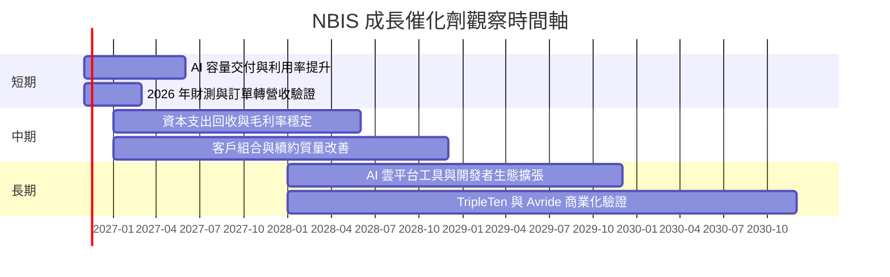

### 9.2 TAM 市場規模分析

公司未提供可核對 TAM、已服務市場或分部收入，因此下表不虛構市場金額或滲透率。

```
╔══════════════════════════════════════════════════════════════════╗
║ NBIS 潛在市場與可量化資訊                                        ║
╠══════════════════════════════════════════════════════════════════╣
║ AI 算力／GPU 雲 TAM：N/A；外部市場規模資料未提供                ║
║ 公司 AI 基礎設施 TTM 營收：分部數字 N/A                         ║
║ 公司整體 TTM 營收：$1.36B；最新單季 $582.3M                     ║
║ TripleTen TAM／營收：N/A                                         ║
║ Avride TAM／營收：N/A                                            ║
║ 投資判斷重點：可服務市場不等於可獲利市場，應追蹤毛利、利用率與 FCF ║
╚══════════════════════════════════════════════════════════════════╝
```

### 9.3 成長驅動力結構圖

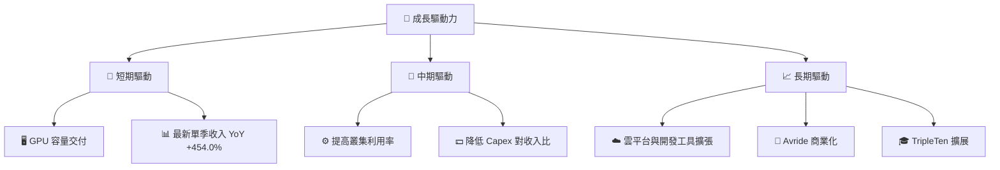

催化劑是否形成股東價值，須看投入資本回報，而非只有收入增長。管理層展望若下修、Capex 高於收入轉化速度，則成長本身可能加重資金缺口。

---

## 10. 風險矩陣

### 10.1 風險評分矩陣

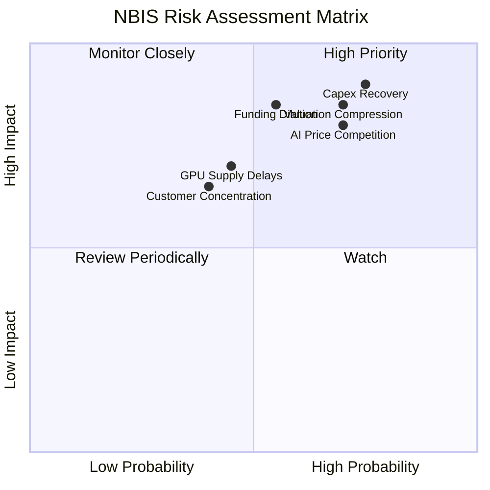

### 10.2 風險清單詳細分析

| # | 風險項目 | 發生機率 | 財務衝擊 | 風險評分 | 緩解措施 |
|---|----------|----------|----------|----------|----------|
| 1 | 🔴 **資本支出回收不及預期** | 高；約 60%（分析假設） | Capex 已達 TTM $11.14B，可能使 FCF 長期為負 | 🔴 9.0/10 | 按季度檢查容量利用率、已簽約容量、每單位算力收入及增量 Capex |
| 2 | 🔴 **AI 雲端價格競爭** | 中高；約 55%（分析假設） | 可能壓低 TTM 毛利率 74.3% 的持續性與未來營業利潤率 | 🔴 8.0/10 | 追蹤毛利率、合約期限、客戶續約價格與差異化軟體收入 |
| 3 | 🔴 **再融資與股權稀釋** | 中；約 45%（分析假設） | TTM FCF -$5.88B、淨負債 $2.15B；增資會稀釋每股價值 | 🔴 8.0/10 | 追蹤現金跑道、到期債務、利息成本與流通股數 |
| 4 | 🟡 **GPU／資料中心交付延誤** | 中；約 40%（分析假設） | 延遲會推後收入確認、令 Capex 與收入錯配 | 🟡 7.0/10 | 追蹤建置時程、交付設備、電力與冷卻容量 |
| 5 | 🟡 **客戶集中與續約風險** | 中；約 40%（分析假設） | 單一大客戶調整需求可令收入成長波動 | 🟡 6.5/10 | 要求公司披露前十大客戶占比、合約期限與未履約訂單 |
| 6 | 🔴 **估值倍數收縮** | 高；約 60%（分析假設） | P/S 25.807287x，市場對成長率或財測變化敏感 | 🔴 8.5/10 | 避免只以收入增長定價；追蹤 FCF、利潤率及預期差 |

機率欄為分析師情境估算，不是公司公布的統計機率。資料包新聞摘要提及 2026 年展望下調與股價下跌，顯示財測變化可能迅速反映於價格；此資訊未提供足夠財務明細，因此不直接量化對全年收入的影響。

---

## 11. 投資建議

### 11.1 最終綜合評級雷達圖

```
╔══════════════════════════════════════════════════════════════╗
║                    NBIS 最終綜合評分                         ║
╠══════════════════════════════════════════════════════════════╣
║ 基本面       5.0/10  ▓▓▓▓▓▓▓▓▓▓░░░░░░░░░░                    ║
║ 成長性       8.5/10  ▓▓▓▓▓▓▓▓▓▓▓▓▓▓▓▓▓░░░                    ║
║ 獲利能力     2.5/10  ▓▓▓▓▓░░░░░░░░░░░░░░░                    ║
║ 財務健康     4.5/10  ▓▓▓▓▓▓▓▓▓░░░░░░░░░░░░                    ║
║ 估值合理性   2.5/10  ▓▓▓▓▓░░░░░░░░░░░░░░░                    ║
║ 護城河       4.8/10  ▓▓▓▓▓▓▓▓▓▓░░░░░░░░░░                    ║
║ 管理層執行   5.0/10  ▓▓▓▓▓▓▓▓▓▓░░░░░░░░░░                    ║
╠══════════════════════════════════════════════════════════════╣
║ 綜合         4.6/10  🟡 高成長機會伴隨高資本與估值風險        ║
╚══════════════════════════════════════════════════════════════╝
```

### 11.2 目標價與隱含報酬率

| 情境／參考 | 目標價 | 相對 2026-11-12 收盤 $128.64 | 機率權重／用途 |
|------------|-------:|----------------------------:|---------------|
| 🔴 悲觀相對估值 | $16.10 | -87.5% | 風險情境 |
| 🟡 基準相對估值 | $33.35 | -74.1% | 12 個月主要相對估值參考 |
| 🟢 樂觀相對估值 | $76.10 | -40.9% | 使用 MSFT P/S 倍數的樂觀比較 |
| 基準 DCF | 約 $29.89 | 約 -76.8% | 長期現金流情境模型，信心低 |
| 分析師平均目標 | $278.05 | +116.1% | 20 位分析師共識，僅作參考 |
| **加權合理價值** | **$78.94** | **-38.6% 上行空間** | **MOS -63.0%；對應賣出** |

**評級一致性說明：**MOS -63.0% 低於 -25%，依規則應為賣出；沒有以質化因素上調或下調評級。加權合理價值中的 EV/EBITDA 與分析師共識使估值高於 DCF 和 P/S 基準，但即使加權後仍低於現價。

### 11.3 買入時機與觸發因素

```
╔══════════════════════════════════════════════════════════════════╗
║                  ✅ 買入觸發因素 Checklist                      ║
╠══════════════════════════════════════════════════════════════════╣
║  目前建議：不在 $128.64 追價；現價高於加權合理價值 $78.94。     ║
║                                                                  ║
║  重新評估買入條件（多數符合）：                                  ║
║  ☐ 股價回到 $71.05 以下，對應加權合理值至少 10% MOS             ║
║  ☐ TTM FCF 連續兩季改善，且 Capex/營收呈下降趨勢                ║
║  ☐ 營業利益率連續兩季改善，並呈現明確損益兩平路徑                ║
║  ☐ 公司披露可核實的客戶承諾、容量利用率及到期債務資料            ║
║                                                                  ║
║  加碼觸發條件：                                                  ║
║  ☐ FCF 轉正，或營業現金流增速持續高於資本支出增速                ║
║  ☐ 收入成長維持且毛利率不明顯惡化                                ║
║                                                                  ║
║  減碼／退出觸發條件：                                            ║
║  ☐ 連續兩季收入 YoY 低於 100%，且未見 Capex 同步收縮             ║
║  ☐ TTM FCF 惡化至低於 -$6B，或現金下降而淨負債增加               ║
║  ☐ 股數快速上升、債務成本上升或主要客戶縮減採購                  ║
╚══════════════════════════════════════════════════════════════════╝
```

### 11.4 投資人適配度分析

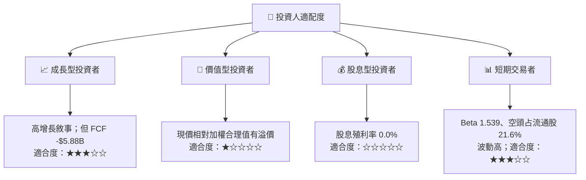

### 11.5 每季財報監控清單（Quarterly Watch List）

| 監控指標 | 已知基準 | 觸發加碼／正面門檻 | 觸發減碼／負面門檻 |
|----------|----------|--------------------|--------------------|
| 收入與 YoY 成長 | 2026 Q2 $582.3M；YoY +454.0% | YoY >100% 且 QoQ 繼續增長 | 連續兩季 YoY <100% 且訂單能見度下降 |
| 營業利益率 | TTM -50.5%；最新季度 -37.4% | 連續兩季改善並靠近損益兩平 | 連續兩季惡化或成本快於收入增長 |
| 毛利率 | TTM 74.3% | 維持 70% 以上且營業費用率下降 | 低於 65% 並伴隨降價或利用率下降 |
| Capex | TTM $11.14B | Capex/收入下降、收入與利用率同步上升 | Capex 再加速但收入增長顯著減速 |
| FCF | TTM -$5.88B | 連續兩季改善；中期出現轉正路徑 | TTM FCF 進一步惡化且現金下降 |
| 現金與負債 | 現金投資 $8.04B；債務 $10.20B | 現金跑道穩定、負債不再快速增加 | 淨負債快速增加或融資成本上升 |
| SBC／股數 | FY2025 SBC $83.2M；2026-06 shares 272M | SBC/收入下降、股數穩定 | SBC 占比升高或流通股數加速上升 |
| 財測與訂單 | 資料包新聞摘要提及下調 2026 展望；具體數字 N/A | 展望穩定或上修且有交付支持 | 再次下修，或訂單沒有轉化為收入 |

### 11.6 反面論證：什麼會證明論點錯誤（What Would Change My Mind）

```
╔══════════════════════════════════════════════════════════════════╗
║              ⚠️ 論點失效條件（Disconfirming Evidence）           ║
╠══════════════════════════════════════════════════════════════════╣
║ 本報告對估值與資本回收的判斷，在下列情況成立時應重新檢視：     ║
║                                                                  ║
║ ☐ AI 基礎設施收入連續兩季 YoY < 100%，且未被新業務抵銷          ║
║ ☐ 營業利益率連續兩季低於 -50.5%，或改善趨勢反轉                 ║
║ ☐ TTM FCF 低於 -$6B，並伴隨現金低於 $6B                        ║
║ ☐ Capex/收入長期維持高於 100%，而利用率與毛利率不升             ║
║ ☐ 淨負債超過 $5B，或新增股數一年增加超過 10%                    ║
║ ☐ 營業利潤率未能在五年內朝正值與穩態方向改善                    ║
║ ☐ 可核實 ROIC 長期低於 10.01% WACC，表示投資未覆蓋資本成本       ║
║                                                                  ║
║ 相反，若 FCF 持續改善、Capex 強度下降且 ROIC 高於 WACC，         ║
║ 本報告偏保守的 DCF 與賣出判斷需要重新評估。                     ║
╚══════════════════════════════════════════════════════════════════╝
```

> **免責聲明**：本報告為 AI 自動生成，僅供研究參考，不構成投資建議。部分資料未經 SEC 申報文件核實，估值假設不等同公司指引。投資有風險，入市需謹慎。