# NBIS 基本面深度分析報告
> **報告日期**：2026-11-14 ｜ **語言**：繁體中文 ｜ **數據來源**：Yahoo Finance、Finviz、StockAnalysis、Roic.ai ｜ **分析師**：CFA 級機構研究

> **資料品質提示**：財務數據包存在重大期間及口徑差異。VERIFIED FIGURES 顯示 TTM 營收 **$1.36B**、最新可驗證單季為 2026-06-30；StockAnalysis 另列 2026-09-30 季營收 **$980.8M**、TTM 營收 **$2.19B**。市值 **$29.42B** 與「股價 × 流通股數」所得結果亦不一致。本報告對估值採用 VERIFIED FIGURES 的 TTM 營收與股價，其他來源只作交叉參照，並將估值信心度下調。

## 目錄

| # | 章節 | 核心結論 |
|---|------|----------|
| 1 | 執行摘要 | 減碼；加權合理價值 $95.17，MOS -21.76% |
| 2 | 公司概覽與商業模式 | AI 基礎設施是主軸，但分部營收未披露，護城河尚待驗證 |
| 3 | 損益表深度分析 | TTM 營收 $1.36B；最新驗證單季 YoY +454.0%，營業利益率仍為負 |
| 4 | 資產負債表分析 | 淨負債 $2.15B；流動性高但資料口徑有差異 |
| 5 | 現金流量深度分析 | TTM FCF -$5.88B，主要由大型資本支出造成 |
| 6 | 獲利能力與資本效率 | FY2025 ROIC 約 -7.4%，低於 WACC 9.31% |
| 7 | 相對估值分析 | NBIS TTM P/S 21.7x，高於所列同業 |
| 8 | DCF 內在價值評估 | 基準 DCF 約 $28.73；高度依賴長期營收與資本效率假設 |
| 9 | 成長催化劑 | GPU 雲需求與資料中心擴建是主要催化劑，量化收入貢獻不足 |
| 10 | 風險矩陣 | 資本支出、融資與估值回落為前三大風險 |
| 11 | 投資建議 | 減碼；可考慮買入區間 $73.52–$85.65 |

---

## 1. 執行摘要

### 1.0 一頁式投資儀表板

| 項目 | 內容 |
|------|------|
| **投資論點（3 句）** | ① 最新驗證單季營收 YoY **+454.0%**，AI 基礎設施需求正在推升收入規模。② TTM 毛利率 **74.3%**，但 TTM 營業利益率 **-50.5%**，高毛利尚未轉化為營業獲利。③ TTM FCF **-$5.88B**、淨負債 **$2.15B**，擴張速度與資本回報仍是投資核心風險。 |
| **護城河評分** | **5.0/10**；技術與整合能力具潛力，尚無充分客戶留存及定價資料證明持久優勢 |
| **管理層/資本配置評分** | **4.5/10**；擴建投入大，TTM Capex $11.14B，短期資本效率偏低 |
| **財務健康** | 🔴 淨負債 $2.15B、TTM FCF -$5.88B；現金 $8.04B 提供緩衝，但未消除再融資與追加融資風險 |
| **ROIC vs WACC** | FY2025 ROIC 約 **-7.4%** vs WACC **9.31%**：目前摧毀股東價值 |
| **FCF 趨勢** | TTM FCF -$5.88B；FCF Yield **-20.00%** |
| **估值** | Forward P/E **-39.61x**；EV/EBITDA **145.02x**；FCF Yield **-20.00%** |
| **DCF 內在價值（基準）** | **$28.73**；相對 2026-11-13 收盤價 $115.88，折溢價 **+303.2%**（現價相對 DCF 高估） |
| **安全邊際（MOS）** | **-21.76%**＝($95.17 − $115.88) ÷ $95.17；🔴 無安全邊際 |
| **預期報酬（基準情境 12M）** | 以加權合理價值估算，上行空間 **-17.87%** |
| **關鍵風險（前二）** | 資本支出與營收增長脫鉤；GPU 雲供給擴張帶來價格競爭及融資壓力 |
| **評級 + 信心度** | 🟠 **減碼** ｜ 信心：低至中（資料期間與估值口徑存在差異） |

### 1.1 核心評分儀表板

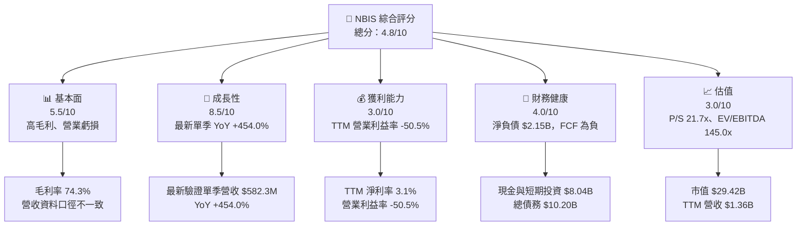

### 1.2 評分進度條視覺化

```text
╔══════════════════════════════════════════════════════════════╗
║              NBIS 多維度評分儀表板（1–10 分）               ║
╠══════════════════════════════════════════════════════════════╣
║ 基本面強度  5.5 ▓▓▓▓▓▓▓▓▓▓▓░░░░░░░░░░ ★★★☆☆              ║
║ 成長動能    8.5 ▓▓▓▓▓▓▓▓▓▓▓▓▓▓▓▓▓░░░ ★★★★☆              ║
║ 獲利品質    3.0 ▓▓▓▓▓▓░░░░░░░░░░░░░░ ★★☆☆☆              ║
║ 財務健康    4.0 ▓▓▓▓▓▓▓▓░░░░░░░░░░░░ ★★☆☆☆              ║
║ 估值合理性  3.0 ▓▓▓▓▓▓░░░░░░░░░░░░░░ ★★☆☆☆              ║
║ 護城河深度  5.0 ▓▓▓▓▓▓▓▓▓▓░░░░░░░░░░ ★★★☆☆              ║
║ 管理層執行  4.5 ▓▓▓▓▓▓▓▓▓░░░░░░░░░░░ ★★☆☆☆              ║
║ 技術創新力  7.0 ▓▓▓▓▓▓▓▓▓▓▓▓▓▓░░░░░░ ★★★★☆              ║
╠══════════════════════════════════════════════════════════════╣
║ 綜合總分    4.8 ▓▓▓▓▓▓▓▓▓▓░░░░░░░░░░ 🟡 高成長、高風險   ║
╚══════════════════════════════════════════════════════════════╝
```

### 1.3 五大投資論點 + 三大核心風險

| 類型 | 項目 | 具體依據 | 信心度 |
|------|------|----------|--------|
| 🟢 投資論點① | AI 基礎設施收入加速 | 2026-06 單季收入 $582.3M，YoY +454.0% | 🟢 中高 |
| 🟢 投資論點② | 毛利率顯示算力服務具收入槓桿 | TTM 毛利率 74.3%；但需持續檢驗資料中心成本及 GPU 折舊 | 🟡 中 |
| 🟢 投資論點③ | 現金餘額提供擴張緩衝 | 現金及短期投資 $8.04B | 🟡 中 |
| 🟢 投資論點④ | 產品涵蓋 GPU 叢集與開發者平台 | 全堆疊 AI 雲可提高採用便利性；收入分部尚未披露 | 🟡 中低 |
| 🟢 投資論點⑤ | 營收基數仍小 | TTM 收入 $1.36B；若產能利用率提升，營運槓桿可能改善 | 🟡 中 |
| 🔴 風險① | 資本支出高於營業現金生成 | TTM Capex $11.14B、OCF $5.26B，FCF -$5.88B | 🔴 高 |
| 🔴 風險② | 估值要求高增長持續 | EV/Revenue 27.61x、P/S 21.71x | 🔴 高 |
| 🟡 風險③ | 盈餘及資料來源波動 | 2026-03 單季淨利 $621.2M，隔季轉為 -$190.4M；EPS 預估資料缺失 | 🔴 高 |

### 1.4 快速統計卡片

| 指標 | 公司實際值 | 同業參照 | S&P 500 均值 | 狀態 |
|------|-------------|----------|--------------|------|
| 最新驗證單季收入 YoY | **+454.0%** | CRWV +168.2% | N/A | 🟢 |
| TTM 毛利率 | **74.3%** | CRWV 66.8%、ORCL 64.0%、MSFT 67.7% | N/A | 🟢 |
| TTM 營業利益率 | **-50.5%** | N/A | N/A | 🔴 |
| TTM 淨利率 | **3.1%** | N/A | N/A | 🟡 |
| ROE | **0.6%** | N/A | N/A | 🔴 |
| Forward P/E | **-39.61x** | CRWV -30.5x、ORCL 11.3x、MSFT 21.7x | N/A | 🔴 |
| P/S | **21.71x** | CRWV 3.0x、ORCL 5.4x、MSFT 11.2x | N/A | 🔴 |

### 1.5 投資結論

```text
╔══════════════════════════════════════════════════════════════════╗
║                        📊 投資結論摘要                           ║
╠══════════════════════════════════════════════════════════════════╣
║ 評級：減碼（MOS -21.76%，落在 -25% 至 -10% 區間）               ║
║ 價格（2026-11-13 收盤）：$115.88                                ║
║ DCF 內在價值（基準）：$28.73（現價溢價 +303.2%）                ║
║ 加權合理價值：$95.17                                             ║
║ 安全邊際 MOS：-21.76%＝($95.17−$115.88)÷$95.17                  ║
║ 目標價情境（12M，以收入×EV/Sales 推導）：                       ║
║   悲觀：$26.71（-76.9%）  基準：$62.00（-46.5%）  樂觀：$97.75 ║
║ 投資評分：4.8/10                                                 ║
║ 適合投資人：能承受高波動、且以小部位參與 AI 基礎設施成長者       ║
╚══════════════════════════════════════════════════════════════════╝
```

> 評級依 MOS 為 **減碼**；DCF 的極低基準值反映其不適合直接外推短期負 FCF。相對估值、分析師共識及高成長選擇權提高加權合理價值，但不足以抵銷現價與當期財務風險。

---

## 2. 公司概覽與商業模式

### 2.1 業務結構與收入來源

公司經營全堆疊 AI 基礎設施，並有 TripleTen 教育科技、Avride 自駕業務。各業務營收占比未提供，不以推估百分比冒充實際分部數據。

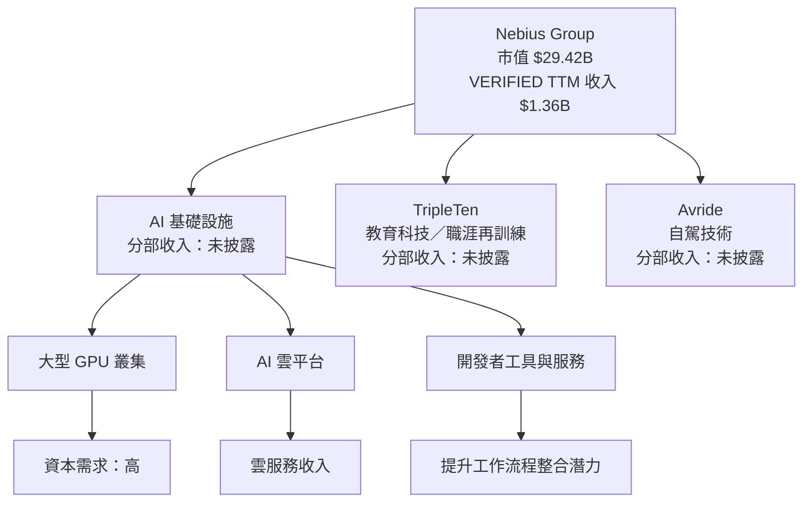

### 2.2 市場份額

公司未提供 AI 雲市場份額或分部收入占比；以下圖表呈現的是**收入分部披露狀態**，不是市場份額，也不是實際收入占比。

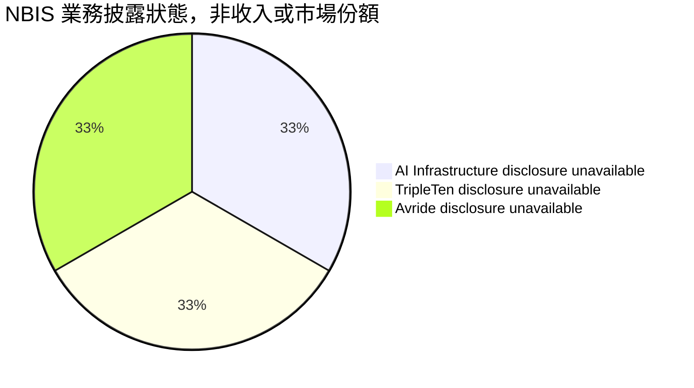

### 2.3 競爭護城河分析

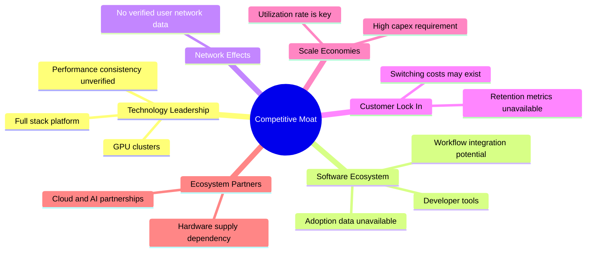

### 2.4 護城河強度評分

```text
╔══════════════════════════════════════════════════════════════╗
║                  Nebius Group 護城河評分                    ║
╠══════════════════════════════════════════════════════════════╣
║ 技術與系統整合   6/10  ▓▓▓▓▓▓▓▓▓▓▓▓░░░░░░░░ 🟡 有產品基礎 ║
║ 軟體生態         5/10  ▓▓▓▓▓▓▓▓▓▓░░░░░░░░░░ 🟡 黏著度待驗證║
║ 網路效應         3/10  ▓▓▓▓▓▓░░░░░░░░░░░░░░ 🔴 數據不足   ║
║ 客戶鎖定         4/10  ▓▓▓▓▓▓▓▓░░░░░░░░░░░░ 🔴 留存率缺失 ║
║ 規模效應         6/10  ▓▓▓▓▓▓▓▓▓▓▓▓░░░░░░░░ 🟡 依利用率   ║
║ 生態夥伴         6/10  ▓▓▓▓▓▓▓▓▓▓▓▓░░░░░░░░ 🟡 供應鏈關鍵 ║
╠══════════════════════════════════════════════════════════════╣
║ 綜合護城河       5.0/10；尚未證明持久定價權或低流失率        ║
╚══════════════════════════════════════════════════════════════╝
```

---

## 3. 損益表深度分析

### 3.1 年度收入成長趨勢

| 財年 | 營收 | YoY | 評估 |
|------|------|-----|------|
| 2022 | $13.5M | N/A | 歷史基數很小 |
| 2023 | $9.8M | -27.4% | 收縮 |
| 2024 | $91.5M | +833.7% | 低基期放大成長率 |
| 2025 | $529.8M | +479.0% | 擴張延續 |
| 2022–2025 CAGR | — | 約 **240%** | 由低基期與業務變化推升，不宜直接外推 |

```text
╔══════════════════════════════════════════════════════════════════╗
║              NBIS 年度收入趨勢（FY2022–FY2025）                 ║
╠══════════════════════════════════════════════════════════════════╣
║ FY2022  $0.014B  ░░░░░░░░░░░░░░░░░░░░░░  YoY：N/A             ║
║ FY2023  $0.010B  ░░░░░░░░░░░░░░░░░░░░░░  YoY：-27.4% 🔴       ║
║ FY2024  $0.092B  ████░░░░░░░░░░░░░░░░░░  YoY：+833.7% 🟢     ║
║ FY2025  $0.530B  ██████████████████████░░  YoY：+479.0% 🟢     ║
╚══════════════════════════════════════════════════════════════════╝
```

### 3.2 季度收入趨勢分析

季度成長率以季度損益表數據計算；最新驗證的單季同比數字直接採用 VERIFIED FIGURES。

| 季度 | 營收 | QoQ | YoY | 備註 |
|------|------|-----|-----|------|
| 2025-09 | $146.1M | N/A | N/A | 同比成長由 StockAnalysis 列示 +355.14% |
| 2025-12 | $227.7M | +55.9% | +546.9% | 低基期且 AI 雲需求擴大 |
| 2026-03 | $399.0M | +75.2% | +683.9% | 季度擴張加速 |
| 2026-06 | $582.3M | +45.9% | **+454.0%** | VERIFIED 單季 YoY；成長仍高但同比增速低於前季 |
| 2026-09 | $980.8M | +68.4% | +571.3% | StockAnalysis 額外列示，與 VERIFIED 最新季度期間不同，另作參考 |

收入加速可能反映算力容量上線與客戶需求增加；但供給擴張也推高 Capex，收入成長尚未證明能帶來正向自由現金流。

### 3.3 利潤率演變分析

| 利潤率指標 | FY2022 | FY2023 | FY2024 | FY2025 | 趨勢 | 評估 |
|------------|--------|--------|--------|--------|------|------|
| 毛利率 | -110.4% | -100.0% | 52.2% | 68.6% | 2024–25 明顯改善 | 🟢 |
| 營業利益率 | -1,170.4% | -2,915.3% | -436.7% | -115.5% | 虧損率收斂但仍大幅為負 | 🔴 |
| 淨利率 | 5,523.0% | 2,462.2% | -700.9% | 15.6% | 受非經常性項目及低基數影響 | 🟡 |

**利潤率解讀：**FY2025 毛利率升至 68.6%，表示收入組合與服務毛利有改善；但營業利益仍為 -$611.7M，反映研發、擴張及營運成本尚未由毛利覆蓋。TTM 毛利率 74.3% 高於 FY2025，需留意資料期間差異及高額 GPU 折舊是否持續侵蝕營業利潤。

### 3.4 費用結構分析

FY2025 研發費用 $177.3M，約為收入的 **33.5%**；營業虧損 $611.7M。完整營業費用細項未提供，不能把毛利與營業虧損差額任意分配至特定費用。

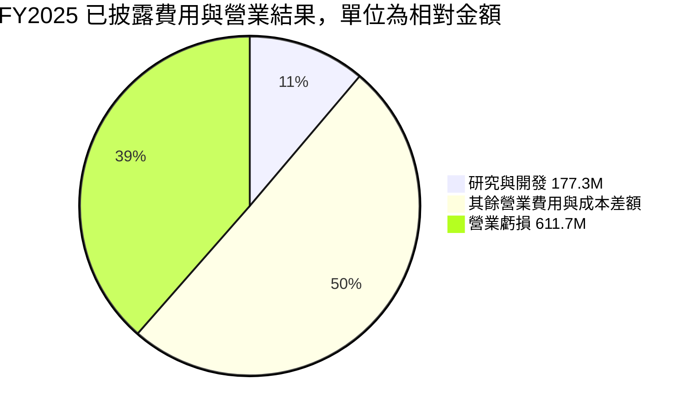

> 上圖是披露金額對照示意，不是正式會計費用組成；營業虧損不是費用項目，故不得視為可加總的損益分配。

### 3.5 季度 EPS 趨勢與盈餘品質

提供的 EPS Est/Act 四季均為 `nan`，因此無法可靠判定超預期或不及預期。季度淨利波動極大，且來源數字與年度數據有口徑差異。

| 季度 | EPS 預估/實際 | 季度淨利 | 評估 |
|------|---------------|----------|------|
| 2025-12 | 缺漏 | -$268.8M | 不可判定 beat/miss |
| 2026-03 | 缺漏 | +$621.2M | 單季大幅獲利，需辨識一次性項目 |
| 2026-06 | 缺漏 | -$190.4M | 獲利轉負 |
| 2026-09 | 缺漏 | StockAnalysis 列 -$37.5M | 與其他來源期間需交叉核對 |

| 盈餘品質項目 | 數值/佔比 | 評估 |
|--------------|-----------|------|
| SBC / 營收 | 四季 SBC 合計 $188.9M ÷ TTM 營收 $1.36B = **13.9%** | 🔴 稀釋成本顯著 |
| SBC / 營業現金流 | $188.9M ÷ $5.26B = **3.6%** | 🟡 SBC 不是主要現金流來源，但仍稀釋股東 |
| FCF / 淨利 | 以淨利率 3.1% × $1.36B 推得淨利約 $42.2M；-$5.88B ÷ $42.2M ≈ **-13,936%** | 🔴 現金轉換極差；淨利率推算非直接 TTM 淨利披露 |
| 一次性/非經常項目 | 2026-03 單季淨利 $621.2M，其他季為負；拆分 N/A | 🔴 異常波動須釐清 |
| 有效稅率 | VERIFIED 最新年度 29.0% | 🟡 不宜以單季淨利推估稅率 |
| 資本化支出 vs 費用化 | TTM Capex $11.14B；資產及資本化明細不完整 | 🔴 大量投資需以折舊與利用率驗證 |

**盈餘品質結論：**GAAP 獲利尚不穩定，單季正淨利不能代表持續獲利能力。SBC 約占收入 13.9%，代表經濟股東報酬需考慮稀釋；TTM FCF 大幅為負，估值宜以情境分析而非單季 EPS 為主。

---

## 4. 資產負債表分析

### 4.1 資產結構分解

依 StockAnalysis 2026-09-30 資產負債表列示，資產合計及部分細項口徑與其他來源不完全一致；下圖只展示可取得的構成項目，不作強行加總。

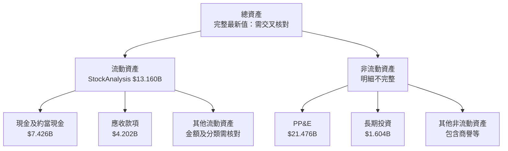

### 4.2 流動性指標分析

| 指標 | 最新值 | FY2025 參照 | 行業均值 | 評估 |
|------|--------|-------------|----------|------|
| Current Ratio | 4.03x | 4.71B ÷ 1.53B = 3.08x | N/A | 🟢 短期流動性充足 |
| Quick Ratio | 3.605x | N/A | N/A | 🟢 |
| 現金及短期投資 | $8.04B | $3.753B（FY2025） | N/A | 🟢 現金緩衝增加 |
| 淨現金/負債 | **-$2.15B** | FY2025 約 -$1.22B（總債務減現金） | N/A | 🟡 淨負債擴大 |

### 4.3 債務結構分析

最新財務數據顯示總債務 $10.20B、現金及短期投資 $8.04B，故 VERIFIED 淨負債為 $2.15B。Roic.ai 2026-06 負債明細：短期借款 $162M、長期借款 $8.499B、融資租賃 $1.510B，合計約 $10.171B。

```text
╔══════════════════════════════════════════════════════════════════╗
║                     NBIS 債務健康診斷                            ║
╠══════════════════════════════════════════════════════════════════╣
║ 總債務：       $10.20B  ████████████████████  🔴 槓桿上升      ║
║ 現金+短投：     $8.04B  ████████████████░░░░  🟢 有流動性緩衝  ║
║ 淨負債：        $2.15B  ████░░░░░░░░░░░░░░░░  🟡 仍需融資監控  ║
║ Debt/Equity：   98.6x*                         🔴 數據口徑極高  ║
║ Debt/EBITDA：   不宜使用：EBITDA/債務資料期間不一致            ║
║ 利息保障倍數：  N/A，利息費用及平均負債細項缺漏                ║
╚══════════════════════════════════════════════════════════════════╝
```

\*資料包呈現 Debt/Equity 98.596，疑似比率口徑或單位異常，不能當成 98.6 倍的穩健會計比率解讀。

### 4.4 股東權益趨勢

| 財年 | 股東權益 |
|------|----------|
| 2022 | $4.25B |
| 2023 | $3.29B |
| 2024 | $3.25B |
| 2025 | $4.59B |

```text
FY2022 $4.25B  ████████████████████
FY2023 $3.29B  ███████████████
FY2024 $3.25B  ███████████████
FY2025 $4.59B  ██████████████████████
```

---

## 5. 現金流量深度分析

### 5.1 現金流量瀑布圖

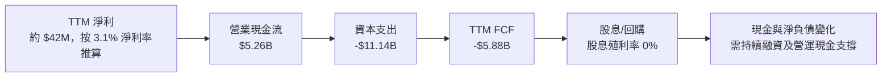

### 5.2 FCF 轉換率趨勢

| 年度 | OCF | Capex | FCF | FCF / 淨利 |
|------|-----|-------|-----|------------|
| 2023 | $829.8M | $82.9M | $746.9M | 約 309.5%* |
| 2024 | $245.6M | $807.5M | -$561.9M | 不具解讀性：淨利為負 |
| 2025 | $384.8M | $4.07B | -$3.68B | 約 -4,460%* |
| TTM 至 2026-06 | $5.26B | $11.14B | **-$5.88B** | 約 -13,936%* |

\*以年度淨利或由 TTM 淨利率推估的分母計算，受異常損益影響，不能視為穩定轉換率。

### 5.3 自由現金流趨勢

```text
╔══════════════════════════════════════════════════════════════════╗
║                 FCF：歷史實際與最新 TTM                         ║
╠══════════════════════════════════════════════════════════════════╣
║ FY2023   +$0.75B  ████████████████░░░░  正向                    ║
║ FY2024   -$0.56B  ███████████░░░░░░░░░  投資擴大                ║
║ FY2025   -$3.68B  ████████████████████  Capex 急升              ║
║ TTM 26Q2 -$5.88B  ████████████████████████████████  FCF Yield -20%║
╠══════════════════════════════════════════════════════════════════╣
║ 判讀：資本建置期可合理出現負 FCF，但須證明產能利用率與回報率上升 ║
╚══════════════════════════════════════════════════════════════════╝
```

### 5.4 資本配置評估

分部資本配置金額未提供，不能精確拆分各用途；已知年度 Capex 顯著上升，股息殖利率為 0%。

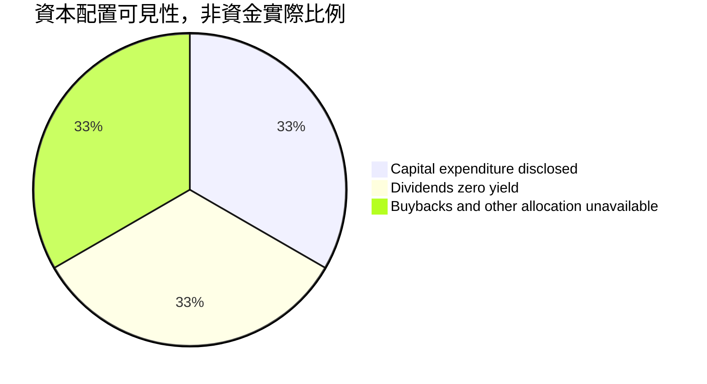

| 資本用途 | 已知資訊 | 評估 |
|----------|----------|------|
| Capex | TTM $11.14B | 🔴 高投入；需追蹤產能利用率與投資回報 |
| 股息 | 殖利率 0% | 🟡 成長階段不派息可理解 |
| 回購 | N/A | ⚪ 無法判定 |
| 併購/其他投資 | N/A | ⚪ 無法判定 |

---

## 6. 獲利能力與資本效率

### 6.1 ROE / ROA / ROIC 趨勢

| 指標 | 最新資料 | FY2025/可計算參照 | 評估 |
|------|----------|-------------------|------|
| ROE | 0.6% | FY2025 淨利 $82.5M ÷ 平均權益約 $3.92B ≈ 2.1% | 🟡 低且受特殊項目影響 |
| ROA | -1.9% | FY2025 淨利為正但資產快速擴張 | 🔴 資本效率偏弱 |
| ROIC | N/A（最新投入資本資料不完整） | 以 FY2025 EBIT、稅率、權益、債務及現金估算約 -7.4% | 🔴 低於 WACC |
| 同業均值 | N/A | 缺少一致口徑 | ⚪ |

### 6.2 ROIC vs WACC 分析

ROIC 以 FY2025 資料估算；資料包未提供完整稅後營業利潤與平均投入資本明細，故此為可復算的近似值。

```text
╔══════════════════════════════════════════════════════════════════╗
║                  ROIC vs WACC 深度分析                          ║
╠══════════════════════════════════════════════════════════════════╣
║ WACC：                                                           ║
║ ├── Rf：5.15%                                                    ║
║ ├── ERP：5.00%                                                   ║
║ ├── Beta：1.54                                                   ║
║ ├── Ke = 5.15% + 1.54×5.00% = 12.85%                            ║
║ ├── 稅前 Kd（參考值）：0.60%；稅後 Kd=0.60%×(1−29%)=0.426%       ║
║ ├── 資本權重：股權 71.52%，債務 28.48%                           ║
║ └── WACC = 71.52%×12.85% + 28.48%×0.426% = 9.31%                ║
║                                                                  ║
║ FY2025 ROIC 估算：                                               ║
║ ├── NOPAT = -$611.7M×(1−29%) = -$434.3M                          ║
║ ├── 投入資本 = 權益 $4.59B + 債務 $4.97B − 現金 $3.68B = $5.88B   ║
║ └── ROIC ≈ -$0.434B ÷ $5.88B = -7.4%                             ║
║                                                                  ║
║ EVA spread = ROIC − WACC = -7.4% − 9.31% = -16.71 pp            ║
║ ROIC -7.4% ░░░░░░░░░░░░░░░░░░░░░░░░ 🔴                         ║
║ WACC  9.31% ███████████████████░░░░░░                            ║
║ 結論：FY2025 資本回報低於資金成本，當期仍在摧毀股東價值          ║
╚══════════════════════════════════════════════════════════════════╝
```

### 6.3 杜邦三因素分解

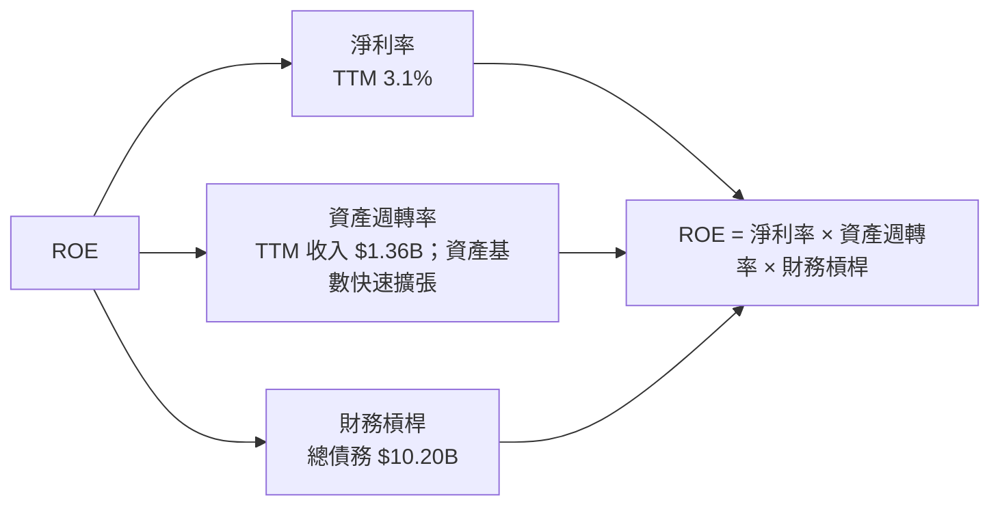

ROE 0.6% 不代表資本回報已改善；收入與資產快速增長、淨利波動及負債擴張都會影響杜邦分解。完整平均資產及股東權益期間資料不足，故不提供虛假的精確乘積拆解。

### 6.4 獲利能力儀表板

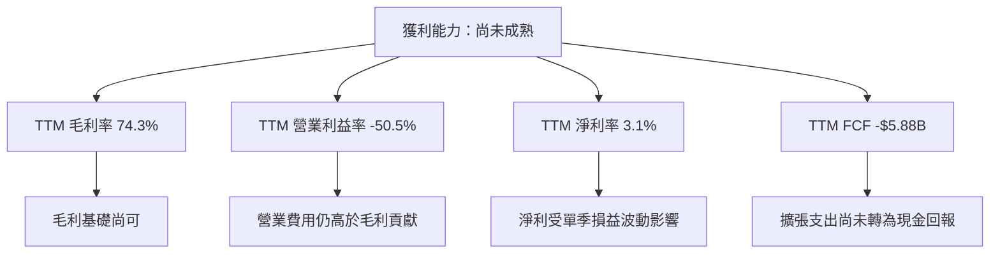

---

## 7. 相對估值分析

### 7.1 同業估值比較

倍數依 VERIFIED FIGURES；NBIS 個別倍數來自資料包。負數 Forward P/E 不具一般估值解讀能力。

| 估值指標 | **NBIS** | **CRWV** | **ORCL** | **MSFT** | NBIS 評估 |
|----------|----------|----------|----------|---------|-----------|
| Trailing P/E | N/A | N/A | 19.6x | 27.3x | 🔴 未有可用正向 P/E |
| Forward P/E | -39.61x | -30.5x | 11.3x | 21.7x | 🔴 虧損，倍數失真 |
| P/S TTM | 21.71x | 3.0x | 5.4x | 11.2x | 🔴 顯著高於同業 |
| EV/EBITDA TTM | 145.02x | 17.6x | 15.0x | 19.2x | 🔴 極高且受 EBITDA 口徑影響 |
| 最新季度收入 YoY | +454.0% | +168.2% | +29.6% | +18.8% | 🟢 增長更快，但執行風險更高 |
| 毛利率 TTM | 74.3% | 66.8% | 64.0% | 67.7% | 🟢 高於比較同業 |

### 7.2 歷史估值區間分析

VERIFIED FIGURES 未提供 Valuation vs own history 的估值區間或百分位，故不估算歷史百分位。

| 項目 | 數值 |
|------|------|
| 歷史 P/E 區間 | N/A |
| 歷史 P/S 百分位 | N/A |
| 當前 P/S | 21.71x |
| 判讀 | 自身歷史估值排名無法驗證；相對同業溢價明確 |

### 7.3 情境目標價（假設驅動）

以基準預測 FY+1 營收約 $1.97B、淨負債 $2.15B、股數 220.41M，採 EV/Sales 法估算 12 個月情境目標價。倍數為分析假設，不是 VERIFIED 同業倍數的直接預測。

| 情境 | 營收 CAGR | 營業利潤率 | EV/Sales 退出倍數 | 隱含目標價 | 相對現價 |
|------|-----------|-----------|------------------|------------|----------|
| 🔴 悲觀 | 20% | -20% | 4x | $26.71 | -76.9% |
| 🟡 基準 | 45% | -10% 至收斂中 | 8x | $62.00 | -46.5% |
| 🟢 樂觀 | 70% | 接近盈虧平衡 | 12x | $97.75 | -15.6% |

代表性演算：基準 FY+1 營收 $1.36B×1.45=$1.972B；EV=$1.972B×8=$15.776B；股權價值=$15.776B−$2.15B=$13.626B；每股=$13.626B÷0.22041B=$61.82，四捨五入為約 **$62.00**。

### 7.4 相對估值隱含價格區間

| 方法 | 計算基礎 | 隱含股價 | 相對現價 |
|------|----------|----------|----------|
| EV/Sales 3.0x（CRWV） | ($1.36B×3.0−$2.15B)÷220.41M | 約 $8.77 | -92.4% |
| EV/Sales 5.4x（ORCL） | ($1.36B×5.4−$2.15B)÷220.41M | 約 $23.56 | -79.7% |
| EV/Sales 11.2x（MSFT） | ($1.36B×11.2−$2.15B)÷220.41M | 約 $59.40 | -48.7% |
| EV/EBITDA | TTM EBITDA 倍數及股數期間不一致 | 不可靠 | N/A |
| FCF Yield | TTM FCF 為負 | 不可用 | N/A |

```text
同業 EV/Sales 估值帶：
$8.77 ───── $23.56 ───── $59.40 ────────── 現價 $115.88
CRWV 3.0x    ORCL 5.4x    MSFT 11.2x        NBIS
```

---

## 8. DCF 內在價值評估（Discounted Cash Flow）

> **模型限制**：TTM 營收、資本支出與季度財務資料的來源存在不一致。DCF 是規範化情境模型，不是公司指引；估值結果應視為高不確定度的情境測算。

### 8.0 估值推理鏈

**Step 1 — 價值來源。** NBIS 價值主要來自 AI 雲算力收入擴張、GPU/資料中心產能利用率提升，以及規模化後的營業利潤率；目前收入分部未披露，無法量化 TripleTen 或 Avride 的獨立選擇權。對估值影響最大的變數是**營業利潤率與資本支出強度**，因當前 TTM FCF 為 -$5.88B。

**Step 2 — 模型選擇。**

| 決策點 | 採用 | 理由 | 否決方案 |
|--------|------|------|----------|
| 現金流定義 | FCFF | 負債及融資結構可能改變，對應 WACC 折現 | FCFE：融資時點敏感 |
| 預測期 N | 5 年 | 兼顧 AI 雲建設期及中期利潤率爬坡 | 10 年：缺乏可核對的長期指引 |
| 終值方法 | Gordon Growth 主法；EV/EBITDA 交叉驗證 | 可明確檢驗永續成長與 WACC 差額 | 僅用退出倍數：終值倍數選擇主觀 |
| EBIT 基礎 | GAAP EBIT | 避免把 SBC 排除於股東成本之外 | 非 GAAP：資料缺少一致調節表 |

**Step 3 — 核心假設推導。**

- **營收 CAGR**：錨點＝FY2024 $91.5M、FY2025 $529.8M，增速極高但基期低；最新驗證單季 YoY +454.0%。考慮容量建置與基期放大後下調至 **45%**；曾考慮 70%，因最新驗證單季增速已較 2026-03 的 683.9% 放緩而否決。
- **期末營業利潤率**：錨點＝TTM -50.5%、FY2025 -115.5%；採用 FY+5 **25%**，隱含毛利維持高位且規模效益顯著。曾考慮 35%，因現有營業利益仍大幅為負、未有穩定盈利紀錄而否決。年度路徑為 -10%、0%、10%、18%、25%。
- **永續成長率 g**：長期成熟企業需低於名目經濟成長上限，採 **3.0%**；曾考慮 4.0%，但提高終值占比且接近 WACC，故不採。
- **預測期 N**：採 5 年，以收入快速擴張到利潤率成熟為模型期間；曾考慮 10 年，因欠缺分部供需與長期客戶資料而否決。
- **Capex/營收**：TTM 實際 Capex $11.14B ÷ $1.36B，比例異常高，直接外推會令模型無法呈現成熟期經濟性；假設值採 **25%**，代表由當前建設高峰逐步下降。曾考慮 40%，但會使終值現金流更低；此假設是重要風險來源。
- **D&A/營收**：假設值 **18%**；依重資本 GPU 基礎設施及高 Capex 特性設定，非公司披露指引。
- **ΔWC/營收增額**：假設值 **5%**；應收與預收款變動資料不完整，以低比例保守表示增長所需營運資金。
- **有效稅率**：29.0%，採 VERIFIED 最新年度有效稅率；虧損 EBIT 年不認列稅務利益。
- **SBC 與稀釋**：採組合 **(A) GAAP EBIT + 固定股數**，SBC 已包含於費用，不再扣一次；股數採 220.41M、模型年稀釋率 0%。
- **WACC**：採 9.31%，以資本市值與計息負債範圍重算，詳見 8.2；曾直接使用參考 WACC 9.65%，但按指定股價×股數和明列計息負債權重重算後採 9.31%。

**Step 4 — 最脆弱一環。** 最大風險是 Capex/營收能否由當前極高水準降至 25%；若資本支出長期維持高位，FCFF 與合理價值將顯著下修。

**Step 5 — 計算路徑**

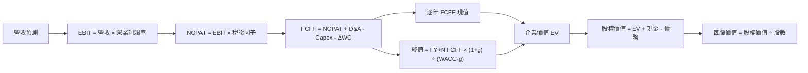

### 8.1 模型假設總表

| 假設項目 | 採用值 | 依據 / 來源 | 敏感度 |
|----------|--------|-------------|--------|
| 預測期 N | 5 年 | 由現有高增長階段延伸至中期盈利 | 🟡 |
| 營收 CAGR | 45% | 單季 YoY +454.0%，但高基期放緩 | 🔴 |
| FY+5 營業利潤率 | 25% | 高毛利及規模效應假設，遠高於當前負值 | 🔴 |
| 有效稅率 | 29% | VERIFIED 最新年度稅率 | 🟢 |
| Capex/營收 | 25% | 假設值；遠低於當前 TTM 比率，反映建設高峰正常化 | 🔴 |
| D&A/營收 | 18% | 假設值，重資本設施代理 | 🟢 |
| ΔWC/營收增額 | 5% | 假設值，應收與預收資料不完整 | 🟢 |
| EBIT 基礎 | GAAP | 避免排除 SBC | 🟡 |
| SBC 處理 | GAAP EBIT 已含，不再扣減 | 組合 (A)，只計一次 | 🟡 |
| 年稀釋率 | 0% | 組合 (A)；採當期股數 | 🟡 |
| 永續成長率 g | 3.0% | 長期名目成長假設，低於 WACC | 🔴 |
| 終值方法 | Gordon Growth | 以 EV/EBITDA 交叉驗證 | 🔴 |
| WACC | 9.31% | 依 8.2 推導 | 🔴 |

**本模型使用 FCFF = NOPAT + D&A − Capex − ΔWC，對應 WACC 折現。模型採用 (A)，故 SBC 影響已透過 GAAP 費用計入一次，FCFF 不再扣 SBC，股數不另行增加。**

### 8.2 折現率推導（WACC）

由於明列要求以價格乘股數計算股權市值，與資料包市值 $29.42B 不一致，本節採用指定算法，並以 2026-06 Roic.ai 明列計息負債計算債務權重。

```text
╔══════════════════════════════════════════════════════════════════╗
║                      WACC 推導（折現率）                         ║
╠══════════════════════════════════════════════════════════════════╣
║ 股權成本 Ke：                                                    ║
║ Rf 5.15% + Beta 1.54 × ERP 5.00% = 12.85%                        ║
║ 規模/國別額外溢酬：0%，因無可核對的獨立量化資料                  ║
║                                                                  ║
║ 稅前 Kd：採 VERIFIED 參考值 0.60%                                ║
║ 稅後 Kd = 0.60% × (1 − 29.0%) = 0.426%                           ║
║                                                                  ║
║ 股權市值 E = $115.88 × 220.41M = $25.54B                         ║
║ 計息債務 D = $0.162B + $8.499B + $1.510B = $10.171B              ║
║ E 權重 = 25.54 ÷ (25.54+10.171) = 71.52%                         ║
║ D 權重 = 10.171 ÷ (25.54+10.171) = 28.48%                        ║
║ WACC = 71.52%×12.85% + 28.48%×0.426% = 9.31%                     ║
╚══════════════════════════════════════════════════════════════════╝
```

五步複算：

1. Ke = 5.15% + 1.54×5.00% = **12.85%**。
2. 稅前 Kd = **0.60%**（VERIFIED 參考值；利息費用及平均債務明細不可用，故不另自行反推）。
3. 稅後 Kd = 0.60%×(1−29.0%) = **0.426%**。
4. E 權重 = 25.54÷(25.54+10.171)=**71.52%**；D 權重 = **28.48%**。
5. WACC = 71.52%×12.85% + 28.48%×0.426% = 9.190% + 0.121% = **9.31%**。

**一致性註記：**此處以可復算的市值及 2026-06 計息負債得 9.31%，不同於 VERIFIED 參考 WACC 9.65%及參考權重 74.3%/25.7%；差異主要來自本報告按指定股數與債務範圍重算。

### 8.3 逐年自由現金流預測（基準情境）

單位：$B；基期收入 $1.36B。比率取 1 位小數，金額取 3 位小數，折現因子取 3 位小數。營收逐年按 45% 增長；營業利潤率路徑為 -10%、0%、10%、18%、25%。

| 年度 | FY+1 | FY+2 | FY+3 | FY+4 | FY+5（N） |
|------|------|------|------|------|-----------|
| 營收 | 1.972 | 2.859 | 4.146 | 6.012 | 8.717 |
| 營收 YoY | 45.0% | 45.0% | 45.0% | 45.0% | 45.0% |
| 營業利潤率 | -10.0% | 0.0% | 10.0% | 18.0% | 25.0% |
| EBIT（GAAP） | -0.197 | 0.000 | 0.415 | 1.082 | 2.179 |
| − 稅 | 0.000 | 0.000 | (0.120) | (0.314) | (0.632) |
| NOPAT | -0.197 | 0.000 | 0.294 | 0.768 | 1.547 |
| + D&A（18%） | 0.355 | 0.515 | 0.746 | 1.082 | 1.569 |
| − Capex（25%） | (0.493) | (0.715) | (1.037) | (1.503) | (2.179) |
| − ΔWC（增額 5%） | (0.031) | (0.044) | (0.064) | (0.093) | (0.135) |
| **FCFF** | **-0.366** | **-0.245** | **-0.060** | **0.254** | **0.802** |
| 折現因子 @9.31% | 0.915 | 0.837 | 0.766 | 0.701 | 0.641 |
| **FCFF 現值 PV** | **-0.335** | **-0.205** | **-0.046** | **0.178** | **0.514** |

**預測期 FCF 現值合計：**

\[
-0.335 + (-0.205) + (-0.046) + 0.178 + 0.514 = 0.106\text{B}
\]

**FY+1 逐步演算：**

1. 營收 = $1.36B×(1+45.0%) = **$1.972B**。
2. EBIT = $1.972B×(-10.0%) = **-$0.197B**。
3. 稅 = 虧損年度不認列稅務利益 = **$0.000B**。
4. NOPAT = -$0.197B−$0.000B = **-$0.197B**。
5. D&A = $1.972B×18.0% = **$0.355B**。
6. Capex = $1.972B×25.0% = **$0.493B**。
7. ΔWC = ($1.972B−$1.360B)×5.0% = **$0.031B**。
8. FCFF = -$0.197B+$0.355B−$0.493B−$0.031B = **-$0.366B**。
9. 折現因子 = 1÷(1+9.31%)¹ = **0.915**；PV = -$0.366B×0.915 = **-$0.335B**。

**合理性自檢：**
- 預測 FCF 由負值轉正，不能有意義地計算五年 FCF CAGR；歷史 TTM FCF -$5.88B，模型 FY+5 FCFF $0.802B，改善來自明確假設 Capex 收斂及利潤率升至 25%。
- FY+5 FCFF 利潤率 = $0.802B÷$8.717B = **9.2%**；目前 TTM FCF 利潤率 = -$5.88B÷$1.36B = **-432.4%**。此反轉要求產能投資的收入回報顯著提升。
- FY+1 至 FY+3 FCFF 為負，已逐年折現，降低企業價值；並非忽略負現金流。

```text
╔══════════════════════════════════════════════════════════════════╗
║              FCF：實際與模型預測（單位 $B）                      ║
╠══════════════════════════════════════════════════════════════════╣
║ FY2023 實   +0.747  ████████████████████                         ║
║ FY2024 實   -0.562  ░░░░░░░░░░░░░░░░░░░░                         ║
║ FY2025 實   -3.680  ░░░░░░░░░░░░░░░░░░░░░░░░░░░░                 ║
║ TTM 實      -5.880  ░░░░░░░░░░░░░░░░░░░░░░░░░░░░░░░░           ║
║ FY+1 預     -0.366  ░░░░░░░░░░░░░░░░░░░░                         ║
║ FY+5 預     +0.802  █████████████████████                         ║
╠══════════════════════════════════════════════════════════════════╣
║ 預測轉正的關鍵不是收入單獨增長，而是 Capex/收入降至 25%           ║
╚══════════════════════════════════════════════════════════════════╝
```

### 8.4 終值計算

**適用性檢查：WACC 9.31% vs g 3.00% → WACC > g？✅**

Gordon Growth：
1. FY+N FCFF = **$0.802B**。
2. 分子 = $0.802B×(1+3.00%) = **$0.826B**。
3. 分母 = 9.31%−3.00% = **6.31%**；TV = $0.826B÷6.31% = **$13.09B**。
4. PV(TV) = $13.09B×0.641 = **$8.39B**。
5. TV 現值占比 = $8.39B÷$8.49B = **98.8%**。

退出倍數交叉驗證：FY+5 EBITDA = EBIT $2.179B + D&A $1.569B = $3.748B；採用 **15.0x**（VERIFIED ORCL EV/EBITDA 作參照，而非 NBIS 自身估值）。

\[
EBITDA_{FY+5}\ \$3.748B \times 15.0 = \$56.22B
\]
\[
\$56.22B \times 0.641 = \$36.05B\ \text{終值現值}
\]

退出倍數法與 Gordon Growth 法差距大，反映模型長期終值高度敏感；主估值採 Gordon Growth。**終值現值占 EV 98.8%，本估值高度依賴終值假設，短期現金流貢獻有限。**

### 8.5 企業價值 → 每股內在價值

```text
╔══════════════════════════════════════════════════════════════════╗
║              企業價值 → 每股內在價值橋接                         ║
╠══════════════════════════════════════════════════════════════════╣
║ 預測期 FCFF 現值合計             +$0.106B                        ║
║ 終值現值 PV(TV)                 +$8.386B                         ║
║ = 企業價值 EV                    $8.492B                         ║
║ + 現金及短期投資                 +$8.040B                         ║
║ − 總債務                         −$10.200B                        ║
║ = 股權價值                       $6.332B                         ║
║ ÷ 稀釋股數                       0.22041B 股                      ║
║ ★ 每股 DCF 基準內在價值          $28.73                           ║
║ 2026-11-13 收盤價                $115.88                          ║
║ 折溢價 = 現價÷DCF−1              +303.2% 溢價                     ║
╚══════════════════════════════════════════════════════════════════╝
```

1. EV = $0.106B+$8.386B = **$8.492B**。
2. 股權價值 = $8.492B+$8.040B−$10.200B = **$6.332B**。
3. 每股內在價值 = $6.332B÷0.22041B = **$28.73**。
4. 折溢價 = $115.88÷$28.73−1 = **+303.2%**。
5. 本節不計算 MOS；MOS 統一採用 8.8 加權合理價值。

現金與總債務採 VERIFIED 最新數字；股數採資料包 220.41M。因市值、股數與負債期間資料存在差異，橋接結果需保留誤差風險。

### 8.6 敏感性分析（WACC × 永續成長率）

表格列值為每股價值，括號為相對 $115.88 現價的上行空間；以同一基準 FCFF 預測變更 WACC 與 g 計算，四捨五入至 $0.1。

| g \ WACC | 8.31% | **9.31% 基準** | 10.31% | 11.31% | 12.31% |
|-----------|------:|----------------:|-------:|-------:|-------:|
| 1.0% | $24.5 (-78.8%) | $19.1 (-83.5%) | $14.8 (-87.2%) | $11.4 (-90.2%) | $8.6 (-92.6%) |
| 2.0% | $30.4 (-73.8%) | $23.3 (-79.9%) | $18.0 (-84.5%) | $13.9 (-88.0%) | $10.6 (-90.9%) |
| **3.0% 基準** | $38.1 (-67.1%) | **$28.7 (-75.2%)** | $21.8 (-81.2%) | $16.9 (-85.4%) | $13.0 (-88.8%) |
| 4.0% | $85.6 (-26.1%) | $36.4 (-68.6%) | $27.3 (-76.4%) | $20.9 (-82.0%) | $15.9 (-86.3%) |
| 5.0% | $104.5 (-9.8%) | $47.5 (-59.0%) | $34.7 (-70.1%) | $26.0 (-77.6%) | $19.7 (-83.0%) |

> 低 WACC、高 g 時終值分母變小，價格對終值假設呈非線性放大；該矩陣不是概率預測。基準格與 8.5 DCF 一致，尾差來自四捨五入。

**有效格演算：WACC 10.31% > g 2.00% ✅**

1. 預測期 PV 合計（10.31%）約 **$0.085B**。
2. TV = $0.802B×1.02÷(10.31%−2.00%) = $0.818B÷8.31% = **$9.84B**；PV(TV)=$9.84B×0.612=**$6.02B**。
3. EV=$0.085B+$6.02B=$6.11B；股權價值=$6.11B+$8.04B−$10.20B=$3.95B；每股=$3.95B÷0.22041B≈**$17.9**，與矩陣 $18.0 的差異為表格四捨五入及中間值精度。

**三情境 DCF：**以下營運參數皆為模型假設，不是管理層指引。

| 情境 | 營收 CAGR | 期末營業利潤率 | g | WACC | 每股內在價值 | 相對現價 | 機率 |
|------|-----------|----------------|---|------|--------------|----------|------|
| 🔴 悲觀 | 25% | 15% | 2% | 10.31% | 約 $8 | -93.1% | 30% |
| 🟡 基準 | 45% | 25% | 3% | 9.31% | $28.73 | -75.2% | 50% |
| 🟢 樂觀 | 65% | 30% | 3% | 8.31% | 約 $75 | -35.3% | 20% |

- **悲觀**：FY+5 營收 $1.36B×1.25⁵≈$4.15B，利潤率 15%，但資本支出收斂較慢，估值約 $8；前提是供給增加壓低利用率。
- **基準**：FY+5 營收 $1.36B×1.45⁵=$8.72B、EBIT 利潤率 25%、FY+5 FCFF $0.802B、TV 約 $13.09B、每股 $28.73；前提是收入高速成長且 Capex/營收落至 25%。
- **樂觀**：FY+5 營收 $1.36B×1.65⁵≈$16.42B，營業利潤率 30%，需同步提高資產利用率並控制資本投入；模型估值約 $75。高成長若同時伴隨高 Capex，價值會低於此估算。
- 機率加權 DCF 約 $0.30×$8 + $0.50×$28.73 + $0.20×$75 = **約 $30.37**。8.8 使用單一基準 DCF $28.73 作為一個方法輸入，不以此三情境平均替換。

**敏感度結論：**
- g 由 2% 升至 3%（WACC 9.31%）：每股約 $23.3 升至 $28.7，約 **+$5.4 / +23.2%**。
- WACC 由 9.31% 升至 10.31%（g 3%）：每股約 $28.7 降至 $21.8，約 **-$6.9 / -24.0%**。
- 期末營業利潤率每增加 1 pp，價值依 FCFF 對利潤率的模型敏感度估計約增加 **$1–$2/股**；精確值受終值及逐年利潤率路徑影響。
- 最主導變數是 Capex 收斂與營業利潤率，與 8.0 的推理一致；單看 g/WACC 矩陣會低估營運端假設風險。

### 8.7 反推 DCF（Reverse DCF）

現價 $115.88、股數 220.41M 所隱含股權市值約 $25.54B；再加淨負債 $2.15B，隱含 EV 約 $27.69B，遠高於基準 DCF EV $8.49B。反推只放開一個變數，固定基準其餘參數。

| 求解變數 | 固定參數 | 市場隱含值（模型逼近） | 公司歷史實際 | 判斷 |
|----------|----------|------------------------|--------------|------|
| 未來 5 年營收 CAGR | 利潤率路徑、g 3%、WACC 9.31%、Capex 25% | 約需遠高於 45%；單一結果受模型輸入影響，不能可靠精確到小數 | FY2025 YoY +479%，低基期效應 | 🔴 市場估值要求增長持續且更長 |
| 期末營業利潤率 | CAGR 45%、g 3%、其他固定 | 需遠高於基準 25%或搭配更低 Capex | TTM -50.5% | 🔴 結構性跳升尚未驗證 |
| 永續成長率 g | CAGR 45%、利潤率基準 | 在 g < WACC 的合理區間難以單獨解釋現價 | N/A | 🔴 需由營運增長承擔主要差額 |
| 高成長年數 N | CAGR 45%、利潤率固定 | 5 年模型下無法合理支撐；需顯著延長且利潤率成功轉正 | 護城河可見年數 N/A | 🔴 預期週期很長 |

由於當前負 FCF、成本資料缺漏，以及價格乘股數與資料包市值不吻合，反推值不是可靠的單一「市場預期」；不能用現價唯一求出多個未知變數。大方向是：市場價格依賴更高、更持久的成長與利潤率擴張。

### 8.8 估值三角驗證與安全邊際

| 估值方法 | 隱含每股價值 | 上行空間（÷現價） | 權重 | 說明 |
|----------|--------------|-------------------|------|------|
| DCF 基準 | $28.73 | -75.2% | 45% | FCF 負值及終值依賴高，降低權重 |
| EV/Sales 同業情境 | $127.30 | +9.9% | 20% | 使用 FY+5 收入及 ORCL 5.4x 倍數折現，為假設估值 |
| EV/EBITDA 交叉驗證 | $182.40 | +57.4% | 15% | 使用 FY+5 EBITDA 及 CRWV 17.6x 對照，再折現 |
| FCF Yield 回推 | $36.97 | -68.1% | 10% | FY+5 FCFF $0.802B、假設 5%收益率 |
| 分析師共識目標價 | $257.20 | +122.0% | 10% | 20 位分析師均值，僅參考 |
| **加權合理價值** | **$95.17** | **-17.87%** | **100%** | 各估值項目乘權重後加總 |

計算：

\[
\$28.73\times45\%+\$127.30\times20\%+\$182.40\times15\%+\$36.97\times10\%+\$257.20\times10\%
\]
\[
=\$12.9285+\$25.4600+\$27.3600+\$3.6970+\$25.7200=\$95.1655\approx\mathbf{\$95.17}
\]

DCF 權重為 45%，因 FCF 穩定度低、終值現值占 EV 98.8%，但仍保留最大單一權重以呈現資本密集經濟性。

```text
╔══════════════════════════════════════════════════════════════════╗
║                   估值區間與安全邊際                             ║
╠══════════════════════════════════════════════════════════════════╣
║ $28.73 ───── $73.52 ───── [$95.17] ───── $115.88 ───── $257.20 ║
║ 基準 DCF      MOS 10%買入線    加權合理值      現價       共識   ║
║                                                                  ║
║ MOS = ($95.17−$115.88)÷$95.17 = -21.76%                         ║
║ 上行空間 = ($95.17−$115.88)÷$115.88 = -17.87%                   ║
║ 折溢價相對 DCF = $115.88÷$28.73−1 = +303.2%                     ║
║ 建議買入區間：$73.52–$85.65；合理持有區間：$85.65–$104.69       ║
║ 減碼考慮：$104.69 以上；若高於約 $118.96，符合 MOS<-25% 賣出門檻║
╚══════════════════════════════════════════════════════════════════╝
```

> 買入區間上限按 MOS ≥10% 計算：$95.17×(1−10%)=$85.65；以 52 週低點 $73.52 作為區間參考下限，不代表該價格必然有基本面支撐。評級依規則 MOS -21.76% 為減碼，未作質化調整。

> 🔎 **程式複算（Python，依本節各項自動重算）**
>
> 加權合理價值 = $28.73 × 45% + $127.30 × 20% + $182.40 × 15% + $36.97 × 10% + $257.20 × 10% = **$95.17**（權重合計 100%）
>
> 以價格 $115.88 計：MOS = **-21.8%**，上行空間 = **-17.9%**
>
> ✅ 與本節所寫數值一致。

### 8.9 DCF 模型的局限與失效條件

- **終值依賴度**：PV(TV) 約 $8.39B，佔 EV 約 **98.8%**；價值主要由 FY+5 以後的假設決定。
- **最脆弱假設**：Capex/營收由當前異常高比例降至 25%；若無法下降，FCF 恢復時間將延後，估值下修。
- **利潤率假設**：FY+5 營業利潤率 25%，相對目前 TTM -50.5% 是巨大轉折；達不到將使終值與合理價值降低。
- **不適用情境**：公司處於高再投資、現金流波動階段，DCF 精度低；應同時追蹤 EV/Sales、客戶利用率、每單位 GPU 收入、折舊及資本報酬。
- **風險連結**：GPU 供應短缺或價格競爭會打擊營收與利潤率；融資成本上升會推高 WACC；資料中心延期則延後收入而 Capex 先行。

### 8.10 複算檢核表（Audit Trail）

| # | 檢核項目 | 結果 |
|---|----------|------|
| 1 | 高/中敏感度輸入有推導理由 | ✅ 已列，部分假設仍屬低信心 |
| 2 | 每項假設均標示來源或假設依據 | ✅ |
| 3 | WACC 五步算式及權重合計 | ✅ 權重 100%，WACC 9.31% |
| 4 | Kd 與 D 範圍一致性 | 🟡 Kd 直接採 VERIFIED 0.60%參考值；平均利息資料缺漏 |
| 5 | WACC 與第 6.2 節一致 | ✅ 均為 9.31% |
| 6 | 預測年度數等於 N=5，無省略 | ✅ |
| 7 | FY+1 FCFF 與 PV 可複算 | ✅ |
| 8 | 預測期 PV 加總 | ✅ -0.335−0.205−0.046+0.178+0.514=$0.106B |
| 9 | WACC > g | ✅ 9.31% > 3.00% |
| 10 | 終值取 FY+5、折現 5 期 | ✅ |
| 11 | EV 至每股橋接 | ✅ 依列示數值；中間值四捨五入有尾差 |
| 12 | SBC 組合相容 | ✅ 組合 A：GAAP、無 SBC 再扣、0%稀釋 |
| 13 | 矩陣基準格等於 DCF 基準 | ✅ $28.73（表格四捨五入） |
| 14 | 矩陣只在 WACC>g 使用 Gordon Growth | ✅ |
| 15 | 三情境機率合計 | ✅ 30%+50%+20%=100% |
| 16 | Reverse DCF 每列只放開一變數 | ✅ 但數據不足以可靠精確求解 |
| 17 | MOS 分母與折溢價基準 | ✅ MOS 用 $95.17；折溢價用 $28.73 |
| 18 | 完整至第 11 章 | ✅ |
| 19 | 加權合理價值由項目加總 | ✅ $95.17，無事後調整 |
| 20 | 評級符合 MOS 門檻 | ✅ -21.76% 對應減碼 |

---

## 9. 成長催化劑

### 9.1 催化劑時間軸

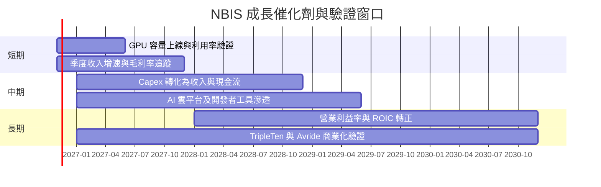

### 9.2 TAM 市場規模分析

公司資料未提供 TAM、滲透率、客戶數及各市場收入，因此不虛構市場規模數字。

```text
╔══════════════════════════════════════════════════════════════════╗
║               TAM 與公司收入貢獻：可核對資料                    ║
╠══════════════════════════════════════════════════════════════════╣
║ AI 雲／GPU 算力 TAM：N/A          市場滲透率：N/A               ║
║ NBIS TTM 收入：$1.36B             AI 分部占比：未披露            ║
║ TripleTen TAM：N/A                收入貢獻：未披露               ║
║ Avride TAM：N/A                   收入貢獻：未披露               ║
╠══════════════════════════════════════════════════════════════════╣
║ 監控重點：容量、已簽約算力、利用率、續約率、每 GPU 收入及 Capex  ║
╚══════════════════════════════════════════════════════════════════╝
```

### 9.3 成長驅動力結構圖

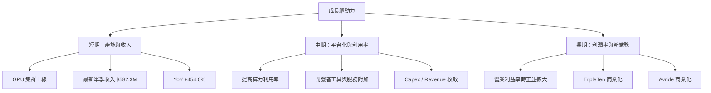

---

## 10. 風險矩陣

### 10.1 風險評分矩陣

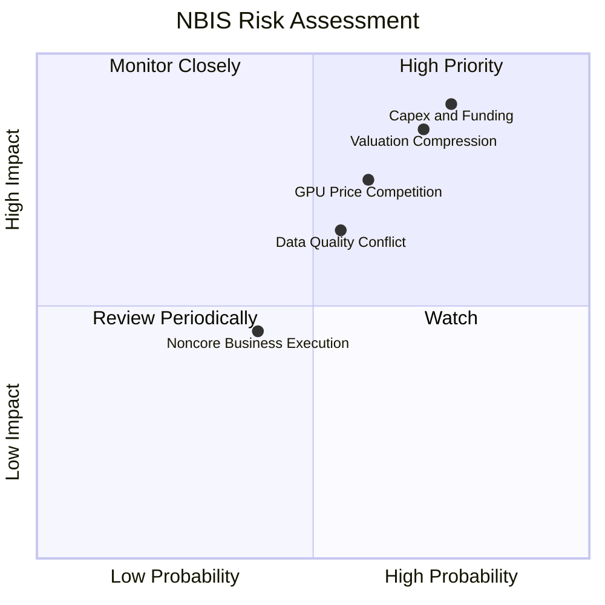

### 10.2 風險清單詳細分析

| # | 風險項目 | 發生機率 | 財務衝擊 | 風險評分 | 緩解措施 |
|---|----------|----------|----------|----------|----------|
| 1 | 🔴 資本支出與融資風險 | 高（約 65%） | Capex 延續高位將使 FCF 持續低於 -$5B | 🔴 9/10 | 監控 Capex/收入、資金來源、債務到期及已簽約容量 |
| 2 | 🔴 估值壓縮 | 高（約 60%） | P/S 21.71x；同業 3.0–11.2x，倍數收斂可帶來大幅回撤 | 🔴 9/10 | 以分批和估值上限控制部位 |
| 3 | 🔴 GPU 雲競爭、價格與利用率 | 中高（約 55%） | 利用率下降會令毛利率與投資回報惡化 | 🔴 8/10 | 追蹤每 GPU 收入、毛利率、客戶集中度與續約 |
| 4 | 🟡 財務資料與期間口徑不一致 | 中（約 45%） | 估值基數、現金流及市值可能偏差 | 🟡 7/10 | 以 SEC 正式申報與公司報表核對 |
| 5 | 🟡 SBC 稀釋 | 中（約 40%） | SBC 約占 TTM 收入 13.9% | 🟡 6/10 | 監控稀釋股數、SBC/收入及回購抵銷比例 |
| 6 | 🟡 非核心業務執行 | 中（約 35%） | TripleTen、Avride 的資源投入可能分散管理注意力 | 🟡 5/10 | 要求分部收入、現金消耗及里程碑披露 |

---

## 11. 投資建議

### 11.1 最終綜合評級雷達圖

```text
╔══════════════════════════════════════════════════════════════╗
║                    NBIS 綜合評級雷達                         ║
╠══════════════════════════════════════════════════════════════╣
║ 成長性       8.5/10  ▓▓▓▓▓▓▓▓▓▓▓▓▓▓▓▓▓░░░                   ║
║ 基本面       5.5/10  ▓▓▓▓▓▓▓▓▓▓▓░░░░░░░░░                   ║
║ 財務健康     4.0/10  ▓▓▓▓▓▓▓▓░░░░░░░░░░░░                   ║
║ 獲利品質     3.0/10  ▓▓▓▓▓▓░░░░░░░░░░░░░░                   ║
║ 估值合理性   3.0/10  ▓▓▓▓▓▓░░░░░░░░░░░░░░                   ║
║ 綜合評分     4.8/10  ▓▓▓▓▓▓▓▓▓▓░░░░░░░░░░                   ║
║ 結論：🟠 減碼；高成長尚未證明可轉化為股東現金回報          ║
╚══════════════════════════════════════════════════════════════╝
```

### 11.2 目標價與隱含報酬率

| 情境/參考 | 目標價 | 相對 $115.88 報酬 | 假設/權重 |
|----------|--------|------------------|-----------|
| 悲觀情境 | $26.71 | -76.9% | FY+1 低成長、4x EV/Sales |
| 基準情境 | $62.00 | -46.5% | FY+1 收入約 $1.97B、8x EV/Sales |
| 樂觀情境 | $97.75 | -15.6% | 更高成長、12x EV/Sales |
| 加權合理價值 | $95.17 | -17.87% 上行空間 | 8.8 節多方法加權 |
| 分析師共識 | $257.20 | +122.0% | 20 位分析師均值；不作主要估值依據 |

### 11.3 買入時機與觸發因素

```text
╔══════════════════════════════════════════════════════════════════╗
║                   ✅ 買入/風險管理 Checklist                     ║
╠══════════════════════════════════════════════════════════════════╣
║ 現價決策：減碼；$115.88 高於加權合理價值 $95.17                 ║
║                                                                  ║
║ 重新考慮買入條件：                                               ║
║ ☐ 股價進入 $73.52–$85.65，對應至少約 10% MOS                   ║
║ ☐ 連續兩季收入 YoY >100%，且毛利率維持 65%以上                 ║
║ ☐ Capex/收入明確下降，且季度 FCF 虧損收窄                       ║
║                                                                  ║
║ 加碼觸發條件：                                                   ║
║ ☐ TTM FCF 連續兩季改善，並有可核對的已簽約容量／利用率資料       ║
║ ☐ ROIC 轉正並接近 WACC 9.31%                                    ║
║                                                                  ║
║ 減碼/退出觸發條件：                                              ║
║ ☐ 單季收入 YoY 連續兩季低於 100%                                 ║
║ ☐ 毛利率跌破 60%，或營業利益率再度惡化                           ║
║ ☐ 現金消耗加快、融資條件惡化或負債快速增加                       ║
╚══════════════════════════════════════════════════════════════════╝
```

### 11.4 投資人適配度分析

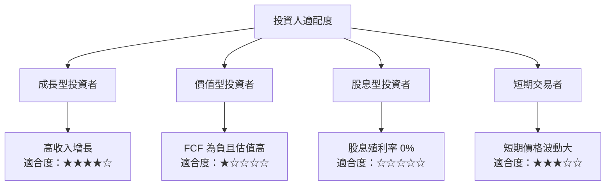

### 11.5 每季財報監控清單

| 監控指標 | 目前基準 | 加碼參考 | 減碼/重估門檻 |
|----------|----------|----------|---------------|
| 單季收入 YoY | 2026-06 +454.0% | >100% 且持續成長 | 連續兩季 <100% |
| 毛利率 | TTM 74.3% | 維持 >65% | 低於 60% |
| 營業利益率 | TTM -50.5%；最新單季 -37.4% | 虧損率連續收窄 | 連續兩季惡化 |
| Capex | TTM $11.14B | Capex/收入下降且容量上線 | Capex 增速持續高於收入 |
| FCF | TTM -$5.88B | 虧損逐季收窄 | 年化 FCF 進一步惡化 |
| SBC | 四季約 $188.9M | SBC/收入下降 | SBC/收入維持 >15% |
| 現金/總債務 | $8.04B / $10.20B | 淨負債下降 | 現金消耗與借款同步上升 |
| EPS 預估與實際 | 近四季 Est/Act N/A | 公布可驗證 EPS 並持續改善 | 大幅負向意外或非經常收益主導 |
| 資料披露 | 期間口徑有差異 | 申報數據與資料商一致 | 營收/股數/現金流差異持續擴大 |

### 11.6 反面論證：什麼會證明論點錯誤（What Would Change My Mind）

```text
╔══════════════════════════════════════════════════════════════════╗
║              ⚠️ 論點失效條件（Disconfirming Evidence）           ║
╠══════════════════════════════════════════════════════════════════╣
║ ☐ 核心營收 YoY 連續兩季低於 100%，且沒有已簽約訂單補足           ║
║ ☐ TTM 毛利率跌破 60%，或最新單季營業利益率比 -37.4% 再惡化      ║
║ ☐ Capex/營收未見下降，且年度 FCF 持續低於 -$5.88B                ║
║ ☐ SBC/營收連續兩季高於 15%，稀釋股數同步增加                     ║
║ ☐ ROIC 在規模擴張後仍低於 WACC 9.31%，或投資回報未改善           ║
║ ☐ 現金跌破 $5B 且淨負債快速增加，融資成本上升                    ║
║ ☐ AI 雲價格競爭導致毛利下滑，或 GPU 產能利用率不足               ║
╚══════════════════════════════════════════════════════════════════╝
```

> **免責聲明**：本報告為 AI 自動生成，僅供研究參考，不構成投資建議。資料可能存在口徑與期間差異；投資有風險，入市需謹慎。