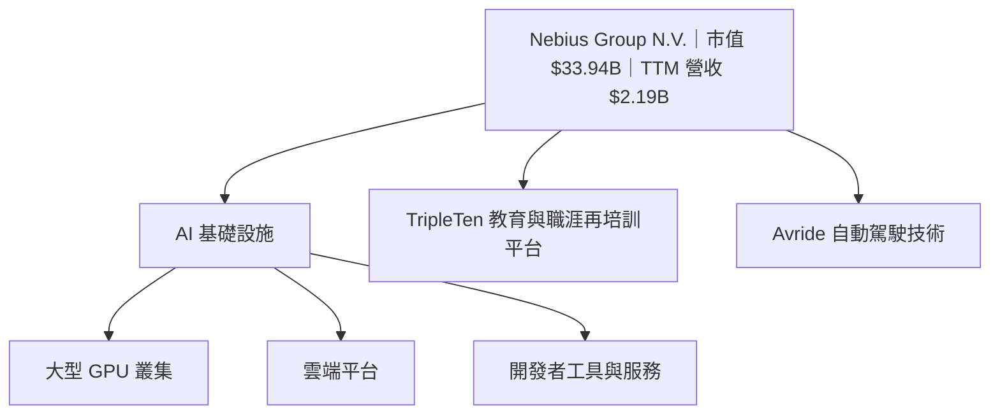
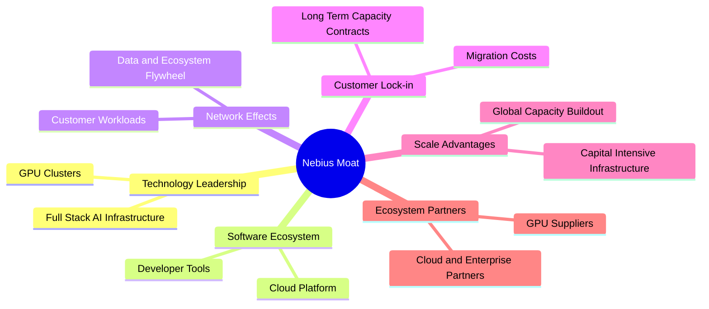
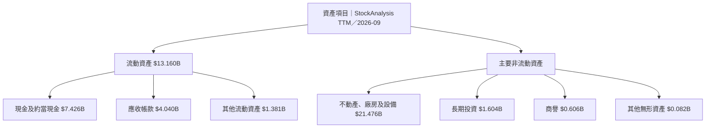
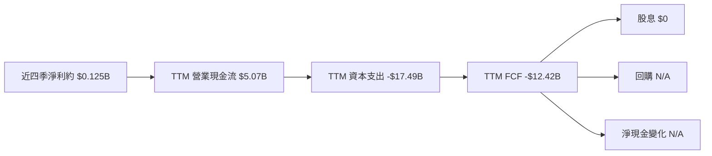
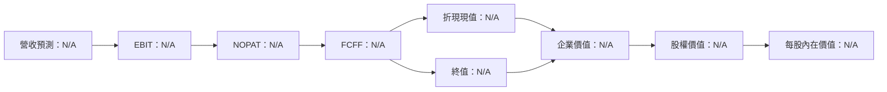
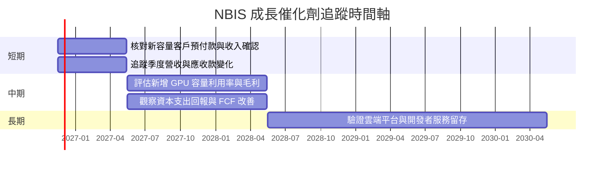
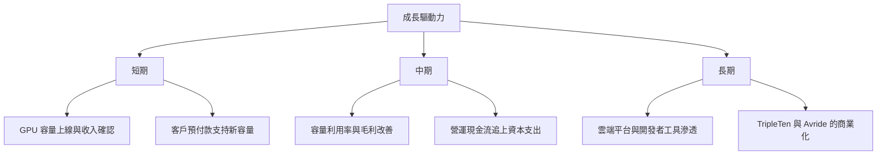
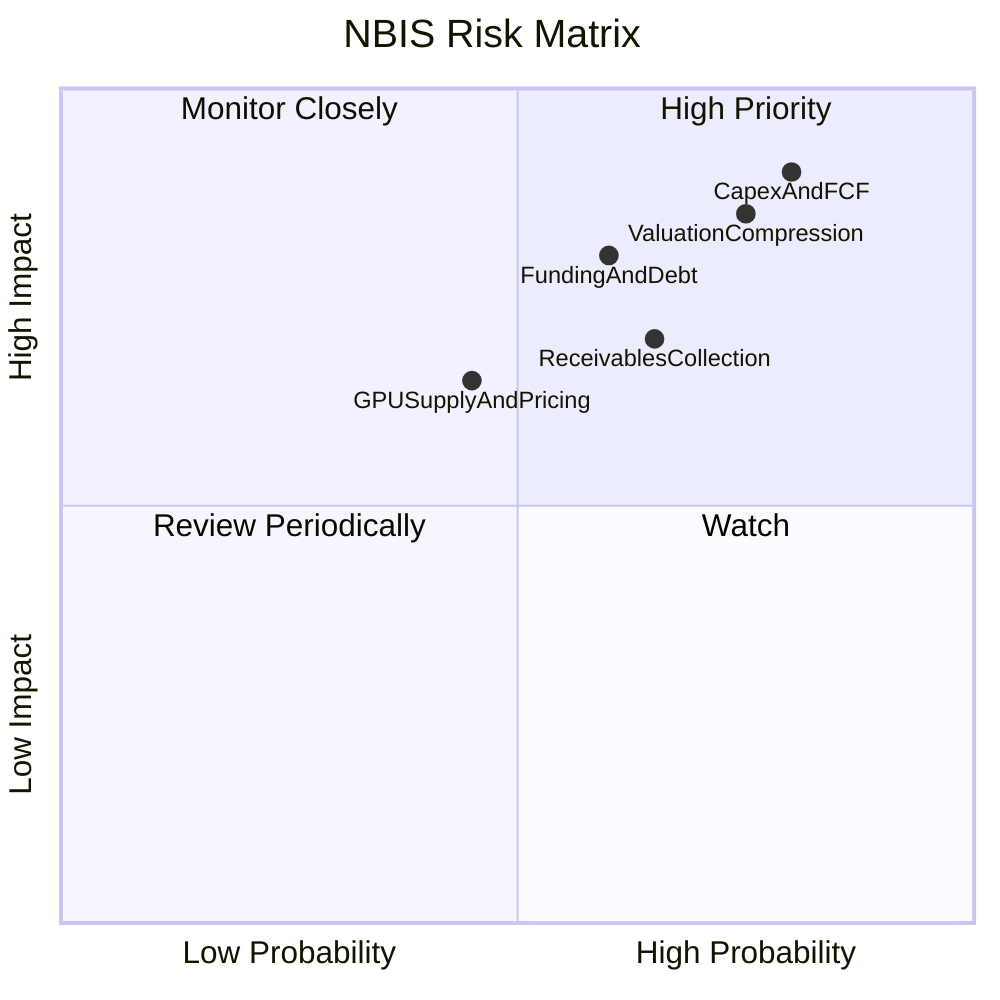
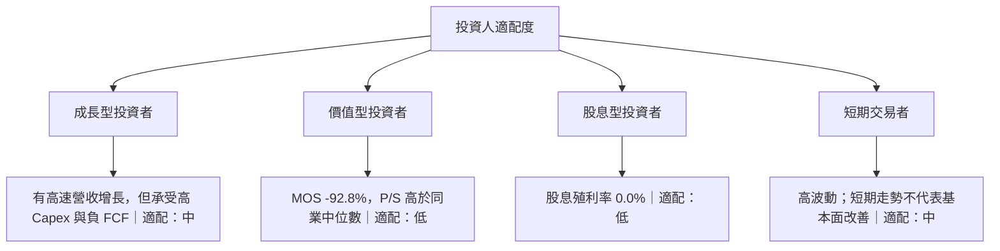

# NBIS 基本面深度分析報告
> **報告日期**：2026-11-15 ｜ **語言**：繁體中文 ｜ **數據來源**：Yahoo Finance、Finviz、StockAnalysis、Roic.ai ｜ **分析師**：CFA 級機構研究

## 目錄

| # | 章節 | 核心結論 |
|---|------|----------|
| 1 | 執行摘要 | 賣出；加權合理價值 $60.09，MOS -92.8% |
| 2 | 公司概覽與商業模式 | AI 基礎設施為核心；分部營收與市占率資料未提供 |
| 3 | 損益表深度分析 | TTM 營收 $2.19B；最新一季年增 571.3%，但 TTM 營業利益率 -23.0% |
| 4 | 資產負債表分析 | 淨負債 $8.53B；流動比率 5.306，但應收款天數偏高 |
| 5 | 現金流量深度分析 | TTM FCF -$12.42B，主要反映高額資本支出 |
| 6 | 獲利能力與資本效率 | ROIC 為 N/A；無法確認已創造股東價值 |
| 7 | 相對估值分析 | NBIS P/S 15.5x，顯著高於同業中位數 5.4x |
| 8 | DCF 內在價值評估 | DCF N/A：TTM 營業利益為負，依規則不建立 DCF |
| 9 | 成長催化劑 | AI 算力需求及客戶預付款可支持擴建，但變現與回報尚待驗證 |
| 10 | 風險矩陣 | 資本支出、融資負擔、估值回落為主要風險 |
| 11 | 投資建議 | 不宜追價；以營運現金流、資本效率及估值回落作為再評估條件 |

---

## 1. 執行摘要

NBIS 最新可用收盤價為 **2026-11-13 的 $115.88**。TTM 營收為 **$2.19B**，最新一季營收年增 **571.3%**，顯示 AI 基礎設施需求快速擴大；但 TTM 營業利益率為 **-23.0%**、TTM FCF 為 **-$12.42B**，且淨負債為 **$8.53B**。估值上，NBIS P/S 為 **15.5x**，相較同業 P/S 中位數 **5.4x** 有明顯溢價。依 8.8 節加權合理價值 **$60.09** 計算，MOS 為 **-92.8%**，因此依規則 20 評級為 **賣出**；DCF 因 TTM 營業利益為負而不適用，故沒有 DCF 情境目標價。

### 1.0 一頁式投資儀表板（Portfolio Manager 30 秒速讀）

| 項目 | 內容 |
|------|------|
| **投資論點（3 句）** | ① TTM 營收 $2.19B，最新一季年增 571.3%，顯示 AI 基礎設施業務快速擴張。② TTM 資本支出 $17.49B 高於營業現金流 $5.07B，導致 FCF -$12.42B，擴張速度尚未轉化為自由現金流。③ NBIS P/S 15.5x，約為同業中位數 5.4x 的 2.9 倍，估值已包含高成長預期。 |
| **綜合評分** | **4.2/10**（引用 1.1 評分卡） |
| **財務健康** | 🔴 淨負債 $8.53B、FCF -$12.42B；流動比率 5.306 提供短期流動性緩衝，但不能消除持續投資的資金需求。 |
| **ROIC vs WACC** | ROIC：N/A；WACC：8.22%。資料不足以確認創造或摧毀價值。 |
| **FCF 趨勢** | 擴建投入令 TTM FCF 為 -$12.42B；FCF Yield -36.60%。 |
| **估值** | Forward P/E -35.7x ｜ EV/EBITDA 82.1x ｜ FCF Yield -36.60% |
| **DCF 內在價值（基準）** | N/A；TTM 營業利益為負，DCF 模型不適用。 |
| **安全邊際（MOS）** | **-92.8%**＝($60.09 − $115.88) ÷ $60.09；基準為 8.8 節加權合理價值。🔴 |
| **預期報酬（基準情境 12M）** | DCF 情境 N/A；加權合理價值相對現價的上行空間 **-48.1%**。 |
| **關鍵風險（前二）** | 高資本支出造成持續負 FCF；淨負債與高估值令融資及估值回落風險上升。 |
| **評級 + 信心度** | 🔴 **賣出** ｜ 信心：中（估值訊號明確，但公司仍處高速擴張期，盈利數據與分部資訊有限） |

### 1.1 綜合評分卡（全報告唯一）

| 維度 | 評分（1–10） | 主要依據（引用數字與其來源章節） |
|------|--------------|----------------------------------|
| 成長性 | 8.0 | TTM 營收成長率 N/A；最新一季年增 571.3%，但單季高速成長不代表可持續 TTM 增速（第 3 章）。 |
| 獲利能力 | 3.0 | TTM 營業利益率 -23.0%；ROIC、F-Score 為 N/A（第 3、6 章）。 |
| 財務健康 | 4.0 | 淨負債 $8.53B、流動比率 5.306；DSO 673 天（第 4 章）。 |
| 估值 | 1.0 | MOS -92.8%；NBIS P/S 15.5x，同業中位數 5.4x（第 7、8 章）。 |
| 護城河 | 6.0 | 全棧 AI 基礎設施、GPU 叢集及雲端平台具差異化潛力，但客戶集中度、續約率及分部經濟性未提供（第 2 章）。 |
| 管理層與資本配置 | 3.0 | TTM Capex $17.49B、FCF -$12.42B；近期新聞提及客戶預付款覆蓋新容量比例超過 100%，但尚缺足夠現金回報歷史（第 5、9 章）。 |
| **綜合評分** | **4.2** | 六項算術平均：(8.0 + 3.0 + 4.0 + 1.0 + 6.0 + 3.0) ÷ 6 = 4.1667，四捨五入至一位小數。 |

### 1.2 五大投資論點 + 三大核心風險

| 類型 | 項目 | 具體依據 | 信心度 |
|------|------|----------|--------|
| 🟢 **投資論點①** | AI 基礎設施需求快速放量 | 最新一季營收 $980.8M，年增 571.3%；但單季增長須與未來容量上線及收入確認節奏一併觀察。 | 🟢 高 |
| 🟢 **投資論點②** | 毛利率具一定改善跡象 | TTM 毛利率 76.0%；最新一季毛利 $761.1M / 營收 $980.8M，約 77.6%。 | 🟡 中 |
| 🟢 **投資論點③** | 現金及短期投資可部分支持擴張 | 現金及短期投資 $7.43B；但總債務 $15.96B，仍為淨負債狀態。 | 🟡 中 |
| 🟢 **投資論點④** | 客戶預付款可能改善建置融資 | 近期新聞稱客戶預付款覆蓋「超過 100%」的新容量；屬新聞所述管理層訊息，需以後續財報驗證實際現金流及合約條件。 | 🟡 中 |
| 🟢 **投資論點⑤** | 仍有跨區域及產品擴張選項 | 公司提供 GPU 叢集、雲端平台及開發者工具；但各業務收入與利潤拆分未提供。 | 🟡 中 |
| 🟡 **風險①** | 資本密集與負 FCF | TTM Capex $17.49B、FCF -$12.42B，若投資回收慢於折舊或需求增長，融資需求將升高。 | 🔴 高 |
| 🔴 **風險②** | 高估值回落 | NBIS P/S 15.5x，對比同業中位數 5.4x；即使營收成長，估值倍數收斂仍可能造成股價下行。 | 🔴 高 |
| 🔴 **風險③** | 淨負債及應收款風險 | 淨負債 $8.53B、DSO 673 天；應收款回收週期偏長，可能令帳面營收與現金流脫節。 | 🔴 高 |

### 1.3 快速統計卡片

| 指標 | 公司實際值（期間） | 同業中位數 | 狀態 |
|------|--------------------|------------|------|
| 營收成長（TTM） | **N/A** | — | 🟡 |
| 營收成長（最新一季年增） | **571.3%** | 29.6%（CRWV、ORCL、MSFT 中位數） | 🟢 |
| 毛利率（TTM） | **76.0%** | 66.8%（三家同業中位數） | 🟢 |
| 營業利益率（TTM） | **-23.0%** | — | 🔴 |
| ROIC（TTM） | **N/A** | — | 🟡 |
| Forward P/E | **-35.7x** | 11.3x（ORCL、21.7x MSFT、-30.0x CRWV，中位數 11.3x） | 🔴 |
| FCF Yield（TTM） | **-36.60%** | — | 🔴 |
| Piotroski F-Score | **N/A** | — | 🟡 |

### 1.4 投資結論

╔══════════════════════════════════════════════════════════════════╗  
║                    📊 投資結論摘要                               ║  
╠══════════════════════════════════════════════════════════════════╣  
║  評級：🔴 賣出（依規則 20；未作質化調整）                        ║  
║  價格（2026-11-13 收盤）：$115.88                                ║  
║  DCF 內在價值（基準）：N/A（TTM 營業利益為負）                   ║  
║  安全邊際 MOS：-92.8%（以加權合理價值 $60.09 為分母）            ║  
║  加權合理價值（8.8）：$60.09                                     ║  
║  DCF 情境價值：N/A（DCF 模型不適用）                             ║  
║  綜合評分：4.2/10（引用 1.1）                                    ║  
║  適合投資人：可承受高波動、願意承擔建置與融資風險的成長型投資人  ║  
╚══════════════════════════════════════════════════════════════════╝

---

## 2. 公司概覽與商業模式

### 2.1 業務結構與收入來源

公司概述顯示 Nebius 建置 AI 全棧基礎設施，包含大型 GPU 叢集、雲端平台及開發者工具；另有 TripleTen 教育平台及 Avride 自動駕駛業務。最新 TTM 營收為 **$2.19B**、市值 **$33.94B**。各業務收入金額及占比未提供，因此不將總收入任意分配至各業務。

AI 基礎設施是公司描述中的核心業務，但分部營收、分部毛利與資本支出未提供；不能由公司總營收推算各分部占比。

### 2.2 市場份額

市場份額資料未提供，因此不製作市占率圖表。NBIS TTM 營收為 $2.19B，最新一季年增 571.3%，顯示規模快速擴張；但其商業規模、客戶覆蓋及同業營收口徑不同，無法據此推算市場占有率。

### 2.3 競爭護城河分析

圖中為商業模式的質化分析；供應商合作、客戶留存、轉換成本等量化證據未提供，故不能將其視為已驗證的強護城河。

### 2.4 護城河強度

| 護城河項目 | 強度（強／中／弱） | 證據（引用數字或事實） | 會削弱它的情況 |
|------------|--------------------|------------------------|----------------|
| 技術與基礎設施 | 中 | 提供 GPU 叢集、雲端平台及開發者工具；最新一季營收年增 571.3%。 | GPU 供應受限、技術迭代加速或競爭者價格更低。 |
| 軟體生態系統 | 弱至中 | 有雲端平台與工具，但活躍開發者、使用量及軟體收入未提供。 | 客戶只購買算力而不使用平台工具，服務差異化不足。 |
| 網路效應 | 弱 | 客戶及開發者規模、交互效應資料未提供。 | 客戶可輕易在雲端供應商間遷移。 |
| 客戶鎖定 | 中 | 新容量有客戶預付款的新聞描述，但合約期限、取消條款及續約率未提供。 | 預付款不代表長期承諾，或客戶集中度過高。 |
| 規模效應 | 中 | TTM Capex $17.49B，代表重資產建置；規模能否帶來單位成本下降尚未驗證。 | 利用率不足、折舊與融資成本吞噬規模效益。 |
| 生態夥伴 | 弱至中 | 業務需要 GPU 供應及基礎設施合作，但具名合作與依賴度資料未提供。 | 供應鏈集中、供應商定價權上升。 |

1.1「護城河」評分為 **6.0/10**，理由是 AI 基礎設施及平台業務具建立差異化的可能，但客戶留存、軟體收入及單位經濟性尚無可核實數據。

---

## 3. 損益表深度分析

### 3.1 年度收入成長趨勢（近4年）

依年度損益表，2022–2025 營收由 $13.5M 增至 $529.8M；2023 年仍為低基期，故長期 CAGR 不宜直接外推至目前 AI 基礎設施規模。

╔══════════════════════════════════════════════════════════════════╗  
║              NBIS 年度收入趨勢（FY2022-FY2025）                  ║  
╠══════════════════════════════════════════════════════════════════╣  
║  FY2022  $13.5M    ▏                         YoY：+37.8%*        ║  
║  FY2023   $9.8M    ▏                         YoY：-27.4%         ║  
║  FY2024  $91.5M    ████                      YoY：+833.7%        ║  
║  FY2025 $529.8M    ████████████████████████  YoY：+479.0%        ║  
║                                                                  ║  
║  FY2022–FY2025 CAGR：(529.8 ÷ 13.5)^(1/3) − 1 ≈ 239.7%           ║  
║  *FY2022 相對 FY2021 $4.746B，因業務與報表基礎大幅變動，參考性低。║  
╚══════════════════════════════════════════════════════════════════╝

### 3.2 季度收入趨勢分析

| 季度 | 營收 | QoQ | YoY | 備註 |
|------|------:|----:|----:|------|
| 2025 Q4 | $227.7M | — | 546.88% | 年增率依 StockAnalysis 季度資料。 |
| 2026 Q1 | $399.0M | +75.2% | 683.89% | 低基期和容量擴張共同影響。 |
| 2026 Q2 | $582.3M | +45.9% | 454.04% | QoQ 仍顯著增長，但增速較 Q1 低。 |
| 2026 Q3 | $980.8M | +68.4% | 571.3% | 最新一季年增率；這是單季 YoY，不是 TTM 成長率。 |

QoQ 公式為「本季營收 ÷ 前季營收 − 1」，例如 2026 Q3：(980.8 ÷ 582.3) − 1 = 68.4%。季度收入連續擴大，與 AI 算力需求及基礎設施上線相符；但收入確認速度須與應收款及現金流共同檢查。

### 3.3 利潤率演變分析

| 利潤率指標 | FY2022 | FY2023 | FY2024 | FY2025 | 趨勢 | 評估 |
|------------|--------:|--------:|--------:|--------:|------|------|
| **毛利率** | -110.4% | -100.0% | 52.2% | 68.6% | 轉正並提升；FY2025 毛利率 = $363.6M ÷ $529.8M。 | 🟢 |
| **營業利益率** | -1,170.4% | -2,915.3% | -436.7% | -115.5% | 虧損率收窄，但仍為大幅負值。 | 🔴 |
| **淨利率** | 5,523.0% | 2,462.2% | -700.4% | 15.6% | 年度淨利受一次性或非經常項目影響，波動很大。 | 🟡 |

**利潤率演變深度解析：**FY2024–FY2025 毛利率提升，與收入組合轉向基礎設施服務、產能利用率提升可能一致，但資料未提供分部或成本細節，不能將原因確定為單一因素。FY2025 營收已增至 $529.8M，營業虧損仍為 $611.7M，說明研發、營運及擴張成本仍超過毛利。另有一項口徑差異：最新季度原始表列出 2026 Q3 營業利益 $50.4M，但標準化數據列示最新一季營業利益率 -23.0%；兩者不一致，本報告以 VERIFIED Figures 的 -23.0% 作為標準化指標，並將季度損益表原值視為需進一步核對的資料品質問題。

### 3.4 費用結構分析

公司未提供足以建立完整費用分解的 TTM 營業費用明細。FY2025 研發費用為 **$177.3M**，但其他費用細項及 TTM 分類數據不完整，因此不繪製費用占比圓餅圖。費用結構分析應優先追蹤研發、銷售管理費用、折舊及融資費用的變化。

### 3.5 季度 EPS 趨勢與盈餘品質（Quality of Earnings）

| 季度 | EPS 預估 | EPS 實際 | 超預期／不及預期 | 可判斷原因 |
|------|---------|---------|------------------|------------|
| 2026-09-30 | N/A | N/A | N/A | 預估與實際值均缺失。 |
| 2026-06-30 | N/A | N/A | N/A | 預估與實際值均缺失。 |
| 2026-03-31 | N/A | N/A | N/A | 預估與實際值均缺失。 |
| 2025-12-31 | N/A | N/A | N/A | 預估與實際值均缺失。 |

| 盈餘品質項目 | 數值／佔比 | 評估 |
|--------------|-----------|------|
| 股權薪酬 SBC / 營收 | TTM SBC 約 $221.4M；$221.4M ÷ $2.19B = **10.1%** | 🔴 SBC 占營收比重高，且可能造成股東稀釋。SBC 為四季數據加總的計算值。 |
| SBC / 營業現金流 | $221.4M ÷ $5.07B = **4.4%** | 🟡 佔營業現金流比例較低，但 OCF 本身並不等同可分配股東現金。 |
| FCF / 淨利（現金轉換率） | TTM 淨利約 $122.9M；-$12.42B ÷ $122.9M ≈ **-10,106%** | 🔴 FCF 大幅為負，反映高額資本支出而非現金盈利轉換。 |
| 一次性／非經常性損益 | 季度淨利大幅波動；單季 2026 Q1 淨利 $621.2M，另季虧損 | 🔴 未提供調整項明細，不能判定特殊收益來源；淨利不宜單獨作為常態盈利指標。 |
| 有效稅率異常 | 29.0%（最新年度有效稅率） | 🟡 TTM 稅費拆解不足，不能確認是否有一次性稅務利益。 |
| 資本化支出 vs 費用化 | TTM Capex $17.49B；資本化政策明細 N/A | 🔴 資本支出已對 FCF 造成重大影響；須檢視資產使用年限、折舊與利用率。 |

**盈餘品質結論：**TTM 淨利約 $122.9M 與 FCF -$12.42B 並存，主要警訊是資本支出遠高於營業現金流；年度及季度淨利波動亦使單一期間的 GAAP 盈餘代表性有限。SBC 約占營收 10.1%，對股東回報有實質稀釋風險。估值應更重視現金流、容量利用率與資本回報，而非短期淨利。

---

## 4. 資產負債表分析

### 4.1 資產結構分解

最新季度可取得的資產項目如下；部分項目及總資產口徑未能完整核對，因此不計算占比。

資產項目顯示公司資本密集程度高，PPE 約 $21.476B；應收帳款 $4.040B 亦相當可觀。資產類別和總資產口徑須由正式申報資料進一步核對。

### 4.2 流動性與營運資金分析

| 指標 | 最新 TTM | 一年前 TTM | 變化 | 解讀 |
|------|----------|------------|------|------|
| DSO 應收帳款天數 | **673 天** | N/A | N/A | 應收款周轉天數高；可能受收入快速成長、付款條款或資料口徑影響，須核對帳齡及客戶集中度。 |
| DIO 存貨天數 | **N/A** | N/A | N/A | 公司未報列存貨餘額。 |
| DPO 應付帳款天數 | **368 天** | N/A | N/A | 付款周期偏長，可能反映供應商付款安排或快速擴張的營運資金變化。 |
| CCC 現金轉換週期 | **N/A** | N/A | N/A | DIO 缺失，不能計算；不以其他數字反推。 |

流動性比率如下：流動比率 **5.306**、速動比率 **4.688**。這些比率顯示帳面短期資產相對流動負債有緩衝，但應收帳款變現速度及資本支出的現金需求仍是關鍵約束。

### 4.3 債務結構分析

╔══════════════════════════════════════════════════════════════════╗  
║                   NBIS 債務健康診斷                               ║  
╠══════════════════════════════════════════════════════════════════╣  
║  總債務：              $15.96B  ████████████████████  🔴          ║  
║  現金及短期投資：       $7.43B  █████████              🟡          ║  
║  淨負債：               $8.53B  ███████████            🔴          ║  
║  Debt/EBITDA：          N/A（TTM EBITDA 口徑未足以核實）           ║  
║  Interest Coverage：    N/A（利息費用與 EBIT 口徑不完整）          ║  
║  流動比率：             5.306  🟢                                  ║  
╚══════════════════════════════════════════════════════════════════╝

現金覆蓋約為總債務的 **46.6%**（$7.43B ÷ $15.96B），仍留下 $8.53B 淨負債。公司目前具有較高流動比率，但若 Capex 維持高位，應觀察未來新增融資、負債期限及利息成本。

### 4.4 股東權益趨勢

╔══════════════════════════════════════════════════════════════════╗  
║               NBIS 歷年股東權益（年度）                           ║  
╠══════════════════════════════════════════════════════════════════╣  
║  FY2022  $4.25B   ████████████████████████                       ║  
║  FY2023  $3.29B   ██████████████████                             ║  
║  FY2024  $3.25B   ██████████████████                             ║  
║  FY2025  $4.59B   ██████████████████████████                     ║  
╚══════════════════════════════════════════════════════════════════╝

FY2025 股東權益回升至 $4.59B，但資產負債表與股本可能受融資、收購及股權薪酬影響；僅憑年度總額無法拆解權益增加的來源。

---

## 5. 現金流量深度分析

### 5.1 現金流量瀑布圖

以下淨利為最近四季淨利加總，約 $124.5M；現金流與資本支出採用 TTM 標準化數值。

### 5.2 FCF 轉換率趨勢

| 年度 | 營業現金流 | 資本支出 | FCF | 淨利 | FCF / 淨利 |
|------|------------:|---------:|----:|-----:|-----------:|
| FY2022 | $697.0M | $14.6M | $682.4M | $745.6M | 91.5% |
| FY2023 | $829.8M | $82.9M | $746.9M | $241.3M | 309.6% |
| FY2024 | $245.6M | $807.5M | -$561.9M | -$641.4M | 87.6% |
| FY2025 | $384.8M | $4.07B | -$3.68B | $82.5M | -4,460.6% |
| TTM 至 2026-09-30 | $5.07B | $17.49B | -$12.42B | 約 $122.9M | 約 -10,106% |

FY2025 與 TTM FCF 大幅轉負，主因 Capex 快速增加；這代表資金回報取決於新增 GPU 容量的利用率、客戶合約及價格，而不是單靠營收增長即可判斷。

### 5.3 自由現金流趨勢

╔══════════════════════════════════════════════════════════════════╗  
║                 自由現金流：歷史實際與 TTM                        ║  
╠══════════════════════════════════════════════════════════════════╣  
║  FY2022  +$0.68B  ████████████████              FCF Yield：N/A    ║  
║  FY2023  +$0.75B  █████████████████             FCF Yield：N/A    ║  
║  FY2024  -$0.56B  ◀████████████                 FCF Yield：N/A    ║  
║  FY2025  -$3.68B  ◀████████████████████████     FCF Yield：N/A    ║  
║  TTM     -$12.42B ◀████████████████████████████ FCF Yield：-36.60%║  
╚══════════════════════════════════════════════════════════════════╝

歷史 FCF Yield 因缺乏各年度同期市值資料不列示；TTM FCF Yield 使用標準化數值 -36.60%。

### 5.4 資本配置評估

完整資本配置分項（收購、維持性 Capex、成長性 Capex、回購及留存現金）未提供，故不繪製比例圓餅圖。

| 項目 | 可取得數據 | 評估 |
|------|------------|------|
| 資本支出 | TTM $17.49B | 🔴 高額投資令 FCF 深度為負；需驗證投資回報與容量利用率。 |
| 股息 | 殖利率 0.0% | 🟡 目前無股息支出。 |
| 股份回購 | N/A | 未提供資料。 |
| 股權薪酬 | FY2025 $83.2M；TTM 約 $221.4M | 🔴 可能稀釋股東；需追蹤完全稀釋股數。 |
| 客戶預付款 | 新聞稱覆蓋新容量超過 100% | 🟡 可能降低資金壓力，但仍需確認是否已體現在營運現金流及合同負債。 |

---

## 6. 獲利能力與資本效率

### 6.1 ROE / ROA / ROIC 趨勢

| 指標 | 最新可得值 | 歷史趨勢／限制 | 評估 |
|------|-----------:|----------------|------|
| ROE（TTM） | 1.5% | DuPont 所需淨利、營收、總資產及正權益口徑未能完整匹配。 | 🟡 |
| ROA（TTM） | -1.3% | 營業擴張及資產投入尚未反映為穩定資產回報。 | 🔴 |
| ROIC（TTM） | N/A | 缺少可靠 TTM 投入資本及稅後營業利益資料。 | 🟡 |
| WACC | 8.22% | 採用資本成本區塊數值。 | — |

### 6.2 ROIC vs WACC 分析（核心價值創造判斷）

╔══════════════════════════════════════════════════════════════════╗  
║                ROIC vs WACC 深度分析                             ║  
╠══════════════════════════════════════════════════════════════════╣  
║  WACC（採用成本資本資料）：8.22%                                  ║  
║  ├── 無風險利率（10Y 美債）：5.15%                                ║  
║  ├── 市場風險溢酬：5.00%                                          ║  
║  ├── Beta 原始值：1.54；採用調整後 Beta：1.36                    ║  
║  ├── 股權成本：11.95%                                             ║  
║  ├── 稅前債務成本：0.39%；有效稅率：29.0%                         ║  
║  ├── 股權／債務權重：68.0%／32.0%                                 ║  
║  └── ✅ WACC：8.22%                                               ║  
║                                                                  ║  
║  ROIC：N/A（可用資料不足以可靠計算）                               ║  
║  EVA = ROIC − WACC：N/A                                           ║  
║                                                                  ║  
║  📊 結論：目前無法判定公司是否以高於 8.22% 的回報創造價值。       ║  
╚══════════════════════════════════════════════════════════════════╝

原始 Beta 為 1.54，調整後 Beta 按 ⅔ × 1.54 + ⅓ = 1.36 採用。資本成本明細中權重及債務成本是程式提供的估算結果，和單純以最新收盤價、總債務及股數重新計算的口徑可能不同；本節依規定引用統一 WACC **8.22%**。由於 ROIC 為 N/A，不能聲稱 NBIS 已創造或摧毀股東價值；目前更重要的是確認未來新建產能的增量回報能否超過資金成本。

### 6.3 杜邦三因素分解

**N/A（數據未提供：品質指標計算缺少可匹配的淨利、營收、總資產或正權益口徑。）**

### 6.4 財務體質：Piotroski F-Score

**N/A（需要相隔一年的兩組 TTM SEC 申報資料；目前無可判定的九項測試結果。）**

---

## 7. 相對估值分析

### 7.1 同業估值比較表格

Peer multiples 來自 Yahoo Finance。CRWV 為直接 AI 雲端基礎設施比較對象；ORCL、MSFT 是雲端及大型科技平台參照，商業模式與資本結構並非完全同質。

| 估值指標 | **NBIS** | **CRWV** | **ORCL** | **MSFT** | NBIS 評估 |
|----------|---------:|---------:|---------:|---------:|-----------|
| **Trailing P/E** | 90.5x | N/A | 19.6x | 27.3x | 🔴 NBIS 倍數高，且不同公司盈利口徑不完全可比。 |
| **Forward P/E** | -35.7x | -30.0x | 11.3x | 21.7x | 🔴 NBIS 預期 EPS 為負，P/E 失去正向估值解讀。 |
| **P/S Ratio** | 15.5x | 3.0x | 5.4x | 11.2x | 🔴 NBIS 高於三家同業中位數 5.4x。 |
| **EV/EBITDA** | 82.1x | 17.6x | 15.0x | 19.3x | 🔴 NBIS 溢價顯著；EBITDA 口徑及高速擴張造成可比性限制。 |
| **最新一季營收年增** | 571.3% | 168.2% | 29.6% | 18.8% | 🟢 NBIS 成長率較高，但增長能否轉化成利潤與現金流仍待驗證。 |
| **毛利率（TTM）** | 76.0% | 66.8% | 64.0% | 67.7% | 🟢 NBIS 毛利率較高；不代表扣除營運成本後已盈利。 |

同業 P/S 中位數為三家公司 3.0x、5.4x、11.2x 的中位數 **5.4x**。NBIS P/S 15.5x 約為其 **2.9 倍**，目前定價需要長期高成長及利潤率擴張共同支持。

### 7.2 歷史估值區間分析

**N/A（數據未提供：缺少 NBIS 歷史 P/E、P/S 或 EV/EBITDA 分位數；不以股價走勢代替估值區間。）**

股價資料顯示，2026-06 月收盤價曾為 $276.17，至 2026-11 月為 $115.88；這反映價格波動，但不等同歷史估值倍數區間。

### 7.3 情境價值（Bear / Base / Bull）

**N/A（DCF 無法計算：TTM 營業利益為負，無法使用本報告指定的 DCF 模型；因此不提供 DCF 三情境目標價。）**

### 7.4 相對估值隱含價格區間

╔══════════════════════════════════════════════════════════════════╗  
║                 相對估值與市場價格對照                            ║  
╠══════════════════════════════════════════════════════════════════╣  
║  同業 P/S 隱含價值：$40.71                                       ║  
║  加權合理價值：    $60.09                                        ║  
║  最新收盤價：      $115.88                                       ║  
║  分析師共識均值：  $234.50                                       ║  
╚══════════════════════════════════════════════════════════════════╝

| 方法 | 隱含每股價值 | 依據 |
|------|--------------:|------|
| 同業 P/S | $40.71 | CRWV、ORCL、MSFT 的同業中位數 P/S 5.4x，結合 NBIS TTM 營收計算；程式提供的估值結果照錄。 |
| 分析師共識目標價 | $234.50 | 20 位分析師平均目標價；屬分析師預測，不是基本面現金流估值。 |

---

## 8. DCF 內在價值評估（Discounted Cash Flow）

### 8.0 估值推理鏈（Thinking Logic）

**DCF 結論先行：N/A。** TTM 營業利益率為 **-23.0%**，TTM 營業利益為負；依指定模型規則，負的營業利益折現並不能提供可靠的 DCF 估值。本章不自建模型、不補設營收 CAGR、終值或稀釋股數，也不產生 DCF 目標價。

NBIS 的營收來源可概括為 AI 基礎設施、開發者服務及其他業務，但分部收入占比未提供；無法將「現有主業、第二曲線、選擇權價值」拆成可計算的估值項目。估值主導變數應是產能利用率及投入資本回報，但相關數據不足。

| 決策點 | 本報告採用 | 理由（含數字） | 曾考慮但否決 | 否決理由 |
|--------|-----------|----------------|--------------|----------|
| 現金流定義 | 不適用 | DCF 模型為 N/A；TTM 營業利益為負。 | FCFF／FCFE | 無法建立有效營業現金流預測。 |
| 預測期 N | N/A | 模型無可用預測期假設。 | 5–10 年 | 不自行設定預測參數。 |
| 終值方法 | N/A | DCF 模型無終值資料。 | Gordon Growth／退出倍數 | 缺乏可用基準現金流。 |
| EBIT 基礎 | N/A | TTM 營業利益為負。 | GAAP／非 GAAP 預測 | 不以自行預測取代程式模型。 |

**高敏感度假設推導鏈：**營收 CAGR、期末營業利潤率、永續成長率、預測期、Capex/營收、SBC 處理、稀釋率及終值假設均為 N/A；起點錨、調整理由及採用值均未由模型提供，因此不得創造數值。最脆弱的一環是高額 Capex 能否形成足夠利用率和回報；若需求或利用率不達預期，價值方向向下，但幅度因 DCF N/A 無法量化。

### 8.1 模型假設總表（Model Inputs）

**N/A（數據未提供：DCF MODEL 因 TTM 營業利益為負而不可用；預測期、營收 CAGR、利潤率、稅率、Capex、D&A、營運資金、SBC、稀釋率及終值輸入均未提供，不建立替代模型。）**

### 8.2 折現率推導（WACC）

WACC 為其他資本效率分析可引用的資本成本；但不代表本報告可繼續建立 DCF。依資本成本數據：原始 Beta 1.54，調整後 Beta 1.36，計算關係為 **⅔ × 1.54 + ⅓ = 1.36**。其餘成本資本輸入如下：

╔══════════════════════════════════════════════════════════════════╗  
║                    WACC 推導（折現率）                           ║  
╠══════════════════════════════════════════════════════════════════╣  
║  無風險利率 Rf（10Y 美債）：5.15%                                 ║  
║  市場風險溢酬 ERP：5.00%                                          ║  
║  原始 Beta：1.54；採用調整後 Beta：1.36                          ║  
║  股權成本 Ke：11.95%                                              ║  
║  稅前債務成本：0.39%；有效稅率：29.0%                            ║  
║  股權／債務權重：68.0%／32.0%                                     ║  
║  ✅ 採用 WACC：8.22%                                               ║  
║  註：以上為程式提供的資本成本估計值；DCF 仍為 N/A。               ║  
╚══════════════════════════════════════════════════════════════════╝

逐步演算只能依據可取得的成本資本數據：

1. **Ke**：資本成本資料列示 **11.95%**；其輸入包括 Rf 5.15%、調整後 Beta 1.36、ERP 5.00%。
2. **稅前 Kd**：程式提供 **0.39%**；利息費用及平均計息負債明細未提供，不能另行重算。
3. **稅後 Kd**：0.39% × (1 − 29.0%) = **0.2769%**；此為依已列輸入推導的計算值，非另行替換程式 WACC。
4. **權重**：股權 68.0%，債務 32.0%；合計 68.0% + 32.0% = **100.0%**。
5. **WACC**：採用資本成本資料提供的 **8.22%**。由於該區塊的成本及權重可能已經標準化或限制區間，本報告不以不同資料口徑重算並替代它。

Rf 日期未提供，ERP 為假設值，無法補造日期或風險溢酬來源。第 6.2 節與本節採用同一 WACC 8.22%。

### 8.3 逐年自由現金流預測（基準情境）

**N/A（DCF MODEL 不可用：TTM 營業利益為負。）**因此不列 FY+1 至 FY+N 預測表、不計算預測期現值、FCF CAGR 或預測 FCF 利潤率，也不另建模型。

### 8.4 終值計算（Terminal Value）

**N/A（DCF 模型未提供 FCFF 預測與終值假設；不計算 Gordon Growth 或退出倍數終值。）**

### 8.5 企業價值 → 每股內在價值（Bridge）

**N/A（無預測期現金流及終值，無法計算企業價值、股權價值或 DCF 每股內在價值。）**  
折溢價：N/A（以 DCF 內在價值為基準，DCF 未計算）。本節不計算 MOS；全報告 MOS 僅以 8.8 加權合理價值為基準。

### 8.6 敏感性分析（WACC × 永續成長率）

**N/A（DCF MODEL 未提供敏感度矩陣；不自建矩陣、不產生情境目標價。）**

### 8.7 反推 DCF（Reverse DCF）

**N/A（DCF MODEL 未提供反推結果；當前股價不能單獨決定多個未知營運變數，故不自行反解營收 CAGR、利潤率或成長年數。）**

### 8.8 估值三角驗證與安全邊際

估值方法及權重依公司類型「未盈利」固定採用。DCF 與同業 Forward P/E 無法計算，故程式提供的估值方法只有同業 P/S 與分析師共識目標價；其權重分別為 90% 與 10%。

| 估值方法 | 隱含每股價值 | 上行空間（÷現價） | 權重 | 說明 |
|----------|--------------:|-------------------:|------|------|
| 同業 P/S | $40.71 | -64.9% | 90% | 同業 P/S 中位數 5.4x × NBIS TTM 營收，程式提供的每股價值照錄。 |
| 分析師共識目標價 | $234.50 | +102.4% | 10% | 20 位分析師平均目標價；作為參考，權重較低。 |
| **加權合理價值** | **$60.09** | **-48.1%** | **100%** | 公司類型為未盈利；同業 Forward P/E 因不可計算而未納入，權重分配由程式固定。 |

逐步演算：  
**加權合理價值** = $40.71 × 90% + $234.50 × 10%  
= $36.639 + $23.450  
= $60.089  
= **$60.09**（金額四捨五入至美分）。

**安全邊際 MOS** = (加權合理價值 − 現價) ÷ 加權合理價值  
= ($60.09 − $115.88) ÷ $60.09  
= -$55.79 ÷ $60.09  
= **-92.8%**。

**上行空間** = (加權合理價值 − 現價) ÷ 現價  
= ($60.09 − $115.88) ÷ $115.88  
= -$55.79 ÷ $115.88  
= **-48.1%**。

╔══════════════════════════════════════════════════════════════════╗  
║                  估值區間與安全邊際                              ║  
╠══════════════════════════════════════════════════════════════════╣  
║  $40.71 ─────── $60.09 ─────── $115.88 ─────── $234.50          ║  
║  同業 P/S       加權合理值     現價           分析師共識           ║  
║                                                                  ║  
║  MOS = (加權合理價值 − 現價) ÷ 加權合理價值 = -92.8%            ║  
║  MOS 評估：🔴 無安全邊際                                          ║  
║  上行空間 = (合理價值 − 現價) ÷ 現價 = -48.1%                   ║  
║  建議觀察價：≤ $54.08，約相當於在 $60.09 價值上保留 10% MOS      ║  
╚══════════════════════════════════════════════════════════════════╝

> 🔎 **程式複算（Python，依本節各項自動重算）**
>
> 加權合理價值 = $40.71 × 90% + $234.50 × 10% = **$60.09**（權重合計 100%）
>
> 以價格 $115.88 計：MOS = **-92.8%**，上行空間 = **-48.1%**
>
> ✅ 與本節所寫數值一致。

### 8.9 DCF 模型的局限與失效條件

- **終值依賴度：**N/A，因 DCF 未建模。
- **最脆弱的假設：**無法量化 DCF 假設敏感度；實際經營上最需驗證的是 Capex 對新增收入及現金回報的轉化。
- **不適用情境說明：**公司 TTM 營業利益率 -23.0%、TTM FCF -$12.42B，DCF 可靠度不足；目前應以同業 EV/Sales 或 P/S、容量利用率、客戶預付款及資本回報作補充，而非單看短期盈利倍數。
- **與第 10 章風險矩陣的連結：**需求降溫、GPU 供應或價格變動會影響營收成長及毛利；利用率不足會降低資本回報；融資條件轉差則可能增加資金成本。

### 8.10 複算檢核表（Audit Trail）

| # | 檢核項目 | 檢查方式 | 結果 |
|---|----------|----------|------|
| 1 | 高／中敏感度輸入四段式推導 | DCF 輸入未提供，模型 N/A。 | N/A |
| 2 | 每個假設都有來歷 | 未建立替代假設。 | N/A |
| 3 | WACC 五步算式及權重 | 引用 WACC 8.22%、權重合計 100%；利息及負債明細不足以重算。 | N/A（沿用程式值） |
| 4 | Kd 分母與 D 範圍一致 | Kd 的利息與平均計息負債構成未提供。 | N/A |
| 5 | WACC 與第 6.2 節同值 | 兩節均採 8.22%。 | ✅ |
| 6 | 逐年預測期數等於 N | DCF 模型 N/A，沒有預測年度表。 | N/A |
| 7 | FY+1 九步算式可複算 | 無 FY+1 預測值。 | N/A |
| 8 | 預測期 PV 合計 | 無預測期現值。 | N/A |
| 9 | WACC > g | g 未提供。 | N/A |
| 10 | 終值以 FY+N 現金流計算 | 無終值。 | N/A |
| 11 | EV 到每股價值橋接 | DCF 橋接未計算。 | N/A |
| 12 | SBC 模型組合相容 | 未建立 DCF 股數假設；財務分析中 SBC 另行披露。 | N/A |
| 13 | 敏感性基準格等於 DCF 價值 | 沒有矩陣或 DCF 基準值。 | N/A |
| 14 | 矩陣格 WACC > g | 沒有敏感度矩陣。 | N/A |
| 15 | 三情境機率與加權 | 未提供 DCF 情境。 | N/A |
| 16 | 反推每列只放開一變數 | 未提供反推 DCF。 | N/A |
| 17 | MOS 與折溢價定義 | MOS 以 $60.09 加權價值為分母；DCF 折溢價 N/A。 | ✅ |
| 18 | 報告完整至第 11 章 | 已列出 11 章。 | ✅ |
| 19 | 加權合理價值計算 | $40.71 × 90% + $234.50 × 10% = $60.089，四捨五入 $60.09。 | ✅ |
| 20 | 評級符合 MOS 門檻 | MOS -92.8% < -25%，評級為賣出。 | ✅ |

---

## 9. 成長催化劑

### 9.1 催化劑時間軸

以下時間區間為研究追蹤框架，不是公司已公布的財務指引或產品上線日期。

### 9.2 TAM 市場規模分析

**N/A（TAM 數據未提供）。** NBIS TTM 營收 $2.19B，最新一季營收年增 571.3%，可作為公司當前擴張速度的參考，但缺少可引用的 AI 雲端市場規模與年份，故不估算滲透率或市場容量。

### 9.3 成長驅動力結構圖

---

## 10. 風險矩陣

### 10.1 風險評分矩陣

以下機率與衝擊坐標為分析師定性評估，不是公司財報數字。

### 10.2 風險清單詳細分析

| # | 風險項目 | 發生機率 | 財務衝擊 | 風險評分 | 緩解措施 |
|---|----------|----------|----------|----------|----------|
| 1 | 🔴 **高資本支出與負 FCF** | 高（約 70%） | 高：TTM FCF -$12.42B；若持續可能擴大融資需求。 | 🔴 9.0/10 | 逐季檢查 Capex、收入增幅、容量利用率與新增客戶合約；要求管理層披露投資回收指標。 |
| 2 | 🔴 **估值倍數收斂** | 高（約 65%） | 高：NBIS P/S 15.5x 對比同業中位數 5.4x。 | 🔴 8.5/10 | 以營收及毛利增長驗證估值；若營收增速顯著放緩，重新審視倍數。 |
| 3 | 🔴 **債務與融資條件風險** | 中高（約 55%） | 高：總債務 $15.96B、淨負債 $8.53B。 | 🔴 8.0/10 | 監控到期債務、利息成本、現金餘額及融資條款；避免假設客戶預付款必然足以覆蓋所有資本支出。 |
| 4 | 🟡 **應收款回收慢或客戶集中** | 中高（約 55%） | 中高：DSO 673 天，應收帳款 $4.040B。 | 🟡 7.0/10 | 追蹤應收帳齡、主要客戶占比、合約資產及回款。 |
| 5 | 🟡 **GPU 供應與價格競爭** | 中（約 45%） | 中高：可能令容量延遲或毛利率下降。 | 🟡 6.5/10 | 監控供應來源、設備交付、單位算力定價與折舊年限。 |

---

## 11. 投資建議

### 11.1 最終評級與評分

依加權合理價值 $60.09 與 2026-11-13 收盤價 $115.88 計算，MOS 為 -92.8%，依規則 20 評級為 **賣出**；未作一級質化調整。綜合評分為 **4.2/10**，六項分數依序為成長性 8.0、獲利能力 3.0、財務健康 4.0、估值 1.0、護城河 6.0、管理層與資本配置 3.0。

### 11.2 合理價值與隱含報酬率

| 估值項目 | 每股價值 | 相對現價 $115.88 | 備註 |
|----------|---------:|-----------------:|------|
| 加權合理價值 | $60.09 | -48.1% | 90% 同業 P/S、10% 分析師共識。 |
| 悲觀 DCF 情境 | N/A | N/A | DCF 不適用。 |
| 基準 DCF 情境 | N/A | N/A | DCF 不適用。 |
| 樂觀 DCF 情境 | N/A | N/A | DCF 不適用。 |

### 11.3 買入時機與觸發因素

╔══════════════════════════════════════════════════════════════════╗  
║                  ✅ 買入觸發因素 Checklist                       ║  
╠══════════════════════════════════════════════════════════════════╣  
║  目前狀態：評級為賣出，估值與現金流均未提供足夠安全邊際。        ║  
║                                                                  ║  
║  重新評估買入的條件：                                            ║  
║  ☐ 股價回到 $60.09 以下，且營運指標未惡化                        ║  
║  ☐ 若要求至少 10% MOS，觀察價約為 $54.08 或以下                  ║  
║  ☐ FCF 連續改善，並明確顯示 Capex 成長逐步轉化為營收與回款       ║  
║  ☐ 應收款成長不再長期快於營收，DSO 出現持續下降                  ║  
║                                                                  ║  
║  減碼／退出觸發條件：                                            ║  
║  ☐ 新增容量未能帶動收入，或毛利率持續收縮                        ║  
║  ☐ 淨負債增加且融資成本上升                                      ║  
║  ☐ 客戶預付款未能覆蓋新建容量，或現金流未改善                    ║  
╚══════════════════════════════════════════════════════════════════╝

上述 $54.08 為依加權合理價值 $60.09 減去 10% 得出的觀察價格，不是 DCF 目標價，也不代表基本面風險已解除。

### 11.4 投資人適配度分析

### 11.5 每季財報監控清單（Quarterly Watch List）

| 監控指標 | 最新基準 | 加碼／改善訊號 | 減碼／惡化訊號 |
|----------|----------|----------------|----------------|
| 營收與年增率 | TTM $2.19B；最新一季 YoY 571.3% | 收入增長伴隨回款與毛利改善。 | 連續兩季年增低於 100%，且容量投入未降。 |
| 毛利率 | TTM 76.0% | 維持或提高，並帶動營業虧損收窄。 | 低於 65% 且持續下滑。 |
| 營業利益率 | TTM -23.0% | 持續向損益兩平改善。 | 虧損率擴大或收入增加但營業虧損惡化。 |
| 資本支出 | TTM $17.49B | Capex 增幅低於收入增幅，或明確提升利用率。 | Capex 維持高位但收入與現金回報不跟上。 |
| FCF | TTM -$12.42B | 連續季度改善並縮小負值。 | FCF 惡化或融資依賴加深。 |
| 應收款與 DSO | 應收帳款 $4.040B；DSO 673 天 | DSO 下降、回款速度改善。 | DSO 維持或上升，應收增長高於營收。 |
| 淨負債 | $8.53B | 淨負債下降或現金增加速度超過負債。 | 淨負債持續上升、利息成本增加。 |
| SBC | TTM 約 $221.4M，約為營收 10.1% | SBC 占營收下降、稀釋股數增速放緩。 | SBC 占比上升或股數明顯增加。 |
| 客戶預付款及容量承諾 | 新聞稱覆蓋新容量超過 100% | 財報中確認預付款、合約負債與回款支持擴建。 | 客戶承諾取消、預付款不足或收入確認延遲。 |

### 11.6 反面論證：什麼會證明論點錯誤（What Would Change My Mind）

╔══════════════════════════════════════════════════════════════════╗  
║              ⚠️ 論點失效條件（Disconfirming Evidence）            ║  
╠══════════════════════════════════════════════════════════════════╣  
║  多頭論點若要成立，需由成長轉化為現金流及資本回報；若出現下列情況，║  
║  應重新檢視估值及投資論點：                                      ║  
║                                                                  ║  
║  ☐ 最新一季營收年增連續兩季低於 100%，且管理層未能解釋容量進度    ║  
║  ☐ TTM 毛利率跌破 65%，或營業利益率持續低於 -23.0%               ║  
║  ☐ TTM FCF 持續低於 -$12.42B，或連續兩季較前期惡化               ║  
║  ☐ DSO 長期高於 673 天，且應收款增速高於營收增速                  ║  
║  ☐ 淨負債高於 $8.53B 且客戶預付款未能支持新增容量                ║  
║  ☐ ROIC 可計算後低於 WACC 8.22%，且連續期間未改善                ║  
║  ☐ SBC / 營收高於目前約 10.1%，並伴隨稀釋股數加速增加             ║  
╚══════════════════════════════════════════════════════════════════╝

> **免責聲明**：本報告為 AI 自動生成，僅供研究參考，不構成投資建議。投資有風險，入市需謹慎。

---

## 資料與來源

| 項目 | 內容 |
|------|------|
| 價格 | 115.88 USD，2026-11-13 收盤（Yahoo Finance 日線） |
| 財務報表 | Yahoo quarterly statements (no SEC filing data)，最新季度 2026-09-30（TTM = four quarters to this date） |
| 有回應的資料來源 | Yahoo Finance、Finviz、StockAnalysis、Roic.ai |
| 未回應的資料來源 | SEC 申報資料 (XBRL) |
| 由程式計算 | TTM 數字、WACC、DCF 模型、估值方法與權重、加權合理價值、MOS、評級門檻、F-Score、杜邦分解、營運資金天數、綜合評分 |
| 撰寫模型 | openai / gpt-6-luna |

> 本區塊由產生報告的程式依實際取得的資料填寫，非模型撰寫。「由程式計算」的數字不是模型的估計；其餘判斷（評分、情境、策略）是模型的分析。
