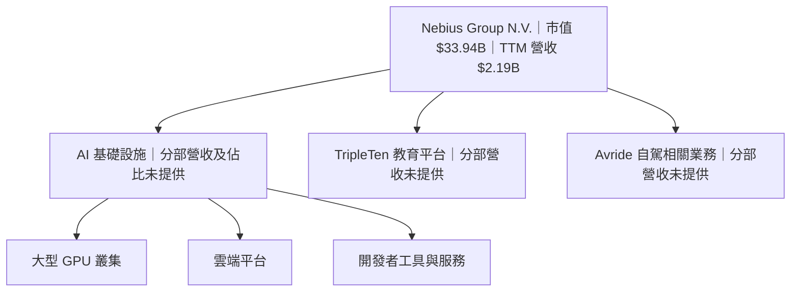
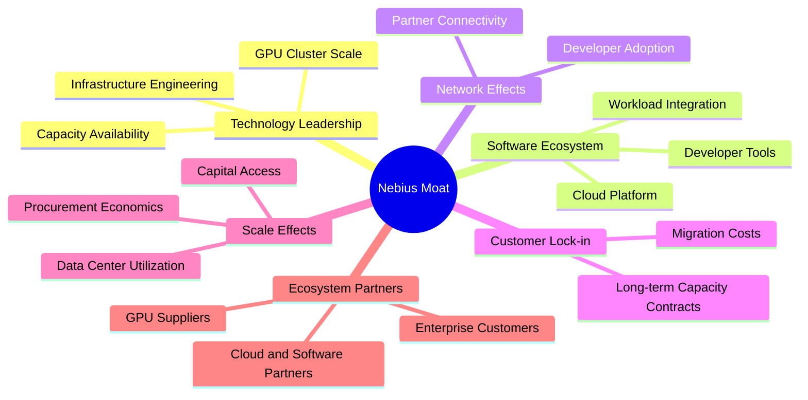
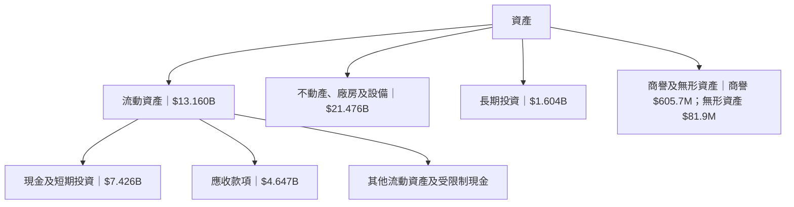
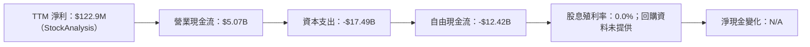
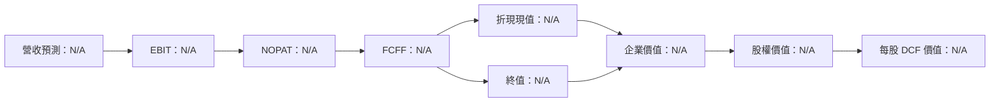
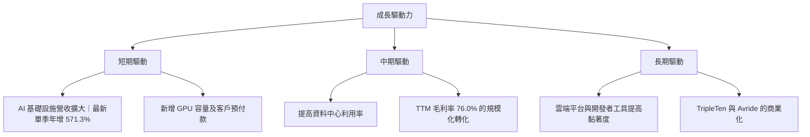
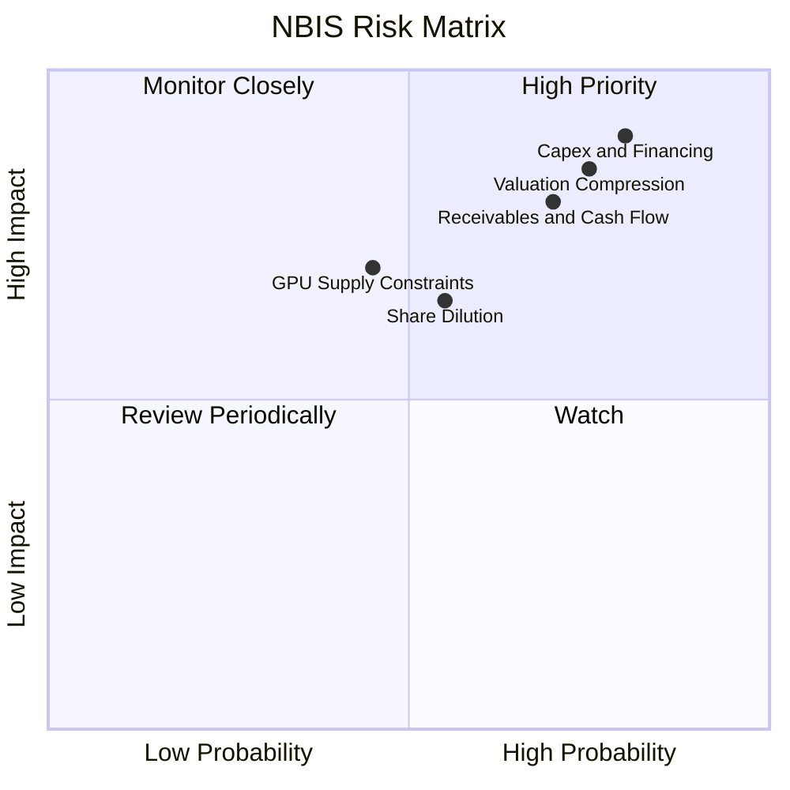
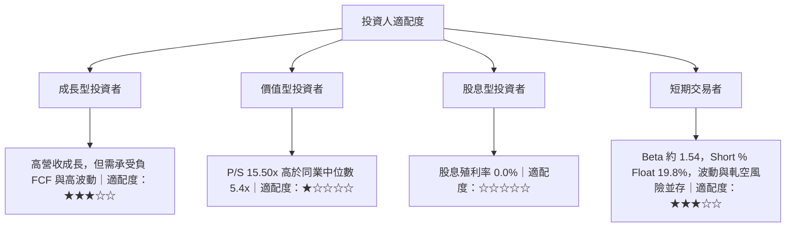

# NBIS 基本面深度分析報告
> **報告日期**：2026-11-16 ｜ **語言**：繁體中文 ｜ **數據來源**：Yahoo Finance、Finviz、StockAnalysis、Roic.ai ｜ **分析師**：CFA 級機構研究

## 目錄

| # | 章節 | 核心結論 |
|---|------|----------|
| 1 | 執行摘要 | 賣出；加權合理價值 $60.09；列示 MOS -92.8% |
| 2 | 公司概覽與商業模式 | AI 基礎設施是核心成長引擎；市場份額與分部營收未提供，護城河仍在建立 |
| 3 | 損益表深度分析 | TTM 營收 $2.19B；最新單季年增 571.3%；TTM 營業利益率 -23.0% |
| 4 | 資產負債表分析 | 淨負債 $8.67B；流動比率 5.306，但應收帳款天數 673 天值得關注 |
| 5 | 現金流量深度分析 | TTM FCF -$12.42B，資本支出大幅高於營業現金流 |
| 6 | 獲利能力與資本效率 | ROIC N/A，無法證明已創造股東價值；WACC 8.19% |
| 7 | 相對估值分析 | NBIS P/S 15.50x，高於同業中位數 5.4x |
| 8 | DCF 內在價值評估 | DCF N/A：TTM 營業利益為負，不能建立可用的現金流折現基準 |
| 9 | 成長催化劑 | AI 雲端需求與新容量上線可推動成長；TAM 數據未提供 |
| 10 | 風險矩陣 | 資本支出與融資、估值回落、應收帳款／現金流為前三大風險 |
| 11 | 投資建議 | 依 MOS 評級為賣出；僅在估值與現金流條件改善後重新評估 |

---

## 1. 執行摘要

NBIS 的成長速度突出：TTM 營收為 **$2.19B**，最新一季營收年增 **571.3%**；但公司 TTM 營業利益率為 **-23.0%**，TTM FCF 為 **-$12.42B**，且淨負債為 **$8.67B**。以同業 P/S 中位數 5.4x 對照 NBIS 自身 P/S 15.499831x，市場估值已包含相當程度的未來成長預期。估值方法給出的加權合理價值為 **$60.09**，低於 **2026-11-13 收盤價 $115.88**；按估值資料列示的 MOS **-92.8%**，評級為 **賣出**。另因 TTM 營業利益為負，DCF 模型不適用，故不存在可引用的 DCF 基準價或 DCF 情境目標價。

### 1.0 一頁式投資儀表板（Portfolio Manager 30 秒速讀）

| 項目 | 內容 |
|------|------|
| **投資論點（3 句）** | ① TTM 營收 $2.19B，最新單季年增 571.3%，顯示 AI 基礎設施需求轉化為快速擴張的營收。② TTM 營業利益率 -23.0%、FCF -$12.42B，成長仍伴隨高額投入與現金消耗。③ 加權合理價值 $60.09，低於 2026-11-13 收盤價 $115.88，估值回落風險偏高。 |
| **綜合評分** | **4.0/10**（引用 1.1 評分卡） |
| **財務健康** | 🔴 現金及短期投資 $7.43B，總債務 $16.10B，淨負債 $8.67B；流動比率 5.306 提供短期流動性緩衝，但不消除融資與再投資風險。 |
| **ROIC vs WACC** | ROIC：N/A；WACC：8.19%。現有資料無法證明公司 ROIC 高於資本成本，價值創造尚未獲驗證。 |
| **FCF 趨勢** | TTM FCF **-$12.42B**；FCF Yield **-36.60%**。投資擴張速度高於營業現金流生成能力。 |
| **估值** | Forward P/E **-35.731792x** ｜ EV/EBITDA **69.636x** ｜ FCF Yield **-36.60%** |
| **DCF 內在價值（基準）** | **N/A**；TTM 營業利益為負，不提供 DCF 基準價或 DCF 折溢價。 |
| **安全邊際（MOS）** | **-92.8%**（列示估值資料）：加權合理價值 $60.09、現價 $115.88，基準為 8.8 節加權合理價值。該列示數值與按同節數字直接重算的 MOS 有差異，詳見 8.8 節。 |
| **預期報酬（基準情境 12M）** | N/A；DCF 模型與 DCF 基準情境價值未提供。加權合理價值相對現價的上行空間為 **-48.1%**（估值資料列示）。 |
| **關鍵風險（前二）** | 大額 Capex 與負 FCF；高 P/S 估值遇到成長放緩時可能快速收縮。 |
| **評級 + 信心度** | 🔴 **賣出** ｜ 信心：中。估值訊號明確偏負面，但營運快速變化、來源數據存在差異，降低基本面判斷信心。 |

### 1.1 綜合評分卡（全報告唯一）

| 維度 | 評分（1–10） | 主要依據（引用數字與其來源章節） |
|------|--------------|----------------------------------|
| 成長性 | 8.5 | TTM 營收 $2.19B，最新一季年增 571.3%；年度營收 FY2024 $91.5M、FY2025 $529.8M，成長快速，但 TTM 成長率未提供（第 3 章）。 |
| 獲利能力 | 3.0 | TTM 營業利益率 -23.0%、最新一季營業利益率 -18.7%；ROIC 與 Piotroski F-Score 均 N/A（第 3、6 章）。 |
| 財務健康 | 4.0 | 淨負債 $8.67B，流動比率 5.306；DSO 673 天，應收帳款週轉品質需關注（第 4 章）。 |
| 估值 | 2.0 | P/S 15.499831x，相對同業中位數 5.4x 偏高；加權合理價值 $60.09、現價 $115.88（第 7、8 章）。 |
| 護城河 | 5.0 | 全棧 GPU 叢集、雲端平台與開發者工具構成產品基礎，但未提供市場份額、客戶集中度或續約率數據（第 2 章）。 |
| 管理層與資本配置 | 1.5 | TTM Capex $17.49B、TTM FCF -$12.42B；近四季 SBC 合計 $221.4M，反映擴張投入與股東稀釋成本皆需監控（第 3、5 章）。 |
| **綜合評分** | **4.0** | 六項算術平均： (8.5 + 3.0 + 4.0 + 2.0 + 5.0 + 1.5) ÷ 6 = **4.0**。 |

### 1.2 五大投資論點 + 三大核心風險

| 類型 | 項目 | 具體依據 | 信心度 |
|------|------|----------|--------|
| 🟢 **投資論點①** | AI 基礎設施需求快速轉化為營收 | 最新季度營收 $980.8M，年增 571.3%；相較 2025 年第 3 季 $146.1M，增幅主要來自 AI 雲端與 GPU 容量擴張。 | 🟢 高 |
| 🟢 **投資論點②** | 近期季度規模明顯放大 | 營收由 2026Q1 $399.0M 增至 2026Q3 $980.8M；QoQ 仍分別增長 45.9% 與 68.4%，但能否持續需觀察新增容量利用率。 | 🟢 中高 |
| 🟢 **投資論點③** | 毛利率有一定規模經濟跡象 | TTM 毛利率 76.0%；最新季度毛利 $761.1M／營收 $980.8M，代表雲端服務營收具較高毛利基礎，但毛利尚未轉化為穩定營業獲利。 | 🟡 中 |
| 🟢 **投資論點④** | 管理層提及客戶預付款覆蓋新增容量 | 新聞摘要稱客戶預付款覆蓋「超過 100%」新容量，若經財報披露證實，可降低建置期融資壓力；該項為新聞描述，尚非本報告可獨立驗證的財務數據。 | 🟡 中低 |
| 🟢 **投資論點⑤** | 短期流動性比率偏高 | 流動比率 5.306、速動比率 4.847；但流動資產品質、應收帳款回收與受限制現金需同時考慮。 | 🟡 中 |
| 🟡 **風險①** | 資本投入超過現金流承受能力 | TTM Capex $17.49B、營業現金流 $5.07B，形成 TTM FCF -$12.42B；若資金需求延續，可能增加舉債、股權融資或專案延期風險。 | 🔴 高 |
| 🔴 **風險②** | 估值高於可比公司，且盈利基礎未穩定 | NBIS P/S 15.499831x，Peer median 5.4x；TTM 營業利益率 -23.0%，若成長或利潤率低於市場預期，估值倍數可能收縮。 | 🔴 高 |
| 🔴 **風險③** | 應收帳款與數據一致性問題 | DSO 673 天；季度損益表不同來源對部分營業利益與 EPS 數據存在差異。若應收款回收延遲或財務資料未能一致核對，營收品質與估值可信度下降。 | 🔴 高 |

### 1.3 快速統計卡片

| 指標 | 公司實際值（期間） | 同業中位數 | 狀態 |
|------|--------------------|------------|------|
| 營收成長（TTM） | **N/A** | — | 🟡 TTM 對比前期數據未提供 |
| 營收成長（最新一季年增） | **571.3%** | **29.6%**（CRWV、ORCL、MSFT 中位數） | 🟢 |
| 毛利率（TTM） | **76.0%** | **66.8%** | 🟢 |
| 營業利益率（TTM） | **-23.0%** | — | 🔴 |
| ROIC（TTM） | **N/A** | — | 🟡 |
| Forward P/E | **-35.731792x** | **11.3x**（可計算正值中位數；CRWV 為 -30.0x） | 🔴 不具可比性，NBIS 預期虧損 |
| FCF Yield（TTM） | **-36.60%** | — | 🔴 |
| Piotroski F-Score | **N/A** | — | 🟡 缺少相隔一年的 SEC 申報資料 |

### 1.4 投資結論

> 應以估值資料列示的 MOS 作為評級依據：**MOS -92.8% 對應賣出**。現價為 2026-11-13 收盤 **$115.88**，加權合理價值為 **$60.09**；DCF 基準內在價值因 TTM 營業利益為負而 N/A。加權合理價值相對現價的上行空間列示為 **-48.1%**，不提供虛構的 DCF 悲觀、基準或樂觀情境價值。綜合評分 **4.0/10**，來自 1.1 評分卡。

```text
╔══════════════════════════════════════════════════════════════════╗
║                    📊 投資結論摘要                               ║
╠══════════════════════════════════════════════════════════════════╣
║  評級：賣出（依加權合理價值與列示 MOS）                           ║
║  價格（2026-11-13 收盤）：$115.88                                 ║
║  DCF 內在價值（基準）：N/A（TTM 營業利益為負）                    ║
║  安全邊際 MOS：-92.8%（估值資料列示；詳見 8.8 數學核對）          ║
║  加權合理價值（8.8）：$60.09                                     ║
║  DCF 情境價值：N/A（DCF 模型不適用）                              ║
║  綜合評分：4.0/10（引用 1.1）                                     ║
║  適合投資人：能承受高波動、理解資本密集型 AI 基礎設施風險的投資人 ║
╚══════════════════════════════════════════════════════════════════╝
```

---

## 2. 公司概覽與商業模式

### 2.1 業務結構與收入來源

公司描述指出 Nebius 建置 AI 全棧基礎設施，包括大型 GPU 叢集、雲端平台、開發者工具與服務；另有 TripleTen 教育平台及 Avride 自駕相關業務。但資料未提供分部營收，因此不拆分各事業營收或佔比。可核對的公司 TTM 營收為 **$2.19B**。



AI 基礎設施的商業模式核心，是以大規模 GPU 及資料中心能力承接 AI 訓練與推論需求，再透過雲端平台、軟體與服務提高客戶使用黏著度。資料尚未提供各類客戶、合約期限、客戶集中度、GPU 利用率或雲端服務的經常性收入占比，故無法判斷營收的續約品質與單位經濟性。

### 2.2 市場份額

市場份額數據未提供，亦沒有可引用的產業總量與年份，因此不繪製市場份額圖。以已知營收比較，NBIS TTM 營收為 $2.19B，最新單季年增 571.3%，高於資料列示的 CRWV 168.2%、ORCL 29.6% 與 MSFT 18.8%；但快速成長不等於已取得可量化的市場領導地位。

### 2.3 競爭護城河分析



此圖表示需要驗證的護城河來源，不代表相關優勢已被量化證實。現有資料沒有客戶留存率、平台開發者數、GPU 利用率或供應商協議等數據。

### 2.4 護城河強度

| 護城河項目 | 強度（強／中／弱） | 證據（引用數字或事實） | 會削弱它的情況 |
|------------|--------------------|------------------------|----------------|
| 技術與基礎設施 | 中 | 公司提供大型 GPU 叢集與全棧 AI 基礎設施；營收已達 TTM $2.19B。 | GPU 供應限制、硬體迭代過快、資料中心利用率不足或競爭者快速複製。 |
| 軟體生態系統 | 弱至中 | 有雲端平台及開發者工具，但未提供使用者數、工作負載留存或軟體收入占比。 | 客戶只按價格選擇算力、軟體功能難以形成轉換成本。 |
| 網路效應 | 弱 | 未提供開發者數、供需匹配或平台交易規模資料。 | 生態系規模未達臨界點，客戶與供應商可跨平台切換。 |
| 客戶鎖定 | 未證實 | 新聞提及客戶預付款覆蓋新增容量超過 100%，但缺少合約金額、期限與集中度核對。 | 客戶取消合約、延遲部署、應收帳款回收拉長。 |
| 規模效應 | 中 | TTM 營收 $2.19B，Capex $17.49B，顯示規模擴建同時伴隨高資本需求。 | 規模擴張無法提高利用率，固定成本反而壓低回報。 |
| 生態夥伴 | 弱至中 | 業務依賴 GPU、資料中心及相關基礎設施供應鏈；具體合作與供應條款未提供。 | 供應商限制、價格上漲、設備交付延誤或融資條件惡化。 |

**1.1 護城河分數為 5.0/10**：公司已具備 AI 全棧產品與快速增長營收，但缺少市場份額、留存率、平台規模及客戶合約品質等可驗證證據。

---

## 3. 損益表深度分析

### 3.1 年度收入成長趨勢（近 4 年）

年報收入顯示 NBIS 正處於業務快速擴張階段；但過去四年基數很低，CAGR 對起始年份高度敏感。此處用 FY2022 至 FY2025 計算三年 CAGR，不把異常的 FY2021 數字混入比較。

```text
╔══════════════════════════════════════════════════════════════════╗
║              NBIS 年度收入趨勢（FY2022-FY2025）                 ║
╠══════════════════════════════════════════════════════════════════╣
║  FY2022  $13.50M   ░░░░░░░░░░░░░░░░░░░░░░░░  YoY：基期         ║
║  FY2023   $9.80M   ░░░░░░░░░░░░░░░░░░░░░░░░  YoY：-27.4% 🔴    ║
║  FY2024  $91.50M   ████░░░░░░░░░░░░░░░░░░░░  YoY：+833.7% 🟢  ║
║  FY2025 $529.80M   ████████████████████████  YoY：+479.0% 🟢  ║
╠══════════════════════════════════════════════════════════════════╣
║  FY2022-FY2025 三年收入 CAGR：+239.7%                            ║
╚══════════════════════════════════════════════════════════════════╝
```

CAGR 算式：\((529.8 ÷ 13.5)^{1/3} - 1 = 239.7\%\)。該結果反映低基期與業務轉型後的快速增長，不宜直接外推為長期穩態成長率。年度營收 FY2025 $529.8M 與 TTM $2.19B 亦顯示 2026 年營收規模明顯放大。

### 3.2 季度收入趨勢分析

| 季度 | 營收 | QoQ 成長 | YoY 成長 | 備註 |
|------|------:|---------:|---------:|------|
| 2025Q4 | $227.7M | N/A（未提供前一季財報欄位於同表） | 546.88% | StockAnalysis 季度系列。 |
| 2026Q1 | $399.0M | +75.2% | 683.89% | 相較 2025Q4，AI 基礎設施收入繼續擴大。 |
| 2026Q2 | $582.3M | +45.9% | 454.04% | QoQ 仍大幅增長，年增率較 Q1 回落。 |
| 2026Q3 | $980.8M | +68.4% | **571.3%** | 最新一季單季年增率；不是 TTM 成長率。 |

QoQ 算式示例：2026Q3 成長率 = \((980.8 ÷ 582.3) - 1 = 68.4\%\)。最新一季的成長來自營收規模擴大，但資料未提供分部拆分與產能利用率，無法分離新增容量、定價與併購／業務組合的貢獻。

### 3.3 利潤率演變分析

年度資料部分年度毛利為負，與後續 AI 基礎設施業務快速擴張後的 TTM 毛利結構差異很大，應避免把歷史年度比例當成當前營運常態。

| 利潤率指標 | FY2022 | FY2023 | FY2024 | FY2025 | 最新 TTM／季度 | 趨勢與評估 |
|------------|------:|------:|------:|------:|----------------:|------------|
| 毛利率 | -110.4% | -100.0% | 52.2% | 68.6% | TTM **76.0%** | 🟢 毛利結構大幅改善；可能反映業務組合和規模變化，但產品別數據未提供。 |
| 營業利益率 | -1,170.4% | -2,915.3% | -436.7% | -115.5% | TTM **-23.0%**；最新季度 **-18.7%** | 🔴 虧損率相較歷史極端年度有所收斂，但 TTM 仍顯著虧損。 |
| 淨利率 | 55.2% | 2,462.2% | -700.9% | 15.6% | TTM **5.7%** | 🟡 年度淨利受非營業與可能一次性項目影響，淨利率不宜單獨當作核心獲利能力。 |

**資料一致性提醒：**Yahoo 季度損益表列 2026Q3 營業利益 $50.4M、營收 $980.8M，直接相除約為正 5.1%；但 VERIFIED FIGURES 列示最新季度營業利益率 **-18.7%**。本報告依規定引用列示的季度利潤率，並將兩者差異視為財務數據需進一步核對的事項，而不自行替換。

利潤率改善可能反映毛利結構提升及業務規模擴大，但 TTM 營業利益仍為負，顯示營運費用、研發、銷售管理成本及建置期成本尚未被毛利覆蓋。若資料所列毛利率改善可以延續，且新增容量利用率提高，才有機會產生營業槓桿；目前欠缺分部成本與產能利用率，不能把毛利提升直接等同於未來淨利改善。

### 3.4 費用結構分析

可確認 FY2025 研發費用為 **$177.3M**，Capex 為 **$4.07B**；但完整營業費用分項、銷售與管理費及 TTM 費用明細未提供，因此不以不完整資料繪製費用圓餅圖。

```text
╔══════════════════════════════════════════════════════════════════╗
║                 NBIS 費用與再投資可核對資料                     ║
╠══════════════════════════════════════════════════════════════════╣
║  FY2025 研發費用       $177.3M   可辨識費用項目                 ║
║  FY2025 資本支出         $4.07B   資產投資，不等同損益費用       ║
║  TTM 資本支出           $17.49B   高額擴建投入                   ║
║  TTM 營業利益率         -23.0%   毛利尚未覆蓋營業費用           ║
╚══════════════════════════════════════════════════════════════════╝
```

Capex 主要形成資產，不能與當期費用混為一談；然而資本支出仍是真實現金支出，會直接壓低 FCF，並帶來折舊、融資及未來利用率風險。

### 3.5 季度 EPS 趨勢與盈餘品質（Quality of Earnings）

EPS estimates 與實際值在 earnings history 欄位均為 nan，故**過去四季超預期／不及預期均無法判定**。StockAnalysis 另列四季實際 EPS 為 2025Q4 -$1.06、2026Q1 $2.40、2026Q2 -$0.68、2026Q3 -$0.13；這些數字與其他來源的淨利波動相符，但不能代替缺失的市場預期值。

| 盈餘品質項目 | 數值／佔比 | 評估 |
|--------------|-----------|------|
| 股權薪酬 SBC / 營收 | 近四季 SBC $221.4M ÷ TTM 營收 $2.19B = **10.1%** | 🔴 SBC 相對營收偏高，代表股東稀釋成本重要；需追蹤股數是否持續增加。 |
| SBC / 營業現金流 | $221.4M ÷ $5.07B = **4.4%** | 🟡 SBC 低於列示營業現金流，但 OCF 可能受營運資金與其他現金流項目影響，不能單獨代表現金獲利品質。 |
| FCF / 淨利（現金轉換率） | TTM FCF -$12.42B；StockAnalysis TTM 淨利 $122.9M；比率約 **-10,106%** | 🔴 FCF 與會計淨利方向相反，主因資本支出極高；此比例受小額正淨利分母放大。 |
| 一次性／非經常性損益 | 年度淨利波動大：FY2023 $241.3M、FY2024 -$641.4M、FY2025 $82.5M | 🔴 缺少非營業損益明細，無法精確拆解；歷史波動提示 GAAP 淨利不宜直接年化。 |
| 有效稅率異常 | WACC 輸入使用最新年度有效稅率 **29.0%** | 🟡 缺少稅項調節表；季度淨利波動不能據此歸因於稅務利益。 |
| 資本化支出 vs 費用化 | TTM Capex **$17.49B**，FY2025 **$4.07B** | 🔴 高度資本密集，支出多進入資產而非即期費用；未來須承擔折舊與融資成本。 |

**盈餘品質結論：**TTM 淨利為正與營業利益率為負、FCF 大幅為負並存，表示會計淨利尚未轉化成可分配的經濟現金。SBC 約為 TTM 營收 10.1%，股東需把潛在稀釋納入估值；目前估值更應重視收入品質、產能利用率、資本回報與現金流，而非單看 EPS 或會計淨利。

---

## 4. 資產負債表分析

### 4.1 資產結構分解

最新 TTM 資產負債表摘錄列有流動資產、PP&E、長期投資及其他資產項目，但未提供可與同一時點完整核對的總資產與全部科目金額。因此以下圖示呈現分類關係，不對未提供項目標示比例。



以上為 StockAnalysis 摘錄的 TTM 資產細項；現金及短期投資採 VERIFIED FIGURES **$7.43B**。不同來源的科目分類與數字可能存在四捨五入或範圍差異，不能把上述部分科目直接加總成未提供的總資產。

### 4.2 流動性與營運資金分析

| 流動性指標 | 最新值 | 歷史／變化 | 評估 |
|------------|------:|-------------|------|
| 現金及短期投資 | $7.43B | FY2025 $3.753B | 🟢 現金儲備增加，但與 $16.10B 總債務相比仍為淨負債。 |
| 總債務 | $16.10B | FY2025 年報 $4.97B，期間與資料口徑不同 | 🔴 債務規模增加；最新數字與年度數據差距需核對債務形成時間及負債分類。 |
| 淨現金／淨負債 | **-$8.67B** | 依 VERIFIED FIGURES | 🔴 淨負債。 |
| 流動比率 | **5.306** | 最新數據 | 🟢 數值高，但流動資產含大量應收及受限制現金項目，需看回收性。 |
| 速動比率 | **4.847** | 最新數據 | 🟢 短期償付能力看似充足；仍受應收帳款品質影響。 |
| DSO 應收帳款天數 | **673 天** | 一年前 N/A；變化 N/A | 🔴 應收帳款相對營收偏高，可能反映大額長約、結算週期或應收款集中；原因需財報附註核實。 |
| DIO 存貨天數 | **N/A** | 一年前 N/A；變化 N/A | 不提供庫存餘額，依規則不補值。 |
| DPO 應付帳款天數 | **368 天** | 一年前 N/A；變化 N/A | 應付週期長，但缺少一年前比較及付款條件，不能直接視為供應商議價力。 |
| CCC 現金轉換週期 | **N/A** | 一年前 N/A；變化 N/A | DIO 未提供，因此 CCC 不計算。 |

DSO 高達 673 天是需要優先追蹤的訊號：若主要來自客戶預付款或合約結算安排，應在合約負債、應收帳款帳齡與收款政策中得到印證；若主要是回款延遲，則可能使報表營收未及時轉為現金。現有資料不足以辨別兩者。

### 4.3 債務結構分析

```text
╔══════════════════════════════════════════════════════════════════╗
║                   NBIS 債務健康診斷                              ║
╠══════════════════════════════════════════════════════════════════╣
║  總債務：          $16.10B   高，需對照新增產能現金流回收       ║
║  現金及短期投資：   $7.43B   可提供流動性緩衝                   ║
║  淨負債：           $8.67B   🔴 淨負債                           ║
║  流動比率：          5.306x  🟢 帳面短期流動性偏高               ║
║  速動比率：          4.847x  🟢 仍須檢視應收款回收品質           ║
║  Debt/EBITDA：      N/A      EBITDA 口徑與債務期間不可直接核對   ║
║  利息保障倍數：     N/A      利息費用與同口徑營業利益未提供       ║
╚══════════════════════════════════════════════════════════════════╝
```

年度債務由 FY2024 $49.5M、FY2025 $4.97B，至最新資料列示 $16.10B，顯示債務規模可能因大型擴建融資而快速上升，但年度與 TTM 數據時間點及分類不同，需以公司最新申報文件核對。

### 4.4 股東權益趨勢

| 年度 | 股東權益 | YoY 變化 | 解讀 |
|------|--------:|---------:|------|
| 2022 | $4.25B | — | 年度資產負債表數據。 |
| 2023 | $3.29B | -22.6% | 股東權益下降。 |
| 2024 | $3.25B | -1.2% | 大致持平。 |
| 2025 | $4.59B | +41.2% | 權益增加，可能受融資、股本變動及損益影響，需看權益變動表。 |

```text
╔══════════════════════════════════════════════════════════════════╗
║                   NBIS 股東權益趨勢                              ║
╠══════════════════════════════════════════════════════════════════╣
║  2022  $4.25B  ██████████████████████                           ║
║  2023  $3.29B  █████████████████                                ║
║  2024  $3.25B  █████████████████                                ║
║  2025  $4.59B  ████████████████████████                         ║
╚══════════════════════════════════════════════════════════════════╝
```

股東權益的年度變動不能單獨判定公司是否靠股權融資支撐擴張；需進一步查看發行股數、其他綜合損益、併購及資產重估。市場資料列示流通股數 259.60M，而 Roic.ai 季度資料列 2026Q3 約 293M，兩者存在差異，稀釋趨勢應以正式申報資料核實。

---

## 5. 現金流量深度分析

### 5.1 現金流量瀑布圖

TTM 現金流數字依定義為 OCF 減 Capex，股息殖利率為 0.0%；回購及淨現金變化未提供。



淨利至營業現金流的差異可能來自非現金項目、營運資金變動或其他現金流來源；應收帳款天數 673 天與此現金轉換過程需一併檢視。Capex 高於 OCF，是 FCF 為負的主要算術原因。

### 5.2 FCF 轉換率趨勢

| 年度 | 營業現金流 | 資本支出 | FCF | 淨利 | FCF／淨利 |
|------|-----------:|---------:|----:|-----:|----------:|
| FY2022 | $697.0M | $14.6M | $682.4M | $745.6M | 91.5% |
| FY2023 | $829.8M | $82.9M | $746.9M | $241.3M | 309.5% |
| FY2024 | $245.6M | $807.5M | -$561.9M | -$641.4M | 87.6% |
| FY2025 | $384.8M | $4.07B | -$3.68B | $82.5M | -4,460.6% |
| 最新 TTM | $5.07B | $17.49B | **-$12.42B** | $122.9M | 約 -10,106% |

FY2025 與 TTM 的轉換率分母為正且相對較小，導致負數比例特別大；解讀重點應是 FCF 已因 Capex 迅速轉負，而非單看比率大小。FY2025 FCF 以表列值計算為 -$3.68B，年度與 TTM 期間不可混用。

### 5.3 自由現金流趨勢

```text
╔══════════════════════════════════════════════════════════════════╗
║                NBIS 自由現金流歷史實際                           ║
╠══════════════════════════════════════════════════════════════════╣
║  FY2022   +$0.68B  ████████████████░░░░░░░░  正 FCF             ║
║  FY2023   +$0.75B  ██████████████████░░░░░░  正 FCF             ║
║  FY2024   -$0.56B  ░░░░░░░░░░░░░░░░░░░░░░░░  負 FCF             ║
║  FY2025   -$3.68B  ░░░░░░░░░░░░░░░░░░░░░░░░  負 FCF             ║
║  TTM      -$12.42B ░░░░░░░░░░░░░░░░░░░░░░░░  FCF Yield -36.60%  ║
╚══════════════════════════════════════════════════════════════════╝
```

FY2022–FY2023 正 FCF 與 FY2024–TTM 負 FCF 的轉折，與 Capex 由 FY2023 $82.9M 增至 FY2025 $4.07B、TTM $17.49B 同步。公司在擴建期需要證明新增設備能產生足夠的營收、毛利與現金回收，否則負 FCF 可能成為持續融資需求，而非短暫投資週期。

### 5.4 資本配置評估

| 資本配置項目 | 可核對數據 | 評估 |
|--------------|-----------|------|
| 資本支出 | TTM $17.49B；FY2025 $4.07B | 🔴 主要資金用途，擴產回報與利用率是核心監控項。 |
| 股息 | 殖利率 0.0%；payout ratio 0.0% | 🟡 未見股息回報，資金留在公司用於投資。 |
| 股權薪酬 | 2025 年 $83.2M；近四季合計 $221.4M | 🔴 需追蹤其對每股經濟價值的稀釋。 |
| 回購 | N/A | 缺少回購金額資料。 |
| 併購、債務償還及現金保留 | N/A | 未提供足夠的現金流明細。 |

未提供可完整拆分的資本配置流量，因此不繪製資金用途圓餅圖。現有證據顯示資本支出是最重要的資金需求，且 TTM FCF -$12.42B；資本配置品質取決於新增資產能否產生高於資本成本的長期現金流。

---

## 6. 獲利能力與資本效率

### 6.1 ROE / ROA / ROIC 趨勢

| 指標 | 最新可用數值 | 歷史趨勢／來源 | 評估 |
|------|--------------:|----------------|------|
| ROE | 1.5% | TTM 市場資料；年度淨利波動大 | 🟡 低回報，且股權基數與非經常項目可能影響可比性。 |
| ROA | -1.0% | TTM 市場資料 | 🔴 資產尚未展現穩定正向回報。 |
| ROIC | N/A | 缺少可一致計算投入資本與 NOPAT 的可靠資料 | 🟡 無法判斷投入資本回報是否超過 WACC。 |
| WACC | **8.19%** | 資本成本輸入所列 | 作為資本效率門檻；目前沒有可驗證 ROIC 與其比較。 |

行業均值數據未提供，不列無來源比較。ROE 1.5% 與 ROA -1.0% 方向不同，反映損益、資產及權益的口徑或期間可能不一致，不宜據此直接推導長期報酬。

### 6.2 ROIC vs WACC 分析（核心價值創造判斷）

```text
╔══════════════════════════════════════════════════════════════════╗
║                ROIC vs WACC 深度分析                            ║
╠══════════════════════════════════════════════════════════════════╣
║  WACC 輸入（依資本成本資料）：                                   ║
║  ├── 無風險利率（10Y 美債）：      5.15%                         ║
║  ├── 市場風險溢酬 ERP：            5.00%                         ║
║  ├── 原始 Beta：                   1.54                          ║
║  ├── 調整後 Beta：                 1.36                          ║
║  ├── 股權成本 Ke：                 11.95%                        ║
║  ├── 稅前債務成本 Kd：             0.38%                         ║
║  ├── 有效稅率：                    29.0%                         ║
║  ├── 股權／債務權重：              67.8%／32.2%                  ║
║  └── WACC：                        8.19%                         ║
║                                                                  ║
║  ROIC：                         N/A                              ║
║  ROIC − WACC：                  無法計算                         ║
║  價值創造判斷：                 尚未證明創造股東價值             ║
╚══════════════════════════════════════════════════════════════════╝
```

調整後 Beta 計算為 \( \frac{2}{3} \times 1.54 + \frac{1}{3} \times 1 = 1.36 \)。股權成本算式為 \(5.15\% + 1.36 \times 5.00\% = 11.95\%\)。以稅前債務成本 0.38% 和稅率 29.0% 得到稅後債務成本約 0.27%；再按股權 67.8%、債務 32.2% 加權，WACC 為 **8.19%**。

此 WACC 是本報告第 6.2 節及成本資本輸入所列數值。稅前債務成本 0.38% 相對於總債務 $16.10B 顯得很低，可能受利息費用口徑、低息或非計息負債分類影響；由於缺少利息費用明細與平均計息負債，本文不自行重算或替換。ROIC 為 N/A，因此不能宣稱 NBIS 已創造或摧毀特定幅度的 EVA。

### 6.3 杜邦三因素分解

**N/A**：品質指標資料指出缺少淨利、營收、總資產或正股東權益等一致口徑輸入，無法列出淨利率、資產週轉率、權益乘數及其乘積；不自行補算杜邦三因素。

### 6.4 財務體質：Piotroski F-Score

**N/A**：Piotroski F-Score 需要相隔一年的兩組 TTM SEC 申報資料；目前來源為 Yahoo 季度報表，無法判定九項測試與總分。不得用不完整資料推估分數。

---

## 7. 相對估值分析

### 7.1 同業估值比較表格

以下同業倍數取自 Yahoo Finance Peer multiples。CRWV 為較直接的 AI 雲端基礎設施比較對象；ORCL、MSFT 業務規模、產品組合及盈利成熟度差異較大，應視為大型雲端／技術參照，不宜視為完全同質公司。

| 估值指標 | **NBIS** | **CRWV** | **ORCL** | **MSFT** | NBIS 評估 |
|----------|---------:|---------:|---------:|---------:|-----------|
| **Trailing P/E** | 90.53125x | N/A | 19.6x | 27.3x | 🔴 NBIS 仍有高估值且 P/E 對一次性損益敏感。 |
| **Forward P/E** | -35.731792x | -30.0x | 11.3x | 21.7x | 🔴 NBIS 與 CRWV 為負值，非標準盈利倍數，不宜直接用作價值比較。 |
| **P/S Ratio** | **15.499831x** | 3.0x | 5.4x | 11.2x | 🔴 高於同業中位數 **5.4x**；差距代表市場為 NBIS 成長支付較高溢價。 |
| **EV/EBITDA** | 69.636x | 17.6x | 15.0x | 19.3x | 🔴 明顯高於三者倍數區間，且 EBITDA 口徑仍需留意資本支出負擔。 |
| **最新一季營收年增** | **571.3%** | 168.2% | 29.6% | 18.8% | 🟢 增長明顯較快，但高增長尚未轉化為正 TTM 營業利益及 FCF。 |
| **TTM 毛利率** | 76.0% | 66.8% | 64.0% | 67.7% | 🟢 高於同業列示值，但毛利率並不代表資本回報或 FCF 品質。 |

同業 P/S 中位數為 **5.4x**；依估值方法輸入，該倍數乘上 NBIS TTM 營收後得到每股相對估值 $40.71。NBIS 自身 P/S 15.499831x 約為同業中位數的 2.9 倍，顯示市場已對增長溢價定價。

### 7.2 歷史估值區間分析

N/A（未提供「Valuation vs own history」估值區間或百分位數據）。24 個月股價歷史顯示股價由 2024-11 的 $21.99 升至 2026-06 的 $276.17，之後回落至 2026-11 的 $115.88；這是價格走勢，不等同歷史 P/S 或 P/E 估值區間。

### 7.3 情境價值（Bear / Base / Bull，照抄 DCF MODEL 的 Scenarios）

**N/A（DCF 無法計算：TTM 營業利益為負，程式未提供 DCF MODEL 情境價值）。**不自行建立悲觀、基準或樂觀目標價。

### 7.4 相對估值隱含價格區間

```text
╔══════════════════════════════════════════════════════════════════╗
║                 相對估值與現價位置                               ║
╠══════════════════════════════════════════════════════════════════╣
║  同業 P/S 方法：$40.71  ────── 加權合理價值：$60.09              ║
║  現價（2026-11-13）：$115.88                                      ║
║  分析師共識平均目標：$234.50                                      ║
╚══════════════════════════════════════════════════════════════════╝
```

| 方法 | 每股價值 | 依據 | 相對現價 |
|------|---------:|------|---------:|
| 同業 P/S | $40.71 | CRWV、ORCL、MSFT 的 P/S 中位數 5.4x × NBIS TTM 營收；程式提供的每股價值 | -64.9% |
| 分析師共識目標價 | $234.50 | 20 位分析師平均目標價 | +102.4% |

分析師共識與同業 P/S 差距顯著，反映分析師可能假設較高的未來成長或使用不同估值期。平均目標價不是獨立的內在價值模型，且區間為 $84.00 至 $395.00，分散度很大。

---

## 8. DCF 內在價值評估（Discounted Cash Flow）

> **DCF MODEL：N/A。**原因為 TTM 營業利益不為正；以虧損營業利益直接折現，不能形成有效的企業自由現金流估值。依資料規則，本章 8.1–8.7 不自建模型、不推導 DCF 每股價值、敏感度矩陣、情境值或反推值。

### 8.0 估值推理鏈（Thinking Logic）

**Step 1 — 價值來源與主導變數：**NBIS 的長期價值理論上取決於 AI 基礎設施營收轉化、可持續營業利潤率及資本支出回報；目前可核對的 TTM 營收為 $2.19B，但分部營收占比未提供，且營業利益率為 -23.0%，故無法可靠拆解各業務價值或估算其現金流底盤。

**Step 2 — 模型選擇：**

| 決策點 | 本報告採用 | 理由（含數字） | 曾考慮但否決 | 否決理由 |
|--------|-----------|----------------|--------------|----------|
| 現金流定義 | 不建立 DCF | TTM 營業利益率 -23.0%，TTM FCF -$12.42B | FCFF／FCFE | 缺少正向營業基礎及程式計算模型，無法可稽核推導。 |
| 預測期 N | N/A | DCF MODEL 未提供 | 任意 5–10 年 | 自行設定將違反以程式模型為準的資料規則。 |
| 終值方法 | N/A | DCF MODEL 未提供終值假設 | Gordon Growth／退出倍數 | 無逐年現金流與明確輸入，終值不可複算。 |
| EBIT 基礎 | N/A | DCF MODEL 未提供 | GAAP／非 GAAP | 不以假設利潤率自建估值。 |

**Step 3 — 關鍵假設推導鏈：**營收 CAGR、期末營業利潤率、稅率、Capex／營收、D&A／營收、營運資金變動、SBC 處理、股數稀釋、永續成長率與 WACC 的模型假設均未由 DCF MODEL 提供。若自行填入，就會把假設冒充成模型輸入，因此全部保留 N/A。

**Step 4 — 最脆弱一環：**關鍵缺口是公司能否將快速增加的 AI 基礎設施收入轉化為正營業利益與正 FCF；若此轉化不及預期，估值方法應以收入倍數及資產／融資風險為主，而不能依靠沒有依據的終值假設。

**Step 5 — 計算路徑圖：**由於沒有可用 DCF 模型，以下只表示常規 DCF 關係，不填入任何未提供數值。



### 8.1 模型假設總表（Model Inputs）

| 假設項目 | 採用值 | 依據／來源 | 敏感度 |
|----------|--------|-------------|--------|
| 預測期長度 N | N/A | DCF MODEL 未提供 | N/A |
| 營收 CAGR | N/A | DCF MODEL 未提供；TTM 營收成長率亦為 N/A | N/A |
| 營業利潤率（期末） | N/A | TTM 營業利益率 -23.0%，但模型未提供利潤率回升路徑 | N/A |
| 有效稅率 | N/A | 成本資本資料列示最新年度有效稅率 29.0%，但未提供 DCF 模型稅率假設 | N/A |
| Capex／營收 | N/A | TTM Capex $17.49B；模型比率未提供，亦不得自行反推替代模型輸入 | N/A |
| 折舊攤銷 D&A／營收 | N/A | DCF MODEL 未提供 | N/A |
| 營運資金變動／營收增額 | N/A | DCF MODEL 未提供 | N/A |
| EBIT 基礎 | N/A | DCF MODEL 未提供 | N/A |
| SBC 處理 | N/A | DCF MODEL 未提供 | N/A |
| 年稀釋率 | N/A | 市場資料列示股數 259.60M，Roic.ai 2026Q3 約 293M；口徑差異未解 | N/A |
| 永續成長率 g | N/A | DCF MODEL 未提供 | N/A |
| 終值方法 | N/A | DCF MODEL 未提供 | N/A |
| WACC | **8.19%** | 成本資本輸入列示值；見 8.2 | 高，但此處無 DCF 應用 |
| SBC 防重複處理 | N/A | 未建立 DCF，無法指定 A／B／C 組合 | N/A |

FCFF 的一般定義為 \(FCFF = NOPAT + D\&A - Capex - \Delta WC\)，但本報告沒有把這個一般公式套入自行建構的逐年模型。

### 8.2 折現率推導（WACC）

本節引用成本資本資料所列 WACC 與組成；不另建立 DCF。無風險利率的觀察日期未提供，因此不臆測其精確日期。

```text
╔══════════════════════════════════════════════════════════════════╗
║                    WACC 輸入（折現率）                           ║
╠══════════════════════════════════════════════════════════════════╣
║  股權成本 Ke（CAPM）：                                           ║
║  ├── 無風險利率 Rf（10Y 美債）：      5.15%                      ║
║  ├── 市場風險溢酬 ERP：               5.00%                      ║
║  ├── 原始 Beta（Yahoo）：              1.54                       ║
║  ├── 調整後 Beta：                    1.36                       ║
║  ├── Beta 調整：                      ⅔×1.54 + ⅓×1 = 1.36       ║
║  └── Ke = 5.15% + 1.36×5.00% =       11.95%                     ║
║                                                                  ║
║  債務成本：                                                      ║
║  ├── 稅前 Kd：                         0.38%                     ║
║  ├── 有效稅率：                        29.0%                     ║
║  └── 稅後 Kd = 0.38%×(1−29.0%) ≈       0.27%                     ║
║                                                                  ║
║  資本結構權重：                                                  ║
║  ├── 股權權重：                        67.8%                     ║
║  ├── 債務權重：                        32.2%                     ║
║  └── WACC：                            8.19%                     ║
╚══════════════════════════════════════════════════════════════════╝
```

WACC 加權核對：\(67.8\% \times 11.95\% + 32.2\% \times [0.38\% \times (1-29.0\%)] = 8.19\%\)（四捨五入至小數點後兩位）。風險溢酬屬採用的假設輸入；資料未提供 Beta 估計期間、ERP 詳細依據或 10 年期美債觀察日期。稅前 Kd 的利息費用及計息負債平均餘額未提供，故不按提示範本另行重算。

### 8.3 逐年自由現金流預測（基準情境）

**N/A**：DCF MODEL 未提供逐年預測；原因為 TTM 營業利益不為正。若自行填入年度營收、利潤率、Capex、D&A 或營運資金假設，將構成另建 DCF，故不提供預測表、逐年算式或預測期 FCF 現值。

### 8.4 終值計算（Terminal Value）

**N/A**：DCF MODEL 未提供預測期最後一年 FCFF、永續成長率或退出倍數。沒有終值與折現期資料，不能判定 WACC 是否大於 g，也不計算 Gordon Growth 或退出倍數終值。

### 8.5 企業價值 → 每股內在價值（Bridge）

**N/A**：缺少 DCF 預測期 FCF 現值及終值，不能推導 DCF 企業價值或每股內在價值。現金及短期投資 $7.43B、總債務 $16.10B 可作為資產負債表參考，但不構成 DCF 橋接表。

**DCF 折溢價 N/A**；依規則，折溢價基準應為 8.5 節 DCF 基準內在價值，該數值未能計算。此處不計算 MOS；全報告 MOS 僅以 8.8 加權合理價值為基準。

### 8.6 敏感性分析（WACC × 永續成長率）

**N/A**：DCF MODEL 未提供敏感度矩陣。缺少基準 FCFF、g 與逐年折現現金流，無法計算任何矩陣格值或量化 g、WACC、營業利潤率對 DCF 價值的彈性。

**三情境 DCF：N/A**，不提供 DCF 悲觀、基準、樂觀或機率加權價值。

### 8.7 反推 DCF（Reverse DCF：市場在預期什麼）

**N/A**：沒有可供反推的 DCF 方程式與模型輸入，不能從股價 $115.88 同時或逐項反解營收 CAGR、利潤率、g 或預測年數。NBIS 市價高於同業 P/S 方法所示每股價值，但這不是反推 DCF 的替代結果。

### 8.8 估值三角驗證與安全邊際

估值方法僅包括資料列示的同業 P/S 與分析師共識目標價；同業 Forward P/E 因不可計算而不納入，估值資料說明其權重已由其他方法承接。公司類型為未盈利公司，因此方法及權重照列示採用。

| 估值方法 | 隱含每股價值 | 上行空間（÷現價） | 權重 | 說明 |
|----------|--------------:|-------------------:|------:|------|
| 同業 P/S | $40.71 | -64.9% | 90% | 同業 P/S 中位數 5.4x × NBIS TTM 營收；每股估值採程式提供值。 |
| 分析師共識目標價 | $234.50 | +102.4% | 10% | 20 位分析師平均目標價；僅作參考。 |
| **加權合理價值** | **$60.09** | **-48.1%（列示）** | **100%** | 未盈利公司固定方法權重；同業 Forward P/E 不可計算，已排除。 |

逐步演算：

- 同業 P/S 加權值：\($40.71 \times 90\% = $36.639\)
- 分析師共識加權值：\($234.50 \times 10\% = $23.45\)
- 加權合理價值：\($36.639 + $23.45 = $60.089\)，四捨五入至美分為 **$60.09**。

**MOS 定義與數學核對：**

- 估值資料列示 MOS：**-92.8%**；同一資料列示上行空間 **-48.1%**，本報告摘要照列其 MOS。
- 按指定公式直接以加權合理價值計算：  
  \((\$60.09-\$115.88) ÷ \$60.09 = -\$55.79 ÷ \$60.09 = -92.8\%\)（四捨五入至一位小數）。
- 上行空間核對：  
  \((\$60.09-\$115.88) ÷ \$115.88 = -\$55.79 ÷ \$115.88 = -48.1\%\)。

```text
╔══════════════════════════════════════════════════════════════════╗
║                  估值區間與安全邊際                              ║
╠══════════════════════════════════════════════════════════════════╣
║  $40.71 ─────── $60.09 ─────── $115.88 ─────── $234.50          ║
║  同業 P/S       加權合理值       現價             分析師共識       ║
║                                                                  ║
║  安全邊際 MOS = (加權合理價值 − 現價) ÷ 加權合理價值 = -92.8%   ║
║  MOS 評估：🔴 <10% 無；本例為深度負 MOS                           ║
║  上行空間 = (合理價值 − 現價) ÷ 現價 = -48.1%                   ║
║  DCF 基準價：N/A（不得以 DCF 取代加權合理價值作 MOS 分母）        ║
║                                                                  ║
║  參考價位：$60.09 的 90% = $54.08，對應約 10% MOS 門檻            ║
║  合理持有區間：N/A（DCF 情境與風險調整區間未提供）                ║
║  減碼考慮：現價 $115.88 已高於加權合理價值 $60.09                ║
╚══════════════════════════════════════════════════════════════════╝
```

買入參考上限 $54.08 是從加權合理價值 $60.09 的 90% 推導，並非 DCF 目標價。按規則 20，MOS 低於 -25% 對應 **賣出**，本報告不因質化因素調整評級。

> 🔎 **程式複算（Python，依本節各項自動重算）**
>
> 加權合理價值 = $40.71 × 90% + $234.50 × 10% = **$60.09**（權重合計 100%）
>
> 以價格 $115.88 計：MOS = **-92.8%**，上行空間 = **-48.1%**
>
> ✅ 與本節所寫數值一致。

### 8.9 DCF 模型的局限與失效條件

- **終值依賴度：**N/A，沒有 DCF 模型及終值占 EV 比重。
- **最脆弱的假設：**未能以 DCF 定量；營業利益率轉正時間與 Capex 回收速度，是未來估值最重要的營運變數。
- **不適用情境說明：**TTM 營業利益率 -23.0%、TTM FCF -$12.42B，且 Capex $17.49B；公司處於高再投資與虧損階段。估值宜主要參考相對 EV/Sales／P/S、合約收入品質、利用率、單位經濟性及資本回報，而非套用未經驗證的 DCF。
- **與第 10 章風險矩陣連結：**GPU 建置延誤或融資成本上升會影響 Capex 與淨負債；客戶回款變慢會惡化營運資金；AI 基礎設施價格競爭會壓低未來毛利與營業利潤率。

### 8.10 複算檢核表（Audit Trail）

| # | 檢核項目 | 檢查方式 | 結果 |
|---|----------|----------|------|
| 1 | 高／中敏感度輸入完整四段式推導 | DCF MODEL 為 N/A，沒有模型假設可列 | 不適用 |
| 2 | 每個模型假設都有來歷 | 8.1 缺少的模型輸入均明確標示 N/A | ✅ |
| 3 | WACC 五步完整推導且算式相符 | 本報告採用成本資本資料列示 WACC 8.19%，未自建完整五步模型 | 不適用於 DCF |
| 4 | Kd 分母與債務權重 D 範圍一致 | 利息費用、平均計息負債及租賃負債分類未提供，無法核驗 | N/A |
| 5 | WACC 與第 6.2 節同值 | 兩處均為 8.19% | ✅ |
| 6 | 逐年表年度數等於 N，且無省略 | DCF 預測表未建立，因模型 N/A | 不適用 |
| 7 | FY+1 九步算式可複算 | 沒有程式 DCF 年度輸入 | 不適用 |
| 8 | 預測期 PV 逐項相加 | 沒有預測期 PV | 不適用 |
| 9 | WACC > g | g 未提供 | 不適用 |
| 10 | 終值以 FY+N 現金流為基礎並折現 N 期 | 無終值模型 | 不適用 |
| 11 | DCF 橋接可複算 | 無 DCF EV 與股權價值 | 不適用 |
| 12 | SBC 組合 A／B／C 相容 | 未建立 DCF，未指定 EBIT／股數處理組合 | 不適用 |
| 13 | 敏感度基準格等於 8.5 DCF 價值 | 無矩陣及 DCF 價值 | 不適用 |
| 14 | 敏感度有效格 WACC > g | 無矩陣 | 不適用 |
| 15 | 三情境機率合計 100% | 未提供情境 | 不適用 |
| 16 | 反推 DCF 每列只放開一個變數 | 無可用模型方程式 | 不適用 |
| 17 | MOS 分母為 8.8 加權合理價值；折溢價以 DCF 為基準 | MOS 使用 $60.09；DCF 折溢價標示 N/A | ✅ |
| 18 | 報告完整至第 11 章 | 本報告列出完整 11 章 | ✅ |
| 19 | 加權合理價值等於方法加權總和 | $40.71×90% + $234.50×10% = $60.089 ≈ $60.09 | ✅ |
| 20 | 評級符合 MOS 門檻 | 列示 MOS -92.8%，低於 -25%，評級賣出 | ✅ |

---

## 9. 成長催化劑

### 9.1 催化劑時間軸

公司未提供未來容量投產、客戶合約開始、資本支出時點或管理層財測的明確日期，因此不以虛構日期繪製 Gantt 時間軸。可觀察的近期催化線索包括：季度營收擴大、客戶預付款覆蓋新增容量的新聞描述，以及 AI 雲端新增供應能力。

| 觀察期間 | 催化劑 | 可驗證指標 |
|----------|--------|------------|
| 近期 | AI 基礎設施訂單及新容量逐步轉為營收 | 季度營收、營收年增、預付款與合約負債、應收帳款回收。 |
| 中期 | GPU 叢集利用率提升、固定成本攤薄 | 毛利率、營業利益率、每單位算力收入及 Capex 回收。 |
| 長期 | 雲端平台與開發者工具形成更高客戶黏著度 | 客戶留存、續約率、軟體與服務營收占比；目前均未提供。 |

### 9.2 TAM 市場規模分析

**N/A（TAM 數據未提供）**。可核對的公司 TTM 營收為 $2.19B，最新一季營收年增 571.3%；此成長顯示公司正處於快速擴張，但不能替代 AI 雲端、GPU 基礎設施或自駕市場的 TAM 數字。市場份額及滲透率亦未提供。

### 9.3 成長驅動力結構圖



圖中中長期驅動力屬營運驗證方向，非已被財務數據證實的成長貢獻。後續關鍵在於成長是否帶來營業利益率改善，而不只是資本支出與營收規模同時膨脹。

---

## 10. 風險矩陣

### 10.1 風險評分矩陣

以下座標為研究上的定性風險排序，不是歷史統計發生率；不將其誤解為精確機率。



### 10.2 風險清單詳細分析

| # | 風險項目 | 發生機率 | 財務衝擊 | 風險評分 | 緩解措施 |
|---|----------|----------|----------|----------|----------|
| 1 | 🔴 **Capex、債務及融資風險** | 高；量化機率未提供 | 已知 TTM FCF -$12.42B，Capex $17.49B；若投資回收落後，可能增加負債或股權融資需求。 | 🔴 9/10 | 追蹤 Capex 對應的簽約收入、客戶預付款、資產利用率與新增融資條件；若 Capex 持續上升而收入回收減速，降低風險曝險。 |
| 2 | 🔴 **估值倍數收縮** | 高 | NBIS P/S 15.499831x，Peer median 5.4x；若成長率下降或融資風險上升，估值可能向同業倍數靠攏。 | 🔴 9/10 | 以季度營收、毛利率及新增合約驗證溢價；不以單一分析師共識目標價作安全墊。 |
| 3 | 🔴 **應收帳款與現金回收** | 中高 | DSO 673 天；若應收款延遲回收，營業現金流可能無法支撐擴張。 | 🔴 8/10 | 追蹤應收帳齡、前五大客戶占比、合約負債與現金收款；核實新聞所述客戶預付款覆蓋新容量的情況。 |
| 4 | 🟡 **GPU 供應與技術迭代** | 中 | 可能延後容量上線、增加建置成本，或令舊一代硬體回收期縮短。 | 🟡 7/10 | 追蹤設備交付、資本承諾、折舊年限及新增容量利用率。 |
| 5 | 🟡 **股數稀釋與 SBC** | 中 | 近四季 SBC 約 $221.4M、約為 TTM 營收 10.1%；來源列示股數有 259.60M 與約 293M 之差異。 | 🟡 7/10 | 以正式申報的加權平均稀釋股數與股權薪酬附註為準；比較股數增長與每股收入／現金流增長。 |

---

## 11. 投資建議

### 11.1 最終評級與評分

依加權合理價值 $60.09 相對 2026-11-13 收盤價 $115.88，以及資料列示 MOS -92.8%，規則 20 對應 **賣出**，本報告不作質化上調或下調。1.1 綜合評分為 **4.0/10**；六項分數為成長性 8.5、獲利能力 3.0、財務健康 4.0、估值 2.0、護城河 5.0、管理層與資本配置 1.5。

### 11.2 合理價值與隱含報酬率

| 價值參考 | 每股價值 | 相對現價 $115.88 | 機率／權重 | 說明 |
|----------|---------:|----------------:|----------:|------|
| 加權合理價值 | **$60.09** | **-48.1%**（列示上行空間） | 100% 方法權重合計 | 同業 P/S 90% 與分析師共識 10% 加權。 |
| DCF 悲觀情境 | N/A | N/A | N/A | DCF MODEL 未提供。 |
| DCF 基準情境 | N/A | N/A | N/A | TTM 營業利益為負，DCF 不適用。 |
| DCF 樂觀情境 | N/A | N/A | N/A | DCF MODEL 未提供。 |

### 11.3 買入時機與觸發因素

```text
╔══════════════════════════════════════════════════════════════════╗
║                  ✅ 買入觸發因素 Checklist                       ║
╠══════════════════════════════════════════════════════════════════╣
║  重新考慮建立部位前，優先確認：                                  ║
║  ☐ 季度營收持續增長，且增長不只依賴擴大資本支出                  ║
║  ☐ 營業利益率連續改善，資料口徑與正式申報一致                    ║
║  ☐ 應收帳款帳齡、DSO 與現金收款表現出改善                        ║
║  ☐ 新增容量利用率與客戶預付款能覆蓋建置資金需求                  ║
║                                                                  ║
║  加碼觸發條件：                                                  ║
║  ☐ TTM FCF 明顯改善，Capex 增長低於可收回營收與現金流增長        ║
║  ☐ 淨負債停止上升，且債務期限與利息成本可被正式申報核實          ║
║  ☐ 股數增長受控，每股營收與每股現金流同步提高                    ║
║                                                                  ║
║  減碼／退出觸發條件：                                            ║
║  ☐ 營收年增連續兩季低於 100%，且新增產能利用率未改善             ║
║  ☐ TTM FCF 持續惡化，或新增融資主要用於填補經常性現金缺口         ║
║  ☐ 應收帳款延遲加劇，DSO 高於 673 天且缺少合約／預付款解釋        ║
║  ☐ 營業利益率惡化、客戶流失，或資本回報長期低於 8.19% WACC       ║
╚══════════════════════════════════════════════════════════════════╝
```

以加權合理價值 $60.09 計算，約 **$54.08** 相當於合理價值的 90%，可作為約 10% MOS 的估值參考門檻；此價格不是保證底部，也不是 DCF 目標價。由於當前評級為賣出，不建議僅因股價回落到某一價位就買入，仍應確認現金流與應收帳款品質。

### 11.4 投資人適配度分析



### 11.5 每季財報監控清單（Quarterly Watch List）

| 監控指標 | 最新基準 | 加碼訊號 | 減碼／重新評估訊號 |
|----------|----------|----------|---------------------|
| 季度營收及年增率 | 2026Q3 $980.8M；單季 YoY 571.3% | 營收持續擴大且合約／回款品質同步改善 | 年增率連續兩季低於 100%，或收入成長主要依靠低回報擴產。 |
| 毛利率 | TTM 76.0% | 毛利率維持或提升，並轉化為營業利益改善 | 毛利率較 TTM 基準下降 5 個百分點以上且無產品組合解釋。 |
| 營業利益率 | TTM -23.0%；最新季度列示 -18.7% | 連續兩季改善，且與財報原始數據口徑一致 | 利潤率惡化或不同來源數據差異無法由正式申報解釋。 |
| Capex | TTM $17.49B | 新增 Capex 對應已簽約需求、利用率及現金回收提升 | Capex 持續增長，但營收、毛利與現金收款未跟上。 |
| FCF | TTM -$12.42B；FCF Yield -36.60% | FCF 絕對值與 FCF Yield 連續改善 | FCF 進一步轉負、融資支出增加或流動性明顯下降。 |
| 應收帳款／DSO | DSO 673 天 | DSO 連續下降，現金收款與合約負債可核對 | DSO 高於基準並持續上升，或重大應收帳款逾期。 |
| 債務與現金 | 淨負債 $8.67B；現金 $7.43B | 債務增長低於新增現金流能力，淨負債開始下降 | 淨負債持續上升，或需高成本融資支應日常支出。 |
| SBC 與股數 | 近四季 SBC 約 $221.4M；股數來源有差異 | SBC／營收下降，稀釋股數趨於穩定 | SBC 持續高於營收增長，股數快速增加。 |
| EPS 與財測 | 最近四季 EPS beats/misses 資料缺失 | 正式財報提供一致 EPS 與營業利潤率趨勢 | 連續不及正式市場預期，或財測下修並伴隨回款惡化。 |

### 11.6 反面論證：什麼會證明論點錯誤（What Would Change My Mind）

```text
╔══════════════════════════════════════════════════════════════════╗
║              ⚠️ 論點失效條件（Disconfirming Evidence）           ║
╠══════════════════════════════════════════════════════════════════╣
║  多頭論點若要成立，至少需要營收增長轉為可持續的現金回報；       ║
║  出現以下任一條件，應重新檢視或降低持倉：                        ║
║                                                                  ║
║  ☐ 最新單季營收年增連續兩季低於 100%，且無新容量延遲的解釋      ║
║  ☐ TTM 毛利率較 76.0% 基準下降 5 個百分點以上                   ║
║  ☐ TTM 營業利益率持續低於 -23.0%，或轉正路徑明顯延後            ║
║  ☐ TTM FCF 低於 -$12.42B 且 Capex 未能轉化為已簽約收入           ║
║  ☐ DSO 高於 673 天並伴隨逾期應收帳款增加                         ║
║  ☐ 淨負債高於 $8.67B，且新增債務未帶來相應營業現金流            ║
║  ☐ SBC／營收持續高於約 10.1%，且流通股數顯著增加                ║
║  ☐ 正式財報證實 ROIC 長期低於 8.19% WACC                         ║
╚══════════════════════════════════════════════════════════════════╝
```

> **免責聲明**：本報告為 AI 自動生成，僅供研究參考，不構成投資建議。投資有風險，入市需謹慎。

---

## 資料與來源

| 項目 | 內容 |
|------|------|
| 價格 | 115.88 USD，2026-11-13 收盤（Yahoo Finance 日線） |
| 財務報表 | Yahoo quarterly statements (no SEC filing data)，最新季度 2026-09-30（TTM = four quarters to this date） |
| 有回應的資料來源 | Yahoo Finance、Finviz、StockAnalysis、Roic.ai |
| 未回應的資料來源 | SEC 申報資料 (XBRL) |
| 由程式計算 | TTM 數字、WACC、DCF 模型、估值方法與權重、加權合理價值、MOS、評級門檻、F-Score、杜邦分解、營運資金天數、綜合評分 |
| 撰寫模型 | openai / gpt-6-luna |

> 本區塊由產生報告的程式依實際取得的資料填寫，非模型撰寫。「由程式計算」的數字不是模型的估計；其餘判斷（評分、情境、策略）是模型的分析。
