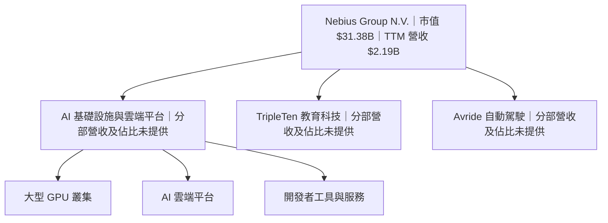
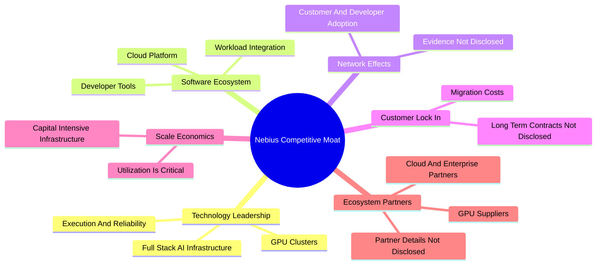
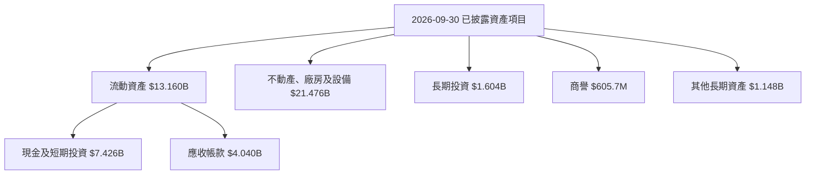
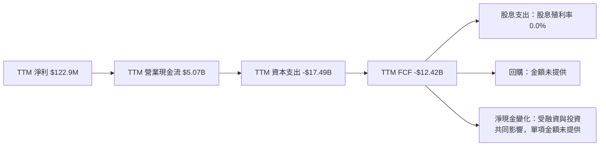
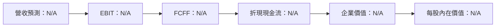
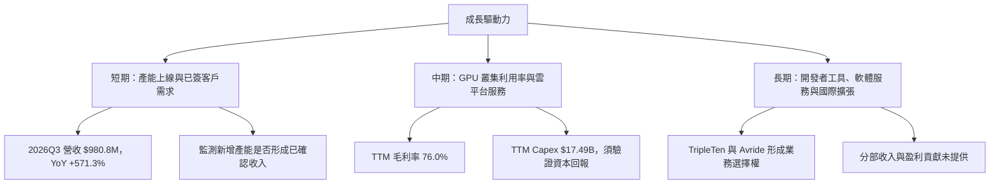
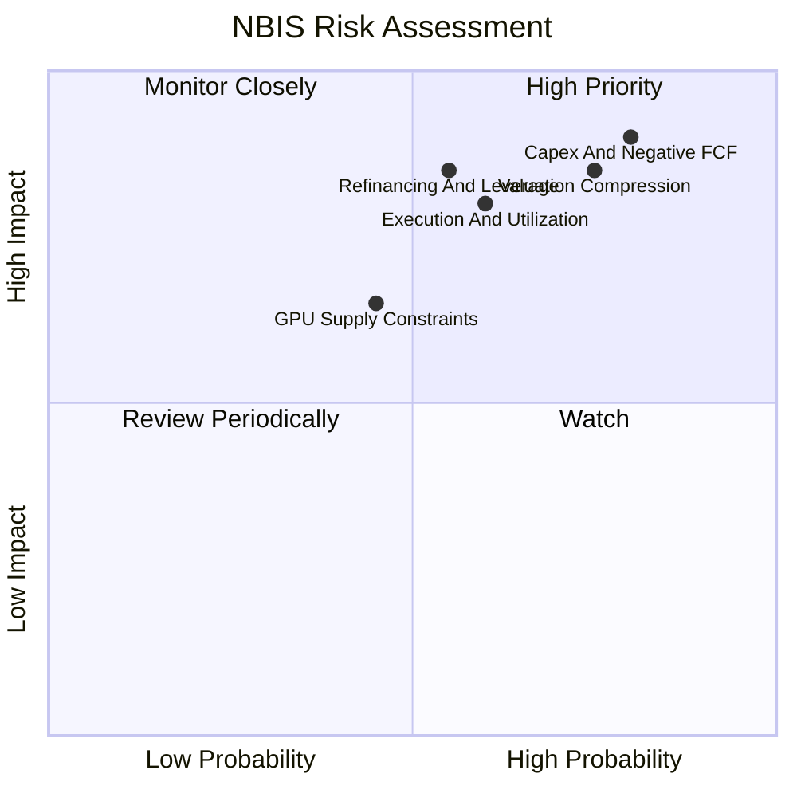
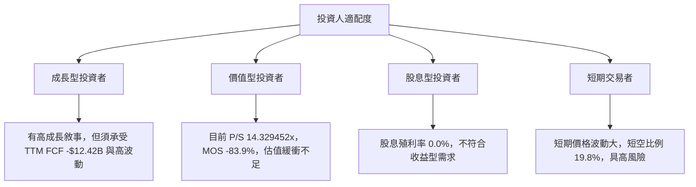

# NBIS 基本面深度分析報告
> **報告日期**：2026-11-17 ｜ **語言**：繁體中文 ｜ **數據來源**：Yahoo Finance、Finviz、StockAnalysis、Roic.ai ｜ **分析師**：CFA 級機構研究

---

## 目錄

| # | 章節 | 核心結論 |
|---|------|----------|
| 1 | 執行摘要 | TTM FCF 為 -$12.42B、加權合理價值 $58.25、MOS -83.9%；依規則 20 評級為賣出 |
| 2 | 公司概覽與商業模式 | AI 基礎設施是主要業務方向；細分收入與市場份額未提供，護城河仍待經營數據驗證 |
| 3 | 損益表深度分析 | 最新一季營收年增 571.3%，但 TTM 營業利益率 -23.0%，成長尚未轉化為穩定營業獲利 |
| 4 | 資產負債表分析 | 淨負債 $8.67B；流動比率 5.306，但應收帳款天數 673 天值得關注 |
| 5 | 現金流量深度分析 | TTM 營業現金流 $5.07B、資本支出 $17.49B，FCF 為 -$12.42B |
| 6 | 獲利能力與資本效率 | ROIC 未提供；WACC 為 7.97%，營業虧損顯示目前營運尚未證明創造經濟價值 |
| 7 | 相對估值分析 | NBIS TTM P/S 14.33x，高於三家同業 P/S 中位數 5.2x |
| 8 | DCF 內在價值評估 | DCF MODEL 不適用：TTM 營業利益為負；改以已計算估值方法三角驗證 |
| 9 | 成長催化劑 | AI 運算需求與 GPU 基礎設施擴張可望支持成長；公司級 TAM 與具體催化時程未提供 |
| 10 | 風險矩陣 | 最大風險為高資本支出下 FCF 惡化、融資與債務負擔、以及高估值回落 |
| 11 | 投資建議 | 依加權合理價值與 MOS 評級為賣出；須觀察資本支出回報、現金流與利潤率改善 |

---

## 1. 執行摘要

截至 2026-11-16 收盤，NBIS 股價為 **$107.13**。公司最新季度營收年增 **571.3%**，但 TTM 營業利益率為 **-23.0%**、TTM FCF 為 **-$12.42B**，FCF Yield 為 **-39.59%**；同業 P/S 中位數法給出的每股價值為 **$38.67**，分析師共識目標價為 **$234.50**，依固定權重計算的加權合理價值為 **$58.25**。以加權合理價值計算，MOS 為 **-83.9%**，因此規則 20 評級為 **賣出**。公司營收成長速度顯著，但目前估值要求高成長、資本投資轉化為回報與融資可得性同時成立；現有 FCF 與營業利潤率尚未支持這種估值。

### 1.0 一頁式投資儀表板（Portfolio Manager 30 秒速讀）

| 項目 | 內容 |
|------|------|
| **投資論點（3 句）** | ① 最新一季營收年增 571.3%，反映 AI 算力需求與新產能放量。② TTM 營業利益率 -23.0%、FCF -$12.42B，擴張仍伴隨高昂資本需求。③ 加權合理價值 $58.25，低於 2026-11-16 收盤價 $107.13，估值折價保護不足。 |
| **綜合評分** | **4.3/10**（引用 1.1 評分卡） |
| **財務健康** | 🔴 淨負債 $8.67B、TTM FCF -$12.42B；流動比率 5.306 提供短期緩衝，但不能消除投資支出與融資風險。 |
| **ROIC vs WACC** | ROIC：N/A；WACC：7.97%。ROIC 缺資料，不能量化價差；TTM 營業利益率 -23.0% 表示目前營運尚未證明創造價值。 |
| **FCF 趨勢** | 惡化至 TTM -$12.42B；FCF Yield **-39.59%**。 |
| **估值** | Forward P/E **-35.000538x**｜EV/EBITDA **65.438x**｜FCF Yield **-39.59%**。Forward P/E 為負，不能視作一般正盈餘倍數。 |
| **DCF 內在價值（基準）** | **N/A**；TTM 營業利益為負，依估值模型規則不建立 DCF，因此 DCF 折溢價亦為 N/A。 |
| **安全邊際（MOS）** | **-83.9%**＝($58.25 − $107.13) ÷ $58.25；🔴 相對加權合理價值無安全邊際。 |
| **預期報酬（基準情境 12M）** | N/A；沒有可用 DCF 情境價值，不以分析師共識代替基準情境。 |
| **關鍵風險（前二）** | ① 資本支出快速增加、FCF 深度為負。② 市場估值遠高於同業 P/S 中位數，若成長或融資條件降溫，估值可能收縮。 |
| **評級 + 信心度** | 🔴 **賣出** ｜ 信心：中（固定估值方法給出負 MOS，但 DCF 不適用且財報來源存在口徑差異） |

### 1.1 綜合評分卡（全報告唯一）

| 維度 | 評分（1–10） | 主要依據（引用數字與其來源章節） |
|------|--------------|----------------------------------|
| 成長性 | 8.0 | 最新季度營收年增 571.3%；TTM 營收成長率不可得，不能將單季成長外推為 TTM（第 3 章）。 |
| 獲利能力 | 2.5 | TTM 營業利益率 -23.0%；ROIC、Piotroski F-Score 未提供（第 3、6 章）。 |
| 財務健康 | 4.0 | 淨負債 $8.67B、流動比率 5.306、TTM FCF -$12.42B，流動性尚可但資金消耗與負債增加（第 4、5 章）。 |
| 估值 | 1.0 | MOS -83.9%；NBIS P/S 14.329452x，同業 P/S 中位數 5.2x（第 7、8 章）。 |
| 護城河 | 6.0 | AI 全堆疊基礎設施與 GPU 叢集具技術與轉換成本潛力，但分部營收、客戶留存和市占率未提供（第 2 章）。 |
| 管理層與資本配置 | 4.0 | TTM Capex $17.49B、SBC $221.4M（依最近四季資料加總），投資規模大；資本回報率與專案回報資料不足（第 5 章）。 |
| **綜合評分** | **4.3** | 六項算術平均：(8.0 + 2.5 + 4.0 + 1.0 + 6.0 + 4.0) ÷ 6 = 4.25，四捨五入為 4.3。 |

### 1.2 五大投資論點 + 三大核心風險

| 類型 | 項目 | 具體依據 | 信心度 |
|------|------|----------|--------|
| 🟢 **投資論點①** | AI 基礎設施營收加速 | 2026Q3 營收 $980.8M，年增 571.3%；若新增 GPU 容量有足夠客戶需求，營收規模可快速提升。 | 🟢 高 |
| 🟢 **投資論點②** | 毛利率具擴張跡象 | TTM 毛利率 76.0%；最新季度毛利 $761.1M / 營收 $980.8M = 77.6%，但須觀察高資本與折舊成本能否被毛利吸收。 | 🟡 中 |
| 🟢 **投資論點③** | 短期流動性比率較高 | 流動比率 5.306、速動比率 4.847；有一定短期資產緩衝，惟資產可回收性及資本支出仍是關鍵。 | 🟡 中 |
| 🟢 **投資論點④** | 公司仍有現金資源支應擴張 | 現金與短期投資 $7.43B；但總債務 $16.10B，淨負債仍達 $8.67B。 | 🟡 中 |
| 🟢 **投資論點⑤** | 市場仍對長期增長有高預期 | 20 位分析師平均目標價 $234.50；但這只是共識，不等於可驗證的內在價值。 | 🟡 中 |
| 🟡 **風險①** | 高資本支出與 FCF 惡化 | TTM Capex $17.49B，FCF -$12.42B；若算力租用率與客戶合約不足，投資回收期將延長。 | 🔴 高衝擊 |
| 🔴 **風險②** | 估值與現金流背離 | NBIS P/S 14.329452x，高於同業 P/S 中位數 5.2x；加權合理價值 $58.25，低於現價 $107.13。 | 🔴 高衝擊 |
| 🔴 **風險③** | 淨負債及外部融資風險 | 淨負債 $8.67B、Debt/Equity 130.875；在高投資期，借款成本或資本市場條件轉差會壓縮股東回報。 | 🔴 高衝擊 |

### 1.3 快速統計卡片

| 指標 | 公司實際值（期間） | 同業中位數 | 狀態 |
|------|--------------------|------------|------|
| 營收成長（TTM） | **N/A** | — | 🟡 TTM 年增率不可得 |
| 營收成長（最新一季年增） | **571.3%** | **29.6%** | 🟢 高於同業樣本中位數；基期與業務擴張速度需留意 |
| 毛利率（TTM） | **76.0%** | **66.8%** | 🟢 高於同業樣本中位數 |
| 營業利益率（TTM） | **-23.0%** | — | 🔴 營業虧損 |
| Forward P/E | **-35.000538x** | **10.8x** | 🔴 公司預期 EPS 為負，倍數不可直接比較 |
| FCF Yield（TTM） | **-39.59%** | — | 🔴 大幅負值 |
| Piotroski F-Score | **N/A / 9** | — | 🟡 缺少兩個相隔一年的 SEC 申報 TTM 期間 |

### 1.4 投資結論

```text
╔══════════════════════════════════════════════════════════════════╗
║                    📊 投資結論摘要                               ║
╠══════════════════════════════════════════════════════════════════╣
║  評級：🔴 賣出（MOS -83.9%，依規則 20）                          ║
║  價格（2026-11-16 收盤）：$107.13                                ║
║  DCF 內在價值（基準）：N/A（TTM 營業利益為負，DCF 不適用）       ║
║  安全邊際 MOS：-83.9%（＝($58.25−$107.13)÷$58.25）              ║
║  加權合理價值（8.8）：$58.25                                     ║
║  綜合評分：4.3/10（引用 1.1）                                    ║
║  適合投資人：能承受高波動與高資本支出風險、並可追蹤季度現金流者  ║
╚══════════════════════════════════════════════════════════════════╝
```

---

## 2. 公司概覽與商業模式

### 2.1 業務結構與收入來源

Nebius Group N.V. 總部位於荷蘭，員工數 **1,543**。公司業務包括 AI 全堆疊基礎設施、教育科技平台 TripleTen，以及自動駕駛業務 Avride。2026-09-30 TTM 營收為 **$2.19B**，FY2025 年營收為 **$529.80M**。兩個期間的規模差異反映近期營收快速擴張，但分部營收與分部獲利未提供，無法可靠計算各項業務佔比。



**收入結構限制：**年度、季度合併營收已披露，但各分部金額、軟體服務收入比例與客戶集中度未提供，因此不將公司總營收拆分成推估占比。

### 2.2 市場份額

市場份額數據未提供，亦沒有可引用的市場規模與年份資料。以營收規模觀察，NBIS TTM 營收 **$2.19B**，2026Q3 單季營收年增 **571.3%**，高於 CRWV、ORCL、MSFT 三家公司最新季度年增率的中位數 **29.6%**。但該差距反映成長階段不同，不能直接推論 NBIS 已取得較高市場份額。

### 2.3 競爭護城河分析



### 2.4 護城河強度

| 護城河項目 | 強度（強／中／弱） | 證據（引用數字或事實） | 會削弱它的情況 |
|------------|--------------------|------------------------|----------------|
| 技術與基礎設施 | 中 | 提供大型 GPU 叢集、雲端平台與開發者工具；TTM 毛利率 76.0%，但技術性能與利用率數據未提供。 | GPU 供應受限、競品提供更低價格或更高效能。 |
| 軟體生態系統 | 中偏弱 | 公司提供 AI 雲平台及開發者工具；使用者數、留存率、軟體訂閱佔比未提供。 | 客戶主要按硬體價格選擇供應商，轉換成本有限。 |
| 網路效應 | 弱 | 未提供客戶數、開發者數或平台互補產品增長資料。 | 平台使用量未產生可觀察的客戶獲取或留存優勢。 |
| 客戶鎖定 | 中偏弱 | GPU 叢集與雲端部署通常需要遷移及重新配置，但公司合約長度與續約率未披露。 | 短約、低轉換成本或客戶採多雲策略。 |
| 規模效應 | 中 | 大型基礎設施可提高固定成本吸收效率；但 TTM Capex $17.49B，規模擴張也增加資金需求。 | 利用率不足、建置超前需求、融資成本上升。 |
| 生態夥伴 | 中偏弱 | AI 基礎設施仰賴 GPU 與供應鏈合作；具體合作條款、供應保障未提供。 | 供應商優先配置、價格或出口限制改變。 |

**護城河評分理由：**1.1 節護城河評分 **6.0/10**，反映公司具備全堆疊 AI 基礎設施與軟體工具的潛力，但客戶留存、平台規模、供應優勢及分部經濟性仍缺乏可量化證據。

---

## 3. 損益表深度分析

### 3.1 年度收入成長趨勢（近 4 年）

以下年度金額直接引用年度損益表；趨勢圖長度只作視覺呈現。

```text
╔══════════════════════════════════════════════════════════════════╗
║              Nebius 年度收入趨勢（FY2022-FY2025）                ║
╠══════════════════════════════════════════════════════════════════╣
║  FY2022  $13.50M   █                         YoY：—              ║
║  FY2023   $9.80M   █                         YoY：-27.4%         ║
║  FY2024  $91.50M   █████                     YoY：+833.7%        ║
║  FY2025 $529.80M   ██████████████████████████ YoY：+479.0%      ║
╠══════════════════════════════════════════════════════════════════╣
║  FY2022-FY2025 CAGR：(529.8 ÷ 13.5)^(1/3) − 1 ≈ 240.0%          ║
║  ⚠️ FY2022-FY2023 收入低且業務組合可能變動，CAGR 不宜直線外推。 ║
╚══════════════════════════════════════════════════════════════════╝
```

FY2025 年營收較 FY2024 增加 **479.0%**，其後 TTM 營收達 **$2.19B**，顯示近期經營規模再次提升。需注意年度數據與當前業務邊界可能受公司組合及業務擴張影響；FY2022 至 FY2025 的高 CAGR 由低基數放大，不能視為成熟期成長率。

### 3.2 季度收入趨勢分析

QoQ 以季度營收變化計算；YoY 優先引用 StockAnalysis 季度列示，最新季度則引用已驗證數值 **571.3%**。

| 季度 | 營收 | QoQ 成長 | YoY 成長 | 備註 |
|------|------:|---------:|---------:|------|
| 2025Q4 | $227.7M | +55.9%（對 2025Q3） | +546.88% | 基期仍小，百分比受低基數放大。 |
| 2026Q1 | $399.0M | +75.2% | +683.89% | 季度規模延續擴大。 |
| 2026Q2 | $582.3M | +45.9% | +454.04% | 絕對營收增加，但年增率較 Q1 回落。 |
| 2026Q3 | $980.8M | +68.4% | **+571.3%** | 最新季度年增率；不可標記為 TTM 成長率。 |

季度營收自 2025Q4 的 **$227.7M** 增至 2026Q3 的 **$980.8M**，三季累計提升約 4.3 倍。其商業含義是客戶需求與部署容量同步擴大；但該成長是否能持續，取決於 GPU 設備交付、機房建置、客戶使用率與已簽約容量的實際變現。

### 3.3 利潤率演變分析

年度毛利率、營業利益率由年度損益表數字計算；低收入基期下的百分比容易失真。TTM 與最新季度營業利益率則按已驗證數據引用。

| 利潤率指標 | FY2022 | FY2023 | FY2024 | FY2025 | 趨勢 | 評估 |
|------------|-------:|-------:|-------:|-------:|------|------|
| **毛利率** | -110.4% | -100.0% | 52.2% | 68.6% | 2024 起轉正並擴張 | 🟢 近期毛利改善；低基數歷史比率參考性有限 |
| **營業利益率** | -1,170.4% | -2,915.3% | -436.7% | -115.5% | 虧損率逐步收窄，但仍為負 | 🔴 尚未達到營業獲利 |
| **淨利率** | 5,522.2% | 2,462.2% | -700.4% | 15.6% | 年度淨利波動極大 | 🟡 非營業項目與一次性項目可能影響 |
| **營業利益率（TTM）** | — | — | — | **-23.0%** | 最新季度為 -18.7% | 🔴 TTM 仍虧損 |

FY2025 毛利率改善，與收入規模及產品組合變化相符；但營業利益仍為 **-$611.7M**。2026Q3 單季營業利益轉正至 **$50.4M**，而前兩季分別為 **-$128.0M** 與 **-$175.9M**，顯示損益走勢有改善訊號但季間波動仍大。高研發、建置和營運費用，加上新產能折舊與爬坡，會決定毛利改善能否轉化為持續營業獲利。

### 3.4 費用結構分析

完整營運費用分項、銷售與管理費用及折舊分項未提供，故不以不完整數據製作費用比例圓餅圖。已知 FY2025 研發費用為 **$177.3M**，約佔當年營收 **33.5%**（$177.3M ÷ $529.8M），反映公司仍投入大量資源於技術與產品。FY2025 SBC 為 **$83.2M**，約佔 FY2025 營收 **15.7%**，是股東報酬稀釋的重要觀察項目。

### 3.5 季度 EPS 趨勢與盈餘品質（Quality of Earnings）

| 季度 | EPS 實際值 | 預估值 | 超預期／不及預期 | 備註 |
|------|-----------:|------:|------------------|------|
| 2025Q4 | -$1.06 | N/A | N/A | EPS 估值資料缺失，無法判定 beat/miss。 |
| 2026Q1 | $2.40 | N/A | N/A | 高額淨利與其他損益項目可能使 EPS 不代表常態營運。 |
| 2026Q2 | -$0.68 | N/A | N/A | StockAnalysis 顯示 EPS 實際值；分析師預估缺失。 |
| 2026Q3 | -$0.13 | N/A | N/A | Yahoo 季度淨利為 -$37.5M；分析師預估缺失。 |

EPS 估值資料四季皆為 `nan`，因此不能以超預期或不及預期描述盈餘表現。各資料源的季度淨利及 EPS 口徑亦有差異，EPS 趨勢應以後續公司申報資料核實。

| 盈餘品質項目 | 數值／佔比 | 評估 |
|--------------|-----------|------|
| 股權薪酬 SBC / 營收 | 約 **10.1%**；最近四季 SBC 加總 $221.4M ÷ TTM 營收 $2.19B | 🔴 比例偏高；若以股票支付薪酬，會稀釋現有股東。 |
| SBC / 營業現金流 | 約 **4.4%**；$221.4M ÷ $5.07B | 🟡 單看現金流比例不高，但 SBC 不是無成本，且 OCF 包含大型季度波動。 |
| FCF / 淨利（現金轉換率） | 約 **-10,106%**；-$12.42B ÷ $122.9M | 🔴 大額 Capex 令 FCF 與帳面淨利背離；比率因淨利基數小而極端。 |
| 一次性／非經常性損益 | 季度淨利由 2026Q1 的 $621.2M 轉為 2026Q2 -$190.4M、2026Q3 -$37.5M | 🔴 波動明顯；缺少損益附註，無法精確拆分一次性項目。 |
| 有效稅率異常 | 最新年度有效稅率 **29.0%** | 🟡 TTM 稅務明細未提供；年度稅率不能直接代表近期現金稅率。 |
| 資本化支出 vs 費用化 | TTM Capex $17.49B；資本化與折舊明細未提供 | 🔴 資本支出規模遠高於 TTM 營收，需追蹤設備折舊與資產利用率。 |

**盈餘品質結論：**TTM 淨利與季度淨利波動大，而 TTM FCF 為 **-$12.42B**；因此現階段不能將帳面淨利視為可分配給股東的常態經濟盈餘。估值應更重視投入資本的利用率、單位經濟性與資本回收，而非單看正的 TTM 淨利或 EPS。

---

## 4. 資產負債表分析

### 4.1 資產結構分解

2026-09-30 StockAnalysis 顯示流動資產 **$13.160B**、PP&E **$21.476B**、長期投資 **$1.604B**、商譽 **$605.7M**、其他長期資產 **$1.148B**。當期總資產值未明確提供，且資料分項不一定涵蓋全部資產，因此以下只呈現已披露項目，不將其加總成總資產。



### 4.2 流動性與營運資金分析

| 指標 | 最新值 | 歷史對照 | 評估 |
|------|------:|---------|------|
| 流動比率 | **5.306** | 年度 Current Assets ÷ Current Liabilities：FY2025 為 3.08x、FY2024 為 9.60x | 🟢 最新比率較高；年度及季度口徑的資產負債表可能有差異。 |
| 速動比率 | **4.847** | N/A | 🟢 短期流動資產緩衝足；但不代表可持續支應全部 Capex。 |
| 現金及短期投資 | **$7.43B** | FY2025 現金 $3.68B，另有短期投資 | 🟡 現金資源增加，但仍低於總債務。 |
| 淨負債 | **$8.67B** | N/A | 🔴 淨負債令擴張期間的再融資與償債能力更重要。 |

營運資金天數照錄品質指標；一年前期間數據未提供，變化量不計算。

| 指標 | 最新 TTM | 一年前 TTM | 變化 | 解讀 |
|------|----------:|-----------:|-----:|------|
| DSO 應收帳款天數 | **673 天** | N/A | N/A | 數值很高，可能反映期末應收帳款大增或營收確認與收款時點差異；需核對合約資產與客戶付款條款。 |
| DIO 存貨天數 | **N/A** | N/A | N/A | 公司未報告相應存貨餘額，不能補值。 |
| DPO 應付帳款天數 | **368 天** | N/A | N/A | 可能反映應付帳款與供應商付款時間拉長；資料不足以判斷議價力或逾期狀況。 |
| CCC 現金轉換週期 | **N/A** | N/A | N/A | DIO 為 N/A，且品質指標明確未計算 CCC。 |

### 4.3 債務結構分析

```text
╔══════════════════════════════════════════════════════════════════╗
║                   NBIS 債務健康診斷                              ║
╠══════════════════════════════════════════════════════════════════╣
║  總債務：        $16.10B  ████████████████████  🔴               ║
║  現金及短期投資： $7.43B  █████████             🟡               ║
║  淨負債：         $8.67B  ███████████           🔴               ║
║                                                                  ║
║  Current Ratio： 5.306x  🟢                                    ║
║  Quick Ratio：   4.847x  🟢                                    ║
║  Debt/EBITDA：   N/A（可比 EBITDA 絕對值未提供）                 ║
║  Interest Coverage：N/A（利息費用及覆蓋率未提供）                ║
╠══════════════════════════════════════════════════════════════════╣
║  解讀：流動比率高，但淨負債 $8.67B 且 TTM FCF -$12.42B，          ║
║        高資本支出使融資與資產利用率成為核心風險。                 ║
╚══════════════════════════════════════════════════════════════════╝
```

市場資料的總債務為 **$16.10B**，現金與短期投資 **$7.43B**，淨負債 **$8.67B**。需注意 Yahoo 與其他資料源對債務項目分類可能有差異，故本報告的淨負債採已驗證數值，不以資產負債表分項反推替換。

### 4.4 股東權益趨勢

```text
╔══════════════════════════════════════════════════════════════════╗
║                  NBIS 歷年股東權益                               ║
╠══════════════════════════════════════════════════════════════════╣
║  FY2022  $4.25B  ████████████████████                           ║
║  FY2023  $3.29B  ███████████████                                ║
║  FY2024  $3.25B  ███████████████                                ║
║  FY2025  $4.59B  ██████████████████████                         ║
╠══════════════════════════════════════════════════════════════════╣
║  FY2025 較 FY2024 增加 $1.34B；未提供季度股東權益序列。         ║
╚══════════════════════════════════════════════════════════════════╝
```

股東權益於 FY2025 回升至 **$4.59B**，但同期間總債務升至 **$4.97B**（年度資料），且最新 TTM 總債務為 **$16.10B**。因此股東權益增加不能單獨代表財務槓桿下降，仍需觀察新增融資的用途與投資回報。

---

## 5. 現金流量深度分析

### 5.1 現金流量瀑布圖

TTM 淨利使用 StockAnalysis 列示 **$122.9M**；FCF 則固定採用營業現金流減 Capex 的已驗證定義。



### 5.2 FCF 轉換率趨勢

| 期間 | FCF | 淨利 | FCF / 淨利 | 解讀 |
|------|----:|----:|-----------:|------|
| FY2022 | $682.4M | $745.6M | 91.5% | 現金轉換接近帳面淨利。 |
| FY2023 | $746.9M | $241.3M | 309.7% | FCF 高於淨利，但年度資料不宜與目前擴張期直接比較。 |
| FY2024 | -$561.9M | -$641.4M | 87.6% | FCF 與淨利同為負值，比例本身不代表健康。 |
| FY2025 | -$3.68B | $82.5M | -4,460.6% | 高額 Capex 使現金流明顯弱於淨利。 |
| TTM 至 2026-09-30 | **-$12.42B** | 約 $122.9M | 約 **-10,106%** | 大額投資期使帳面獲利與可分配現金脫節。 |

年度 FCF 採財報表列示數值；TTM FCF 必須採用營業現金流減資本支出的定義，且不與年度 FCF 簡單互換。

### 5.3 自由現金流趨勢

```text
╔══════════════════════════════════════════════════════════════════╗
║            自由現金流歷史（美元）                                ║
╠══════════════════════════════════════════════════════════════════╣
║  FY2022  +$0.68B  ████                         FCF Yield：N/A    ║
║  FY2023  +$0.75B  ████                         FCF Yield：N/A    ║
║  FY2024  -$0.56B  ◀███                         FCF Yield：N/A    ║
║  FY2025  -$3.68B  ◀████████████                FCF Yield：N/A    ║
║  TTM     -$12.42B ◀████████████████████████████ FCF Yield：-39.59%║
╠══════════════════════════════════════════════════════════════════╣
║  TTM OCF $5.07B − Capex $17.49B = FCF -$12.42B                 ║
╚══════════════════════════════════════════════════════════════════╝
```

TTM FCF 轉負的主因是 **$17.49B** 資本支出遠高於 **$5.07B** 營業現金流。這可能是公司為增加 GPU 與資料中心能力而進行的前置投資；但若新增產能不能快速帶來合約收入與足夠利用率，負 FCF 將持續增加融資依賴。

### 5.4 資本配置評估

股息殖利率為 **0.0%**，回購金額未提供，因此沒有足夠資料建立涵蓋 Capex、投資、回購、股息與留存現金的資本配置圓餅圖。

| 資本配置項目 | 已知數值 | 評估 |
|--------------|---------:|------|
| TTM 資本支出 | $17.49B | 🔴 規模大，應追蹤資產利用率、合約覆蓋與投資回報。 |
| TTM 營業現金流 | $5.07B | 🟡 有營運現金流，但與資本支出差距大。 |
| 股息 | 殖利率 0.0% | 🟢 現金保留於營運與投資；不適合以股息作為投資論點。 |
| 股票回購 | N/A | 資料未提供。 |
| SBC | 最近四季合計約 $221.4M | 🔴 薪酬稀釋需要與員工留任及投資回報一併評估。 |

---

## 6. 獲利能力與資本效率

### 6.1 ROE / ROA / ROIC 趨勢

ROE、ROA 採現有 TTM 指標；ROIC 歷史序列未有足夠可核對的當前口徑，不列入推算。

| 指標 | 公司數值 | 期間 | 評估 |
|------|---------:|------|------|
| ROE | **1.5%** | TTM | 🟡 低回報；受淨利項目波動影響。 |
| ROA | **-1.0%** | TTM | 🔴 資產尚未產生正的整體回報。 |
| ROIC | **N/A** | TTM | 🔴 無法確認投入資本回報是否高於資本成本。 |
| WACC | **7.97%** | 資本成本輸入 | ROIC 不可得，不能計算 ROIC-WACC 的實際差額。 |

### 6.2 ROIC vs WACC 分析（核心價值創造判斷）

```text
╔══════════════════════════════════════════════════════════════════╗
║                ROIC vs WACC 深度分析                            ║
╠══════════════════════════════════════════════════════════════════╣
║  WACC（採用已計算值）：7.97%                                    ║
║  ├── 無風險利率（10Y 美債）：5.12%                              ║
║  ├── 市場風險溢酬：5.00%                                       ║
║  ├── 原始 Beta：1.54                                            ║
║  ├── 調整後 Beta：1.36 = ⅔×1.54 + ⅓×1                          ║
║  ├── 股權成本：11.92%                                           ║
║  ├── 稅前債務成本：0.38%；稅後約 0.27%                          ║
║  ├── 股權／債務權重：66.1%／33.9%                               ║
║  └── ✅ WACC：7.97%（採用資本成本資料的既定值）                  ║
║                                                                  ║
║  ROIC：N/A（缺少可驗證投入資本與稅後營業利益資料）                ║
║  EVA = ROIC − WACC：N/A                                          ║
╠══════════════════════════════════════════════════════════════════╣
║  TTM 營業利益率 -23.0%，顯示當期營運未達穩定營業獲利；           ║
║  但不能將營業利益率直接冒充 ROIC。                               ║
║  結論：目前未能證明 NBIS 正在創造高於 7.97% WACC 的股東價值。    ║
╚══════════════════════════════════════════════════════════════════╝
```

ROIC 是判斷投入資本回報的核心指標，但資料不足，故不自行反推。WACC **7.97%** 依已提供的成本資本數據採用。公司 TTM 營業利益率 **-23.0%**，並非正向資本回報的證據；在 ROIC 尚不可計算的情況下，應以「尚未證明創造價值」而非直接聲稱 ROIC 低於 WACC。

### 6.3 杜邦三因素分解

**N/A**：品質指標的杜邦分解因缺少一致口徑的淨利、營收、總資產或正股東權益資料而無法計算；不以其他口徑自行補值。

### 6.4 財務體質：Piotroski F-Score

**Piotroski F-Score：N/A / 9。**需要相隔一年的 SEC 申報 TTM 數據；目前公司資料來源未提供可用 SEC 申報資料，九項測試結果均無法判定，因此不列出推測性測試結果。

---

## 7. 相對估值分析

### 7.1 同業估值比較表格

同業倍數依 Yahoo Finance 的 Peer multiples。同行業中位數僅按表中可得樣本計算；負 Forward P/E 及公司自身負 EPS 情況下，P/E 比較參考性有限。

| 估值指標 | **NBIS** | **CRWV** | **ORCL** | **MSFT** | 本公司評估 |
|----------|---------:|---------:|--------:|--------:|-----------|
| **Trailing P/E** | 83.69531x | N/A | 19.7x | 27.0x | 🔴 NBIS 明顯較高；同業可用數值中位數 23.35x。 |
| **Forward P/E** | -35.000538x | -28.1x | 10.8x | 21.4x | 🔴 NBIS 預期 EPS 為負，負倍數不代表便宜；三家中位數 10.8x。 |
| **P/S Ratio（TTM）** | 14.329452x | 2.8x | 5.2x | 11.1x | 🔴 NBIS 高於同業中位數 5.2x，估值隱含顯著成長持續。 |
| **EV/EBITDA（TTM）** | 65.438x | 17.2x | 14.4x | 19.0x | 🔴 NBIS 倍數高；若 EBITDA 絕對數值及口徑不一致，需審慎比較。 |
| **最新季度營收 YoY** | 571.3% | 168.2% | 29.6% | 18.8% | 🟢 NBIS 成長較快，但規模、成長階段與資本需求不同。 |
| **毛利率（TTM）** | 76.0% | 66.8% | 64.0% | 67.7% | 🟢 NBIS 高於同業樣本中位數 66.8%。 |

NBIS 的成長率及毛利率高於同業樣本，但 P/S **14.329452x**，約為同業中位數 **5.2x** 的 2.76 倍。這種溢價只有在高成長延續、單位經濟性改善且巨額 Capex 可產生足夠回報時才較可持續；目前 TTM FCF **-$12.42B** 使估值對執行力和融資條件高度敏感。

### 7.2 歷史估值區間分析

N/A（數據未提供：缺少公司自身歷史 P/E、P/S、EV/EBITDA 區間與歷史百分位資料）。24 個月股價曾於 2026-06 月底收在 **$276.17**，2026-11-16 收盤為 **$107.13**；股價波動反映市場預期快速變動，但不能替代歷史估值倍數區間。

### 7.3 情境價值（Bear / Base / Bull）

**N/A（DCF 無法計算：TTM 營業利益不為正，DCF MODEL 未提供有效情境價值）。**依規則不自行建立情境目標價，也不推估情境機率。

### 7.4 相對估值隱含價格區間

```text
╔══════════════════════════════════════════════════════════════════╗
║                相對估值方法：每股價值                             ║
╠══════════════════════════════════════════════════════════════════╣
║  $38.67 ─────────────────── $107.13 ───────────────── $234.50   ║
║  同業 P/S                        現價                   分析師共識 ║
║  -63.9%                          —                      +118.9%   ║
╚══════════════════════════════════════════════════════════════════╝
```

| 方法 | 每股價值 | 相對現價 | 方法依據 |
|------|---------:|---------:|----------|
| 同業 P/S | **$38.67** | **-63.9%** | CRWV、ORCL、MSFT 的 P/S 中位數 **5.2x** 乘以公司 TTM 營收，再以股數換算；數值採估值方法輸出。 |
| 分析師共識目標價 | **$234.50** | **+118.9%** | 20 位分析師平均目標價；屬市場預期參考，不是基本面保證。 |

---

## 8. DCF 內在價值評估（Discounted Cash Flow）

### 8.0 估值推理鏈（Thinking Logic）

**Step 1 — 價值由哪些變數決定？**  
NBIS 的價值主要取決於 AI 基礎設施營收擴張、營業利潤率能否轉正，以及高額 GPU／資料中心 Capex 能否轉為足夠的現金流。AI 基礎設施是公司主要描述業務，但分部營收佔比未提供；TripleTen 與 Avride 的營收占比也未提供，因此無法量化各業務對總價值的分拆。

**Step 2 — 模型選擇**

| 決策點 | 本報告採用 | 理由（含數字） | 曾考慮但否決 | 否決理由 |
|--------|-----------|----------------|--------------|----------|
| 現金流定義 | 不建立 DCF | TTM 營業利益率 -23.0%、營業利益為負；DCF MODEL 明確標示 N/A | 自行預測 FCFF | 不符合已驗證模型要求，且缺少可核對的營運假設 |
| 預測期 N | N/A | DCF MODEL 未生成有效預測期 | 自行選 5–10 年 | 缺少經核准模型輸入與預測表 |
| 終值方法 | N/A | 無有效 DCF 現金流及終值 | Gordon Growth／退出倍數 | 不以虧損期現金流建立終值 |
| EBIT 基礎 | N/A | 不建立 DCF | GAAP EBIT 預測 | 缺少模型逐年輸入，不自行建立 |

**Step 3 — 假設推導鏈**  
由於 DCF MODEL 為 N/A，營收 CAGR、期末營業利潤率、永續成長率、Capex／營收、D&A、營運資金、SBC 與股數等假設均未生成。若在此自行選值，將形成非來源支持的模型，故不提供數字，也不假裝存在完整推導鏈。

**Step 4 — 最脆弱的一環**  
若未來營收成長不能抵消巨額 Capex，負 FCF 可能持續擴大；但沒有有效 DCF 情境表，無法量化估值下降幅度。

**Step 5 — 計算路徑圖**



### 8.1 模型假設總表（Model Inputs）

**N/A（DCF MODEL 未提供模型輸入，原因：TTM 營業利益不為正）。**依規定不自行建模，故不列預測期、CAGR、期末營業利潤率、Capex、D&A、營運資金、SBC、稀釋率或永續成長率等假設。

### 8.2 折現率推導（WACC）

本節列示資本成本資料，供第 6.2 節資本效率討論引用；**不將其套用於自建 DCF**。

```text
╔══════════════════════════════════════════════════════════════════╗
║                    WACC 資料（DCF 不適用）                       ║
╠══════════════════════════════════════════════════════════════════╣
║  無風險利率 Rf：5.12%                                            ║
║  市場風險溢酬 ERP：5.00%（假設輸入）                             ║
║  原始 Beta：1.54；調整後 Beta：1.36                              ║
║  Ke = Rf + β × ERP = 5.12% + 1.36 × 5.00% = 11.92%              ║
║  稅前債務成本：0.38%                                             ║
║  稅率：29.0%；稅後 Kd = 0.38% × (1 − 29.0%) ≈ 0.27%             ║
║  E / D 權重：66.1% / 33.9%                                       ║
║  WACC = 66.1% × 11.92% + 33.9% × 0.27% ≈ 7.97%                  ║
║  採用 WACC：7.97%（來源：資本成本計算輸出）                       ║
╚══════════════════════════════════════════════════════════════════╝
```

上述算式為已計算資本成本輸入的核對呈現，實際報告採用 **WACC 7.97%**，不另行調整。原始 Beta 1.54 經 ⅔ × 1.54 + ⅓ × 1 調整為 1.36。無風險利率取自資本成本輸入所列 10 年期美債殖利率 **5.12%**；該資料未附觀察日期，故不另指定日期。股權／債務權重及 WACC 為既定輸出，未自行重建市值與計息負債範圍。

### 8.3 逐年自由現金流預測（基準情境）

**N/A（原因同上）。**沒有可採用的 DCF 年度預測與逐年 FCFF；不補入營收、利潤率、資本支出或折現因子，也不計算預測 FCF CAGR。

### 8.4 終值計算（Terminal Value）

**N/A。**沒有有效預測期 FCFF，無法檢驗 WACC 與永續成長率 g 的關係，也無法計算 Gordon Growth 終值或退出倍數終值。

### 8.5 企業價值 → 每股內在價值（Bridge）

**N/A。**DCF 企業價值、DCF 股權價值、DCF 每股內在價值及 DCF 折溢價均無法計算。依指標定義，不在本節計算 MOS；MOS 只採第 8.8 節加權合理價值。

### 8.6 敏感性分析（WACC × 永續成長率）

**N/A（DCF MODEL 未提供敏感度矩陣）。**不建立 WACC × g 矩陣，不列基準格、三情境價值或假設機率。

### 8.7 反推 DCF（Reverse DCF）

**N/A。**因沒有有效 DCF 基準模型，不能以現價反推營收 CAGR、營業利潤率、永續成長率或高成長年數；以單一現價自行求解會涉及未提供模型參數。

### 8.8 估值三角驗證與安全邊際

| 估值方法 | 隱含每股價值 | 上行空間（÷現價） | 權重 | 說明 |
|----------|--------------:|------------------:|------:|------|
| 同業 P/S | **$38.67** | **-63.9%** | **90%** | CRWV、ORCL、MSFT 同業中位數 P/S **5.2x** 乘以 TTM 營收所換算。 |
| 分析師共識目標價 | **$234.50** | **+118.9%** | **10%** | 20 位分析師平均目標價，作參考而非獨立現金流估值。 |
| **加權合理價值** | **$58.25** | **-45.6%** | **100%** | 不含不可計算的同業 Forward P/E。 |

**加權計算：**

\[
\$38.67 \times 90\% + \$234.50 \times 10\%
= \$34.803 + \$23.450
= \$58.253
\approx \$58.25
\]

公司類型為「未獲利公司」，估值方法權重依固定規則採同業 P/S 90%、分析師共識 10%。同業 Forward P/E 因不可計算而不納入，權重由其他可計算方法分配；不新增方法或改動權重。

```text
╔══════════════════════════════════════════════════════════════════╗
║                  估值區間與安全邊際                              ║
╠══════════════════════════════════════════════════════════════════╣
║  $38.67 ───────── $58.25 ─────────────── $107.13 ─── $234.50   ║
║  同業 P/S        加權合理價值                現價    分析師共識 ║
║                                                                  ║
║  安全邊際 MOS = ($58.25 − $107.13) ÷ $58.25 = -83.9%           ║
║  上行空間 = ($58.25 − $107.13) ÷ $107.13 = -45.6%              ║
║  折溢價相對 DCF：N/A（DCF 內在價值不可計算）                     ║
║                                                                  ║
║  價格 ≤ $52.43 時，對 $58.25 加權價值才有至少 10% MOS            ║
║  計算：$58.25 × (1 − 10%) = $52.425 ≈ $52.43                    ║
╚══════════════════════════════════════════════════════════════════╝
```

本報告的 MOS 只以 **$58.25 加權合理價值**為分母；上行空間以現價為分母，兩者不可互換。以加權合理價值計，現價 **$107.13** 高於估值中樞，對應 MOS **-83.9%**、上行空間 **-45.6%**。若要求至少 10% MOS，價格須不高於 **$52.43**；此價格門檻是由加權合理價值公式推導，不是分析師目標價。

> 🔎 **程式複算（Python，依本節各項自動重算）**
>
> 加權合理價值 = $38.67 × 90% + $234.50 × 10% = **$58.25**（權重合計 100%）
>
> 以價格 $107.13 計：MOS = **-83.9%**，上行空間 = **-45.6%**
>
> ✅ 與本節所寫數值一致。

### 8.9 DCF 模型的局限與失效條件

- **DCF 不適用原因：**TTM 營業利益率 **-23.0%**，TTM 營業利益不為正，現有模型標記 DCF MODEL N/A。以虧損期現金流直接折現並給出每股價值，可能產生不可靠結果。
- **估值替代方式：**本報告採已計算的同業 P/S 與分析師共識加權；在公司營業獲利尚未穩定前，可進一步檢視 EV/Sales、單位經濟性、GPU 利用率及分部價值，但相關資料目前未提供。
- **主要局限：**同業 P/S 未必反映不同公司成長、資本密集度與融資結構；分析師共識對少數長期假設敏感，且不能替代現金流驗證。
- **與第 10 章風險連結：**Capex 未能轉為收入會影響營收與現金流；利潤率未改善會延後營業損益兩平；資本市場收緊會推高融資風險並壓低估值。

### 8.10 複算檢核表（Audit Trail）

| # | 檢核項目 | 檢查方式 | 結果 |
|---|----------|----------|------|
| 1 | DCF 高／中敏感度假設完整推導 | DCF MODEL 為 N/A，沒有假設輸入 | N/A |
| 2 | 模型假設均有來源 | 不建立 DCF，未填入自行假設數字 | N/A |
| 3 | WACC 輸入與算式核對 | 引用 WACC 7.97% 及資本成本組成 | ✅ |
| 4 | Kd 分母與債務權重範圍一致 | DCF 不適用；未自行重建 WACC | N/A |
| 5 | WACC 與第 6.2 節相同 | 均使用 7.97% | ✅ |
| 6 | 預測期欄位數等於 N | 無有效預測期 | N/A |
| 7 | FY+1 FCFF 與 PV 可複算 | 無 DCF 預測值 | N/A |
| 8 | 預測期 PV 合計可核對 | 無預測期 PV | N/A |
| 9 | WACC > g | 未提供 g | N/A |
| 10 | 終值以 FY+N FCFF 為基礎 | 無終值 | N/A |
| 11 | EV 至每股價值橋接可核對 | 無 DCF 橋接 | N/A |
| 12 | SBC 處理組合合法且一致 | 無 DCF 模型組合 | N/A |
| 13 | 敏感性矩陣基準格與 DCF 一致 | 無矩陣 | N/A |
| 14 | 矩陣僅列 WACC > g 有效格 | 無矩陣 | N/A |
| 15 | 三情境機率與加權算式 | 無 DCF 情境 | N/A |
| 16 | 反推 DCF 每列只解一個變數 | 無有效 DCF 基準模型 | N/A |
| 17 | MOS 與折溢價分母一致遵循定義 | MOS 引用 8.8；DCF 折溢價標 N/A | ✅ |
| 18 | 完整輸出至第 11 章 | 章節 1–11 均列出 | ✅ |
| 19 | 加權合理價值等於加權方法總和 | $38.67×90% + $234.50×10% = $58.253 ≈ $58.25 | ✅ |
| 20 | 評級符合 MOS 門檻 | MOS -83.9% < -25%，評級賣出 | ✅ |

---

## 9. 成長催化劑

### 9.1 催化劑時間軸

公司級產品交付、產能上線及客戶合約的正式時間表未提供，因此不以估計日期製作甘特圖。可追蹤的近期事件是財報披露與公司對 Capex、營收及產能利用率的更新；媒體報導提及公司下一年每 $1 收入可能支出超過 $3，但該說法需以公司正式財測或財報核實，不能當作已確認財務指引。

### 9.2 TAM 市場規模分析

**N/A（TAM 數據未提供）。**公司服務 AI 基礎設施市場，但沒有可引用的 TAM 金額、來源與年份，故不估算市場滲透率。以公司自身營收觀察，TTM 營收 **$2.19B**，最新季度年增 **571.3%**；未來成長空間取決於需求、GPU 供應、資料中心建置與資本回收，而非僅由總體市場規模決定。

### 9.3 成長驅動力結構圖



---

## 10. 風險矩陣

### 10.1 風險評分矩陣

以下位置為分析師主觀判斷，不是公司公布的統計機率；用於比較風險優先順序。



### 10.2 風險清單詳細分析

| # | 風險項目 | 發生機率 | 財務衝擊 | 風險評分 | 緩解措施 |
|---|----------|----------|----------|----------|----------|
| 1 | 🔴 **高 Capex 與負 FCF 持續** | 高（分析師判斷） | TTM FCF 已為 -$12.42B；若投入產能回收延後，融資需求與淨負債可能上升。 | 🔴 高 | 追蹤季度 Capex、營業現金流、產能利用率及已簽約需求；新增投資須與可見客戶需求相匹配。 |
| 2 | 🔴 **估值收縮** | 高（分析師判斷） | P/S 14.329452x 對比同業中位數 5.2x；市場若下修成長假設，估值可能大幅重估。 | 🔴 高 | 以營收成長、毛利率、營業利益率及 FCF 改善作持倉條件；避免只依分析師目標價加碼。 |
| 3 | 🔴 **槓桿與融資風險** | 中至高（分析師判斷） | 總債務 $16.10B、淨負債 $8.67B；若外部融資成本上升，股東稀釋或利息負擔可能增加。 | 🔴 高 | 監測到期債務、利息支出、現金餘額與資本市場融資條件。 |
| 4 | 🟡 **GPU 供應與技術依賴** | 中（分析師判斷） | 公司核心業務依賴 GPU 叢集與供應鏈；供應或出口限制可能延後部署與收入確認。 | 🟡 中高 | 關注供應商多元化、設備交付節奏、資料中心上線及客戶合約履約。 |
| 5 | 🟡 **收入成長不等於現金回報** | 中至高（分析師判斷） | 最新季度年增 571.3%，但 TTM 營業利益率 -23.0%，且 TTM FCF 深度為負。 | 🔴 高 | 將評估重心放在毛利轉營業獲利的轉換、資本利用率及 FCF 改善，而非營收單一指標。 |
| 6 | 🟡 **應收帳款與收款時點** | 中（分析師判斷） | DSO 673 天；應收帳款 $4.040B，需確認收款品質與大客戶付款安排。 | 🟡 中高 | 追蹤應收帳款增速、逾期帳款、合約資產與營業現金流。 |

---

## 11. 投資建議

### 11.1 最終評級與評分

依 8.8 節加權合理價值 **$58.25** 與 2026-11-16 收盤價 **$107.13** 計算，MOS 為 **-83.9%**，依規則 20 評級為 **賣出**，未作質化調整。1.1 節綜合評分為 **4.3/10**，六項分數為成長性 8.0、獲利能力 2.5、財務健康 4.0、估值 1.0、護城河 6.0、管理層與資本配置 4.0。

### 11.2 合理價值與隱含報酬率

| 方法／情境 | 每股價值 | 相對現價報酬 | 機率 |
|------------|---------:|--------------:|-----:|
| 加權合理價值（同業 P/S 90%、分析師共識 10%） | **$58.25** | **-45.6%** | 不適用 |
| 悲觀 DCF 情境 | N/A | N/A | N/A |
| 基準 DCF 情境 | N/A | N/A | N/A |
| 樂觀 DCF 情境 | N/A | N/A | N/A |

DCF MODEL 不適用，因此不提供 DCF 情境價值與機率。加權合理價值是依固定估值方法計算，不代表未來 12 個月價格必然到達該水準。

### 11.3 買入時機與觸發因素

```text
╔══════════════════════════════════════════════════════════════════╗
║                  ✅ 買入觸發因素 Checklist                      ║
╠══════════════════════════════════════════════════════════════════╣
║  目前觀察：現價 $107.13，高於加權合理價值 $58.25。               ║
║                                                                  ║
║  考慮建立／增加部位前，優先觀察：                                ║
║  ☐ 股價回到 $52.43 或以下，對 $58.25 加權價值具至少 10% MOS      ║
║  ☐ TTM FCF 相較 -$12.42B 明確改善，且 Capex 增速趨緩             ║
║  ☐ 營業利益率持續改善，不再只靠單季轉正                          ║
║  ☐ 應收帳款天數自 673 天下降，且營業現金流能反映收款             ║
║                                                                  ║
║  加碼觸發條件：                                                  ║
║  ☐ 公司披露的產能利用率與已簽約收入支持新增資本支出               ║
║  ☐ 毛利率改善同時帶來營業利益及 FCF 收斂                         ║
║                                                                  ║
║  減碼／退出觸發條件：                                            ║
║  ☐ TTM FCF 進一步惡化，且公司仍維持高強度 Capex                   ║
║  ☐ 淨負債持續增加而新增產能未帶來對應收入                         ║
║  ☐ 最新季度營收成長顯著放緩，且營業利益率再度惡化                 ║
╚══════════════════════════════════════════════════════════════════╝
```

### 11.4 投資人適配度分析



### 11.5 每季財報監控清單（Quarterly Watch List）

| 監控指標 | 最新基準 | 加碼觀察條件 | 減碼／重新評估條件 |
|----------|---------|--------------|--------------------|
| 季度營收與年增率 | 2026Q3 $980.8M、YoY +571.3% | 營收持續擴張，且成長轉化為更高毛利與現金回收 | 成長率連續兩季明顯放緩，且產能投入仍加速 |
| 營業利益率 | TTM -23.0%；最新季度 -18.7% | TTM 利潤率持續改善並朝損益兩平收斂 | TTM 利潤率惡化，或單季轉正後再度大幅虧損 |
| 毛利率 | TTM 76.0% | 維持高毛利並帶動營業利潤改善 | 毛利率顯著下降，顯示定價或產品組合轉差 |
| Capex | TTM $17.49B | Capex 與已簽約收入、利用率相符，資本回收期可見 | Capex 繼續大增但營收、現金流未跟上 |
| FCF 與 FCF Yield | TTM -$12.42B；-39.59% | FCF 趨勢明確改善，且營業現金流可覆蓋更多投資 | FCF 進一步轉負、融資依賴升高 |
| 應收帳款／DSO | 應收帳款 $4.040B；DSO 673 天 | DSO 下降，營業現金流能反映已確認收入 | DSO 維持高位或持續上升、營收與收款背離 |
| 淨負債 | $8.67B | 淨負債穩定或隨現金流改善下降 | 淨負債增加且再融資成本或稀釋風險升高 |
| SBC | 最近四季約 $221.4M | SBC 佔營收比下降、股數稀釋受控 | SBC 持續增加且營收成長未改善股東價值 |
| 公司財測／訂單 | 目前未提供完整合約與財測明細 | 公司披露可核實的需求、交付與產能利用資訊 | 訂單延遲、取消，或公司未能說明投資回收路徑 |

### 11.6 反面論證：什麼會證明論點錯誤（What Would Change My Mind）

```text
╔══════════════════════════════════════════════════════════════════╗
║              ⚠️ 論點失效條件（Disconfirming Evidence）           ║
╠══════════════════════════════════════════════════════════════════╣
║  ☐ 最新季度營收年增連續兩季低於 100%，且已簽約需求同步走弱       ║
║  ☐ TTM 營業利益率未能改善，或最新季度轉正後再度大幅為負           ║
║  ☐ TTM FCF 維持或低於 -$12.42B，Capex 卻沒有相應收入回報          ║
║  ☐ DSO 高於目前 673 天並繼續上升，營業現金流與營收背離             ║
║  ☐ 淨負債高於目前 $8.67B，且公司需要大幅增發或更高成本融資         ║
║  ☐ 股價長期高於加權合理價值 $58.25，基本面卻未改善以支撐溢價       ║
║  ☐ ROIC 可計算後低於 WACC 7.97%，且沒有可見的改善趨勢              ║
╚══════════════════════════════════════════════════════════════════╝
```

> **免責聲明**：本報告為 AI 自動生成，僅供研究參考，不構成投資建議。投資有風險，入市需謹慎。

---

## 資料與來源

| 項目 | 內容 |
|------|------|
| 價格 | 107.13 USD，2026-11-16 收盤（Yahoo Finance 日線） |
| 財務報表 | Yahoo quarterly statements (no SEC filing data)，最新季度 2026-09-30（TTM = four quarters to this date） |
| 有回應的資料來源 | Yahoo Finance、Finviz、StockAnalysis、Roic.ai |
| 未回應的資料來源 | SEC 申報資料 (XBRL) |
| 由程式計算 | TTM 數字、WACC、DCF 模型、估值方法與權重、加權合理價值、MOS、評級門檻、F-Score、杜邦分解、營運資金天數、綜合評分 |
| 撰寫模型 | openai / gpt-6-luna |

> 本區塊由產生報告的程式依實際取得的資料填寫，非模型撰寫。「由程式計算」的數字不是模型的估計；其餘判斷（評分、情境、策略）是模型的分析。
