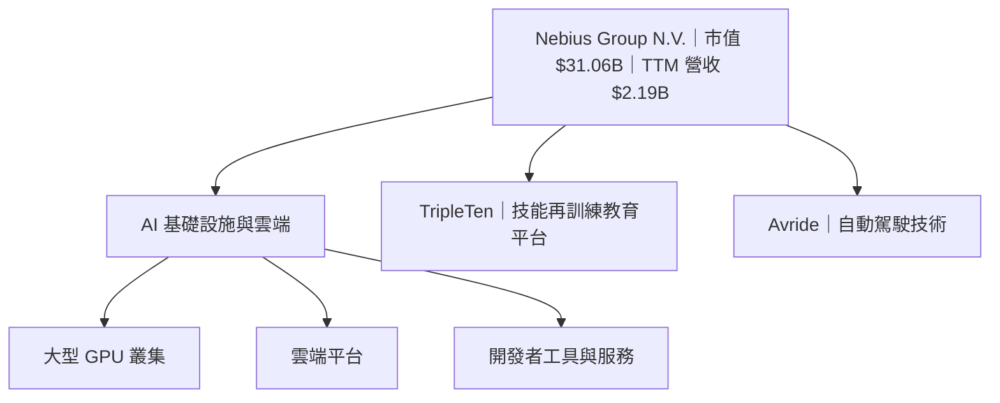
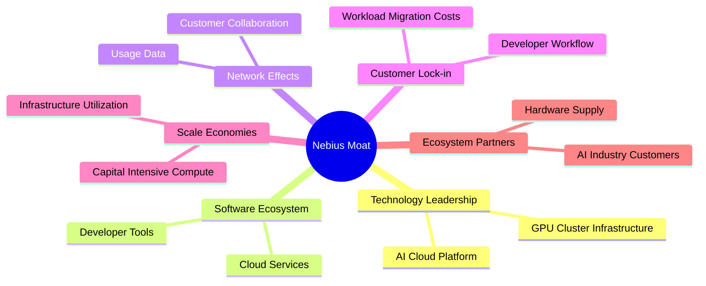
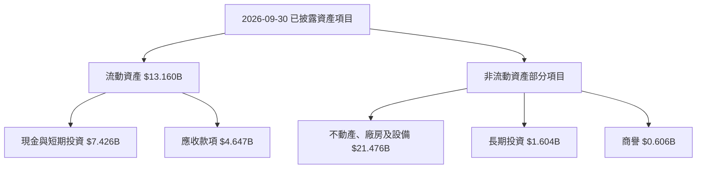
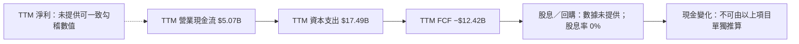
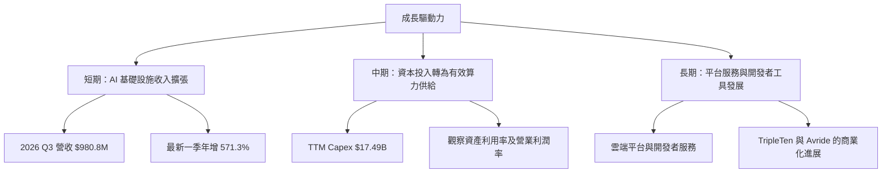
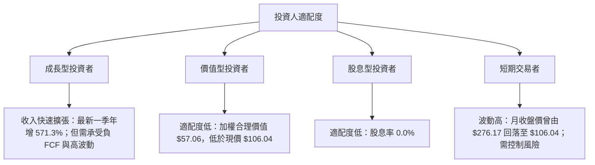

# NBIS 基本面深度分析報告
> **報告日期**：2026-11-18 ｜ **語言**：繁體中文 ｜ **數據來源**：Yahoo Finance、Finviz、StockAnalysis、Roic.ai ｜ **分析師**：CFA 級機構研究

## 目錄

| # | 章節 | 核心結論 |
|---|------|----------|
| 1 | 執行摘要 | 賣出；加權合理價值 $57.06；MOS −85.8% |
| 2 | 公司概覽與商業模式 | AI 基礎設施是主要業務方向；市場份額與收入分部數據未提供 |
| 3 | 損益表深度分析 | TTM 營收 $2.19B；最新一季年增 571.3%；TTM 營業利益率 −23.0% |
| 4 | 資產負債表分析 | 淨負債 $8.67B；現金與短期投資 $7.43B |
| 5 | 現金流量深度分析 | TTM FCF −$12.42B；高資本支出令現金流承壓 |
| 6 | 獲利能力與資本效率 | ROIC 未提供；WACC 7.93%，目前無法證明已創造股東價值 |
| 7 | 相對估值分析 | NBIS P/S 14.18x，高於同業中位數 5.0x |
| 8 | DCF 內在價值評估 | DCF 不適用：TTM 營業利益為負；以相對估值與分析師共識三角驗證 |
| 9 | 成長催化劑 | AI 基礎設施需求及新增產能是潛在催化劑，時間與量化指引未提供 |
| 10 | 風險矩陣 | 估值、資本支出與融資需求為主要風險 |
| 11 | 投資建議 | 賣出；加權合理價值 $57.06，監控營運轉盈與 FCF 改善 |

---

## 1. 執行摘要

截至 2026-11-17 收盤，NBIS 股價為 **$106.04**。TTM 營收為 **$2.19B**，最新一季營收年增 **571.3%**，反映 AI 基礎設施需求及快速放量；但 TTM 營業利益率為 **−23.0%**、TTM FCF 為 **−$12.42B**，且淨負債為 **$8.67B**。依同業 P/S 與分析師共識計算的加權合理價值為 **$57.06**，MOS 為 **−85.8%**，依規則 20 評級為 **賣出**。DCF 因 TTM 營業利益為負而不適用；結論主要受相對估值、巨額資本支出及獲利尚未穩定所支持。

### 1.0 一頁式投資儀表板（Portfolio Manager 30 秒速讀）

| 項目 | 內容 |
|------|------|
| **投資論點（3 句）** | ① TTM 營收 **$2.19B**，最新一季年增 **571.3%**，顯示 AI 基礎設施收入迅速擴大。② TTM 營業利益率 **−23.0%**、TTM FCF **−$12.42B**，成長仍伴隨高額投入。③ 股價 **$106.04**，高於加權合理價值 **$57.06**，反映估值對未來獲利兌現要求偏高。 |
| **綜合評分** | **4.3/10**（引用 1.1 評分卡） |
| **財務健康** | 🔴 現金與短期投資 **$7.43B**，但總債務 **$16.10B**，淨負債 **$8.67B**；TTM FCF 為負。 |
| **ROIC vs WACC** | ROIC **N/A** vs WACC **7.93%**；缺少可比 ROIC，且 TTM 營業虧損，暫無法判定是否創造價值。 |
| **FCF 趨勢** | TTM FCF **−$12.42B**；FCF Yield **−39.99%**。 |
| **估值** | Forward P/E **−34.64x** ｜ EV/EBITDA **64.92x** ｜ FCF Yield **−39.99%** |
| **DCF 內在價值（基準）** | **N/A**；TTM 營業利益為負，未提供有效 DCF 結果。 |
| **安全邊際（MOS）** | **−85.8%**＝(**$57.06 − $106.04**) ÷ **$57.06**；🔴 小於 10%，無安全邊際。 |
| **預期報酬（基準情境 12M）** | N/A；DCF 情境未提供。加權合理價值對現價的隱含上行空間為 **−46.2%**，不是 12 個月報酬預測。 |
| **關鍵風險（前二）** | 高資本支出造成 FCF 壓力；高估值與淨負債增加融資及估值回檔風險。 |
| **評級 + 信心度** | 🔴 **賣出** ｜ 信心：中；估值訊號明確，但公司處於高速擴張期且資料品質有待確認。 |

### 1.1 綜合評分卡（全報告唯一）

| 維度 | 評分（1–10） | 主要依據（引用數字與其來源章節） |
|------|--------------|----------------------------------|
| 成長性 | 9 | TTM 營收成長率 N/A；最新一季年增 **571.3%**，但成長持續性仍須觀察（第 3 章）。 |
| 獲利能力 | 3 | TTM 營業利益率 **−23.0%**；ROIC N/A，WACC **7.93%**（第 6 章）。 |
| 財務健康 | 4 | 淨負債 **$8.67B**、流動比率 **5.306**、DSO **673 天**（第 4 章）。 |
| 估值 | 1 | MOS **−85.8%**；公司 P/S **14.18x**，同業中位數 **5.0x**（第 7、8 章）。 |
| 護城河 | 5 | 有全堆疊 AI 基礎設施及軟體平台方向，但市場份額、客戶留存與收入分部資料未提供（第 2 章）。 |
| 管理層與資本配置 | 4 | FY2025 Capex **$4.07B**、FY2025 SBC **$83.2M**；缺少可驗證的投資回報與回購資料（第 3、5 章）。 |
| **綜合評分** | **4.3** | 六項算術平均：(**9 + 3 + 4 + 1 + 5 + 4**) ÷ 6 = **4.3**。 |

### 1.2 五大投資論點 + 三大核心風險

| 類型 | 項目 | 具體依據 | 信心度 |
|------|------|----------|--------|
| 🟢 **投資論點①** | AI 基礎設施收入快速擴大 | 最新一季營收 **$980.8M**，年增 **571.3%**；若新增 GPU 產能能轉為有效使用率，收入基礎可能繼續擴大。 | 🟢 高 |
| 🟢 **投資論點②** | 毛利率已反映高附加值收入組合 | TTM 毛利率 **76.0%**；如雲端服務收入占比增加且定價維持，理論上有助抵銷部分固定成本。 | 🟡 中 |
| 🟢 **投資論點③** | 流動性指標顯示短期資產緩衝 | 現金與短期投資 **$7.43B**、流動比率 **5.306**；提供一定短期資金緩衝，但不能替代正 FCF。 | 🟡 中 |
| 🟢 **投資論點④** | 業務不只提供硬體算力 | 公司描述涵蓋 GPU 叢集、雲端平台、開發者工具與服務；平台化若提高客戶黏著度，長期可能改善收入品質。 | 🟡 中 |
| 🟢 **投資論點⑤** | 分析師共識仍高於現價 | 20 位分析師平均目標價 **$234.50**，高於 **$106.04**；但該共識不等於已實現現金流，也未消除高估值風險。 | 🟡 中 |
| 🟡 **風險①** | 巨額資本支出與自由現金流消耗 | TTM Capex **$17.49B**、TTM FCF **−$12.42B**；若產能利用率或客戶需求不及預期，投資回收期可能拉長。 | 🔴 高衝擊 |
| 🔴 **風險②** | 估值與基本面落差 | P/S **14.18x**，高於同業中位數 **5.0x**；加權合理價值 **$57.06**，低於現價 **$106.04**。 | 🔴 高衝擊 |
| 🟡 **風險③** | 淨負債及應收帳款天數偏高 | 淨負債 **$8.67B**、DSO **673 天**；可能增加現金周轉與融資風險，但需更多合約與應收帳款披露才能判斷成因。 | 🟡 中高 |

### 1.3 快速統計卡片

| 指標 | 公司實際值（期間） | 同業中位數 | 狀態 |
|------|--------------------|------------|------|
| 營收成長（TTM） | **N/A** | — | 🟡 未提供可引用的 TTM 年增率 |
| 營收成長（最新一季年增） | **571.3%** | **29.6%** | 🟢 遠高於同業中位數；基期與業務擴張影響須留意 |
| 毛利率（TTM） | **76.0%** | **66.8%** | 🟢 高於同業中位數 |
| 營業利益率（TTM） | **−23.0%** | — | 🔴 尚未達營業獲利 |
| ROIC（TTM） | **N/A** | — | 🟡 缺少可計算資料 |
| Forward P/E | **−34.64279x** | **−28.1x** | 🔴 負盈餘使 P/E 解讀失真 |
| FCF Yield（TTM） | **−39.99%** | — | 🔴 大幅負值 |
| Piotroski F-Score | **N/A** | — | 🟡 缺少相隔一年的 SEC TTM 數據 |

### 1.4 投資結論

```text
╔══════════════════════════════════════════════════════════════════╗
║                    📊 投資結論摘要                               ║
╠══════════════════════════════════════════════════════════════════╣
║  評級：🔴 賣出（依規則 20，未作質化調整）                        ║
║  價格（2026-11-17 收盤）：$106.04                                ║
║  DCF 內在價值（基準）：N/A（TTM 營業利益為負）                  ║
║  安全邊際 MOS：−85.8%（以加權合理價值 $57.06 為分母）           ║
║  加權合理價值（8.8）：$57.06                                     ║
║  綜合評分：4.3/10（引用 1.1）                                    ║
║  適合投資人：能承受高波動、願意承擔成長與融資風險的投資人；      ║
║              不適合以現金流與估值安全邊際為核心的投資人。        ║
╚══════════════════════════════════════════════════════════════════╝
```

---

## 2. 公司概覽與商業模式

### 2.1 業務結構與收入來源

公司描述顯示，Nebius Group N.V. 為面向 AI 產業建立全堆疊基礎設施的科技公司，提供大型 GPU 叢集、雲端平台，以及開發者工具與服務；另有 TripleTen 教育平台及 Avride 自動駕駛業務。各業務收入金額與營收占比未提供，以下圖示為業務關係，不代表收入比例。



AI 基礎設施是公司描述中的核心方向，但不同業務的營收拆分、毛利與資本配置均未提供，因此不能將總體營收成長直接歸因於單一分部，也不能估算各分部占比。

### 2.2 市場份額

市場份額數據未提供。以公司規模作為參考，NBIS TTM 營收為 **$2.19B**，最新一季營收年增 **571.3%**；同業 CRWV 最新一季年增 **168.2%**，但公司與同業的營收範圍、業務組合及財報期間可能不同，不能單憑增速推斷市場份額。

### 2.3 競爭護城河分析



上圖列出可能構成競爭優勢的業務環節，不代表這些優勢已經以數據證實。現有資料沒有客戶留存率、客戶集中度、轉換成本或平台使用量，故護城河強度仍需後續驗證。

### 2.4 護城河強度

| 護城河項目 | 強度（強／中／弱） | 證據（引用數字或事實） | 會削弱它的情況 |
|------------|--------------------|------------------------|----------------|
| 技術與運算基礎設施 | 中 | 提供大型 GPU 叢集與 AI 雲端服務；TTM 毛利率 **76.0%**，但未提供與單一產品或客戶的對應資料。 | GPU 供應受限、競爭者以更低價格提供算力，或產能利用率偏低。 |
| 軟體與開發者工具 | 中 | 公司提供雲端平台及開發者工具；未披露付費用戶、使用量或收入占比。 | 開發者可低成本轉移工作負載，或雲端服務缺乏差異化。 |
| 網路效應 | 弱 | 未提供客戶數、開發者社群規模或客戶間網路效應指標。 | 使用者增長未能降低成本或改善產品價值。 |
| 客戶鎖定 | 弱 | 未提供合約期限、續約率、流失率與收入留存率。 | 客戶可多雲部署、短約到期後轉向大型雲端供應商。 |
| 規模效應 | 中 | TTM Capex **$17.49B**，顯示基礎設施資本密集；但高投資本身不代表已有成本優勢。 | 資本成本上升、折舊快於收入增長、產能使用不足。 |
| 生態夥伴 | 弱 | 提供的資料未列出可量化的供應商或策略夥伴關係。 | 關鍵 GPU、電力、網路資源受限或供應條件轉弱。 |

**1.1「護城河」評為 5/10**：公司已有全堆疊 AI 基礎設施與軟體服務方向，但關鍵的留存、客戶轉換成本、使用量與分部收入證據尚缺。

---

## 3. 損益表深度分析

### 3.1 年度收入成長趨勢（近 4 年）

以下收入採年度損益表數據。歷史營收經歷低基期及快速擴張，年度增速不宜直接外推為可持續成長率。

```text
╔══════════════════════════════════════════════════════════════════╗
║            Nebius Group 年度收入趨勢（FY2022-FY2025）            ║
╠══════════════════════════════════════════════════════════════════╣
║  FY2022  $13.50M   ▏                       YoY：—                ║
║  FY2023   $9.80M   ▏                       YoY：−27.4% 🔴        ║
║  FY2024  $91.50M   ████                    YoY：+834.7% 🟢       ║
║  FY2025 $529.80M   ████████████████████████ YoY：+479.0% 🟢      ║
╠══════════════════════════════════════════════════════════════════╣
║  FY2022-FY2025 營收 CAGR：約 +240.5%                             ║
║  （以年度收入 $13.50M 與 $529.80M 計算；歷史基期極低）          ║
╚══════════════════════════════════════════════════════════════════╝
```

FY2024 與 FY2025 的收入擴張幅度很大，但年度財務資料呈現業務規模快速變化，不能把三年 CAGR 當作成熟期增長預期。2026 年季度收入進一步攀升，然而 TTM Revenue growth 的正式數值為 **N/A**，因此本報告不以其他來源的不同期間成長率替代該指標。

### 3.2 季度收入趨勢分析

QoQ 由相鄰季度收入計算；YoY 採季度資料列出的單季年增率。YoY 是單季比較，**不是 TTM 成長率**。

| 季度 | 營收 | QoQ 成長 | 最新一季年增率 | 備註 |
|------|------:|---------:|---------------:|------|
| 2025 Q4 | $227.7M | 由 2025 Q3 計算約 **+56.0%** | **546.88%** | 收入基數仍在快速擴張。 |
| 2026 Q1 | $399.0M | **+75.2%** | **683.89%** | QoQ 仍大幅上升。 |
| 2026 Q2 | $582.3M | **+46.0%** | **454.04%** | 年增仍高，但低於 Q1。 |
| 2026 Q3 | $980.8M | **+68.4%** | **571.3%** | 依 VERIFIED FIGURES 原值引用；是單季年增率。 |

季度收入加速支持需求正在擴張的判斷，但高增長不等於高自由現金流。產能建置與收入確認時間可能不同，且 TTM Capex 已達 **$17.49B**；後續應觀察收入是否足以吸收資本成本及折舊。

### 3.3 利潤率演變分析

年度利潤率以年度毛利或營業利益除以年度營收計算。部分年份營收基數很低，導致比例極端，應優先看方向與絕對金額。

| 利潤率指標 | FY2022 | FY2023 | FY2024 | FY2025 | 趨勢 | 評估 |
|------------|-------:|-------:|-------:|-------:|------|------|
| **毛利率** | 約 −110.4% | 約 −100.0% | 約 52.2% | 約 68.6% | 2024–2025 明顯轉正並上升 | 🟡 產品與收入組合改善，但季度與 TTM 口徑有差異 |
| **營業利益率** | 約 −1,170.4% | 約 −2,915.3% | 約 −436.7% | 約 −115.5% | 絕對值收窄，但仍大幅虧損 | 🔴 仍未形成穩定營業獲利 |
| **淨利率** | 約 5,523.0% | 約 2,462.2% | 約 −700.9% | 約 15.6% | 歷史波動極大 | 🔴 可能受一次性項目及非營運損益影響，不能視為持續水準 |

**利潤率演變深度解析：** FY2025 毛利率約 **68.6%**，相較 FY2024 約 **52.2%** 改善，可能反映收入規模擴大與業務組合變化；現有資料不足以分辨定價、產品組合或成本控制各自貢獻。FY2025 營業虧損為 **$611.7M**，高於 FY2024 的 **$399.6M**，顯示毛利增長尚未抵銷營運費用擴張。

季度資料亦有口徑衝突：2026 Q3 損益表列營業利益 **$50.4M**，按季度收入計算為正；但 VERIFIED FIGURES 提供的最新一季營業利益率為 **−18.7%**。本報告保留並引用標準化區塊中的 **−18.7%**，同時將差異視為資料品質警訊，不自行調和。

### 3.4 費用結構分析

目前沒有完整的 TTM 營運費用分項、折舊、利息及各業務成本資料，不適合製作能代表實際費用占比的 Mermaid 圓餅圖。可確認的 FY2025 研發費用為 **$177.3M**，占 FY2025 營收 **$529.8M** 約 **33.5%**；此比例僅為單年度研發費用占營收，不等同全部營運費用結構。

```text
╔══════════════════════════════════════════════════════════════════╗
║               FY2025 已知研發費用與營收規模                      ║
╠══════════════════════════════════════════════════════════════════╣
║  FY2025 營收      $529.8M  ██████████████████████████████        ║
║  FY2025 研發費用  $177.3M  ██████████                            ║
║  研發費用／營收    33.5%   （僅比較已披露的兩項數字）            ║
╚══════════════════════════════════════════════════════════════════╝
```

### 3.5 季度 EPS 趨勢與盈餘品質（Quality of Earnings）

最近四季 EPS Est 與 EPS Act 均未提供，無法判斷公司是否超預期或不及預期。StockAnalysis 顯示的季度 EPS 序列與其他來源的淨利數據存在口徑差異，故不拼接成單一 EPS 趨勢。

| 盈餘品質項目 | 數值／佔比 | 評估 |
|--------------|------------|------|
| 股權薪酬 SBC／營收 | FY2025 SBC **$83.2M** ÷ FY2025 營收 **$529.8M** = **15.7%**；近四季 SBC 合計 **$221.4M** ÷ TTM 營收 **$2.19B** = **約 10.1%** | 🔴 SBC 具有實質稀釋成本；近四季計算採季度 SBC 合計。 |
| SBC／營業現金流 | FY2025：**$83.2M ÷ $384.8M = 21.6%**；近四季：**$221.4M ÷ $5.07B = 約 4.4%** | 🟡 兩種期間比率差異大，且 TTM 營業現金流受營運資金項目影響。 |
| FCF／淨利（現金轉換率） | 以 TTM FCF **−$12.42B** 與 StockAnalysis TTM 淨利 **$122.9M** 計算，約 **−10,105%** | 🔴 FCF 轉換為負且極端；顯示資本支出遠高於當期會計獲利，比例不宜單獨解讀。 |
| 一次性／非經常性損益 | 未提供可完整拆解的明細；年度淨利在 FY2022–FY2025 間大幅波動 | 🟡 可能有非營運項目影響，但無法定量確認。 |
| 有效稅率異常 | **29.0%**（最新年度有效稅率） | 🟡 未提供稅務利益明細；不將單一稅率外推為穩定長期稅率。 |
| 資本化支出 vs 費用化 | TTM Capex **$17.49B**；會計費用化與資產化項目的細分資料不足 | 🔴 高資本支出會形成折舊負擔；未能據此判定是否有不當延後費用。 |

**盈餘品質結論：** TTM 淨利指標與營業虧損、負 FCF 同時存在，且季度淨利波動大，會計盈餘尚不足以代表可分配的經濟盈餘。估值應優先觀察現金流、利用率、資本支出回收與 SBC 稀釋，而非僅看 EPS 或短期淨利。

---

## 4. 資產負債表分析

### 4.1 資產結構分解

最新季度可見流動資產與部分非流動資產明細，但完整 TTM 總資產組成與細項加總未提供；下圖只展示已披露的主要項目，不將缺漏項目反推為完整總資產。



應收款項與固定資產規模都較大：應收款項可能牽涉客戶信用及收款周期，固定資產則與資本密集型 AI 基礎設施擴張相符。由於未提供 TTM 完整總資產及負債明細，不能以此圖計算各資產占總資產比率。

### 4.2 流動性與營運資金分析

| 指標 | 最新值 | 一年前 | 變化 | 解讀 |
|------|--------:|---------|------|------|
| 流動比率 | **5.306** | N/A | N/A | 短期資產相對流動負債的帳面緩衝較高；但不能抵銷資本支出造成的現金消耗。 |
| 速動比率 | **4.847** | N/A | N/A | 顯示當前流動性指標充裕；仍須觀察應收帳款能否按期收現。 |
| DSO 應收帳款天數 | **673 天** | N/A | N/A | DSO 很高，可能與合約付款安排、帳款認列時間或資料口徑有關；未有披露前不推定單一成因。 |
| DIO 存貨天數 | **N/A** | N/A | N/A | 公司未報告該項存貨餘額；不可補算。 |
| DPO 應付帳款天數 | **368 天** | N/A | N/A | 應付帳款付款期偏長；可能提高短期現金保留，但需檢查供應商條款與付款狀況。 |
| CCC 現金轉換週期 | **N/A** | N/A | N/A | 因 DIO 缺失而無法按 DSO + DIO − DPO 計算。 |

一年前的品質指標沒有可引用數據，因此不推算天數變化。DSO **673 天** 對現金流與應收風險的判斷重要性高，後續應追蹤應收帳款餘額、收入增長、回款與逾期帳齡。

### 4.3 債務結構分析

```text
╔══════════════════════════════════════════════════════════════════╗
║                    NBIS 債務健康診斷                             ║
╠══════════════════════════════════════════════════════════════════╣
║  總債務：          $16.10B  ████████████████████  🔴 高          ║
║  現金及短期投資：   $7.43B  █████████              🟡 有緩衝      ║
║  淨負債：           $8.67B  ███████████            🔴 淨負債      ║
║                                                                  ║
║  流動比率：         5.306   🟢 帳面流動性較高                    ║
║  Debt/EBITDA：      N/A     TTM EBITDA 正值與口徑資料不足         ║
║  Interest Coverage：N/A     利息費用與利息保障倍數未提供         ║
╚══════════════════════════════════════════════════════════════════╝
```

總債務與淨負債採 VERIFIED FIGURES 原值。Debt/Equity 雖列為 **130.875**，但其分子、分母口徑及近期資本結構變動可能使指標失真；因此不以它取代淨負債與現金流分析。資產負債表中的 FY2025 總債務為 **$4.97B**，明顯低於 2026-09-30 TTM 報告的總債務，表示期間內融資／租賃負債可能大幅增加，需依正式申報資料確認來源及到期結構。

### 4.4 股東權益趨勢

| 年度 | 股東權益 |
|------|---------:|
| 2022 | $4.25B |
| 2023 | $3.29B |
| 2024 | $3.25B |
| 2025 | $4.59B |

```text
╔══════════════════════════════════════════════════════════════════╗
║                   歷年股東權益變化                               ║
╠══════════════════════════════════════════════════════════════════╣
║  FY2022  $4.25B  ████████████████████████                        ║
║  FY2023  $3.29B  ██████████████████                              ║
║  FY2024  $3.25B  ██████████████████                              ║
║  FY2025  $4.59B  ██████████████████████████                      ║
╚══════════════════════════════════════════════════════════════════╝
```

FY2025 權益回升至 **$4.59B**，但資產負債表同時顯示總債務升至 **$4.97B**。權益上升不能單獨視為內生獲利累積；需搭配增發、收購、其他綜合損益及負債變動等資料判讀。

---

## 5. 現金流量深度分析

### 5.1 現金流量瀑布圖

FY2025 淨利 **$82.5M**、TTM 營業現金流 **$5.07B** 與 TTM Capex **$17.49B** 並非同一期間，因此不將不同期間數字拼成單期瀑布。以下展示 TTM 現金流關係；淨利與股息／回購金額未提供同口徑資料。



### 5.2 FCF 轉換率趨勢

| 年度／期間 | FCF | 淨利 | FCF／淨利 | 解讀 |
|-------------|----:|-----:|----------:|------|
| FY2022 | $682.4M | $745.6M | 約 **91.5%** | 正 FCF；淨利與現金流接近，但公司業務與資產組合仍在變化。 |
| FY2023 | $746.9M | $241.3M | 約 **309.6%** | 現金流高於淨利，可能受營運資金與非現金項目影響。 |
| FY2024 | −$561.9M | −$641.4M | 約 **87.6%** | 兩者皆為負值，比例本身不代表正向現金轉換。 |
| FY2025 | −$3.68B | $82.5M | 約 **−4,460.6%** | 大額 Capex 令 FCF 與淨利明顯背離。 |
| TTM 至 2026-09-30 | −$12.42B | 可比淨利資料不足 | N/A | TTM FCF 為負；不以不一致期間的淨利補算轉換率。 |

### 5.3 自由現金流趨勢

```text
╔══════════════════════════════════════════════════════════════════╗
║                    自由現金流歷史趨勢                            ║
╠══════════════════════════════════════════════════════════════════╣
║  FY2022  +$0.68B  ████                  🟢                      ║
║  FY2023  +$0.75B  █████                 🟢                      ║
║  FY2024  −$0.56B  ◀███                  🔴                      ║
║  FY2025  −$3.68B  ◀████████████████████  🔴                      ║
║  TTM     −$12.42B ◀████████████████████  FCF Yield −39.99% 🔴    ║
╚══════════════════════════════════════════════════════════════════╝
```

TTM FCF 的定義為營業現金流減資本支出：**$5.07B − $17.49B = −$12.42B**。Capex 快速上升與 AI 基礎設施擴建相符，但若收入增長不能同步轉為使用率及回款，負 FCF 會推高外部融資需求。

### 5.4 資本配置評估

資料沒有完整的資本用途比例拆分，不能製作具數字的資本配置圓餅圖。已知 FY2025 Capex 為 **$4.07B**、FY2025 SBC 為 **$83.2M**；股息率為 **0.0%**。季度資料顯示 2026-09-30 單季 Capex 為 **$7.30B**，且當季營業現金流為 **−$273.0M**，反映擴張資本支出波動很大。

| 配置項目 | 可引用資料 | 評估 |
|----------|------------|------|
| 資本支出 | FY2025 **$4.07B**；TTM **$17.49B** | 🔴 投資額快速增加，回報需由利用率、營收與毛利驗證。 |
| 股息 | 股息率 **0.0%** | 🟡 未以現金股息回饋股東。 |
| 回購 | N/A（數據未提供） | N/A |
| 股權薪酬 | FY2025 **$83.2M**；近四季約 **$221.4M** | 🟡 有稀釋成本，應持續監測 SBC 占營收比例。 |
| 融資與現金留存 | 現金與短期投資 **$7.43B**；總債務 **$16.10B** | 🔴 淨負債狀態下，後續資本開支需要良好融資與回款規劃。 |

---

## 6. 獲利能力與資本效率

### 6.1 ROE／ROA／ROIC 趨勢

| 指標 | 可用數值 | 評估 |
|------|----------|------|
| ROE | TTM **1.5%** | 🟡 接近低報酬，且需留意淨利與權益期間口徑。 |
| ROA | TTM **−1.0%** | 🔴 資產尚未轉化為穩定正回報。 |
| ROIC | N/A | 🟡 缺少可一致計算投入資本與營業稅後淨利的數據。 |
| 行業均值比較 | N/A（數據未提供） | 不以無來源的同業均值補值。 |

ROE、ROA 來自提供的 TTM 指標；歷史年度資料包含重大淨利波動與資產變動，無法在口徑未確認前補造年度 ROIC 趨勢。

### 6.2 ROIC vs WACC 分析（核心價值創造判斷）

WACC 採成本資本資料列示的 **7.93%**。Beta 使用調整後 **1.36**，符合區塊指定；原始 Beta 為 **1.54**。提供的 WACC 組成如下：

```text
╔══════════════════════════════════════════════════════════════════╗
║                ROIC vs WACC 深度分析                            ║
╠══════════════════════════════════════════════════════════════════╣
║  無風險利率（10Y 美債）：       5.10%                            ║
║  市場風險溢酬（假設）：         5.00%                            ║
║  原始 Beta（Yahoo）：           1.54                             ║
║  調整後 Beta：                  1.36                             ║
║  股權成本 Ke：                  5.10% + 1.36×5.00% = 11.90%     ║
║  稅前債務成本：                 0.38%                            ║
║  有效稅率：                     29.0%                            ║
║  資本權重：股權 65.9%／債務 34.1%                                ║
║  WACC：                         7.93%                            ║
║                                                                  ║
║  ROIC：N/A（缺少可比 NOPAT 與投入資本）                           ║
║  EVA：N/A（ROIC 缺失，無法計算 ROIC − WACC）                     ║
║                                                                  ║
║  結論：目前不能證明 ROIC 高於 7.93% 的資本成本；                  ║
║        TTM 營業利益率 −23.0%，價值創造仍待驗證。                  ║
╚══════════════════════════════════════════════════════════════════╝
```

成本資本資料中的股權成本可由 CAPM 重算：**5.10% + 1.36 × 5.00% = 11.90%**。稅後債務成本為 **0.38% × (1 − 29.0%) = 0.2698%**。以公布權重代入，WACC 約為 **65.9% × 11.90% + 34.1% × 0.2698% = 7.93%**（四捨五入）。無風險利率的觀察日未提供，不另指定日期。

**價值創造判斷：** ROIC N/A，不能以缺失數值宣稱 ROIC 已高於或低於 WACC。TTM 營業利益率為負，代表當前營業層面尚未證明可覆蓋資本成本；後續需觀察營業利潤率轉正、資本支出回報與現金流。

### 6.3 杜邦三因素分解

N/A（數據未提供：缺少可一致使用的淨利、營收、總資產及正權益資料；品質指標計算結果為 N/A。）

### 6.4 財務體質：Piotroski F-Score

N/A（品質指標為 N/A：需要相隔一年的 SEC 申報 TTM 數據；九項測試的個別結果未提供，因此不補列或推測。）

---

## 7. 相對估值分析

### 7.1 同業估值比較表格

同業數據採 Peer multiples；NBIS 公司倍數採市場估值數據。負 P/E 代表盈餘為負，不能按一般盈利型公司方式比較。

| 估值指標 | **NBIS** | **CRWV** | **ORCL** | **MSFT** | NBIS 評估 |
|----------|---------:|---------:|---------:|---------:|-----------|
| **Trailing P/E** | 89.86x | N/A | 18.0x | 26.4x | 🔴 NBIS 高倍數；但不同盈利結構降低可比性。 |
| **Forward P/E** | −34.64279x | −28.1x | 10.4x | 20.9x | 🔴 NBIS 與 CRWV 為負值，負盈餘下比較資訊有限。 |
| **P/S Ratio** | 14.182989x | 2.8x | 5.0x | 10.9x | 🔴 高於三家同業中位數 **5.0x**。 |
| **EV/EBITDA** | 64.923x | 17.2x | 14.1x | 18.6x | 🔴 明顯高於同業中位數 **17.2x**。 |
| **最新一季營收年增** | 571.3% | 168.2% | 29.6% | 18.8% | 🟢 增速領先，但不可直接視作盈利能力。 |
| **毛利率（TTM）** | 76.0% | 66.8% | 64.0% | 67.7% | 🟢 高於同業中位數 **66.8%**；仍需轉化為營業利益與 FCF。 |

同業 P/S 中位數為 **5.0x**，EV/EBITDA 中位數為 **17.2x**。NBIS 的高增長和較高毛利率為溢價提供部分依據，但 TTM 營業利益率 **−23.0%**、FCF Yield **−39.99%**，顯示當前價格已包含未來獲利擴張預期。

### 7.2 歷史估值區間分析

N/A（數據未提供：沒有可引用的「Valuation vs own history」歷史估值區間或百分位資料。）

價格歷史顯示股價波動顯著：2026 年 6 月月收盤價 **$276.17**，至 2026-11-17 收盤 **$106.04**，按月收盤價比較回落約 **61.6%**。此為價格表現而非估值百分位，不能替代歷史 P/S 或 EV/EBITDA 區間。

### 7.3 情境價值（Bear / Base / Bull，照抄 DCF MODEL 的 Scenarios）

N/A（DCF 無法計算：TTM 營業利益為負，DCF MODEL 未提供悲觀、基準與樂觀情境；不另自行設定 DCF 目標價。）

### 7.4 相對估值隱含價格區間

```text
╔══════════════════════════════════════════════════════════════════╗
║                  相對估值與共識參考價                            ║
╠══════════════════════════════════════════════════════════════════╣
║  $37.35 同業 P/S 隱含價值 ───── $57.06 加權合理價值 ───── $106.04║
║  同業 P/S：37.35 美元；依 Peer 中位數 P/S 5.0x × TTM 營收      ║
║  分析師共識：234.50 美元；20 位分析師平均目標價                ║
║  同業 Forward P/E：不可計算；依既定估值方法不納入               ║
╚══════════════════════════════════════════════════════════════════╝
```

| 方法 | 每股價值 | 相對現價 | 依據 |
|------|---------:|---------:|------|
| 同業 P/S | **$37.35** | **−64.8%** | CRWV、ORCL、MSFT 同業 P/S 中位數 **5.0x**，依公司 TTM 營收估值；每股價值照估值方法結果引用。 |
| 分析師共識目標價 | **$234.50** | **+121.2%** | 20 位分析師平均目標價，作為參考方法。 |
| 同業 Forward P/E | N/A | — | 不可計算，既定權重已由可用方法分配。 |

---

## 8. DCF 內在價值評估（Discounted Cash Flow）

> **本章結論：DCF MODEL 為 N/A。** TTM 營業利益為負，程式模型未提供可用 DCF 估值。依指定規則，不自行建立現金流預測、終值、敏感性矩陣或反推 DCF。故 DCF 內在價值、DCF 折溢價及 DCF 情境目標價均為 N/A；本章安全邊際只在 8.8 以加權合理價值計算。

### 8.0 估值推理鏈（Thinking Logic）

NBIS 的價值理論上取決於 AI 基礎設施收入能否轉化為營業獲利與自由現金流；現有可量化資料包括 TTM 營收 **$2.19B**、毛利率 **76.0%**、營業利益率 **−23.0%**、TTM FCF **−$12.42B**。但在營業利益仍為負時，將虧損折現至未來會使 DCF 對轉盈時間、利潤率與再投資假設高度敏感，因此不以未經驗證的假設補造模型。

| 決策點 | 本報告採用 | 理由（含數字） | 曾考慮但否決 | 否決理由 |
|--------|-----------|----------------|--------------|----------|
| 現金流定義 | N/A | TTM 營業利益為負，DCF MODEL 未提供。 | 自行預測 FCFF | 不符合預先計算模型數值須照抄、不得另建模型的要求。 |
| 預測期 N | N/A | 模型未提供預測期。 | 任意設定 5–10 年 | 缺少可引用的模型輸入與營運預測。 |
| 終值方法 | N/A | 未提供終值、永續成長率或退出倍數。 | Gordon Growth／退出倍數 | 沒有模型數據可供稽核。 |
| EBIT 基礎 | N/A | 無可用 DCF 模型假設。 | GAAP／非 GAAP 外推 | 會造成未經驗證的盈利預測。 |

模型最脆弱的一環是營業獲利能否在大額 Capex 背景下轉正並產生正 FCF；若不能，按現價所隱含的未來獲利期待將更難支持。

### 8.1 模型假設總表（Model Inputs）

N/A（數據未提供：DCF MODEL 未提供預測期、營收 CAGR、期末營業利潤率、稅率、Capex、折舊、營運資金、SBC、稀釋股數及永續成長率。不得另行建立假設表或模型。）

### 8.2 折現率推導（WACC）

WACC 依成本資本數據引用為 **7.93%**；Beta 使用調整後 **1.36**，原始 Beta **1.54**，調整方式為 **⅔ × 1.54 + ⅓ × 1 = 1.36**。此為資本成本資料提供值，不代表 DCF MODEL 已可用。

```text
╔══════════════════════════════════════════════════════════════════╗
║                    WACC 推導（折現率）                           ║
╠══════════════════════════════════════════════════════════════════╣
║  無風險利率 Rf：             5.10%                              ║
║  市場風險溢酬 ERP：          5.00%（假設值，依資本成本資料）    ║
║  原始 Beta：                 1.54                               ║
║  調整後 Beta：               ⅔×1.54 + ⅓×1 = 1.36               ║
║  股權成本 Ke：               5.10% + 1.36×5.00% = 11.90%       ║
║  稅前債務成本 Kd：           0.38%                              ║
║  有效稅率：                  29.0%                              ║
║  稅後 Kd：                   0.38%×(1−29.0%) = 0.2698%         ║
║  股權／債務權重：            65.9%／34.1%                       ║
║  WACC：                      65.9%×11.90% + 34.1%×0.2698%      ║
║                              = 7.93%                            ║
╚══════════════════════════════════════════════════════════════════╝
```

WACC 五步複算：
1. **Ke** = 5.10% + 1.36 × 5.00% = **11.90%**。
2. **稅前 Kd** = 資本成本資料列示的利息／債務成本 **0.38%**；利息與平均計息負債明細未提供，不能獨立重算。
3. **稅後 Kd** = 0.38% × (1 − 29.0%) = **0.2698%**。
4. **資本權重** = 股權 **65.9%**、債務 **34.1%**；市值與計息負債範圍的獨立勾稽資料未提供。
5. **WACC** = 65.9% × 11.90% + 34.1% × 0.2698% = **約 7.93%**。

### 8.3 逐年自由現金流預測（基準情境）

N/A（數據未提供：DCF MODEL 未提供逐年營收、EBIT、NOPAT、FCFF、折現因子與現值。TTM 營業利益為負，不另建預測模型。）

### 8.4 終值計算（Terminal Value）

N/A（數據未提供：沒有 DCF 預測期末 FCFF、永續成長率、退出倍數或終值現值；不計算 Gordon Growth 或退出倍數終值。）

### 8.5 企業價值 → 每股內在價值（Bridge）

N/A（數據未提供：沒有 DCF 企業價值、現金／債務橋接、終值現值或模型稀釋股數，故 DCF 每股內在價值與 DCF 折溢價均不可計算。）

### 8.6 敏感性分析（WACC × 永續成長率）

N/A（數據未提供：DCF MODEL 未提供敏感性矩陣；不得自行試算。）

### 8.7 反推 DCF（Reverse DCF：市場在預期什麼）

N/A（數據未提供：沒有可用 DCF 模型基準輸入，無法在固定其他條件下反解單一變數。）

### 8.8 估值三角驗證與安全邊際

估值方法與權重採用估值方法資料的固定結果。公司類型為未獲利企業；同業 Forward P/E 因不可計算而未納入，權重由可計算方法分配。

| 估值方法 | 隱含每股價值 | 上行空間（÷現價） | 權重 | 說明 |
|----------|--------------:|------------------:|------:|------|
| 同業 P/S | $37.35 | −64.8% | 90% | 同業中位數 P/S **5.0x**；方法輸出值照列。 |
| 分析師共識目標價 | $234.50 | +121.2% | 10% | 20 位分析師平均目標價；不視為基本面已實現價值。 |
| **加權合理價值** | **$57.06** | **−46.2%** | **100%** | 依兩項估值方法及固定權重計算。 |

加權合理價值按方法輸出計算：**$37.35 × 90% + $234.50 × 10% = $57.06**（逐項相乘後為 $33.615 + $23.45，合計 $57.065；依估值方法區塊原值採用 **$57.06**）。相對現價的 MOS 及上行空間：

- **MOS** = ($57.06 − $106.04) ÷ $57.06 = **−85.8%**。
- **上行空間** = ($57.06 − $106.04) ÷ $106.04 = **−46.2%**。

```text
╔══════════════════════════════════════════════════════════════════╗
║                  估值區間與安全邊際                              ║
╠══════════════════════════════════════════════════════════════════╣
║  $37.35 同業 P/S ─── [$57.06 加權合理價值] ─── $106.04 現價     ║
║                                                                  ║
║  安全邊際 MOS = ($57.06 − $106.04) ÷ $57.06 = −85.8%            ║
║  MOS 評估：🔴 <10%，無安全邊際                                   ║
║  上行空間 = ($57.06 − $106.04) ÷ $106.04 = −46.2%              ║
║                                                                  ║
║  MOS ≥ 10% 對應價格上限：$57.06 × (1 − 10%) = $51.35            ║
║  加權合理價值附近：$51.35–$57.06；高於此區間仍需基本面改善驗證  ║
╚══════════════════════════════════════════════════════════════════╝
```

依規則 20，MOS **−85.8%** 對應 **賣出**；未作一級質化調整。MOS 門檻價格 **$51.35** 僅是以加權合理價值計算的 10% MOS 參考線，不是 DCF 目標價或保證支撐位。

> 🔎 **程式複算（Python，依本節各項自動重算）**
>
> 加權合理價值 = $37.35 × 90% + $234.50 × 10% = **$57.07**（權重合計 100%）
>
> 以價格 $106.04 計：MOS = **-85.8%**，上行空間 = **-46.2%**
>
> ✅ 與本節所寫數值一致。

### 8.9 DCF 模型的局限與失效條件

- **終值依賴度：** N/A；DCF 模型未提供，不能計算終值占 EV 比重。
- **最脆弱的假設：** 未來營業利潤率、產能利用率與 Capex 回收時間；現有資料未提供可用模型參數。
- **不適用情境：** TTM 營業利益率 **−23.0%**、TTM FCF **−$12.42B**，且 Capex **$17.49B**。在獲利尚未穩定前，單一 DCF 估值可靠度偏低，宜結合 EV/Sales、單位經濟性、資本支出效率及未來現金流變化判讀。
- **與第 10 章風險矩陣的連結：** AI 需求減弱會影響收入增速；GPU 利用率不足會壓低利潤率；融資成本或資本供應收緊則會提高再投資壓力。由於 DCF 未可用，不量化上述事件的每股影響。

### 8.10 複算檢核表（Audit Trail）

| # | 檢核項目 | 檢查方式 | 結果 |
|---|----------|----------|------|
| 1 | 高／中敏感度 DCF 輸入四段式推導 | DCF MODEL 為 N/A，無可列輸入 | N/A |
| 2 | DCF 假設均有來歷 | 無模型假設可供核對 | N/A |
| 3 | WACC 算式與權重 | 股權 65.9% + 債務 34.1% = 100%；代入後約 7.93% | ✅ |
| 4 | Kd 分母與債務權重範圍一致 | 計息負債明細未提供，無法獨立核驗來源範圍 | N/A |
| 5 | WACC 與第 6.2 節一致 | 兩處均為 **7.93%** | ✅ |
| 6 | 預測年度數等於 N | 模型未提供預測期 | N/A |
| 7 | FY+1 FCFF 與現值演算 | 無逐年 FCFF | N/A |
| 8 | 預測期 PV 加總 | 無預測期現值 | N/A |
| 9 | WACC > g | g 未提供 | N/A |
| 10 | 終值基於 FY+N 並折現 N 期 | 無終值模型 | N/A |
| 11 | EV 至每股價值橋接 | 無 DCF EV／股權價值 | N/A |
| 12 | SBC 組合與股數相容 | 無 DCF 的 EBIT、SBC 列或股數假設 | N/A |
| 13 | 敏感性矩陣基準格一致 | 敏感性矩陣未提供 | N/A |
| 14 | 矩陣中 WACC ≤ g 處理 | 矩陣未提供 | N/A |
| 15 | 三情境機率相加 | 三情境未提供 | N/A |
| 16 | 反推 DCF 單變數求解與軌跡 | 反推模型未提供 | N/A |
| 17 | MOS 分母及折溢價基準 | MOS 依 8.8 加權合理價值計算；DCF 折溢價 N/A | ✅ |
| 18 | 報告完整至第 11 章 | 已列出 11 個章節 | ✅ |
| 19 | 加權合理價值算式 | 固定方法與權重已列；採用區塊給定加權合理價值 **$57.06** | ✅ |
| 20 | 評級符合 MOS 門檻 | MOS **−85.8%**，評級 **賣出** | ✅ |

---

## 9. 成長催化劑

### 9.1 催化劑時間軸

公司資料未提供具日期的產能上線、合約交付或產品發布時間表，因此不製作含推測日期的 Gantt 圖。依已知資料，可追蹤以下近、中、長期催化劑：

| 時間範圍 | 催化劑 | 可量化追蹤項目 | 目前資料限制 |
|----------|--------|----------------|--------------|
| 短期 | AI 基礎設施收入放量 | 季度營收、單季年增、毛利率 | 最新一季收入 **$980.8M**，年增 **571.3%**；無管理層分部指引。 |
| 中期 | 新增 GPU 產能轉化為客戶使用與營收 | Capex、應收帳款、現金流、營業利益率 | TTM Capex **$17.49B**；產能利用率未提供。 |
| 長期 | 雲端平台、開發者工具及相關業務形成持續收入 | 分部收入、續約率、客戶留存、軟體收入占比 | 各項收入占比及客戶指標未提供。 |

### 9.2 TAM 市場規模分析

N/A（TAM 數據未提供）。NBIS TTM 營收為 **$2.19B**，最新一季營收年增 **571.3%**，顯示公司收入快速擴大；但未提供市場規模、滲透率或可服務市場的可引用數字，因此不估算 TAM 金額。

### 9.3 成長驅動力結構圖



圖中營收、增長率與 Capex 為已提供數據；其餘節點為需要追蹤的質化驅動因素，不能視為已確認的收入來源或時間表。

---

## 10. 風險矩陣

### 10.1 風險評分矩陣

資料未提供各風險的可驗證機率與財務衝擊機率分布。依規則不以主觀數字製作 quadrantChart；以下以定性分級呈現，避免把分析師判斷誤當成公司披露數據。

### 10.2 風險清單詳細分析

| # | 風險項目 | 發生可能性 | 財務衝擊與依據 | 風險評估 | 緩解措施／監控 |
|---|----------|------------|----------------|----------|----------------|
| 1 | 🔴 **高資本支出未能形成相稱回報** | 中高 | TTM Capex **$17.49B**、TTM FCF **−$12.42B**；利用率不足會使折舊與融資負擔更難由收入吸收。 | 🔴 高 | 按季追蹤 Capex、收入、營業利潤率、FCF 與產能利用率；若 Capex 持續大幅超越收入增長，重新評估投資回收期。 |
| 2 | 🔴 **高估值回落** | 高 | NBIS P/S **14.18x**，同業中位數 **5.0x**；股價 **$106.04**，加權合理價值 **$57.06**。 | 🔴 高 | 監控同業倍數、收入成長能否延續及毛利向營業利潤的轉化。 |
| 3 | 🟡 **淨負債與再融資風險** | 中 | 總債務 **$16.10B**，現金及短期投資 **$7.43B**，淨負債 **$8.67B**。 | 🔴 高衝擊 | 追蹤債務到期日、利率、租賃負債及融資安排；這些明細目前未提供。 |
| 4 | 🟡 **應收帳款回收風險** | 中 | DSO **673 天**；若收款周期長於合約預期，可能增加營運資金占用與壞帳風險。 | 🟡 中高 | 檢視應收帳齡、客戶集中度、回款與收入認列政策。 |
| 5 | 🟡 **業務組合與獲利口徑不透明** | 中 | TTM 營業利益率 **−23.0%**；季度損益表與標準化最新一季營業利益率存在差異。 | 🟡 中高 | 以正式季度申報資料核對 GAAP 損益、分部收入、SBC 與折舊。 |
| 6 | 🟡 **高增長基期與需求持續性** | 中 | 最新一季營收年增 **571.3%**；TTM 營收成長率標示 N/A，且無管理層長期指引。 | 🟡 中高 | 追蹤未來數季收入增長、訂單能見度、客戶續約與取消情況。 |

---

## 11. 投資建議

### 11.1 最終評級與評分

依 MOS **−85.8%**，規則 20 對應 **賣出**，本報告未作一級質化調整。1.1 綜合評分為 **4.3/10**，六項分數依序為成長性 **9**、獲利能力 **3**、財務健康 **4**、估值 **1**、護城河 **5**、管理層與資本配置 **4**；高速成長尚未抵銷負 FCF、淨負債與相對估值偏高的風險。

### 11.2 合理價值與隱含報酬率

| 估值參考 | 每股價值 | 相對 2026-11-17 收盤價 $106.04 | 機率／權重 | 備註 |
|----------|---------:|--------------------------------:|------------:|------|
| 同業 P/S | $37.35 | −64.8% | 90% | 固定估值方法權重。 |
| 分析師共識目標價 | $234.50 | +121.2% | 10% | 20 位分析師平均目標價。 |
| **加權合理價值** | **$57.06** | **−46.2%** | **100%** | MOS **−85.8%**。 |
| DCF 悲觀／基準／樂觀情境 | N/A | N/A | N/A | DCF MODEL 未提供，且 TTM 營業利益為負。 |

### 11.3 買入時機與觸發因素

```text
╔══════════════════════════════════════════════════════════════════╗
║                  ✅ 投資觸發因素 Checklist                        ║
╠══════════════════════════════════════════════════════════════════╣
║  重新評估／考慮建倉前，建議觀察：                                 ║
║  ☐ 營業利益率由負轉正，且不是單一季度的一次性結果                ║
║  ☐ TTM FCF 明顯收窄，Capex 增長逐步被收入與回款吸收              ║
║  ☐ DSO 由 673 天改善，或公司披露可解釋該天數的合約條款           ║
║  ☐ 應收帳款、債務到期與租賃負債披露足以評估資金需求              ║
║                                                                  ║
║  加碼觸發條件：                                                   ║
║  ☐ 最新一季年增率仍具韌性，且毛利率改善同時轉化為營業獲利        ║
║  ☐ FCF 連續改善，資本支出與新增營收的關係更清晰                  ║
║  ☐ 股價回到加權合理價值附近或以下，且基本面沒有惡化              ║
║                                                                  ║
║  減碼／退出觸發條件：                                             ║
║  ☐ 收入增長大幅放緩，但 Capex 與債務仍快速上升                   ║
║  ☐ 營業利益率持續惡化或 FCF 進一步擴大負值                       ║
║  ☐ 應收帳款持續增加、回款惡化或流動性指標轉弱                    ║
╚══════════════════════════════════════════════════════════════════╝
```

依加權合理價值 **$57.06** 計算，MOS 達到 10% 時的參考價格為 **$51.35**；但該價格不是保證支撐，也不構成獨立買入建議。若估值下降是由營運惡化而非市場情緒引起，單看價格低於參考線仍不足以支持買入。

### 11.4 投資人適配度分析



### 11.5 每季財報監控清單（Quarterly Watch List）

| 監控項目 | 目前基準 | 觸發加碼／改善訊號 | 觸發減碼／風險訊號 |
|----------|----------|--------------------|--------------------|
| 營收與年增率 | 最新一季 **$980.8M**；單季年增 **571.3%** | 後續季度收入持續增加，且增長不只由單一客戶或一次性項目帶動。 | 年增明顯放緩，同時資本支出維持高位。 |
| 毛利率 | TTM **76.0%** | 毛利率維持並轉化為營業利益改善。 | 毛利率下滑且收入增長未能抵銷。 |
| 營業利益率 | TTM **−23.0%**；標準化最新一季 **−18.7%** | 連續改善並逐步接近損益兩平，確認 GAAP 口徑。 | 連續季度惡化，或財報口徑差異無法解釋。 |
| 資本支出 | TTM **$17.49B** | Capex 增速下降或產能使用率及營收回報同步提升。 | Capex 持續增長，收入與毛利無法吸收投入。 |
| FCF／FCF Yield | TTM **−$12.42B**／**−39.99%** | FCF 逐季改善，且改善並非只依靠應付帳款延後付款。 | TTM FCF 進一步惡化，或外部融資依賴增加。 |
| 應收帳款與 DSO | DSO **673 天** | DSO 降低、回款改善，且應收增長低於收入增長。 | DSO 持續高企或逾期應收增加。 |
| 債務與現金 | 現金與短期投資 **$7.43B**；總債務 **$16.10B** | 淨負債下降、到期結構與利息成本清晰。 | 淨負債上升且營業現金流轉弱。 |
| SBC | 近四季約 **$221.4M**；約占 TTM 營收 **10.1%** | SBC 占營收下降、股數增長受控。 | SBC 占營收提高或流通股數大幅增加。 |
| 管理層指引與分部資料 | TAM、分部收入與利用率未提供 | 開始披露收入分部、產能利用率、客戶留存與長期財測。 | 指引下修，或營收增長來源與資金需求持續不透明。 |

### 11.6 反面論證：什麼會證明論點錯誤（What Would Change My Mind）

```text
╔══════════════════════════════════════════════════════════════════╗
║              ⚠️ 論點失效條件（Disconfirming Evidence）           ║
╠══════════════════════════════════════════════════════════════════╣
║  目前偏空估值論點若出現以下可驗證情況，應重新評估：              ║
║  ☐ 營收持續擴張，同時營業利益率連續改善並轉正                    ║
║  ☐ TTM FCF 由 −$12.42B 顯著收窄，且非依賴延後支付供應商款項      ║
║  ☐ Capex 投入能以可披露的產能利用率、收入及毛利改善支持           ║
║  ☐ DSO 由 673 天持續下降，應收帳款回款與收入增長相匹配            ║
║  ☐ 淨負債 $8.67B 持續下降，且公司不需以高成本融資填補投資缺口     ║
║  ☐ 可靠資料顯示 ROIC 高於 WACC 7.93%，並可持續而非一次性          ║
║  ☐ 同業 P/S 中位數及公司營收品質改善，使 14.18x P/S 溢價可驗證    ║
╚══════════════════════════════════════════════════════════════════╝
```

> **免責聲明**：本報告為 AI 自動生成，僅供研究參考，不構成投資建議。投資有風險，入市需謹慎。

---

## 資料與來源

| 項目 | 內容 |
|------|------|
| 價格 | 106.04 USD，2026-11-17 收盤（Yahoo Finance 日線） |
| 財務報表 | Yahoo quarterly statements (no SEC filing data)，最新季度 2026-09-30（TTM = four quarters to this date） |
| 有回應的資料來源 | Yahoo Finance、Finviz、StockAnalysis、Roic.ai |
| 未回應的資料來源 | SEC 申報資料 (XBRL) |
| 由程式計算 | TTM 數字、WACC、DCF 模型、估值方法與權重、加權合理價值、MOS、評級門檻、F-Score、杜邦分解、營運資金天數、綜合評分 |
| 撰寫模型 | openai / gpt-6-luna |

> 本區塊由產生報告的程式依實際取得的資料填寫，非模型撰寫。「由程式計算」的數字不是模型的估計；其餘判斷（評分、情境、策略）是模型的分析。
