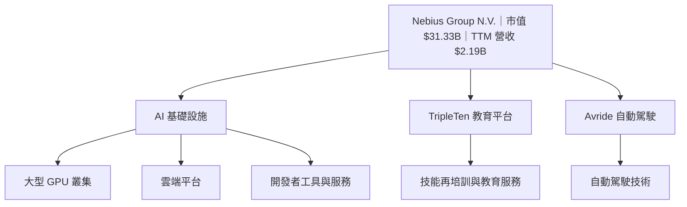
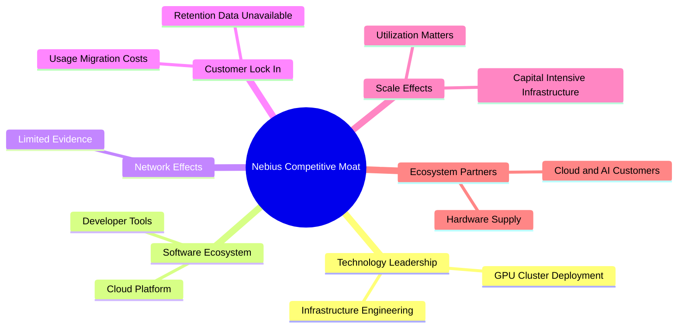
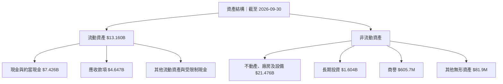
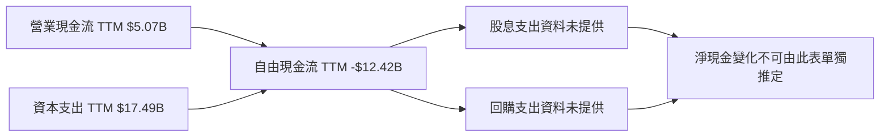
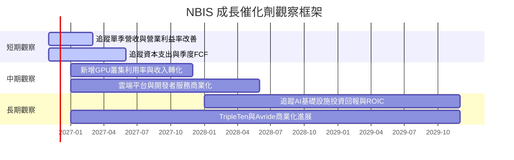
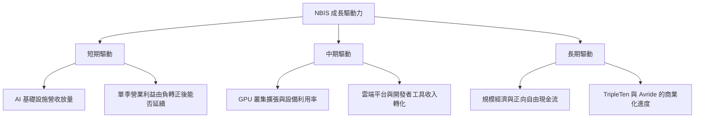
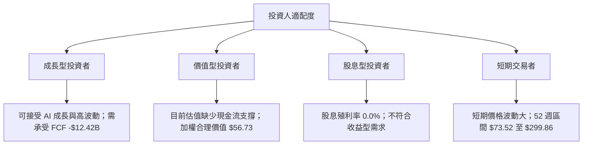

# NBIS 基本面深度分析報告
> **報告日期**：2026-11-19 ｜ **語言**：繁體中文 ｜ **數據來源**：Yahoo Finance、Finviz、StockAnalysis、Roic.ai ｜ **分析師**：CFA 級機構研究

## 目錄

| # | 章節 | 核心結論 |
|---|------|----------|
| 1 | 執行摘要 | 賣出；加權合理價值 $56.73，MOS -88.5% |
| 2 | 公司概覽與商業模式 | AI 基礎設施是核心敘事，但分部營收與市場份額未提供，護城河仍待驗證 |
| 3 | 損益表深度分析 | TTM 營收 $2.19B；最新一季營收年增 571.3%，但 TTM 營業利益率為 -23.0% |
| 4 | 資產負債表分析 | 淨負債 $8.67B；流動比率 5.306，但應收帳款天數 673 天值得關注 |
| 5 | 現金流量深度分析 | TTM FCF -$12.42B，資本支出高於營業現金流 |
| 6 | 獲利能力與資本效率 | ROIC 未提供，無法證明創造股東價值；WACC 為 7.93% |
| 7 | 相對估值分析 | 同業 P/S 中位數 4.9x 對應 $36.98；公司現有 P/S 為 14.31x |
| 8 | DCF 內在價值評估 | DCF 為 N/A：TTM 營業利益為負，不建立自製 DCF |
| 9 | 成長催化劑 | AI 基礎設施需求與營收放量是主要催化劑；TAM 數據未提供 |
| 10 | 風險矩陣 | 資本支出、融資槓桿與高速成長能否轉化為正 FCF 是主要風險 |
| 11 | 投資建議 | 依 MOS 評級賣出；需待估值與現金流改善後重新評估 |

---

## 1. 執行摘要

NBIS 的最新一季營收年增 **571.3%**，TTM 營收達 **$2.19B**，但 TTM 營業利益率為 **-23.0%**，TTM FCF 為 **-$12.42B**，且總債務 **$16.10B** 高於現金及短期投資 **$7.43B**。按同業 P/S 與分析師共識目標價加權後，合理價值為 **$56.73**；以 2026-11-18 收盤價 **$106.96** 計，MOS 為 **-88.5%**，因此依規則 20 評級為 **賣出**。這不是對 AI 基礎設施需求的否定，而是目前的營收成長、現金流消耗與股價估值之間尚未形成足以支持現價的證據鏈。

### 1.0 一頁式投資儀表板（Portfolio Manager 30 秒速讀）

| 項目 | 內容 |
|------|------|
| **投資論點（3 句）** | ① 最新一季營收年增 **571.3%**，反映 AI 基礎設施業務快速放量。② TTM 營業利益率 **-23.0%**、TTM FCF **-$12.42B**，擴張仍伴隨高成本與高再投資。③ 同業 P/S 法估值 **$36.98**，低於現價 **$106.96**，目前估值要求未來成長與盈利改善持續兌現。 |
| **綜合評分** | **3.5/10**（引用 1.1 評分卡） |
| **財務健康** | 🔴 淨負債 **$8.67B**，雖流動比率為 **5.306**，但 TTM FCF 大幅為負 |
| **ROIC vs WACC** | ROIC：**N/A**；WACC：**7.93%**。缺少可核實 ROIC，無法判定公司已創造價值 |
| **FCF 趨勢** | 大幅為負；TTM FCF **-$12.42B**，FCF Yield **-39.65%** |
| **估值** | Forward P/E **-35.13636x** ｜ EV/EBITDA **65.366x** ｜ FCF Yield **-39.65%** |
| **DCF 內在價值（基準）** | **N/A**；TTM 營業利益為負，DCF 模型不適用；現價折溢價 N/A |
| **安全邊際（MOS）** | **-88.5%＝($56.73−$106.96)÷$56.73**；以加權合理價值為基準，🔴 無安全邊際 |
| **預期報酬（基準情境 12M）** | DCF 情境為 N/A；以加權合理價值衡量的上行空間為 **-47.0%** |
| **關鍵風險（前二）** | 高資本支出與負 FCF；大型基礎設施融資及負債增加 |
| **評級 + 信心度** | 🔴 **賣出** ｜ 信心：中（估值與現金流證據明確，但公司仍處於快速擴張期） |

### 1.1 綜合評分卡（全報告唯一）

| 維度 | 評分（1–10） | 主要依據（引用數字與其來源章節） |
|------|--------------|----------------------------------|
| 成長性 | 8.0 | 最新一季營收年增 **571.3%**，但 TTM 成長率依可核實指標為 N/A（第 3 章） |
| 獲利能力 | 2.0 | TTM 營業利益率 **-23.0%**；ROIC、Piotroski F-Score 為 N/A（第 3、6 章） |
| 財務健康 | 4.0 | 淨負債 **$8.67B**；流動比率 **5.306**；DSO **673 天**（第 4 章） |
| 估值 | 1.0 | MOS **-88.5%**；公司 P/S **14.31x**，同業 P/S 中位數 **4.9x**（第 7、8 章） |
| 護城河 | 5.0 | AI 基礎設施、雲端平台與開發者服務提供潛在產品整合優勢，但缺少客戶留存、分部營收及市場份額數據（第 2 章） |
| 管理層與資本配置 | 1.0 | TTM 資本支出 **$17.49B**、TTM FCF **-$12.42B**；回購與資本回報數據未提供（第 5 章） |
| **綜合評分** | **3.5** | 六項算術平均：**(8.0+2.0+4.0+1.0+5.0+1.0)÷6 = 3.5** |

### 1.2 五大投資論點 + 三大核心風險

| 類型 | 項目 | 具體依據 | 信心度 |
|------|------|----------|--------|
| 🟢 **投資論點①** | AI 基礎設施收入快速擴張 | 最新一季收入 **$980.8M**，年增 **571.3%**；收入從 2025 年第四季 **$227.7M** 增至 2026 年第三季 **$980.8M** | 🟢 高 |
| 🟢 **投資論點②** | 毛利率已達可觀水準 | TTM 毛利率 **76.0%**，高於 CRWV **66.8%**、ORCL **64.0%**、MSFT **67.7%**；但高毛利尚未轉化為正營業利益 | 🟡 中 |
| 🟢 **投資論點③** | 服務型與平台型業務可能增加客戶黏著 | 公司提供 GPU 叢集、雲端平台與開發者工具；目前缺少客戶留存與經常性收入數字驗證 | 🟡 中 |
| 🟢 **投資論點④** | 流動性指標提供短期緩衝 | 現金及短期投資 **$7.43B**、流動比率 **5.306**，可支應部分營運與擴張需求 | 🟡 中 |
| 🟢 **投資論點⑤** | 市場仍給予高成長預期 | 20 位分析師平均目標價 **$234.50**；但此估值與同業 P/S 法估值 **$36.98** 落差很大 | 🟡 中 |
| 🟡 **風險①** | 資本支出造成現金流壓力 | TTM 資本支出 **$17.49B**，高於營業現金流 **$5.07B**，使 FCF 為 **-$12.42B** | 🔴 高衝擊 |
| 🔴 **風險②** | 淨負債及大型融資需求 | 總債務 **$16.10B**、現金及短期投資 **$7.43B**，淨負債 **$8.67B** | 🔴 高衝擊 |
| 🟡 **風險③** | 應收帳款天數偏長 | DSO **673 天**，可能反映大型客戶付款條件、收入確認與應收回收風險；需觀察後續變化 | 🔴 高 |

### 1.3 快速統計卡片

| 指標 | 公司實際值（期間） | 同業中位數 | 狀態 |
|------|--------------------|------------|------|
| 營收成長（TTM） | **N/A** | — | 🟡 |
| 營收成長（最新一季年增） | **571.3%** | **29.6%** | 🟢 |
| 毛利率（TTM） | **76.0%** | **66.8%** | 🟢 |
| 營業利益率（TTM） | **-23.0%** | — | 🔴 |
| ROIC（TTM） | **N/A** | — | 🟡 |
| Forward P/E | **-35.13636x** | **10.3x** | 🔴（NBIS 為負盈餘，倍數不可直接比較） |
| FCF Yield（TTM） | **-39.65%** | — | 🔴 |
| Piotroski F-Score | **N/A** | — | 🟡 |

### 1.4 投資結論

```text
╔══════════════════════════════════════════════════════════════════╗
║                    📊 投資結論摘要                               ║
╠══════════════════════════════════════════════════════════════════╣
║  評級：🔴 賣出（依 MOS 評級規則）                                ║
║  價格（2026-11-18 收盤）：$106.96                                ║
║  DCF 內在價值（基準）：N/A（TTM 營業利益為負）                   ║
║  安全邊際 MOS：-88.5%（＝($56.73−$106.96)÷$56.73）              ║
║  加權合理價值（8.8）：$56.73                                     ║
║  綜合評分：3.5/10（引用 1.1）                                    ║
║  適合投資人：能承受高波動、願意承擔基礎設施投資與融資風險者      ║
╚══════════════════════════════════════════════════════════════════╝
```

---

## 2. 公司概覽與商業模式

### 2.1 業務結構與收入來源

公司概況資料描述 Nebius Group N.V. 在美國、英國及其他國家建置 AI 全棧基礎設施，提供大型 GPU 叢集、雲端平台、開發者工具與服務，另有 TripleTen 教育平台與 Avride 自動駕駛業務。財務資料未提供各分部營收及占比，因此下圖只呈現業務關係，不填入未披露的比例或金額。



收入集中度、軟體與服務占比、各業務的毛利貢獻均未提供。AI 基礎設施是目前營收加速的核心敘事，但無法由現有分部資料判定收入究竟來自算力租用、平台軟體或其他服務。

### 2.2 市場份額

市場份額數據未提供。NBIS 最新一季營收為 **$980.8M**、年增 **571.3%**，高於 CRWV 最新一季年增 **168.2%**、ORCL **29.6%** 與 MSFT **18.8%**；但單季成長率不能直接推導市場份額，也不能證明其規模已接近大型雲端服務商。

### 2.3 競爭護城河分析



### 2.4 護城河強度

| 護城河項目 | 強度（強／中／弱） | 證據（引用數字或事實） | 會削弱它的情況 |
|------------|--------------------|------------------------|----------------|
| 技術與基礎設施 | 中 | 提供大型 GPU 叢集及 AI 全棧服務；最新一季營收年增 **571.3%** | GPU 供應受限、設備快速折舊、競爭者提高供給 |
| 軟體與開發者生態 | 中偏弱 | 有雲端平台與開發者工具，但用戶規模、續約率與軟體收入占比未提供 | 客戶工作負載可移轉至超大規模雲端或其他新雲商 |
| 網路效應 | 弱／未證實 | 未提供使用者、開發者或資料網路規模數據 | 平台未形成互補服務與跨客戶網路效應 |
| 客戶鎖定 | 中偏弱 | GPU 工作負載遷移可能需工程投入，但公司實際留存率未提供 | 客戶分散採購、合約期限短、價格競爭 |
| 規模效應 | 中 | TTM 營收 **$2.19B**；大規模叢集有望提高設備利用率 | 高 Capex、低利用率或融資成本上升 |
| 生態夥伴 | 中偏弱 | 產品包含算力、雲平台與開發者服務；合作夥伴營收貢獻未提供 | 供應商議價權提高或合作關係缺乏排他性 |

1.1「護城河」評分 **5.0/10**，反映公司已具備技術與平台布局，但缺乏留存率、分部收入、市占率及客戶集中度等證據來證明護城河已轉化成持久定價能力。

---

## 3. 損益表深度分析

### 3.1 年度收入成長趨勢（近 4 年）

年度營收由公司年報列示的 2022 至 2025 年數據呈現；同比按相鄰年度營收計算。因年度收入基數與資料來源存在大幅變動，成長率應與季度數據及業務連續性一併解讀。

```text
╔══════════════════════════════════════════════════════════════════╗
║              NBIS 年度收入趨勢（FY2022–FY2025）                 ║
╠══════════════════════════════════════════════════════════════════╣
║  FY2022  $0.0135B  ▏                         YoY：N/A            ║
║  FY2023  $0.0098B  ▏                         YoY：-27.4% 🔴      ║
║  FY2024  $0.0915B  ██                        YoY：+833.7% 🟢     ║
║  FY2025  $0.5298B  ██████████                YoY：+479.0% 🟢     ║
║                                                                  ║
║  2022 至 2025 年收入 CAGR：+240.0%                               ║
║  計算：($529.8M ÷ $13.5M)^(1/3) − 1 ≈ 240.0%                    ║
╚══════════════════════════════════════════════════════════════════╝
```

FY2022 至 FY2025 收入 CAGR 約 **240.0%**，但 FY2022 的基數僅 **$13.5M**，以低基數計算的 CAGR 不宜外推。公司 2025 年收入 **$529.8M**，2026 年第三季單季已達 **$980.8M**，顯示業務規模迅速變化；但 TTM 成長率依可核實口徑為 **N/A**，本報告不以其他口徑替換。

### 3.2 季度收入趨勢分析

QoQ 以本季營收除以上季營收減一計算。YoY 採資料列示的季度年增率；2025 年第四季的歷史比較值由 StockAnalysis 季度成長資料提供。

| 季度 | 營收 | QoQ 成長 | YoY 成長 | 備註 |
|------|------:|---------:|---------:|------|
| 2025-12-31 | $227.7M | +55.9% | +546.88% | QoQ 對比 2025 年第三季 $146.1M；YoY 使用 StockAnalysis 列示值 |
| 2026-03-31 | $399.0M | +75.2% | +683.89% | 營收擴張速度仍高，惟該季營業利益為 -$128.0M |
| 2026-06-30 | $582.3M | +45.9% | +454.04% | 營收續增，營業利益為 -$175.9M |
| 2026-09-30 | $980.8M | +68.4% | **+571.3%** | 可核實最新一季年增率；該季營業利益轉正至 $50.4M |

最新一季營收較上一季增加 **$398.5M**，QoQ 約 **68.4%**。單季營業利益雖轉正，但不足以抵銷此前季度虧損，因此 TTM 營業利益仍為負。營收成長若延續，可能提升設備利用率與固定成本吸收；是否形成可持續利潤，仍需觀察新叢集投產後的折舊、能源及融資成本。

### 3.3 利潤率演變分析

下表年度毛利率與營業利益率依收入及毛利、營業利益計算；TTM 與最新一季營業利益率則按可核實數值引用。歷史年度數字反映業務與合併範圍變動，並非同一營運結構下的平滑趨勢。

| 利潤率指標 | FY2022 | FY2023 | FY2024 | FY2025 | 最新期間 | 趨勢與評估 |
|------------|--------|--------|--------|--------|----------|------------|
| **毛利率** | -110.4% | -100.0% | 52.2% | 68.6% | TTM **76.0%** | 🟢 明顯改善；FY2025 起毛利轉正並上升，可能與業務組合及營收規模擴大有關 |
| **營業利益率** | -1,170.4% | -2,915.3% | -436.7% | -115.5% | TTM **-23.0%**；最新季 **-18.7%** | 🔴 仍為負；最新季度單季營業利益為正，但年度與 TTM 仍受到擴張期營運費用影響 |

FY2025 毛利率約 **68.6%**，TTM 毛利率進一步達 **76.0%**，顯示收入增長可能伴隨毛利結構改善。另一方面，公司 TTM 營業利益率仍為 **-23.0%**，意味毛利需要覆蓋研發、銷售、管理、折舊及擴張成本後，才會轉化為營業獲利。最新一季營業利益 **$50.4M** 是正面訊號，但單季改善尚不能代表已達到穩定盈虧平衡。

### 3.4 費用結構分析

完整 TTM 研發、銷售與管理費用及其費用率未提供，故不製作費用結構圓餅圖。年度研發費用由 FY2022 **$58.3M** 增至 FY2025 **$177.3M**，代表公司持續投入技術與產品建置；但可用資料不足以計算全部營業費用的構成比例。

### 3.5 季度 EPS 趨勢與盈餘品質（Quality of Earnings）

四季 EPS 預估值皆為缺漏，沒有可核實的「超預期／不及預期」資料。因此只能列實際 EPS，不能將缺失的預估值視為財報 miss。

| 季度 | EPS 實際值 | EPS 預估／驚喜 | 評估 |
|------|-----------:|-----------------|------|
| 2025-12-31 | -$1.11 | N/A | 無預估值，無法判定超預期或不及預期 |
| 2026-03-31 | $2.11 | N/A | 實際值可能受非經常性項目影響；季度淨利 $621.2M，需核對盈餘組成 |
| 2026-06-30 | -$0.78 | N/A | 季度淨利 -$190.4M |
| 2026-09-30 | -$0.14 | N/A | 季度淨利 -$37.5M |

| 盈餘品質項目 | 數值／佔比 | 評估 |
|--------------|-----------|------|
| 股權薪酬 SBC / 營收 | 估計 **10.1%**；TTM SBC 依最近四季加總 $221.4M ÷ TTM 營收 $2.19B | 🔴 SBC 對股東報酬有實質稀釋成本；這是依季度 SBC 加總的估算，不是可核實區塊的品質指標 |
| SBC / 營業現金流 | 估計 **4.4%**；$221.4M ÷ $5.07B | 🟡 SBC 相對 OCF 較低，但 OCF 可能受營運資金變動影響，不能因此視為成本不重要 |
| FCF / 淨利（現金轉換率） | 估計 **-10,106%**；-$12.42B ÷ $122.9M | 🔴 FCF 大幅為負；分母為 StockAnalysis 的 TTM 淨利，來源口徑與季度淨利合計略有差異，僅作方向性參考 |
| 一次性／非經常性損益 | 有明顯波動跡象；2026 Q1 淨利 $621.2M，而營業利益 -$128.0M | 🔴 單季淨利與營業結果背離，應核查投資處分、重估或稅務等項目；細項未提供 |
| 有效稅率異常 | **29.0%**（最新年度有效稅率） | 🟡 不代表各季度稅率穩定；缺少季度稅費拆分 |
| 資本化支出 vs 費用化 | TTM Capex **$17.49B**；資本化／費用化拆分未提供 | 🟡 高額 Capex 會先進資產負債表並逐期折舊；需追蹤折舊增幅與設備利用率 |

**盈餘品質結論**：GAAP 淨利不能單獨作為估值錨點。TTM 淨利與 FCF 的方向相反，且 2026 年第一季出現營業虧損、淨利大幅為正的背離；在非營業損益細項尚未核清前，應以營業利益、FCF、Capex 及營運資金為主要追蹤指標。SBC 約佔 TTM 營收 **10.1%** 的估計比例亦顯示，股東回報需考慮稀釋成本。

---

## 4. 資產負債表分析

### 4.1 資產結構分解

依 StockAnalysis 2026-09-30 資產負債表資料，總流動資產為 **$13.160B**，另有 PP&E **$21.476B**、長期投資 **$1.604B**、商譽 **$605.7M** 等項目。資料未列示總資產完整合計及所有資產細項，故不推算未披露項目的數值。



### 4.2 流動性與營運資金分析

| 指標 | 最新值 | 歷史資訊 | 評估 |
|------|-------:|----------|------|
| 流動比率 | **5.306** | FY2025 年末流動資產 $4.71B、流動負債 $1.53B | 🟢 比率高，但需同時觀察應收帳款可回收性及擴張現金需求 |
| 速動比率 | **4.847** | N/A | 🟢 顯示短期流動資產充足；不代表現金流轉正 |
| 現金及短期投資 | **$7.43B** | FY2025 年末現金 $3.68B，另有短期投資 $75M | 🟡 現金增加，但同期間債務與資本支出也大幅擴張 |

營運資金天數依 QUALITY FIGURES 原值引用；一年前數值沒有提供，故不計算變化。

| 指標 | 最新 TTM | 一年前 TTM | 變化 | 解讀 |
|------|----------|------------|------|------|
| DSO 應收帳款天數 | **673 天** | N/A | N/A | 🔴 應收帳款占營收比例高，可能涉及大型客戶付款條件或應收結算時點；需追蹤回收與壞帳 |
| DIO 存貨天數 | **N/A** | N/A | N/A | 公司未報告此項存貨餘額，不填補 |
| DPO 應付帳款天數 | **368 天** | N/A | N/A | 供應商付款週期長可能支持營運資金，但若供應商條款收緊會造成現金壓力 |
| CCC 現金轉換週期 | **N/A** | N/A | N/A | 因 DIO 為 N/A，CCC 不可計算 |

### 4.3 債務結構分析

```text
╔══════════════════════════════════════════════════════════════════╗
║                   NBIS 債務健康診斷                              ║
╠══════════════════════════════════════════════════════════════════╣
║  總債務：        $16.10B  ████████████████████  🔴 高            ║
║  現金+短期投資： $7.43B   █████████             🟡 有緩衝        ║
║  淨負債：        $8.67B   ███████████           🔴 淨負債        ║
║                                                                  ║
║  Debt/EBITDA：   N/A（未提供可直接對應的可靠口徑）                ║
║  Interest Coverage：N/A（利息費用與利息保障倍數未提供）         ║
║  Debt/Equity：   130.875（資料來源列示）                          ║
║  流動比率：      5.306                                           ║
╚══════════════════════════════════════════════════════════════════╝
```

總債務、現金與淨負債採可核實的 TTM 數值。另有 FY2025 年末債務 **$4.97B**、2026 年第三季 Roic.ai 長期借款及融資租賃分類資料；資料口徑並不完全一致，因此本報告不自行用明細重組計息負債，也不計算 Debt/EBITDA 或利息保障倍數。

### 4.4 股東權益趨勢

```text
╔══════════════════════════════════════════════════════════════════╗
║                   NBIS 歷年股東權益                              ║
╠══════════════════════════════════════════════════════════════════╣
║  FY2022  $4.25B  ████████████████████                            ║
║  FY2023  $3.29B  ███████████████                                  ║
║  FY2024  $3.25B  ███████████████                                  ║
║  FY2025  $4.59B  ██████████████████████                           ║
╚══════════════════════════════════════════════════════════════════╝
```

股東權益由 FY2024 **$3.25B** 增至 FY2025 **$4.59B**，同期總資產由 **$3.55B** 增至 **$12.43B**。資產與權益快速變化應與融資、業務整併及資本支出一併檢視，不能僅以權益增加判定財務風險降低。

---

## 5. 現金流量深度分析

### 5.1 現金流量瀑布圖

現有財務數據未提供可採用的 TTM 淨利與股息、回購的完整現金流瀑布口徑，因此僅呈現可核實的營運現金流、資本支出與 FCF 數值。



### 5.2 FCF 轉換率趨勢

| 財年 | 營業現金流 | 資本支出 | FCF | 淨利 | FCF／淨利 |
|------|-----------:|---------:|----:|-----:|----------:|
| FY2022 | $697.0M | $14.6M | $682.4M | $745.6M | 約 **91.5%** |
| FY2023 | $829.8M | $82.9M | $746.9M | $241.3M | 約 **309.5%** |
| FY2024 | $245.6M | $807.5M | -$561.9M | -$641.4M | 約 **87.6%** |
| FY2025 | $384.8M | $4.07B | -$3.68B | $82.5M | 約 **-4,461%** |
| TTM 至 2026-09-30 | $5.07B | $17.49B | **-$12.42B** | TTM $122.9M | 約 **-10,106%** |

FY2025 與 TTM FCF 轉換率受到大幅資本支出影響，不宜將過去正 FCF 年份外推。FY2026 季度資本支出由 Q1 **$2.47B**、Q2 **$5.66B** 升至 Q3 **$7.30B**；Q3 單季 FCF 為 **-$7.57B**。公司投資仍處於重資本階段，現金流能否改善取決於新增設備是否及時投入使用、產生足夠營收與利用率。

### 5.3 自由現金流趨勢

```text
╔══════════════════════════════════════════════════════════════════╗
║              NBIS 自由現金流趨勢（美元）                         ║
╠══════════════════════════════════════════════════════════════════╣
║  FY2022  +$0.682B  ████                 FCF Yield：N/A           ║
║  FY2023  +$0.747B  █████                FCF Yield：N/A           ║
║  FY2024  -$0.562B  ◀███                 FCF Yield：N/A           ║
║  FY2025  -$3.68B   ◀████████████        FCF Yield：N/A           ║
║  TTM     -$12.42B  ◀████████████████████ FCF Yield：-39.65%     ║
╚══════════════════════════════════════════════════════════════════╝
```

TTM FCF 使用定義 **營業現金流減資本支出**，即 **$5.07B−$17.49B=-$12.42B**。負 FCF Yield **-39.65%** 表示現價所對應的市值並未由當期自由現金流支撐，股東價值主要依賴未來成長與資本回報改善。

### 5.4 資本配置評估

回購、股息及總資本配置比例未提供，故不繪製比例圓餅圖。FY2025 Capex **$4.07B**，TTM Capex **$17.49B**；FY2025 SBC **$83.2M**，最近四季季度 SBC 合計約 **$221.4M**。公司目前現金流配置重心明顯偏向基礎設施建置，但設備回報週期與投資回報率尚未能由現有資料確認。

---

## 6. 獲利能力與資本效率

### 6.1 ROE／ROA／ROIC 趨勢

完整歷年 ROIC 與可比 ROE、ROA 數列未提供；本報告不以資料缺漏項目推算 ROIC。可核實 TTM 指標如下：

| 指標 | 可核實值 | 評估 |
|------|---------:|------|
| ROE（TTM） | **1.5%** | 🟡 接近低回報水準；需與權益及非經常性淨利項目一併解讀 |
| ROA（TTM） | **-1.0%** | 🔴 資產尚未產生正向整體回報 |
| ROIC（TTM） | **N/A** | 缺少可直接引用的 ROIC 指標及足以統一口徑的投入資本細項 |
| 行業均值對比 | N/A | 未提供來源一致的行業均值，不作推估 |

### 6.2 ROIC vs WACC 分析（核心價值創造判斷）

ROIC 未提供，因此不能把 ROE 或營業利益率替代成 ROIC，也不能得出確定的 EVA。WACC 依成本資本資料直接採用 **7.93%**。

```text
╔══════════════════════════════════════════════════════════════════╗
║                ROIC vs WACC 深度分析                            ║
╠══════════════════════════════════════════════════════════════════╣
║  WACC（依成本資本資料）：7.93%                                   ║
║  ├── 無風險利率（10Y 美債）：  5.07%                             ║
║  ├── 市場風險溢酬 ERP：         5.00%                             ║
║  ├── 原始 Beta：                1.54                              ║
║  ├── 調整後 Beta：              1.36                              ║
║  ├── 股權成本：                 11.86%                            ║
║  ├── 稅前債務成本：             0.38%                             ║
║  ├── 稅率：                     29.0%                             ║
║  ├── 股權／債務權重：           66.1%／33.9%                      ║
║  └── ✅ WACC：                  7.93%                             ║
║                                                                  ║
║  ROIC：N/A（未提供可核實數值）                                    ║
║  NOPAT、投入資本與 EVA：N/A（缺少一致口徑所需數據）              ║
║                                                                  ║
║  結論：無法判定 ROIC 是否高於 WACC；現階段不可宣稱已創造價值     ║
╚══════════════════════════════════════════════════════════════════╝
```

提供的股權成本計算為 **5.07% + 1.36×5.00% = 11.87%**，資料列示的股權成本為 **11.86%**；兩者差異來自四捨五入，WACC 採用資料列示值 **7.93%**，不另行估算。以提供的稅前債務成本及稅率計算，稅後債務成本為 **0.38%×(1−29.0%)=0.2698%**；按資料列示資本權重，WACC 約為 **66.1%×11.86%+33.9%×0.2698%=7.93%**。

### 6.3 杜邦三因素分解

QUALITY FIGURES 的 DuPont 指標為 N/A，原因是缺少淨利、營收、總資產或正權益所需的統一資料口徑；依要求不自行補算。

| 因素 | 數值（TTM） | 解讀 |
|------|-------------|------|
| 淨利率 | N/A | QUALITY FIGURES 未提供 DuPont 分解 |
| 資產週轉率 | N/A | 同上 |
| 權益乘數 | N/A | 同上 |
| **ROE** | **N/A** | DuPont 數據列為 N/A，不以其他來源補算 |

### 6.4 財務體質：Piotroski F-Score

Piotroski F-Score 為 **N/A**，因缺少間隔一年、可比口徑的 SEC 申報資料；九項測試結果亦未提供，因此不臆測各項通過與否。

---

## 7. 相對估值分析

### 7.1 同業估值比較表格

同業倍數來自 Peer multiples；NBIS 倍數依估值資料列示。公司尚未有正向 TTM P/E，因此 P/E 倍數解讀受限。

| 估值指標 | **NBIS** | **CRWV** | **ORCL** | **MSFT** | 本公司評估 |
|----------|---------:|---------:|---------:|---------:|-----------|
| **Trailing P/E** | N/A | N/A | 17.9x | 26.5x | 🔴 公司 TTM EPS 為 -$0.26，無可比正 P/E |
| **Forward P/E** | -35.13636x | -27.0x | 10.3x | 21.0x | 🔴 NBIS 與 CRWV 為負盈餘，倍數不宜按一般 PE 比較 |
| **P/S Ratio** | **14.306713x** | 2.7x | 4.9x | 10.9x | 🔴 NBIS 高於三家同業中位數 **4.9x** |
| **EV/EBITDA（TTM）** | 65.366x | 17.0x | 14.0x | 18.7x | 🔴 明顯偏高；TTM EBITDA 口徑與投入期需進一步核對 |
| **最新一季營收年增** | **571.3%** | 168.2% | 29.6% | 18.8% | 🟢 成長高於同業，但不代表可持續或已創造現金流 |
| **毛利率（TTM）** | **76.0%** | 66.8% | 64.0% | 67.7% | 🟢 毛利率高於三家同業 |

Peer P/S 中位數為 **4.9x**，但 NBIS 現有 P/S 為 **14.306713x**。這一差距意味市場對 NBIS 給予更高成長預期；若收入成長回落、資本支出維持高檔或利潤率改善慢於預期，估值可能向同業倍數收斂。

### 7.2 歷史估值區間分析

```text
╔══════════════════════════════════════════════════════════════════╗
║                  NBIS 歷史估值區間分析                           ║
╠══════════════════════════════════════════════════════════════════╣
║  N/A：Valuation vs own history 未提供可核實的歷史估值區間或百分位 ║
║  可觀察價格：52 週高點 $299.86；52 週低點 $73.52                 ║
║  2026-11-18 收盤價 $106.96，較 52 週高點低約 64.3%               ║
╚══════════════════════════════════════════════════════════════════╝
```

價格由 2026 年 6 月月末 **$276.17** 回落至 2026-11-18 **$106.96**，約跌 **61.3%**。這是價格表現，不等同於估值百分位；因歷史估值區間未提供，不以價格跌幅代替估值分位。

### 7.3 情境價值（Bear / Base / Bull）

N/A（DCF 無法計算：TTM 營業利益為負，程式計算的 DCF MODEL 不適用）。依資料規則，不自行建構悲觀、基準或樂觀 DCF 目標價。

### 7.4 相對估值隱含價格區間

```text
╔══════════════════════════════════════════════════════════════════╗
║                  相對估值隱含價格                                ║
╠══════════════════════════════════════════════════════════════════╣
║  同業 P/S：$36.98  ────────────── 現價：$106.96                  ║
║  分析師共識：$234.50                                             ║
║                                                                  ║
║  同業 P/S：CRWV、ORCL、MSFT 的中位數 P/S 4.9x × TTM 營收         ║
║  分析師共識：20 位分析師平均目標價                               ║
╚══════════════════════════════════════════════════════════════════╝
```

同業 P/S 對應價格 **$36.98**，折讓 **65.4%**；分析師共識為 **$234.50**，相對現價高 **119.2%**。兩者分歧顯示估值對成長、盈利能力及融資假設高度敏感，不能將分析師共識視為已實現的內在價值。

---

## 8. DCF 內在價值評估（Discounted Cash Flow）

### 8.0 估值推理鏈（Thinking Logic）

**Step 1 — 公司價值的核心變數**

NBIS 價值主要由 AI 基礎設施收入成長、長期營業利潤率及龐大資本支出的投資回報決定。資料沒有各分部營收占比，不能把主業、TripleTen 或 Avride 各自占比拆出；最新一季總營收為 **$980.8M**，TTM 營收 **$2.19B**。估值主導變數是投資建置後的營業獲利與現金流轉化，而不是單一季度收入成長率。

**Step 2 — 模型選擇**

| 決策點 | 本報告採用 | 理由（含數字） | 曾考慮但否決 | 否決理由 |
|--------|-----------|----------------|--------------|----------|
| 現金流定義 | DCF 不執行 | TTM 營業利益率 **-23.0%**，TTM 營業利益不為正 | FCFF／FCFE 預測 | 程式模型明確列為 N/A；不得另建模型 |
| 預測期 N | N/A | 沒有可核實 DCF 預測期 | 自行設定 5–10 年 | 違反指定資料模型唯一性 |
| 終值方法 | N/A | 模型未生成終值 | Gordon Growth／退出倍數 | 沒有有效 DCF 基礎現金流 |
| EBIT 基礎 | N/A | 不執行 DCF | GAAP／非 GAAP EBIT | 缺少模型輸入與逐年預測資料 |

**Step 3 — 假設推導鏈**

DCF MODEL 為 N/A，因此沒有營收 CAGR、期末營業利潤率、永續成長率、Capex／營收、D&A、ΔWC、年稀釋率或終值方法可供引用。若自行填入數值，會將假設冒充為模型輸出，故不作推估。

**Step 4 — 最脆弱環節**

最脆弱的環節是高 Capex 能否轉化為持續正向營業利益與 FCF；最新 TTM Capex **$17.49B**，而 TTM FCF 為 **-$12.42B**。在缺少可用 DCF 模型時，不能量化該假設失效的每股價值影響。

**Step 5 — 計算路徑圖**

由於模型為 N/A，不展示假造的逐年預測或價值計算路徑。

### 8.1 模型假設總表（Model Inputs）

**N/A（數據未提供：DCF MODEL 因 TTM 營業利益不為正而停用；不能自建模型或填入未經模型計算的預測假設。）**

### 8.2 折現率推導（WACC）

WACC 按成本資本資料引用，與第 6.2 節相同。原始 Beta **1.54**，調整後 Beta **1.36**，其調整方式為 **⅔×1.54+⅓×1.00=1.36**。資料未提供無風險利率觀察日期、債務利息費用明細與資本結構市值計算細項；故遵守原值引用，不另行重算或替換。

```text
╔══════════════════════════════════════════════════════════════════╗
║                    WACC 推導（引用成本資本資料）                 ║
╠══════════════════════════════════════════════════════════════════╣
║  無風險利率 Rf（10Y 美債）：  5.07%                              ║
║  市場風險溢酬 ERP：             5.00%                              ║
║  原始 Beta：                    1.54                               ║
║  調整後 Beta：                  1.36（⅔×1.54＋⅓×1.00）             ║
║  股權成本 Ke：                  11.86%                             ║
║  稅前債務成本 Kd：              0.38%                              ║
║  有效稅率：                     29.0%                              ║
║  股權／債務權重：               66.1%／33.9%                       ║
║  WACC：                         7.93%                              ║
╚══════════════════════════════════════════════════════════════════╝
```

逐步計算（採用資料所列組成；部分來源未提供完整底層明細）：

1. **Ke（CAPM）**＝資料列示 **11.86%**；由已四捨五入輸入計算為 **5.07%＋1.36×5.00%=11.87%**，差異為輸入四捨五入。
2. **稅前 Kd**＝資料列示 **0.38%**；利息費用與平均計息負債原始明細未提供，不自行補算。
3. **稅後 Kd**＝**0.38%×(1−29.0%)=0.2698%**。
4. **權重**＝股權 **66.1%**；債務 **33.9%**，合計 **100.0%**。市場價值 E 與同範圍計息負債 D 的底層金額未提供，直接採用原列權重。
5. **WACC**＝**66.1%×11.86%+33.9%×0.2698%=7.9275%≈7.93%**。

### 8.3 逐年自由現金流預測（基準情境）

N/A（DCF MODEL 停用：TTM 營業利益不為正。沒有程式提供的預測期及逐年 FCFF，故不建立 FY+1 至 FY+N 表格。）

### 8.4 終值計算（Terminal Value）

N/A（未建立 DCF 預測現金流，無法以終值公式計算企業價值。）

### 8.5 企業價值 → 每股內在價值（Bridge）

DCF 基準內在價值為 **N/A**，因此無法計算 DCF 折溢價。現金及短期投資 **$7.43B**、總債務 **$16.10B**、淨負債 **$8.67B** 採 TTM 資料；但由於 DCF 模型本身無效，不進行企業價值至股權價值的橋接。

### 8.6 敏感性分析（WACC × 永續成長率）

N/A（無基準 DCF、終值或預測現金流，不能製作敏感性矩陣或 DCF 三情境目標價。）

### 8.7 反推 DCF（Reverse DCF：市場在預期什麼）

N/A（DCF MODEL 不可用；沒有基準現金流模型可在固定其他輸入下反解單一變數。）

### 8.8 估值三角驗證與安全邊際

| 估值方法 | 隱含每股價值 | 上行空間（÷現價） | 權重 | 說明 |
|----------|--------------:|-------------------:|------|------|
| 同業 P/S | **$36.98** | **-65.4%** | **90%** | CRWV、ORCL、MSFT 同業中位數 P/S **4.9x** × NBIS TTM 營收 |
| 分析師共識目標價 | **$234.50** | **+119.2%** | **10%** | 20 位分析師平均目標價，作為參考而非主要估值錨 |
| **加權合理價值** | **$56.73** | **-47.0%** | **100%** | 不可計算的同業 Forward P/E 權重已按模型規則分配至其餘方法 |

加權計算：

**$36.98×90%+$234.50×10%=$33.282+$23.450=$56.732≈$56.73**

上述加權方法符合未獲利公司類型的固定權重：同業 P/S 90%、分析師共識 10%。同業 Forward P/E 不可計算，未列入估值方法。

```text
╔══════════════════════════════════════════════════════════════════╗
║                  估值區間與安全邊際                              ║
╠══════════════════════════════════════════════════════════════════╣
║  $36.98（同業 P/S） ── $56.73（加權合理價值） ── $106.96（現價）║
║                                                                  ║
║  安全邊際 MOS = ($56.73 − $106.96) ÷ $56.73 = -88.5%            ║
║  MOS 評估：🔴 <10%，無安全邊際                                   ║
║  上行空間 = ($56.73 − $106.96) ÷ $106.96 = -47.0%               ║
║  DCF 基準折溢價：N/A（DCF 不適用）                               ║
╚══════════════════════════════════════════════════════════════════╝
```

MOS 的負值代表現價高於加權合理價值；上行空間為負值亦表示由現價回到加權合理價值的估值變化為負。兩者分母不同，不可混用。

> 🔎 **程式複算（Python，依本節各項自動重算）**
>
> 加權合理價值 = $36.98 × 90% + $234.50 × 10% = **$56.73**（權重合計 100%）
>
> 以價格 $106.96 計：MOS = **-88.5%**，上行空間 = **-47.0%**
>
> ✅ 與本節所寫數值一致。

### 8.9 DCF 模型的局限與失效條件

- **終值依賴度**：N/A，因模型無終值。
- **最脆弱的假設**：現有資料沒有可用的 DCF 基準假設，不能量化內在價值下跌幅度。
- **不適用情境說明**：TTM 營業利益為負，且 TTM FCF **-$12.42B**；此時現金流貼現對長期利潤率與資本支出假設非常敏感，DCF 可靠度低。較適合以同業 EV/Sales 或 P/S、營收與毛利趨勢、單位經濟性及投資回報追蹤，而非自行假設長期現金流。
- **與第 10 章風險矩陣的連結**：GPU 供應與利用率、客戶需求、融資條件及資本支出若不利，會直接拖慢收入兌現並延後轉正 FCF。

### 8.10 複算檢核表（Audit Trail）

| # | 檢核項目 | 檢查方式 | 結果 |
|---|----------|----------|------|
| 1 | 所有高／中敏感度 DCF 輸入有完整推導 | DCF MODEL 為 N/A，未建立假設輸入 | N/A |
| 2 | 每個 DCF 假設都有來歷 | 未建立 DCF 假設 | N/A |
| 3 | WACC 組成與計算 | 採用原列 WACC 7.93%；以四捨五入數重算約 7.93% | ✅ |
| 4 | Kd 分母與債務權重範圍一致 | 底層計息負債金額與明細未提供，依指示引用原列權重 | N/A |
| 5 | WACC 與第 6.2 節相同 | 兩節均為 7.93% | ✅ |
| 6 | 預測年度數等於 N | DCF MODEL 為 N/A | N/A |
| 7 | FY+1 九步算式可複算 | 無逐年模型 | N/A |
| 8 | 預測期 PV 加總 | 無逐年模型 | N/A |
| 9 | WACC 大於 g | g 未提供 | N/A |
| 10 | 終值基於 FY+N 並折現 N 期 | 無終值模型 | N/A |
| 11 | EV 至每股價值橋接 | DCF 每股價值為 N/A | N/A |
| 12 | SBC、EBIT 與股數處理一致 | 未建立 DCF，不應宣稱採用組合 A／B／C | N/A |
| 13 | 敏感性矩陣基準格等於 8.5 | 無矩陣 | N/A |
| 14 | 敏感性矩陣只含有效格 | 無矩陣 | N/A |
| 15 | 三情境機率加總 | 無 DCF 情境 | N/A |
| 16 | 反推 DCF 每列只放開一個變數 | 反推 DCF 為 N/A | N/A |
| 17 | MOS 分母與折溢價基準正確 | MOS 使用 $56.73；DCF 折溢價標 N/A | ✅ |
| 18 | 報告完整輸出至第 11 章 | 本報告含 11 章 | ✅ |
| 19 | 加權合理價值等於加權總和 | $36.98×90%+$234.50×10%=$56.732≈$56.73 | ✅ |
| 20 | 評級符合 MOS 門檻 | MOS -88.5%，評級賣出 | ✅ |

---

## 9. 成長催化劑

### 9.1 催化劑時間軸

公司未提供明確合約投產日期、產能上線計畫或各階段收入目標，以下時間軸只依已知業務發展方向描述，不將未公布日期列為既定催化劑。



### 9.2 TAM 市場規模分析

N/A（TAM 數據未提供）。目前可觀察的公司規模為 TTM 營收 **$2.19B**，最新一季營收年增 **571.3%**；這說明公司正處於快速擴張階段，但沒有可引用的市場規模、滲透率或市占率資料，不能量化可服務市場。

### 9.3 成長驅動力結構圖



短期催化劑是最新一季營收 **$980.8M**、營業利益 **$50.4M** 的延續性；中期核心是高額資本支出能否提升利用率；長期價值則取決於 ROIC 是否高於 **7.93%** 的 WACC，以及 FCF 能否由負轉正。

---

## 10. 風險矩陣

### 10.1 風險評分矩陣

資料未提供各風險的客觀發生機率，因此不以虛構機率數字繪製 Mermaid quadrantChart。以下排序為基於財務數據的定性判斷，而非統計發生率。

| 風險 | 機率判斷 | 衝擊判斷 | 依據 |
|------|----------|----------|------|
| 資本支出長期高於現金流創造 | 高 | 高 | TTM Capex **$17.49B**、FCF **-$12.42B** |
| 融資與淨負債攀升 | 中高 | 高 | 總債務 **$16.10B**、淨負債 **$8.67B** |
| 客戶回款與應收帳款風險 | 中 | 中高 | DSO **673 天** |
| AI 算力供需轉弱或價格競爭 | 中 | 高 | 公司高度依賴 AI 基礎設施需求，收入分部與客戶合約資料未提供 |
| 估值倍數下修 | 高 | 高 | P/S **14.306713x**，同業中位數 P/S **4.9x** |

### 10.2 風險清單詳細分析

風險評分為定性分析，不代表可核實的發生機率或精確預測。

| # | 風險項目 | 發生機率 | 財務衝擊 | 風險評估 | 緩解措施 |
|---|----------|----------|----------|----------|----------|
| 1 | 🔴 **資本支出與現金流缺口** | 高（定性） | 高：TTM FCF 已為 **-$12.42B** | 🔴 極高 | 逐季追蹤 Capex、設備利用率、OCF 和 FCF；若 Capex 增幅持續大於收入及現金流改善，降低曝險 |
| 2 | 🔴 **融資與負債風險** | 中高（定性） | 高：淨負債 **$8.67B** | 🔴 高 | 追蹤債務到期、利息費用、融資租賃與增資稀釋；資料明細不足時不假設再融資必然可得 |
| 3 | 🔴 **估值倍數收斂** | 高（定性） | 高：同業 P/S 法價值 **$36.98**，低於現價 **$106.96** | 🔴 高 | 用實際營業利益率與 FCF 改善驗證高倍數，不以分析師共識取代營運數據 |
| 4 | 🟡 **應收帳款回收與客戶集中** | 中（定性） | 中高：DSO **673 天** | 🟡 高 | 追蹤應收帳款餘額、逾期帳款及主要客戶集中度；目前相關分項未提供 |
| 5 | 🟡 **AI 雲端競爭與供需波動** | 中（定性） | 高：可能影響收入增長及資產利用率 | 🟡 高 | 追蹤季度收入、毛利率、客戶續約、合約期限與算力利用率 |

---

## 11. 投資建議

### 11.1 最終評級與評分

加權合理價值 **$56.73** 相對 2026-11-18 收盤價 **$106.96** 的 MOS 為 **-88.5%**，依規則 20 評級為 **賣出**，未作質化調整。1.1 評分卡的六項分數為成長性 **8.0**、獲利能力 **2.0**、財務健康 **4.0**、估值 **1.0**、護城河 **5.0**、管理層與資本配置 **1.0**，綜合評分 **3.5/10**。

### 11.2 合理價值與隱含報酬率

| 估值方法／情境 | 每股價值 | 相對 2026-11-18 收盤價 $106.96 | 權重／機率 |
|---------------|---------:|--------------------------------:|-----------|
| 同業 P/S | $36.98 | -65.4% | 90% |
| 分析師共識目標價 | $234.50 | +119.2% | 10% |
| **加權合理價值** | **$56.73** | **-47.0%** | **100%** |
| DCF 悲觀／基準／樂觀 | N/A | N/A | DCF MODEL 不適用 |

### 11.3 買入時機與觸發因素

現行評級為賣出，故目前不建議以未經模型驗證的價格區間設定買入目標。若公司基本面與估值出現可核實改善，可重新評估。

```text
╔══════════════════════════════════════════════════════════════════╗
║                  ✅ 投資決策觸發因素 Checklist                   ║
╠══════════════════════════════════════════════════════════════════╣
║  重新評估買入條件：                                              ║
║  ☐ 季度營業利益率改善可持續，且不只依賴單季收入波動             ║
║  ☐ TTM FCF 明顯改善，並朝零或正值收斂                           ║
║  ☐ Capex 增速低於收入增速，且設備利用率有可核實數據             ║
║  ☐ DSO 自 673 天水準下降，應收回款與現金流一致改善               ║
║                                                                  ║
║  加碼觸發條件：                                                  ║
║  ☐ ROIC 有可核實數據且高於 WACC 7.93%                           ║
║  ☐ 公司正向 FCF 能由後續財報持續驗證                            ║
║                                                                  ║
║  減碼／退出觸發條件：                                            ║
║  ☐ 營收成長下降但資本支出與淨負債仍持續增加                     ║
║  ☐ 現金、融資能力或債務條件惡化                                 ║
║  ☐ 應收帳款回收惡化或 DSO 再度上升                              ║
╚══════════════════════════════════════════════════════════════════╝
```

### 11.4 投資人適配度分析



### 11.5 每季財報監控清單（Quarterly Watch List）

| 監控指標 | 最新參考值 | 加碼／改善訊號 | 減碼／惡化訊號 |
|----------|-----------:|---------------|---------------|
| 單季營收與年增率 | 2026 Q3 **$980.8M**；YoY **571.3%** | 營收續增，且增長能轉化為營業利益 | 成長明顯放緩且毛利或營業利益同步惡化 |
| 單季營業利益率 | 2026 Q3 **-18.7%**（資料列示）；單季營業利益 $50.4M | 後續季持續改善，且 TTM 營業利益轉正 | 單季獲利無法延續，營業虧損再擴大 |
| 毛利率 | TTM **76.0%** | 高毛利維持且營業費用率下降 | 毛利率下滑並伴隨價格競爭 |
| 資本支出 | TTM **$17.49B**；2026 Q3 **$7.30B** | Capex 增幅下降、既有資產利用率提高 | Capex 持續增加但收入及現金流未同步改善 |
| FCF | TTM **-$12.42B** | 連續季度改善，並朝正值收斂 | FCF 缺口擴大、融資依賴升高 |
| 應收帳款與 DSO | DSO **673 天** | DSO 下降且回款改善 | DSO 上升或應收款快速增加 |
| 淨負債 | **$8.67B** | 債務增幅放緩，現金流改善 | 借款增加且 FCF 仍持續為負 |
| SBC | 近四季估計合計 **$221.4M** | SBC 佔營收下降、稀釋可控 | SBC 增速持續高於收入增速 |
| 財測與資本計畫 | 最新資料未提供完整指引 | 公司提供可核實的收入、Capex 與 FCF 目標，且逐季達成 | 下修指引或投資規模上升而回報不明 |

### 11.6 反面論證：什麼會證明論點錯誤（What Would Change My Mind）

```text
╔══════════════════════════════════════════════════════════════════╗
║              ⚠️ 論點失效條件（Disconfirming Evidence）           ║
╠══════════════════════════════════════════════════════════════════╣
║  本報告對公司估值與現金流的負面判斷，在下列情況成立時應重新檢視：║
║                                                                  ║
║  ☐ 後續財報證明營業利益率持續改善，且 TTM 營業利益轉正           ║
║  ☐ TTM FCF 從 -$12.42B 顯著改善，並朝零或正值持續收斂           ║
║  ☐ Capex 投入帶來可驗證收入及設備利用率提升，而非單純擴大資產    ║
║  ☐ DSO 從 673 天大幅下降，且營收與營業現金流的轉換同步改善       ║
║  ☐ 公司公開的 ROIC 高於 WACC 7.93%，且有足夠期間的數據支持        ║
║  ☐ 同業 P/S 收斂差距由盈利與現金流改善解釋，而非僅靠市場情緒     ║
╚══════════════════════════════════════════════════════════════════╝
```

> **免責聲明**：本報告為 AI 自動生成，僅供研究參考，不構成投資建議。投資有風險，入市需謹慎。

---

## 資料與來源

| 項目 | 內容 |
|------|------|
| 價格 | 106.96 USD，2026-11-18 收盤（Yahoo Finance 即時報價（該交易日已收盤）） |
| 財務報表 | Yahoo quarterly statements (no SEC filing data)，最新季度 2026-09-30（TTM = four quarters to this date） |
| 有回應的資料來源 | Yahoo Finance、Finviz、StockAnalysis、Roic.ai |
| 未回應的資料來源 | SEC 申報資料 (XBRL) |
| 由程式計算 | TTM 數字、WACC、DCF 模型、估值方法與權重、加權合理價值、MOS、評級門檻、F-Score、杜邦分解、營運資金天數、綜合評分 |
| 撰寫模型 | openai / gpt-6-luna |

> 本區塊由產生報告的程式依實際取得的資料填寫，非模型撰寫。「由程式計算」的數字不是模型的估計；其餘判斷（評分、情境、策略）是模型的分析。
