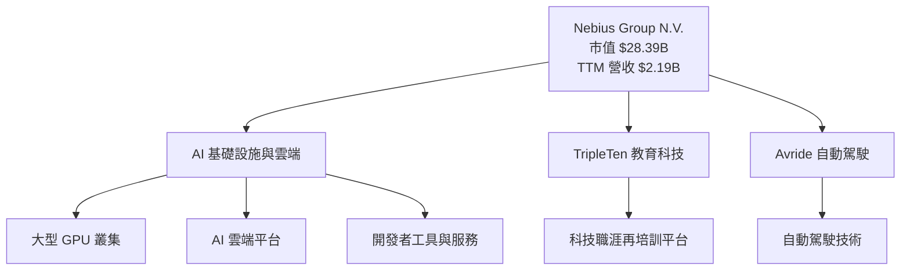
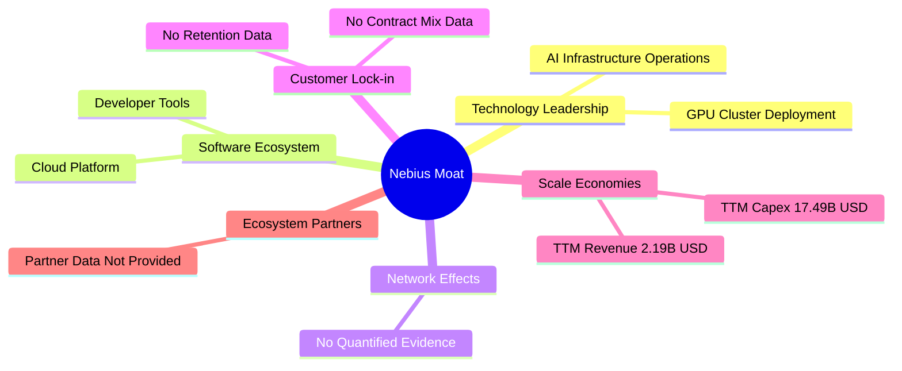
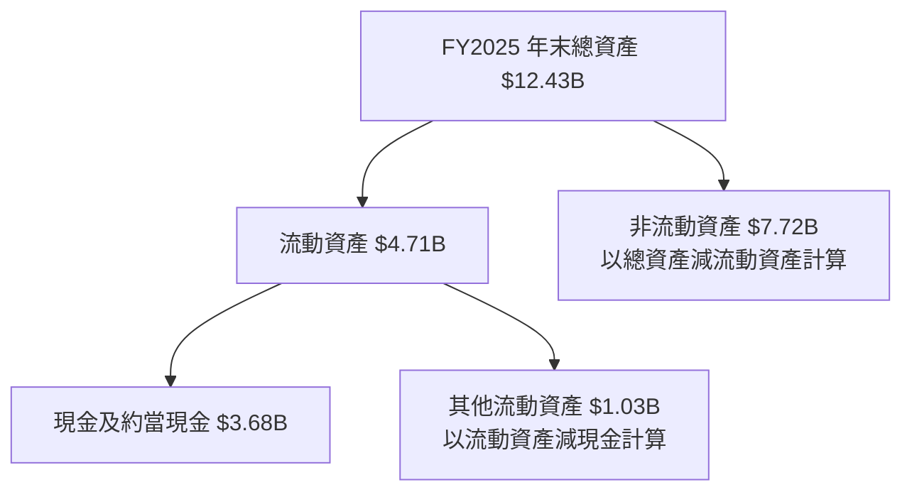
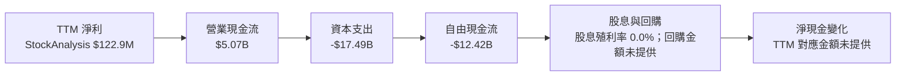
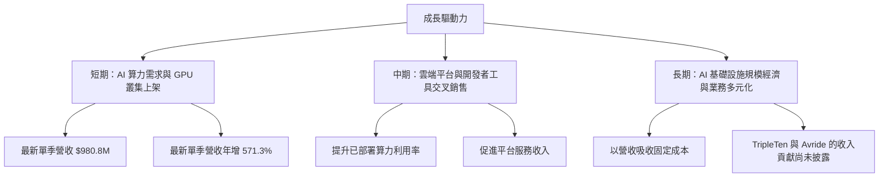
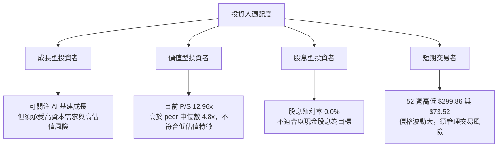

# NBIS 基本面深度分析報告
> **報告日期**：2026-11-20 ｜ **語言**：繁體中文 ｜ **數據來源**：Yahoo Finance、Finviz、StockAnalysis、Roic.ai ｜ **分析師**：CFA 級機構研究

## 目錄

| # | 章節 | 核心結論 |
|---|------|----------|
| 1 | 執行摘要 | 賣出；加權合理價值 $55.77；MOS -73.8% |
| 2 | 公司概覽與商業模式 | AI 基礎設施具成長性，但收入組成與客戶經濟性未充分披露，護城河尚待驗證 |
| 3 | 損益表深度分析 | TTM 營收 $2.19B；最新單季營收年增 571.3%，但 TTM 營業利益率 -23.0% |
| 4 | 資產負債表分析 | 淨負債 $8.67B；流動比率 5.306，但應收帳款天數 673 天值得關注 |
| 5 | 現金流量深度分析 | TTM FCF -$12.42B，主要反映大規模資本支出 |
| 6 | 獲利能力與資本效率 | ROIC N/A；WACC 7.66%；現階段無法證明已創造經濟價值 |
| 7 | 相對估值分析 | NBIS P/S 12.96x，高於三家同業中位數 4.8x |
| 8 | DCF 內在價值評估 | N/A；TTM 營業利益為負，現金流折現模型不適用 |
| 9 | 成長催化劑 | AI 算力需求與 GPU 叢集擴張具催化潛力；TAM 數據未提供 |
| 10 | 風險矩陣 | 資本支出與融資、估值回落、AI 算力需求及客戶回款為主要風險 |
| 11 | 投資建議 | 賣出；目前估值與資本需求不匹配，應監控營業槓桿及 FCF |

## 1. 執行摘要

### 1.0 一頁式投資儀表板（Portfolio Manager 30 秒速讀）

| 項目 | 內容 |
|------|------|
| **投資論點（3 句）** | ① 最新一季營收年增 **571.3%**，反映 AI 基礎設施需求快速放大，但這是單季年增率，並非 TTM 成長率。② TTM 資本支出 **$17.49B** 高於營業現金流 **$5.07B**，令 TTM FCF 為 **-$12.42B**，擴張仍高度消耗資金。③ NBIS P/S **12.96x**，同業中位數為 **4.8x**；按固定權重計算的加權合理價值為 **$55.77**，低於 2026-11-19 收盤價 **$96.92**。 |
| **綜合評分** | **4.0/10**（引用 1.1 評分卡） |
| **財務健康** | 🔴 淨負債 **$8.67B**、TTM FCF **-$12.42B**；流動比率 **5.306** 提供短期流動性緩衝，但無法消除長期融資風險。 |
| **ROIC vs WACC** | ROIC **N/A** vs WACC **7.66%**；ROIC 資料不足，不能確認是否創造價值，TTM 營業利益率 **-23.0%** 顯示當前營運尚未達正向營業獲利。 |
| **FCF 趨勢** | 惡化；TTM FCF **-$12.42B**，FCF Yield **-43.76%**。大額資本支出是主要原因，後續要看新增算力資產能否轉為現金收入。 |
| **估值** | Forward P/E **-31.84x**（虧損公司，解讀有限）｜ EV/EBITDA **60.56x**｜ FCF Yield **-43.76%** |
| **DCF 內在價值（基準）** | **N/A**；公司 TTM 營業利益為負，依模型規則不計算 DCF，也無法計算 DCF 折溢價。 |
| **安全邊際（MOS）** | **-73.8%**＝(**加權合理價值 $55.77 − 現價 $96.92**) ÷ 加權合理價值 $55.77；🔴 無安全邊際。 |
| **預期報酬（基準情境 12M）** | N/A；DCF 情境未提供。以加權合理價值為估值參照，上行空間 **-42.5%**，但非 12 個月回報預測。 |
| **關鍵風險（前二）** | ① TTM FCF **-$12.42B**、淨負債 **$8.67B** 帶來資金需求；② NBIS P/S **12.96x** 對照同業中位數 **4.8x**，估值重定價風險高。 |
| **評級 + 信心度** | 🔴 **賣出**｜信心：中。規則 20 的 MOS 為 **-73.8%**，且 P/S 高於同業中位數；DCF 不能提供獨立交叉驗證，故信心不評為高。 |

### 1.1 綜合評分卡（全報告唯一）

| 維度 | 評分（1–10） | 主要依據（引用數字與其來源章節） |
|------|--------------|----------------------------------|
| 成長性 | 8.0 | TTM 營收 $2.19B；最新單季營收年增 571.3%，但 TTM 成長率 N/A，且單季成長不代表可持續性（第 3 章）。 |
| 獲利能力 | 3.0 | TTM 營業利益率 -23.0%；ROIC 與 Piotroski F-Score N/A，無法證明盈利能力已形成（第 3、6 章）。 |
| 財務健康 | 4.0 | 淨負債 $8.67B、流動比率 5.306、DSO 673 天、TTM FCF -$12.42B（第 4、5 章）。 |
| 估值 | 1.0 | MOS -73.8%；NBIS P/S 12.96x，Peer P/S 中位數 4.8x（第 7、8 章）。 |
| 護城河 | 6.0 | 公司建置 GPU 叢集、雲端平台與開發者工具，但未提供市場份額、客戶留存或分部收入數據，競爭優勢仍需量化驗證（第 2 章）。 |
| 管理層與資本配置 | 2.0 | TTM Capex $17.49B、TTM FCF -$12.42B；FY2025 SBC $83.2M，2026 年四季 SBC 合計 $221.4M。擴張速度與股東資金效率需觀察（第 3、5 章）。 |
| **綜合評分** | **4.0** | 六項算術平均：\((8+3+4+1+6+2)÷6=4.0\)。 |

### 1.2 五大投資論點 + 三大核心風險

| 類型 | 項目 | 具體依據 | 信心度 |
|------|------|----------|--------|
| 🟢 **投資論點①** | AI 算力需求帶動收入快速增長 | 最新季度營收 **$980.8M**，年增 **571.3%**；若客戶需求轉為可持續合約收入，資產利用率提升可能改善營業槓桿。 | 🟢 高 |
| 🟢 **投資論點②** | 毛利率顯示算力服務具一定毛利空間 | TTM 毛利率 **76.0%**；最新季度毛利率按季報數字計算為 **77.6%**（$761.1M ÷ $980.8M）。高毛利有利於吸收固定成本，但尚未轉化為正向 TTM 營業利益。 | 🟡 中 |
| 🟢 **投資論點③** | 現金資產及流動性緩衝 | 現金與短期投資 **$7.43B**、流動比率 **5.306**；可支持部分擴張需求，但相對總債務仍為淨負債。 | 🟡 中 |
| 🟢 **投資論點④** | GPU 叢集與平台服務具有交叉銷售可能 | 公司提供大型 GPU 叢集、AI 雲平台與開發者工具；目前未有分部收入或客戶留存數據，交叉銷售尚未被量化驗證。 | 🟡 中 |
| 🟢 **投資論點⑤** | 業務規模已明顯高於前期 | 年營收由 FY2024 **$91.5M** 增至 FY2025 **$529.8M**，同比約 **479.0%**；快速增長提高規模經濟可能性，也同步加大資本需求。 | 🟡 中 |
| 🟡 **風險①** | 資本支出與融資壓力 | TTM Capex **$17.49B**、FCF **-$12.42B**、淨負債 **$8.67B**；若新增容量利用率或定價低於預期，現金消耗可能延續。 | 🔴 高衝擊 |
| 🔴 **風險②** | 估值高於同業參照 | P/S **12.96x**，同業中位數 **4.8x**；若成長率下降或市場下修算力基建估值，股價可能承受倍數收縮。 | 🔴 高衝擊 |
| 🟡 **風險③** | 回款與客戶集中風險 | DSO **673 天**；數據可能受期末應收款、營收快速增長及業務結構影響，但長天數仍提示需要檢查回款品質與客戶集中度。 | 🟡 中度 |

### 1.3 快速統計卡片

| 指標 | 公司實際值（期間） | 同業中位數 | 狀態 |
|------|--------------------|------------|------|
| 營收成長（TTM） | **N/A** | — | 🟡 |
| 營收成長（最新一季年增） | **571.3%** | **29.6%**（CRWV、ORCL、MSFT 的中位數） | 🟢 |
| 毛利率（TTM） | **76.0%** | **66.8%** | 🟢 |
| 營業利益率（TTM） | **-23.0%** | — | 🔴 |
| ROIC（TTM） | **N/A** | — | 🟡 |
| Forward P/E | **-31.84x** | **10.0x**（可計算之 ORCL、MSFT 中位數；CRWV 為 -25.3x） | 🔴 |
| FCF Yield（TTM） | **-43.76%** | — | 🔴 |
| Piotroski F-Score | **N/A** | — | 🟡 |

> 同業營收成長中位數以三家提供值排序計算；Forward P/E 的 CRWV 為負數且與盈利型 P/E 中位數不可直接比較，因此列出 ORCL、MSFT 可解讀倍數中位數，並在評語中保留此限制。

### 1.4 投資結論

╔══════════════════════════════════════════════════════════════════╗  
║　　　　　　　　　📊 投資結論摘要　　　　　　　　　　　　　　　║  
╠══════════════════════════════════════════════════════════════════╣  
║ 評級：賣出（MOS -73.8%，依規則 20）　　　　　　　　　　　　　║  
║ 價格（2026-11-19 收盤）：$96.92　　　　　　　　　　　　　　　║  
║ DCF 內在價值（基準）：N/A（TTM 營業利益為負）　　　　　　　　║  
║ 安全邊際 MOS：-73.8%（以加權合理價值為分母）　　　　　　　　║  
║ 加權合理價值（8.8）：$55.77　　　　　　　　　　　　　　　　　║  
║ 綜合評分：4.0/10（引用 1.1）　　　　　　　　　　　　　　　　　║  
║ 適合投資人：能承受高波動、以長期 AI 基礎設施成長為主題的投資人；║  
║　　　　　　不適合依賴現金流、低估值或股息的投資人。　　　　　║  
╚══════════════════════════════════════════════════════════════════╝

## 2. 公司概覽與商業模式

### 2.1 業務結構與收入來源

公司資料列出 Nebius AI 基礎設施、TripleTen 教育科技平台與 Avride 自動駕駛業務，但沒有提供各業務的營收拆分。因此只呈現已披露的公司總營收與業務類型，不推估各板塊收入或佔比。

AI 基礎設施包括大型 GPU 叢集、雲平台與開發者工具；可辨識為軟體與服務的部分，尚無獨立收入數字。公司整體營收不能直接等同 AI 雲端收入，亦不能從現有資料推導各業務收入貢獻。

### 2.2 市場份額

市場份額數據未提供。可引用的規模指標為 TTM 營收 **$2.19B**、最新單季營收年增 **571.3%**；CRWV 最新季度年增 **168.2%**，但業務規模及收入確認口徑不完全相同，不能據此推導市場佔有率。

### 2.3 競爭護城河分析

### 2.4 護城河強度

| 護城河項目 | 強度（強／中／弱） | 證據（引用數字或事實） | 會削弱它的情況 |
|------------|--------------------|------------------------|----------------|
| 技術與算力基建 | 中 | 提供大型 GPU 叢集及 AI 雲平台；TTM Capex **$17.49B** 顯示正在大量投入資產。 | GPU 供應不足、技術迭代令設備快速過時、競爭者同時擴產。 |
| 軟體生態系統 | 中偏弱 | 有雲平台與開發者工具，但沒有活躍開發者、使用量、軟體收入或留存數據。 | 客戶使用多雲架構、工具轉換成本低、服務差異化不足。 |
| 網路效應 | 弱／未驗證 | 未提供供需雙邊網路、客戶互相帶動或社群規模數據。 | 客戶不因其他客戶加入而增加使用價值。 |
| 客戶鎖定 | 未驗證 | DSO **673 天**，但沒有合約期限、續約率或客戶集中度資料，不能把高應收天數視為鎖定證據。 | 客戶集中、合約短期化、算力可跨供應商切換。 |
| 規模效應 | 中 | TTM 營收 **$2.19B**，最新季度營收 **$980.8M**；規模擴大有助固定成本攤薄，但 TTM 營業利益率仍為 **-23.0%**。 | 利用率不足、價格競爭或資本成本上升。 |
| 生態夥伴 | 未驗證 | 財務資料未披露合作夥伴收入、分銷貢獻或供應協議條款。 | 依賴單一供應來源，或合作夥伴自行推出競爭服務。 |

1.1 護城河評分為 **6.0/10**：公司具備實體算力與平台能力，但缺少市佔率、留存、客戶集中度與分部經濟性數據，仍不能把資產投入直接等同可持續競爭優勢。

## 3. 損益表深度分析

### 3.1 年度收入成長趨勢（近4年）

FY2022–FY2025 收入由 **$13.5M** 增至 **$529.8M**，三年 CAGR 約 **240.0%**。計算為 \((529.8÷13.5)^{1/3}-1\)；基期非常低，且業務組合可能變動，不宜外推為穩態增速。

╔══════════════════════════════════════════════════════════════════╗  
║　　　　　　　　Nebius 年度收入趨勢（FY2022–FY2025）　　　　　　║  
╠══════════════════════════════════════════════════════════════════╣  
║ FY2022　$13.5M　　　YoY：+37.8%　　　　　　　　　　　　　　　║  
║ FY2023　$9.8M　　　 YoY：-27.4%　　　　　　　　　　　　　　　║  
║ FY2024　$91.5M　　　YoY：+833.7%　　　　　　　　　　　　　　║  
║ FY2025　$529.8M　　 YoY：+479.0%　　　　　　　　　　　　　　║  
║　　　　　　　　　　　　　　　　　　　　　　　　　　　　　　　║  
║ 三年累計 CAGR：+240.0%（FY2022 至 FY2025）　　　　　　　　　║  
╚══════════════════════════════════════════════════════════════════╝

### 3.2 季度收入趨勢分析

| 季度 | 營收 | QoQ 成長 | YoY 成長 | 備註 |
|------|------:|---------:|---------:|------|
| 2025 Q4 | $227.7M | +347.2% | +499.2% | QoQ 以 2025 Q3 $50.9M 為基期；YoY 以 StockAnalysis 列示的 2024 Q4 $38M 計算。 |
| 2026 Q1 | $399.0M | +75.2% | +683.9% | 年增率依 StockAnalysis 季度數據。 |
| 2026 Q2 | $582.3M | +46.0% | +454.0% | 季增仍高，但增速低於 Q1 的季增率。 |
| 2026 Q3 | $980.8M | +68.4% | **+571.3%** | 年增率照錄財務資料；收入規模快速擴張。 |

QoQ 公式為當季營收除以上季營收再減 1。例如 Q3：\((980.8÷582.3)-1=68.4\%\)。季度 YoY 反映低基期與業務放量共同作用，不能代替 TTM 成長率；TTM 成長率標示 **N/A**。

### 3.3 利潤率演變分析

年度毛利率由毛利除以營收計算；FY2023 與 FY2022 毛利為負，顯示歷史業務結構與目前 AI 基建階段可能不同。

| 利潤率指標 | FY2022 | FY2023 | FY2024 | FY2025 | 趨勢 | 評估 |
|------------|-------:|-------:|-------:|-------:|------|------|
| **毛利率** | -110.4% | -100.0% | 52.2% | 68.6% | FY2024 起轉正並擴張，顯示收入組合或交付經濟性改變。 | 🟢 |
| **營業利益率** | -1,170.4% | -2,915.3% | -436.7% | -115.5% | 虧損率收窄，但仍為大幅負值。 | 🔴 |
| **淨利率** | 5,522.2% | 2,462.2% | -700.9% | 15.6% | 極受非營業及一次性項目影響，年度間不可直接外推。 | 🟡 |

TTM 毛利率為 **76.0%**，但 TTM 營業利益率為 **-23.0%**，差距反映毛利以下仍有顯著營運費用及／或擴張成本。最新單季營業利益率的不同來源存在不一致：以收入 $980.8M、營業利益 $50.4M 計算為正 **5.1%**，而統一財務指標列示最新一季營業利益率 **-18.7%**。因此不將這兩種口徑混為一談；營業利益率結論以標準化指標 TTM **-23.0%** 為主，並將單季數據差異列為資料核對事項。

### 3.4 費用結構分析

費用細目未提供足夠一致的最新 TTM 分類，不能製作完整費用圓餅圖。可確認 FY2025 研發費用為 **$177.3M**，約為當年營收的 **33.5%**（$177.3M ÷ $529.8M）；高研發投入支持產品與平台開發，但在營業利益仍為負時，也加大盈利轉正所需的收入規模。

### 3.5 季度 EPS 趨勢與盈餘品質（Quality of Earnings）

EPS 預估與實際值資料庫均為缺值，故過去四季無法判定超預期或不及預期。季報淨利依序為 **-$268.8M、+$621.2M、-$190.4M、-$37.5M**；FY2026 Q1 的淨利轉正不能單獨視為持續獲利證據，年度與季度淨利波動很大。

| 盈餘品質項目 | 數值/佔比 | 評估 |
|--------------|-----------|------|
| 股權薪酬 SBC / 營收 | 2026 四季 SBC 合計 **$221.4M ÷ TTM 營收 $2.19B = 10.1%** | 🔴 佔比顯著；SBC 是現有股東的經濟成本，若持續將造成稀釋。季度 SBC 合計取自 2025 Q4 至 2026 Q3。 |
| SBC / 營業現金流 | **$221.4M ÷ $5.07B = 4.4%** | 🟡 現金流為正，但營業現金流受營運資金等項目影響，不代表扣除大額 Capex 後有可分配現金。 |
| FCF / 淨利（現金轉換率） | TTM FCF **-$12.42B**；StockAnalysis TTM 淨利 **$122.9M**，比率約 **-101.1 倍** | 🔴 FCF 與淨利方向相反，主要反映 Capex 大於營業現金流；淨利不是現階段現金盈利的可靠替代。 |
| 一次性/非經常性損益 | 年度與季度淨利大幅波動；FY2026 Q1 淨利 **$621.2M**，而鄰近季度為虧損 | 🟡 財務資料未提供項目明細，無法精確拆分一次性損益；單季正淨利不宜直接年化。 |
| 有效稅率異常 | **29.0%**（最近年度有效稅率） | 🟡 尚未達穩定盈利，單一年度有效稅率未必可代表長期現金稅率。 |
| 資本化支出 vs 費用化 | TTM Capex **$17.49B**；TTM 營業利益率 **-23.0%** | 🔴 算力設備以資本支出投入，成本透過折舊逐年反映；需留意資本化使當期費用低於現金投入，但目前沒有證據據此判斷會計處理不當。 |

**盈餘品質結論**：FY2026 Q1 的淨利轉正與 TTM 正淨利，未能抵銷 **-$12.42B** 的 TTM FCF；同時 SBC 約佔 TTM 營收 **10.1%**。因此目前經濟獲利的含金量偏低，估值應優先觀察營業獲利、資本回報及自由現金流，而非單季 GAAP 淨利。

## 4. 資產負債表分析

### 4.1 資產結構分解

最新完整資產細項來自 FY2025 年末資料：流動資產 **$4.71B**，總資產 **$12.43B**，因此非流動資產為 **$7.72B**（$12.43B − $4.71B）。此圖反映 FY2025 年末，而非 2026-09-30 最新 TTM 資產細項。

### 4.2 流動性與營運資金分析

流動性數值為最新可用口徑；可比歷史流動比率與速動比率未提供。

| 指標 | 最新值 | 評估 |
|------|-------:|------|
| 流動比率 | **5.306** | 🟢 短期流動資產對流動負債覆蓋較高，但不代表資產可立即變現。 |
| 速動比率 | **4.847** | 🟢 不計存貨後仍有緩衝；公司未列存貨，符合以算力設備為主的資產特性。 |
| 現金及短期投資 | **$7.43B** | 🟡 提供融資緩衝，但低於總債務。 |

**營運資金天數**（數值照錄品質指標區間；一年前數據未提供，不計算變化）：

| 指標 | 最新 TTM | 一年前 TTM | 變化 | 解讀 |
|------|----------:|------------|------|------|
| DSO 應收帳款天數 | **673 天** | N/A | N/A | 長天數可能與客戶付款條件、期末應收款或快速增長有關，應追蹤回款及應收款減值。 |
| DIO 存貨天數 | **N/A** | N/A | N/A | 公司未報告存貨餘額；不推算。 |
| DPO 應付帳款天數 | **368 天** | N/A | N/A | 較長付款週期可能與設備採購和供應商條款有關，需留意是否反映正常商業條款或付款壓力。 |
| CCC 現金轉換週期 | **N/A** | N/A | N/A | 由於 DIO 為 N/A，CCC 不可計算。 |

### 4.3 債務結構分析

最新統一指標為現金及短期投資 **$7.43B**、總債務 **$16.10B**、淨負債 **$8.67B**。FY2025 年末總債務僅列 **$4.97B**，與 2026-09-30 的最新資料差異很大，可能反映期間融資、租賃或統計口徑變化；不應以舊年度債務替代最新值。

╔══════════════════════════════════════════════════════════════════╗  
║　　　　　　　　　NBIS 債務健康診斷　　　　　　　　　　　　　　║  
╠══════════════════════════════════════════════════════════════════╣  
║ 總債務：　　　 $16.10B　🔴 相較現金較高　　　　　　　　　　　║  
║ 現金及短期投資：$7.43B　 🟡 提供流動性緩衝　　　　　　　　　║  
║ 淨負債：　　　 $8.67B　 🔴 有息負債高於現金投資　　　　　　　║  
║ 流動比率：　　 5.306　　🟢 短期覆蓋尚可　　　　　　　　　　║  
║ Debt/EBITDA：　約 26.3x（估算）　🔴　　　　　　　　　　　　║  
║ 利息保障倍數： N/A（利息費用及一致 EBITDA 口徑未提供）　　　　║  
╚══════════════════════════════════════════════════════════════════╝

Debt/EBITDA 為估算值：TTM EBITDA Margin **28.0% × TTM 營收 $2.19B = 約 $0.613B**；再以總債務 **$16.10B ÷ $0.613B = 約 26.3x**。該比率對口徑很敏感，尤其公司 TTM 營業利益為負，不應把 EBITDA 視為可用於償債的現金流。

### 4.4 股東權益趨勢

| 年度 | 股東權益 | 年度變化 | 解讀 |
|------|---------:|---------:|------|
| 2022 | $4.25B | — | 基期。 |
| 2023 | $3.29B | -22.6% | 權益下降。 |
| 2024 | $3.25B | -1.2% | 大致持平。 |
| 2025 | $4.59B | +41.2% | 權益增加；需配合增發、業務交易與其他綜合收益細項解讀。 |

╔══════════════════════════════════════════════════════════════════╗  
║　　　　　　　股東權益（年度）　　　　　　　　　　　　　　　　║  
╠══════════════════════════════════════════════════════════════════╣  
║ 2022　$4.25B　████████████████████　　　　　　　　　　　　　　║  
║ 2023　$3.29B　███████████████　　　　　　　　　　　　　　　　　║  
║ 2024　$3.25B　███████████████　　　　　　　　　　　　　　　　　║  
║ 2025　$4.59B　██████████████████████　　　　　　　　　　　　　║  
╚══════════════════════════════════════════════════════════════════╝

## 5. 現金流量深度分析

### 5.1 現金流量瀑布圖

TTM 營業現金流和資本支出使用標準化財務指標。淨利、分紅及回購的 TTM 對應完整瀑布數字未提供，因此不以未經核實的數字填補。

### 5.2 FCF 轉換率趨勢

| 年度 | 營業現金流 | FCF | 淨利 | FCF / 淨利 | 解讀 |
|------|-----------:|----:|-----:|-----------:|------|
| 2022 | $697.0M | $682.4M | $745.6M | 91.5% | FCF 接近淨利，但歷史業務組合與當前不同。 |
| 2023 | $829.8M | $746.9M | $241.3M | 309.5% | 比率受淨利偏低與資本支出較少影響。 |
| 2024 | $245.6M | -$561.9M | -$641.4M | 87.6% | 淨利及 FCF 均為負，比例不宜作正常化解讀。 |
| 2025 | $384.8M | -$3.68B | $82.5M | -44.6x | 大額投資令現金流與帳面淨利背離。 |
| TTM 至 2026-09-30 | $5.07B | -$12.42B | $122.9M¹ | 約 -101.1x | 資本支出遠高於營業現金流，現金轉換嚴重為負。 |

¹ TTM 淨利取自 StockAnalysis；TTM FCF 嚴格採用營業現金流減資本支出的標準定義。

### 5.3 自由現金流趨勢

╔══════════════════════════════════════════════════════════════════╗  
║　　　　　　　　自由現金流：年度實際　　　　　　　　　　　　　　║  
╠══════════════════════════════════════════════════════════════════╣  
║ FY2022　+$0.682B　正值　　　　　　　　　　　　　　　　　　　║  
║ FY2023　+$0.747B　正值　　　　　　　　　　　　　　　　　　　║  
║ FY2024　-$0.562B　轉負　　　　　　　　　　　　　　　　　　　║  
║ FY2025　-$3.68B　 Capex 擴大　　　　　　　　　　　　　　　　║  
║ TTM　　 -$12.42B　FCF Yield -43.76%　　　　　　　　　　　　　║  
╠══════════════════════════════════════════════════════════════════╣  
║ TTM OCF $5.07B − Capex $17.49B = FCF -$12.42B　　　　　　　　║  
╚══════════════════════════════════════════════════════════════════╝

TTM FCF 惡化主要來自 **$17.49B** 的資本支出，遠高於 **$5.07B** 營業現金流。若設備上架與客戶收入增長相匹配，資本投入可能形成後續收入；反之，折舊、利息與再融資壓力可能使負 FCF 延續。

### 5.4 資本配置評估

資本配置方向可以由現金流辨識，但完整資金用途分布未提供，故不製作比例圓餅圖。

| 項目 | 已知數據 | 評估 |
|------|----------|------|
| Capex | TTM **$17.49B**；FY2025 **$4.07B** | 資本投入顯著加速，是現金流負值主因；投資回報率尚未證明。 |
| SBC | FY2025 **$83.2M**；2026 四季合計 **$221.4M** | SBC 增加會稀釋現有股東，應與每股收入及每股現金流一併追蹤。 |
| 股息 | 殖利率 **0.0%** | 未有股息回報。 |
| 回購 | 金額未提供 | 不作推算。 |
| 融資與現金 | 現金及短期投資 **$7.43B**、總債務 **$16.10B** | 淨負債 **$8.67B**，擴張需依賴營運現金流改善或外部融資。 |

## 6. 獲利能力與資本效率

### 6.1 ROE / ROA / ROIC 趨勢

| 指標 | 最新值 | 歷史可用資料 | 評估 |
|------|--------:|----------------|------|
| ROE | **1.5% TTM** | 年度歷史序列未提供同口徑數據 | 🟡 表面略正，但淨利包含可能非經常性項目，需與持續營業獲利交叉檢視。 |
| ROA | **-1.0% TTM** | 年度歷史序列未提供同口徑數據 | 🔴 資產回報仍為負。 |
| ROIC | **N/A** | 缺少可核實的投入資本及 NOPAT 序列 | 🟡 不能直接推論資本回報高於資本成本。 |

產業均值資料未提供，不作對比。歷史營業利益連年為負，至 FY2025 為 **-$611.7M**；FY2026 最新季度營業利益數據與統一營業利潤率來源亦存在口徑差異，因此不以單季數據代替完整 ROIC 趨勢。

### 6.2 ROIC vs WACC 分析（核心價值創造判斷）

WACC 採用資本成本資料所列 **7.66%**。原始 Beta 為 **1.54**，採用調整後 Beta **1.36**；WACC 各組成數值以財務資料的資本成本區塊為準，不另行重估。

╔══════════════════════════════════════════════════════════════════╗  
║　　　　　　　　ROIC vs WACC 深度分析　　　　　　　　　　　　　║  
╠══════════════════════════════════════════════════════════════════╣  
║ 無風險利率（10Y 美債）：5.05%　　　　　　　　　　　　　　　　║  
║ 市場風險溢酬 ERP：　　　5.00%　　　　　　　　　　　　　　　　║  
║ 原始 Beta：　　　　　　1.54　　　　　　　　　　　　　　　　　║  
║ 調整後 Beta：　　　　　1.36（⅔×1.54＋⅓×1）　　　　　　　　║  
║ 股權成本 Ke：　　　　　11.85%　　　　　　　　　　　　　　　　║  
║ 稅前債務成本：　　　　 0.38%　　　　　　　　　　　　　　　　║  
║ 有效稅率：　　　　　　29.0%　　　　　　　　　　　　　　　　　║  
║ 股權／債務權重：　　　63.8%／36.2%　　　　　　　　　　　　　║  
║ WACC：　　　　　　　　7.66%　　　　　　　　　　　　　　　　　║  
║ ROIC：　　　　　　　　N/A　　　　　　　　　　　　　　　　　　║  
║ EVA（ROIC − WACC）：　N/A　　　　　　　　　　　　　　　　　　║  
╠══════════════════════════════════════════════════════════════════╣  
║ 結論：ROIC 資料不足，無法計算 EVA；不能據此宣稱已創造股東價值。║  
║ TTM 營業利益率 -23.0%，顯示營業層面尚未達到正向獲利。　　　　║  
╚══════════════════════════════════════════════════════════════════╝

資本成本資料的內部驗算：股權成本依 CAPM 為 \(5.05\%+1.36×5.00\%=11.85\%\)；稅後債務成本 \(0.38\%×(1-29.0\%)=0.27\%\)；加權為 \(63.8\%×11.85\%+36.2\%×0.27\%=7.66\%\)（四捨五入）。此處沿用提供的 WACC，ROIC 因必要投入資本及稅後營業利益數據不足而不自行補算。結論是目前**無法確認**是否創造股東價值；負營業利潤率及負 FCF 是尚未達成價值創造的警示。

### 6.3 杜邦三因素分解

| 因素 | 數值（TTM） | 解讀 |
|------|-------------|------|
| 淨利率 | N/A | QUALITY FIGURES 所列 DuPont 為 N/A；缺少一致的淨利、營收、總資產及正股東權益組合。 |
| 資產週轉率 | N/A | 同上，不補算。 |
| 權益乘數 | N/A | 同上，不補算。 |
| **ROE** | **N/A（DuPont 口徑）** | QUALITY FIGURES DuPont 為 N/A；另行列示的 ROE TTM 1.5% 不可替代三因素拆解。 |

### 6.4 財務體質：Piotroski F-Score

**Piotroski F-Score：N/A**。缺少相隔一年的 SEC 申報資料，九項測試均未能按統一規則判定，因此不得把未能判定誤作通過或未通過。

| 測試 | 結果 | 解讀 |
|------|------|------|
| 正向 ROA | N/A | 缺少符合比較期要求的 SEC 申報資料。 |
| 正向營業現金流 | N/A | 不以 Yahoo TTM 取代評分規則所需資料。 |
| ROA 改善 | N/A | 同上。 |
| 營業現金流高於淨利 | N/A | 同上。 |
| 槓桿下降 | N/A | 同上。 |
| 流動比率改善 | N/A | 同上。 |
| 無新增股份稀釋 | N/A | 同上。 |
| 毛利率改善 | N/A | 同上。 |
| 資產週轉率改善 | N/A | 同上。 |

## 7. 相對估值分析

### 7.1 同業估值比較表格

同業倍數照錄 Yahoo Finance peer multiples；NBIS 數值來自公司估值資料。NBIS 虧損使 P/E 指標解讀受限。

| 估值指標 | **NBIS** | **CRWV** | **ORCL** | **MSFT** | NBIS 評估 |
|----------|---------:|---------:|---------:|---------:|-----------|
| **Trailing P/E** | N/A | N/A | 17.3x | 26.0x | 🔴 NBIS TTM EPS 為 -$0.26，無法用正向 P/E 作比較。 |
| **Forward P/E** | -31.84x | -25.3x | 10.0x | 20.6x | 🔴 NBIS 與 CRWV 為負值；負 P/E 不是低估訊號。 |
| **P/S Ratio** | **12.96x** | 2.5x | 4.8x | 10.7x | 🔴 NBIS 高於 peer 中位數 **4.8x**，市場已計入較高成長預期。 |
| **EV/EBITDA** | **60.56x** | 16.7x | 13.7x | 18.3x | 🔴 NBIS 倍數顯著較高；盈利口徑和資本開支強度需一併考量。 |
| **最新季度營收年增** | **571.3%** | 168.2% | 29.6% | 18.8% | 🟢 NBIS 增速領先，但低基期及高資本需求使增長品質仍待驗證。 |
| **毛利率 TTM** | **76.0%** | 66.8% | 64.0% | 67.7% | 🟢 高於 peer 中位數 **66.8%**；高毛利尚未轉成 TTM 正向營業利潤。 |

三家同業 P/S 中位數為 **4.8x**（2.5x、4.8x、10.7x 排序後的中位數）。NBIS 的營收增速較高，但其 P/S 約為中位數的 **2.70 倍**（12.96 ÷ 4.8），投資者必須相信高增長和資本回報可持續，才有理由支付溢價。

### 7.2 歷史估值區間分析

N/A（歷史 P/E、P/S 或 EV/EBITDA 分位區間未提供；價格歷史不能代替估值倍數歷史）。可見 2026 年 6 月月收盤價 **$276.17**，至 2026-11-19 收盤 **$96.92**，跌幅約 **64.9%**；52 週高低分別為 **$299.86** 與 **$73.52**。價格回落反映波動，不等於估值已回到合理區間。

### 7.3 情境價值（Bear / Base / Bull）

N/A（DCF 無法計算：TTM 營業利益為負，DCF MODEL 標示不適用）。不提供未經模型計算的情境目標價。

### 7.4 相對估值隱含價格區間

╔══════════════════════════════════════════════════════════════════╗  
║　　　　　　　　相對估值隱含價值　　　　　　　　　　　　　　　║  
╠══════════════════════════════════════════════════════════════════╣  
║ 同業 P/S：$35.91／股　　　　　　　　　　　　　　　　　　　　　║  
║　依據：CRWV、ORCL、MSFT 的 P/S 中位數 4.8x × NBIS TTM 營收　　║  
║　　　　再按股數及市值換算；固定估值方法表列每股價值。　　　　║  
║ 分析師共識目標價：$234.50／股　　　　　　　　　　　　　　　　║  
║　依據：20 位分析師平均目標價；不是公司基本面現金流估值。　　　║  
║ 現價（2026-11-19）：$96.92　　　　　　　　　　　　　　　　　　║  
╚══════════════════════════════════════════════════════════════════╝

同業 P/S 隱含價格 **$35.91**，相對現價低 **62.9%**；分析師共識目標價 **$234.50**，相對現價高 **142.0%**。兩者差異極大，顯示市場對未來成長、資本需求與長期盈利能力的假設分歧很高。

## 8. DCF 內在價值評估（Discounted Cash Flow）

### 8.0 估值推理鏈（Thinking Logic）

**先說結論限制**：DCF MODEL 標示 N/A，理由是 TTM 營業利益為負；因此不能合理地把當前虧損直接折現，也不能自行填入營收 CAGR、期末利潤率、終值或每股價值。下面列出資料允許的推理與可用估值方法，不建立替代 DCF。

NBIS 價值的主要可驗證來源是 AI 基礎設施收入規模、毛利及資本投入回收；TripleTen 與 Avride 是其他業務，但分部收入未提供，無法給出收入佔比或獨立估值。現階段最重要的估值變數應是**新增 GPU 資產利用率能否轉為持續營業獲利及現金流**：TTM Capex **$17.49B**、TTM FCF **-$12.42B**，而 TTM 營業利益率 **-23.0%**。但模型不提供敏感度矩陣，不能量化該變數對每股價值的影響。

| 決策點 | 本報告採用 | 理由（含數字） | 曾考慮但否決 | 否決理由 |
|--------|-----------|----------------|--------------|----------|
| 現金流定義 | 不建立 DCF | 既有 DCF MODEL 明確為 N/A；TTM 營業利益率 -23.0%。 | 自行採 FCFF 預測 | 缺乏有效模型假設及可核對逐年預測。 |
| 預測期 N | N/A | 模型沒有預測期。 | 自行指定 5 年或 10 年 | 無管理層財測或有效盈利基期作錨。 |
| 終值方法 | N/A | 無法形成正向營業現金流基礎。 | Gordon Growth／退出倍數 | 會製造未經驗證的終值與內在價值。 |
| EBIT 基礎 | N/A | 當前 TTM EBIT 為負，模型已停用。 | 自行轉用非 GAAP EBIT | 缺少一致非 GAAP 數據及 SBC 調節。 |

**關鍵假設推導鏈**：營收 CAGR、期末營業利潤率、稅率、Capex/營收、D&A/營收、營運資金、股數稀釋及永續成長率均未在 DCF MODEL 中提供，因此無法建立「錨點→調整→採用值→否決值」的可稽核推導；本報告不填入假設值。最脆弱的一環若勉強自建，會是新增算力資產的利用率與回報，但目前沒有可量化的合約、利用率或客戶留存資料。

### 8.1 模型假設總表（Model Inputs）

N/A（DCF MODEL 未建立：TTM 營業利益為負；財務資料缺少可支持逐年 FCFF 預測的管理層指引、稅後 EBIT 正向基礎及終值假設。不得自行建立模型。）

### 8.2 折現率推導（WACC）

DCF 不計算，但同一組資本成本資料可供第 6.2 節參考；WACC **7.66%**。原始 Beta **1.54**，使用調整後 Beta **1.36**，調整方式為 \(⅔×1.54+⅓×1=1.36\)。資本成本資料列示 Rf **5.05%**、ERP **5.00%**、股權成本 **11.85%**、稅前債務成本 **0.38%**、有效稅率 **29.0%**、股權／債務權重 **63.8%／36.2%**。此 WACC 是資本成本資料提供值，因 DCF 模型 N/A，不另以部分財報資料重建。

### 8.3 逐年自由現金流預測（基準情境）

N/A（DCF MODEL 未建立：TTM 營業利益為負；沒有模型逐年收入、EBIT、FCFF 與折現因子。歷史 TTM FCF **-$12.42B** 不可替代預測現金流。）

### 8.4 終值計算（Terminal Value）

N/A（沒有 DCF 預測期最後一年 FCFF、永續成長率或退出倍數。因而無法判斷 WACC 與 g 的關係，也不能計算終值。）

### 8.5 企業價值 → 每股內在價值（Bridge）

N/A（無預測期現金流現值、終值及企業價值，不能計算 DCF 每股價值或 DCF 折溢價。現金、總債務及股數已有資料，但不足以單獨形成 DCF 股權價值。）

### 8.6 敏感性分析（WACC × 永續成長率）

N/A（DCF 基準模型及其敏感度矩陣未提供；不自行填入 WACC／g 情境或每股價值。）

**三情境 DCF**：N/A。DCF MODEL 未提供悲觀、基準、樂觀情境，故不提供情境目標價、機率或機率加權價值。

**敏感度結論**：N/A。營收成長、營業利潤率、永續成長率與折現率對內在價值的量化彈性沒有模型輸出，不臆造敏感度。

### 8.7 反推 DCF（Reverse DCF：市場在預期什麼）

N/A（既有 DCF MODEL 未提供反推結果；僅憑現價 **$96.92** 及單一價格，沒有完整現金流模型，無法唯一反解營收成長率、利潤率或其他假設）。因此不建立試算軌跡，也不宣稱市場隱含某一個確切營運假設。

### 8.8 估值三角驗證與安全邊際

估值方法與權重按未盈利公司類型固定照錄：同業 P/S 權重 **90%**、分析師共識目標價權重 **10%**。同業 Forward P/E 因不可計算而剔除，其權重依固定方法表分配至其他方法。

| 估值方法 | 隱含每股價值 | 上行空間（÷現價） | 權重 | 說明 |
|----------|--------------:|------------------:|-----:|------|
| 同業 P/S | **$35.91** | **-62.9%** | **90%** | CRWV、ORCL、MSFT 同業 P/S 中位數 **4.8x** × NBIS TTM 營收。 |
| 分析師共識目標價 | **$234.50** | **+142.0%** | **10%** | 20 位分析師平均目標價；屬外部參考，分歧及方法不明。 |
| **加權合理價值** | **$55.77** | **-42.5%** | **100%** | 未盈利公司固定權重；同業 Forward P/E 不可計算，未納入。 |

逐步演算：
\[
\$35.91×90\%+\$234.50×10\%
=\$32.319+\$23.450
=\$55.769
\approx\boxed{\$55.77}
\]

採用固定加權合理價值 **$55.77** 與最新收盤價 **$96.92** 計算：

\[
MOS=\frac{\$55.77-\$96.92}{\$55.77}
=\frac{-\$41.15}{\$55.77}
=-73.8\%
\]

\[
上行空間=\frac{\$55.77-\$96.92}{\$96.92}
=\frac{-\$41.15}{\$96.92}
=-42.5\%
\]

MOS 評級依規則 20 為 **賣出**。折溢價以 DCF 基準值為基準，但 DCF 為 N/A，因此不計算。

╔══════════════════════════════════════════════════════════════════╗  
║　　　　　　　　估值區間與安全邊際　　　　　　　　　　　　　　║  
╠══════════════════════════════════════════════════════════════════╣  
║ 同業 P/S $35.91　──　加權合理價值 $55.77　──　現價 $96.92　║  
║ DCF 基準值：N/A；悲觀／基準／樂觀 DCF：N/A　　　　　　　　　║  
║ 安全邊際 MOS = ($55.77 − $96.92) ÷ $55.77 = -73.8%　　　　　║  
║ 上行空間 = ($55.77 − $96.92) ÷ $96.92 = -42.5%　　　　　　　║  
║ MOS 評估：🔴 無安全邊際　　　　　　　　　　　　　　　　　　║  
║ MOS ≥10% 的純估值參考價格上限：$55.77 × 90% = $50.19　　　　║  
║ 此價格是估值參考，不代表賣出評級下的買入建議。　　　　　　　║  
╚══════════════════════════════════════════════════════════════════╝

> 🔎 **程式複算（Python，依本節各項自動重算）**
>
> 加權合理價值 = $35.91 × 90% + $234.50 × 10% = **$55.77**（權重合計 100%）
>
> 以價格 $96.92 計：MOS = **-73.8%**，上行空間 = **-42.5%**
>
> ✅ 與本節所寫數值一致。

### 8.9 DCF 模型的局限與失效條件

- **終值依賴度**：N/A；DCF 未建立，無法計算終值佔 EV 比重。
- **最脆弱的假設**：若建立模型，核心風險會是新增 GPU 資產的利用率、定價與現金回收，但相關資料未提供，不能量化其對每股價值的影響。
- **不適用情境說明**：TTM 營業利益率 **-23.0%**、TTM FCF **-$12.42B**，獲利及資本支出波動大，DCF 可靠度不足。現階段宜以同業 EV/Sales 或 P/S、合約與單位經濟性、資本支出回報及資產利用率追蹤為主。
- **與第 10 章風險矩陣的連結**：AI 算力需求減速、價格競爭、設備供應或融資條件惡化，會使收入增速、毛利率及 Capex 回收低於市場預期；這些輸入未提供可量化 DCF 測試。

### 8.10 複算檢核表（Audit Trail：輸出前自我驗算）

| # | 檢核項目 | 檢查方式 | 結果 |
|---|----------|----------|------|
| 1 | 所有高／中敏感度 DCF 輸入均有推導 | DCF MODEL 為 N/A，未建立假設表 | ✅ 不適用並已明示 |
| 2 | 每個假設都有來歷 | 未填入 DCF 假設數值 | ✅ |
| 3 | WACC 算式與權重 | 沿用提供 WACC 7.66%；權重 63.8% + 36.2% = 100% | ✅ |
| 4 | Kd 與債務權重使用同一計息負債範圍 | 未自行重建債務範圍或 Kd | ✅ 不適用於自建 DCF |
| 5 | WACC 與第 6.2 節同值 | 均為 7.66% | ✅ |
| 6 | 逐年預測欄位符合 N | DCF MODEL N/A，沒有預測年 | ✅ 不適用 |
| 7 | FY+1 FCFF 演算 | 無模型輸入 | ✅ 不適用 |
| 8 | 預測期 PV 合計 | 無模型輸出 | ✅ 不適用 |
| 9 | WACC > g | g 未提供 | ✅ 不適用 |
| 10 | 終值以 FY+N 現金流為基礎 | 無預測期或終值 | ✅ 不適用 |
| 11 | EV 至每股價值橋接 | DCF 橋接未建立 | ✅ 不適用 |
| 12 | SBC 處理與股數假設相容 | 未建立 DCF 股數假設；財務分析已單獨披露 SBC | ✅ 不適用 |
| 13 | 矩陣基準格等於 DCF 基準值 | 無矩陣、無 DCF 基準值 | ✅ 不適用 |
| 14 | 敏感度矩陣有效格 | 無矩陣 | ✅ 不適用 |
| 15 | 三情境機率和 | 無 DCF 情境 | ✅ 不適用 |
| 16 | 反推 DCF 每列只放開一個變數 | 未反推 | ✅ 不適用 |
| 17 | MOS 分母與折溢價基準 | MOS 以加權合理價值 $55.77 為分母；DCF 折溢價未計算 | ✅ |
| 18 | 報告完整至第 11 章 | 章節完整 | ✅ |
| 19 | 加權合理價值等於價值乘權重之和 | $35.91×90% + $234.50×10% = $55.769 ≈ $55.77 | ✅ |
| 20 | 評級符合 MOS 門檻 | MOS -73.8%，符合賣出門檻 | ✅ |

## 9. 成長催化劑

### 9.1 催化劑時間軸

可核實資料沒有列出未來 GPU 上架、產能交付、合約啟動或財測日期，因此不以假設日期製作前瞻 Gantt 圖。已知的近期香港數據是 2026 Q3 營收 **$980.8M**、年增 **571.3%**；後續應以季度財報確認成長是否延續，以及收入是否轉成營業獲利與現金流。

### 9.2 TAM 市場規模分析

N/A（TAM 數據未提供）。可量化的公司收入基礎為 TTM **$2.19B**，最新單季營收 **$980.8M**；單季年增 **571.3%** 顯示目前規模快速擴張，但缺少可引用市場規模與公司市佔率，無法計算滲透率。

### 9.3 成長驅動力結構圖

短中期的關鍵不是單純擴大 Capex，而是證明新建算力能帶來足夠高的利用率與現金回收。TTM Capex **$17.49B** 對比 TTM FCF **-$12.42B**，意味成長催化劑必須同時帶來資產回報，才會改善股東價值。

## 10. 風險矩陣

### 10.1 風險評分矩陣

財務資料未提供可驗證的風險發生機率或損失分布，因此不以主觀座標製作帶有精確數字的象限圖。下表以「高／中」作定性分級，並明確區分已觀察到的財務敞口與尚未量化的衝擊。

### 10.2 風險清單詳細分析

| # | 風險項目 | 發生機率 | 財務衝擊 | 風險評估 | 緩解措施 |
|---|----------|----------|----------|----------|----------|
| 1 | 🔴 **Capex、淨負債與資金需求** | 高（定性判斷） | 高；TTM Capex **$17.49B**、FCF **-$12.42B**、淨負債 **$8.67B** | 🔴 高 | 追蹤資本支出分期、現金餘額、融資到期日與每單位算力收入；若收入增長但 FCF 持續擴大負值，降低持倉風險。 |
| 2 | 🔴 **估值倍數收縮** | 高（定性判斷） | 高；NBIS P/S **12.96x** 對照 peer 中位數 **4.8x** | 🔴 高 | 以季度收入成長、毛利率、營業利潤率和相對估值作聯合檢查；不以分析師目標價代替現金流驗證。 |
| 3 | 🟡 **AI 算力需求、價格或利用率低於預期** | 中至高（定性判斷） | 高；可能降低既有 Capex 回報，現有量化損失未提供 | 🔴 高 | 追蹤產能利用率、客戶合約期限、續約、單位算力定價與已部署產能爬坡。 |
| 4 | 🟡 **應收帳款與回款風險** | 中（定性判斷） | 中至高；DSO **673 天** | 🟡 中高 | 追蹤應收帳款餘額、逾期比例、壞帳準備及主要客戶付款條款。 |
| 5 | 🟡 **股權薪酬造成稀釋** | 中（定性判斷） | 中；2026 四季 SBC **$221.4M**，約為 TTM 營收 **10.1%** | 🟡 中高 | 追蹤年化 SBC／營收、稀釋股數與每股營收；要求每股成長不低於股數增長。 |
| 6 | 🟡 **資料口徑及盈利波動** | 中（定性判斷） | 中；最新季度營業利益率來源存在差異，季度淨利波動顯著 | 🟡 中 | 以 10-Q／年報調節 Yahoo、StockAnalysis 及其他來源，關注 GAAP 與非 GAAP 調節表。 |

## 11. 投資建議

### 11.1 最終評級與評分

按加權合理價值 **$55.77** 與 2026-11-19 收盤價 **$96.92** 計算，MOS 為 **-73.8%**，依規則 20 評級為 **賣出**；沒有作質化上調或下調。1.1 的綜合評分為 **4.0/10**，六項分數依序為成長性 **8.0**、獲利能力 **3.0**、財務健康 **4.0**、估值 **1.0**、護城河 **6.0**、管理層與資本配置 **2.0**。

### 11.2 合理價值與隱含報酬率

| 估值方法／情境 | 每股價值 | 相對現價 $96.92 | 機率／權重 | 說明 |
|----------------|---------:|-----------------:|-----------:|------|
| 同業 P/S | **$35.91** | **-62.9%** | **90%** | 固定權重估值方法。 |
| 分析師共識目標價 | **$234.50** | **+142.0%** | **10%** | 20 位分析師平均目標價。 |
| **加權合理價值** | **$55.77** | **-42.5%** | **100%** | 本報告 MOS 唯一分母。 |
| 悲觀／基準／樂觀 DCF 情境 | N/A | N/A | N/A | DCF MODEL 因 TTM 營業利益為負而不適用。 |

### 11.3 買入時機與觸發因素

╔══════════════════════════════════════════════════════════════════╗  
║　　　　　　　　✅ 投資觸發因素 Checklist　　　　　　　　　　　║  
╠══════════════════════════════════════════════════════════════════╣  
║ 暫不建議以現價建立估值型部位；需先看到以下證據：　　　　　　　║  
║ ☐ TTM 營業利益率由 -23.0% 持續改善，並朝損益兩平收斂。　　　　║  
║ ☐ TTM FCF 不再維持 -$12.42B 的大幅負值，且改善不只來自營運資金。║  
║ ☐ Capex 增長低於收入增長，新增算力有可核實的利用率與回款。　　║  
║ ☐ DSO 由 673 天顯著下降，或公司提供可信的應收款與合約說明。　　║  
║ ☐ P/S 估值溢價收窄，或公司以更高的持續成長與獲利改善證明溢價。║  
║                                                                  ║  
║ 加碼觀察條件：　　　　　　　　　　　　　　　　　　　　　　　║  
║ ☐ 至少兩季營業利益率改善，且營業現金流能覆蓋更大比例 Capex。　║  
║ ☐ 股數增長及 SBC／營收比率下降，避免每股價值被稀釋。　　　　　║  
║                                                                  ║  
║ 減碼／退出觸發條件：　　　　　　　　　　　　　　　　　　　　║  
║ ☐ 營收增長明顯放緩，同時毛利率或營業利潤率惡化。　　　　　　　║  
║ ☐ FCF 進一步惡化、現金餘額下降且淨負債持續上升。　　　　　　　║  
║ ☐ 客戶回款、資產利用率或融資條件顯示擴張投資無法回收。　　　　║  
╚══════════════════════════════════════════════════════════════════╝

### 11.4 投資人適配度分析

### 11.5 每季財報監控清單（Quarterly Watch List）

| 監控指標 | 最新基準 | 觸發加碼的改善訊號 | 觸發減碼／重新評估訊號 |
|----------|---------|---------------------|-------------------------|
| 營收與增長 | TTM **$2.19B**；最新單季年增 **571.3%** | 多季維持高增長，且不只由低基期或一次性項目推動 | 單季年增連續兩季低於 **100%**，且毛利及利用率同步轉弱；此為分析師監控門檻，非公司財測。 |
| 毛利率 | TTM **76.0%** | 維持高位並帶動營業利潤率改善 | 低於 **66.8%** 的三家同業毛利率中位數，且沒有產品組合解釋。 |
| 營業利潤率 | TTM **-23.0%**；最新季度來源口徑有差異 | 以一致申報口徑連續兩季改善 | 相較可比季度惡化超過 **5 個百分點**；須先核對季度口徑。 |
| Capex 與 FCF | TTM Capex **$17.49B**；TTM FCF **-$12.42B** | 收入持續成長且 FCF 虧損逐季收窄 | FCF 進一步惡化、Capex 上升而營收或合約覆蓋不足。 |
| 營業現金流 | TTM **$5.07B** | 現金流改善且不是依靠應付帳款或短期營運資金變動 | OCF 轉負並持續，或與收入成長方向背離。 |
| DSO 應收天數 | **673 天** | 應收款天數下降且回款金額增加 | DSO 進一步升高或應收款增速長期高於營收增速。 |
| SBC 與股數 | 2026 四季 SBC **$221.4M**；流通股數市場資料 **259.60M** | SBC／營收下降、股數增速受控 | SBC／營收持續高於 **10.1%**，或股數增速快於每股收入增速。 |
| 債務與現金 | 現金投資 **$7.43B**；總債務 **$16.10B**；淨負債 **$8.67B** | 淨負債下降且無高成本大規模增資 | 淨負債增加、融資成本上升或現金儲備快速下降。 |
| EPS 與獲利品質 | EPS 估計／實際驚喜數據 N/A；TTM EPS **-$0.26** | GAAP 獲利穩定轉正，並與 FCF 改善一致 | 依賴單季非經常性淨利、SBC 增長或營運現金流反覆波動。 |

### 11.6 反面論證：什麼會證明論點錯誤（What Would Change My Mind）

╔══════════════════════════════════════════════════════════════════╗  
║　　　　　　⚠️ 論點失效條件（Disconfirming Evidence）　　　　　　║  
╠══════════════════════════════════════════════════════════════════╣  
║ 下列情況會推翻「AI 業務增長足以支撐現有估值」的多頭論點：　　　║  
║ ☐ 最新季度營收年增連續兩季低於 100%，且收入放緩並非高基期所致。║  
║ ☐ TTM 營業利益率較 -23.0% 基準再收縮 5 個百分點以上。　　　　║  
║ ☐ TTM FCF 由 -$12.42B 進一步惡化，或新增 Capex 未帶來收入回報。║  
║ ☐ DSO 高於 673 天且應收款增長持續快於收入，顯示回款品質惡化。║  
║ ☐ 淨負債高於 $8.67B 且現金餘額下降，融資需求轉為稀釋股東。　　║  
║ ☐ P/S 仍顯著高於 peer 中位數 4.8x，但營收成長和毛利率同步下滑。║  
║ ☐ SBC／營收持續高於目前約 10.1%，或股數增速長期快於每股收入。║  
║ ☐ ROIC 一旦能可靠計算，仍低於 WACC 7.66%，代表擴張未創造價值。║  
╚══════════════════════════════════════════════════════════════════╝

> **免責聲明**：本報告為 AI 自動生成，僅供研究參考，不構成投資建議。投資有風險，入市需謹慎。

---

## 資料與來源

| 項目 | 內容 |
|------|------|
| 價格 | 96.92 USD，2026-11-19 收盤（Yahoo Finance 即時報價（該交易日已收盤）） |
| 財務報表 | Yahoo quarterly statements (no SEC filing data)，最新季度 2026-09-30（TTM = four quarters to this date） |
| 有回應的資料來源 | Yahoo Finance、Finviz、StockAnalysis、Roic.ai |
| 未回應的資料來源 | SEC 申報資料 (XBRL) |
| 由程式計算 | TTM 數字、WACC、DCF 模型、估值方法與權重、加權合理價值、MOS、評級門檻、F-Score、杜邦分解、營運資金天數、綜合評分 |
| 撰寫模型 | openai / gpt-6-luna |

> 本區塊由產生報告的程式依實際取得的資料填寫，非模型撰寫。「由程式計算」的數字不是模型的估計；其餘判斷（評分、情境、策略）是模型的分析。
