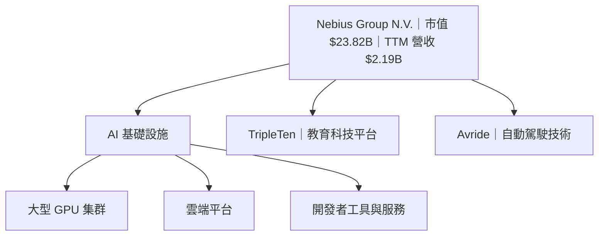
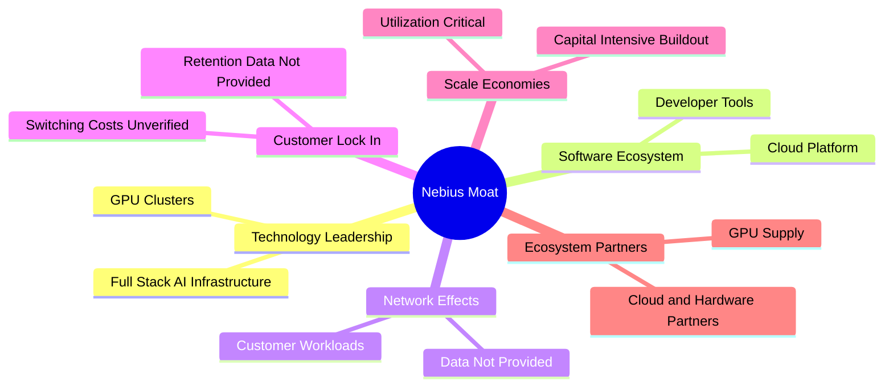
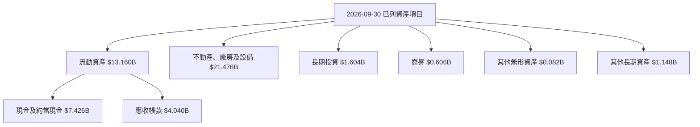
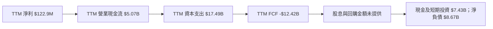
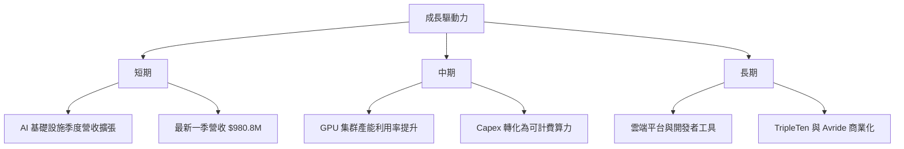
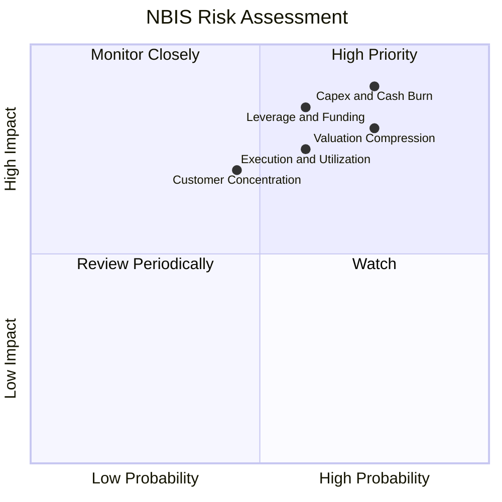
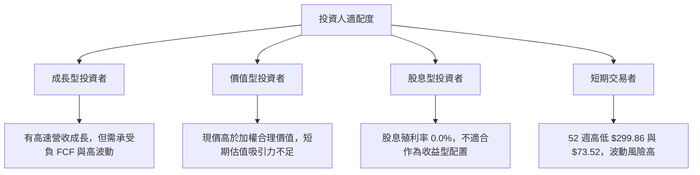

# NBIS 基本面深度分析報告
> **報告日期**：2026-11-21 ｜ **語言**：繁體中文 ｜ **數據來源**：Yahoo Finance、Finviz、StockAnalysis、Roic.ai ｜ **分析師**：CFA 級機構研究

---

## 目錄

| # | 章節 | 核心結論 |
|---|------|----------|
| 1 | 執行摘要 | 賣出；加權合理價值 $52.73，MOS -54.2% |
| 2 | 公司概覽與商業模式 | AI 基礎設施是核心方向，但分部收入與市場份額未提供 |
| 3 | 損益表深度分析 | TTM 營收 $2.19B；最新一季年增 571.3%，但營業獲利資料有來源差異 |
| 4 | 資產負債表分析 | 淨負債 $8.67B；流動比率 5.306，但應收帳款天數偏高 |
| 5 | 現金流量深度分析 | TTM FCF -$12.42B，主要受高資本支出拖累 |
| 6 | 獲利能力與資本效率 | ROIC 未提供；WACC 7.10%，目前不足以證明正向價值創造 |
| 7 | 相對估值分析 | 同業 P/S 中位數 4.4x，NBIS TTM P/S 10.88x |
| 8 | DCF 內在價值評估 | DCF N/A：TTM 營業利益為負；依同業 P/S 與分析師共識加權估值 |
| 9 | 成長催化劑 | AI 算力需求、GPU 集群擴建與新業務拓展為主要質化催化劑 |
| 10 | 風險矩陣 | 資本支出、負債與估值回落風險居前 |
| 11 | 投資建議 | 賣出；待估值、FCF 與營業利潤率改善後再重新評估 |

---

## 1. 執行摘要

### 1.0 一頁式投資儀表板（Portfolio Manager 30 秒速讀）

| 項目 | 內容 |
|------|------|
| **投資論點（3 句）** | ① 最新一季營收年增 **571.3%**，反映 AI 基礎設施需求快速擴大。② TTM 資本支出 **$17.49B**，高於營業現金流 **$5.07B**，使 TTM FCF 為 **-$12.42B**。③ 同業 P/S 估值法得 **$32.86**，與 2026-11-20 收盤價 **$81.31** 相比，顯示估值壓力。 |
| **綜合評分** | **4.2/10**（引用 1.1 評分卡） |
| **財務健康** | 🔴 淨負債 **$8.67B**、TTM FCF **-$12.42B**；流動比率 **5.306**提供短期緩衝，但不能消除投資支出與融資風險。 |
| **ROIC vs WACC** | ROIC：**N/A**；WACC：**7.10%**。ROIC 未提供，無法量化價差；目前營業虧損與負 FCF 不支持已創造正經濟利潤的結論。 |
| **FCF 趨勢** | TTM FCF **-$12.42B**；FCF Yield **-52.16%**。高額資料中心與 GPU 投資可能帶來未來產能，但目前現金回收尚未跟上。 |
| **估值** | Forward P/E **-26.71x** ｜ EV/EBITDA **53.10x** ｜ FCF Yield **-52.16%**。虧損狀態下 P/E 解讀有限。 |
| **DCF 內在價值（基準）** | **N/A**；TTM 營業利益為負，DCF 模型未計算，因此無法計算 DCF 折溢價。 |
| **安全邊際（MOS）** | **-54.2%**＝（加權合理價值 **$52.73** − 現價 **$81.31**）÷ 加權合理價值 **$52.73**；基準為第 8.8 節加權合理價值。 |
| **預期報酬（基準情境 12M）** | DCF 基準情境：**N/A**；加權合理價值相對現價的上行空間為 **-35.1%**。 |
| **關鍵風險（前二）** | ① 資本支出持續高於營運現金流；② 淨負債與估值倍數在成長不及預期時可能同時承壓。 |
| **評級 + 信心度** | 🔴 **賣出** ｜ 信心：中。依 MOS **-54.2%**，按規則 20 為賣出；未作質化調整。 |

### 1.1 綜合評分卡（全報告唯一）

| 維度 | 評分（1–10） | 主要依據（引用數字與其來源章節） |
|------|--------------|----------------------------------|
| 成長性 | 9.0 | 最新一季營收年增 **571.3%**；但 TTM 成長率為 N/A，詳見第 3 章。 |
| 獲利能力 | 2.0 | TTM 營業利益率 **-23.0%**、FCF **-$12.42B**；ROIC 與 F-Score 為 N/A，詳見第 3、5、6 章。 |
| 財務健康 | 4.0 | 淨負債 **$8.67B**、流動比率 **5.306**，DSO **673 天**，詳見第 4 章。 |
| 估值 | 1.0 | MOS **-54.2%**；NBIS P/S **10.88x**，高於同業 P/S 中位數 **4.4x**，詳見第 7、8 章。 |
| 護城河 | 5.0 | 有全堆疊 AI 基礎設施與 GPU 集群定位，但客戶留存、轉換成本與分部經濟數據未提供，詳見第 2 章。 |
| 管理層與資本配置 | 4.0 | FY2025 Capex **$4.07B**，TTM Capex 擴至 **$17.49B**；投資規模上升，但回報與資金來源需持續驗證，詳見第 5 章。 |
| **綜合評分** | **4.2** | 六項算術平均：**(9.0 + 2.0 + 4.0 + 1.0 + 5.0 + 4.0) ÷ 6 = 4.2**。 |

### 1.2 五大投資論點 + 三大核心風險

| 類型 | 項目 | 具體依據 | 信心度 |
|------|------|----------|--------|
| 🟢 **投資論點①** | AI 基礎設施收入快速放大 | 最新一季營收 **$980.8M**，年增 **571.3%**；若持續轉化為已部署算力與客戶使用量，有望擴大營收底盤。 | 🟢 高 |
| 🟢 **投資論點②** | 毛利率具有一定空間 | TTM 毛利率 **76.0%**；若高毛利雲端服務收入占比上升，可能改善固定成本吸收。 | 🟡 中 |
| 🟢 **投資論點③** | 流動性緩衝較高 | 現金與短期投資 **$7.43B**、流動比率 **5.306**，短期資產緩衝較充足。 | 🟡 中 |
| 🟢 **投資論點④** | AI 算力供應仍可形成差異化 | 公司提供 GPU 集群、雲端平台及開發工具；但市場份額與客戶留存數據未提供，需以後續財報驗證。 | 🟡 中 |
| 🟢 **投資論點⑤** | 最新季度營收連續擴大 | 2026 年三季營收依序為 **$399.0M、$582.3M、$980.8M**，QoQ 分別約 **45.9%**、**68.4%**。 | 🟢 高 |
| 🟡 **風險①** | 高資本支出與負 FCF | TTM Capex **$17.49B**，OCF **$5.07B**，FCF **-$12.42B**；若產能利用率或客戶需求不如預期，回收期將拉長。 | 🔴 高衝擊 |
| 🔴 **風險②** | 淨負債及融資需求 | 總債務 **$16.10B**、現金與短期投資 **$7.43B**，淨負債 **$8.67B**；持續擴建可能提高融資與利息風險。 | 🔴 高衝擊 |
| 🔴 **風險③** | 估值與波動性 | NBIS TTM P/S **10.88x**，高於同業 P/S 中位數 **4.4x**；短倉占流通股 **19.8%**，價格波動可能放大。 | 🔴 高衝擊 |

### 1.3 快速統計卡片

| 指標 | 公司實際值（期間） | 同業中位數 | 狀態 |
|------|--------------------|------------|------|
| 營收成長（TTM） | **N/A** | — | 🟡 資料未提供 |
| 營收成長（最新一季年增） | **571.3%** | **29.6%** | 🟢 高於同業 |
| 毛利率（TTM） | **76.0%** | **66.8%** | 🟢 高於同業 |
| 營業利益率（TTM） | **-23.0%** | — | 🔴 虧損 |
| ROIC（TTM） | **N/A** | — | 🟡 資料未提供 |
| Forward P/E | **-26.710333x** | **9.2x** | 🔴 公司仍虧損，倍數不可直接比較 |
| FCF Yield（TTM） | **-52.16%** | — | 🔴 負自由現金流 |
| Piotroski F-Score | **N/A** | — | 🟡 缺少 SEC 申報資料所需的兩期可比數據 |

### 1.4 投資結論

```text
╔══════════════════════════════════════════════════════════════════╗
║                    📊 投資結論摘要                               ║
╠══════════════════════════════════════════════════════════════════╣
║  評級：🔴 賣出（MOS -54.2%，依規則 20，未作質化調整）            ║
║  價格（2026-11-20 收盤）：$81.31                                ║
║  DCF 內在價值（基準）：N/A（TTM 營業利益為負）                   ║
║  安全邊際 MOS：-54.2%（以加權合理價值 $52.73 為分母）            ║
║  加權合理價值（8.8）：$52.73                                     ║
║  綜合評分：4.2/10（引用 1.1）                                    ║
║  適合投資人：可承受高波動、能承擔資本密集型成長風險的投資人      ║
╚══════════════════════════════════════════════════════════════════╝
```

---

## 2. 公司概覽與商業模式

### 2.1 業務結構與收入來源

公司資料顯示，Nebius Group N.V. 為 AI 基礎設施公司，提供 GPU 集群、雲端平台與開發者工具；另有 TripleTen 教育科技平台及 Avride 自動駕駛業務。**各業務收入、營收占比及分部利潤未提供**，以下不推估其比例。



### 2.2 市場份額

市場份額數據未提供，無法可靠估算 Nebius 在 AI 雲端或 GPU 雲端市場的占比。公司 TTM 營收為 **$2.19B**，最新一季營收年增 **571.3%**；該成長率高於所列同業最新一季年增率中位數 **29.6%**，但尚不足以推導市場份額或長期競爭地位。

### 2.3 競爭護城河分析



### 2.4 護城河強度

| 護城河項目 | 強度（強／中／弱） | 證據（引用數字或事實） | 會削弱它的情況 |
|------------|--------------------|------------------------|----------------|
| 技術與算力供應 | 中 | 提供大型 GPU 集群與全堆疊 AI 基礎設施；最新一季營收 **$980.8M**。 | GPU 供應受限、硬體代際快速更新或競爭者降價。 |
| 軟體生態系統 | 弱至中 | 有雲端平台與開發者工具，但活躍開發者、使用量及軟體收入均未提供。 | 客戶主要因短期算力而非平台黏著度使用服務。 |
| 網路效應 | 弱 | 未提供客戶數、資料累積、平台交易量或轉介數據。 | 客戶工作負載可輕易在多雲間遷移。 |
| 客戶鎖定 | 未證實 | 未提供續約率、客戶集中度與轉換成本數據。 | 長約比例低、用量具周期性或客戶自行建置算力。 |
| 規模效應 | 中 | TTM 毛利率 **76.0%**，但 TTM 營業利益率仍為 **-23.0%**，顯示毛利尚未轉化為正營業利潤。 | 利用率不足、折舊與電力成本上升。 |
| 生態夥伴 | 未證實 | 公司業務依賴 GPU、機房、電力及網路供應，但具體供應協議與合作數據未提供。 | 供應商集中、交付延誤或議價能力轉弱。 |

**1.1 護城河分數為 5.0/10**：公司有 AI 基礎設施與平台定位，但客戶留存、網路效應與單位經濟數據不足以證明護城河已成熟。

---

## 3. 損益表深度分析

### 3.1 年度收入成長趨勢（近 4 年）

下列年度 YoY 由年度營收計算；TTM 成長率仍依資料列示為 N/A，不以年度增速替代。

```text
╔══════════════════════════════════════════════════════════════════╗
║              Nebius 年度收入趨勢（FY2022-FY2025）               ║
╠══════════════════════════════════════════════════════════════════╣
║  FY2022   $13.50M  ▏                         YoY：N/A            ║
║  FY2023    $9.80M  ▏                         YoY：-27.4% 🔴      ║
║  FY2024   $91.50M  ████                      YoY：+833.7% 🟢     ║
║  FY2025  $529.80M  ████████████████████████  YoY：+479.0% 🟢    ║
║                                                                  ║
║  FY2022 至 FY2025 營收 CAGR：約 240%（起點低，受基期效應放大）   ║
╚══════════════════════════════════════════════════════════════════╝
```

近年營收由低基期快速擴張，2024、2025 年增幅很高，但 CAGR 受早期極小營收基數放大，不宜直接外推。2026 年前三季營收合計已達 **$1.962B**，主要反映 AI 基礎設施業務快速放量；接下來估值更依賴這些收入能否形成持續利用率與現金回收。

### 3.2 季度收入趨勢分析

| 季度 | 營收 | QoQ 成長 | YoY 成長 | 備註 |
|------|------:|---------:|---------:|------|
| 2025 Q4 | $227.7M | +55.8% | +546.88% | 相較 2025 Q3 $146.1M；YoY 為季度營收年增率。 |
| 2026 Q1 | $399.0M | +75.2% | +683.89% | 相較 2025 Q4 $227.7M；YoY 以 2025 Q1 $50.9M 為基期。 |
| 2026 Q2 | $582.3M | +45.9% | +454.04% | 相較 2026 Q1；YoY 以 2025 Q2 $105.1M 為基期。 |
| 2026 Q3 | $980.8M | +68.4% | +571.3% | 相較 2026 Q2；最新一季 YoY，非 TTM 成長率。 |

QoQ 公式例：2026 Q3 **($980.8M ÷ $582.3M) − 1 = 68.4%**。單季收入擴張明顯，但季度成長尚未等同於可持續的 TTM 成長，也不能替代現金流與客戶續約指標。

### 3.3 利潤率演變分析

| 利潤率指標 | FY2022 | FY2023 | FY2024 | FY2025 | 趨勢 | 評估 |
|------------|-------:|-------:|-------:|-------:|------|------|
| **毛利率** | -110.4% | -100.0% | 52.2% | 68.6% | 由負值改善至正值，反映營收結構與成本吸收改變。 | 🟡 |
| **營業利益率** | -1,170.4% | -2,915.3% | -436.7% | -115.5% | 仍為營業虧損；低基期令比率波動極大。 | 🔴 |
| **淨利率** | 5,522.2% | 2,462.2% | -700.9% | 15.6% | 歷年淨利波動極端，包含非營業項目影響的可能性。 | 🔴 |

年度比率以年度損益表金額相除計算，2022、2023 年營收極小，故比率特別敏感，不應與目前雲端業務的單位經濟直接類比。另有重要資料差異：程式核驗的 **TTM 營業利益率為 -23.0%**、最新季為 **-18.7%**；但季度損益表列示 2026 Q3 營業利益 **+$50.4M**，相對營收 $980.8M 對應正營業利潤率。兩者方向相反，本報告採用核驗區塊的期間比率作為正式指標，並將此差異列為資料品質風險，等待公司申報資料釐清。

**利潤率演變深度解析：**FY2024 至 FY2025 毛利率由約 **52.2%** 升至 **68.6%**，顯示收入組合與直接成本吸收改善；但 FY2025 營業利益仍為 **-$611.7M**。也就是說，毛利改善尚未充分抵銷研發、管理及擴張支出。若營收規模提高而營業費用增幅低於營收，營業槓桿才可能持續改善；若 GPU 折舊、電力與建置成本同步大幅增加，毛利改善不一定轉化為營業獲利。

### 3.4 費用結構分析

完整 COGS、銷售與管理費用及折舊分項未提供，故不繪製費用圓餅圖，避免以不完整數字推算占比。可確認 FY2025 研發支出為 **$177.3M**，約為 FY2025 營收 **$529.8M** 的三分之一；研發有助於平台與基礎設施能力，但費用回報與分部收入尚無法拆解。

### 3.5 季度 EPS 趨勢與盈餘品質（Quality of Earnings）

| 季度 | EPS 預估 | EPS 實際 | 超預期／不及預期 | 可用盈餘資料 |
|------|---------|---------|------------------|---------------|
| 2025 Q4 | N/A | N/A | 無法判定 | 淨利 -$268.8M |
| 2026 Q1 | N/A | N/A | 無法判定 | 淨利 +$621.2M |
| 2026 Q2 | N/A | N/A | 無法判定 | 淨利 -$190.4M |
| 2026 Q3 | N/A | N/A | 無法判定 | 淨利 -$37.5M |

EPS Est 與 EPS Act 資料均為 nan，無法判斷過去四季盈餘是否超預期。淨利季度波動大，尤其 Q1 2026 正淨利與其他季度的虧損反差顯著；若無調整後淨利、稅務與非經常項目明細，不宜將單季淨利外推。

| 盈餘品質項目 | 數值／佔比 | 評估 |
|--------------|-----------|------|
| 股權薪酬 SBC / 營收 | 近四季 SBC 合計 **$221.4M** ÷ TTM 營收 **$2.19B** = **10.1%** | 🔴 SBC 約占營收一成，對股東的經濟成本不可忽略；會透過稀釋降低每股經濟利益。 |
| SBC / 營業現金流 | **$221.4M ÷ $5.07B = 4.4%** | 🟡 單看 OCF 占比不高，但 OCF 受營運資金與其他項目影響，不能代表 SBC 沒有稀釋成本。 |
| FCF / 淨利（現金轉換率） | 使用 TTM 淨利 $122.9M：**-$12.42B ÷ $122.9M = -101.1x** | 🔴 以淨利為分母的轉換率失真，主因 Capex 遠高於 OCF；該比值不代表穩態轉換率。 |
| 一次性／非經常性損益 | 分項 N/A；季度淨利由 **+$621.2M** 至 **-$268.8M** 波動 | 🟡 無法判定單季盈餘是否由一次性損益推動，需查核財報附註。 |
| 有效稅率異常 | WACC 資料所列最新年度有效稅率 **29.0%** | 🟡 稅務明細與稅前盈餘缺漏，不能判斷當期稅率是否由一次性稅務項目造成。 |
| 資本化支出 vs 費用化 | TTM Capex **$17.49B**；資本化項目明細 N/A | 🔴 大額資本支出形成未來折舊與資產報酬風險；未有分項資料，無法判定資本化政策是否改變。 |

**盈餘品質結論：**目前淨利不穩定，TTM FCF 大幅為負，且 SBC/營收約 **10.1%**。因此現階段應以營收、毛利、現金回收與資本支出效率衡量，而非單看 GAAP 淨利或 P/E。一次性損益的具體影響因缺少附註資料而無法確認。

---

## 4. 資產負債表分析

### 4.1 資產結構分解



圖中項目取自 StockAnalysis 的 2026-09-30 資產負債表資料。由於部分資產分類與總資產明細未完整列示，不以圖中已知項目反推總資產。

### 4.2 流動性與營運資金分析

| 指標 | 最新值 | 歷史趨勢／變化 | 解讀 |
|------|-------:|----------------|------|
| 流動比率 | **5.306** | 歷史可比序列未提供 | 短期流動資產相對流動負債充足，但資產中應收與限制性現金的流動性不一定等同現金。 |
| 速動比率 | **4.847** | 歷史可比序列未提供 | 短期償債緩衝尚可，仍須觀察應收回收速度。 |
| DSO 應收帳款天數 | **673 天** | 一年前 N/A；變化 N/A | 應收回收期偏長；可能與大額合約、帳單時點或應收集中有關，但客戶與帳齡資料未提供。 |
| DIO 存貨天數 | **N/A** | 一年前 N/A；變化 N/A | 公司未列示相應存貨餘額，不推算。 |
| DPO 應付帳款天數 | **368 天** | 一年前 N/A；變化 N/A | 可能反映採購及付款時點，但不能單憑天數判斷供應商議價能力。 |
| CCC 現金轉換週期 | **N/A** | 一年前 N/A；變化 N/A | 由於 DIO 缺值，CCC 不可計算。 |

營運資金天數依品質指標資料照列。DSO **673 天**值得優先追蹤，因應收帳款高會把帳面收入與現金收款拉開；後續須核對合約資產、帳齡、客戶集中度及現金收款。

### 4.3 債務結構分析

```text
╔══════════════════════════════════════════════════════════════════╗
║                   Nebius 債務健康診斷                           ║
╠══════════════════════════════════════════════════════════════════╣
║  總債務：                 $16.10B                               ║
║  現金及短期投資：          $7.43B                                ║
║  淨負債：                  $8.67B 🔴                             ║
║  流動比率：                5.306                                ║
║  Debt/EBITDA：             N/A（可比 EBITDA 與債務口徑不足）      ║
║  利息保障倍數：            N/A（利息費用與 EBIT 口徑未完整提供）  ║
║  解讀：高流動比率提供緩衝，但淨負債與負 FCF 仍需關注           ║
╚══════════════════════════════════════════════════════════════════╝
```

債務資料需注意口徑差異：總債務 **$16.10B** 為核驗的最新總額，而 FY2025 年度表列總債務 **$4.97B**，差距反映期間內融資／租賃負債大幅變化或來源口徑差異。投資人應以最新申報資料確認債務構成、到期日與租賃負債；現有資料不足以判斷利息覆蓋能力。

### 4.4 股東權益趨勢

```text
╔══════════════════════════════════════════════════════════════════╗
║                股東權益趨勢（年度）                              ║
╠══════════════════════════════════════════════════════════════════╣
║  2022-12-31   $4.25B  ███████████████████████                   ║
║  2023-12-31   $3.29B  ██████████████████                        ║
║  2024-12-31   $3.25B  ██████████████████                        ║
║  2025-12-31   $4.59B  █████████████████████████                 ║
║                                                                  ║
║  FY2025 權益回升，但股數與融資活動資料需與股東稀釋一併檢視     ║
╚══════════════════════════════════════════════════════════════════╝
```

年度股東權益自 FY2024 的 **$3.25B** 升至 FY2025 的 **$4.59B**，增加約 **41.2%**。但權益增加可能來自融資或其他權益變動，不能直接等同於留存盈餘增加；同期總債務也升至年度表列 **$4.97B**。

---

## 5. 現金流量深度分析

### 5.1 現金流量瀑布圖



OCF 與淨利之間的差距顯示現金流受非現金項目、營運資金及其他現金流項目影響；但即使 OCF 為正，TTM Capex 仍明顯較高，形成 **-$12.42B** 的 FCF。

### 5.2 FCF 轉換率趨勢

| 年度 | FCF | 淨利 | FCF / 淨利 | 解讀 |
|------|----:|-----:|-----------:|------|
| 2022 | $682.4M | $745.6M | 91.5% | 比率接近 1，但歷史業務組成與目前不同。 |
| 2023 | $746.9M | $241.3M | 309.5% | 分母較小，轉換率偏高，不代表常態。 |
| 2024 | -$561.9M | -$641.4M | 87.6% | 淨利與 FCF 同為負值，正比率不代表獲利品質良好。 |
| 2025 | -$3.68B | $82.5M | -4,461.8% | 高 Capex 使現金流與會計淨利背離。 |
| TTM 至 2026-09-30 | **-$12.42B** | StockAnalysis TTM **$122.9M** | 約 **-101.1x** | 營運現金流不足以覆蓋投資支出，TTM 比率僅供方向參考。 |

歷史 FCF 與淨利口徑可能受公司業務組成及一次性項目影響。尤其 TTM FCF 為核驗值 **-$12.42B**，不能用年度或季度其他來源的自由現金流口徑替代。

### 5.3 自由現金流趨勢

```text
╔══════════════════════════════════════════════════════════════════╗
║                自由現金流：歷史實際                              ║
╠══════════════════════════════════════════════════════════════════╣
║  FY2022   +$0.68B  ████                    FCF Yield：N/A        ║
║  FY2023   +$0.75B  █████                   FCF Yield：N/A        ║
║  FY2024   -$0.56B  ◀███                    FCF Yield：N/A        ║
║  FY2025   -$3.68B  ◀██████████████████     FCF Yield：N/A        ║
║  TTM      -$12.42B ◀██████████████████████ FCF Yield：-52.16%    ║
╚══════════════════════════════════════════════════════════════════╝
```

TTM FCF Yield **-52.16%**，反映現階段資本密集程度與市場價值之比仍偏高。若新增算力能快速提升利用率、客戶用量及毛利，負 FCF 可被視為擴張投資；若利用率不足，負 FCF 將增加外部融資與稀釋風險。

### 5.4 資本配置評估

股息殖利率為 **0.0%**；回購金額、併購金額與現金用途完整拆分未提供，因此不繪製資本配置比例圓餅圖。

| 資本配置項目 | 已知數據 | 評估 |
|--------------|---------|------|
| 資本支出 | TTM **$17.49B**；FY2025 **$4.07B** | 資本配置重心明顯偏向建置產能；需追蹤收入與利用率是否能同步提升。 |
| 股息 | 殖利率 **0.0%** | 現階段未見現金股息回報。 |
| 回購 | N/A | 回購金額未提供，不能評估抵銷稀釋的效果。 |
| 研發 | FY2025 **$177.3M** | 可能支撐軟體與技術發展，投資回報與分部收入未提供。 |
| 現金變化 | 現金及短期投資 **$7.43B**；淨負債 **$8.67B** | 高投資與負 FCF 使資金餘裕需按季度檢視。 |

---

## 6. 獲利能力與資本效率

### 6.1 ROE / ROA / ROIC 趨勢

| 指標 | 最新可用數據 | 歷史或限制 | 評估 |
|------|-------------:|-------------|------|
| ROE | **1.5%** | TTM；DuPont 品質指標為 N/A | 低正報酬，且不能由此判斷營運主業資本效率。 |
| ROA | **-1.0%** | TTM | 資產回報為負，與目前大額擴張及盈利不穩相符。 |
| ROIC | **N/A** | 投入資本與 NOPAT 的一致口徑未提供 | 無法量化 ROIC-WACC 利差。 |
| WACC | **7.10%** | 成本資本資料列示 | 供第 6.2 與估值討論使用。 |
| F-Score | **N/A** | 缺 SEC 申報資料的兩期可比數據 | 不推測財務品質分數。 |

行業均值未提供，不列行業比較欄。ROIC 不可由 ROE、ROA 或營業利益率直接替代。

### 6.2 ROIC vs WACC 分析（核心價值創造判斷）

```text
╔══════════════════════════════════════════════════════════════════╗
║                ROIC vs WACC 深度分析                            ║
╠══════════════════════════════════════════════════════════════════╣
║  WACC（成本資本資料）：                                         ║
║  ├── 無風險利率：                    4.91%                       ║
║  ├── 市場風險溢酬：                  5.00%                       ║
║  ├── 原始 Beta：                     1.54                        ║
║  ├── 調整後 Beta：                   1.36                        ║
║  ├── 股權成本：                      11.71%                      ║
║  ├── 稅前債務成本：                  0.38%                       ║
║  ├── E / D 權重：                    59.7% / 40.3%                ║
║  └── ✅ WACC：                       7.10%                       ║
║                                                                  ║
║  ROIC：N/A（缺一致口徑 NOPAT 與投入資本）                        ║
║  TTM 營業利益率：-23.0%（營業層面仍虧損）                       ║
║  EVA：N/A（ROIC 未提供，不能計算 ROIC − WACC）                   ║
║                                                                  ║
║  結論：無法定量判定 ROIC 是否高於 WACC；目前尚無正向價值創造證據║
╚══════════════════════════════════════════════════════════════════╝
```

WACC 為核驗成本資本資料的 **7.10%**。調整後 Beta 由原始 Beta 1.54 按 **⅔ × 1.54 + ⅓ × 1.00 = 1.36** 平滑處理。股權成本公式為 **4.91% + 1.36 × 5.00% = 11.71%**。稅後債務成本為 **0.38% × (1 − 29.0%) = 0.2698%**；權重加權後 WACC 為 **59.7% × 11.71% + 40.3% × 0.2698% = 7.10%**（四捨五入）。

ROIC 未提供，不應將其虛構為負值或直接用營業利潤率替代。不過，TTM 營業利益率 **-23.0%** 與 FCF **-$12.42B** 顯示當前營運尚未證明投資已產生足以覆蓋資本成本的經濟回報。

### 6.3 杜邦三因素分解

杜邦品質指標為 **N/A**：缺少可一致使用的淨利、營收、總資產或正股東權益資料，故不重算、不補列分項。

### 6.4 財務體質：Piotroski F-Score

Piotroski F-Score 為 **N/A**，原因是缺少 SEC 申報資料中相隔一年的兩期 TTM 可比數據。九項測試結果均未提供，因此不逐項推定或填補。

---

## 7. 相對估值分析

### 7.1 同業估值比較表格

Peer multiples 取自 Yahoo Finance 資料；同業 P/S 中位數為三家公司排序後的中位數 **4.4x**。NBIS 指標取估值資料列示值。

| 估值指標 | **NBIS** | **CRWV** | **ORCL** | **MSFT** | NBIS 評估 |
|----------|---------:|---------:|--------:|--------:|-----------|
| **Trailing P/E** | N/A | N/A | 15.9x | 25.3x | 🟡 NBIS 為虧損狀態，不能以正 P/E 比較。 |
| **Forward P/E** | -26.710333x | -22.2x | 9.2x | 20.0x | 🔴 負數表示預期盈餘為負或口徑特殊，傳統 P/E 不具可比性。 |
| **P/S Ratio** | 10.875831x | 2.2x | 4.4x | 10.4x | 🔴 NBIS 高於同業中位數 4.4x；成長溢價須由未來盈利與現金流兌現。 |
| **EV/EBITDA（TTM）** | 53.104x | 16.1x | 12.9x | 17.8x | 🔴 NBIS 倍數明顯較高，但不同公司 EBITDA 結構與成長階段不同。 |
| **最新一季營收年增** | 571.3% | 168.2% | 29.6% | 18.8% | 🟢 NBIS 成長最快，但單季高速成長不等同可持續增長。 |
| **毛利率（TTM）** | 76.0% | 66.8% | 64.0% | 67.7% | 🟢 高於所列同業，但毛利仍須覆蓋折舊與營業費用。 |

NBIS 的營收成長高於同業，但其 P/S 與 EV/EBITDA 亦較高。估值關鍵不只是成長幅度，而是成長能否轉化為更高資產利用率、營業利潤率與正 FCF。

### 7.2 歷史估值區間分析

Valuation vs own history 的估值區間與百分位資料未提供，因此無法列示歷史 P/E 區間或目前估值百分位。可觀察到股價在 2026 年 6 月月收盤價 **$276.17** 後下跌至 2026-11-20 **$81.31**；價格歷史顯示估值與市場情緒波動顯著，但不能據此推導歷史估值倍數。

### 7.3 情境價值（Bear / Base / Bull）

**N/A（DCF 無法計算：TTM 營業利益為負，核驗資料未提供 DCF 情境模型）。**不設定自建情境目標價。

### 7.4 相對估值隱含價格區間

```text
╔══════════════════════════════════════════════════════════════════╗
║               相對估值與分析師參考價                             ║
╠══════════════════════════════════════════════════════════════════╣
║  同業 P/S 估值：       $32.86                                    ║
║  加權合理價值：        $52.73                                    ║
║  2026-11-20 收盤價：   $81.31                                    ║
║  分析師共識目標價：    $231.60                                   ║
║                                                                  ║
║  同業 P/S $32.86 ── 加權值 $52.73 ── 現價 $81.31 ── 共識 $231.60║
╚══════════════════════════════════════════════════════════════════╝
```

| 方法 | 每股價值 | 相對現價 | 依據 |
|------|---------:|---------:|------|
| 同業 P/S | **$32.86** | **-59.6%** | 同業中位數 P/S **4.4x**（CRWV、ORCL、MSFT）乘以公司 TTM 營收後回推。 |
| 分析師共識目標價 | **$231.60** | **+184.8%** | 20 位分析師平均目標價；分析師目標價分布為低端 **$84**、高端 **$380**，離散度高。 |

---

## 8. DCF 內在價值評估（Discounted Cash Flow）

> **模型狀態：N/A。**依成本資本及 DCF 模型規則，TTM 營業利益不為正，因此不對負營業利益折現，也不另建 DCF。以下明確列出不可計算項目，避免以未經支持的預測假設製造虛假精確度。

### 8.0 估值推理鏈（Thinking Logic）

**Step 1 — 價值來源與主導變數：**Nebius 的企業價值主要取決於 AI 基礎設施收入能否轉化為穩定正營業利潤與自由現金流；另有 TripleTen 與 Avride，但分部營收占比未提供，不能各自估值。就目前資料而言，最重要的變數是 AI 算力業務能否在大額 Capex 下提升利用率，並使 **TTM 營業利益率 -23.0%**轉正。

**Step 2 — 模型選擇：**常規 DCF 需要可合理預測的正營業現金流基礎；此處 TTM 營業利益為負，且 TTM FCF 為 **-$12.42B**。因此採用核驗估值方法中的同業 P/S 與分析師共識加權值，而非以虧損現金流建構自設 DCF。

| 決策點 | 本報告採用 | 理由（含數字） | 曾考慮但否決 | 否決理由 |
|--------|-----------|----------------|--------------|----------|
| 現金流定義 | DCF N/A | TTM 營業利益率 **-23.0%**；TTM FCF **-$12.42B** | FCFF／FCFE 自建預測 | 缺少可支持預測的正營業利益與模型假設。 |
| 預測期 N | N/A | 模型未計算 | 任意設定 5–10 年 | 缺少管理層長期財測，會形成黑箱假設。 |
| 終值方法 | N/A | 未建立預測期現金流 | Gordon Growth／退出倍數 | 無可靠正 FCFF 作為基礎。 |
| EBIT 基礎 | N/A | DCF 模型未啟用 | GAAP／非 GAAP | 避免以自行調整盈利建構 DCF。 |

**Step 3 — 關鍵假設推導鏈：**營收 CAGR、期末營業利潤率、永續成長率、預測期、Capex/營收、稅率、D&A、ΔWC、SBC 與稀釋率均未在 DCF 模型提供，故一律不設定採用值。以高達 **$17.49B** 的 TTM Capex 自行假定穩態 Capex 比例，會對估值造成重大且不可驗證的影響。

**Step 4 — 最脆弱的一環：**若以未經驗證的高營收 CAGR 與迅速轉正的營業利潤率支撐估值，模型將可能大幅高估；目前無 DCF 情境與敏感度資料可量化其幅度。

**Step 5 — 計算路徑圖：**因 DCF 模型未計算，不呈現假定數字路徑圖；估值三角驗證以第 8.8 節核驗方法為準。

### 8.1 模型假設總表（Model Inputs）

**N/A（TTM 營業利益不為正，DCF 模型未計算）。**逐年營收、營業利潤率、稅率、Capex/營收、折舊、營運資金、SBC、稀釋率及永續成長率均未提供可引用模型輸入，故不另行建立假設。

### 8.2 折現率推導（WACC）

WACC 仍可作為公司資本成本參考，但不代表 DCF 已計算。

```text
╔══════════════════════════════════════════════════════════════════╗
║                    WACC 推導（折現率）                           ║
╠══════════════════════════════════════════════════════════════════╣
║  股權成本 Ke（CAPM）：                                           ║
║  ├── 無風險利率 Rf：                 4.91%                       ║
║  ├── 市場風險溢酬 ERP：              5.00%                       ║
║  ├── 原始 Beta：                     1.54                        ║
║  ├── 調整後 Beta：                   1.36                        ║
║  └── Ke = 4.91% + 1.36 × 5.00% = 11.71%                         ║
║                                                                  ║
║  債務成本：                                                       ║
║  ├── 稅前 Kd：                       0.38%                       ║
║  ├── 有效稅率：                      29.0%                       ║
║  └── 稅後 Kd = 0.38% × (1 − 29.0%) = 0.2698%                    ║
║                                                                  ║
║  資本結構權重：E 59.7% / D 40.3%                                 ║
║  └── WACC = 59.7% × 11.71% + 40.3% × 0.2698% = 7.10%           ║
╚══════════════════════════════════════════════════════════════════╝
```

計算細節：Beta 調整 **⅔ × 1.54 + ⅓ × 1.00 = 1.36**；股權成本 **4.91% + 1.36 × 5.00% = 11.71%**；稅後債務成本 **0.38% × (1 − 29.0%) = 0.2698%**；WACC **59.7% × 11.71% + 40.3% × 0.2698% = 7.10%**。以上直接採用成本資本資料列值，並與第 6.2 節一致；無風險利率的具體觀察日未提供。

### 8.3 逐年自由現金流預測（基準情境）

**N/A（DCF 模型未計算）。**沒有 FY+1 至 FY+N 現金流預測、折現因子或基準情境，因此不建立逐年表格，也不以自設輸入補足。

### 8.4 終值計算（Terminal Value）

**N/A（DCF 模型未計算）。**預測期最後一年 FCFF、永續成長率及終值方法均無資料，不計算 Gordon Growth 或退出倍數終值。

### 8.5 企業價值 → 每股內在價值（Bridge）

**N/A（DCF 模型未計算）。**無法提供 DCF 企業價值、股權價值或每股內在價值，故 DCF 折溢價亦為 N/A。現價唯一採用 **2026-11-20 收盤價 $81.31**。

### 8.6 敏感性分析（WACC × 永續成長率）

**N/A（DCF 模型未計算）。**沒有基準現金流、永續成長率與基準每股價值，不能產生有效敏感度矩陣或三情境 DCF。

### 8.7 反推 DCF（Reverse DCF）

**N/A（DCF 模型未計算）。**現價 $81.31 可作為市場價格參考，但缺乏已建立的 DCF 方程式，不能反推出營收 CAGR、利潤率、永續成長率或高成長年數。

### 8.8 估值三角驗證與安全邊際

| 估值方法 | 隱含每股價值 | 上行空間（÷現價） | 權重 | 說明 |
|----------|--------------:|------------------:|----:|------|
| 同業 P/S | **$32.86** | **-59.6%** | **90%** | 同業 P/S 中位數 **4.4x** 乘以公司 TTM 營收回推。 |
| 分析師共識目標價 | **$231.60** | **+184.8%** | **10%** | 20 位分析師平均目標價；作為參考權重。 |
| **加權合理價值** | **$52.73** | **-35.1%** | **100%** | 依未獲利公司類型採固定估值權重。 |

**逐步演算：**

- 同業 P/S 加權值：**$32.86 × 90% = $29.574**
- 分析師共識加權值：**$231.60 × 10% = $23.160**
- 加權合理價值：**$29.574 + $23.160 = $52.734 ≈ $52.73**
- MOS：**($52.73 − $81.31) ÷ $52.73 = -54.2%**
- 上行空間：**($52.73 − $81.31) ÷ $81.31 = -35.1%**

同業 Forward P/E 因不可計算而未納入，該方法權重依估值方法設定分配至同業 P/S；本公司類型為未獲利公司，估值方法與權重依核驗結果照列。

```text
╔══════════════════════════════════════════════════════════════════╗
║                  估值區間與安全邊際                              ║
╠══════════════════════════════════════════════════════════════════╣
║  同業 P/S $32.86 ── 加權合理值 $52.73 ── 現價 $81.31            ║
║                                                                  ║
║  安全邊際 MOS = ($52.73 − $81.31) ÷ $52.73 = -54.2%             ║
║  上行空間     = ($52.73 − $81.31) ÷ $81.31 = -35.1%             ║
║  DCF 基準值：N/A                                                  ║
║                                                                  ║
║  MOS ≥ 10% 對應價格：$52.73 × 90% = $47.46                       ║
║  現價高於加權合理價值；評級為賣出，現階段不建議以此作買入區間   ║
╚══════════════════════════════════════════════════════════════════╝
```

MOS 的分母固定為加權合理價值 **$52.73**；折溢價若以 DCF 內在價值為基準則因 DCF N/A 而無法計算。**$47.46** 是依 MOS 10% 門檻計算出的價格上限參考，不是 DCF 目標價。

> 🔎 **程式複算（Python，依本節各項自動重算）**
>
> 加權合理價值 = $32.86 × 90% + $231.60 × 10% = **$52.73**（權重合計 100%）
>
> 以價格 $81.31 計：MOS = **-54.2%**，上行空間 = **-35.1%**
>
> ✅ 與本節所寫數值一致。

### 8.9 DCF 模型的局限與失效條件

- **終值依賴度：**N/A，DCF 未建模，沒有可計算的終值占 EV 比率。
- **最脆弱的假設：**無法量化假設；核心不確定性是收入成長能否轉成營業利潤，以及高 Capex 能否帶來足夠利用率。
- **不適用情境：**公司目前 TTM 營業利益率 **-23.0%**、TTM FCF **-$12.42B**，傳統 DCF 的可靠度有限。現階段較適合以同業 EV/Sales、營收品質、資產利用率與逐步轉正的單位經濟追蹤。
- **與第 10 章風險矩陣的連結：**GPU 供應、電力與資料中心利用率會衝擊 Capex 回收；價格競爭會影響毛利率；融資條件則會影響淨負債與股東稀釋。
- **資料限制：**財務數據主要來自 Yahoo Finance 等彙整來源，且最新季度營業利益率與損益表金額存在方向差異；估值應視為低信心度區間判斷。

### 8.10 複算檢核表（Audit Trail）

| # | 檢核項目 | 檢查方式 | 結果 |
|---|----------|----------|------|
| 1 | 高／中敏感度 DCF 輸入有完整四段式推導 | DCF 為 N/A，未列假設輸入 | ✅ 不適用 |
| 2 | 每個 DCF 假設都有來歷 | 未自行設定模型假設 | ✅ |
| 3 | WACC 算式及權重核對 | 59.7% + 40.3% = 100%；按列示輸入計算為 7.10% | ✅ |
| 4 | Kd 分母與債務權重範圍一致 | 直接採用成本資本區塊稅前 Kd 與 E/D 權重，未另建債務口徑 | ✅ 依核驗數值照列 |
| 5 | WACC 與第 6.2 節同值 | 均為 7.10% | ✅ |
| 6 | 逐年預測年度數與 N 一致 | DCF N/A，無逐年表 | ✅ 不適用 |
| 7 | FY+1 FCFF 與 PV 可複算 | DCF N/A | ✅ 不適用 |
| 8 | 預測期 PV 加總 | DCF N/A | ✅ 不適用 |
| 9 | WACC > g | g 未設定，DCF N/A | ✅ 不適用 |
| 10 | 終值基於 FY+N 並折現 N 期 | DCF N/A | ✅ 不適用 |
| 11 | EV 至每股價值橋接 | DCF N/A | ✅ 不適用 |
| 12 | SBC、EBIT 與股數處理一致 | 未建立 DCF | ✅ 不適用 |
| 13 | 敏感性矩陣基準格 | DCF N/A，無矩陣 | ✅ 不適用 |
| 14 | 矩陣有效格條件 | DCF N/A，無矩陣 | ✅ 不適用 |
| 15 | 三情境機率加總 | DCF N/A，未提供情境 | ✅ 不適用 |
| 16 | 反推 DCF 一次解一個變數 | DCF N/A，未反推 | ✅ 不適用 |
| 17 | MOS 與折溢價分母正確 | MOS 以 $52.73 為分母；DCF 折溢價 N/A | ✅ |
| 18 | 報告完整至第 11 章 | 11 章均已列示 | ✅ |
| 19 | 加權合理價值可加總 | $32.86 × 90% + $231.60 × 10% = $52.734 ≈ $52.73 | ✅ |
| 20 | 評級符合 MOS 門檻 | MOS -54.2% 對應賣出，未調整 | ✅ |

---

## 9. 成長催化劑

### 9.1 催化劑時間軸

具體產品上線、機房交付與管理層財測日期未提供，不繪製帶有假定日期的 Gantt 圖。可追蹤的時間順序如下：

| 時間區間 | 催化劑 | 可觀察指標 |
|----------|--------|------------|
| 短期：未來數季 | AI 基礎設施收入延續放量 | 季度收入、客戶用量、應收帳款與現金收款。 |
| 中期：未來 1–2 年 | 新增 GPU 與資料中心產能轉化為收入 | Capex、產能利用率、毛利與營業利潤率。 |
| 長期：未來 2 年以上 | 開發者平台、TripleTen 與 Avride 的商業化 | 分部營收、分部獲利與新增資本需求。 |

### 9.2 TAM 市場規模分析

**N/A（TAM 數據未提供）。**公司 TTM 營收為 **$2.19B**，最新一季年增 **571.3%**，顯示業務擴張速度快；但缺少可引用的總可服務市場規模、公司滲透率及各分部營收，不能推算 TAM 或市場滲透率。

### 9.3 成長驅動力結構圖



---

## 10. 風險矩陣

### 10.1 風險評分矩陣

下圖座標為分析師對風險機率與衝擊的定性評估，不是公司財務數據或統計發生率。



### 10.2 風險清單詳細分析

| # | 風險項目 | 發生機率 | 財務衝擊 | 風險級別 | 緩解措施 |
|---|----------|----------|----------|----------|----------|
| 1 | 🔴 **高 Capex 與現金消耗** | 高；TTM Capex **$17.49B** | TTM FCF **-$12.42B**；若利用率不足，回收期拉長並增加融資需求。 | 🔴 高 | 追蹤季度 Capex、OCF、FCF、已部署產能及利用率；要求管理層說明增量產能的收入回收。 |
| 2 | 🔴 **負債與融資風險** | 中高；淨負債 **$8.67B** | 可能增加利息負擔、再融資風險或股權稀釋。 | 🔴 高 | 追蹤債務到期結構、利率、現金餘額及新增融資條件。 |
| 3 | 🔴 **估值倍數收縮** | 高；TTM P/S **10.88x** 對比同業中位數 **4.4x** | 成長預期下修時，股價可能同時遭受營收預期與倍數下修。 | 🔴 高 | 以收入、毛利、營業利潤率與現金回收共同檢視，不以單季增長單獨支持估值。 |
| 4 | 🟡 **客戶集中與應收帳款回收** | 中；DSO **673 天** | 回款延遲會放大營運資金需求，增加收入品質疑慮。 | 🟡 中高 | 追蹤應收帳齡、客戶集中度、收款與合約資產。 |
| 5 | 🟡 **產能利用率與執行風險** | 中高；Capex 大幅增加 | 交付延誤、電力或 GPU 供應不足可能使資本投入無法按期變現。 | 🟡 高 | 追蹤交付進度、可用算力、利用率、單位成本與客戶需求。 |
| 6 | 🟡 **財務資料口徑不一致** | 中；季度營業利益率有矛盾 | 可能造成盈利能力判斷與估值輸入錯誤。 | 🟡 中 | 以 SEC 申報資料核實損益表、現金流、租賃及債務明細。 |

---

## 11. 投資建議

### 11.1 最終評級與評分

按加權合理價值 **$52.73**、現價 **$81.31** 計算，MOS 為 **-54.2%**，依規則 20 評級為 **🔴 賣出**，未作一級質化調整。公司綜合評分為 **4.2/10**，六項分數依序為成長性 **9.0**、獲利能力 **2.0**、財務健康 **4.0**、估值 **1.0**、護城河 **5.0**、管理層與資本配置 **4.0**。

### 11.2 合理價值與隱含報酬率

| 估值項目 | 每股價值 | 相對 2026-11-20 收盤價 $81.31 | 權重／機率 |
|----------|---------:|------------------------------:|------------|
| 同業 P/S | $32.86 | -59.6% | 90% |
| 分析師共識目標價 | $231.60 | +184.8% | 10% |
| **加權合理價值** | **$52.73** | **-35.1%** | 100% |
| DCF 悲觀情境 | N/A | N/A | DCF 未計算 |
| DCF 基準情境 | N/A | N/A | DCF 未計算 |
| DCF 樂觀情境 | N/A | N/A | DCF 未計算 |

分析師共識目標價與同業 P/S 估值差異極大，且目標價區間為 **$84–$380**；共識價格不能取代現金流與估值模型。加權合理價值採固定權重後為 **$52.73**，現價高於該值。

### 11.3 買入時機與觸發因素

```text
╔══════════════════════════════════════════════════════════════════╗
║                  ✅ 買入觸發因素 Checklist                      ║
╠══════════════════════════════════════════════════════════════════╣
║  立即重新評估條件：                                              ║
║  ☐ 連續季度營收成長仍高，但應收帳款及收款速度同步改善          ║
║  ☐ 營業利益率從虧損趨勢轉為可持續改善，並由申報資料核實        ║
║  ☐ Capex 增速低於營收增速，FCF 缺口連續收窄                    ║
║                                                                  ║
║  價格參考：                                                      ║
║  • $47.46 為 MOS 10% 門檻對應價：$52.73 × 90%                  ║
║  • 該價格是估值門檻推算，不代表 DCF 目標價                      ║
║                                                                  ║
║  減碼／退出觸發條件：                                            ║
║  ☐ 季度營收增速明顯下滑，且利用率或毛利率同步轉弱              ║
║  ☐ 淨負債上升、現金餘額下降，融資或稀釋加劇                    ║
║  ☐ 應收帳款持續大幅高於營收增幅，收款與現金流惡化              ║
╚══════════════════════════════════════════════════════════════════╝
```

### 11.4 投資人適配度分析



### 11.5 每季財報監控清單（Quarterly Watch List）

| 監控指標 | 最新參考值 | 觸發加碼／正面訊號 | 觸發減碼／負面訊號 |
|----------|-----------:|--------------------|--------------------|
| 季度營收與年增率 | 2026 Q3 **$980.8M**；YoY **571.3%** | 營收延續增長，且非單一合約或短期交付推動。 | 營收年增連續兩季低於 **100%**，且毛利或應收同步惡化。此為監控門檻，不是公司財測。 |
| 毛利率 | TTM **76.0%** | 維持高毛利並能轉化為營業利潤。 | TTM 毛利率連續下降並伴隨價格競爭。 |
| 營業利益率 | TTM **-23.0%**；來源存在季度資料矛盾 | 申報資料確認營業利潤率改善，並逐季接近損益兩平。 | 核驗後營業利潤率未改善，或虧損隨擴張加深。 |
| Capex | TTM **$17.49B** | Capex 增速低於營收增速、產能利用率上升。 | Capex 持續高於 OCF，且新增產能未帶來相應收入。 |
| OCF / FCF | OCF **$5.07B**；FCF **-$12.42B** | FCF 缺口連續收窄，OCF 持續覆蓋更多投資支出。 | FCF 缺口擴大，或 OCF 轉負。 |
| 現金與淨負債 | 現金及短期投資 **$7.43B**；淨負債 **$8.67B** | 現金餘額穩定，淨負債不再上升。 | 現金快速下降、淨負債增長或股權稀釋加速。 |
| 應收帳款與 DSO | DSO **673 天** | DSO 顯著下降、收款成長追上收入成長。 | DSO 繼續上升或應收帳款增速持續高於營收。 |
| SBC / 營收 | 約 **10.1%**（近四季估算） | SBC 占比下降或員工激勵與營收、利潤同步改善。 | SBC 占比上升且流通股數持續快速增加。 |
| EPS 與非經常性項目 | 過去四季 EPS 預估／實際 N/A | 財報揭露可比、可重複的營業獲利改善。 | 淨利主要依賴一次性項目或稅務利益。 |

### 11.6 反面論證：什麼會證明論點錯誤（What Would Change My Mind）

```text
╔══════════════════════════════════════════════════════════════════╗
║              ⚠️ 論點失效條件（Disconfirming Evidence）           ║
╠══════════════════════════════════════════════════════════════════╣
║  ☐ 最新一季營收年增率連續兩季低於 100%，且收入規模成長明顯減速  ║
║  ☐ TTM 毛利率由 76.0% 大幅下滑，營業利益率亦未改善              ║
║  ☐ TTM FCF 缺口未較 -$12.42B 收窄，或營業現金流轉負             ║
║  ☐ 淨負債高於 $8.67B 且現金及短期投資低於 $7.43B                 ║
║  ☐ DSO 高於 673 天並持續上升，顯示收入轉現金能力惡化            ║
║  ☐ SBC / 營收高於近四季約 10.1%，且股數增長持續加速             ║
║  ☐ 申報資料核實後，營業利潤率仍為負且距損益兩平沒有改善          ║
╚══════════════════════════════════════════════════════════════════╝
```

**免責聲明：**本報告為 AI 自動生成，僅供研究參考，不構成投資建議。投資有風險，入市需謹慎。

---

## 資料與來源

| 項目 | 內容 |
|------|------|
| 價格 | 81.31 USD，2026-11-20 收盤（Yahoo Finance 即時報價（該交易日已收盤）） |
| 財務報表 | Yahoo quarterly statements (no SEC filing data)，最新季度 2026-09-30（TTM = four quarters to this date） |
| 有回應的資料來源 | Yahoo Finance、Finviz、StockAnalysis、Roic.ai |
| 未回應的資料來源 | SEC 申報資料 (XBRL) |
| 由程式計算 | TTM 數字、WACC、DCF 模型、估值方法與權重、加權合理價值、MOS、評級門檻、F-Score、杜邦分解、營運資金天數、綜合評分 |
| 撰寫模型 | openai / gpt-6-luna |

> 本區塊由產生報告的程式依實際取得的資料填寫，非模型撰寫。「由程式計算」的數字不是模型的估計；其餘判斷（評分、情境、策略）是模型的分析。
