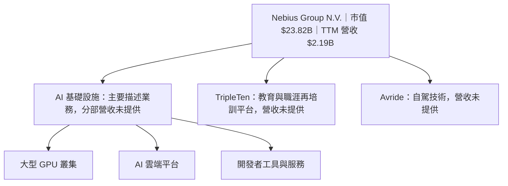
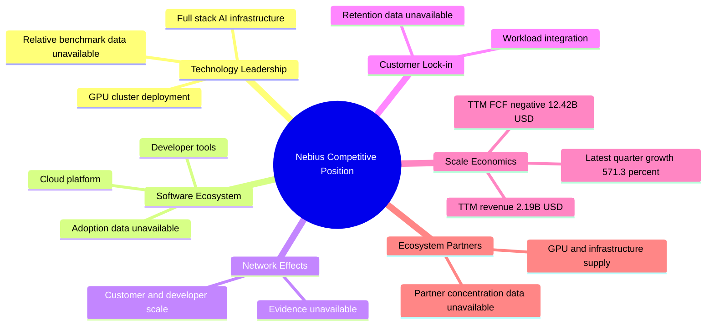
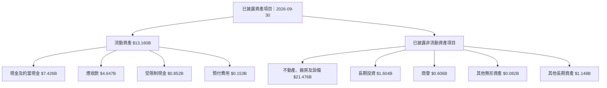
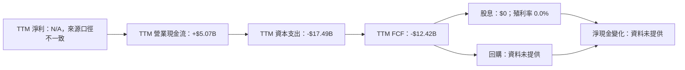
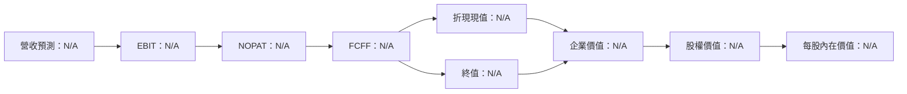
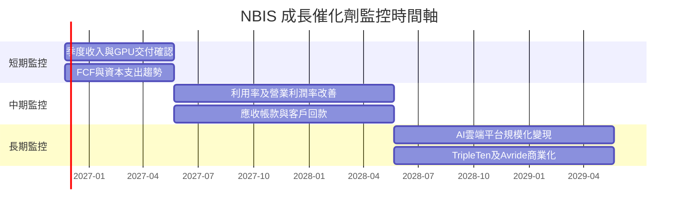
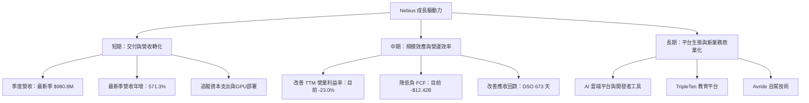
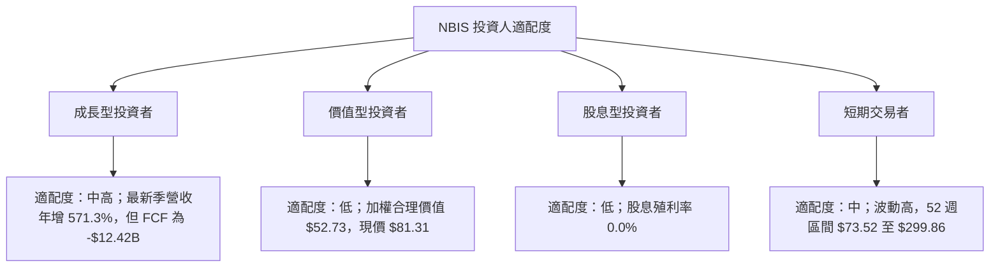

# NBIS 基本面深度分析報告
> **報告日期**：2026-11-22 ｜ **語言**：繁體中文 ｜ **數據來源**：Yahoo Finance、Finviz、StockAnalysis、Roic.ai ｜ **分析師**：CFA 級機構研究

## 目錄

| # | 章節 | 核心結論 |
|---|------|----------|
| 1 | 執行摘要 | 評級為賣出；加權合理價值 $52.73，MOS -54.2% |
| 2 | 公司概覽與商業模式 | AI 基礎設施成長迅速，但分部營收與市場份額未提供 |
| 3 | 損益表深度分析 | TTM 營收 $2.19B；最新一季年增 571.3%，但獲利波動大 |
| 4 | 資產負債表分析 | 淨負債 $8.67B；流動比率 5.306，但應收帳款天數偏高 |
| 5 | 現金流量深度分析 | TTM FCF -$12.42B，主要受高額資本支出拖累 |
| 6 | 獲利能力與資本效率 | 最新 ROIC N/A；WACC 7.10%，現有資料不足以確認價值創造 |
| 7 | 相對估值分析 | NBIS P/S 10.88x，高於同業中位數 4.4x |
| 8 | DCF 內在價值評估 | DCF N/A；TTM 營業利益為負，不適合直接折現虧損現金流 |
| 9 | 成長催化劑 | AI 雲端與 GPU 基礎設施需求是核心催化劑；TAM 數據未提供 |
| 10 | 風險矩陣 | 資本支出、執行與估值風險居前 |
| 11 | 投資建議 | 在現價與加權合理價值差距收窄前宜審慎，按財報追蹤營運轉化 |

---

## 1. 執行摘要

截至 **2026-11-20 收盤價 $81.31**，NBIS 的 TTM 營收為 **$2.19B**，最新一季營收年增 **571.3%**，顯示 AI 基礎設施需求與交付規模快速擴張；但 TTM 營業利益率為 **-23.0%**、TTM FCF 為 **-$12.42B**、淨負債為 **$8.67B**。相對估值與分析師共識加權後的合理價值為 **$52.73**，安全邊際 **MOS = -54.2%**，依評級門檻為 **賣出**。DCF 因 TTM 營業利益為負而不適用，因此不提供 DCF 目標價或 DCF 情境價值。

### 1.0 一頁式投資儀表板（Portfolio Manager 30 秒速讀）

| 項目 | 內容 |
|------|------|
| **投資論點（3 句）** | ① TTM 營收 **$2.19B**，最新一季年增 **571.3%**，AI 基礎設施需求正在快速轉化為營收。② TTM 營業利益率 **-23.0%**、FCF **-$12.42B**，擴張尚未轉化為可持續自由現金流。③ 現價 **$81.31** 高於加權合理價值 **$52.73**，估值折讓不足。 |
| **綜合評分** | **4.5/10**（引用 1.1 評分卡） |
| **財務健康** | 🔴 淨負債 **$8.67B**、TTM FCF **-$12.42B**；流動比率 **5.306** 提供短期緩衝，但不能消除長期資金需求。 |
| **ROIC vs WACC** | ROIC：**N/A**；WACC：**7.10%**。目前無法確認是否創造股東價值。 |
| **FCF 趨勢** | 資本支出擴張使 TTM FCF 為 **-$12.42B**；FCF Yield **-52.16%**。 |
| **估值** | Forward P/E **-26.710333x** ｜ EV/EBITDA **53.067x** ｜ FCF Yield **-52.16%** |
| **DCF 內在價值（基準）** | **N/A**；TTM 營業利益為負，不能據此建立有效 DCF 基準。 |
| **安全邊際（MOS）** | **-54.2%＝($52.73 − $81.31) ÷ $52.73**（基準為 8.8 加權合理價值）｜ 🔴 無 |
| **預期報酬（基準情境 12M）** | DCF 基準情境 **N/A**；以加權合理價值衡量，現價至 $52.73 的估值隱含上行空間為 **-35.1%**，並非 12 個月報酬預測。 |
| **關鍵風險（前二）** | ① 巨額資本支出與 FCF 缺口；② 高估值下的成長與執行預期落差。 |
| **評級 + 信心度** | 🔴 **賣出** ｜ 信心：中低；估值與 FCF 數據方向明確，但業務分部及資本需求資料有限。 |

### 1.1 綜合評分卡（全報告唯一）

| 維度 | 評分（1–10） | 主要依據（引用數字與其來源章節） |
|------|--------------|----------------------------------|
| 成長性 | 9.0 | TTM 營收 **$2.19B**，最新一季年增 **571.3%**；TTM 成長率本身未提供（第 3 章）。 |
| 獲利能力 | 3.0 | TTM 營業利益率 **-23.0%**、TTM FCF **-$12.42B**；ROIC 與 F-Score 為 N/A（第 3、5、6 章）。 |
| 財務健康 | 4.0 | 淨負債 **$8.67B**、流動比率 **5.306**；DSO **673 天**（第 4 章）。 |
| 估值 | 1.0 | MOS **-54.2%**；NBIS P/S **10.875831x**，高於同業 P/S 中位數 **4.4x**（第 7、8 章）。 |
| 護城河 | 6.0 | 提供 GPU 叢集、雲端平台及開發者工具；但客戶鎖定、分部收入與市場份額資料未提供（第 2 章）。 |
| 管理層與資本配置 | 4.0 | FY2025 SBC **$83.2M**；TTM 資本支出 **$17.49B**、FCF **-$12.42B**，回購資料未提供（第 3、5 章）。 |
| **綜合評分** | **4.5** | 六項算術平均：**(9.0 + 3.0 + 4.0 + 1.0 + 6.0 + 4.0) ÷ 6 = 4.5** |

### 1.2 五大投資論點 + 三大核心風險

| 類型 | 項目 | 具體依據 | 信心度 |
|------|------|----------|--------|
| 🟢 **投資論點①** | AI 基礎設施營收快速放大 | 最新一季營收 **$980.8M**，年增 **571.3%**；與前一季 **$582.3M** 相比，QoQ 增長 **68.4%**。 | 🟢 高 |
| 🟢 **投資論點②** | 毛利規模有望支持營運槓桿 | TTM 毛利率 **76.0%**；若 GPU 利用率提升且基礎設施成本增幅低於營收增幅，營業虧損可能收窄。 | 🟡 中 |
| 🟢 **投資論點③** | 流動性提供擴建緩衝 | 現金與短期投資 **$7.43B**、流動比率 **5.306**；但仍須以後續現金消耗與融資安排驗證。 | 🟡 中 |
| 🟢 **投資論點④** | 多產品組合提供選擇權 | 業務涵蓋 AI 基礎設施、TripleTen 教育平台與 Avride 自駕技術；各分部營收未提供，尚不能量化分散效果。 | 🟡 中 |
| 🟢 **投資論點⑤** | 機構持有比例較高 | 機構持股 **61.9%**；此數據僅表示持有人結構，不代表估值或業績保證。 | 🟡 中 |
| 🟡 **風險①** | 投資支出遠超目前現金流 | TTM 資本支出 **$17.49B**、營業現金流 **$5.07B**，形成 **-$12.42B** TTM FCF。 | 🔴 高衝擊 |
| 🔴 **風險②** | 估值對成長持續性要求高 | P/S **10.875831x**，同業中位數 **4.4x**；若營收增速回落而利潤率未改善，估值可能壓縮。 | 🔴 高衝擊 |
| 🟡 **風險③** | 應收款與融資負擔 | DSO **673 天**、總債務 **$16.10B**、淨負債 **$8.67B**；回款與債務服務能力須逐季檢查。 | 🔴 高衝擊 |

### 1.3 快速統計卡片

| 指標 | 公司實際值（期間） | 同業中位數 | 狀態 |
|------|--------------------|------------|------|
| 營收成長（TTM） | **N/A** | — | 🟡 不可判定 |
| 營收成長（最新一季年增） | **571.3%** | **29.6%** | 🟢 高於同業中位數 |
| 毛利率（TTM） | **76.0%** | **66.8%** | 🟢 高於同業中位數 |
| 營業利益率（TTM） | **-23.0%** | — | 🔴 尚未獲利 |
| ROIC（TTM） | **N/A** | — | 🟡 資料不足 |
| Forward P/E | **-26.710333x** | **9.2x** | 🔴 公司 Forward EPS 為負，倍數不可直接比較 |
| FCF Yield（TTM） | **-52.16%** | — | 🔴 現金流為負 |
| Piotroski F-Score | **N/A** | — | 🟡 缺少可比期間 SEC 申報資料 |

### 1.4 投資結論

╔══════════════════════════════════════════════════════════════════╗  
║                    📊 投資結論摘要                               ║  
╠══════════════════════════════════════════════════════════════════╣  
║  評級：🔴 賣出（依 8.8 MOS 門檻，未作質化調整）                 ║  
║  價格（2026-11-20 收盤）：$81.31                                ║  
║  DCF 內在價值（基準）：N/A（TTM 營業利益為負）                  ║  
║  安全邊際 MOS：-54.2%＝($52.73−$81.31)÷$52.73                  ║  
║  加權合理價值（8.8）：$52.73                                    ║  
║  綜合評分：4.5/10（引用 1.1）                                   ║  
║  適合投資人：能承受高波動、以成長選擇權為主且有嚴格風險控管者  ║  
╚══════════════════════════════════════════════════════════════════╝

---

## 2. 公司概覽與商業模式

### 2.1 業務結構與收入來源

公司概覽顯示，Nebius 提供 AI 全堆疊基礎設施，包括大型 GPU 叢集、雲端平台與開發者工具；另有 TripleTen 與 Avride。資料未提供各分部營收及佔比，因此不將總營收拆分或以估計比例畫圖。

### 2.2 市場份額

市場份額數據未提供。NBIS 最新一季營收 **$980.8M**、年增 **571.3%**，高於同業樣本最新一季營收成長中位數 **29.6%**；但單季增速比較不代表市場份額或可持續競爭優勢。

### 2.3 競爭護城河分析

### 2.4 護城河強度

| 護城河項目 | 強度（強／中／弱） | 證據（引用數字或事實） | 會削弱它的情況 |
|------------|--------------------|------------------------|----------------|
| 技術與產品 | 中 | 業務涵蓋 GPU 叢集、雲端平台與開發者工具；技術效能對照資料未提供。 | 同業快速複製、GPU 世代更替或性能差距擴大。 |
| 軟體生態系統 | 弱至中 | 提供雲端平台與開發者工具；客戶數、使用量、留存率未提供。 | 客戶可低成本遷移至大型雲端供應商。 |
| 網路效應 | 弱 | 未提供客戶／開發者網絡規模與平台互動數據。 | 平台增長未帶來更低成本或更高黏著度。 |
| 客戶鎖定 | 未證實 | DSO **673 天**，但應收帳款天數不能直接證明客戶鎖定。 | 應收款逾期、客戶集中或合約續約率下降。 |
| 規模效應 | 中 | TTM 營收 **$2.19B**，最新一季年增 **571.3%**；但 TTM FCF **-$12.42B**。 | 擴張資本需求持續高於營收及現金流增長。 |
| 生態夥伴 | 未證實 | 供應商、合作夥伴與依賴集中度資料未提供。 | GPU 或能源供應受限，或供應商議價條件惡化。 |

1.1「護城河」評分 **6.0/10**，反映全堆疊產品與營收擴張具潛力，但客戶留存、平台效應與供應鏈依賴缺少可驗證數據。

---

## 3. 損益表深度分析

### 3.1 年度收入成長趨勢（近 4 年）

年度營收由 **2022 年 $13.5M** 增至 **2025 年 $529.8M**。這段期間發生快速業務轉型，單純 CAGR 會受極低基期放大，不能當作未來穩態增長預測。

╔══════════════════════════════════════════════════════════════════╗  
║              NBIS 年度收入趨勢（FY2022-FY2025）                 ║  
╠══════════════════════════════════════════════════════════════════╣  
║ FY2022  $13.5M   ▏                         🟡 基期較低           ║  
║ FY2023   $9.8M   ▏                         🔴 YoY -27.4%         ║  
║ FY2024  $91.5M   ████                      🟢 YoY +833.7%        ║  
║ FY2025 $529.8M   ████████████████████████  🟢 YoY +479.0%        ║  
╠══════════════════════════════════════════════════════════════════╣  
║ FY2022 至 FY2025 CAGR：((529.8 ÷ 13.5)^(1/3) − 1) = 約 240.0%  ║  
║ 注意：低基期與業務結構變化使 CAGR 不宜外推。                    ║  
╚══════════════════════════════════════════════════════════════════╝

### 3.2 季度收入趨勢分析

| 季度 | 營收 | QoQ 成長 | YoY 成長 | 備註 |
|------|------:|---------:|---------:|------|
| 2025 Q4 | $227.7M | N/A | 546.88% | QoQ 比較所需前一季資料在此表未列；YoY 取 StockAnalysis。 |
| 2026 Q1 | $399.0M | **75.2%** | 683.89% | QoQ = ($399.0M ÷ $227.7M) − 1；年增率很高但波動。 |
| 2026 Q2 | $582.3M | **45.9%** | 454.04% | QoQ = ($582.3M ÷ $399.0M) − 1；成長仍快但年增回落。 |
| 2026 Q3 | $980.8M | **68.4%** | 571.3% | QoQ = ($980.8M ÷ $582.3M) − 1；為最新季，不能標作 TTM 成長。 |

**TTM 營收成長率：N/A。** TTM 對比上一個 TTM 的成長數據未提供，不能以最新一季年增率代替。季度營收躍升顯示交付與需求擴張，但單季高速成長需由訂單、利用率、客戶集中度與應收款回收共同驗證。

### 3.3 利潤率演變分析

| 利潤率指標 | FY2022 | FY2023 | FY2024 | FY2025 | 趨勢 | 評估 |
|------------|-------:|-------:|-------:|-------:|------|------|
| **毛利率** | -110.4% | -100.0% | 52.2% | 68.6% | 由負轉正並改善；計算為毛利 ÷ 營收。 | 🟢 FY2025 毛利率改善，但需確認新業務規模化後能否維持。 |
| **營業利益率** | -1,170.4% | -2,915.3% | -436.7% | -115.5% | 仍為負；基期極小使比率波動失真。 | 🔴 FY2025 營業虧損仍達 $611.7M。 |
| **TTM 營業利益率** | — | — | — | **-23.0%** | 以指定 TTM 指標為準。 | 🔴 尚未達到營業獲利。 |
| **最新一季營業利益率** | — | — | — | **-18.7%** | 以指定季度指標為準。 | 🔴 季度損益資料與此比率有來源差異，需以後續申報核驗。 |

FY2025 毛利率較 FY2024 改善，與營收規模擴大及業務組合改變相符；但營業利益仍為 **-$611.7M**，說明研發、管理及擴張成本尚未被毛利覆蓋。另需注意季度明細列出 2026 Q3 營業利益 **+$50.4M**、營收 **$980.8M**，直接相除並不等於提供的最新季度營業利益率 **-18.7%**。本報告依嚴格數據規則引用 **-18.7%**，並將差異列為需核對的資料品質問題。

### 3.4 費用結構分析

費用的完整分項（銷售、管理、研發、折舊及一次性項目）未完整提供，不能製作具財務意義的費用圓餅圖。可確認 FY2025 研發費用為 **$177.3M**，約為 FY2025 營收 **$529.8M** 的 **33.5%**；但單一費用項目不足以代表整體費用結構。

### 3.5 季度 EPS 趨勢與盈餘品質（Quality of Earnings）

| 盈餘品質項目 | 數值／佔比 | 評估 |
|--------------|-----------|------|
| 股權薪酬 SBC / 營收 | 近四季 SBC 合計 **$221.4M** ÷ TTM 營收 **$2.19B** = **約 10.1%** | 🔴 具實質稀釋成本；若持續，股東每股價值可能被攤薄。 |
| SBC / 營業現金流 | **$221.4M ÷ $5.07B = 約 4.4%** | 🟡 比率不高於營收佔比，但營業現金流含營運資金波動，不能單獨代表盈餘品質。 |
| FCF / 淨利（現金轉換率） | **N/A**：TTM FCF 為 **-$12.42B**；期間淨利資料在各來源間不一致。 | 🔴 即使帳面淨利為正，巨額負 FCF 顯示現金轉換薄弱。 |
| 一次性／非經常性損益 | 季度淨利大幅波動：2026 Q1 **+$621.2M**，Q2 **-$190.4M**，Q3 **-$37.5M** | 🔴 Q1 正淨利無法與連續虧損季度相互印證，需檢視非營運項目及處分損益。 |
| 有效稅率異常 | 最新年度有效稅率 **29.0%** | 🟡 單年稅率不代表未來穩態稅率；稅務利益與一次性項目拆分資料未提供。 |
| 資本化支出 vs 費用化 | TTM 資本支出 **$17.49B**；資本化政策明細未提供。 | 🔴 高額資本化投資可能使當期費用與現金消耗呈現落差；須追蹤折舊及資產利用率。 |

最近四季 EPS 預估值與實際值均為 **N/A**，因此無法判斷超預期或不及預期，也無法可靠排序四季 EPS surprise。可見淨利由 **2026 Q1 +$621.2M** 轉為 Q2 **-$190.4M**、Q3 **-$37.5M**，波動遠高於核心營業趨勢可支持的穩定盈餘判讀。

**盈餘品質結論**：TTM FCF **-$12.42B**、SBC 約佔 TTM 營收 **10.1%**，而季度淨利波動明顯。現有資料不足以將單季正淨利視為可持續經濟盈餘；估值應以現金流、資產利用率及稀釋後每股經濟價值為核心，而非單看 EPS 或帳面淨利。

---

## 4. 資產負債表分析

### 4.1 資產結構分解

以下採 2026-09-30 的 StockAnalysis 資產負債表細項。分項資料未能完整勾稽至總資產，故不補推總資產或缺漏項目。

### 4.2 流動性與營運資金分析

| 指標 | 最新值 | 歷史趨勢 | 評估 |
|------|------:|---------|------|
| 流動比率 | **5.306** | 2025 年底流動資產 $4.71B、流動負債 $1.53B；最新季流動資產 $13.16B。 | 🟢 短期帳面流動性充足，但需留意受限制現金與擴張現金需求。 |
| 速動比率 | **4.847** | 最新值；歷史可比序列未提供。 | 🟢 短期償付緩衝較高。 |
| 現金與短期投資 | **$7.43B** | 高於 2025 年底現金與短期投資 $3.753B。 | 🟡 現金增長有助融資，但不能抵消連續巨額資本支出。 |
| 淨負債 | **$8.67B** | 總債務 $16.10B 減現金與短期投資 $7.43B。 | 🔴 需靠資產利用率與未來現金流改善支撐。 |

| 指標 | 最新 TTM | 一年前 TTM | 變化 | 解讀 |
|------|----------:|------------:|------:|------|
| DSO 應收帳款天數 | **673 天** | N/A | N/A | 應收款餘額相對 TTM 營收很高；可能受專案付款條款、合約結算或資料口徑影響，須追蹤回款。 |
| DIO 存貨天數 | **N/A** | N/A | N/A | 公司未報告可用存貨餘額，不能推算。 |
| DPO 應付帳款天數 | **368 天** | N/A | N/A | 對供應商付款週期長；可能提供營運資金，但不等同議價力證據。 |
| CCC 現金轉換週期 | **N/A** | N/A | N/A | DIO 缺漏，無法計算 CCC。 |

### 4.3 債務結構分析

╔══════════════════════════════════════════════════════════════════╗  
║                   NBIS 債務健康診斷                              ║  
╠══════════════════════════════════════════════════════════════════╣  
║  總債務：                  $16.10B  🔴                            ║  
║  現金及短期投資：           $7.43B  🟡                            ║  
║  淨負債：                   $8.67B  🔴                            ║  
║  流動比率：                 5.306   🟢                            ║  
║  Debt/EBITDA：              不宜引用；TTM EBITDA $613.2M 與      ║  
║                              債務期間口徑可能不一致              ║  
║  利息保障倍數：             N/A（利息費用明細未提供）            ║  
║  WACC 稅前債務成本：         0.38%（資本成本資料）                ║  
╚══════════════════════════════════════════════════════════════════╝

財報彙整中的 TTM EBITDA margin **28.0%** 與年度 EBITDA、季度營業損益的呈現並不完全一致；不以單一 EBITDA 倍數推斷還債能力。總債務從 2025 年底 **$4.97B** 增至最新彙整值 **$16.10B**，新增融資與租賃義務的完整分項未提供，應核對後續申報資料。

### 4.4 股東權益趨勢

╔══════════════════════════════════════════════════════════════════╗  
║                NBIS 歷年股東權益變化（年度）                    ║  
╠══════════════════════════════════════════════════════════════════╣  
║ 2022-12-31  $4.25B   ███████████████████████                    ║  
║ 2023-12-31  $3.29B   ██████████████████                         ║  
║ 2024-12-31  $3.25B   ██████████████████                         ║  
║ 2025-12-31  $4.59B   █████████████████████████                  ║  
╠══════════════════════════════════════════════════════════════════╣  
║ 2025 權益較 2024 增加約 $1.34B；最新季度股東權益未提供。        ║  
╚══════════════════════════════════════════════════════════════════╝

---

## 5. 現金流量深度分析

### 5.1 現金流量瀑布圖

近四季 TTM 營業現金流 **$5.07B**，資本支出 **$17.49B**，所以 FCF 為 **-$12.42B**。TTM 淨利與股息、回購及淨現金變動的可比數據未完整提供。

### 5.2 FCF 轉換率趨勢

| 期間 | FCF | 淨利 | FCF / 淨利 | 解讀 |
|------|----:|----:|----------:|------|
| FY2022 | $682.4M | $745.6M | 約 **91.5%** | 正 FCF；但歷史業務結構與目前不同。 |
| FY2023 | $746.9M | $241.3M | 約 **309.6%** | 高於淨利，可能受營運資金及一次性項目影響。 |
| FY2024 | -$561.9M | -$641.4M | 約 **87.6%** | 兩者均為負，比例不宜解讀為現金轉換良好。 |
| FY2025 | -$3.68B | $82.5M | 約 **-44.6x** | 投資支出已遠高於帳面獲利。 |
| TTM 至 2026-09-30 | **-$12.42B** | TTM 淨利資料口徑不一致 | **N/A** | 不以不一致的淨利分母製造精確轉換率。 |

### 5.3 自由現金流趨勢

╔══════════════════════════════════════════════════════════════════╗  
║                    NBIS 自由現金流趨勢                           ║  
╠══════════════════════════════════════════════════════════════════╣  
║ FY2022  +$0.682B   ████                         FCF 正           ║  
║ FY2023  +$0.747B   ████                         FCF 正           ║  
║ FY2024  -$0.562B   ◀███                         FCF 負           ║  
║ FY2025  -$3.68B    ◀███████████████             FCF 負           ║  
║ TTM     -$12.42B   ◀████████████████████████    FCF Yield -52.16%║  
╠══════════════════════════════════════════════════════════════════╣  
║ FY2025 至 TTM 的負 FCF 擴大，核心原因是 TTM Capex $17.49B。     ║  
╚══════════════════════════════════════════════════════════════════╝

### 5.4 資本配置評估

| 配置項目 | 已知數據 | 評估 |
|----------|---------|------|
| 資本支出 | TTM **$17.49B**；FY2025 **$4.07B** | 🔴 投資強度高；投資回報需由收入、GPU 利用率與毛利率驗證。 |
| 股息 | 股息殖利率 **0.0%** | 🟡 資本主要留在企業內部，符合擴張階段特徵。 |
| 股票回購 | 未提供 | N/A |
| 研發 | FY2025 **$177.3M** | 🟡 支持技術與產品開發，仍須觀察對客戶獲取及定價的轉化。 |
| 留存與融資 | 現金及短期投資 **$7.43B**、總債務 **$16.10B** | 🔴 擴張依賴內部資金與外部融資的組合。 |

完整資本配置比例未提供，因此不畫資本配置圓餅圖。

---

## 6. 獲利能力與資本效率

### 6.1 ROE / ROA / ROIC 趨勢

| 指標 | 最新可用值 | 歷史資料 | 評估 |
|------|------------:|----------|------|
| ROE | **1.5%**（TTM 彙整） | FY2025 淨利、權益資料與 TTM 口徑不完全一致 | 🟡 偏低；且淨利受季度波動影響。 |
| ROA | **-1.0%**（TTM 彙整） | 最新季度資產基礎與淨利明細未完整匹配 | 🔴 資產回報尚未證明。 |
| ROIC | **N/A** | 品質指標區塊未能計算；舊年度歷史指標不代表目前業務 | 🟡 無法與資本成本直接作可靠比較。 |
| WACC | **7.10%** | 資本成本資料提供值 | 作為價值創造門檻。 |

### 6.2 ROIC vs WACC 分析（核心價值創造判斷）

╔══════════════════════════════════════════════════════════════════╗  
║                ROIC vs WACC 深度分析                            ║  
╠══════════════════════════════════════════════════════════════════╣  
║  WACC（採用資本成本資料提供值）：**7.10%**                      ║  
║  ├── 無風險利率（10Y 美債）：4.91%                               ║  
║  ├── 市場風險溢酬（假設）：5.00%                                ║  
║  ├── Beta 原始值：1.54；採用調整後 Beta：1.36                   ║  
║  ├── 股權成本：11.71%                                            ║  
║  ├── 稅前債務成本：0.38%；有效稅率：29.0%                       ║  
║  ├── 股權／債務權重：59.7%／40.3%                                ║  
║  └── WACC：7.10%（直接採用提供值，不另建 WACC）                 ║  
║                                                                  ║  
║  最新 ROIC：N/A（現有資料無法可靠計算）                           ║  
║  EVA：N/A（ROIC 缺值，無法計算 ROIC − WACC）                     ║  
║                                                                  ║  
║  ROIC   N/A                                                       ║  
║  WACC   7.10%                                                     ║  
║                                                                  ║  
║  結論：目前無法判定公司是否正在創造或摧毀經濟價值。              ║  
║  但 TTM 營業利益率 -23.0%、TTM FCF -$12.42B，顯示價值創造        ║  
║  尚未由當期營運結果證明。                                        ║  
╚══════════════════════════════════════════════════════════════════╝

### 6.3 杜邦三因素分解

| 因素 | 數值（TTM） | 解讀 |
|------|-------------|------|
| 淨利率 | N/A | 品質指標資料未提供可用杜邦分解值。 |
| 資產週轉率 | N/A | 同上。 |
| 權益乘數 | N/A | 同上。 |
| **ROE** | **N/A** | 杜邦分解需要一致期間的淨利、營收、資產與正權益；品質指標判定資料不足。 |

### 6.4 財務體質：Piotroski F-Score

| 測試 | 結果 | 解讀 |
|------|------|------|
| 總分 | **N/A** | 缺少相隔一年的 SEC 申報資料，不能算出總分。 |
| 獲利能力測試 | N/A | 九項測試逐項結果未提供。 |
| 槓桿與流動性測試 | N/A | 九項測試逐項結果未提供。 |
| 營運效率測試 | N/A | 九項測試逐項結果未提供。 |

九項測試的逐項結果未提供，不能自行補算。另，財務資料來源註明部分財報資料來自 Yahoo Finance，而非 SEC 申報資料，財務品質指標的可比性需待正式申報資料確認。

---

## 7. 相對估值分析

### 7.1 同業估值比較表格

同業倍數依 Yahoo Finance 的 Peer multiples。公司估值採市場資料欄所列數值；負 EPS 下 P/E 倍數不具傳統正盈利解讀。

| 估值指標 | **NBIS** | **CRWV** | **ORCL** | **MSFT** | NBIS 評估 |
|----------|---------:|---------:|--------:|--------:|-----------|
| **Trailing P/E** | N/A | N/A | 15.9x | 25.3x | 🔴 NBIS TTM EPS 為負，無法比較。 |
| **Forward P/E** | **-26.710333x** | -22.2x | 9.2x | 20.0x | 🔴 NBIS Forward EPS 為負，該倍數不具可比盈利意義。 |
| **P/S Ratio** | **10.875831x** | 2.2x | 4.4x | 10.4x | 🔴 高於同業 P/S 中位數 **4.4x**；需證明增長可轉為利潤。 |
| **EV/EBITDA** | **53.067x** | 16.1x | 12.9x | 17.8x | 🔴 NBIS 倍數顯著較高，且基礎 EBITDA 口徑應核驗。 |
| **最新一季營收年增** | **571.3%** | 168.2% | 29.6% | 18.8% | 🟢 NBIS 增速最高，但成長持續性與基期效應仍是風險。 |
| **毛利率（TTM）** | **76.0%** | 66.8% | 64.0% | 67.7% | 🟢 高於同業中位數 **66.8%**，但營業虧損與 FCF 仍為負。 |

### 7.2 歷史估值區間分析

N/A（未提供「Valuation vs own history」的歷史估值區間資料）。可用的價格歷史顯示，2026 年 6 月月收盤價曾達 **$276.17**，2026 年 11 月收盤價為 **$81.31**；這是價格變動，不可替代歷史 P/S、P/E 或估值百分位。

### 7.3 情境價值（Bear / Base / Bull）

N/A（DCF 無法計算：TTM 營業利益為負；DCF MODEL 未提供悲觀、基準與樂觀情境，因此不提供情境目標價）。

### 7.4 相對估值隱含價格區間

╔══════════════════════════════════════════════════════════════════╗  
║                  相對估值方法與每股價值                         ║  
╠══════════════════════════════════════════════════════════════════╣  
║ 同業 P/S：$32.86／股                                             ║  
║ ├─ 同業 P/S 中位數：4.4x（CRWV 2.2x、ORCL 4.4x、MSFT 10.4x）    ║  
║ └─ 以公司 TTM 營收推算，估值方法結果依程式計算值 $32.86           ║  
║                                                                  ║  
║ 分析師共識目標價：$231.60／股（20 位分析師平均）                ║  
║                                                                  ║  
║ 現價（2026-11-20）：$81.31                                        ║  
╚══════════════════════════════════════════════════════════════════╝

同業 P/S 估值為 **$32.86**，相較現價上行空間 **-59.6%**；分析師平均目標價 **$231.60**，相較現價上行空間 **+184.8%**。兩者差距很大，顯示分析師共識高度依賴未來成長與獲利轉化，不能取代可驗證的現金流與相對估值檢驗。

---

## 8. DCF 內在價值評估（Discounted Cash Flow）

> **估值模型狀態：N/A。** TTM 營業利益率為 **-23.0%**，且 TTM 營業利益為負。以虧損營業基礎向前折現會把未經證實的轉盈時間、利潤率和投資需求直接寫入估值，因此不建立自製 DCF。依估值資料，DCF MODEL 未提供預測、終值、敏感度矩陣或反推結果。

### 8.0 估值推理鏈（Thinking Logic）

**Step 1 — 價值來源與主導變數**

NBIS 價值主要取決於 AI 基礎設施是否能把快速增長的收入轉成可持續營業利潤與自由現金流；目前 TTM 營收 **$2.19B**，但營業利益率 **-23.0%**、FCF **-$12.42B**。TripleTen 與 Avride 是其他業務選擇權，但分部營收佔比未提供。最主導估值的變數是資本密集擴張後的**營業利潤率與資本支出回報**，目前不具備可支持數值 DCF 的足夠資料。

**Step 2 — 模型選擇**

| 決策點 | 本報告採用 | 理由（含數字） | 曾考慮但否決 | 否決理由 |
|--------|-----------|----------------|--------------|----------|
| 現金流定義 | DCF 不計算 | TTM 營業利益率 **-23.0%**，TTM FCF **-$12.42B**。 | FCFF 或 FCFE | 缺乏可驗證的轉盈路徑與模型假設，無法形成可複算的現金流預測。 |
| 預測期 N | N/A | 模型未提供預測期長度。 | 任意 5 或 10 年 | 不能自行新增預測期與假設。 |
| 終值方法 | N/A | DCF MODEL 未提供終值。 | Gordon Growth、退出倍數 | 沒有基礎 FCF／EBITDA 預測，無法可靠計算。 |
| EBIT 基礎 | N/A | 不能將負 TTM 營業利益任意外推。 | GAAP 或非 GAAP EBIT | 沒有模型支持的未來 EBIT 路徑。 |

**Step 3 — 關鍵假設推導鏈**

營收 CAGR、期末營業利潤率、永續成長率、預測期、Capex／營收、D&A／營收、ΔWC、SBC 處理、年稀釋率、終值及 WACC 的 DCF 模型輸入均未提供。若自行指定這些數字，將違反不自建 DCF 的要求，故本章不填入假設值、不計算內在價值。

**Step 4 — 最脆弱環節**

最脆弱環節是未來擴建投資能否在合理時間內提升設備利用率並改善營業利潤率；若無法改善，負 FCF 會延長且股權融資或新增債務需求可能增加。

**Step 5 — 計算路徑**

下圖僅呈現理論 DCF 計算關係，不含 NBIS 模型數值，因 DCF MODEL 為 N/A。

### 8.1 模型假設總表（Model Inputs）

| 假設項目 | 採用值 | 依據／來源 | 敏感度 |
|----------|--------|-------------|--------|
| 預測期長度 N | N/A | DCF MODEL 未提供預測期。 | N/A |
| 營收 CAGR | N/A | 未提供模型預測；TTM 成長率亦為 N/A。 | N/A |
| 期末營業利潤率 | N/A | TTM 營業利益率為 **-23.0%**，但未提供轉盈假設。 | N/A |
| 有效稅率 | N/A | 財務資料提供最新年度有效稅率 **29.0%**，但模型未提供。 | N/A |
| Capex / 營收 | N/A | TTM Capex **$17.49B**、TTM 營收 **$2.19B**；未提供預測比例。 | N/A |
| D&A / 營收 | N/A | 模型假設未提供。 | N/A |
| 營運資金變動 / 營收增額 | N/A | 模型假設未提供，且 DSO 達 **673 天**。 | N/A |
| EBIT 基礎 | N/A | DCF MODEL 未提供 GAAP／非 GAAP 模型選擇。 | N/A |
| SBC 處理 | N/A | SBC 模型處理方式未提供。 | N/A |
| 年稀釋率 | N/A | 模型未提供；近四季 SBC 合計可估算，但不能代替稀釋股數預測。 | N/A |
| 永續成長率 g | N/A | DCF MODEL 未提供。 | N/A |
| 終值方法 | N/A | DCF MODEL 未提供。 | N/A |
| WACC | **7.10%** | 採用資本成本資料提供值；DCF 模型本身仍為 N/A。 | 不適用於缺失模型 |

本節不能據此逐年預測 FCFF、終值或每股價值，也不採用 SBC 組合 A/B/C 建模，因為模型根本未建立。

### 8.2 折現率推導（WACC）

╔══════════════════════════════════════════════════════════════════╗  
║                    WACC 資料（直接採用提供值）                   ║  
╠══════════════════════════════════════════════════════════════════╣  
║ 無風險利率 Rf（10Y 美債）：4.91%                                ║  
║ 市場風險溢酬 ERP（假設）：5.00%                                 ║  
║ 原始 Beta：1.54                                                  ║  
║ 調整後 Beta：1.36＝⅔ × 1.54 + ⅓ × 1.00                         ║  
║ 股權成本：11.71%                                                 ║  
║ 稅前債務成本：0.38%                                              ║  
║ 有效稅率：29.0%                                                  ║  
║ 股權／債務權重：59.7%／40.3%                                     ║  
║ WACC：**7.10%**（直接採用資本成本資料）                          ║  
╚══════════════════════════════════════════════════════════════════╝

資本成本資料已列出股權成本、債務成本、權重與 WACC。本報告不另行重算或替換 WACC；10 年期美債殖利率的觀測日期未提供，ERP 標示為假設值。WACC 與第 6.2 節一致。

### 8.3 逐年自由現金流預測（基準情境）

N/A（DCF MODEL 未提供逐年營收、營業利潤率、稅、D&A、Capex、營運資金變動、FCFF 或折現因子；依要求不自行建立 DCF）。

### 8.4 終值計算（Terminal Value）

N/A（DCF MODEL 未提供終值方法、永續成長率、退出倍數或終值現值；亦無可用預測期末 FCFF 作為基礎）。

### 8.5 企業價值 → 每股內在價值（Bridge）

N/A（無預測期現值與終值，無法計算企業價值、股權價值或 DCF 每股內在價值）。本節不計算 DCF 折溢價，也不計算 DCF MOS。

### 8.6 敏感性分析（WACC × 永續成長率）

N/A（DCF MODEL 未提供敏感度矩陣；自行建立矩陣會形成新的 DCF 模型，故不填假設性數字）。三情境 DCF 同樣為 N/A。

### 8.7 反推 DCF（Reverse DCF）

N/A（無 DCF 模型及其固定假設，無法由股價反解單一變數或提供可重現的迭代軌跡）。不能據此宣稱市場隱含某一營收 CAGR 或利潤率。

### 8.8 估值三角驗證與安全邊際

依公司類型 **unprofitable** 的固定方法與權重，估值方法只包含同業 P/S 與分析師共識目標價。不可計算的同業 Forward P/E 已剔除，其權重依固定規則分配給剩餘方法。

| 估值方法 | 隱含每股價值 | 上行空間（÷現價） | 權重 | 說明 |
|----------|--------------:|-------------------:|------:|------|
| 同業 P/S | **$32.86** | **-59.6%** | **90%** | Peer P/S 中位數 **4.4x**，採同業中位數估值方法。 |
| 分析師共識目標價 | **$231.60** | **+184.8%** | **10%** | 20 位分析師平均目標價；作為參考權重，不代表現金流價值。 |
| **加權合理價值** | **$52.73** | **-35.1%** | **100%** | 固定權重加權結果。 |

**逐步演算：**

- 加權合理價值  
  = **$32.86 × 90% + $231.60 × 10%**  
  = **$29.574 + $23.160**  
  = **$52.734**  
  = **$52.73**（四捨五入至美分）

- MOS  
  = **($52.73 − $81.31) ÷ $52.73**  
  = **-$28.58 ÷ $52.73**  
  = **-54.2%**

- 上行空間  
  = **($52.73 − $81.31) ÷ $81.31**  
  = **-$28.58 ÷ $81.31**  
  = **-35.1%**

- 折溢價以 DCF 基準內在價值為基礎；DCF 為 N/A，因此本報告不計算該折溢價。

╔══════════════════════════════════════════════════════════════════╗  
║                  估值區間與安全邊際                              ║  
╠══════════════════════════════════════════════════════════════════╣  
║  同業 P/S $32.86 ── 現價 $81.31 ── 加權合理價值 $52.73          ║  
║  （現價高於加權合理價值；估值方法值不代表價格先後排序）         ║  
║                                                                  ║  
║  MOS = ($52.73 − $81.31) ÷ $52.73 = **-54.2%**                 ║  
║  上行空間 = ($52.73 − $81.31) ÷ $81.31 = **-35.1%**            ║  
║  MOS 評估：🔴 <10% 無；現價高於加權合理價值                     ║  
║  DCF 基準內在價值與 DCF 情境：N/A                               ║  
╚══════════════════════════════════════════════════════════════════╝

估值方法區塊未提供買入區間、合理持有區間或減碼區間的價格門檻；不另造價格區間。按評級一致性，當前不應將現價列作建議買入價。

> 🔎 **程式複算（Python，依本節各項自動重算）**
>
> 加權合理價值 = $32.86 × 90% + $231.60 × 10% = **$52.73**（權重合計 100%）
>
> 以價格 $81.31 計：MOS = **-54.2%**，上行空間 = **-35.1%**
>
> ✅ 與本節所寫數值一致。

### 8.9 DCF 模型的局限與失效條件

- **終值依賴度**：N/A，DCF 模型未提供終值與 EV。
- **最脆弱的假設**：無法量化 DCF 假設；營收能否轉化為營業利潤與 FCF，是關鍵未知數。
- **不適用情境**：公司 TTM 營業利益為負、TTM FCF **-$12.42B**，資本支出高於營業現金流。現階段相對估值可作有限交叉檢驗，但仍應同時分析 GPU 利用率、訂單與收入可見度、客戶集中度和資本回報。
- **與第 10 章風險矩陣的連結**：需求放緩會降低收入成長；資本支出延續會加深負 FCF；融資成本或債務增加則會降低股權價值。

### 8.10 複算檢核表（Audit Trail）

| # | 檢核項目 | 檢查方式 | 結果 |
|---|----------|----------|------|
| 1 | 高／中敏感度輸入四段式推導 | DCF MODEL 為 N/A，沒有模型假設可列。 | N/A |
| 2 | 每個假設均有來歷 | 未自行填入 DCF 假設。 | ✅ |
| 3 | WACC 五步算式與重算 | 直接採用 WACC **7.10%**，沒有另行建立 WACC。 | N/A |
| 4 | Kd 分母與債務權重範圍一致 | 本報告不重算 WACC。 | N/A |
| 5 | WACC 與第 6.2 節同值 | 兩處均為 **7.10%**。 | ✅ |
| 6 | 逐年表格年度數與 N 一致 | DCF MODEL 未提供 N 或預測表。 | N/A |
| 7 | FY+1 九步算式可複算 | 無 FY+1 預測資料。 | N/A |
| 8 | 預測期 PV 加總 | 無預測期 PV。 | N/A |
| 9 | WACC > g | g 未提供。 | N/A |
| 10 | 終值基於 FY+N 並折現 N 期 | 無終值資料。 | N/A |
| 11 | EV 至每股價值橋接 | DCF 橋接無法計算。 | N/A |
| 12 | SBC 三要素組合相容 | 未建立 DCF，未指定 EBIT、SBC 扣除或稀釋率組合。 | N/A |
| 13 | 敏感性矩陣基準格與 DCF 一致 | 矩陣未提供。 | N/A |
| 14 | 矩陣格子符合 WACC > g | 矩陣未提供。 | N/A |
| 15 | 三情境機率加總 | 情境未提供。 | N/A |
| 16 | 反推 DCF 單變數及迭代軌跡 | 未提供反推模型。 | N/A |
| 17 | MOS 基準與折溢價定義 | MOS 以 **$52.73** 加權合理價值為分母；DCF 折溢價不計。 | ✅ |
| 18 | 完整輸出至第 11 章 | 本報告已列至第 11 章。 | ✅ |
| 19 | 加權合理價值可複算 | **$32.86 × 90% + $231.60 × 10% = $52.734 → $52.73**。 | ✅ |
| 20 | 評級符合 MOS 門檻 | MOS **-54.2%**，對應賣出。 | ✅ |

---

## 9. 成長催化劑

### 9.1 催化劑時間軸

以下為營運監控框架，時間區間是分析上的追蹤安排，不代表公司已公布的財測或產品上線日期。

### 9.2 TAM 市場規模分析

N/A（TAM 數據未提供）。公司 TTM 營收 **$2.19B**，最新一季營收年增 **571.3%**，代表近期業務擴張速度高，但無法由此推算市場總量或滲透率。後續應以公司披露的訂單、客戶數、GPU 容量與利用率判斷成長空間。

### 9.3 成長驅動力結構圖

---

## 10. 風險矩陣

### 10.1 風險評分矩陣

財務資料未提供各風險事件的發生機率或量化損失，因此不填入任意機率與衝擊座標，也不以虛構量化圖呈現。下表按業務相關性與可能的財務影響排序，屬定性風險判斷。

### 10.2 風險清單詳細分析

| # | 風險項目 | 發生機率 | 財務衝擊 | 風險評估 | 緩解措施 |
|---|----------|----------|----------|----------|----------|
| 1 | 🔴 資本支出與融資需求 | 中高；TTM Capex **$17.49B** | 高；TTM FCF **-$12.42B**，現金耗用可能延續 | 🔴 高 | 追蹤季度 Capex、營業現金流、未使用融資額度及債務到期結構。 |
| 2 | 🔴 高估值下增長不及預期 | 中高；最新季年增 **571.3%**，但低基期與高增長預期並存 | 高；P/S **10.875831x** 對比同業中位數 **4.4x** | 🔴 高 | 觀察連續季度收入、訂單轉收入、客戶集中度與毛利率。 |
| 3 | 🔴 回款與應收款風險 | 中；DSO **673 天** | 高；應收回收延遲可能削弱營運現金流 | 🔴 高 | 追蹤應收帳款帳齡、逾期比例、前五大客戶應收款及收款條款。 |
| 4 | 🟡 營運利潤率無法改善 | 中；TTM 營業利益率 **-23.0%** | 高；可能使估值長期依賴營收倍數 | 🔴 高 | 監控單位 GPU 收入、利用率、能源成本、折舊與營業費用率。 |
| 5 | 🟡 股權稀釋 | 中；近四季 SBC 約 **$221.4M** | 中；SBC 約佔 TTM 營收 **10.1%** | 🟡 中高 | 追蹤稀釋股數、SBC/營收及員工股權計畫。 |
| 6 | 🟡 債務與利率／資產負債結構 | 中；總債務 **$16.10B**、淨負債 **$8.67B** | 中高；利息及再融資可能壓縮股權現金流 | 🟡 中高 | 核對計息債務、租賃負債、期限及契約限制。 |

---

## 11. 投資建議

### 11.1 最終評級與評分

加權合理價值 **$52.73**、現價 **$81.31**，MOS **-54.2%**，依規則 20 為 **賣出**；未作質化調整。1.1 綜合評分為 **4.5/10**，六項分數為成長性 **9.0**、獲利能力 **3.0**、財務健康 **4.0**、估值 **1.0**、護城河 **6.0**、管理層與資本配置 **4.0**。

### 11.2 合理價值與隱含報酬率

| 估值項目 | 每股價值 | 相對 2026-11-20 收盤價 $81.31 | 說明 |
|----------|---------:|----------------------------:|------|
| 加權合理價值 | **$52.73** | **-35.1%** | 同業 P/S 權重 90%、分析師共識權重 10%。 |
| 悲觀 DCF 情境 | N/A | N/A | DCF MODEL 未提供。 |
| 基準 DCF 情境 | N/A | N/A | DCF MODEL 未提供。 |
| 樂觀 DCF 情境 | N/A | N/A | DCF MODEL 未提供。 |

### 11.3 買入時機與觸發因素

╔══════════════════════════════════════════════════════════════════╗  
║                  ✅ 買入觸發因素 Checklist                      ║  
╠══════════════════════════════════════════════════════════════════╣  
║  立即考慮買入前，優先確認以下事項：                              ║  
║  ☐ 最新季收入增長可由訂單、客戶與產能利用率支持                 ║  
║  ☐ 營業利益率連續改善，並能與已披露的季度損益勾稽               ║  
║  ☐ FCF 缺口收窄，資本支出增長低於收入及營業現金流增長           ║  
║                                                                  ║  
║  加碼觸發條件：                                                  ║  
║  ☐ DSO 由目前 673 天顯著下降，且應收帳款回收有申報資料佐證       ║  
║  ☐ 營業利益率朝正值改善，並非僅依賴非營業項目                   ║  
║  ☐ 現價與加權合理價值差距收窄，且估值改善有獲利／現金流支持     ║  
║                                                                  ║  
║  減碼／退出觸發條件：                                            ║  
║  ☐ 收入增長明顯放緩但 Capex 仍維持高位                           ║  
║  ☐ FCF 缺口擴大，或需大幅增加債務／股權融資                     ║  
║  ☐ 應收款延遲、客戶集中度上升或營業利潤率再度惡化               ║  
╚══════════════════════════════════════════════════════════════════╝

### 11.4 投資人適配度分析

### 11.5 每季財報監控清單（Quarterly Watch List）

| 監控指標 | 目前基準 | 加碼觀察門檻 | 減碼／重新評估門檻 |
|----------|---------|--------------|--------------------|
| 營收與年增率 | 最新季 **$980.8M**、年增 **571.3%** | 成長由新增產能、客戶訂單與可辨識收入支持 | 連續兩季收入增長顯著減速，且公司未提供訂單或利用率改善證據 |
| 營業利益率 | TTM **-23.0%**；提供的最新季度值 **-18.7%** | 虧損率逐季收窄並與財報金額勾稽 | 虧損率惡化，或利潤率與季度損益數據持續不一致 |
| 資本支出 | TTM **$17.49B** | Capex 增量低於營收／現金流增量，且利用率提高 | Capex 繼續上升而收入、毛利與營業現金流未跟上 |
| 自由現金流 | TTM **-$12.42B** | 負 FCF 持續收窄 | FCF 缺口擴大，且現金或新增融資緩衝下降 |
| 應收帳款 | DSO **673 天** | DSO 降低、收款期改善 | DSO 維持高位或應收款逾期增加 |
| 毛利率 | TTM **76.0%** | 維持高毛利且營業費用率下降 | 毛利率下滑，且無法由產品組合或規模效應抵銷 |
| SBC／稀釋 | 近四季 SBC 約佔 TTM 營收 **10.1%** | SBC 佔營收下降、稀釋股數增速受控 | SBC 比重上升或股數快速增加 |
| 現金與債務 | 現金及短期投資 **$7.43B**；總債務 **$16.10B** | 淨負債趨勢穩定、融資條件可控 | 淨負債增加，或短期流動性與債務期限風險上升 |

### 11.6 反面論證：什麼會證明論點錯誤（What Would Change My Mind）

╔══════════════════════════════════════════════════════════════════╗  
║              ⚠️ 論點失效條件（Disconfirming Evidence）           ║  
╠══════════════════════════════════════════════════════════════════╣  
║  多頭成長論點在下列情況發生時應重新檢視：                       ║  
║  ☐ 最新一季營收年增由 571.3% 大幅回落，且連續兩季沒有訂單／    ║  
║    產能利用率改善證據                                           ║  
║  ☐ TTM 營業利益率低於目前 -23.0%，或季度營業損益無法與披露     ║  
║    的營業利益率勾稽                                              ║  
║  ☐ TTM FCF 低於目前 -$12.42B，且資本支出未轉化為收入或毛利     ║  
║  ☐ DSO 高於 673 天或應收帳款持續增長而現金回收停滯               ║  
║  ☐ 淨負債高於目前 $8.67B，且營運現金流未改善                    ║  
║  ☐ SBC 佔營收高於目前約 10.1%，或稀釋股數加速上升                ║  
║  ☐ ROIC 可計算後低於 WACC 7.10%，且沒有明確改善路徑             ║  
╚══════════════════════════════════════════════════════════════════╝

> **免責聲明**：本報告為 AI 自動生成，僅供研究參考，不構成投資建議。投資有風險，入市需謹慎。

---

## 資料與來源

| 項目 | 內容 |
|------|------|
| 價格 | 81.31 USD，2026-11-20 收盤（Yahoo Finance 日線） |
| 財務報表 | Yahoo quarterly statements (no SEC filing data)，最新季度 2026-09-30（TTM = four quarters to this date） |
| 有回應的資料來源 | Yahoo Finance、Finviz、StockAnalysis、Roic.ai |
| 未回應的資料來源 | SEC 申報資料 (XBRL) |
| 由程式計算 | TTM 數字、WACC、DCF 模型、估值方法與權重、加權合理價值、MOS、評級門檻、F-Score、杜邦分解、營運資金天數、綜合評分 |
| 撰寫模型 | openai / gpt-6-luna |

> 本區塊由產生報告的程式依實際取得的資料填寫，非模型撰寫。「由程式計算」的數字不是模型的估計；其餘判斷（評分、情境、策略）是模型的分析。
