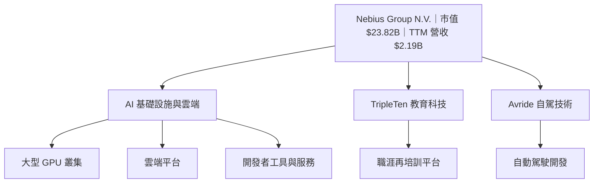
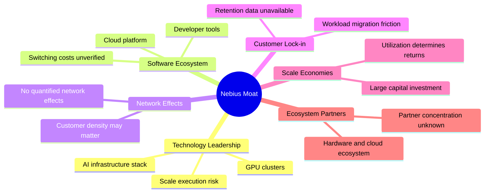
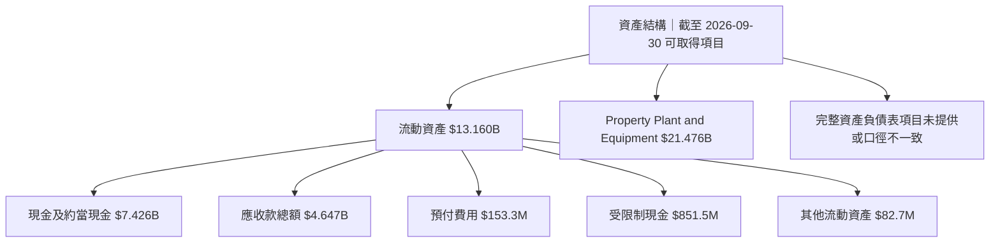
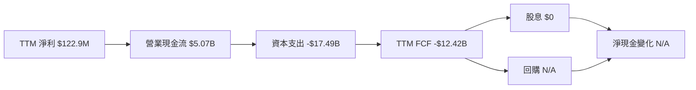
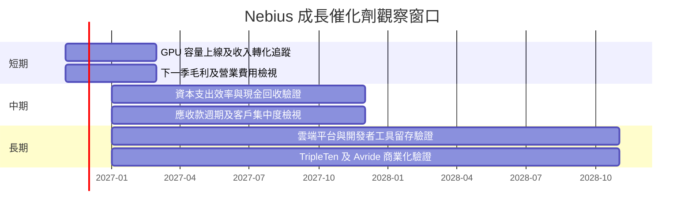
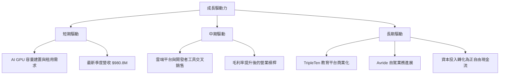
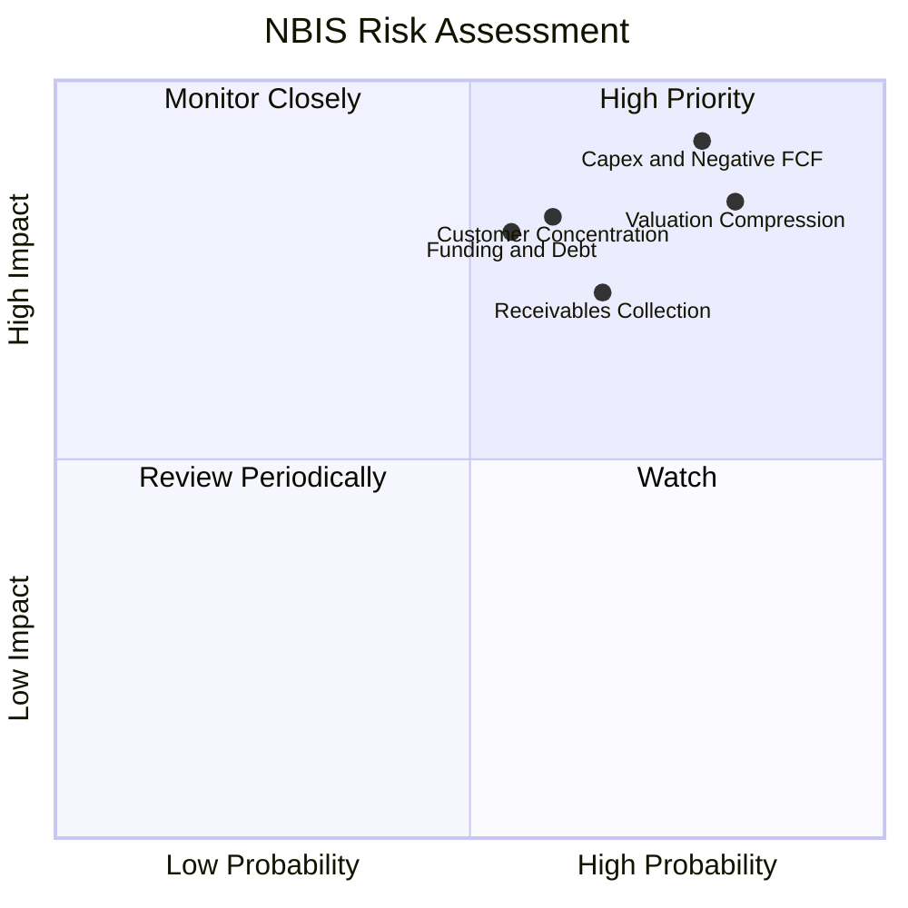
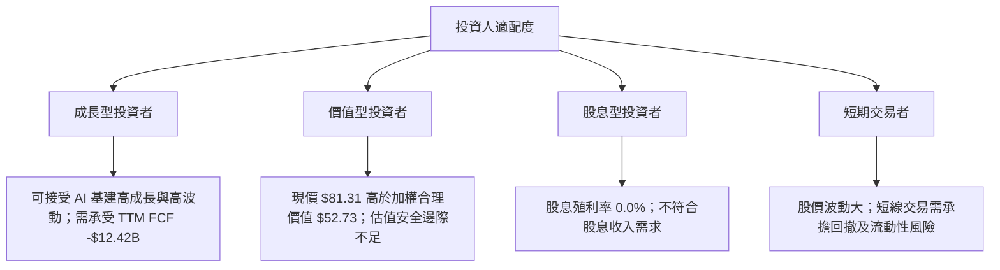

# NBIS 基本面深度分析報告
> **報告日期**：2026-11-23 ｜ **語言**：繁體中文 ｜ **數據來源**：Yahoo Finance、Finviz、StockAnalysis、Roic.ai ｜ **分析師**：CFA 級機構研究

## 目錄

| # | 章節 | 核心結論 |
|---|------|----------|
| 1 | 執行摘要 | 賣出；加權合理價值 $52.73；MOS -54.2% |
| 2 | 公司概覽與商業模式 | AI 基礎設施需求提供成長機會，但分部營收與市場份額未披露 |
| 3 | 損益表深度分析 | TTM 營收 $2.19B，最新一季 YoY +571.3%；營業利益率仍為負 |
| 4 | 資產負債表分析 | 淨負債 $8.67B；流動比率 5.306 倍，但應收帳款天數偏高 |
| 5 | 現金流量深度分析 | TTM FCF -$12.42B、FCF Yield -52.16%，反映高額投資需求 |
| 6 | 獲利能力與資本效率 | ROIC N/A，WACC 7.10%；目前尚無法證明已創造超額資本報酬 |
| 7 | 相對估值分析 | NBIS TTM P/S 10.88 倍，高於同業中位數 4.4 倍 |
| 8 | DCF 內在價值評估 | DCF N/A；TTM 營業利益為負，不建立自建 DCF |
| 9 | 成長催化劑 | GPU 叢集與 AI 雲端需求是主要增長來源，量化 TAM 未提供 |
| 10 | 風險矩陣 | 高資本支出、客戶集中及估值波動是主要風險 |
| 11 | 投資建議 | 現價高於加權合理價值；需等待估值或現金流改善 |

## 1. 執行摘要

NBIS 最新季度營收達 **$980.8M**，較上一季 **$582.3M** 增加 **68.4% QoQ**，並較去年同期增加 **571.3% YoY**，顯示 AI 基礎設施需求快速轉化為營收；但 TTM 營業利益率仍為 **-23.0%**，TTM FCF **-$12.42B**，且淨負債 **$8.67B**，擴張的資本需求尚未轉化為穩定的自由現金流。以同業 P/S 估值及分析師共識加權後，合理價值為 **$52.73**；相對 **2026-11-20 收盤價 $81.31**，MOS 為 **-54.2%**。依 MOS 門檻評級為**賣出**；這一結論主要反映現價與估值基準的落差，而不是否定公司營收成長機會。

### 1.0 一頁式投資儀表板（Portfolio Manager 30 秒速讀）

| 項目 | 內容 |
|------|------|
| **投資論點（3 句）** | ① TTM 營收 **$2.19B**，最新一季 YoY **+571.3%**，AI 基礎設施需求快速放量。② TTM 營業利益率 **-23.0%**、TTM FCF **-$12.42B**，擴張成本仍高於現金創造能力。③ 同業 P/S 法估值 **$32.86**，與共識加權後合理價值 **$52.73**，低於現價 **$81.31**。 |
| **綜合評分** | **4.5/10**（引用 1.1 評分卡） |
| **財務健康** | 🔴 淨負債 **$8.67B**、TTM FCF **-$12.42B**；流動比率 **5.306 倍**提供短期緩衝，但不消除資本支出風險。 |
| **ROIC vs WACC** | ROIC **N/A** vs WACC **7.10%**；無法證明目前 ROIC 高於資本成本，營業利益率仍為負。 |
| **FCF 趨勢** | TTM FCF **-$12.42B**，FCF Yield **-52.16%**；大額 GPU／資料中心投入尚未轉為正自由現金流。 |
| **估值** | Forward P/E **-26.71 倍**（虧損時倍數解讀有限）｜EV/EBITDA **53.07 倍**｜FCF Yield **-52.16%** |
| **DCF 內在價值（基準）** | **N/A**；TTM 營業利益不為正，DCF 模型未計算，故 DCF 折溢價 N/A。 |
| **安全邊際（MOS）** | **-54.2%＝($52.73 − $81.31) ÷ $52.73**；🔴 無安全邊際。合理價值基準為第 8.8 節加權值。 |
| **預期報酬（基準情境 12M）** | N/A；DCF 無基準情境。加權合理價值相對現價的上行空間為 **-35.1%**，不是 12 個月預測報酬。 |
| **關鍵風險（前二）** | GPU／資料中心資本支出導致 FCF 長期深度為負；高成長預期與客戶／供應集中若未兌現，估值可能再收縮。 |
| **評級 + 信心度** | 🔴 **賣出** ｜ 信心：中（估值折價訊號明確，但 DCF 無法估值且成長變數高） |

### 1.1 綜合評分卡（全報告唯一）

| 維度 | 評分（1–10） | 主要依據（引用數字與其來源章節） |
|------|--------------|----------------------------------|
| 成長性 | 9 | TTM 營收 **$2.19B**；最新一季 YoY **+571.3%**，但 TTM 成長率本身未提供（第 3 章）。 |
| 獲利能力 | 2 | TTM 營業利益率 **-23.0%**，最新一季 **-18.7%**；ROIC 與 Piotroski F-Score 均 N/A（第 3、6 章）。 |
| 財務健康 | 4 | 淨負債 **$8.67B**、流動比率 **5.306 倍**；DSO **673 天**，營運資金天數資料存在限制（第 4 章）。 |
| 估值 | 1 | 加權合理價值 **$52.73**，現價 **$81.31**，MOS **-54.2%**；TTM P/S **10.88 倍**（第 7、8 章）。 |
| 護城河 | 6 | 有 GPU 叢集、雲端平台與開發者工具的全堆疊定位，但客戶留存、分部占比及市場份額未提供（第 2 章）。 |
| 管理層與資本配置 | 5 | FY2025 Capex **$4.07B**，TTM Capex **$17.49B**；投資擴張顯著，但投資回報和稀釋影響仍待驗證（第 5 章）。 |
| **綜合評分** | **4.5** | 六項算術平均：**(9 + 2 + 4 + 1 + 6 + 5) ÷ 6 = 4.5**。 |

### 1.2 五大投資論點 + 三大核心風險

| 類型 | 項目 | 具體依據 | 信心度 |
|------|------|----------|--------|
| 🟢 **投資論點①** | AI 基礎設施營收快速擴張 | 最新季度營收 **$980.8M**，YoY **+571.3%**、QoQ **+68.4%**；增長顯示需求正在落到實際收入，但尚未證明能同步帶來盈利。 | 🟢 高 |
| 🟢 **投資論點②** | 毛利率高於可比同業中位數 | NBIS TTM 毛利率 **76.0%**，CRWV、ORCL、MSFT 中位數 **66.8%**；但毛利率優勢尚未抵銷營運費用及資本支出。 | 🟡 中 |
| 🟢 **投資論點③** | 資產投入擴大服務能力 | PP&E 由 FY2024 **$891.5M** 增至 FY2025 **$6.472B**；有助建置容量，但折舊、利用率及回報週期是關鍵。 | 🟡 中 |
| 🟢 **投資論點④** | 現金與短期投資提供流動緩衝 | 現金及短期投資 **$7.43B**、流動比率 **5.306 倍**；可支持部分擴張，但低於總債務 **$16.10B**。 | 🟡 中 |
| 🟢 **投資論點⑤** | 存在非核心業務選擇權 | 公司另有 TripleTen 教育平台與 Avride 自駕業務；各自收入與獲利貢獻未披露，現階段不能視為已驗證價值。 | 🟡 低 |
| 🟡 **風險①** | 高資本支出與負自由現金流 | TTM Capex **$17.49B**、FCF **-$12.42B**；若容量建置速度高於需求轉化，現金消耗和融資需求將加重。 | 🔴 高 |
| 🔴 **風險②** | 估值對成長預期敏感 | 現價 **$81.31**，加權合理價值 **$52.73**；股價 2026 年 6 月月收盤價 **$276.17**，至 11 月降至 **$81.31**，波動顯著。 | 🔴 高 |
| 🔴 **風險③** | 應收款與客戶／融資集中風險 | DSO **673 天**，而客戶集中度資料未提供；若大額合約收款延遲，營收成長未必能轉成現金。 | 🟡 中 |

### 1.3 快速統計卡片

| 指標 | 公司實際值（期間） | 同業中位數 | 狀態 |
|------|--------------------|------------|------|
| 營收成長（TTM） | **N/A** | — | 🟡 TTM 成長率未提供；不可用最新一季增幅替代 |
| 營收成長（最新一季年增） | **571.3%** | **29.6%** | 🟢 明顯高於同業中位數 |
| 毛利率（TTM） | **76.0%** | **66.8%** | 🟢 高於同業中位數 |
| 營業利益率（TTM） | **-23.0%** | — | 🔴 營業仍虧損 |
| ROIC（TTM） | **N/A** | — | 🟡 缺少可一致驗證的 ROIC 數據 |
| Forward P/E | **-26.71x** | **9.2x**¹ | 🔴 公司為負值，橫向比較失去一般正盈餘倍數意義 |
| FCF Yield（TTM） | **-52.16%** | — | 🔴 現金流大幅為負 |
| Piotroski F-Score | **N/A** | — | 🟡 缺少相隔一年之 SEC 申報資料 |

¹ 同業中位數依 CRWV、ORCL、MSFT 提供的 Forward P/E 數值計算；CRWV 為 -22.2x、ORCL 為 9.2x、MSFT 為 20.0x，三者中位數為 9.2x。

### 1.4 投資結論

```text
╔══════════════════════════════════════════════════════════════════╗
║                    📊 投資結論摘要                               ║
╠══════════════════════════════════════════════════════════════════╣
║  評級：🔴 賣出（依加權合理價值 MOS 門檻）                        ║
║  價格（2026-11-20 收盤）：$81.31                                 ║
║  DCF 內在價值（基準）：N/A（TTM 營業利益不為正）                 ║
║  DCF 折溢價：N/A                                                  ║
║  安全邊際 MOS：-54.2%＝($52.73−$81.31)÷$52.73                   ║
║  加權合理價值（8.8）：$52.73                                     ║
║  DCF 情境價值：N/A（DCF 模型未計算）                             ║
║  綜合評分：4.5/10（引用 1.1）                                    ║
║  適合投資人：可承受高波動、以成長為主題且能承受深度回撤者；       ║
║              不適合以現金流、低估值或股息為主要標準的投資人。     ║
╚══════════════════════════════════════════════════════════════════╝
```

## 2. 公司概覽與商業模式

### 2.1 業務結構與收入來源

Nebius Group N.V. 是荷蘭科技公司，建置面向全球 AI 產業的全堆疊基礎設施，包括大型 GPU 叢集、雲端平台及開發者工具。公司也經營 TripleTen 教育平台及 Avride 自駕相關業務。資料未提供分部營收，因此下圖不虛構各業務占比；公司總營收採 TTM **$2.19B**。



### 2.2 市場份額

市場份額、TAM 與各分部營收均未提供可引用數字，因此不繪製市場份額圖。以公司整體規模衡量，TTM 營收為 **$2.19B**，最新一季 YoY 成長 **571.3%**；成長速度高於本報告可比公司最新一季營收增長中位數 **29.6%**，但目前仍無法從資料判斷其在 GPU 雲端或 AI 算力市場的市占地位。

### 2.3 競爭護城河分析



### 2.4 護城河強度

| 護城河項目 | 強度（強／中／弱） | 證據（引用數字或事實） | 會削弱它的情況 |
|------------|--------------------|------------------------|----------------|
| 技術與基礎設施 | 中 | 公司提供大型 GPU 叢集、AI 雲端平台及開發者工具；PP&E FY2025 達 **$6.472B**。 | GPU 供應受限、競品追趕，或設備利用率不足。 |
| 軟體生態系統 | 中偏弱 | 有雲端平台與開發者工具，但活躍開發者、客戶留存及使用量未提供。 | 客戶可低成本轉向大型雲端供應商，工具差異不足。 |
| 網路效應 | 弱／未驗證 | 未提供客戶數、工作負載互動或資料網路效應數據。 | 客戶規模無法帶來更低單位成本或更佳服務。 |
| 客戶鎖定 | 未驗證 | DSO **673 天**提示應收款週期需密切監控，但不能直接證明留存或鎖定。 | 合約短、客戶集中、價格競爭或工作負載可移轉。 |
| 規模效應 | 中 | 最新季度營收 **$980.8M**，快速擴大營收基礎；但 TTM FCF **-$12.42B**。 | 資本投入增幅持續高於營收與利用率提升。 |
| 生態夥伴 | 未驗證 | AI 硬體與服務需要供應鏈合作，但具體合作條件與依賴程度未提供。 | 供應商議價力上升、設備交付延遲或單一來源依賴。 |

護城河評分引用 1.1 的 **6/10**：業務具大型資產與軟體平台的潛在優勢，但尚欠缺客戶留存、單位經濟與市占數據驗證。

## 3. 損益表深度分析

### 3.1 年度收入成長趨勢（近4年）

年度營收為 FY2022 **$13.5M**、FY2023 **$9.8M**、FY2024 **$91.5M**、FY2025 **$529.8M**。由 FY2022 至 FY2025 的三年營收 CAGR 約 **239.7%**，但低基期、業務組合與營收來源變化使該 CAGR 不宜直接外推。

```text
╔══════════════════════════════════════════════════════════════════╗
║            Nebius Group 年度收入趨勢（FY2022-FY2025）           ║
╠══════════════════════════════════════════════════════════════════╣
║  FY2022  $0.0135B  █░░░░░░░░░░░░░░░░░░░░░░░░  YoY: N/A         ║
║  FY2023  $0.0098B  █░░░░░░░░░░░░░░░░░░░░░░░░  YoY: -27.4% 🔴   ║
║  FY2024  $0.0915B  █████░░░░░░░░░░░░░░░░░░░  YoY: +833.7% 🟢  ║
║  FY2025  $0.5298B  █████████████████████████  YoY: +479.0% 🟢  ║
╠══════════════════════════════════════════════════════════════════╣
║  FY2022-FY2025 營收 CAGR：約 +239.7%                            ║
║  註：成長率受低基期及業務組合變動影響，不應視為穩態成長率。      ║
╚══════════════════════════════════════════════════════════════════╝
```

CAGR 算式：**($529.8M ÷ $13.5M)^(1/3) − 1 ≈ 239.7%**。年度數據與 TTM **$2.19B** 之間的跳升主要反映最近數季快速擴張；TTM 對前 TTM 成長率明確為 **N/A**，不以資料源另列的增長率替代。

### 3.2 季度收入趨勢分析

| 季度 | 營收 | QoQ 成長 | YoY 成長 | 備註 |
|------|------:|---------:|---------:|------|
| 2025 Q4 | $227.7M | +55.9% | +546.9% | YoY 依 StockAnalysis 季度列示；QoQ 對比 2025 Q3 的 $146.1M。 |
| 2026 Q1 | $399.0M | +75.2% | +683.9% | 同比 2025 Q1 的 $50.9M。 |
| 2026 Q2 | $582.3M | +45.9% | +454.0% | 同比 2025 Q2 的 $105.1M。 |
| 2026 Q3 | $980.8M | +68.4% | **+571.3%** | 最新季度 YoY 按指定財務數據引用；同比 2025 Q3 的 $146.1M。 |

QoQ 算式例：2026 Q3 **($980.8M ÷ $582.3M) − 1 = 68.4%**。季度快速擴張可能來自新容量上線及 AI 算力需求，但每季的增長並不自動意味毛利或現金流同步改善；合約履行、利用率、設備交付與客戶付款條件會決定增長的經濟含金量。

### 3.3 利潤率演變分析

| 利潤率指標 | FY2022 | FY2023 | FY2024 | FY2025 | 趨勢 | 評估 |
|------------|--------|--------|--------|--------|------|------|
| **毛利率** | -110.4% | -100.0% | 52.2% | 68.6% | 由負轉正，FY2025 再改善 | 🟡 營收擴張與組合變化改善毛利，但年度序列波動大 |
| **營業利益率** | -1,170.4% | -2,915.3% | -436.7% | -115.5% | 虧損率收窄，但仍顯著為負 | 🔴 營業費用與擴張成本仍高 |
| **淨利率** | 5,522.2% | 2,462.2% | -701.0% | 15.6% | 極端波動 | 🟡 淨利受非營業項目或特殊因素影響，不能單獨當作經常獲利 |
| **TTM 毛利率** | — | — | — | **76.0%** | 最新 TTM 毛利水準高於 FY2025 | 🟢 但營業利益率仍為 **-23.0%** |

利潤率以年度毛利或營業利益除以年度營收計算。FY2025 毛利率改善，與營收規模擴大及可能的業務組合變化相符；但營業利益率仍為負，說明毛利改善尚不足以覆蓋研發、營運與擴張費用。季度方面，最新一季營業利益 **$50.4M**，按該季營收計算為正；但季度序列曾有 **-$250.0M、-$128.0M、-$175.9M** 等營業損失，尚不能判斷單季轉正已形成持續趨勢。

### 3.4 費用結構分析

可取得的 FY2025 研發費用為 **$177.3M**，營收 **$529.8M**，相當於 **33.5%**。但完整營業費用分項、銷管費用及折舊明細未提供，因此不以缺漏項目拼成費用占比圓餅圖。

```text
╔══════════════════════════════════════════════════════════════════╗
║                 FY2025 已知費用指標                              ║
╠══════════════════════════════════════════════════════════════════╣
║  研發費用：$177.3M                                               ║
║  研發費用／營收：$177.3M ÷ $529.8M = 33.5%                      ║
║  營業損失：-$611.7M                                              ║
║  其他費用明細：未提供；不以推算方式填補。                        ║
╚══════════════════════════════════════════════════════════════════╝
```

### 3.5 季度 EPS 趨勢與盈餘品質（Quality of Earnings）

| 季度 | EPS 實際值 | 預期值／超預期或不及預期 | 解讀 |
|------|-----------:|--------------------------|------|
| 2025 Q4 | -$1.11 | N/A；EPS Est/Act 皆未提供 | 無法判定是否超預期。 |
| 2026 Q1 | $2.11 | N/A；EPS Est/Act 皆未提供 | EPS 正值與季度淨利 **$621.2M** 並存，需釐清是否含非經常項目。 |
| 2026 Q2 | -$0.78 | N/A；EPS Est/Act 皆未提供 | 季度淨利 **-$190.4M**，仍呈現獲利波動。 |
| 2026 Q3 | -$0.14 | N/A；EPS Est/Act 皆未提供 | 季度淨利 **-$37.5M**；營業利益為正，但淨利仍負。 |

資料中的四季 EPS 預估值均為 NaN，故不能把未提供預估值的季度標示為 beat 或 miss。

| 盈餘品質項目 | 數值／佔比 | 評估 |
|--------------|-----------|------|
| 股權薪酬 SBC / TTM 營收 | **10.1%** | 🔴 2025 Q4 至 2026 Q3 SBC 合計約 **$221.4M**；持續增發會稀釋股東持有比例。 |
| SBC / TTM 營業現金流 | **4.4%** | 🟡 SBC 約 **$221.4M ÷ $5.07B**；此比率不代表 SBC 是現金支出，主要反映其相對營運現金流的規模。 |
| FCF / TTM 淨利 | **約 -10,106%** | 🔴 以 StockAnalysis TTM 淨利 **$122.9M** 計，**-$12.42B ÷ $122.9M ≈ -10,106%**；口徑與期間可能有差異，且分母小，轉換率極端。 |
| 一次性／非經常性損益 | 有波動跡象；具體項目 N/A | 🟡 2026 Q1 淨利 **$621.2M**，而 Q2、Q3 分別為 **-$190.4M、-$37.5M**；無足夠明細確認原因。 |
| 有效稅率異常 | 最新年度有效稅率 **29.0%** | 🟡 具體稅務調節表未提供；季度淨利波動不能直接歸因於稅項。 |
| 資本化支出 vs 費用化 | TTM Capex **$17.49B**；資本化與費用化細節 N/A | 🔴 高額設備投資會先反映在現金流，折舊費用可能在後續期間逐步增加；不可據此推定當期利潤被高估。 |

**盈餘品質結論**：營業損益仍虧損、季度淨利波動大，且 FCF 為大額負值，單一季度 EPS 對經常性獲利的代表性有限。SBC 約為 TTM 營收的 **10.1%**，是實質股東成本；在預測股東回報時必須持續監控股數稀釋。

## 4. 資產負債表分析

### 4.1 資產結構分解

最新可用資產分項來自截至 2026-09-30 的 StockAnalysis 資料。該來源列示流動資產 **$13.160B**、PP&E **$21.476B**；完整總資產及所有非流動資產分類無法可靠對齊，故不把部分項目加總為總資產。



### 4.2 流動性與營運資金分析

| 指標 | 最新值 | 歷史趨勢 | 評估 |
|------|-------:|----------|------|
| 流動比率 | **5.306** | 可比歷史序列未完整提供 | 🟢 短期流動資產緩衝充足，但流動比率不表示資產可立即變現。 |
| 速動比率 | **4.847** | 可比歷史序列未完整提供 | 🟢 數值偏高；需關注應收帳款收現品質。 |
| 現金及短期投資 | **$7.43B** | FY2025 為 $3.753B | 🟢 現金緩衝增加，但仍低於總債務。 |
| 總債務 | **$16.10B** | FY2025 年度數據為 $4.97B，口徑與日期不同 | 🔴 負債增加幅度需配合租賃及新融資資料確認。 |
| 淨現金／淨負債 | **-$8.67B 淨負債** | — | 🔴 現金不足以覆蓋總債務。 |

營運資金天數依 QUALITY FIGURES 原值列示：

| 指標 | 最新 TTM | 一年前 TTM | 變化 | 解讀 |
|------|----------|------------|------|------|
| DSO 應收帳款天數 | **673 天** | **N/A** | N/A | 🔴 收款週期顯著偏長；可能與合約結算或應收款結構有關，但細節不足以判斷原因。 |
| DIO 存貨天數 | **N/A** | **N/A** | N/A | 公司未報告該項庫存餘額；不補值。 |
| DPO 應付帳款天數 | **368 天** | **N/A** | N/A | 對供應商付款週期偏長，可能提供短期資金支持；是否反映議價力或付款安排，需更多披露。 |
| CCC 現金轉換週期 | **N/A** | **N/A** | N/A | 因 DIO N/A，無法計算。 |

### 4.3 債務結構分析

| 指標 | 數值 | 診斷 |
|------|-----:|------|
| 總債務 | **$16.10B** | 🔴 明顯高於現金及短期投資 |
| 現金及短期投資 | **$7.43B** | 🟡 提供流動性，但不構成淨現金 |
| 淨負債 | **$8.67B** | 🔴 需依靠未來營運現金流及融資支持擴張 |
| Debt/Equity | **130.875** | 🔴 數據來源列示值；受股東權益口徑影響，應配合完整債務附註解讀 |
| Debt/EBITDA | N/A | TTM EBITDA 雖列示為正，但債務與 EBITDA 口徑及可持續性不足以提供可比的債務償付判斷 |
| 利息保障倍數 | N/A | 利息費用及可比營業利益數據不足 |

```text
╔══════════════════════════════════════════════════════════════════╗
║                   Nebius 債務健康診斷                            ║
╠══════════════════════════════════════════════════════════════════╣
║  總債務：       $16.10B  ████████████████████  高                ║
║  現金及短投：    $7.43B  █████████              低於總債務        ║
║  淨負債：        $8.67B  淨負債                 🔴                ║
║  流動比率：       5.306x                       🟢 短期緩衝        ║
║  速動比率：       4.847x                       🟢                ║
║  Debt/EBITDA：     N/A                         不作推算          ║
║  利息保障倍數：   N/A                         利息資料不足      ║
╚══════════════════════════════════════════════════════════════════╝
```

### 4.4 股東權益趨勢

| 年度 | 股東權益 | 年變化 |
|------|---------:|-------:|
| 2022 | $4.25B | — |
| 2023 | $3.29B | -22.6% |
| 2024 | $3.25B | -1.2% |
| 2025 | $4.59B | +41.2% |

FY2025 權益上升，但同期總資產由 FY2024 **$3.55B** 增至 **$12.43B**，資產負債表快速擴大。股東權益變動可能受增資、損益與其他項目共同影響，完整權益變動表未提供，不能單獨視為每股價值增加。

```text
╔══════════════════════════════════════════════════════════════════╗
║                  股東權益變化（年度）                            ║
╠══════════════════════════════════════════════════════════════════╣
║  2022  $4.25B  ████████████████████████                         ║
║  2023  $3.29B  ███████████████████                              ║
║  2024  $3.25B  ██████████████████                               ║
║  2025  $4.59B  █████████████████████████                        ║
╚══════════════════════════════════════════════════════════════════╝
```

## 5. 現金流量深度分析

### 5.1 現金流量瀑布圖

TTM 營業現金流 **$5.07B**，資本支出 **$17.49B**，依指定定義 FCF 為 **-$12.42B**。TTM 淨利採 StockAnalysis 列示的 **$122.9M**，與季度淨利加總存在口徑差異，不將其當成現金流推算依據。



### 5.2 FCF 轉換率趨勢

| 年度 | FCF | 淨利 | FCF／淨利 | 解讀 |
|------|----:|-----:|----------:|------|
| 2022 | $682.4M | $745.6M | 91.5% | 正值；但業務規模和後續公司結構與目前不同。 |
| 2023 | $746.9M | $241.3M | 309.5% | 比率受較小淨利分母影響。 |
| 2024 | -$561.9M | -$641.4M | 87.6% | 同為負數，正比率不代表產生正現金。 |
| 2025 | -$3.68B | $82.5M | -4,460.6% | 高額投資使 FCF 轉負；現金轉換明顯惡化。 |
| TTM 至 2026-09-30 | -$12.42B | $122.9M | 約 -10,106% | 來源口徑不一、分母小，僅作方向性警示。 |

### 5.3 自由現金流趨勢

| 期間 | FCF | 診斷 |
|------|----:|------|
| FY2022 | $682.4M | 歷史正值 |
| FY2023 | $746.9M | 歷史正值 |
| FY2024 | -$561.9M | 轉為負值 |
| FY2025 | -$3.68B | 負值擴大 |
| TTM 至 2026-09-30 | **-$12.42B** | 資本支出加速，現金流壓力顯著 |

```text
╔══════════════════════════════════════════════════════════════════╗
║              自由現金流：年度實際及最新 TTM                      ║
╠══════════════════════════════════════════════════════════════════╣
║  FY2022  +$0.682B  ████░░░░░░░░░░░░░░  正值                    ║
║  FY2023  +$0.747B  █████░░░░░░░░░░░░░  正值                    ║
║  FY2024  -$0.562B  ██░░░░░░░░░░░░░░░░  負值                    ║
║  FY2025  -$3.680B  █████████░░░░░░░░░  負值擴大                ║
║  TTM      -$12.42B  ████████████████████  FCF Yield -52.16%    ║
╠══════════════════════════════════════════════════════════════════╣
║  TTM FCF = 營業現金流 $5.07B − Capex $17.49B = -$12.42B        ║
╚══════════════════════════════════════════════════════════════════╝
```

### 5.4 資本配置評估

已披露的年度資本支出由 FY2024 **$807.5M** 增至 FY2025 **$4.07B**；TTM 資本支出進一步達 **$17.49B**。公司有明確的容量建置投入，但現有資料不足以把全部現金流分配至設備、收購、還債、回購及留存用途，因此不繪製資本配置比例圓餅圖。

| 資本配置項目 | 可取得數據 | 評估 |
|--------------|-----------|------|
| 資本支出 | TTM **$17.49B** | 🔴 投資規模高；須追蹤新增容量的營收、毛利及現金回收。 |
| 股息 | 殖利率 **0.0%** | 🟡 未見現金股息回報。 |
| 股票回購 | N/A | 未提供可引用金額。 |
| 股權薪酬 | TTM 約 **$221.4M** | 🔴 約占 TTM 營收 **10.1%**，有稀釋風險。 |
| 債務及其他資本配置 | N/A | 完整用途與期限結構未提供。 |

## 6. 獲利能力與資本效率

### 6.1 ROE / ROA / ROIC 趨勢

| 指標 | 可用值 | 評估 |
|------|--------|------|
| ROE（TTM） | **1.5%** | 🟡 正值但偏低；淨利波動令其可持續性不明。 |
| ROA（TTM） | **-1.0%** | 🔴 反映資產擴張尚未轉為相稱的淨利回報。 |
| ROIC（TTM） | **N/A** | 缺乏可依一致口徑計算的投入資本與 NOPAT 數據。 |
| 行業均值 | 未提供 | 不填補未有來源的行業比較數據。 |

### 6.2 ROIC vs WACC 分析（核心價值創造判斷）

成本資本區塊給出的 WACC 為 **7.10%**，本節及第 8.2 節一致採用此值。ROIC 為 N/A，因此 EVA 無法量化；目前 TTM 營業利益率 **-23.0%**，只能判斷現階段營業獲利尚未提供足夠證據支持「已創造高於資本成本的回報」。

```text
╔══════════════════════════════════════════════════════════════════╗
║                ROIC vs WACC 深度分析                            ║
╠══════════════════════════════════════════════════════════════════╣
║  WACC（採用成本資本區塊數值）：7.10%                             ║
║  ├── 無風險利率（10Y 美債）：4.91%                               ║
║  ├── 股權風險溢酬 ERP：5.00%                                     ║
║  ├── Beta（調整後）：1.36                                       ║
║  ├── Ke = 4.91% + 1.36 × 5.00% = 11.71%                        ║
║  ├── 稅前債務成本：0.38%；稅後約 0.27%                          ║
║  ├── 權重：股權 59.7%，債務 40.3%                               ║
║  └── WACC：7.10%                                                ║
║                                                                  ║
║  ROIC（TTM）：N/A                                                ║
║  TTM 營業利益率：-23.0%                                         ║
║  EVA = ROIC − WACC：N/A（ROIC 不可得）                          ║
║                                                                  ║
║  價值創造結論：尚無法證明 ROIC 高於 WACC；                       ║
║  營業利益率為負，資本投入回報仍待驗證。                          ║
╚══════════════════════════════════════════════════════════════════╝
```

Beta 原始值 **1.54**，調整後 Beta **1.36**，依成本資本資料的調整方式 **⅔ × 1.54 + ⅓ × 1 = 1.36**。10 年期美債收益率日期、ERP 估計依據與是否納入規模／國別溢酬，來源未提供；本分析不另行推算 WACC，直接引用程式計算值。成本資本資料所列權重為市場股權 **59.7%**、債務 **40.3%**。

### 6.3 杜邦三因素分解

| 因素 | 數值（TTM） | 解讀 |
|------|-------------|------|
| 淨利率 | N/A | QUALITY FIGURES 列示杜邦分析 N/A；缺少可一致使用的淨利、營收、總資產或正股東權益資料。 |
| 資產週轉率 | N/A | 同上。 |
| 權益乘數 | N/A | 同上。 |
| **ROE** | **N/A** | 不重算或補填杜邦指標；另有來源列示 ROE TTM **1.5%**，但不代表完整杜邦三因素可用。 |

### 6.4 財務體質：Piotroski F-Score

Piotroski F-Score 為 **N/A**：需有相隔一年的兩期 SEC 申報資料，而本次資料來源為 Yahoo 季度報表，且未提供可判定的九項測試結果。

| 測試 | 結果 | 解讀 |
|------|------|------|
| 獲利品質九項測試 | N/A | 各項結果未提供；不自行填入通過或未通過。 |
| Piotroski F-Score | N/A | 無法判定整體財務趨勢分數。 |

## 7. 相對估值分析

### 7.1 同業估值比較

比較對象為資料列示的 CRWV、ORCL、MSFT。公司與同業資料以 Yahoo Finance 的 Peer multiples 區塊為準；同業中位數僅用可取得的數值計算。

| 估值指標 | **NBIS** | **CRWV** | **ORCL** | **MSFT** | 同業中位數／本公司評估 |
|----------|---------:|---------:|---------:|---------:|------------------------|
| **Trailing P/E** | N/A | N/A | 15.9x | 25.3x | 可用兩家公司中位數 20.6x；NBIS TTM EPS 為負，無法比較 |
| **Forward P/E** | **-26.71x** | -22.2x | 9.2x | 20.0x | 中位數 9.2x；🔴 NBIS 為負值，倍數參考價值有限 |
| **P/S Ratio** | **10.88x** | 2.2x | 4.4x | 10.4x | 中位數 **4.4x**；🔴 NBIS 約為中位數 2.5 倍 |
| **EV/EBITDA** | **53.07x** | 16.1x | 12.9x | 17.8x | 中位數 **16.1x**；🔴 NBIS 顯著較高 |
| **最新一季營收 YoY** | **571.3%** | 168.2% | 29.6% | 18.8% | 中位數 **29.6%**；🟢 成長速度較快，但不等於現金流品質較好 |
| **毛利率 TTM** | **76.0%** | 66.8% | 64.0% | 67.7% | 中位數 **66.8%**；🟢 高於中位數 |

NBIS 的快速增長和較高毛利率可支持一定估值溢價，但 P/S **10.88 倍**對比同業中位數 **4.4 倍**，意味市場已為未來盈利能力支付相當溢價。TTM EV/EBITDA **53.07 倍**也須結合口徑與成長階段審慎解讀，尤其公司仍有 **-23.0%** TTM 營業利益率及大額負 FCF。

### 7.2 歷史估值區間分析

**N/A（數據未提供：缺少 Valuation vs own history 的歷史倍數區間與百分位資料。）**  
可觀察的是股價波動：2026-06 月收盤價 **$276.17**，2026-11-20 收盤 **$81.31**，低於 52 週高點 **$299.86** 約 **72.9%**，但仍高於 52 週低點 **$73.52** 約 **10.6%**。此為價格波動描述，不能替代歷史估值百分位。

### 7.3 情境價值（Bear / Base / Bull，照抄 DCF MODEL 的 Scenarios）

**N/A（DCF 無法計算：TTM 營業利益不為正，DCF 模型未建立，故無悲觀、基準或樂觀情境價值。）**

### 7.4 相對估值隱含價格區間

```text
╔══════════════════════════════════════════════════════════════════╗
║                 相對估值法隱含每股價值                           ║
╠══════════════════════════════════════════════════════════════════╣
║  $32.86  同業 P/S 法                                             ║
║  $81.31  2026-11-20 收盤價                                       ║
║  $231.60 分析師共識平均目標價                                    ║
║                                                                  ║
║  同業 P/S 法：$32.86 × 90%                                       ║
║  分析師共識：$231.60 × 10%                                       ║
║  加權合理價值：$52.73                                            ║
╚══════════════════════════════════════════════════════════════════╝
```

- **同業 P/S：$32.86**。依同業中位數 P/S **4.4 倍**與 NBIS TTM 營收 **$2.19B**回推。此方法未反映 NBIS 的成長率差異、負 FCF 與高資本需求。
- **分析師共識目標價：$231.60**。採 20 位分析師平均目標價；此值明顯高於現價以外的同業 P/S 估值，故在固定估值權重中僅占 10%。
- **同業 Forward P/E**：因不適用／不可計算而未列入估值方法，相關權重依公司類型規則分配給可計算方法。

## 8. DCF 內在價值評估（Discounted Cash Flow）

> **DCF MODEL：N/A。** TTM 營業利益率為 **-23.0%**，TTM 營業利益不為正。依估值資料的模型規則，負的營業利益折現不能形成適用的 DCF 估值，因此本章 8.1–8.7 不自建模型、不提供 DCF 每股價值、情境價值或敏感性矩陣。

### 8.0 估值推理鏈（Thinking Logic：在算之前先想清楚）

**Step 1 — 價值來源與主導變數**  
NBIS 的價值主要取決於 AI 基礎設施與雲端收入能否持續放大，以及高資本投入能否提高容量利用率並轉為正營業利益與自由現金流。公司公布總營收 TTM **$2.19B**，但各業務分部收入占比未提供，無法把 AI 基建、TripleTen 與 Avride 分別量化。估值主導變數是**單位容量的營收轉化與資本回收能力**；這也是目前無法以負營業利益建立可信 DCF 的核心原因。

**Step 2 — 模型選擇**

| 決策點 | 本報告採用 | 理由（含數字） | 曾考慮但否決 | 否決理由 |
|--------|-----------|----------------|--------------|----------|
| 現金流定義 | DCF N/A | TTM 營業利益為負；TTM FCF **-$12.42B**。 | FCFF 或 FCFE 自建 | 無有效模型輸入及程式 DCF 輸出，不能自行假設預測值。 |
| 預測期 N | N/A | 模型未計算。 | 5–10 年預測 | 不得自行建立模型。 |
| 終值方法 | N/A | 無可用預測期 FCFF。 | Gordon Growth／退出倍數 | 無模型終值輸入。 |
| EBIT 基礎 | N/A | 無 DCF 模型列示假設。 | GAAP／非 GAAP 自行選取 | 不能自行創造模型設定。 |

**Step 3 — 假設推導鏈**  
DCF 模型未提供營收 CAGR、利潤率、稅率、Capex／營收、D&A、營運資金、股數稀釋率、永續成長率或終值假設；因此無可依據的「採用值」，也不以歷史短期增幅替代長期預測。

**Step 4 — 最脆弱一環**  
若以同業銷售倍數或分析師目標價取代現金流模型，價值對營收持續增長與未來盈利轉化極敏感；在 TTM FCF **-$12.42B** 的背景下，任何不能達到容量利用率及現金回收目標的情況都會削弱估值。此處不量化 DCF 下行幅度，因為模型未提供可複算數值。

### 8.1 模型假設總表（Model Inputs）

**N/A（數據未提供：DCF MODEL 未建立，因此預測期、營收 CAGR、營業利潤率、稅率、Capex、D&A、營運資金、SBC 處理、稀釋股數及終值假設均不可填列。）**

### 8.2 折現率推導（WACC）

本報告使用程式計算的 **WACC 7.10%**，與第 6.2 節一致。此數值是公司成本資本資料中的估值折現率；以下引用其組成，並不另行建立第二個折現率：

```text
╔══════════════════════════════════════════════════════════════════╗
║                    WACC 推導（折現率）                           ║
╠══════════════════════════════════════════════════════════════════╣
║  股權成本 Ke（CAPM）：                                           ║
║  ├── 無風險利率 Rf（10Y 美債）：4.91%                            ║
║  ├── 市場風險溢酬 ERP：5.00%                                     ║
║  ├── 原始 Beta：1.54；調整後 Beta：1.36                          ║
║  ├── Ke = 4.91% + 1.36 × 5.00% = 11.71%                        ║
║  ├── 規模／國別溢酬：未列示，採用值未另加                       ║
║  ├── 稅前債務成本：0.38%                                         ║
║  ├── 稅後債務成本：0.38% × (1−29.0%) = 0.27%                   ║
║  ├── 股權／債務權重：59.7%／40.3%                               ║
║  └── 採用 WACC：7.10%                                            ║
╚══════════════════════════════════════════════════════════════════╝
```

來源沒有列示 10 年期美債收益率的觀測日期、ERP 採用依據及利息費用與平均計息負債的完整計算明細。因此只保留程式計算的成本資本輸入，不用缺失項目另算 WACC。成本資本提供的原始 Beta **1.54**，調整方式為 **⅔ × 原始 Beta + ⅓ × 1 = 1.36**。

### 8.3 逐年自由現金流預測（基準情境）

**N/A（DCF MODEL 未提供預測期或逐年 FCFF；TTM 營業利益不為正，因此不自建逐年預測。）**

### 8.4 終值計算（Terminal Value）

**N/A（無 DCF 預測期 FCFF，亦無永續成長率 g；不計算 Gordon Growth 或退出倍數終值。）**

### 8.5 企業價值 → 每股內在價值（Bridge）

**N/A（未有 DCF 企業價值、預測期現金流現值或終值，因此無法進行 DCF EV 到每股價值橋接。）**  
不計算 DCF 折溢價或 DCF 安全邊際。安全邊際只在第 8.8 節依加權合理價值計算。

### 8.6 敏感性分析（WACC × 永續成長率）

**N/A（DCF MODEL 未提供敏感性矩陣，也沒有基準 DCF 價值；不自行建立矩陣或三情境估值。）**

### 8.7 反推 DCF（Reverse DCF：市場在預期什麼）

**N/A（無基準 DCF 模型，無法在固定其他變數的條件下反解現價隱含的成長率、利潤率、g 或預測期。）**

### 8.8 估值三角驗證與安全邊際

| 估值方法 | 隱含每股價值 | 上行空間（÷現價） | 權重 | 說明 |
|----------|--------------|-------------------|------|------|
| 同業 P/S | **$32.86** | **-59.6%** | **90%** | 同業 P/S 中位數 **4.4 倍**乘以 NBIS TTM 營收；相對估值法。 |
| 分析師共識目標價 | **$231.60** | **+184.8%** | **10%** | 20 位分析師平均目標價；僅作小權重參照。 |
| **加權合理價值** | **$52.73** | **-35.1%** | **100%** | 公司類型為未獲利公司，依固定權重加權。 |

**逐步演算（權重外顯）**：

- 同業 P/S 部分：**$32.86 × 90% = $29.574**
- 分析師共識部分：**$231.60 × 10% = $23.160**
- 加權價值：**$29.574 + $23.160 = $52.734 ≈ $52.73**
- 權重合計：**90% + 10% = 100%**
- MOS：**($52.73 − $81.31) ÷ $52.73 = -54.2%**
- 上行空間：**($52.73 − $81.31) ÷ $81.31 = -35.1%**

依未獲利公司固定估值規則，同業 Forward P/E 不可計算，未列入方法；沒有 DCF 方法可納入。相對現價，這個加權合理價值代表現價相對估值基準溢價 **$28.58**。

```text
╔══════════════════════════════════════════════════════════════════╗
║                  估值區間與安全邊際                              ║
╠══════════════════════════════════════════════════════════════════╣
║  $32.86 ─────── $52.73 ─────── $81.31 ─────── $231.60           ║
║  同業 P/S       加權合理值      現價          分析師平均目標       ║
║                                                                  ║
║  安全邊際 MOS = ($52.73 − $81.31) ÷ $52.73 = -54.2%            ║
║  MOS 評估：🔴 <10% 無；目前為負值                               ║
║  上行空間 = ($52.73 − $81.31) ÷ $81.31 = -35.1%                ║
║                                                                  ║
║  估值參考：MOS 至少 10% 對應價格 ≤ $47.46                        ║
║  算式：$52.73 × (1−10%) = $47.457 ≈ $47.46                     ║
║  此為估值門檻，不構成買入評級或投資保證。                         ║
╚══════════════════════════════════════════════════════════════════╝
```

> 🔎 **程式複算（Python，依本節各項自動重算）**
>
> 加權合理價值 = $32.86 × 90% + $231.60 × 10% = **$52.73**（權重合計 100%）
>
> 以價格 $81.31 計：MOS = **-54.2%**，上行空間 = **-35.1%**
>
> ✅ 與本節所寫數值一致。

### 8.9 DCF 模型的局限與失效條件

- **終值依賴度**：N/A；沒有 DCF 模型，不能估算終值占企業價值比重。
- **最脆弱的假設**：模型未提供可量化的營收成長與終端利潤率假設；本報告不編造 DCF 下行情境。可觀察的經營風險是 TTM FCF **-$12.42B**、營業利益率 **-23.0%**。
- **不適用情境說明**：公司目前高再投資、TTM 營業利益不為正，標準 DCF 可靠度低。現階段宜以同業 EV/Sales 或 P/S、已披露合約／容量利用率、單位經濟性與未來現金轉化作交叉觀察。
- **與第 10 章風險矩陣的連結**：資本支出高於營收轉化會壓低 FCF；應收帳款延遲會削弱營業現金流；客戶集中或價格競爭則會衝擊毛利率與容量利用率。

### 8.10 複算檢核表（Audit Trail：輸出前自我驗算）

| # | 檢核項目 | 檢查方式 | 結果 |
|---|----------|----------|------|
| 1 | 高／中敏感度輸入具完整四段式推導 | DCF 模型未提供假設 | N/A |
| 2 | 每個假設有來源 | DCF 輸入不存在 | N/A |
| 3 | WACC 五步算式及權重驗算 | 引用成本資本資料的 WACC **7.10%**，未自行重算 | N/A（依規則引用） |
| 4 | Kd 分母與債務權重範圍一致 | 平均計息負債明細未提供 | N/A |
| 5 | WACC 與第 6.2 節一致 | 兩節均引用 **7.10%** | ✅ |
| 6 | 預測年度數與 N 一致且無省略 | DCF 無預測期 | N/A |
| 7 | FY+1 九步演算可複算 | 無 FY+1 預測 | N/A |
| 8 | 預測期 PV 加總 | 無預測期 PV | N/A |
| 9 | WACC > g | 無 g 輸入 | N/A |
| 10 | 終值以 FY+N 現金流計算 | 無終值 | N/A |
| 11 | EV 到每股 DCF 價值橋接 | 無 DCF EV | N/A |
| 12 | SBC 三要素組合相容 | 無 DCF 模型組合設定 | N/A |
| 13 | 敏感性矩陣基準格等於 DCF 基準值 | 無矩陣 | N/A |
| 14 | 敏感性矩陣只填 WACC>g 有效格 | 無矩陣 | N/A |
| 15 | 三情境機率加總為 100% | 無 DCF 情境 | N/A |
| 16 | 反推 DCF 每列只放開一個變數 | 無基準 DCF | N/A |
| 17 | MOS 基準為 8.8 加權價值；折溢價基準為 DCF | MOS 以 **$52.73** 計算；DCF 折溢價 N/A | ✅ |
| 18 | 報告完整至第 11 章 | 已列出第 1 至第 11 章 | ✅ |
| 19 | 加權合理價值等於方法加權總和 | $32.86×90% + $231.60×10% = $52.734 ≈ $52.73 | ✅ |
| 20 | 評級符合 MOS 門檻 | MOS **-54.2%**，符合賣出門檻 | ✅ |

## 9. 成長催化劑

### 9.1 催化劑時間軸

下列時間區段是供後續追蹤的分析觀察窗口，不代表公司已公布具體交付日期。



### 9.2 TAM 市場規模分析

**N/A（TAM 數據未提供）。**公司 TTM 營收為 **$2.19B**，最新一季營收 **$980.8M**，YoY **+571.3%**，顯示業務仍處於快速擴張期；但缺少可引用的市場規模、分部收入與滲透率，不能計算 TAM 或市占。

### 9.3 成長驅動力結構圖



## 10. 風險矩陣

### 10.1 風險評分矩陣

以下機率及衝擊座標為分析師主觀風險排序，不是公司提供的財務預測；衝擊數值不代表精確收入損失估算。



### 10.2 風險清單詳細分析

下表「發生機率」是主觀估計，並非公司披露的事件概率；「衝擊」以營收／現金流方向描述，不假設未提供的損失金額。

| # | 風險項目 | 發生機率 | 財務衝擊 | 風險評分 | 緩解措施 |
|---|----------|----------|----------|----------|----------|
| 1 | 🔴 高資本支出與負 FCF 延續 | 高（約 70% 主觀估計） | 高；TTM FCF 已為 **-$12.42B**，若設備利用率未提升，現金消耗持續 | 🔴 9/10 | 逐季追蹤 Capex、營收、利用率、營業現金流及資金來源；若 Capex 增長長期高於收入轉化，降低風險曝險。 |
| 2 | 🔴 AI 基建估值回落 | 高（約 70% 主觀估計） | 高；現價 **$81.31** 高於加權合理價值 **$52.73**，若成長預期下修，估值有收縮壓力 | 🔴 9/10 | 以營收／毛利、而非單一目標價追蹤估值；對照同業 P/S 中位數 **4.4 倍**。 |
| 3 | 🟠 應收帳款收現與客戶集中 | 中高（約 60% 主觀估計） | 高；DSO **673 天**，回款延遲可能降低現金轉換 | 🟠 8/10 | 要求管理層披露應收款帳齡、客戶集中度、合約付款條款及壞帳準備。 |
| 4 | 🟠 債務與融資風險 | 中（約 50% 主觀估計） | 高；總債務 **$16.10B**，淨負債 **$8.67B** | 🟠 8/10 | 追蹤到期日、融資成本、租賃負債及流動性；維持可持續的融資來源。 |
| 5 | 🟡 GPU 供應與價格競爭 | 中（約 50% 主觀估計） | 中高；設備成本或降價競爭可能壓縮毛利及回收期 | 🟡 7/10 | 觀察 TTM 毛利率 **76.0%** 是否維持，並追蹤容量利用率及主要供應商依賴。 |

## 11. 投資建議

### 11.1 最終評級與評分

依 8.8 加權合理價值 **$52.73**、現價 **$81.31** 計算，MOS 為 **-54.2%**，按評級規則為**賣出**，不作質化調整。綜合評分為 **4.5/10**，六項分數依序為成長性 **9**、獲利能力 **2**、財務健康 **4**、估值 **1**、護城河 **6**、管理層與資本配置 **5**；評分反映成長性突出，但估值、盈利與現金流仍是主要短板。

### 11.2 合理價值與隱含報酬率

| 估值項目 | 每股價值 | 相對 2026-11-20 收盤價 $81.31 | 說明 |
|----------|---------:|------------------------------:|------|
| 同業 P/S 法 | $32.86 | -59.6% | 同業 P/S 中位數乘以 TTM 營收。 |
| 分析師共識平均目標價 | $231.60 | +184.8% | 20 位分析師平均目標價，不代表本報告的基準目標價。 |
| **加權合理價值** | **$52.73** | **上行空間 -35.1%；MOS -54.2%** | 固定權重：同業 P/S 90%、分析師共識 10%。 |
| 悲觀 DCF 情境 | N/A | N/A | DCF 模型未計算。 |
| 基準 DCF 情境 | N/A | N/A | DCF 模型未計算。 |
| 樂觀 DCF 情境 | N/A | N/A | DCF 模型未計算。 |

### 11.3 買入時機與觸發因素

```text
╔══════════════════════════════════════════════════════════════════╗
║                  ✅ 交易觸發因素 Checklist                       ║
╠══════════════════════════════════════════════════════════════════╣
║  目前策略：賣出／避免新增部位；估值基準低於現價。                 ║
║                                                                  ║
║  重新評估買入前需觀察：                                          ║
║  ☐ 股價回到或低於 $47.46，對應加權合理價值至少 10% MOS           ║
║  ☐ 營業利益率連續改善，並能從單季改善轉為可持續趨勢              ║
║  ☐ TTM FCF 明顯收窄虧損，且改善不只來自營運資金暫時變動          ║
║  ☐ DSO 從 673 天水準下降，且應收款回收與收入成長相符             ║
║                                                                  ║
║  只有估值便宜但現金流惡化，不構成加碼理由。                       ║
║                                                                  ║
║  減碼／退出觸發條件：                                            ║
║  ☐ 最新季度營收 YoY 成長連續兩季低於 30%                         ║
║  ☐ 毛利率由 TTM 76.0% 明顯收縮，且營業虧損率同步擴大             ║
║  ☐ TTM FCF 持續低於 -$12.42B，或需以高成本融資填補               ║
║  ☐ 淨負債高於 $8.67B 且未見現金流回收改善                       ║
╚══════════════════════════════════════════════════════════════════╝
```

**估值門檻算式**：若以加權合理價值 **$52.73** 為基準，達到 10% MOS 的價格為 **$52.73 × (1 − 10%) = $47.457 ≈ $47.46**。這是估值觀察門檻，不是基於 DCF 的目標價，也不能取代對營運與融資情況的驗證。

### 11.4 投資人適配度分析



### 11.5 每季財報監控清單（Quarterly Watch List）

| 指標 | 現況基準 | 觸發加碼／改善信號 | 觸發減碼／惡化信號 |
|------|----------|--------------------|--------------------|
| 營收 YoY | 最新一季 **+571.3%** | 成長維持且新增容量有收入支持 | 連續兩季低於 **30%**，重新檢視成長假設 |
| 毛利率 | TTM **76.0%**；同業中位數 **66.8%** | 毛利率維持或改善，表示價格與利用率具韌性 | 毛利率跌破同業中位數且持續下降 |
| 營業利益率 | TTM **-23.0%**；最新季度 **-18.7%** | 虧損率逐季收窄，並有連續正營業利益證據 | 最新季度較 **-18.7%** 明顯惡化或 TTM 虧損率擴大 |
| Capex | TTM **$17.49B** | 投入後營收與容量利用率同步增加 | Capex 持續上升而收入／毛利未跟上 |
| FCF | TTM **-$12.42B** | 虧損幅度連續收窄、營業現金流穩定 | FCF 低於 **-$12.42B** 且沒有已披露的回收路徑 |
| 應收帳款與 DSO | DSO **673 天** | DSO 下降、回款與收入成長相符 | DSO 再升且應收款增速高於營收 |
| SBC／營收 | TTM 約 **10.1%** | SBC 占比下降或稀釋速度放慢 | SBC 占比持續升高、股數快速增加 |
| 資產負債表 | 淨負債 **$8.67B** | 負債穩定且現金流改善 | 淨負債擴大、融資成本或期限風險增加 |
| 管理層財測與交付 | 財測資料未提供 | 新增容量、合約與收入目標可核對 | 財測下修、建置延誤或合約轉化不達標 |

### 11.6 反面論證：什麼會證明論點錯誤（What Would Change My Mind）

```text
╔══════════════════════════════════════════════════════════════════╗
║              ⚠️ 論點失效條件（Disconfirming Evidence）           ║
╠══════════════════════════════════════════════════════════════════╣
║  需重新檢視成長論點或進一步降低曝險的條件：                      ║
║  ☐ 最新一季營收 YoY 連續兩季低於 30%                             ║
║  ☐ TTM 毛利率由 76.0% 顯著下滑，並低於同業中位數 66.8%           ║
║  ☐ TTM 營業利益率由 -23.0% 進一步擴大，而非逐步收窄              ║
║  ☐ TTM FCF 低於 -$12.42B，且新增容量未帶來相稱的營收或現金回收   ║
║  ☐ DSO 高於 673 天且持續上升，顯示收入與現金收款脫節             ║
║  ☐ 淨負債高於 $8.67B，且公司未能披露可驗證的還款／融資計畫       ║
║  ☐ SBC／營收持續高於約 10.1%，導致每股經濟價值被稀釋             ║
║  ☐ 兩個以上季度持續營業虧損擴大，削弱未來達到正 ROIC 的可能性     ║
╚══════════════════════════════════════════════════════════════════╝
```

> **免責聲明**：本報告為 AI 自動生成，僅供研究參考，不構成投資建議。投資有風險，入市需謹慎。

---

## 資料與來源

| 項目 | 內容 |
|------|------|
| 價格 | 81.31 USD，2026-11-20 收盤（Yahoo Finance 日線） |
| 財務報表 | Yahoo quarterly statements (no SEC filing data)，最新季度 2026-09-30（TTM = four quarters to this date） |
| 有回應的資料來源 | Yahoo Finance、Finviz、StockAnalysis、Roic.ai |
| 未回應的資料來源 | SEC 申報資料 (XBRL) |
| 由程式計算 | TTM 數字、WACC、DCF 模型、估值方法與權重、加權合理價值、MOS、評級門檻、F-Score、杜邦分解、營運資金天數、綜合評分 |
| 撰寫模型 | openai / gpt-6-luna |

> 本區塊由產生報告的程式依實際取得的資料填寫，非模型撰寫。「由程式計算」的數字不是模型的估計；其餘判斷（評分、情境、策略）是模型的分析。
