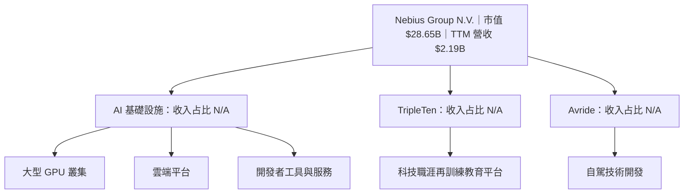
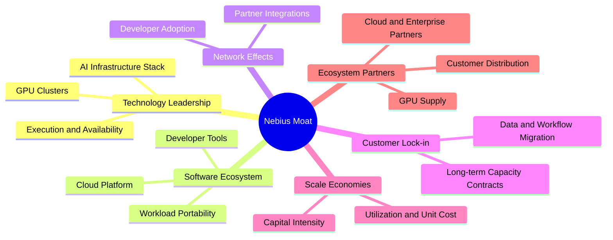
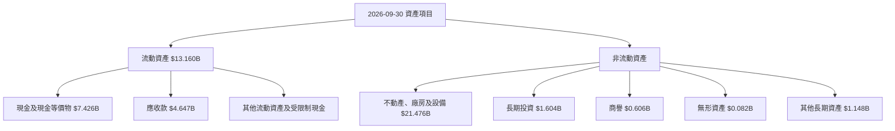
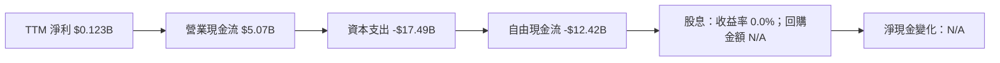
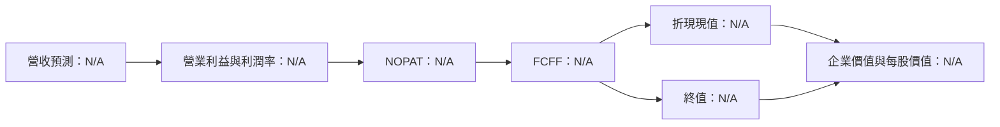
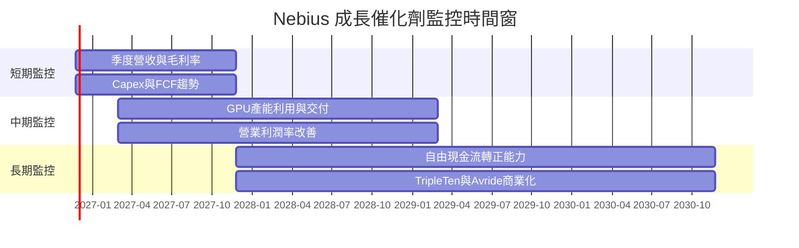
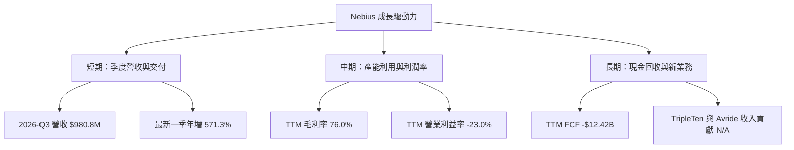
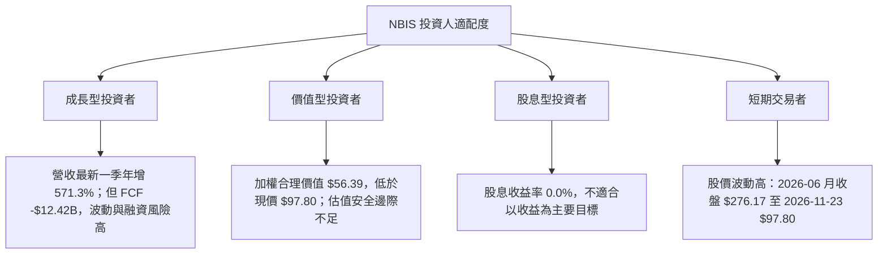

# NBIS 基本面深度分析報告
> **報告日期**：2026-11-24 ｜ **語言**：繁體中文 ｜ **數據來源**：Yahoo Finance、Finviz、StockAnalysis、Roic.ai ｜ **分析師**：CFA 級機構研究

---

## 目錄

| # | 章節 | 核心結論 |
|---|------|----------|
| 1 | 執行摘要 | 賣出；加權合理價值 $56.39，MOS -73.4% |
| 2 | 公司概覽與商業模式 | AI 基礎設施是核心主線，但各業務收入占比與市場份額未提供 |
| 3 | 損益表深度分析 | TTM 營收 $2.19B；最新一季年增 571.3%，獲利仍不穩定 |
| 4 | 資產負債表分析 | 淨負債 $8.67B；流動比率 5.306，但應收帳款天數偏高 |
| 5 | 現金流量深度分析 | TTM FCF -$12.42B，主要反映 AI 基礎設施資本投入 |
| 6 | 獲利能力與資本效率 | WACC 7.60%；ROIC 無法判定，營業獲利仍未穩定覆蓋資本成本 |
| 7 | 相對估值分析 | P/S 13.08x 高於同業中位數 4.9x；同業 P/S 法估值 $36.92 |
| 8 | DCF 內在價值評估 | DCF 不適用：TTM 營業利益為負；採用相對估值三角驗證 |
| 9 | 成長催化劑 | AI GPU 雲端需求與產能利用率是主要觀察重點 |
| 10 | 風險矩陣 | 前三大風險為資本支出／融資、執行與估值回檔 |
| 11 | 投資建議 | 依 MOS 門檻為賣出；以營運里程碑與估值收斂作為重新評估條件 |

---

## 1. 執行摘要

NBIS 的最新一季營收年增 **571.3%**，TTM 營收為 **$2.19B**，顯示 AI 基礎設施需求正快速轉化為營收；但 TTM 營業利益率仍為 **-23.0%**，TTM FCF 為 **-$12.42B**，淨負債 **$8.67B**。以最新收盤價 **$97.80（2026-11-23）**計，估值方法加權合理價值為 **$56.39**，MOS 為 **-73.4%**，因此按規則 20 評級為**賣出**。同業 P/S 法估值僅 **$36.92**，而 DCF 因 TTM 營業利益為負不適用；市場對高速成長及未來獲利的預期已相當高。

### 1.0 一頁式投資儀表板（Portfolio Manager 30 秒速讀）

| 項目 | 內容 |
|------|------|
| **投資論點（3 句）** | ① TTM 營收 **$2.19B**，最新一季年增 **571.3%**，AI 基礎設施需求已反映在營收。② TTM 營業利益率 **-23.0%**、FCF **-$12.42B**，成長尚未轉化為可持續自由現金流。③ 加權合理價值 **$56.39**，低於 2026-11-23 收盤價 **$97.80**，估值緩衝不足。 |
| **綜合評分** | **4.3/10**（引用 1.1 評分卡） |
| **財務健康** | 🔴 淨負債 **$8.67B**、TTM FCF **-$12.42B**；流動比率 **5.306** 提供短期緩衝，但高資本支出仍帶來融資需求 |
| **ROIC vs WACC** | ROIC：**N/A**；WACC：**7.60%**。ROIC 無法可靠計算；目前營業利益率為負，尚無證據顯示經營資本回報已高於資本成本 |
| **FCF 趨勢** | TTM FCF **-$12.42B**；TTM FCF Yield **-43.36%**。近幾季資本支出擴大，現金流仍處於重投資階段 |
| **估值** | Forward P/E **-32.1273x**（虧損，倍數解讀有限）｜EV/EBITDA **60.957x**｜FCF Yield **-43.36%** |
| **DCF 內在價值（基準）** | **N/A**；TTM 營業利益為負，程式模型未計算 DCF，故 DCF 折溢價 N/A |
| **安全邊際（MOS）** | **-73.4%**＝($56.39 − $97.80) ÷ $56.39；🔴 低於 10%，無下檔保護（基準：8.8 加權合理價值） |
| **預期報酬（基準情境 12M）** | DCF 基準情境 N/A。以加權合理價值作估值參照的隱含上行空間為 **-42.3%**，不等同於 12 個月報酬預測 |
| **關鍵風險（前二）** | AI 設施擴建令資本支出與融資壓力延續；高估值對成長放緩及利潤率不達預期敏感 |
| **評級 + 信心度** | 🔴 **賣出** ｜ 信心：中。數據顯示估值偏高及 FCF 大幅為負，但業務仍高速成長，估值不確定性高 |

### 1.1 綜合評分卡（全報告唯一）

| 維度 | 評分（1–10） | 主要依據（引用數字與其來源章節） |
|------|--------------|----------------------------------|
| 成長性 | 9.0 | 最新一季營收年增 **571.3%**，TTM 營收 **$2.19B**；但 TTM 成長率本身為 N/A（第 3 章） |
| 獲利能力 | 3.0 | TTM 營業利益率 **-23.0%**，最新一季列示 **-18.7%**；ROIC 與 Piotroski F-Score 無法判定（第 3、6 章） |
| 財務健康 | 4.0 | 淨負債 **$8.67B**、流動比率 **5.306**、DSO **673 天**、TTM FCF **-$12.42B**（第 4、5 章） |
| 估值 | 1.0 | MOS **-73.4%**；公司 P/S **13.08x**，高於同業 P/S 中位數 **4.9x**（第 7、8 章） |
| 護城河 | 5.0 | 全堆疊 GPU 叢集、雲端平台與開發者工具具差異化可能，但收入組成、留存率及客戶集中度未提供（第 2 章） |
| 管理層與資本配置 | 4.0 | FY2025 資本支出 **$4.07B**、SBC **$83.2M**；TTM 資本支出 **$17.49B**，投資規模大而投資回報尚未確立（第 3、5 章） |
| **綜合評分** | **4.3** | 六項算術平均：(**9.0 + 3.0 + 4.0 + 1.0 + 5.0 + 4.0**) ÷ 6 = **4.3** |

### 1.2 五大投資論點 + 三大核心風險

| 類型 | 項目 | 具體依據 | 信心度 |
|------|------|----------|--------|
| 🟢 **投資論點①** | AI 基礎設施營收加速 | 2026-09-30 季營收 **$980.8M**，年增 **571.3%**；顯示 GPU 雲端需求已形成實際收入（第 3 章） | 🟢 高 |
| 🟢 **投資論點②** | 毛利水準支持規模化的可能性 | TTM 毛利率 **76.0%**，高於 CRWV、ORCL、MSFT 的同業中位數 **66.8%**；但尚未抵銷營運與擴張成本（第 3、7 章） | 🟡 中 |
| 🟢 **投資論點③** | 短期流動性比率尚高 | 流動比率 **5.306**、速動比率 **4.847**，可降低近期流動性斷裂風險（第 4 章） | 🟡 中 |
| 🟢 **投資論點④** | 產能投資可能擴大收入基礎 | 最新季度營收由 2026-Q1 **$399.0M** 增至 Q3 **$980.8M**；若產能有效利用，固定成本吸收有機會改善（第 3、5 章） | 🟡 中 |
| 🟢 **投資論點⑤** | 業務組合提供額外選擇權 | 公司另有 TripleTen 教育平台及 Avride 自駕業務，但未提供各業務收入與獲利貢獻，現階段不應將其當作已驗證價值（第 2 章） | 🔴 低 |
| 🟡 **風險①** | 資本支出與融資風險 | TTM 資本支出 **$17.49B**、FCF **-$12.42B**、淨負債 **$8.67B**；若資金成本上升或建置延誤，估值與融資彈性會受壓（第 4、5 章） | 🔴 高衝擊 |
| 🔴 **風險②** | 高估值與成長預期落差 | P/S **13.08x** 對比同業中位數 **4.9x**；同業 P/S 法每股價值 **$36.92**，低於現價 **$97.80**（第 7 章） | 🔴 高衝擊 |
| 🟡 **風險③** | 應收帳款與現金轉換 | DSO **673 天**；CCC 因存貨資料缺漏為 N/A，收款與合約結算節奏需持續追蹤（第 4 章） | 🟡 中 |

### 1.3 快速統計卡片

| 指標 | 公司實際值（期間） | 同業中位數 | 狀態 |
|------|--------------------|------------|------|
| 營收成長（TTM） | **N/A** | — | 🟡 TTM 成長率未提供；不能以單季數字代替 |
| 營收成長（最新一季年增） | **571.3%** | **29.6%** | 🟢 遠高於所列三家同業中位數 |
| 毛利率（TTM） | **76.0%** | **66.8%** | 🟢 高於同業中位數 |
| 營業利益率（TTM） | **-23.0%** | — | 🔴 營運仍為虧損 |
| ROIC（TTM） | **N/A** | — | 🟡 缺少可靠計算輸入 |
| Forward P/E | **-32.1273x** | **10.3x** | 🔴 公司預估 EPS 為負，倍數不可直接比較 |
| FCF Yield（TTM） | **-43.36%** | — | 🔴 大額資本支出使 FCF 為負 |
| Piotroski F-Score | **N/A** | — | 🟡 缺少相隔一年的 SEC 申報資料 |

### 1.4 投資結論

╔══════════════════════════════════════════════════════════════════╗  
║　　　　　　　　　📊 投資結論摘要　　　　　　　　　　　　　　　║  
╠══════════════════════════════════════════════════════════════════╣  
║　評級：🔴 賣出（MOS -73.4%，按規則 20）　　　　　　　　　　　║  
║　價格（2026-11-23 收盤）：$97.80　　　　　　　　　　　　　　║  
║　DCF 內在價值（基準）：N/A（TTM 營業利益為負）　　　　　　　　║  
║　DCF 折溢價：N/A　　　　　　　　　　　　　　　　　　　　　　║  
║　安全邊際 MOS：-73.4%＝($56.39−$97.80)÷$56.39　　　　　　　║  
║　加權合理價值（8.8）：$56.39　　　　　　　　　　　　　　　　║  
║　綜合評分：4.3/10（引用 1.1）　　　　　　　　　　　　　　　║  
║　適合投資人：能承受高波動、並以營運里程碑嚴格驗證的成長型　║  
╚══════════════════════════════════════════════════════════════════╝

---

## 2. 公司概覽與商業模式

### 2.1 業務結構與收入來源

Nebius Group N.V. 為總部位於荷蘭的科技公司，提供 AI 全堆疊基礎設施，包括大規模 GPU 叢集、雲端平台及開發者工具。另有 TripleTen 教育平台及 Avride 自駕業務。TTM 營收為 **$2.19B**，市值 **$28.65B**；各業務收入占比未提供，不能以公司總營收推估各板塊規模。

### 2.2 市場份額

市場份額數據未提供，因此不估算 Nebius 在 AI 雲端或 GPU 雲端市場的占比。公司最新一季營收年增 **571.3%**，高於 CRWV、ORCL、MSFT 最新一季年增率中位數 **29.6%**；但不同公司的業務範圍、規模及會計期間並不完全一致，不能直接將成長率差距解讀為市占率變化。

### 2.3 競爭護城河分析

上述項目是商業模式可能形成的競爭優勢來源，並不代表已經驗證的護城河。尤其客戶留存、合約年期、GPU 利用率與開發者活躍度均未提供。

### 2.4 護城河強度

| 護城河項目 | 強度（強／中／弱） | 證據（引用數字或事實） | 會削弱它的情況 |
|------------|--------------------|------------------------|----------------|
| 技術與基礎設施 | 中 | 提供大型 GPU 叢集、雲端平台及開發者工具；最新一季營收年增 **571.3%**，但未提供可用容量及利用率 | GPU 供應受限、設備更新落後、客戶轉向自建或大型雲端商 |
| 軟體生態系統 | 中／待驗證 | 公司提供雲端平台和開發者工具；軟體收入占比、客戶留存率及使用者數未提供 | 軟體黏著度不足、平台遷移成本低 |
| 網路效應 | 弱／待驗證 | 未提供開發者數、合作夥伴數或平台交易數據 | 生態系未達規模、合作網路無法帶動新增需求 |
| 客戶鎖定 | N/A | 合約集中度、續約率及客戶流失率未提供；DSO 為 **673 天**，需觀察收款品質 | 大客戶流失、合約到期未續約或付款延遲 |
| 規模效應 | 中 | TTM 營收 **$2.19B**，最新一季營收 **$980.8M**；但 TTM 營業利益率 **-23.0%**，規模尚未反映為穩定經營獲利 | 擴張速度快於需求，產能利用率偏低，成本增幅超過收入 |
| 生態夥伴 | N/A | 公司業務涉及 GPU 叢集及雲端服務，但未提供合作夥伴合約細節 | 供應商集中、合作條款轉差或競爭者取得更優供應 |

第 1.1 節護城河評分為 **5.0/10**，理由是產品與營收成長已有跡象，但客戶黏著、網路效應和規模回報仍缺乏可量化證據。

---

## 3. 損益表深度分析

### 3.1 年度收入成長趨勢（近 4 年）

╔══════════════════════════════════════════════════════════════════╗  
║　　　　　　　Nebius 年度收入趨勢（FY2022–FY2025）　　　　　　　║  
╠══════════════════════════════════════════════════════════════════╣  
║ FY2022　$13.5M　　 YoY：+37.8%　　　　　　　　　　　　　　　║  
║ FY2023　$9.8M　　　YoY：-27.4%　　　　　　　　　　　　　　　║  
║ FY2024　$91.5M　　 YoY：+833.7%　　　　　　　　　　　　　　║  
║ FY2025　$529.8M　　YoY：+479.0%　　　　　　　　　　　　　　║  
╠══════════════════════════════════════════════════════════════════╣  
║ FY2022–FY2025 三年收入 CAGR：　　　　　　　　　　　　　　　　　║  
║ ($529.8M ÷ $13.5M)^(1/3) − 1 = 約 +240.0%　　　　　　　　　║  
╚══════════════════════════════════════════════════════════════════╝

FY2022 至 FY2025 的收入 CAGR 約 **240.0%**，但低基期效應非常大：收入由 **$13.5M** 增至 **$529.8M**，且業務組合和公司規模快速變動，該 CAGR 不宜直接外推為未來成長率。另需注意，FY2022 年增率是以 FY2021 收入 **$4.746B** 計算，歷史收入序列呈現劇烈變動，可能涉及重大業務與公司結構變化，年度比較需審慎解讀。

### 3.2 季度收入趨勢分析

| 季度 | 營收 | QoQ 成長 | YoY 成長 | 備註 |
|------|------:|---------:|---------:|------|
| 2025-Q4 | $227.7M | +55.9% | +546.9% | YoY 以 2025-Q4 對 2024-Q4 比較 |
| 2026-Q1 | $399.0M | +75.2% | +683.9% | 收入延續擴張 |
| 2026-Q2 | $582.3M | +45.9% | +454.0% | QoQ 仍高，但增速較前季放緩 |
| 2026-Q3 | $980.8M | +68.4% | +571.3% | 單季年增率，不是 TTM 成長率 |

QoQ 為以相鄰季度營收計算，例如 2026-Q3：($980.8M ÷ $582.3M) − 1 = **68.4%**。最新一季營收加速，與 AI 基礎設施需求及交付規模擴大相符；但目前資料沒有提供訂單、在手合約、GPU 利用率或價格變動，無法判斷增長中有多少來自新增客戶、單一大客戶或產能交付。

### 3.3 利潤率演變分析

年度毛利率及營業利益率由年度毛利、營業利益除以收入計算；歷史值受公司業務組合及基數影響，極端負值不宜視為穩態利潤率。

| 利潤率指標 | FY2022 | FY2023 | FY2024 | FY2025 | 趨勢 | 評估 |
|------------|-------:|-------:|-------:|-------:|------|------|
| **毛利率** | -110.4% | -100.0% | 52.2% | 68.6% | 近兩年大幅改善 | 🟢 但歷史業務組合變動使可比性有限 |
| **營業利益率** | -1,170.4% | -2,915.3% | -436.7% | -115.4% | 絕對值收斂，但仍大幅為負 | 🔴 |
| **淨利率** | 5,522.2% | 2,462.2% | -700.9% | 15.6% | 受一次性或非營業項目影響可能很大 | 🔴 不宜視為正常化獲利 |

上述年度淨利率因年度淨利變動劇烈、FY2022 與 FY2023 收入基數甚小，經濟意義有限。依最新資料，TTM 毛利率為 **76.0%**，但 TTM 營業利益率仍為 **-23.0%**，代表毛利增長尚未覆蓋營運費用、擴張成本或其他營業支出。最新一季財務表列營業利益 **$50.4M**，但 VERIFIED FIGURES 列示最新一季營業利益率 **-18.7%**；兩者不一致，本報告對指標引用採用指定的已核實利潤率，同時將此列為資料核對風險，不自行以一項覆蓋另一項。

### 3.4 費用結構分析

完整費用項目及各項目金額未提供，故不繪製比例圓餅圖。FY2025 研發支出為 **$177.3M**，約占 FY2025 營收 **33.5%**，計算為 $177.3M ÷ $529.8M；研發投入可支援產品與平台發展，但其商業回報須以收入留存、毛利與營業費用率改善驗證。

### 3.5 季度 EPS 趨勢與盈餘品質（Quality of Earnings）

| 季度 | EPS 實際／預期 | 季度淨利 | 盈餘驚喜 |
|------|----------------|---------:|----------|
| 2025-Q4 | N/A／N/A | -$268.8M | 無法判定：EPS 預期與實際值缺失 |
| 2026-Q1 | N/A／N/A | $621.2M | 無法判定：EPS 預期與實際值缺失 |
| 2026-Q2 | N/A／N/A | -$190.4M | 無法判定：EPS 預期與實際值缺失 |
| 2026-Q3 | N/A／N/A | -$37.5M | 無法判定：EPS 預期與實際值缺失 |

EPS 歷史表列的分析師預期與實際數均為空值，不能把空值當作超預期或不及預期。季度淨利在上述期間大幅波動，FY2026-Q1 的正淨利不能單獨當作穩定盈利能力證據。

| 盈餘品質項目 | 數值／佔比 | 評估 |
|--------------|-----------|------|
| 股權薪酬 SBC / 營收 | 最近四季 SBC 合計 **$221.4M** ÷ TTM 營收 **$2.19B** = **10.1%** | 🔴 對股東具實質稀釋成本；股數變化需持續監控 |
| SBC / 營業現金流 | **$221.4M ÷ $5.07B = 4.4%** | 🟡 比例低於 SBC／營收，但 OCF 受季節性、融資或營運資金變動影響，不能單獨代表現金獲利品質 |
| FCF / 淨利（現金轉換率） | 以 StockAnalysis TTM 淨利 **$122.9M** 參照：**-$12.42B ÷ $122.9M = -101.1 倍** | 🔴 FCF 大幅為負；主要由高資本支出造成，正淨利並未轉化為自由現金流 |
| 一次性／非經常性損益 | 可能存在，但金額與明細未提供 | 🟡 FY2026-Q1 淨利 **$621.2M** 與前後季度差異大，須查明稅務、投資或處分項目 |
| 有效稅率異常 | 最新年有效稅率 **29.0%** | 🟡 非常態項目明細未提供；不可由單季淨利推斷正常稅率 |
| 資本化支出 vs 費用化 | TTM 資本支出 **$17.49B**；資產負債表 PP&E **$21.476B** | 🔴 基礎設施投資大量資本化；折舊年限、資產利用率及減損資料不足，須避免只看當期費用化支出 |

**盈餘品質結論：** 盈餘品質偏弱且波動大。SBC 約為 TTM 營收的 **10.1%**，稀釋不可忽視；TTM FCF 為 **-$12.42B**，而季度淨利變動劇烈。若產能利用率未提高，資本化支出帶來的折舊、減損與融資成本可能使 GAAP 盈餘高於可持續經濟盈餘。

---

## 4. 資產負債表分析

### 4.1 資產結構分解

以下為 2026-09-30 的資產科目；總資產未以一致口徑列示，故不展示總資產合計與占比。

PP&E 為 **$21.476B**，顯示公司已投入大量基礎設施資產；應收款為 **$4.647B**，相對 TTM 營收規模值得追蹤。不同資料源呈現的資產負債項目口徑可能有差異，因此不以個別明細拼湊總額。

### 4.2 流動性與營運資金分析

| 指標 | 最新 TTM | 一年前 TTM | 變化 | 解讀 |
|------|----------:|-----------:|------|------|
| 流動比率 | **5.306** | N/A | N/A | 短期資產覆蓋流動負債能力高，但不代表現金可完全自由動用 |
| 速動比率 | **4.847** | N/A | N/A | 高於 1；但資本投資與債務到期結構仍需另行評估 |
| DSO 應收帳款天數 | **673 天** | N/A | N/A | 顯著偏長；可能受大型合約開票與結算時點影響，也可能反映回款風險，需以合約及後續收款核實 |
| DIO 存貨天數 | **N/A** | N/A | N/A | 公司未呈報相應存貨餘額，不補值 |
| DPO 應付帳款天數 | **368 天** | N/A | N/A | 可能反映供應商付款條款與資本設備採購結算；不可直接解讀為議價力 |
| CCC 現金轉換週期 | **N/A** | N/A | N/A | 因 DIO 為 N/A，不能計算或補估 |

營運資金指標是以期末餘額除以 TTM 流量計算，對快速增長、合約型業務容易受期末時點影響。DSO **673 天**應被視為需核查的警訊，而不是單憑該數字斷定壞帳。

### 4.3 債務結構分析

╔══════════════════════════════════════════════════════════════════╗  
║　　　　　　　　　Nebius 債務健康診斷　　　　　　　　　　　　　║  
╠══════════════════════════════════════════════════════════════════╣  
║　總債務：　　　　　　 $16.10B　　　　　　　　　　　　　　　　║  
║　現金及短期投資：　　 $7.43B　　　　　　　　　　　　　　　　 ║  
║　淨負債：　　　　　　 $8.67B　🔴　　　　　　　　　　　　　　 ║  
║　Debt/Equity：　　　　 130.875x（來源列示；口徑需核對）　　　 ║  
║　流動比率：　　　　　 5.306　🟢　　　　　　　　　　　　　　　║  
║　速動比率：　　　　　 4.847　🟢　　　　　　　　　　　　　　　║  
║　利息保障倍數：　　　 N/A（利息費用明細不足以可靠計算）　　 ║  
║　Debt/EBITDA：　　　　 不採用（TTM EBITDA 口徑與債務口徑未核對）║  
╚══════════════════════════════════════════════════════════════════╝

公司由 FY2025 年底總債務 **$4.97B** 增至最新列示總債務 **$16.10B**，增幅顯著；但不同財報資料源與負債分類可能存在口徑差異，建議檢查季度申報中的借款、融資租賃、債券及設備融資明細。流動性比率高可緩解短期償債壓力，但不消除長期資本支出對外部融資的依賴。

### 4.4 股東權益趨勢

╔══════════════════════════════════════════════════════════════════╗  
║　　　　　　　　歷年股東權益（年度）　　　　　　　　　　　　　║  
╠══════════════════════════════════════════════════════════════════╣  
║　FY2022　$4.25B　　　　　　　　　　　　　　　　　　　　　　　║  
║　FY2023　$3.29B　　YoY 約 -22.6%　　　　　　　　　　　　　　║  
║　FY2024　$3.25B　　YoY 約 -1.2%　　　　　　　　　　　　　　 ║  
║　FY2025　$4.59B　　YoY 約 +41.2%　　　　　　　　　　　　　　║  
╚══════════════════════════════════════════════════════════════════╝

股東權益在 FY2025 回升至 **$4.59B**，但期間同時出現大額淨利波動、債務增加與資本投入。最新季度股東權益未提供可直接對照的可靠數值，故不延伸推算最新權益趨勢。

---

## 5. 現金流量深度分析

### 5.1 現金流量瀑布圖

以下連結以 TTM 指標展示；TTM 淨利採 StockAnalysis 列示值。股息收益率為 **0.0%**；回購金額未提供。

營業現金流為正，但資本支出遠高於營業現金流，令 FCF 為 **-$12.42B**。淨現金變化不能僅由上述瀑布推導，因融資、股權發行、投資與匯兌等現金流細項未提供。

### 5.2 FCF 轉換率趨勢

| 年度 | FCF | 淨利 | FCF／淨利 | 趨勢解讀 |
|------|----:|----:|---------:|----------|
| FY2022 | $682.4M | $745.6M | 約 0.92x | 小規模歷史年度，不能代表目前 AI 基礎設施投資週期 |
| FY2023 | $746.9M | $241.3M | 約 3.10x | 高現金轉換可能受營運資金等因素影響 |
| FY2024 | -$561.9M | -$641.4M | 約 0.88x | 淨利與 FCF 同為負值，倍數解讀有限 |
| FY2025 | -$3.68B | $82.5M | 約 -44.6x | 資本支出造成 FCF 大幅轉負 |
| TTM 至 2026-09-30 | -$12.42B | TTM 淨利約 $122.9M | 約 -101.1x | 大額擴產使正淨利未轉化為可分配現金 |

比率中淨利接近零或負值時，倍數會失真；目前更重要的指標是 FCF 絕對額與資本支出能否隨收入增長趨於穩定。

### 5.3 自由現金流趨勢

╔══════════════════════════════════════════════════════════════════╗  
║　　　　　　　　自由現金流：年度實際　　　　　　　　　　　　　║  
╠══════════════════════════════════════════════════════════════════╣  
║ FY2022　+$0.682B　　FCF／淨利：約 0.92x　　　　　　　　　　 ║  
║ FY2023　+$0.747B　　FCF／淨利：約 3.10x　　　　　　　　　　 ║  
║ FY2024　-$0.562B　　FCF／淨利：約 0.88x　　　　　　　　　　 ║  
║ FY2025　-$3.68B　　 FCF／淨利：約 -44.6x　　　　　　　　　　║  
║ TTM　　 -$12.42B　　FCF Yield：-43.36%　　　　　　　　　　　║  
╠══════════════════════════════════════════════════════════════════╣  
║ TTM 資本支出 $17.49B，高於營業現金流 $5.07B。　　　　　　　 ║  
║ FCF = $5.07B − $17.49B = -$12.42B。　　　　　　　　　　　　 ║  
╚══════════════════════════════════════════════════════════════════╝

FY2026 最近四季資本支出依序為 **$2.06B、$2.47B、$5.66B、$7.30B**（各季現金流表列示為負支出）；投資速度仍在加快。這可能是供給擴張的必要前置成本，但也令公司在資本回收期前承受較高融資風險。

### 5.4 資本配置評估

完整的資本配置百分比拆分未提供，不以缺漏資料繪製比例圓餅圖。

| 配置項目 | 可見數據 | 評估 |
|----------|----------|------|
| 資本支出 | TTM **$17.49B**；FY2025 **$4.07B** | 最大可辨識資金用途；能否形成有足夠利用率的 GPU 資產是投資回報關鍵 |
| 研發 | FY2025 **$177.3M** | 支援產品與平台研發，但佔收入比例與商業回收仍須追蹤 |
| 股權薪酬 | FY2025 **$83.2M**；最近四季合計 **$221.4M** | SBC 增加股東稀釋，須與營收及員工留任效益對照 |
| 股息 | 股息收益率 **0.0%** | 未見現金股息分配 |
| 股票回購 | N/A | 回購金額未提供，不推定有回購 |
| 融資 | 總債務 **$16.10B**；淨負債 **$8.67B** | 資本需求與融資規模上升，增加利率與再融資敏感度 |

---

## 6. 獲利能力與資本效率

### 6.1 ROE / ROA / ROIC 趨勢

ROIC 歷史序列未以可確認期間與定義提供；財務數據的 Piotroski 與 DuPont 亦為 N/A。以下只列來源明確標示的 TTM 指標。

| 指標 | 最新可用值 | 歷史趨勢／限制 | 評估 |
|------|-----------:|----------------|------|
| ROE（TTM） | **1.5%** | 年度權益與淨利大幅波動；不可用來推定穩態報酬率 | 🟡 偏低 |
| ROA（TTM） | **-1.0%** | 資產快速擴張而營業利益仍為負 | 🔴 |
| ROIC（TTM） | **N/A** | 缺乏可靠投入資本、稅後營業利益口徑 | 🟡 |
| Piotroski F-Score | **N/A** | 缺少相隔一年的 SEC 申報資料 | 🟡 |

### 6.2 ROIC vs WACC 分析（核心價值創造判斷）

╔══════════════════════════════════════════════════════════════════╗  
║　　　　　　　　ROIC vs WACC 深度分析　　　　　　　　　　　　　║  
╠══════════════════════════════════════════════════════════════════╣  
║　WACC（程式列示）：7.60%　　　　　　　　　　　　　　　　　　║  
║　├── 無風險利率（10Y 美債）：4.92%　　　　　　　　　　　　　║  
║　├── 市場風險溢酬 ERP：5.00%　　　　　　　　　　　　　　　 ║  
║　├── Beta 原始值：1.54；採用調整後 Beta：1.36　　　　　　　║  
║　├── 股權成本 Ke（列示值）：11.71%　　　　　　　　　　　　║  
║　├── 稅前債務成本：0.38%；稅率：29.0%　　　　　　　　　　 ║  
║　├── 資本權重：股權 64.0%，債務 36.0%　　　　　　　　　　　║  
║　└── WACC：7.60%　　　　　　　　　　　　　　　　　　　　　 ║  
║　　　　　　　　　　　　　　　　　　　　　　　　　　　　　　　║  
║　ROIC：N/A（缺乏可可靠重算之投入資本與 NOPAT）　　　　　　　║  
║　EVA（ROIC − WACC）：N/A　　　　　　　　　　　　　　　　　　║  
║　經濟價值判斷：現有數據無法定量判定 ROIC 是否高於 WACC。　║  
╚══════════════════════════════════════════════════════════════════╝

WACC 採用指定資本成本資料中的 **7.60%**，不另行重建。原始 Beta **1.54** 調整後為 **1.36**，符合資料列示的調整方式 **⅔ × 1.54 + ⅓ = 1.36**。由列示輸入計算 CAPM 可能受中間值與四捨五入影響；本報告保留列示 Ke **11.71%** 及 WACC **7.60%**，不以自行重算值取代。

ROIC 為 N/A，故不能宣稱公司已創造或摧毀股東價值。營業利益率 TTM **-23.0%**，表示現階段經營層面仍未形成正向營業回報；要證明長期價值創造，需見到營業利潤轉正、資產利用率提升及 ROIC 超過 WACC。

### 6.3 杜邦三因素分解

N/A（數據未提供：杜邦計算所需的淨利、營收、總資產或正股東權益未能以一致口徑取得；不另行補算）。

### 6.4 財務體質：Piotroski F-Score

N/A（數據未提供：缺少相隔一年的 SEC 申報資料，無法判定 Piotroski F-Score 及九項測試結果）。

---

## 7. 相對估值分析

### 7.1 同業估值比較表格

同業數據採 Yahoo Finance 列示的 Peer multiples；Nebius 公司倍數依估值資料列示。負 Forward P/E 代表相關公司或 NBIS 預期盈餘為負，不能按一般正盈餘倍數解讀。

| 估值指標 | **NBIS** | **CRWV** | **ORCL** | **MSFT** | 本公司評估 |
|----------|---------:|---------:|---------:|---------:|-----------|
| **Trailing P/E** | N/A | N/A | 15.9x | 25.7x | 🟡 NBIS TTM EPS 為負，P/E 無意義 |
| **Forward P/E** | **-32.1273x** | -27.1x | 10.3x | 20.3x | 🔴 NBIS 預期 EPS 為負，無法按正盈餘公司比較 |
| **P/S Ratio** | **13.081494x** | 2.7x | 4.9x | 10.6x | 🔴 NBIS 高於三家同業中位數 **4.9x** |
| **EV/EBITDA（TTM）** | **60.957x** | 17.1x | 14.0x | 18.1x | 🔴 高於同業中位數 **17.1x**；不同企業利潤率與成長階段差異大 |
| **最新一季營收年增** | **571.3%** | 168.2% | 29.6% | 18.8% | 🟢 成長高於同業中位數 **29.6%** |
| **毛利率（TTM）** | **76.0%** | 66.8% | 64.0% | 67.7% | 🟢 高於同業中位數 **66.8%** |

NBIS 的高速增長及毛利率可能支持高於成熟軟體公司的估值溢價，但目前 P/S 約為同業中位數的 **2.67 倍**（13.081494 ÷ 4.9），且 TTM FCF 為負。若未來利潤率與現金流改善慢於股價所隱含的預期，估值收斂風險偏高。

### 7.2 歷史估值區間分析

╔══════════════════════════════════════════════════════════════════╗  
║　　　　　　　　　歷史估值區間分析　　　　　　　　　　　　　　║  
╠══════════════════════════════════════════════════════════════════╣  
║ P/E 歷史區間／百分位：N/A（未提供 Valuation vs own history）　║  
║ P/S 歷史區間／百分位：N/A（未提供 Valuation vs own history）　║  
║ 價格歷史：2026-06 月收盤 $276.17；2026-11-23 收盤 $97.80　║  
║ 自 2026-06 月收盤至最新收盤變動：-64.6%　　　　　　　　　　║  
╚══════════════════════════════════════════════════════════════════╝

股價由 2026-06 月收盤 **$276.17** 回落至 **$97.80**，按月度收盤價計算下跌約 **64.6%**；這是價格回撤資訊，不等同於歷史估值百分位。估值區間與百分位未提供，因此不推估公司歷史 P/S 或 P/E 位置。

### 7.3 情境價值（Bear / Base / Bull）

N/A（DCF 無法計算：TTM 營業利益為負，DCF MODEL 未提供情境估值；不得另建情境目標價）。

### 7.4 相對估值隱含價格區間

╔══════════════════════════════════════════════════════════════════╗  
║　　　　　　　　　相對估值價格參照　　　　　　　　　　　　　　║  
╠══════════════════════════════════════════════════════════════════╣  
║ 同業 P/S 法：$36.92　——— 現價 $97.80　　　　　　　　　　　　║  
║ 分析師共識：$231.60　　　　　　　　　　　　　　　　　　　　 ║  
║ 加權合理價值：$56.39　　　　　　　　　　　　　　　　　　　　║  
╚══════════════════════════════════════════════════════════════════╝

| 方法 | 每股價值 | 依據 | 相對現價 |
|------|---------:|------|---------:|
| 同業 P/S | **$36.92** | CRWV、ORCL、MSFT 的 P/S 中位數 **4.9x**，乘以 NBIS TTM 營收並按既定模型換算每股價值 | **-62.2%** |
| 分析師共識目標價 | **$231.60** | 20 位分析師平均目標價 | **+136.8%** |

同業 P/S 方法主要反映相對收入規模的定價，未能充分反映 NBIS 的高成長潛力；分析師共識則反映未來獲利及市場預期，兩者差異極大，顯示估值高度依賴成長和利潤率假設。

---

## 8. DCF 內在價值評估（Discounted Cash Flow）

> TTM 營業利益為負，依估值模型設定，本報告不自行建立 DCF。因缺少可用的正營業利益基礎，DCF 的逐年預測、終值、敏感性與反推模型均為 N/A。估值仍以第 8.8 節已提供的估值方法及權重作三角驗證。

### 8.0 估值推理鏈（Thinking Logic）

**Step 1 — 公司的價值由哪些變數決定？**  
NBIS 的價值主要取決於 AI 基礎設施營收轉化、GPU 資產利用率及長期營業利潤率；目前 AI 基礎設施是公司主要業務，但各板塊營收占比未提供，不能將全部 **$2.19B** TTM 營收精確分配至單一業務。就已知數字而言，最新一季營收年增 **571.3%**，但 TTM 營業利益率 **-23.0%**、FCF **-$12.42B**。因此估值的核心不只是收入擴張，而是資本投入能否轉化為正向現金流。

**Step 2 — 模型與方法適用性**

| 決策點 | 本報告採用 | 理由（含數字） | 曾考慮但否決 | 否決理由 |
|--------|-----------|----------------|--------------|----------|
| 現金流定義 | DCF N/A | TTM 營業利益率 **-23.0%**，模型未提供可用 DCF 結果 | FCFF 自建模型 | 依指定模型規則，不以虧損營業利益自行外推 |
| 預測期 N | N/A | 模型未輸出預測期與年度假設 | 自行設定 5 年或 10 年 | 缺少可核查的營運財測，設定期限將形成黑箱 |
| 終值方法 | N/A | 無 DCF 預測及終值資料 | Gordon Growth／退出倍數 | 無法從已核准模型數字推導 |
| EBIT 基礎 | N/A | 不執行 DCF | 自行採 GAAP 或非 GAAP EBIT | 缺少一致基礎及足夠假設 |

**Step 3 — 關鍵假設推導鏈**  
因 DCF MODEL 為 N/A，營收 CAGR、期末營業利潤率、永續成長率、預測期、Capex／營收、折舊、營運資金變動、SBC 處理、稀釋率均未提供。缺少任一重要輸入時自行填入數字，會造成不可稽核估值，因此不建立替代假設。

**Step 4 — 最脆弱的一環**  
目前最脆弱的估值環節是高成長是否能在持續擴產下轉化為正 FCF；若收入增長未伴隨利用率提高或營業利潤改善，現有估值參照中的同業 P/S 法 **$36.92** 會比分析師共識 **$231.60** 更能反映下行敏感度。

**Step 5 — 計算路徑圖**

### 8.1 模型假設總表（Model Inputs）

N/A（數據未提供：DCF MODEL 因 TTM 營業利益為負而未計算；營收 CAGR、預測期、利潤率、稅率路徑、資本支出率、折舊、營運資金、SBC 與股數假設均無可引用模型值）。本節不另建模型，也不自行設定假設數字。

### 8.2 折現率推導（WACC）

下列資本成本數據用於第 6.2 節與 DCF 折現率參考；但由於 DCF 本身 N/A，不進行估值折現。

╔══════════════════════════════════════════════════════════════════╗  
║　　　　　　　　　　　WACC 輸入　　　　　　　　　　　　　　　　║  
╠══════════════════════════════════════════════════════════════════╣  
║　無風險利率（10Y 美債）：4.92%　　　　　　　　　　　　　　　║  
║　ERP（假設值）：5.00%　　　　　　　　　　　　　　　　　　　 ║  
║　原始 Beta：1.54；調整後 Beta：1.36　　　　　　　　　　　　 ║  
║　列示股權成本 Ke：11.71%　　　　　　　　　　　　　　　　　　║  
║　稅前債務成本：0.38%　　　　　　　　　　　　　　　　　　　　║  
║　有效稅率：29.0%　　　　　　　　　　　　　　　　　　　　　 ║  
║　股權／債務權重：64.0%／36.0%　　　　　　　　　　　　　　　║  
║　列示 WACC：7.60%　　　　　　　　　　　　　　　　　　　　　 ║  
╚══════════════════════════════════════════════════════════════════╝

WACC 組成的完整列示如下：無風險利率 **4.92%**、假設 ERP **5.00%**、調整後 Beta **1.36**、列示 Ke **11.71%**、稅前債務成本 **0.38%**、稅率 **29.0%**、股權權重 **64.0%**、債務權重 **36.0%**、列示 WACC **7.60%**。由於股權市值、計息負債範圍及成本資料在不同數據來源間可能存在口徑差異，本報告不自行重算或替換該 WACC。

### 8.3 逐年自由現金流預測（基準情境）

N/A（數據未提供：DCF MODEL 未輸出預測期與逐年現金流；不自建預測表）。目前可引用的歷史錨點為 TTM 營收 **$2.19B**、營業利益率 **-23.0%**、營業現金流 **$5.07B**、資本支出 **$17.49B**、FCF **-$12.42B**。這些數據顯示目前投資期現金流為負，但不足以推導未來年度 FCF。

### 8.4 終值計算（Terminal Value）

N/A（數據未提供：沒有預測期末 FCFF、永續成長率或退出倍數；不計算 Gordon Growth 或退出倍數終值）。

### 8.5 企業價值 → 每股內在價值（Bridge）

N/A（數據未提供：DCF 企業價值、終值現值及估值橋接未計算）。本節不提供 DCF 每股內在價值，也不以其他方法的估值冒充 DCF 基準值。故 DCF 折溢價為 N/A。

### 8.6 敏感性分析（WACC × 永續成長率）

N/A（數據未提供：無 DCF 基準現金流及終值，無法建立 WACC × 永續成長率敏感度矩陣，也不自行試算情境價值）。

### 8.7 反推 DCF（Reverse DCF：市場在預期什麼）

N/A（數據未提供：DCF 模型不存在可供令每股價值等於現價的基準方程式，不能反推營收 CAGR、營業利潤率、永續成長率或預測期）。

### 8.8 估值三角驗證與安全邊際

| 估值方法 | 隱含每股價值 | 上行空間（÷現價） | 權重 | 說明 |
|----------|--------------:|------------------:|------:|------|
| 同業 P/S | **$36.92** | **-62.2%** | **90%** | CRWV、ORCL、MSFT 的 P/S 中位數 **4.9x**，再依既定方法換算 |
| 分析師共識目標價 | **$231.60** | **+136.8%** | **10%** | 20 位分析師平均目標價，參考性高但非營運現金流驗證 |
| **加權合理價值** | **$56.39** | **-42.3%** | **100%** | 未盈利公司類型；權重依方法固定 |

**加權合理價值計算：**

- 同業 P/S 加權值：$36.92 × 90% = **$33.228**
- 分析師共識加權值：$231.60 × 10% = **$23.160**
- 加總：**$33.228 + $23.160 = $56.388**，依估值模型列示為 **$56.39**

此權重配置對應未盈利公司類型；同業 Forward P/E 因無法計算而未納入，該方法權重依固定規則分配至可用方法。未加入 DCF、未另增估值方法，也未改動既定權重。

**MOS 與上行空間：**

- 安全邊際 MOS＝(**加權合理價值** − 現價) ÷ 加權合理價值  
  = ($56.39 − $97.80) ÷ $56.39  
  = -$41.41 ÷ $56.39  
  = **-73.4%**
- 上行空間＝(加權合理價值 − 現價) ÷ 現價  
  = ($56.39 − $97.80) ÷ $97.80  
  = -$41.41 ÷ $97.80  
  = **-42.3%**

╔══════════════════════════════════════════════════════════════════╗  
║　　　　　　　　　估值區間與安全邊際　　　　　　　　　　　　　║  
╠══════════════════════════════════════════════════════════════════╣  
║ 同業 P/S $36.92 ─ 加權合理值 $56.39 ─ 現價 $97.80　　　　　 ║  
║ DCF 悲觀／基準／樂觀：N/A　　　　　　　　　　　　　　　　　 ║  
║ 安全邊際 MOS：-73.4%　　　　　　　　　　　　　　　　　　　 ║  
║ 上行空間：-42.3%　　　　　　　　　　　　　　　　　　　　　 ║  
║ 建議買入參考上限：$50.75（使合理價值 MOS 至少為 10%）　　　║  
╚══════════════════════════════════════════════════════════════════╝

MOS 門檻價格的計算為 **$56.39 × (1 − 10%) = $50.751 ≈ $50.75**。這是以加權合理價值計算的估值緩衝參考，不代表短期股價預測。

> 🔎 **程式複算（Python，依本節各項自動重算）**
>
> 加權合理價值 = $36.92 × 90% + $231.60 × 10% = **$56.39**（權重合計 100%）
>
> 以價格 $97.80 計：MOS = **-73.4%**，上行空間 = **-42.3%**
>
> ✅ 與本節所寫數值一致。

### 8.9 DCF 模型的局限與失效條件

- **終值依賴度：**N/A；未建立 DCF，沒有終值占企業價值比率。
- **最脆弱的估值假設：**營收增長能否在持續擴產下轉為正 FCF；目前 TTM FCF **-$12.42B**，資本支出 **$17.49B**。
- **不適用情境：**營業利益為負、資本支出快速上升且盈餘波動大，DCF 的預測結果高度依賴利潤率與資本回收假設。現階段應以同業 EV／營收、P/S、單位經濟性與分部估值作參考，而非將 DCF 數字當作精確內在價值。
- **與第 10 章風險矩陣連結：**GPU 需求減速或客戶集中會衝擊收入成長；建置成本上升會推高 Capex；融資成本上行會提高 WACC；產能利用不足會延後營業利潤率與 FCF 轉正。

### 8.10 複算檢核表（Audit Trail）

| # | 檢核項目 | 檢查方式 | 結果 |
|---|----------|----------|------|
| 1 | 所有高／中敏感度 DCF 輸入都有完整四段式推導 | DCF MODEL 為 N/A，未設定輸入 | N/A |
| 2 | 每個 DCF 假設都有來歷 | 未建立 DCF 假設 | N/A |
| 3 | WACC 五步算式齊全且相乘相加正確 | 直接引用列示 WACC **7.60%**；不重算 | N/A |
| 4 | Kd 分母與債務權重 D 範圍一致 | 不以此報告自行重建 WACC | N/A |
| 5 | WACC 與第 6.2 節同值 | 兩處均為 **7.60%** | ✅ |
| 6 | 逐年表格年度數等於預測期 N 且無省略 | DCF 預測期未提供 | N/A |
| 7 | FY+1 九步算式可複算 | 無 FY+1 預測 | N/A |
| 8 | 預測期 PV 逐項相加等於合計 | 無預測期 PV | N/A |
| 9 | WACC > g 或依情況 B 處理 | 永續成長率未提供 | N/A |
| 10 | 終值以 FY+N 現金流為基礎並折現 N 期 | 無終值 | N/A |
| 11 | EV 至每股價值橋接可複算 | 無 DCF EV 橋接 | N/A |
| 12 | SBC 組合與股數稀釋相容 | 未建立 DCF SBC／股數假設 | N/A |
| 13 | 敏感性矩陣基準格等於 8.5 DCF 價值 | 無敏感度矩陣 | N/A |
| 14 | 敏感性矩陣只含有效格 | 無敏感度矩陣 | N/A |
| 15 | 三情境機率合計 100% | DCF 情境未提供 | N/A |
| 16 | 反推 DCF 每列只放開一個變數並有軌跡 | 無反推 DCF | N/A |
| 17 | MOS 使用 8.8 加權合理價值；折溢價使用 8.5 DCF | MOS **-73.4%** 以 $56.39 計；DCF 折溢價 N/A | ✅ |
| 18 | 報告完整輸出至第 11 章 | 已涵蓋第 1–11 章 | ✅ |
| 19 | 加權合理價值等於價值乘權重加總 | $36.92×90% + $231.60×10% = **$56.388，列示 $56.39** | ✅ |
| 20 | 評級符合 MOS 門檻 | MOS **-73.4%**，低於 -25%，評級為賣出 | ✅ |

未執行的 DCF 檢核項目均因 DCF MODEL 未計算而標示 N/A；這降低了本報告對絕對內在價值的判斷信心，但不影響對 8.8 既定加權估值與 MOS 的引用。

---

## 9. 成長催化劑

### 9.1 催化劑時間軸

下列為監控時間窗，不代表公司已公布相應財務指引或已確認交付日期。

### 9.2 TAM 市場規模分析

N/A（TAM 數據未提供）。公司最新一季營收 **$980.8M**、年增 **571.3%**，顯示業務快速擴張；但缺少可引用的市場規模、公司市占率與分部收入，不能量化市場滲透率或剩餘市場空間。

### 9.3 成長驅動力結構圖

短期營收擴張已可觀察；中期重點是把收入規模轉化為營業利潤及產能利用率；長期則需證明高額資本投入能形成正向現金流。TripleTen 與 Avride 的成長選擇權尚不能用未提供的財務占比定價。

---

## 10. 風險矩陣

### 10.1 風險評分矩陣

具體發生機率與財務損失幅度未提供，因此不以主觀座標偽裝成量化風險數據。以下矩陣以文字呈現風險排序。

| 風險區域 | 風險項目 | 排序依據 |
|----------|----------|----------|
| 高衝擊／需優先監控 | 資本支出與融資 | TTM Capex **$17.49B**、FCF **-$12.42B**、淨負債 **$8.67B** |
| 高衝擊／需優先監控 | 估值回檔 | P/S **13.081494x**，同業中位數 **4.9x**；MOS **-73.4%** |
| 中高衝擊／持續監控 | 產能利用與營業槓桿 | TTM 營業利益率 **-23.0%**；若收入未覆蓋固定成本，虧損可能延續 |
| 中度／資料核查 | 應收款與回款 | DSO **673 天**，需追蹤客戶收款與應收款帳齡 |
| 中度／營運與競爭 | GPU 供應及價格競爭 | GPU 供應商、合約定價與客戶集中度資料未提供 |

### 10.2 風險清單詳細分析

| # | 風險項目 | 發生機率 | 財務衝擊 | 風險評估 | 緩解措施 |
|---|----------|----------|----------|----------|----------|
| 1 | 🔴 **資本支出與融資壓力** | 定性：中高；機率百分比未提供 | TTM Capex **$17.49B**，TTM FCF **-$12.42B**；可能增加借款、股權稀釋或投資延後 | 🔴 高 | 追蹤現金餘額、債務到期、資本支出承諾、融資來源及資產利用率 |
| 2 | 🔴 **估值與市場預期落差** | 定性：高敏感；機率百分比未提供 | P/S **13.08x** 對比同業中位數 **4.9x**；同業 P/S 法估值 **$36.92** | 🔴 高 | 以營收成長、毛利率、營業利潤率與 FCF 同時驗證，避免僅依分析師共識 |
| 3 | 🟡 **擴產未能形成營業槓桿** | 定性：中高；機率百分比未提供 | TTM 營業利益率 **-23.0%**；若固定成本先增加而收入利用不足，虧損可能延續 | 🔴 高 | 追蹤單位收入、GPU 利用率、每單位成本及季度營業費用率 |
| 4 | 🟡 **應收款與回款週期** | 定性：中；機率百分比未提供 | DSO **673 天**；若部分餘額回收延遲，營運資金需求上升 | 🟡 中 | 追蹤應收帳齡、重大客戶應收款、合約收款條款及後續收款 |
| 5 | 🟡 **業務與財務披露可比性** | 定性：中；機率百分比未提供 | 最新一季營業利益 **$50.4M** 與列示營業利益率 **-18.7%** 不一致 | 🟡 中 | 逐季對照正式申報資料、持續營運項目和調整項目，釐清數據口徑 |

---

## 11. 投資建議

### 11.1 最終評級與評分

依 8.8 加權合理價值 **$56.39** 與 2026-11-23 收盤價 **$97.80** 計算，MOS 為 **-73.4%**，規則 20 對應評級為**賣出**，本報告未因質化因素調整評級。綜合評分為 **4.3/10**，引用 1.1 評分卡六項分數：成長性 **9.0**、獲利能力 **3.0**、財務健康 **4.0**、估值 **1.0**、護城河 **5.0**、管理層與資本配置 **4.0**。

### 11.2 合理價值與隱含報酬率

| 方法 | 每股價值 | 相對 2026-11-23 收盤價 $97.80 | 機率／權重 | 備註 |
|------|---------:|-----------------------------:|-----------:|------|
| 同業 P/S | **$36.92** | **-62.2%** | **90% 權重** | 固定估值方法之一 |
| 分析師共識 | **$231.60** | **+136.8%** | **10% 權重** | 20 位分析師平均目標價 |
| **加權合理價值** | **$56.39** | **-42.3%** | **100% 權重** | 不等同於確定的 12 個月報酬預測 |
| 悲觀／基準／樂觀 DCF | N/A | N/A | N/A | DCF MODEL 未計算，不提供情境目標價 |

### 11.3 買入時機與觸發因素

╔══════════════════════════════════════════════════════════════════╗  
║　　　　　　　✅ 買入觸發因素 Checklist　　　　　　　　　　　　║  
╠══════════════════════════════════════════════════════════════════╣  
║　重新評估持倉條件：　　　　　　　　　　　　　　　　　　　　　║  
║　☐ 最新季度營收成長維持，同時營業利益率連續改善　　　　　　　║  
║　☐ GPU 產能利用與合約收入能支持資本投入回收　　　　　　　　 ║  
║　☐ FCF 赤字連續收窄，且非單靠延後付款改善　　　　　　　　　║  
║　　　　　　　　　　　　　　　　　　　　　　　　　　　　　　　║  
║　估值觸發條件：　　　　　　　　　　　　　　　　　　　　　　　║  
║　☐ 股價回落至加權合理價值 MOS 至少 10% 的參考價 $50.75 附近 ║  
║　☐ 或營運改善足以支持高於現有相對估值參照　　　　　　　　　║  
║　　　　　　　　　　　　　　　　　　　　　　　　　　　　　　　║  
║　減碼／退出觸發條件：　　　　　　　　　　　　　　　　　　　　║  
║　☐ 營收增長明顯放緩，而 TTM 營業利益率仍低於 -23.0%　　　　 ║  
║　☐ TTM FCF 赤字擴大、淨負債高於 $8.67B 且融資條件惡化　　　 ║  
║　☐ 應收款回收惡化，DSO 持續高於 673 天　　　　　　　　　　　║  
╚══════════════════════════════════════════════════════════════════╝

$50.75 是由加權合理價值 **$56.39 × 90%** 推導的 MOS 10% 參考上限，不是對未來股價的保證，也不是固定買進指令。按目前評級，優先做法是等待現金流、利潤率和估值出現可驗證改善。

### 11.4 投資人適配度分析

### 11.5 每季財報監控清單（Quarterly Watch List）

| 監控指標 | 最新基準 | 觸發加碼／重新評估 | 觸發減碼／風險升級 |
|----------|----------|-------------------|--------------------|
| 營收與年增率 | 最新一季營收 **$980.8M**、年增 **571.3%** | 收入成長能持續，且訂單與客戶需求有披露支持 | 連續兩季年增率大幅回落且未有產能利用率改善 |
| 毛利率 | TTM **76.0%** | 維持高毛利並帶動營業利益率改善 | 毛利率明顯低於 TTM 基準，顯示價格或成本壓力 |
| 營業利益率 | TTM **-23.0%**；最新一季列示 **-18.7%** | 虧損率連續收窄，且與正式申報數據口徑一致 | 虧損率惡化或季報口徑矛盾未能解釋 |
| Capex | TTM **$17.49B** | 新增資本支出與已簽約收入、利用率相匹配 | Capex 增長快於收入且未披露需求支撐 |
| FCF | TTM **-$12.42B** | FCF 赤字連續收窄、營運現金流改善具持續性 | FCF 赤字進一步擴大或營運現金流轉負 |
| 淨負債 | **$8.67B** | 淨負債穩定或下降，融資期限與成本可控 | 淨負債快速增加或需大幅增發股票融資 |
| DSO 與應收款 | DSO **673 天** | DSO 下降、應收款回收與收入增長相匹配 | DSO 進一步上升或應收款帳齡惡化 |
| SBC 與股數 | 最近四季 SBC **$221.4M** | SBC 占收入下降且股數增幅受控 | SBC／收入持續高於目前約 **10.1%** 或稀釋加速 |
| 資產利用率 | 未提供基準 | 公司披露 GPU 利用率與單位經濟性持續改善 | 新增產能閒置或客戶承諾不足 |
| 指引與訂單 | 公司財測／在手訂單 N/A | 未來收入指引獲實際交付支持 | 指引下調或重大客戶、合約取消 |

### 11.6 反面論證：什麼會證明論點錯誤（What Would Change My Mind）

╔══════════════════════════════════════════════════════════════════╗  
║　　　　　⚠️ 論點失效條件（Disconfirming Evidence）　　　　　　　║  
╠══════════════════════════════════════════════════════════════════╣  
║　本報告對高成長的正面觀察，在以下情況出現時應下修：　　　　　║  
║　☐ 營收年增率連續兩季低於 100%，且未見產能利用率改善　　　　║  
║　☐ TTM 營業利益率低於目前 -23.0%，或虧損率連續兩季擴大　　 ║  
║　☐ TTM FCF 低於目前 -$12.42B，且 Capex 未與新增合約對應　　 ║  
║　☐ 淨負債高於目前 $8.67B，同時融資成本上升或流動性轉弱　　 ║  
║　☐ DSO 高於目前 673 天，且應收帳款逾期或減損增加　　　　　 ║  
║　☐ 股權薪酬／營收高於目前約 10.1%，股數稀釋加快　　　　　　 ║  
║　☐ 長期 ROIC 持續低於 WACC 7.60%（待取得足夠資料核實）　　 ║  
║　☐ AI 基礎設施收入增長未轉化為正營業利潤及正向 FCF　　　　　║  
╚══════════════════════════════════════════════════════════════════╝

> **免責聲明**：本報告為 AI 自動生成，僅供研究參考，不構成投資建議。投資有風險，入市需謹慎。

---

## 資料與來源

| 項目 | 內容 |
|------|------|
| 價格 | 97.80 USD，2026-11-23 收盤（Yahoo Finance 日線） |
| 財務報表 | Yahoo quarterly statements (no SEC filing data)，最新季度 2026-09-30（TTM = four quarters to this date） |
| 有回應的資料來源 | Yahoo Finance、Finviz、StockAnalysis、Roic.ai |
| 未回應的資料來源 | SEC 申報資料 (XBRL) |
| 由程式計算 | TTM 數字、WACC、DCF 模型、估值方法與權重、加權合理價值、MOS、評級門檻、F-Score、杜邦分解、營運資金天數、綜合評分 |
| 撰寫模型 | openai / gpt-6-luna |

> 本區塊由產生報告的程式依實際取得的資料填寫，非模型撰寫。「由程式計算」的數字不是模型的估計；其餘判斷（評分、情境、策略）是模型的分析。
