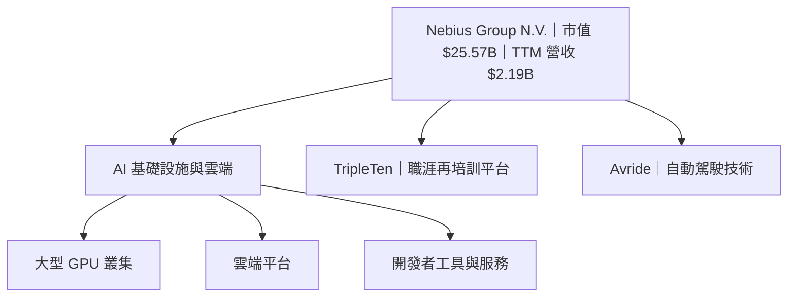
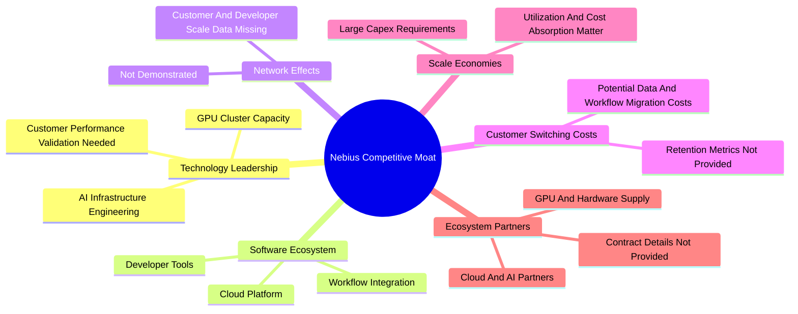
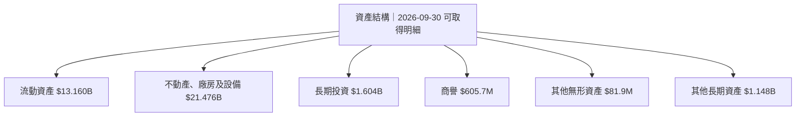
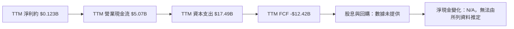
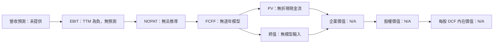
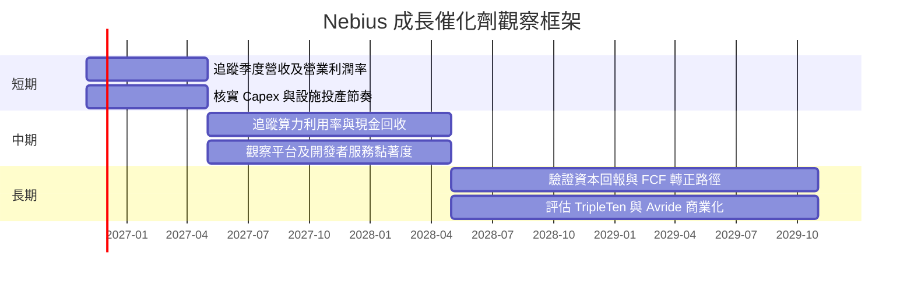
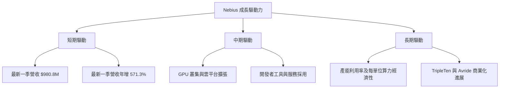
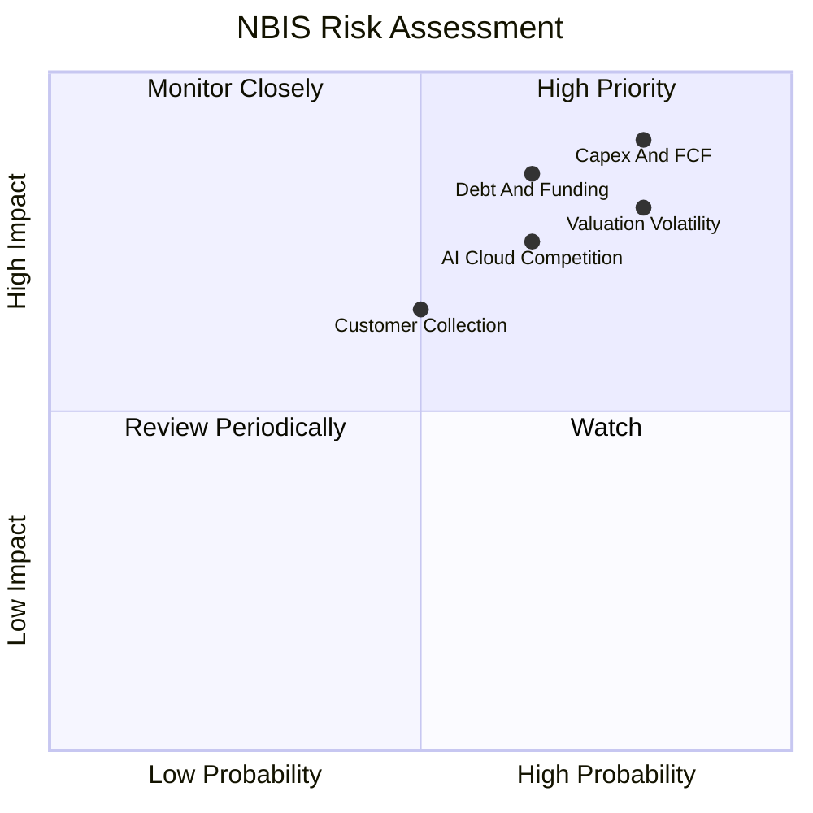
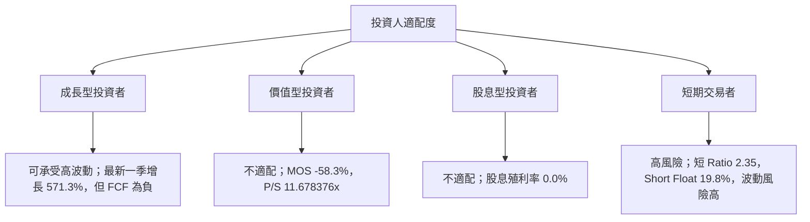

# NBIS 基本面深度分析報告
> **報告日期**：2026-11-25 ｜ **語言**：繁體中文 ｜ **數據來源**：Yahoo Finance、Finviz、StockAnalysis、Roic.ai ｜ **分析師**：CFA 級機構研究

## 目錄

| # | 章節 | 核心結論 |
|---|------|----------|
| 1 | 執行摘要 | 賣出；加權合理價值 $55.16，MOS -58.3% |
| 2 | 公司概覽與商業模式 | AI 基礎設施是主要成長引擎，但分部營收占比未提供 |
| 3 | 損益表深度分析 | TTM 營收 $2.19B；最新一季年增 571.3%，營業虧損仍在 |
| 4 | 資產負債表分析 | 淨負債 $8.67B；現金充足但應收款與融資需求值得關注 |
| 5 | 現金流量深度分析 | TTM FCF -$12.42B，主要受大額資本支出影響 |
| 6 | 獲利能力與資本效率 | WACC 7.29%；ROIC 未提供，無法判定是否創造經濟價值 |
| 7 | 相對估值分析 | 公司 P/S 11.68x，高於同業中位數 4.8x |
| 8 | DCF 內在價值評估 | N/A：TTM 營業利益為負，未建立 DCF |
| 9 | 成長催化劑 | GPU 算力需求及新設施投產是主要觀察項目；TAM 數據未提供 |
| 10 | 風險矩陣 | 資本支出、負債與 AI 雲競爭是主要風險 |
| 11 | 投資建議 | 賣出；以估值、現金消耗與營運里程碑作為追蹤主軸 |

---

## 1. 執行摘要

### 1.0 一頁式投資儀表板（Portfolio Manager 30 秒速讀）

| 項目 | 內容 |
|------|------|
| **投資論點（3 句）** | ① 最新一季營收年增 **571.3%**，顯示 AI 基礎設施需求快速轉化為收入，但單季成長不等於可持續的 TTM 成長。② TTM FCF 為 **-$12.42B**、FCF Yield **-48.57%**，顯示擴建需大量資金，現金流與資產回報仍未成熟。③ 以同業 P/S 及分析師共識加權後，合理價值為 **$55.16**，低於 2026-11-24 收盤價 **$87.31**。 |
| **綜合評分** | **4.2/10**（引用 1.1 評分卡） |
| **財務健康** | 🔴 淨負債 **$8.67B**、TTM FCF **-$12.42B**；流動比率 **5.306** 提供短期緩衝，但不足以消除融資與投資回收風險。 |
| **ROIC vs WACC** | ROIC：**N/A** ｜ WACC：**7.29%**；ROIC 缺漏，無法判定價值創造或摧毀。 |
| **FCF 趨勢** | 大額資本投入下為負；TTM FCF Yield **-48.57%**。 |
| **估值** | Forward P/E **-28.681334x** ｜ EV/EBITDA **55.938x** ｜ FCF Yield **-48.57%**。負的 Forward P/E 不具傳統盈利估值意義。 |
| **DCF 內在價值（基準）** | **N/A**；TTM 營業利益為負，DCF 模型未計算，無法計算 DCF 折溢價。 |
| **安全邊際（MOS）** | **-58.3%**＝($55.16 − $87.31) ÷ $55.16；🔴 為負，表示現價高於加權合理價值。 |
| **預期報酬（基準情境 12M）** | DCF 基準情境 **N/A**。分析師共識目標價 $231.60 隱含上行空間 **+165.3%**，但屬分析師均值，不是本報告的基準情境估值。 |
| **關鍵風險（前二）** | TTM 資本支出 **$17.49B**、FCF **-$12.42B**；總債務 **$16.10B**、淨負債 **$8.67B**。 |
| **評級 + 信心度** | 🔴 **賣出** ｜ 信心：中低；估值訊號清楚，但資料來源間有若干財務口徑差異。 |

### 1.1 綜合評分卡（全報告唯一）

| 維度 | 評分（1–10） | 主要依據（引用數字與其來源章節） |
|------|--------------|----------------------------------|
| 成長性 | 8.0 | 最新一季營收年增 **571.3%**；TTM 營收成長率 N/A，故不把單季成長外推為全年趨勢（第 3 章）。 |
| 獲利能力 | 3.0 | TTM 營業利益率 **-23.0%**、TTM FCF **-$12.42B**；ROIC 與 F-Score 均 N/A（第 3、5、6 章）。 |
| 財務健康 | 4.0 | 現金及短期投資 **$7.43B**、總債務 **$16.10B**、淨負債 **$8.67B**；流動比率 **5.306**（第 4 章）。 |
| 估值 | 1.0 | MOS **-58.3%**；NBIS P/S **11.678376x**，同業中位數 **4.8x**（第 7、8 章）。 |
| 護城河 | 5.0 | 產品包含 GPU 叢集、雲端平台及開發工具；但未提供客戶集中度、留存率、分部收入與市占率數據（第 2 章）。 |
| 管理層與資本配置 | 4.0 | FY2025 資本支出 **$4.07B**，SBC **$83.2M**；公司尚處擴建階段，現金流回報未驗證（第 3、5 章）。 |
| **綜合評分** | **4.2** | 六項算術平均：**(8.0 + 3.0 + 4.0 + 1.0 + 5.0 + 4.0) ÷ 6 = 4.1667 ≈ 4.2**。 |

### 1.2 五大投資論點 + 三大核心風險

| 類型 | 項目 | 具體依據 | 信心度 |
|------|------|----------|--------|
| 🟢 **投資論點①** | AI 基礎設施營收快速爬升 | 2026-09 季營收 **$980.8M**，最新一季年增 **571.3%**；代表算力需求與新產能已有收入轉化，但需追蹤續約與利用率。 | 🟢 高 |
| 🟢 **投資論點②** | 毛利率具一定擴張空間 | TTM 毛利率 **76.0%**，高於 CRWV **66.8%**、ORCL **64.0%**、MSFT **67.7%**；但高毛利尚未轉化為正營業利潤。 | 🟡 中 |
| 🟢 **投資論點③** | 現金部位提供短期緩衝 | 現金及短期投資 **$7.43B**，流動比率 **5.306**；能降低短期支付壓力，但淨負債仍為 **$8.67B**。 | 🟡 中 |
| 🟢 **投資論點④** | AI 雲平台與開發工具可增加黏著度 | 公司提供 GPU 叢集、雲平台、開發工具及服務；若平台工作流程形成黏著，可能提高續約與使用量。客戶留存數據未提供。 | 🟡 中低 |
| 🟢 **投資論點⑤** | 分析師仍給予高共識目標價 | 20 位分析師均值目標價 **$231.60**，相對現價隱含 **+165.3%**；目標區間 $84–$380，分歧顯著，不能視為已實現價值。 | 🟡 中低 |
| 🟡 **風險①** | 資本支出超過營運現金流承載能力 | TTM Capex **$17.49B**、營業現金流 **$5.07B**，按定義 TTM FCF 為 **-$12.42B**；若設施利用率與收入未跟上，資本回收期拉長。 | 🔴 高衝擊 |
| 🔴 **風險②** | 淨負債與融資成本、資產負債表擴張 | 總債務 **$16.10B**、現金 **$7.43B**；融資市場收緊或投資回報延遲，可能導致額外融資或股權稀釋。 | 🔴 高衝擊 |
| 🟡 **風險③** | 高成長估值對情緒與競爭敏感 | NBIS P/S **11.678376x**，高於同業 P/S 中位數 **4.8x**；AI 股票近期下跌新聞顯示估值可能快速收縮。 | 🔴 高 |

### 1.3 快速統計卡片

| 指標 | 公司實際值（期間） | 同業中位數 | 狀態 |
|------|--------------------|------------|------|
| 營收成長（TTM） | **N/A** | — | 🟡 |
| 營收成長（最新一季年增） | **571.3%** | **29.6%** | 🟢 |
| 毛利率（TTM） | **76.0%** | **66.8%** | 🟢 |
| 營業利益率（TTM） | **-23.0%** | — | 🔴 |
| ROIC（TTM） | **N/A** | — | 🟡 |
| Forward P/E | **-28.681334x** | **-23.9x**（同業有效數據僅 CRWV；ORCL、MSFT 為正值） | 🔴 |
| FCF Yield（TTM） | **-48.57%** | — | 🔴 |
| Piotroski F-Score | **N/A** | — | 🟡 |

### 1.4 投資結論

```text
╔══════════════════════════════════════════════════════════════════╗
║                    📊 投資結論摘要                               ║
╠══════════════════════════════════════════════════════════════════╣
║  評級：🔴 賣出（依規則 20；未作質化調整）                         ║
║  價格（2026-11-24 收盤）：$87.31                                 ║
║  DCF 內在價值（基準）：N/A（TTM 營業利益為負）                   ║
║  安全邊際 MOS：-58.3%（加權合理價值 $55.16 為分母）              ║
║  加權合理價值（8.8）：$55.16                                     ║
║  綜合評分：4.2/10（引用 1.1）                                    ║
║  適合投資人：可承受高波動、能承擔資本密集型成長風險的投資人；    ║
║              不適合以估值保護、穩定現金流或股息為主要目標者。   ║
╚══════════════════════════════════════════════════════════════════╝
```

規則 20 的結果是賣出：MOS **-58.3%**，低於 -25% 門檻；加權合理價值 **$55.16** 低於現價 **$87.31**。雖最新一季營收年增 **571.3%**，但 TTM FCF **-$12.42B**、TTM 營業利益率 **-23.0%**，且 DCF 不適用，因此不以分析師高目標價取代現金流與估值約束。

---

## 2. 公司概覽與商業模式

### 2.1 業務結構與收入來源

公司概述指出，Nebius Group N.V. 建置面向全球 AI 產業的全堆疊基礎設施，業務包含 GPU 叢集、雲端平台、開發者工具與服務；另有 TripleTen 教育平台及 Avride 自動駕駛開發業務。各業務收入與營收占比未提供，故不分配百分比或自行推估。



收入分部明細未提供；因此圖中不標示各業務收入金額及占比。公司披露的策略重心為 AI 基礎設施，其他業務對合併營收的貢獻程度仍需透過後續分部申報確認。

### 2.2 市場份額

市場份額數據未提供。NBIS TTM 營收為 **$2.19B**，最新一季營收年增 **571.3%**；同業 CRWV 最新一季年增 **168.2%**，ORCL **29.6%**，MSFT **18.8%**。這些比較只能反映增長速度與規模，不能替代可比口徑的市場份額。

### 2.3 競爭護城河分析



### 2.4 護城河強度

| 護城河項目 | 強度（強／中／弱） | 證據（引用數字或事實） | 會削弱它的情況 |
|------------|--------------------|------------------------|----------------|
| 技術與算力供給 | 中 | 公司建置大型 GPU 叢集，最新一季營收 **$980.8M**；未提供叢集容量、利用率或性能基準。 | GPU 供應受限、晶片世代更新或競品快速擴容。 |
| 軟體與開發者工具 | 中偏弱 | 公司提供雲端平台及開發者工具，但無活躍開發者、使用量或續約率數據。 | 客戶可在雲平台間低成本遷移，或軟體功能差異縮小。 |
| 網路效應 | 弱／未證實 | 未提供客戶數、平台互動或網路效應量化指標。 | 客戶規模未形成供需互補或資料累積優勢。 |
| 客戶鎖定 | 未證實 | 應收帳款及營收數據存在，但未提供客戶集中度、合約年期、留存率。 | 大客戶多雲策略、合約到期未續約。 |
| 規模效應 | 中 | TTM Capex **$17.49B**，說明資本門檻高；但 TTM FCF **-$12.42B**，規模尚未證明能帶來正現金流。 | 利用率不足、電力與設備成本超預算。 |
| 生態夥伴 | 中偏弱 | AI 基建需要 GPU、電力與資料中心合作，但可供核實的合約金額及合作條件未提供。 | 關鍵供應商議價力上升或供應中斷。 |

1.1「護城河」評分為 **5.0/10**，理由是公司有 GPU 基礎設施與軟體服務組合，但客戶黏著、網路效應及規模經濟的直接證據仍不足。

---

## 3. 損益表深度分析

### 3.1 年度收入成長趨勢（近 4 年）

年度營收採用年度損益表數值；柱形僅作相對視覺呈現，不代表市場份額。

```text
╔══════════════════════════════════════════════════════════════════╗
║             Nebius Group 年度收入趨勢（FY2022-FY2025）           ║
╠══════════════════════════════════════════════════════════════════╣
║  FY2022  $0.014B  █░░░░░░░░░░░░░░░░░░░░░░░  YoY：基期            ║
║  FY2023  $0.010B  ░░░░░░░░░░░░░░░░░░░░░░░  YoY：-27.4% 🔴       ║
║  FY2024  $0.092B  ████░░░░░░░░░░░░░░░░░░░  YoY：+833.7% 🟢      ║
║  FY2025  $0.530B  █████████████████████████  YoY：+479.0% 🟢    ║
╠══════════════════════════════════════════════════════════════════╣
║  註：公司業務及合併範圍變動可能使歷史年度營收不可直接視為同口徑。║
╚══════════════════════════════════════════════════════════════════╝
```

按年度列示數字計算，FY2022 至 FY2025 三年營收 CAGR 為：

**($529.8M ÷ $13.5M)^(1/3) − 1 ≈ 239.9%**。

這一高 CAGR 受到低基期與業務擴張影響，不能直接外推；TTM 營收成長率依可核實資料為 **N/A**，本報告不以其他資料源的不同口徑替代。

### 3.2 季度收入趨勢分析

| 季度 | 營收 | QoQ 成長 | YoY 成長 | 備註 |
|------|------|---------|---------|------|
| 2025-12-31 | $227.7M | **+55.8%** | **+546.88%** | QoQ 以前一季 2025-09 營收 $146.1M 計算。 |
| 2026-03-31 | $399.0M | **+75.2%** | **+683.89%** | 營收持續擴張，年增仍受低基期影響。 |
| 2026-06-30 | $582.3M | **+45.9%** | **+454.04%** | QoQ 增幅放緩但仍高，須觀察新增容量爬坡。 |
| 2026-09-30 | $980.8M | **+68.4%** | **+571.3%** | 最新一季 YoY 採 VERIFIED FIGURES 數值；不是 TTM 成長率。 |

QoQ 算式示例：**($980.8M ÷ $582.3M) − 1 = 68.4%**。季度營收加速反映新產能投入及 AI 算力需求，但收入快速增加也伴隨高資本投入，應同時追蹤毛利、使用率、應收款回收與每單位算力經濟性。

### 3.3 利潤率演變分析

| 利潤率指標 | FY2022 | FY2023 | FY2024 | FY2025 | 趨勢 | 評估 |
|------------|--------|--------|--------|--------|------|------|
| **毛利率** | -110.4% | -100.0% | 52.2% | 68.6% | FY2024–FY2025 明顯轉正並改善 | 🟡 歷史口徑可能受業務與合併範圍變動影響。 |
| **營業利益率** | -1,170.4% | -2,915.3% | -436.7% | -115.5% | 虧損率相對收窄，但仍深度負值 | 🔴 尚未達成營業損益平衡。 |
| **淨利率** | 5,522.2% | 2,462.2% | -700.9% | 15.6% | 年間波動極大，非經常性項目可能造成扭曲 | 🔴 不宜以單一年度淨利推估常態獲利。 |

以上年度比率依年度毛利、營業利益、淨利除以年度營收計算；由於歷史數據出現極高比例及年度淨利大幅波動，應優先採用較新的合併營運資訊。TTM 毛利率為 **76.0%**；TTM 營業利益率依指定數據為 **-23.0%**。最新一季營業利益率指定值 **-18.7%**，但季度損益表列示營業利益 **+$50.4M**、營收 **$980.8M**，兩種來源的方向不一致；因此不以直接相除結果取代指定比率，並將此列為資料核對事項。

利潤率變化可能受到產品組合、GPU 折舊、資料中心啟用進度與初期利用率影響；現有資料不足以量化各因素貢獻。毛利率高於同業樣本中位數並不代表公司已具備成熟獲利能力，因 TTM 營業利益仍為負。

### 3.4 費用結構分析

費用結構中缺少完整、同口徑的 TTM 營業費用明細，故不製作比例圓餅圖，以免將不完整項目誤呈為完整費用占比。可核實數據包括：FY2025 研發費用 **$177.3M**、FY2025 營業虧損 **-$611.7M**；FY2025 研發占營收約 **33.5%**（$177.3M ÷ $529.8M）。研發支出支持產品與平台開發，但須追蹤其能否帶來收入及毛利增量。

### 3.5 季度 EPS 趨勢與盈餘品質（Quality of Earnings）

EPS beats/misses 資料列示最近四季估值及實際 EPS 為 nan，因此無法判斷超預期或不及預期；以下依可取得的實際淨利與 EPS 資料說明，不把缺失的預期值補成估計值。

| 季度 | EPS 實際值（StockAnalysis） | 淨利 | 超預期／不及預期 |
|------|------------------------------|------|------------------|
| 2025-12-31 | -$1.11 | -$268.8M | N/A；EPS 預估值缺漏。 |
| 2026-03-31 | $2.11 | $621.2M | N/A；EPS 預估值缺漏，單季大額獲利需辨識非經常性來源。 |
| 2026-06-30 | -$0.78 | -$190.4M | N/A；EPS 預估值缺漏。 |
| 2026-09-30 | -$0.14 | -$37.5M | N/A；EPS 預估值缺漏。 |

| 盈餘品質項目 | 數值／佔比 | 評估 |
|--------------|-----------|------|
| 股權薪酬 SBC / 營收 | 最近四季 SBC 合計 **$221.4M ÷ $2.19B ≈ 10.1%** | 🔴 SBC 顯著；它作為非現金費用仍代表股東稀釋成本。 |
| SBC / 營業現金流 | **$221.4M ÷ $5.07B ≈ 4.4%** | 🟡 單看營業現金流占比不高，但 OCF 不等於可供股東分配現金。 |
| FCF / 淨利（現金轉換率） | TTM FCF **-$12.42B**；TTM 淨利約 **$122.9M**；比率約 **-10,106%** | 🔴 指標受到巨額 Capex 主導，代表資本投入遠超當期獲利，不代表日常營運現金一定同幅惡化。 |
| 一次性／非經常性損益 | FY2023 淨利 **$241.3M**，FY2024 **-$641.4M**，FY2025 **$82.5M**；明細未提供 | 🔴 年度淨利波動極大，無法據此判定常態盈餘。 |
| 有效稅率異常 | 最新年度有效稅率 **29.0%** | 🟡 稅項明細未提供，無法判斷單次稅務利益或費用影響。 |
| 資本化支出 vs 費用化 | TTM Capex **$17.49B**；折舊與資本化明細未提供 | 🔴 大額資本投入形成未來折舊負擔；現有資料不足以判斷費用遞延程度。 |

**盈餘品質結論**：TTM FCF 為負、SBC 約占 TTM 營收 10.1%，而季度淨利波動大。當期淨利不能單獨代表可分配盈餘；以收入倍數或現金流估值時，需重視未來資本支出需求及股數稀釋。

---

## 4. 資產負債表分析

### 4.1 資產結構分解

最新季列示流動資產 **$13.160B**、不動產廠房設備 **$21.476B**、長期投資 **$1.604B**、商譽 **$605.7M**、無形資產 **$81.9M**、遞延所得稅資產 **$39.5M**、其他長期資產 **$1.148B**。由於可取得的資產明細並非完整分類表，不將其強行加總成總資產或畫比例圖。



PP&E 規模反映公司擴建 AI 算力與相關設施的資本密集性；後續核心問題是新增資產能否帶來足夠收入、現金流和資產回報。

### 4.2 流動性與營運資金分析

| 指標 | 最新 TTM | 一年前 TTM | 變化 | 解讀 |
|------|----------|------------|------|------|
| DSO 應收帳款天數 | **673 天** | N/A | N/A | 🟡 應收天數偏長；大額新合約或開票時點可能造成波動，需核對客戶付款條件與實際收款。 |
| DIO 存貨天數 | **N/A** | N/A | N/A | 公司未報告可用存貨餘額，不補填。 |
| DPO 應付帳款天數 | **368 天** | N/A | N/A | 🟡 可能反映付款節奏、供應商融資或新擴張造成的營運資金變化；不能單憑天數推論議價力。 |
| CCC 現金轉換週期 | **N/A** | N/A | N/A | 缺少 DIO，按資料定義不得自行計算。 |

流動比率 **5.306**、速動比率 **4.847**，短期資產對流動負債的帳面覆蓋充足；然而 DSO 數值偏高，且 TTM 營業現金流與資本支出資料呈現巨幅變動，應以現金實際回收與合約收款進度驗證流動性品質。Piotroski F-Score 因缺少跨年度 SEC 申報數據而為 N/A。

### 4.3 債務結構分析

```text
╔══════════════════════════════════════════════════════════════════╗
║                    Nebius 債務健康診斷                           ║
╠══════════════════════════════════════════════════════════════════╣
║  總債務：         $16.10B  ████████████████████  🔴              ║
║  現金及短期投資：  $7.43B  █████████░░░░░░░░░░░  🟡              ║
║  淨負債：          $8.67B  ███████████░░░░░░░░░  🔴              ║
║                                                                  ║
║  Debt/EBITDA：N/A（未提供可核實的 TTM EBITDA 金額）              ║
║  利息保障倍數：N/A（利息支出明細未提供）                         ║
║  流動比率：5.306；速動比率：4.847                               ║
╠══════════════════════════════════════════════════════════════════╣
║  解讀：短期流動比率高，但公司處於高投資期；淨負債及負 FCF 使資金 ║
║        回收速度、融資條件與債務期限管理成為主要監控項目。       ║
╚══════════════════════════════════════════════════════════════════╝
```

總債務與淨負債均採指定 TTM 財務數據。年度資產負債表 FY2025 列示總債務 **$4.97B**，與最新 TTM 口徑 **$16.10B** 不同；兩者期間不同，不能互相替代。另 WACC 成本資本區塊所列稅前債務成本為 **0.38%**，但未提供可直接核驗的利息費用與平均計息負債明細，故不據此倒推利息金額。

### 4.4 股東權益趨勢

| 年度 | 股東權益 | 年變動 |
|------|----------|--------|
| 2022-12-31 | $4.25B | — |
| 2023-12-31 | $3.29B | -22.6% |
| 2024-12-31 | $3.25B | -1.2% |
| 2025-12-31 | $4.59B | +41.2% |

```text
╔══════════════════════════════════════════════════════════════════╗
║              股東權益趨勢（年度資產負債表）                     ║
╠══════════════════════════════════════════════════════════════════╣
║  2022  $4.25B  ███████████████████                               ║
║  2023  $3.29B  ███████████████                                   ║
║  2024  $3.25B  ███████████████                                   ║
║  2025  $4.59B  █████████████████████                             ║
╚══════════════════════════════════════════════════════════════════╝
```

FY2025 權益回升與資產負債表擴張同時發生，但現有資料未提供完整股權發行、重估與非控制權益拆分，不能將權益增長全部歸因於營運獲利。

---

## 5. 現金流量深度分析

### 5.1 現金流量瀑布圖



此圖表示現金流項目間的分析關係，不表示淨利至 OCF 的差額可以由現有數據逐項核對。按指定定義：**$5.07B − $17.49B = -$12.42B**。

### 5.2 FCF 轉換率趨勢

| 年度 | 營業現金流 | 資本支出 | FCF | 淨利 | FCF / 淨利 |
|------|------------|----------|-----|------|------------|
| 2022 | $697.0M | $14.6M | $682.4M | $745.6M | **91.5%** |
| 2023 | $829.8M | $82.9M | $746.9M | $241.3M | **309.5%** |
| 2024 | $245.6M | $807.5M | -$561.9M | -$641.4M | **87.6%** |
| 2025 | $384.8M | $4.07B | -$3.68B | $82.5M | **-4,460.6%** |

各年比率以當年所列 FCF 除以淨利計算；淨利接近零或為負時比率不穩定。FY2025 FCF 大幅轉負，主要與資本支出增加同時發生；若支出代表擴充可出租算力，未來回報取決於利用率及收入變現速度，而非支出本身。

### 5.3 自由現金流趨勢

```text
╔══════════════════════════════════════════════════════════════════╗
║                自由現金流：歷史年度與 TTM                       ║
╠══════════════════════════════════════════════════════════════════╣
║  FY2022  +$0.682B  ████░░░░░░░░░░░░░░░░  FCF Yield：N/A         ║
║  FY2023  +$0.747B  █████░░░░░░░░░░░░░░░  FCF Yield：N/A         ║
║  FY2024  -$0.562B  ◀███░░░░░░░░░░░░░░░░  FCF Yield：N/A         ║
║  FY2025  -$3.68B   ◀████████████████████  FCF Yield：N/A         ║
║  TTM     -$12.42B  ◀████████████████████  FCF Yield：-48.57%     ║
╠══════════════════════════════════════════════════════════════════╣
║  註：歷史 FY 與 TTM 期間及報表口徑不同；TTM FCF 只採指定數值。  ║
╚══════════════════════════════════════════════════════════════════╝
```

TTM FCF Yield 為 **-48.57%**，表示按當前市值計算，現金消耗相對市值重大。投資論點須依賴未來產能利用率、客戶承諾與單位成本改善，而不能只依營收成長速度判定現金流將自動轉正。

### 5.4 資本配置評估

| 資本配置項目 | 已知數據 | 解讀 |
|--------------|----------|------|
| 資本支出 | TTM **$17.49B**；FY2025 **$4.07B** | 擴建強度顯著上升；需以新增營收與現金回報檢驗投資效益。 |
| 股權薪酬 | FY2025 **$83.2M**；近四季合計 **$221.4M** | 對股東而言具有稀釋成本，需看股數增長是否與每股價值提升匹配。 |
| 股息 | 股息殖利率 **0.0%** | 無現金股息回報。 |
| 回購 | 數據未提供 | 不推定有回購。 |
| 淨現金變化 | 數據不足以核算 | 不以資產負債表期初期末差額代替現金流量表數據。 |

支出項目完整分類及金額未提供，故不製作比例圓餅圖。資本配置的核心評估是投入資本能否在適當時間產生高於資本成本的回報；當前 ROIC 缺漏且 FCF 為負，尚無法驗證。

---

## 6. 獲利能力與資本效率

### 6.1 ROE / ROA / ROIC 趨勢

| 指標 | TTM／可取得數值 | 歷史及評估 |
|------|-----------------|------------|
| ROE | **1.5%** | 最新提供值；歷史權益及淨利大幅波動，不能簡單外推。 |
| ROA | **-1.0%** | 最新提供值；反映資產擴張尚未轉化為穩定回報。 |
| ROIC | **N/A** | 缺少可核實投入資本及 TTM NOPAT 口徑，不以 ROE 或營業利益率替代。 |
| 行業均值對比 | 不列 | 未提供一致來源的行業均值。 |

### 6.2 ROIC vs WACC 分析（核心價值創造判斷）

```text
╔══════════════════════════════════════════════════════════════════╗
║                  ROIC vs WACC 深度分析                           ║
╠══════════════════════════════════════════════════════════════════╣
║  WACC 輸入（採用成本資本數據）：                                 ║
║  ├── 無風險利率（10Y 美債）：     4.90%                          ║
║  ├── ERP：                        5.00%                          ║
║  ├── 原始 Beta：                  1.54                           ║
║  ├── 調整後 Beta：                1.36                           ║
║  ├── 股權成本：                   11.70%                         ║
║  ├── 稅前債務成本：               0.38%                          ║
║  ├── 股權／債務權重：             61.4% / 38.6%                  ║
║  └── WACC：                       7.29%                          ║
║                                                                  ║
║  ROIC：N/A（數據未提供可核實的 TTM 投入資本回報率）               ║
║  EVA＝ROIC − WACC：N/A；無法判定公司在創造或摧毀股東價值。       ║
╚══════════════════════════════════════════════════════════════════╝
```

Beta 調整方式為 **⅔ × 原始 Beta 1.54 + ⅓ × 1 = 1.36**（指定調整後 Beta）。股權成本的核算關係為 **4.90% + 1.36 × 5.00% = 11.70%**（採用指定成本資本數值；各項百分比依來源精度）。本節直接採用指定 **WACC 7.29%**，不另建 WACC。因 ROIC 為 N/A，不能以「ROIC 高於／低於 WACC」作結論；對當前投資者而言，可觀察到的是營業利益率為負與高額資本投入，價值創造仍待證明。

### 6.3 杜邦三因素分解

| 因素 | 數值（TTM） | 解讀 |
|------|-------------|------|
| 淨利率 | N/A | Quality Figures：淨利率或相關輸入不完整。 |
| 資產週轉率 | N/A | 缺少可用且一致的平均資產數據。 |
| 權益乘數 | N/A | 缺少符合計算口徑的正權益及資產數據。 |
| **ROE** | **N/A** | Quality Figures 的 DuPont 結果為 N/A，原因為淨利、營收、總資產或正權益資料不足；不自行重算或補值。 |

### 6.4 財務體質：Piotroski F-Score

Piotroski F-Score：**N/A**。目前缺少相隔一年的兩期 SEC 申報資料，九項測試結果均無法判定，因此不逐項以替代數據估算。應在取得完整 10-K／10-Q 後再評估盈利、槓桿、流動性與營運效率變化。

---

## 7. 相對估值分析

### 7.1 同業估值比較表格

| 估值指標 | **NBIS** | **CRWV** | **ORCL** | **MSFT** | 本公司評估 |
|----------|----------|---------|---------|---------|-----------|
| **Trailing P/E** | N/A | N/A | 17.8x | 25.9x | 🔴 NBIS 尚未有可用正盈利倍數。 |
| **Forward P/E** | -28.681334x | -23.9x | 9.9x | 20.5x | 🔴 NBIS 與 CRWV 為負值，不具傳統盈餘倍數解讀。 |
| **P/S Ratio** | 11.678376x | 2.4x | 4.8x | 10.6x | 🔴 NBIS 高於三家公司中位數 **4.8x**。 |
| **EV/EBITDA** | 55.938x | 16.5x | 13.6x | 18.2x | 🔴 NBIS 倍數顯著較高；須留意 EBITDA 口徑與資本強度。 |
| **最新一季營收年增** | 571.3% | 168.2% | 29.6% | 18.8% | 🟢 增長速度突出，但不可忽略低基期及大額資本支出。 |
| **毛利率（TTM）** | 76.0% | 66.8% | 64.0% | 67.7% | 🟢 NBIS 高於比較樣本；仍未轉為正 TTM 營業利潤。 |

同業成長率中位數為 **29.6%**，毛利率中位數為 **66.8%**；兩項中位數均由 CRWV、ORCL、MSFT 的三筆數據取中位。負 Forward P/E 的中位數不適合作為正常估值基準，故估值方法依固定規則採同業 P/S 等已指定方法。

### 7.2 歷史估值區間分析

```text
╔══════════════════════════════════════════════════════════════════╗
║                    NBIS 歷史估值區間                             ║
╠══════════════════════════════════════════════════════════════════╣
║  N/A（未提供 Valuation vs own history 的估值區間及百分位）       ║
║  股價歷史有提供，但不能以股價波動替代 P/E、P/S 歷史估值區間。   ║
╚══════════════════════════════════════════════════════════════════╝
```

### 7.3 情境價值（Bear / Base / Bull，照抄 DCF MODEL 的 Scenarios）

**N/A（DCF 無法計算：TTM 營業利益為負；沒有 DCF Model Scenarios）。**因此不提供自建的悲觀、基準或樂觀 DCF 目標價。

### 7.4 相對估值隱含價格區間

```text
╔══════════════════════════════════════════════════════════════════╗
║                  相對估值隱含價格與現價                          ║
╠══════════════════════════════════════════════════════════════════╣
║  同業 P/S：$35.56     現價：$87.31      分析師共識：$231.60      ║
║  $35.56 ───────────── $87.31 ────────────────── $231.60         ║
║  同業 P/S 隱含值      2026-11-24 收盤    20 位分析師均值          ║
╚══════════════════════════════════════════════════════════════════╝
```

| 方法 | 每股價值 | 相對現價 | 計算依據 |
|------|----------|----------|----------|
| 同業 P/S | **$35.56** | **-59.3%** | 指定估值方法數值；依 Peer multiples 中位數 **4.8x** 與 TTM 營收模型輸出。 |
| 分析師共識目標價 | **$231.60** | **+165.3%** | 20 位分析師目標價均值。 |
| 同業 Forward P/E | N/A | N/A | 不可計算，權重依固定規則由可用方法分配；不自行推估。 |

同業 P/S 的計算結果及估值區塊直接列示的當前 P/S 倍數未必能用股數及市值資料完全互相重建；本報告照列指定方法估值，並提醒後續核對股份數、企業價值與口徑。

---

## 8. DCF 內在價值評估（Discounted Cash Flow）

> **DCF MODEL：N/A。**指定資料顯示 TTM 營業利益為負；因此不建立逐年 FCF、終值、橋接、敏感度、三情境或反推 DCF。缺少模型數值時，不能以自行假設的營收、利潤率或折現率製造每股內在價值。

### 8.0 估值推理鏈（Thinking Logic）

**Step 1 — 價值由哪些變數決定？**  
NBIS 的價值主要取決於 AI 雲端收入轉化、GPU／資料中心資本回收效率，以及營業利潤率何時轉正。現有 TTM 營收 **$2.19B**，但產品分部營收占比未提供，不能把整體收入拆成已知的成熟主業與新業務選擇權。最重要的估值驅動變數是資本密集型收入能否轉換為正 FCF。

**Step 2 — 採用何種模型？**

| 決策點 | 本報告採用 | 理由（含數字） | 曾考慮但否決 | 否決理由 |
|--------|-----------|----------------|--------------|----------|
| 現金流定義 | DCF 不建模 | TTM 營業利益率 **-23.0%**、FCF **-$12.42B** | 自建 FCFF | 需新增未提供的營收、利潤率及 Capex 假設，違反不得自建 DCF 要求。 |
| 預測期 N | N/A | 指定 DCF MODEL 未提供年數 | 任意設定 5–10 年 | 會創造無來源的假設。 |
| 終值方法 | N/A | DCF MODEL 未提供終值數據 | Gordon Growth／退出倍數 | 未有預測期 FCFF 及相關假設。 |
| EBIT 基礎 | N/A | 不建立 DCF | GAAP／非 GAAP 任選 | 不能虛構模型輸入。 |

**Step 3 — 關鍵假設推導鏈**  
營收 CAGR、期末營業利潤率、永續成長率、預測期、Capex 比率、D&A 比率、營運資金、SBC 處理、稀釋率與終值方法均未由 DCF 模型提供，故沒有可供推導的「採用值」；不以任意替代值補上。

**Step 4 — 最脆弱一環**  
最脆弱處是公司能否在保持高速收入成長的同時，降低資本支出相對營收的比重；若無法改善，TTM FCF **-$12.42B** 可能持續壓低股權價值。

**Step 5 — 計算路徑圖**



### 8.1 模型假設總表（Model Inputs）

| 假設項目 | 採用值 | 依據／來源 | 敏感度 |
|----------|--------|-------------|--------|
| 預測期長度 N | N/A | DCF MODEL 未提供；不得自行設定。 | N/A |
| 營收 CAGR | N/A | TTM 成長率 N/A；只有最新一季年增 **571.3%**，不能作長期預測。 | N/A |
| 營業利潤率（期末） | N/A | TTM 營業利益率 **-23.0%**；未有模型期末假設。 | N/A |
| 有效稅率 | N/A | 最新年度 **29.0%** 為資本成本資料，但 DCF 未提供稅務模型。 | N/A |
| Capex / 營收 | N/A | TTM Capex **$17.49B**；未提供 DCF 期間比率假設。 | N/A |
| D&A / 營收 | N/A | 未提供可用 DCF 假設。 | N/A |
| 營運資金變動／營收增額 | N/A | 未提供 DCF 假設，CCC 亦為 N/A。 | N/A |
| EBIT 基礎 | N/A | 未建立 DCF。 | N/A |
| SBC 處理 | N/A | 未建立 DCF，不能宣稱已在模型中處理。 | N/A |
| 年稀釋率 | N/A | 股數雖提供 **259.60M**，未提供 DCF 稀釋假設。 | N/A |
| 永續成長率 g | N/A | DCF MODEL 未提供。 | N/A |
| 終值方法 | N/A | DCF MODEL 未提供。 | N/A |
| WACC | **7.29%**（公司資本成本輸入） | 本報告及第 6.2 節採用指定成本資本；但因 DCF MODEL 為 N/A，不對未存在的 DCF 折現現金流使用。 | N/A |

**FCF 定義**：公司 TTM FCF 指營業現金流減資本支出，為 **-$12.42B**；這不代表本章已建立 FCFF 模型。  
**SBC 防呆聲明**：本章未建立 DCF，故不宣稱採用組合 (A)、(B) 或 (C)，也不對 SBC 作模型扣除或股數稀釋調整。

### 8.2 折現率推導（WACC）

```text
╔══════════════════════════════════════════════════════════════════╗
║                 WACC 輸入（照列指定成本資本數值）                 ║
╠══════════════════════════════════════════════════════════════════╣
║  無風險利率 Rf（10Y 美債）： 4.90%                              ║
║  市場風險溢酬 ERP：           5.00%                              ║
║  原始 Beta：                  1.54                               ║
║  調整後 Beta：                1.36                               ║
║  股權成本 Ke：                11.70%                             ║
║  稅前債務成本 Kd：            0.38%                              ║
║  股權／債務權重：             61.4% / 38.6%                      ║
║  WACC：                       7.29%                              ║
╚══════════════════════════════════════════════════════════════════╝
```

Beta 調整後數字以 **⅔ × 1.54 + ⅓ × 1 = 1.36** 為其來源；指定股權成本為 **11.70%**、WACC 為 **7.29%**。來源未提供無風險利率日期、ERP 方法細節、規模或國別溢酬明細，以及足以重建債務成本權重的全部底層資料，因此本報告照列提供值，不另行補算或改寫 WACC。第 6.2 節與本節採用同一 WACC 數值 **7.29%**。

### 8.3 逐年自由現金流預測（基準情境）

**N/A（DCF MODEL 未建立）。**無預測期年數、逐年營收、利潤率、Capex、D&A、營運資金變動或逐年 FCFF 數字；因此不提供 FY+1 至 FY+N 表格或推導算式，也不以 TTM FCF 直接代替未來預測。

合理性自檢：
- 預測 FCF CAGR：N/A；歷史 FCF CAGR 不適合以跨越正負值的資料直接計算。
- FY+N FCF 利潤率：N/A；沒有 FY+N 預測。
- 任一年 FCFF：N/A；模型未建立。
- ASCII 預測圖：N/A；無可引用的 DCF 預測數字。

### 8.4 終值計算（Terminal Value）

**N/A（DCF MODEL 未提供預測期 FCFF、永續成長率、退出倍數或折現因子）。**無法進行 WACC 與 g 適用性檢查，亦不計算終值、終值現值或終值占 EV 比重。

### 8.5 企業價值 → 每股內在價值（Bridge）

```text
╔══════════════════════════════════════════════════════════════════╗
║              企業價值 → 每股內在價值 橋接表                      ║
╠══════════════════════════════════════════════════════════════════╣
║  預測期 FCF 現值合計：N/A                                       ║
║  終值現值 PV(TV)：N/A                                           ║
║  企業價值 EV：N/A                                               ║
║  現金及短期投資：$7.43B（最新 TTM 資料）                        ║
║  總債務：$16.10B（最新 TTM 資料）                               ║
║  股權價值：N/A                                                  ║
║  稀釋後流通股數：DCF 模型未提供；市場數據普通股數 259.60M       ║
║  每股 DCF 內在價值：N/A                                         ║
║  當前股價：$87.31（2026-11-24 收盤）                            ║
║  DCF 折溢價：N/A                                                ║
╚══════════════════════════════════════════════════════════════════╝
```

由於企業價值無法計算，橋接中的 EV、股權價值與每股內在價值均不成立。**本節不計算 MOS**；全報告 MOS 只採 8.8 加權合理價值為分母。

### 8.6 敏感性分析（WACC × 永續成長率）

**N/A（沒有 DCF 基準模型及其 FCFF、g、WACC 情境輸出，不能建立 5×5 矩陣或自行填值）。**

- 非基準格逐步重算：N/A。
- 基準情境、悲觀情境、樂觀情境：N/A。
- 機率加權 DCF：N/A。
- g 每 +1pp、WACC 每 +1pp、期末營業利潤率每 +1pp 的估值彈性：N/A。
- 敏感度最大變數無法以未建立的 DCF 模型比較。

### 8.7 反推 DCF（Reverse DCF：市場在預期什麼）

**N/A（沒有 DCF MODEL，不能以當前價格反推出營收 CAGR、期末利潤率、g 或預測期）。**本報告不聲稱市場隱含某一未提供的營運假設，也不製作試算收斂表。

### 8.8 估值三角驗證與安全邊際

| 估值方法 | 隱含每股價值 | 上行空間（÷現價） | 權重 | 說明 |
|----------|--------------|-------------------|------|------|
| 同業 P/S | **$35.56** | **-59.3%** | **90%** | 指定方法輸出，依同業 P/S 中位數 4.8x 與公司 TTM 營收估值。 |
| 分析師共識目標價 | **$231.60** | **+165.3%** | **10%** | 20 位分析師目標價均值，非現金流模型估值。 |
| **加權合理價值** | **$55.16** | **-36.8%** | **100%** | 依固定的未盈利公司估值權重；Forward P/E 不可計算，未列方法。 |

**逐步演算（權重外顯）**：  
**$35.56 × 90% + $231.60 × 10% = $32.004 + $23.160 = $55.164 ≈ $55.16**。  
公司類型為未盈利公司，權重採指定估值規則；同業 Forward P/E 因不可計算而不納入方法列。

```text
╔══════════════════════════════════════════════════════════════════╗
║                  估值區間與安全邊際                              ║
╠══════════════════════════════════════════════════════════════════╣
║  同業 P/S $35.56 ── 加權合理值 $55.16 ── 現價 $87.31 ──         ║
║  分析師均值 $231.60                                               ║
║                                                                  ║
║  安全邊際 MOS = ($55.16 − $87.31) ÷ $55.16 = -58.3%             ║
║  上行空間 = ($55.16 − $87.31) ÷ $87.31 = -36.8%                 ║
║  MOS 評估：🔴 負安全邊際；現價高於加權合理價值                   ║
║  DCF 基準價值：N/A；DCF 折溢價無法計算                           ║
║                                                                  ║
║  參考價值折讓區（MOS ≥ 10%）：不高於 $49.64                      ║
║  算式：$55.16 × (1 − 10%) = $49.644 ≈ $49.64                    ║
╚══════════════════════════════════════════════════════════════════╝
```

評級依 MOS 門檻為 **賣出**。上述 $49.64 是以加權合理價值折讓 10% 推導的參考觀察價位，不代表 DCF 買入目標或保證安全價。

> 🔎 **程式複算（Python，依本節各項自動重算）**
>
> 加權合理價值 = $35.56 × 90% + $231.60 × 10% = **$55.16**（權重合計 100%）
>
> 以價格 $87.31 計：MOS = **-58.3%**，上行空間 = **-36.8%**
>
> ✅ 與本節所寫數值一致。

### 8.9 DCF 模型的局限與失效條件

- **終值依賴度**：N/A，沒有 DCF EV 與終值現值。
- **最脆弱的假設**：DCF 模型不存在，無法量化估值跌至何值。基本面最脆弱處是 Capex **$17.49B** 能否轉化為持續可收取的算力收入。
- **不適用情境說明**：TTM 營業利益率 **-23.0%**、TTM FCF **-$12.42B**，以成熟期穩定 FCF 為前提的 DCF 可靠度低。現階段宜以收入倍數、資本回報、設施利用率與合約現金回收並行追蹤。
- **與第 10 章風險連結**：需求放緩會影響營收成長與利用率；建設延誤或設備成本上升會加重 Capex 與負 FCF；融資收緊會提高資本成本並壓低相對估值。

### 8.10 複算檢核表（Audit Trail）

| # | 檢核項目 | 檢查方式 | 結果 |
|---|----------|----------|------|
| 1 | 高／中敏感度輸入四段式推導 | DCF 假設均未建立，未填入假設 | N/A |
| 2 | 每個假設均有來歷 | 未提供模型輸入，不新增假設 | ✅ |
| 3 | WACC 五步算式可重算 | 指定 WACC 7.29% 及組成照列，底層項目不足以獨立完整重建 | N/A |
| 4 | Kd 分母與債務權重口徑一致 | 缺少完整計息負債與利息資料 | N/A |
| 5 | WACC 與第 6.2 節相同 | 兩處均為 7.29% | ✅ |
| 6 | 逐年預測年度數等於 N | DCF 未建立 | N/A |
| 7 | FY+1 九步算式可複算 | 無 FY+1 假設 | N/A |
| 8 | 預測期現值合計正確 | 無預測期現值 | N/A |
| 9 | WACC > g | g 未提供 | N/A |
| 10 | 終值以 FY+N 現金流折現 | 無終值模型 | N/A |
| 11 | EV 到每股價值橋接可複算 | EV 與股權價值無法計算 | N/A |
| 12 | SBC 組合與股數假設一致 | 未建立 DCF，不作模型 SBC 調整 | N/A |
| 13 | 敏感性矩陣基準格等於 DCF 值 | 無矩陣及 DCF 基準值 | N/A |
| 14 | 矩陣無 WACC ≤ g 無效格 | 未建立矩陣 | N/A |
| 15 | 三情境機率合計 100% | 沒有 DCF 三情境 | N/A |
| 16 | 反推 DCF 每列只放開一個變數 | 未建立反推模型 | N/A |
| 17 | MOS 與 1.0 一致；折溢價以 DCF 值為基準 | MOS 均為 -58.3%；DCF 折溢價均標示 N/A | ✅ |
| 18 | 報告完整至第 11 章 | 各章節完整列示 | ✅ |
| 19 | 加權合理價值等於方法加權總和 | $35.56×90% + $231.60×10% = $55.164 ≈ $55.16 | ✅ |
| 20 | 評級符合 MOS 門檻 | MOS -58.3%，低於 -25%；評級賣出 | ✅ |

DCF 相關檢核為 N/A，原因是指定 DCF MODEL 未提供且明確標為 N/A；本報告沒有用自建假設取代缺失模型。

---

## 9. 成長催化劑

### 9.1 催化劑時間軸

具體財報發布日期或公司指引時間點未提供；下圖按觀察週期呈現，不代表公司已公布的時間承諾。



### 9.2 TAM 市場規模分析

**N/A（TAM 數據未提供）**。公司 TTM 營收 **$2.19B**、最新一季年增 **571.3%**，顯示現有業務處於快速擴張期，但不能從營收增速推導市場規模或滲透率。後續需以公司揭露的可服務市場、客戶訂單與產能利用率資料驗證成長空間。

### 9.3 成長驅動力結構圖



最關鍵的量化驗證不是單純營收增長，而是收入增長能否同步改善營業利益率、Capex 回收與 FCF。最新一季營業利益率指定值 **-18.7%**，仍需持續改善才能將高速成長轉化為股東現金回報。

---

## 10. 風險矩陣

### 10.1 風險評分矩陣

以下機率與衝擊座標為分析師定性判斷，不是財務數據或公司指引。



### 10.2 風險清單詳細分析

| # | 風險項目 | 發生機率 | 財務衝擊 | 風險評分 | 緩解措施 |
|---|----------|----------|----------|----------|----------|
| 1 | 🔴 **Capex 回收與 FCF 壓力** | 高（分析師判斷 70%） | 高；TTM FCF 已為 **-$12.42B**，若營收與利用率不及預期，資金需求擴大 | 🔴 9/10 | 追蹤每季 Capex、新增收入、設施利用率及營業現金流；要求新增投資具明確客戶需求與回收期。 |
| 2 | 🔴 **負債與再融資風險** | 中高（60%） | 高；總債務 **$16.10B**、淨負債 **$8.67B** | 🔴 8/10 | 監測到期結構、利息支出、融資條件及現金消耗；避免以短期融資支撐長週期資產。 |
| 3 | 🔴 **AI 雲競爭及價格壓力** | 中高（60%） | 高；若降價爭取利用率，可能侵蝕毛利率，目前 TTM 毛利率 **76.0%** 但營業利益率為負 | 🔴 8/10 | 跟蹤毛利率、客戶續約、算力定價及資本利用率，區分收入增長與折價搶單。 |
| 4 | 🟡 **應收帳款回收變慢** | 中（50%） | 中高；DSO **673 天** | 🟠 7/10 | 查核應收帳齡、客戶集中度、付款條款與現金收款；以營業現金流驗證收入品質。 |
| 5 | 🟡 **估值與市場情緒波動** | 高（70%） | 高；公司 P/S **11.678376x**，高於同業中位數 **4.8x** | 🔴 8/10 | 以估值區間及 MOS 作風險預算，避免只以分析師目標價作交易依據。 |

機率為分析師判斷，不代表由歷史統計模型估算。近期香港 AI 股票下跌與新雲端基建商估值波動等新聞，提示市場情緒可能放大股價波動，但不構成 NBIS 本身財務數字。

---

## 11. 投資建議

### 11.1 最終評級與評分

規則 20 以 MOS **-58.3%** 對應 **賣出**，本報告未作一級質化調整。公司品質綜合評分為 **4.2/10**，其六項分數為成長性 **8.0**、獲利能力 **3.0**、財務健康 **4.0**、估值 **1.0**、護城河 **5.0**、管理層與資本配置 **4.0**；此評分描述公司狀況，不取代 MOS 評級。

### 11.2 合理價值與隱含報酬率

| 估值項目 | 每股價值 | 相對現價 $87.31 | 機率／權重 | 說明 |
|----------|----------|-----------------|------------|------|
| 加權合理價值 | **$55.16** | **-36.8%** | 100% 權重組合 | 8.8 同業 P/S 90%、分析師共識 10%。 |
| DCF 悲觀情境 | N/A | N/A | N/A | DCF MODEL 未提供。 |
| DCF 基準情境 | N/A | N/A | N/A | DCF MODEL 未提供。 |
| DCF 樂觀情境 | N/A | N/A | N/A | DCF MODEL 未提供。 |

上行空間依定義為 **($55.16 − $87.31) ÷ $87.31 = -36.8%**；MOS 則為 **($55.16 − $87.31) ÷ $55.16 = -58.3%**，兩者分母不同。

### 11.3 買入時機與觸發因素

```text
╔══════════════════════════════════════════════════════════════════╗
║                  ✅ 買入觸發因素 Checklist                       ║
╠══════════════════════════════════════════════════════════════════╣
║  目前狀態：MOS -58.3%，估值尚未提供足夠下檔保護。               ║
║                                                                  ║
║  重新評估買入的觸發條件（多數符合）：                            ║
║  ☐ 股價回到加權合理價值折讓至少 10% 的區間（約 $49.64 以下）     ║
║  ☐ 最新一季營收成長延續，且季度營業利益率連續改善               ║
║  ☐ Capex 增長速度低於營收增長速度，FCF 消耗趨勢改善             ║
║  ☐ 應收帳款天數顯著下降，營業現金流能驗證收入回收               ║
║                                                                  ║
║  加碼觸發條件（出現以下任一並有基本面佐證）：                    ║
║  ☐ TTM FCF 轉正或連續改善，且不是單季營運資金暫時釋放           ║
║  ☐ 淨負債下降，同時新增產能利用率及合約現金回收可核實           ║
║                                                                  ║
║  減碼／重新檢視條件：                                            ║
║  ☐ 營收減速同時毛利率收縮，顯示需求或定價能力轉弱               ║
║  ☐ 淨負債進一步上升，或需以大幅股權稀釋支應資本支出             ║
║  ☐ 應收帳款持續增長而現金回收未改善                             ║
╚══════════════════════════════════════════════════════════════════╝
```

### 11.4 投資人適配度分析



### 11.5 每季財報監控清單（Quarterly Watch List）

| 監控指標 | 目前基準 | 加碼觸發方向 | 減碼／論點轉弱方向 |
|----------|----------|--------------|---------------------|
| 核心營收成長 | 最新一季 YoY **571.3%**；TTM 成長 N/A | 成長持續且後續基期提高後仍能維持高增長 | 連續兩季年增低於 **100%**，且沒有產能或合約轉換解釋；此為分析師預警門檻，不是公司指引。 |
| 營業利益率 | TTM **-23.0%**；最新季指定值 **-18.7%** | 連續改善並逐步接近損益平衡 | 連續兩季較前季惡化，或虧損率擴大超過 **5 個百分點**。 |
| 資本支出 | TTM **$17.49B** | Capex 成長低於收入成長，新增收入與利用率可驗證 | Capex 持續上升但收入與現金回收未同步增加。 |
| 自由現金流 | TTM **-$12.42B**；Yield **-48.57%** | FCF 消耗連續收斂，並能用營業現金流和 Capex 拆解 | FCF 惡化且淨負債持續上升。 |
| 應收款與回收 | DSO **673 天** | DSO 連續下降、收款與收入同步 | DSO 再上升且營收增長未帶動現金回款。 |
| 毛利率 | TTM **76.0%** | 保持高毛利並轉化為較佳營業利益率 | 毛利率連續下降，尤其與促銷或競價搶單同時發生。 |
| 負債與現金 | 淨負債 **$8.67B**；現金 **$7.43B** | 淨負債下降且不依靠大幅增發 | 債務快速增加、現金下降或股權融資造成明顯稀釋。 |
| 財測與產能 | 公司財測細節未提供 | 新增產能、客戶訂單與收入轉換有可核查進度 | 專案延遲、利用率偏低或公司下修指引。 |

### 11.6 反面論證：什麼會證明論點錯誤（What Would Change My Mind）

```text
╔══════════════════════════════════════════════════════════════════╗
║              ⚠️ 論點失效條件（Disconfirming Evidence）           ║
╠══════════════════════════════════════════════════════════════════╣
║  下列情況發生時，應重新評估持有或退出：                         ║
║  ☐ 核心營收連續兩季年增低於 100%，且無合約時點或基期因素說明    ║
║  ☐ 營業利益率連續兩季惡化，或較改善高點收縮超過 5 個百分點     ║
║  ☐ TTM FCF 持續低於 -$12.42B，且營收或現金回收未改善           ║
║  ☐ DSO 在 673 天基礎上進一步上升，應收款增加快於營收            ║
║  ☐ 淨負債高於 $8.67B 且融資依賴上升，或股數大幅增加             ║
║  ☐ 產能利用率／客戶承諾無法支撐新增 Capex 的回收                 ║
║  ☐ ROIC 資料公布後持續低於 WACC 7.29%，顯示投入資本未創造價值   ║
╚══════════════════════════════════════════════════════════════════╝
```

> **免責聲明**：本報告為 AI 自動生成，僅供研究參考，不構成投資建議。投資有風險，入市需謹慎。

---

## 資料與來源

| 項目 | 內容 |
|------|------|
| 價格 | 87.31 USD，2026-11-24 收盤（Yahoo Finance 日線） |
| 財務報表 | Yahoo quarterly statements (no SEC filing data)，最新季度 2026-09-30（TTM = four quarters to this date） |
| 有回應的資料來源 | Yahoo Finance、Finviz、StockAnalysis、Roic.ai |
| 未回應的資料來源 | SEC 申報資料 (XBRL) |
| 由程式計算 | TTM 數字、WACC、DCF 模型、估值方法與權重、加權合理價值、MOS、評級門檻、F-Score、杜邦分解、營運資金天數、綜合評分 |
| 撰寫模型 | openai / gpt-6-luna |

> 本區塊由產生報告的程式依實際取得的資料填寫，非模型撰寫。「由程式計算」的數字不是模型的估計；其餘判斷（評分、情境、策略）是模型的分析。
