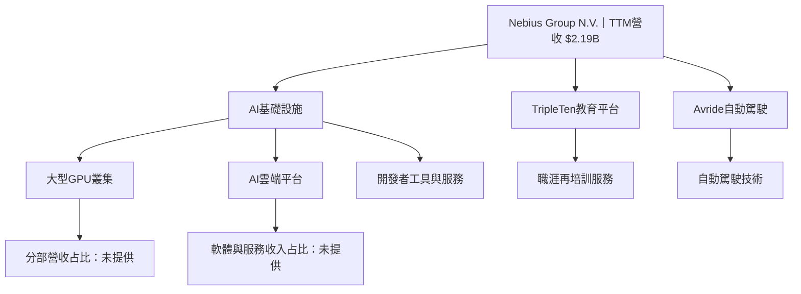
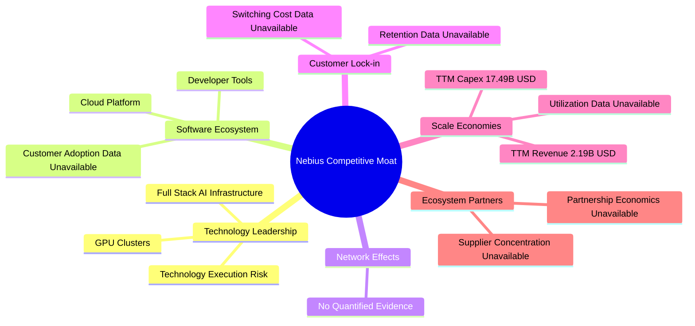
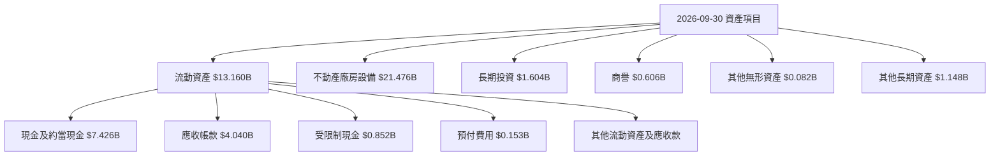
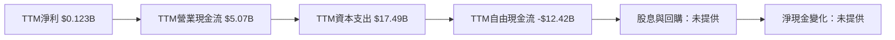
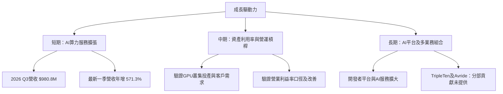
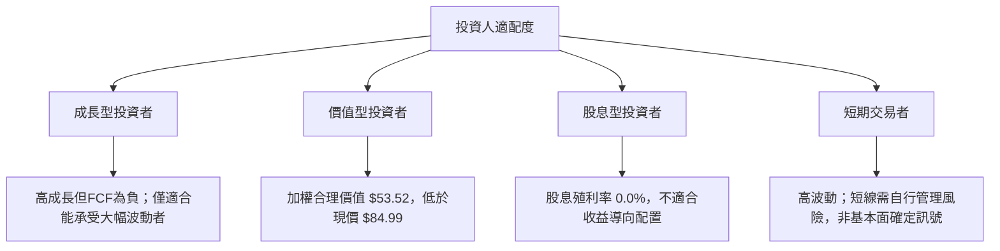

# NBIS 基本面深度分析報告
> **報告日期**：2026-11-26 ｜ **語言**：繁體中文 ｜ **數據來源**：Yahoo Finance、Finviz、StockAnalysis、Roic.ai ｜ **分析師**：CFA 級機構研究

## 目錄

| # | 章節 | 核心結論 |
|---|------|----------|
| 1 | 執行摘要 | 評級：賣出；加權合理價值 $53.52；MOS -58.8% |
| 2 | 公司概覽與商業模式 | AI 基礎設施是核心增長方向，但分部營收及市場份額資料不足以證明護城河已形成 |
| 3 | 損益表深度分析 | TTM 營收 $2.19B；最新一季年增 571.3%；營業利益率仍為負 |
| 4 | 資產負債表分析 | 淨負債 $8.67B；流動比率 5.306，但應收帳款與資本需求值得關注 |
| 5 | 現金流量深度分析 | TTM FCF -$12.42B，FCF Yield -49.90%，擴張伴隨高額現金消耗 |
| 6 | 獲利能力與資本效率 | ROIC 為 N/A，無法確認超過 7.18% WACC；營業獲利仍不穩定 |
| 7 | 相對估值分析 | NBIS P/S 11.37x，高於三家同業 P/S 中位數 4.5x |
| 8 | DCF 內在價值評估 | DCF 為 N/A：TTM 營業利益為負，不能以虧損現金流建立有效 DCF |
| 9 | 成長催化劑 | AI 雲端需求、GPU 叢集擴建可能推升營收，但交付與變現速度是關鍵 |
| 10 | 風險矩陣 | 前三大風險為資本支出／融資、建置延遲與估值壓縮 |
| 11 | 投資建議 | 依 MOS 規則為賣出；重新評估需觀察現金流、利潤率與負債變化 |

---

## 1. 執行摘要

NBIS 的最新一季營收年增 **571.3%**，TTM 營收為 **$2.19B**，反映 AI 基礎設施需求快速放量；但同一 TTM 期間營業利益率為 **-23.0%**，自由現金流為 **-$12.42B**，淨負債為 **$8.67B**。以同業 P/S 方法及分析師共識加權後，合理價值為 **$53.52**；相對 **2026-11-25 收盤價 $84.99**，安全邊際 MOS 為 **-58.8%**，依評級門檻為**賣出**。此結論主要反映現價高於加權合理價值、現金消耗幅度大，且 ROIC 無法確認高於 7.18% WACC；DCF 因 TTM 營業利益為負而不適用。

### 1.0 一頁式投資儀表板（Portfolio Manager 30 秒速讀）

| 項目 | 內容 |
|------|------|
| **投資論點（3 句）** | ① 最新一季營收年增 **571.3%**，顯示 AI 基礎設施需求快速成長。② TTM 營業利益率 **-23.0%**、TTM FCF **-$12.42B**，營收成長尚未轉化為穩定現金流。③ 加權合理價值 **$53.52**，低於現價 **$84.99**，MOS **-58.8%**。 |
| **綜合評分** | **4.2/10**（引用 1.1 評分卡） |
| **財務健康** | 🔴 淨負債 **$8.67B**、TTM FCF **-$12.42B**；流動比率 **5.306** 提供短期緩衝，但不能抵銷巨額投資需求。 |
| **ROIC vs WACC** | ROIC **N/A** vs WACC **7.18%**；資料不足以判斷是否創造價值。 |
| **FCF 趨勢** | 惡化：FY2025 FCF **-$3.68B**，TTM FCF **-$12.42B**；TTM FCF Yield **-49.90%**。 |
| **估值** | Forward P/E **-27.919x** ｜ EV/EBITDA **54.828x** ｜ FCF Yield **-49.90%** |
| **DCF 內在價值（基準）** | **N/A**；TTM 營業利益為負，不適用 DCF。 |
| **安全邊際（MOS）** | **-58.8%＝($53.52 − $84.99) ÷ $53.52**；🟡/🔴 MOS 為負且現價高於合理價值。 |
| **預期報酬（基準情境）** | DCF 基準情境 N/A；以加權合理價值衡量的隱含上行空間為 **-37.0%**，不等同正式 12 個月報酬預測。 |
| **關鍵風險（前二）** | 高資本支出導致現金消耗與融資需求；AI 算力建置及客戶變現時程延遲。 |
| **評級 + 信心度** | 🔴 **賣出** ｜ 信心：中；收入成長證據明確，但財務資料來源出現若干矛盾且 DCF 不適用。 |

### 1.1 綜合評分卡（全報告唯一）

| 維度 | 評分（1–10） | 主要依據（引用數字與其來源章節） |
|------|--------------|----------------------------------|
| 成長性 | 8.5 | TTM 營收成長率為 N/A；最新一季營收年增 **571.3%**（第 3 章），成長速度高但基期與持續性需觀察。 |
| 獲利能力 | 2.5 | TTM 營業利益率 **-23.0%**、FCF **-$12.42B**；ROIC 與 Piotroski F-Score 均 N/A（第 3、5、6 章）。 |
| 財務健康 | 4.0 | 現金及短期投資 **$7.43B**、總債務 **$16.10B**、淨負債 **$8.67B**；流動比率 **5.306**，但 TTM DSO **673 天**（第 4 章）。 |
| 估值 | 1.0 | 加權合理價值 **$53.52**、MOS **-58.8%**；公司 P/S **11.368x**，同業 P/S 中位數 **4.5x**（第 7、8 章）。 |
| 護城河 | 5.0 | 全棧 AI 基礎設施、GPU 叢集及開發者工具構成潛在差異化；但無市場份額、客戶留存及分部營收證據（第 2 章）。 |
| 管理層與資本配置 | 4.0 | FY2025 Capex **$4.07B**、TTM Capex **$17.49B**，投資規模快速擴張；未提供可核驗的回購與資本回報紀錄（第 5 章）。 |
| **綜合評分** | **4.2** | 六項算術平均：**(8.5 + 2.5 + 4.0 + 1.0 + 5.0 + 4.0) ÷ 6 = 4.17 ≈ 4.2**。 |

### 1.2 五大投資論點 + 三大核心風險

| 類型 | 項目 | 具體依據 | 信心度 |
|------|------|----------|--------|
| 🟢 **投資論點①** | AI 雲端營收快速擴張 | 最新一季營收 **$980.8M**，年增 **571.3%**；若 GPU 容量持續上線且利用率提高，規模可為固定成本吸收提供槓桿。 | 🟢 高 |
| 🟢 **投資論點②** | 毛利率已具一定規模 | TTM 毛利率 **76.0%**，高於 CRWV **66.8%**、ORCL **64.0%**、MSFT **67.7%**；仍需留意資料來源與業務組合差異。 | 🟡 中 |
| 🟢 **投資論點③** | 現金儲備不低 | 現金及短期投資 **$7.43B**，流動比率 **5.306**，可提供近期資金緩衝。 | 🟡 中 |
| 🟢 **投資論點④** | 最近一季呈現營業利益改善訊號 | 季度損益表列示 2026-09-30 營業利益 **$50.4M**；但這與同來源另列的最新季度營業利益率 **-18.7%** 不一致，應待財報核實。 | 🟡 低 |
| 🟢 **投資論點⑤** | 分析師共識明顯看多 | 20 位分析師平均目標價 **$231.60**，但共識與程式估值加權後的公平價值差異很大，不能視作基本面保證。 | 🟡 低 |
| 🟡 **風險①** | 高額資本支出與負 FCF | TTM Capex **$17.49B**、TTM FCF **-$12.42B**；若擴建資產不能及時轉化為收入及現金流，將提高融資與稀釋風險。 | 🔴 高衝擊 |
| 🔴 **風險②** | 淨負債及槓桿上升 | 總債務 **$16.10B**，高於現金及短期投資 **$7.43B**，淨負債 **$8.67B**；資本市場收緊時可能提高融資成本。 | 🔴 高衝擊 |
| 🔴 **風險③** | 估值高於相對估值基準 | NBIS P/S **11.368x**，相較同業中位數 **4.5x** 約高 **2.5 倍**；若增長預期下修，倍數可能收縮。 | 🔴 高衝擊 |

### 1.3 快速統計卡片

| 指標 | 公司實際值（期間） | 同業中位數 | 狀態 |
|------|--------------------|------------|------|
| 營收成長（TTM） | **N/A** | — | 🟡 未提供可引用的 TTM 對前一 TTM 成長率 |
| 營收成長（最新一季年增） | **571.3%** | **29.6%** | 🟢 |
| 毛利率（TTM） | **76.0%** | **66.8%** | 🟢 |
| 營業利益率（TTM） | **-23.0%** | — | 🔴 |
| ROIC（TTM） | **N/A** | — | 🟡 |
| Forward P/E | **-27.919x** | N/A（同業含負值，跨公司中位數不具可比性） | 🔴 |
| FCF Yield（TTM） | **-49.90%** | — | 🔴 |
| Piotroski F-Score | **N/A / 9** | — | 🟡 |

> 同業中位數以 CRWV、ORCL、MSFT 的已提供數字計算；營收增長中位數為 29.6%，毛利率中位數為 66.8%。

### 1.4 投資結論

```
╔══════════════════════════════════════════════════════════════════╗
║                    📊 投資結論摘要                               ║
╠══════════════════════════════════════════════════════════════════╣
║  評級：🔴 賣出（依 8.8 MOS -58.8%，未作質化調整）                ║
║  價格（2026-11-25 收盤）：$84.99                                 ║
║  DCF 內在價值（基準）：N/A（TTM 營業利益為負）                   ║
║  安全邊際 MOS：-58.8%（以加權合理價值 $53.52 為分母）           ║
║  加權合理價值（8.8）：$53.52                                     ║
║  DCF 情境價值：N/A（DCF 無法計算，不提供情境目標價）            ║
║  綜合評分：4.2/10（引用 1.1）                                    ║
║  適合投資人：能承受高波動及高資本支出風險、並以營運里程碑追蹤者  ║
╚══════════════════════════════════════════════════════════════════╝
```

---

## 2. 公司概覽與商業模式

### 2.1 業務結構與收入來源

公司資料描述 Nebius Group N.V. 提供面向 AI 產業的全棧基礎設施，包括大型 GPU 叢集、雲端平台及開發者工具，業務範圍涵蓋美國、英國及其他市場；另有 TripleTen 教育平台及 Avride 自動駕駛業務。公司 TTM 營收為 **$2.19B**，但未提供各業務分部營收或占比，因此不能將公司總營收拆分至個別業務。



### 2.2 市場份額

市場份額數據未提供，亦無可引用的公司收入分部拆分或市場總規模資料。Nebius TTM 營收為 **$2.19B**、最新一季年增 **571.3%**，顯示收入規模快速擴張；但單靠成長率不能推定其在 AI 雲端市場的份額，也不能據此判斷相對 CRWV、ORCL 或 MSFT 的市場地位。

### 2.3 競爭護城河分析



### 2.4 護城河強度

| 護城河項目 | 強度（強／中／弱） | 證據（引用數字或事實） | 會削弱它的情況 |
|------------|--------------------|------------------------|----------------|
| 技術與基礎設施 | 中 | 提供 GPU 叢集、AI 雲端及開發者工具；TTM 毛利率 **76.0%**，但未提供產品級毛利與算力利用率。 | GPU 供應受限、硬體快速折舊、雲端服務性能或成本落後。 |
| 軟體生態系統 | 弱至中 | 有雲端平台及開發者工具描述；未提供付費開發者、客戶留存或軟體收入占比。 | 客戶容易多雲遷移，平台功能被大型雲端供應商複製。 |
| 網路效應 | 弱 | 沒有可量化的網路效應或使用者規模資料。 | 使用者與開發者增加未帶來可證明的成本或產品優勢。 |
| 客戶鎖定 | 未證實 | 未提供客戶集中度、合約年期、續約率或切換成本資料。 | 客戶合約短、可轉換算力供應商，或價格競爭加劇。 |
| 規模效應 | 中 | TTM 營收 **$2.19B**，但 TTM Capex **$17.49B**、FCF **-$12.42B**，目前擴張也帶來很高的資本負擔。 | 算力利用率未能提高、折舊與融資成本抵銷規模經濟。 |
| 生態夥伴 | 未證實 | 公司定位服務全球 AI 產業，但未提供合作夥伴收入貢獻或排他性。 | 關鍵供應商或客戶轉向替代供應商。 |

> 第 1.1 節護城河評分 **5.0/10**，反映公司已有全棧 AI 基礎設施的產品輪廓，但缺少市場份額、留存率、合約和分部收入數據來證明護城河已形成。

---

## 3. 損益表深度分析

### 3.1 年度收入成長趨勢（近 4 年）

下圖以年度收入數據呈現，金額與年度成長率取自年度損益表；收入基數快速改變，近年 CAGR 不宜直接外推。

```
╔══════════════════════════════════════════════════════════════════╗
║              Nebius Group 年度收入趨勢（FY2022–FY2025）          ║
╠══════════════════════════════════════════════════════════════════╣
║  FY2022  $0.014B  ░░░░░░░░░░░░░░░░░░░░░░░░  YoY：N/A          ║
║  FY2023  $0.010B  ░░░░░░░░░░░░░░░░░░░░░░░░  YoY：-27.4% 🔴   ║
║  FY2024  $0.092B  ████░░░░░░░░░░░░░░░░░░░░  YoY：+833.7% 🟢  ║
║  FY2025  $0.530B  ████████████████████████  YoY：+479.0% 🟢  ║
╠══════════════════════════════════════════════════════════════════╣
║  FY2022–FY2025 CAGR：約 +240.0%；受低基期與業務組合變動影響。   ║
╚══════════════════════════════════════════════════════════════════╝
```

CAGR 算式：\((529.8 ÷ 13.5)^{1/3} - 1 \approx 240.0\%\)。FY2023 收入低於 FY2022，之後 FY2024、FY2025 大幅增加，顯示歷史期間包含顯著業務轉型或收入基礎變動；因此應優先看最近季度的實際收入與交付進度，而非僅依低基期 CAGR 推估長期增長。

### 3.2 季度收入趨勢分析

| 季度 | 營收 | QoQ 成長率 | YoY 成長率 | 備註 |
|------|------:|------------:|------------:|------|
| 2025 Q4 | $227.7M | **+55.9%** | **+546.9%** | 前一季營收採 StockAnalysis 2025 Q3 的 $146.1M；YoY 亦採該來源。 |
| 2026 Q1 | $399.0M | **+75.2%** | **+683.9%** | 由 2025 Q4 至 2026 Q1 繼續放量。 |
| 2026 Q2 | $582.3M | **+45.9%** | **+454.0%** | 營收仍增加，但年增率低於 Q1。 |
| 2026 Q3 | $980.8M | **+68.4%** | **+571.3%** | 最新一季年增率明確是單季數字，不是 TTM 成長率。 |

QoQ 算式例：2026 Q3 **($980.8M ÷ $582.3M) − 1 = 68.4%**。季度連續成長有利於營運規模擴大，但年增率受低基期及大幅新增收入影響；此外，單季快速成長尚未消除 TTM 營業虧損及現金流赤字。

### 3.3 利潤率演變分析

| 利潤率指標 | FY2022 | FY2023 | FY2024 | FY2025 | 趨勢 | 評估 |
|------------|--------|--------|--------|--------|------|------|
| **毛利率** | -110.4% | -100.0% | 52.2% | 68.6% | 由負轉正並改善 | 🟡 方向改善，但年度數據受業務組合變化影響 |
| **營業利益率** | -1,170.4% | -2,915.3% | -436.7% | -115.5% | 仍為負，幅度收窄 | 🔴 FY2025 仍未達營業損益兩平 |
| **淨利率** | 5,522.2% | 2,462.2% | -700.9% | 15.6% | 波動極大 | 🔴 非營業項目或特殊損益可能造成年度數字失真 |

年度利潤率以年度損益表各年營收、毛利、營業利益及淨利相除。2025 年毛利率改善至 **68.6%**，可能反映收入規模擴張及產品組合改變；但營業利益仍為 **-$611.7M**，代表研發、營運及擴張成本尚未被毛利吸收。年度淨利率在 2023、2024、2025 間大幅波動，因此不能把 FY2025 正淨利簡單視作已建立可持續淨利能力。

另外，兩套財務數字對最新季度營業獲利呈現明顯差異：季度損益表列示 2026 Q3 營業利益 **+$50.4M**，但標準化財務數據列示最新季度營業利益率 **-18.7%**。本報告保留這項不一致，不將其中一組靜默替代另一組；正式投資判斷應以公司正式季報及其會計口徑核實。

### 3.4 費用結構分析

未提供完整的 TTM 營業費用明細，例如銷售與管理費用、折舊分項、電力與資料中心營運成本，因此不能製作代表性費用占比圓餅圖。已提供 FY2025 研發費用為 **$177.3M**，約為該年度營收 **$529.8M** 的 **33.5%**；研發投入可能支持平台與產品能力，但目前營業利益仍為 **-$611.7M**，反映研發以外的營運與擴張支出亦需控制。

```
╔══════════════════════════════════════════════════════════════════╗
║                    費用資料可見範圍                              ║
╠══════════════════════════════════════════════════════════════════╣
║  FY2025 研發費用：$177.3M                                        ║
║  FY2025 營收：    $529.8M                                        ║
║  研發費用／營收：33.5%                                           ║
║  其他營業費用細項：未提供；不推算、不補足。                     ║
╚══════════════════════════════════════════════════════════════════╝
```

### 3.5 季度 EPS 趨勢與盈餘品質（Quality of Earnings）

近四季 EPS 預估值及實際值均未提供有效數字，不能判定季度 EPS 是超預期或不及預期。StockAnalysis 列示的季度 EPS 分別為 2025 Q4 **-$1.11**、2026 Q1 **+$2.11**、2026 Q2 **-$0.78**、2026 Q3 **-$0.14**；但 EPS surprise 資料的預估值與驚喜幅度均為 NaN，故不做 beat/miss 判斷。

| 盈餘品質項目 | 數值/佔比 | 評估 |
|--------------|-----------|------|
| 股權薪酬 SBC / 營收 | 四季 SBC 合計 **$221.4M ÷ $2.19B = 10.1%** | 🔴 占比高；若持續透過股權支付，將稀釋既有股東的每股經濟利益。 |
| SBC / 營業現金流 | **$221.4M ÷ $5.07B = 4.4%** | 🟡 單看該比率不高，但 TTM 營業現金流與巨額資本支出並存；OCF 並不等同可分配現金。 |
| FCF / 淨利（現金轉換率） | **-$12.42B ÷ $122.9M ≈ -101.1 倍** | 🔴 現金流與會計淨利方向背離；高資本支出使盈餘轉現金能力很弱。 |
| 一次性／非經常性損益 | 未能確認；2026 Q1 淨利 **$621.2M**，同期營業利益 **-$128.0M** | 🔴 兩者背離顯著，可能含非營業或特殊項目；未有明細，不推定具體來源。 |
| 有效稅率異常 | **29.0%**（最新年度有效稅率） | 🟡 缺少當期稅額明細及多年度正常化稅率，無法判斷是否有稅務利益。 |
| 資本化支出 vs 費用化 | TTM Capex **$17.49B**；未提供資本化政策及折舊拆分 | 🟡 Capex 形成資產而非當期一次費用，將以折舊及資產利用率影響未來獲利；無資料可判斷是否過度資本化。 |

**盈餘品質結論**：TTM 淨利數據與巨額負 FCF 不相稱，且季度 EPS 波動大、2026 Q1 淨利與營業損失背離。現階段不宜以淨利作單一估值錨；應優先追蹤資產利用率、Capex 回收及由營業現金流轉為正 FCF 的進度。

---

## 4. 資產負債表分析

### 4.1 資產結構分解

下列為 2026-09-30 資產負債表可見項目；不將未提供的總資產或缺少的細項反推補齊。



### 4.2 流動性與營運資金分析

| 指標 | 最新值 | 歷史比較 | 評估 |
|------|-------:|----------|------|
| 流動比率 | **5.306** | 未提供可比的同口徑歷史比率 | 🟢 短期帳面流動性充足，但流動資產中包含應收帳款及受限制現金。 |
| 速動比率 | **4.847** | 未提供可比的同口徑歷史比率 | 🟢 仍高於 1；資產質量、收款能力及現金需求比單一比率更重要。 |
| 現金及短期投資 | **$7.43B** | 2025 年底現金及短期投資 **$3.753B** | 🟢 現金儲備高於 2025 年底，但仍低於總債務。 |
| 淨負債 | **$8.67B** | 2025 年底總債務 **$4.97B**；口徑不完全一致 | 🔴 需以同一季報明細核實債務與租賃範圍。 |

**營運資金天數**（照錄品質指標；一年前數字未提供）：

| 指標 | 最新 TTM | 一年前 TTM | 變化 | 解讀 |
|------|----------|------------|------|------|
| DSO 應收帳款天數 | **673 天** | N/A | N/A | 高 DSO 可能反映帳單／收款時點、合約結構或異常應收餘額；需追蹤應收帳款實際回收及客戶集中度。 |
| DIO 存貨天數 | **N/A** | N/A | N/A | 公司未報告該項存貨餘額，不推算。 |
| DPO 應付帳款天數 | **368 天** | N/A | N/A | 偏長天數可能反映付款條件或資料口徑，不能單憑此數字推定供應商議價能力。 |
| CCC 現金轉換週期 | **N/A** | N/A | N/A | 因 DIO 未提供，無法計算現金轉換週期。 |

### 4.3 債務結構分析

```
╔══════════════════════════════════════════════════════════════════╗
║                   NBIS 債務健康診斷                              ║
╠══════════════════════════════════════════════════════════════════╣
║  總債務：        $16.10B  ████████████████████  🔴              ║
║  現金及短期投資： $7.43B  █████████░░░░░░░░░░░  🟡              ║
║  淨負債：         $8.67B  ███████████░░░░░░░░░  🔴              ║
║                                                                  ║
║  流動比率：       5.306x  🟢 帳面短期流動性較高                 ║
║  速動比率：       4.847x  🟢 仍需檢查應收帳款的回收品質          ║
║  Debt/EBITDA：    N/A     TTM EBITDA 與債務口徑不足以一致核算    ║
║  利息保障倍數：   N/A     利息費用明細不足                       ║
╚══════════════════════════════════════════════════════════════════╝
```

公司總債務 **$16.10B** 相對現金及短期投資 **$7.43B**，形成淨負債 **$8.67B**。流動比率較高是緩衝，不等同長期償債能力；若 FCF 持續為負，資產擴張與債務償付仍可能依賴新增融資、股權或資產變現。

### 4.4 股東權益趨勢

```
╔══════════════════════════════════════════════════════════════════╗
║                    股東權益年度趨勢                              ║
╠══════════════════════════════════════════════════════════════════╣
║  FY2022  $4.25B  ████████████████████                           ║
║  FY2023  $3.29B  ███████████████                                ║
║  FY2024  $3.25B  ███████████████                                ║
║  FY2025  $4.59B  ██████████████████████                         ║
╚══════════════════════════════════════════════════════════════════╝
```

股東權益由 FY2024 **$3.25B** 增至 FY2025 **$4.59B**，但這段期間亦涉及融資、資產與業務結構變化；未提供完整權益變動表，不能將增加額直接歸因於營運盈餘。

---

## 5. 現金流量深度分析

### 5.1 現金流量瀑布圖

TTM 淨利採 StockAnalysis 列示的 **$122.9M**；營業現金流、資本支出及 FCF 則採標準化 TTM 指標。此處呈現指標關係，不代表未提供的股息、回購或現金變動金額。



營業現金流正值 **$5.07B**，但 TTM Capex **$17.49B**，兩者差額形成 **-$12.42B FCF**。這表示目前現金流尚不能支持自身投資規模，未來價值取決於新建 GPU 與資料中心資產能否及時提高利用率、收入與現金回收。

### 5.2 FCF 轉換率趨勢

| 年度 | FCF | 淨利 | FCF／淨利 | 解讀 |
|------|----:|----:|----------:|------|
| FY2022 | $682.4M | $745.6M | **0.91x** | 正值，但歷史業務組合與目前不同。 |
| FY2023 | $746.9M | $241.3M | **3.10x** | 正現金流高於淨利，不代表未來資本密集型模式可延續。 |
| FY2024 | -$561.9M | -$641.4M | **0.88x** | 同為負值，比例的正號不代表現金轉換良好。 |
| FY2025 | -$3.68B | $82.5M | **-44.61x** | 正淨利與負 FCF 背離，主要需關注 Capex。 |
| TTM 至 2026-09-30 | -$12.42B | $122.9M | **約 -101.1x** | 負 FCF 明顯高於會計盈餘，現金含量偏弱。 |

### 5.3 自由現金流趨勢

```
╔══════════════════════════════════════════════════════════════════╗
║                自由現金流趨勢（USD）                             ║
╠══════════════════════════════════════════════════════════════════╣
║  FY2022  +$0.682B  ████░░░░░░░░░░░░░░░░  正值                  ║
║  FY2023  +$0.747B  █████░░░░░░░░░░░░░░░  正值                  ║
║  FY2024  -$0.562B  ░░░░░░░░░░░░░░░░░░░░  負值                  ║
║  FY2025  -$3.680B  ░░░░░░░░░░░░░░░░░░░░  負值                  ║
║  TTM     -$12.42B  ░░░░░░░░░░░░░░░░░░░░  FCF Yield -49.90%    ║
╚══════════════════════════════════════════════════════════════════╝
```

TTM FCF 由 FY2025 **-$3.68B** 擴大至 **-$12.42B**，主要觀察點是資本支出已達 **$17.49B**。若新增算力資產變現速度落後建置，負 FCF 不只是短期擴張現象，也會抬升再融資及股東稀釋風險。

### 5.4 資本配置評估

| 項目 | 已知數字 | 評估 |
|------|----------|------|
| 資本支出 | FY2025 **$4.07B**；TTM **$17.49B** | 投資規模快速升高；應將資本支出與可出租容量、利用率、單位營收及現金回收一起檢視。 |
| 研發 | FY2025 **$177.3M** | 支持技術與產品投入，但未提供研發回報或分部獲利。 |
| 股息 | 殖利率 **0.0%** | 未見現金股息回報。 |
| 股票回購 | 未提供 | 不假設公司有回購。 |
| 留存及融資 | TTM 淨負債 **$8.67B** | 公司需要平衡擴建融資與資產負債表韌性。 |

股息、回購及其他投資配置的金額未提供，不製作比例圓餅圖，以免將未披露項目當作已知資本配置。

---

## 6. 獲利能力與資本效率

### 6.1 ROE / ROA / ROIC 趨勢

| 指標 | 可用數值 | 評估 |
|------|----------|------|
| ROE（TTM） | **1.5%** | 低；且淨利可能受非營業項目影響。 |
| ROA（TTM） | **-1.0%** | 負值，顯示資產基礎尚未轉成穩定的營運報酬。 |
| ROIC（TTM） | **N/A** | 缺少一致的投入資本與 NOPAT 計算資料。 |
| 行業均值 | 未提供 | 不填入非資料來源數字。 |

### 6.2 ROIC vs WACC 分析（核心價值創造判斷）

ROIC 未能從現有資料一致計算，因此不能宣稱 NBIS 已創造或摧毀經濟價值。以下 WACC 直接採用成本資本資料中的 **7.18%**，並與第 8 章保持一致。

```
╔══════════════════════════════════════════════════════════════════╗
║                ROIC vs WACC 深度分析                            ║
╠══════════════════════════════════════════════════════════════════╣
║  WACC（直接採用成本資本資料）：7.18%                             ║
║  ├── 無風險利率（10Y 美債）：4.85%                              ║
║  ├── ERP：5.00%                                                  ║
║  ├── Beta（原始）：1.54；採用調整後 Beta：1.36                  ║
║  ├── 股權成本 Ke：11.64%                                        ║
║  ├── 稅前債務成本：0.38%；有效稅率：29.0%                       ║
║  ├── 股權／債務權重：60.7%／39.3%                               ║
║  └── ✅ WACC：7.18%                                              ║
║                                                                  ║
║  ROIC（TTM）：N/A；投入資本與 NOPAT 資料不足                    ║
║  EVA = ROIC − WACC：N/A                                          ║
║                                                                  ║
║  結論：無法判斷 ROIC 是否高於 WACC；不把負營業利潤率直接冒充    ║
║        ROIC。現有 TTM 營業利益率為 -23.0%，表示營運仍未穩定盈利。║
╚══════════════════════════════════════════════════════════════════╝
```

### 6.3 杜邦三因素分解

| 因素 | 數值（TTM） | 解讀 |
|------|-------------|------|
| 淨利率 | N/A | 品質指標的杜邦分解因淨利、營收、總資產或正權益資料口徑不足而不可用。 |
| 資產週轉率 | N/A | 不補算。 |
| 權益乘數 | N/A | 不補算。 |
| **ROE** | **N/A（杜邦分解）** | 資料不足以構成一致的杜邦恆等式；其他資料來源另列 ROE 1.5%，不可與 N/A 的杜邦分解混為一談。 |

### 6.4 財務體質：Piotroski F-Score

Piotroski F-Score 為 **N/A**，原因是缺少相隔一年的 SEC 申報資料與可比 TTM 期間。九項測試沒有各自可核驗結果，因此逐項結果均不補值。

| 測試 | 結果 | 解讀 |
|------|------|------|
| 盈利能力：正 ROA | N/A | 缺少所需兩期一致資料。 |
| 營業現金流為正 | N/A | 未取得可供 F-Score 年對年比較的 SEC 申報口徑。 |
| ROA 年增改善 | N/A | 兩期可比 ROA 不足。 |
| 營業現金流高於淨利 | N/A | 無完整可比的計分期資料。 |
| 槓桿下降 | N/A | 缺少所需年對年計分口徑。 |
| 流動比率改善 | N/A | 缺少可比的標準化計分資料。 |
| 無股權稀釋 | N/A | 缺少 F-Score 計分所需比較資料。 |
| 毛利率改善 | N/A | 未能確認與計分定義一致的歷史期數。 |
| 資產週轉率改善 | N/A | 缺少可比總資產與營收期間資料。 |

---

## 7. 相對估值分析

### 7.1 同業估值比較表格

| 估值指標 | **NBIS** | **CRWV** | **ORCL** | **MSFT** | NBIS 評估 |
|----------|---------:|---------:|---------:|---------:|-----------|
| **Trailing P/E** | N/A | N/A | 17.2x | 25.6x | 🔴 NBIS 尚無可用 TTM P/E。 |
| **Forward P/E** | -27.919x | -23.9x | 9.4x | 20.2x | 🔴 NBIS 與 CRWV 為負值，正向盈利倍數比較失去解釋力。 |
| **P/S Ratio** | 11.368x | 2.4x | 4.5x | 10.5x | 🔴 NBIS 高於三家同業中位數 **4.5x**。 |
| **EV/EBITDA** | 54.828x | 16.5x | 13.1x | 18.0x | 🔴 NBIS 倍數偏高；盈利口徑及擴建期 EBITDA 品質需審慎。 |
| **最新一季營收年增** | 571.3% | 168.2% | 29.6% | 18.8% | 🟢 增長率較高，但基期及營收可持續性是關鍵。 |
| **毛利率（TTM）** | 76.0% | 66.8% | 64.0% | 67.7% | 🟢 高於同業中位數 **66.8%**；仍須確認口徑與收入組合。 |

Peer multiples 取自 Yahoo Finance。CRWV、ORCL、MSFT 的 P/S 中位數為 **4.5x**；NBIS 以 TTM 收入及同業中位數推導的相對估值每股價值為 **$33.73**，見 7.4 節。

### 7.2 歷史估值區間分析

| 項目 | 數值 |
|------|------|
| 歷史 P/E 區間及百分位 | N/A（未提供 Valuation vs own history 數據） |
| 當前 P/S | **11.368x** |
| 當前 EV/Revenue | **15.328x** |
| 價格歷史 | 2026 年 6 月月收盤價 **$276.17**；2026 年 11 月收盤價 **$84.99** |

公司股價於 2026 年 6 月月收盤價達 **$276.17**，至 2026 年 11 月收盤價降至 **$84.99**。這段回落與市場新聞所述 AI 雲端股票賣壓、擴建延遲與資本支出攀升相符，但不能僅憑價格歷史推定歷史估值區間；因此不估算估值百分位。

### 7.3 情境價值（Bear / Base / Bull）

**N/A（DCF 無法計算：TTM 營業利益為負；未提供可用 DCF MODEL 的三情境數值）。**依估值規則，不自行設定悲觀、基準與樂觀 DCF 目標價。

### 7.4 相對估值隱含價格區間

```
╔══════════════════════════════════════════════════════════════════╗
║               相對估值隱含每股價值                               ║
╠══════════════════════════════════════════════════════════════════╣
║  同業 P/S 法：$33.73 ─────── 現價 $84.99 ─────── 共識 $231.60    ║
║  同業 P/S 法相對現價：-60.3%                                    ║
║  分析師共識相對現價：+172.5%                                     ║
╚══════════════════════════════════════════════════════════════════╝
```

- **同業 P/S：$33.73／股，權重 90%**。依 CRWV、ORCL、MSFT 的 P/S 中位數 **4.5x**，乘上 NBIS TTM 營收後換算至每股；程式估值結果照錄，不另行替換。
- **分析師共識目標價：$231.60／股，權重 10%**。取 20 位分析師平均目標價；屬市場預期參考，並非獨立基本面現金流估值。
- **同業 Forward P/E** 因未能計算而剔除，其權重已由程式按固定規則分配給其餘方法；本報告不增刪估值方法或調整權重。

---

## 8. DCF 內在價值評估（Discounted Cash Flow）

> **本章結論：DCF 為 N/A。**標準化 TTM 營業利益率為 **-23.0%**，TTM 營業利益因此為負；依估值模型規則，虧損營業基礎不適合用 DCF 當作可靠內在價值估計。本章不自建現金流預測、不填入未提供的折現現金流、終值、敏感度矩陣或反推 DCF 數字。

### 8.0 估值推理鏈（Thinking Logic）

**Step 1 — 價值來源與主導變數**

NBIS 的長期價值主要取決於 AI 基礎設施營收能否轉為持續營業現金流。現有資料顯示 TTM 總營收 **$2.19B**，但未提供 AI 基礎設施、TripleTen、Avride 的各自營收及占比，故不能把各項業務分別估值或指定收入占比。現階段主導變數應是**新增 GPU／資料中心資產的利用率與投資回收速度**；然而其利用率與單位經濟性資料未提供，DCF 不具可稽核起點。

**Step 2 — 模型選擇**

| 決策點 | 本報告採用 | 理由（含數字） | 曾考慮但否決 | 否決理由 |
|--------|-----------|----------------|--------------|----------|
| 現金流定義 | 不建立 DCF | TTM 營業利益為負，且 TTM FCF **-$12.42B** | FCFF／FCFE | 沒有可信的營運正常化與預測現金流基礎。 |
| 預測期 N | N/A | 模型未建構 | 5–10 年預測期 | 缺少管理層財測、容量利用率及單位經濟性資料，無法正當化年數。 |
| 終值方法 | N/A | 未有正且可預測的 FCFF 基礎 | Gordon Growth、退出倍數 | 會把未經驗證的成長與利潤率假設偽裝成可計算內在價值。 |
| EBIT 基礎 | N/A | 標準化 TTM 營業利益為負 | GAAP 或非 GAAP EBIT 外推 | 季度損益來源有不一致，且缺少非 GAAP 調節表。 |

**Step 3 — 關鍵假設推導鏈**

DCF MODEL 為 N/A，沒有可採用的營收 CAGR、期末營業利潤率、稅率、Capex/營收、D&A/營收、營運資金需求、稀釋率、永續成長率或終值假設。本報告不以年度收入成長率、單季年增率或分析師目標價反推這些模型輸入，避免生成無法複算的內在價值。

**Step 4 — 最脆弱環節**

最脆弱環節是缺乏可驗證的容量利用率與資本回收資料；若新建資產無法快速產生營業現金流，估值會低於單純按營收成長推演的結果。

**Step 5 — 計算路徑**

因 DCF 不適用，不呈現數值計算路徑圖，避免圖示暗示已有可用 DCF 模型。

### 8.1 模型假設總表（Model Inputs）

| 假設項目 | 採用值 | 依據／來源 | 敏感度 |
|----------|--------|------------|--------|
| 預測期長度 N | N/A | DCF MODEL 不可用；TTM 營業利益為負 | N/A |
| 營收 CAGR | N/A | TTM 成長率 N/A；最新一季年增 571.3% 不能替代長期 CAGR | N/A |
| 營業利潤率（期末） | N/A | TTM 營業利益率 -23.0%；季度資料口徑不一致 | N/A |
| 有效稅率 | N/A（DCF 輸入） | 最新年度有效稅率 29.0%，但無可用 EBIT 預測 | N/A |
| Capex／營收 | N/A（DCF 輸入） | TTM Capex $17.49B，但無未來資本支出計畫 | N/A |
| D&A／營收 | N/A | 未提供可用的 TTM D&A 及未來資產折舊安排 | N/A |
| 營運資金變動／營收增額 | N/A | TTM DSO 673 天、DIO N/A；不足以建立可靠週轉假設 | N/A |
| EBIT 基礎 | N/A | 未建立模型；不得在 GAAP 與非 GAAP 間自行調整 | N/A |
| SBC 處理 | N/A | 未建立 DCF，不做重複扣除或稀釋假設 | N/A |
| 年稀釋率 | N/A | 未提供可支持未來股數變化的模型輸入 | N/A |
| 永續成長率 g | N/A | 未建立終值 | N/A |
| 終值方法 | N/A | 未建立終值 | N/A |
| WACC | **7.18%**（折現率資料值） | 成本資本資料所列 WACC；本報告不以此另建 DCF | N/A |

**FCF 定義**：公司報告的 TTM FCF 採 **營業現金流 − 資本支出**，為 **-$12.42B**。這是已披露的歷史 TTM 指標，不是 DCF 的預測 FCFF。

**SBC 防呆說明**：DCF 未建構，故不採用組合 (A)、(B) 或 (C)，也不將 SBC 另行加入現金流或股數假設。

### 8.2 折現率推導（WACC）

下列成本資本輸入照錄提供的成本資本數據。原始 Beta 為 **1.54**，採用調整後 Beta **1.36**，其調整方式為 **⅔ × 1.54 + ⅓**；WACC 直接採用程式提供的 **7.18%**，不另算替代 WACC。

```
╔══════════════════════════════════════════════════════════════════╗
║                    WACC 推導（折現率）                           ║
╠══════════════════════════════════════════════════════════════════╣
║  股權成本 Ke（CAPM）：                                           ║
║  ├── 無風險利率 Rf（10Y 美債）：4.85%                           ║
║  ├── 市場風險溢酬 ERP：5.00%                                     ║
║  ├── 原始 Beta：1.54；調整後 Beta：1.36                          ║
║  ├── 股權成本 Ke（資料列示）：11.64%                            ║
║  └── 規模／國別溢酬：未另列                                      ║
║                                                                  ║
║  債務成本 Kd：                                                   ║
║  ├── 稅前債務成本：0.38%                                         ║
║  ├── 有效稅率：29.0%                                             ║
║  └── 債務與股權權重：39.3%／60.7%（資料列示）                   ║
║                                                                  ║
║  ✅ WACC（直接採用成本資本資料）：7.18%                          ║
║  說明：未另行重算債務範圍及市值權重；不得視為本報告獨立重建值。  ║
╚══════════════════════════════════════════════════════════════════╝
```

逐步演算的限制：成本資本資料提供 **Rf、ERP、Beta、Ke、稅前 Kd、稅率、權重及 WACC**，但未提供完整利息費用、平均計息負債與同期間權益市值計算底稿，故無法按要求逐步重建所有五步算式。依規則直接引用 WACC **7.18%**；同一數值亦用於第 6.2 節。這項資料限制不影響第 8.8 節程式提供的相對估值加權結果。

### 8.3 逐年自由現金流預測（基準情境）

**N/A（DCF MODEL 未提供逐年預測；原因：TTM 營業利益為負）。**因此沒有 FY+1 至 FY+N 預測表、FCFF 現值合計或逐步演算。不得以管理層未提供的預測或自行假定的營收／利潤率補造模型。

### 8.4 終值計算（Terminal Value）

**N/A（DCF 未建立，無終值現金流、永續成長率或退出倍數輸入）。**WACC 與 g 的適用性比較亦無法進行；不套用 Gordon Growth 或退出倍數。

### 8.5 企業價值 → 每股內在價值（Bridge）

**N/A（沒有預測期 FCF 現值及終值，故不能由 EV 橋接至 DCF 每股價值）。**本報告不使用市值或單一倍數替代 DCF 基準內在價值；DCF 折溢價也不計算。

### 8.6 敏感性分析（WACC × 永續成長率）

**N/A（沒有 DCF 基準現金流、永續成長率或終值，無法建立 WACC × g 矩陣）。**不提供 DCF 三情境內在價值或機率加權值。

### 8.7 反推 DCF（Reverse DCF）

**N/A（DCF MODEL 未提供，亦無可用基準模型可固定其他輸入並求解單一未知數）。**現價 **$84.99** 不能在缺少可用現金流模型時，被轉換成可驗證的市場隱含營收 CAGR 或利潤率。

### 8.8 估值三角驗證與安全邊際

可用估值方法及權重照錄程式估值資料。由於 DCF 不可用，以下僅包含程式列示的兩種方法：

| 估值方法 | 隱含每股價值 | 上行空間（÷現價） | 權重 | 說明 |
|----------|--------------:|-------------------:|------:|------|
| 同業 P/S | **$33.73** | **-60.3%** | **90%** | CRWV、ORCL、MSFT 的同業 P/S 中位數 **4.5x** × NBIS TTM 營收；採用程式計算每股結果。 |
| 分析師共識目標價 | **$231.60** | **+172.5%** | **10%** | 20 位分析師平均目標價；只作低權重參考。 |
| **加權合理價值** | **$53.52** | **-37.0%** | **100%** | 公司類型為未獲利公司；同業 Forward P/E 無法計算，其權重由程式分配至可計算方法。 |

逐步演算：

- **加權合理價值**  
  \( \$33.73 \times 90\% + \$231.60 \times 10\% \)  
  \( = \$30.357 + \$23.160 = \$53.517 \approx \$53.52 \)

- **MOS**（分母採加權合理價值）：  
  \( (\$53.52 - \$84.99) \div \$53.52 = -\$31.47 \div \$53.52 = -58.8\% \)

- **上行空間**（分母採現價）：  
  \( (\$53.52 - \$84.99) \div \$84.99 = -\$31.47 \div \$84.99 = -37.0\% \)

- 評級依 MOS 門檻為**賣出**。同業 Forward P/E 因不可計算而未納入；權重及各方法價值均不調整。

```
╔══════════════════════════════════════════════════════════════════╗
║                  估值區間與安全邊際                              ║
╠══════════════════════════════════════════════════════════════════╣
║  同業P/S $33.73 ── 加權合理值 $53.52 ── 現價 $84.99 ── 共識 $231.60║
║                                                                  ║
║  MOS = ($53.52 − $84.99) ÷ $53.52 = -58.8%                      ║
║  上行空間 = ($53.52 − $84.99) ÷ $84.99 = -37.0%                 ║
║  評級：🔴 賣出                                                  ║
║                                                                  ║
║  MOS ≥ 10% 對應的價格上限：$53.52 × 90% = $48.17               ║
║  MOS -10% 至 +10% 對應價格：約 $48.17–$58.87                   ║
║  MOS 低於 -25% 的價格門檻：$53.52 × 125% = $66.90               ║
╚══════════════════════════════════════════════════════════════════╝
```

以上區間是依加權合理價值與 MOS 門檻的算術換算，不是公司正式財測或保證可達價格。由於評級為賣出，目前不建議將上述價格帶視為無條件買進指令。

> 🔎 **程式複算（Python，依本節各項自動重算）**
>
> 加權合理價值 = $33.73 × 90% + $231.60 × 10% = **$53.52**（權重合計 100%）
>
> 以價格 $84.99 計：MOS = **-58.8%**，上行空間 = **-37.0%**
>
> ✅ 與本節所寫數值一致。

### 8.9 DCF 模型的局限與失效條件

- **終值依賴度**：N/A；DCF 未計算，無法提供終值占 EV 比例。
- **最脆弱假設**：沒有可稽核的資產利用率、客戶合約與資本回收期假設。若建置延誤或使用率低於預期，營收與營業現金流都會低於市場對成長型 AI 基礎設施公司的期待。
- **不適用情境**：TTM FCF **-$12.42B**、TTM 營業利益為負，且營收增長率受低基期影響，DCF 可靠度低。短期相對估值仍可參考 EV/Sales 或 P/S，但必須搭配毛利品質、資本支出回收及現金流里程碑。
- **與第 10 章風險矩陣連結**：GPU 交付或資料中心建置延遲會削弱營收與利潤假設；Capex 超支會擴大負 FCF；融資成本上升則可能進一步壓低股權價值。

### 8.10 複算檢核表（Audit Trail）

| # | 檢核項目 | 檢查方式 | 結果 |
|---|----------|----------|------|
| 1 | 高／中敏感度輸入的四段式推導 | DCF 未建構，無模型輸入 | N/A |
| 2 | 每個 DCF 假設都有來歷 | 未建立 DCF 假設 | N/A |
| 3 | WACC 五步算式及重算 | 直接引用 7.18%；底稿不足以完整重建 | N/A（資料限制已揭露） |
| 4 | Kd 分母與權重的 D 範圍一致 | 未提供平均計息負債及完整權重底稿 | N/A |
| 5 | WACC 與第 6.2 節同值 | 兩節均採 **7.18%** | ✅ |
| 6 | 逐年預測年數符合 N | 無 DCF 預測期 | N/A |
| 7 | FY+1 九步演算可複算 | 無 FY+1 預測值 | N/A |
| 8 | 預測期 PV 加總正確 | 無預測 PV | N/A |
| 9 | WACC > g 或依情況 B 處理 | 無 g 輸入 | N/A |
| 10 | 終值以 FY+N 現金流為基礎 | 無終值 | N/A |
| 11 | EV 至每股價值橋接可複算 | 無 DCF EV | N/A |
| 12 | SBC 組合經濟一致 | DCF 未建構，不扣除 SBC 或估算稀釋 | N/A |
| 13 | 敏感性矩陣基準格等於 DCF 價值 | 無矩陣 | N/A |
| 14 | 矩陣有效格符合 WACC > g | 無矩陣 | N/A |
| 15 | 三情境機率及加權算式 | 無 DCF 情境 | N/A |
| 16 | 反推 DCF 每列只解一個變數 | 無反推模型 | N/A |
| 17 | MOS 與 1.0 一致；折溢價採 DCF 基準 | MOS 均採 **$53.52** 加權價值；DCF 折溢價 N/A | ✅ |
| 18 | 報告完整至第 11 章 | 已列第 1 至第 11 章 | ✅ |
| 19 | 加權合理價值等於方法加權總和 | **$33.73×90% + $231.60×10% = $53.517 ≈ $53.52** | ✅ |
| 20 | 評級符合 MOS 門檻 | MOS **-58.8%**，符合賣出門檻 | ✅ |

> DCF 專屬檢核項目標示 N/A，是因 DCF MODEL 不適用而非將缺失項目視作通過；已採取的修正是停止建模、不提供 DCF 目標價，並以程式提供的相對估值加權值作為唯一 MOS 基準。

---

## 9. 成長催化劑

### 9.1 催化劑時間軸

具體 GPU 交付日期、資料中心投產節點及管理層正式財測未提供，因此不製作帶有未核實日期的甘特圖。可追蹤的催化劑順序如下：

| 時間範圍 | 可觀察催化劑 | 目前可量化基礎 | 需確認事項 |
|----------|--------------|----------------|------------|
| 短期 | 新增 AI 雲端容量帶動季度收入 | 2026 Q3 營收 **$980.8M**，QoQ **+68.4%** | 後續季度交付、算力利用率及收入能否延續。 |
| 中期 | 規模擴大與營業槓桿 | 最新季度損益表列示營業利益 **+$50.4M**，但標準化最新季度營業利益率為 **-18.7%**，數據存在衝突 | 正式季報能否確認營業利潤率改善。 |
| 長期 | AI 基礎設施投資回收 | TTM Capex **$17.49B**、TTM FCF **-$12.42B** | 投資是否提升現金流、降低每單位算力成本與淨負債。 |

### 9.2 TAM 市場規模分析

**N/A（TAM 數據未提供）**。公司收入與最新季度成長率顯示業務放量，但沒有可引用的 AI 雲端或自動駕駛市場規模、年份及可比較市場口徑，故不估算滲透率或 TAM。

### 9.3 成長驅動力結構圖



---

## 10. 風險矩陣

### 10.1 風險評分矩陣

財務資料沒有提供各風險的客觀發生機率或損失分布；因此不以未經驗證的機率座標繪製定量象限圖。以下以可量化財務暴露與質化衝擊排序。

### 10.2 風險清單詳細分析

| # | 風險項目 | 發生機率 | 財務衝擊 | 風險評估 | 緩解措施 |
|---|----------|----------|----------|----------|----------|
| 1 | 🔴 **資本支出與融資壓力** | 定性：偏高；機率數據未提供 | TTM Capex **$17.49B**、FCF **-$12.42B**；若持續，資金缺口可能要求新增債務或股權融資 | 🔴 高 | 按季度追蹤 Capex、OCF、FCF、現金餘額與淨負債；要求新增資產逐步顯示收入與利用率。 |
| 2 | 🔴 **GPU／資料中心建置或交付延遲** | 定性：中高；新聞提及延遲，但未提供實際延誤量化資料 | 推遲可用容量可能使已投入資本不能及時產生營收，令固定成本與折舊壓力延長 | 🔴 高 | 比較每季容量投產與收入增量；核實管理層交付時間表、客戶啟用及合約履約。 |
| 3 | 🔴 **估值倍數收縮** | 定性：偏高；機率數據未提供 | 公司 P/S **11.368x**，同業中位數 **4.5x**；高倍數對增長預期下修敏感 | 🔴 高 | 以實際營收、毛利、現金流及客戶承諾作估值依據，避免只看分析師目標價。 |
| 4 | 🟡 **客戶集中與應收帳款回收** | N/A；未提供客戶集中度 | TTM DSO **673 天**，應收帳款 **$4.040B**；收款延遲可能壓低營業現金流 | 🔴 高 | 追蹤應收帳款帳齡、合約收款條件及前五大客戶占比。 |
| 5 | 🟡 **季度盈利數據與品質波動** | 已觀察到資料口徑不一致 | TTM 營業利益率 **-23.0%**；最新季度營業利益率資料與季度損益表結果互相矛盾 | 🟡 中高 | 以公司正式季報調節 GAAP／非 GAAP、營業利益及特殊項目，避免依單季數字過度推論。 |
| 6 | 🟡 **供應商、能源與硬體供應風險** | N/A；供應商集中與能源成本資料未提供 | 資本密集型 AI 基礎設施可能受 GPU、電力、網路及設備價格影響 | 🟡 中高 | 追蹤供應承諾、設備折舊、能源成本與資本支出回報；評估供應來源多元性。 |

---

## 11. 投資建議

### 11.1 最終評級與評分

依第 8.8 節加權合理價值 **$53.52** 計算，MOS 為 **-58.8%**，依評級規則為**賣出**，沒有因質化因素調整評級。綜合評分為 **4.2/10**，引用第 1.1 節六項分數：成長性 **8.5**、獲利能力 **2.5**、財務健康 **4.0**、估值 **1.0**、護城河 **5.0**、管理層與資本配置 **4.0**。

### 11.2 合理價值與隱含報酬率

| 方法 | 每股價值 | 相對 2026-11-25 收盤價 $84.99 | 機率／權重 | 說明 |
|------|---------:|-----------------------------:|------------:|------|
| 同業 P/S | $33.73 | -60.3% | 加權權重 90% | 同業 P/S 中位數 4.5x 推導。 |
| 分析師共識目標價 | $231.60 | +172.5% | 加權權重 10%；20 位分析師 | 市場共識，非 DCF。 |
| **加權合理價值** | **$53.52** | **-37.0%** | **100%** | MOS **-58.8%**；評級為賣出。 |
| 悲觀／基準／樂觀 DCF 情境 | N/A | N/A | N/A | DCF MODEL 不適用，故不提供情境價值。 |

### 11.3 買入時機與觸發因素

```
╔══════════════════════════════════════════════════════════════════╗
║                  ✅ 買入觸發因素 Checklist                      ║
╠══════════════════════════════════════════════════════════════════╣
║  立即重新評估條件（需多數符合）：                                ║
║  ☐ 正式季報確認營業利益率連續改善，並釐清目前資料口徑衝突       ║
║  ☐ FCF 赤字連續收窄，且不是單靠延後付款或一次性營運資金變動      ║
║  ☐ 新建 GPU／資料中心容量有可驗證的投產與客戶啟用證據            ║
║  ☐ 應收帳款回收改善，DSO 自 673 天明顯下降                       ║
║                                                                  ║
║  價格與估值觀察：                                                ║
║  ☐ 加權合理價值 $53.52 的 MOS +10% 價格門檻約 $48.17            ║
║  ☐ 現價 $84.99 高於 MOS -25% 門檻約 $66.90，暫不符合價值條件    ║
║                                                                  ║
║  減碼／退出觸發條件（出現任一需檢視）：                          ║
║  ☐ TTM FCF 進一步惡化或淨負債高於 $8.67B 且缺少融資緩衝         ║
║  ☐ 核心收入成長放緩，但 Capex 仍維持高位                         ║
║  ☐ 正式季報確認營業利益率持續低於目前 TTM -23.0%                 ║
╚══════════════════════════════════════════════════════════════════╝
```

上述價格門檻由加權合理價值與 MOS 規則機械換算，不代表價格一定會觸及或公司價值不會變動。對於高波動、負 FCF 公司，估值門檻應隨新財報與資本支出回報變化更新。

### 11.4 投資人適配度分析



### 11.5 每季財報監控清單（Quarterly Watch List）

| 監控指標 | 最新基準 | 觸發加碼／改善條件 | 觸發減碼／風險條件 |
|----------|----------|-------------------|-------------------|
| 營收與年增 | 2026 Q3 **$980.8M**；單季 YoY **571.3%** | 後續季度營收增加且年增仍能以實際交付支持 | 連續兩季營收低於前季，且公司未能解釋容量或需求因素 |
| 營業利益率 | TTM **-23.0%**；最新季度另一資料列示 **-18.7%** | 正式季報確認改善並與 GAAP 報表一致 | 正式季報確認利潤率進一步收縮，或差異持續無法解釋 |
| 資本支出 | TTM **$17.49B** | Capex 增加同時帶動容量投產、收入及現金回收 | Capex 維持高位，但新增收入及利用率未跟上 |
| FCF | TTM **-$12.42B** | FCF 赤字連續收窄，OCF 足以承接更多 Capex | FCF 赤字擴大，或須反覆依靠外部融資維持投資 |
| 現金及債務 | 現金及短期投資 **$7.43B**；總債務 **$16.10B** | 淨負債下降，融資條件穩定 | 淨負債增加且現金緩衝下滑 |
| 應收帳款／收款效率 | TTM DSO **673 天**；應收帳款 **$4.040B** | DSO 下降、應收帳齡改善及 OCF 品質提升 | DSO 持續偏高或應收帳款增速明顯超過營收 |
| SBC | 四季合計 **$221.4M**，約 TTM 營收 **10.1%** | SBC 占營收下降且每股稀釋可控 | SBC 占比上升、股數擴張加快而經營成果未改善 |
| 財測與交付 | 管理層財測與交付節點未提供 | 財測可量化、逐季交付並由收入及毛利驗證 | 延遲、下修或新增投資無明確客戶承諾 |

### 11.6 反面論證：什麼會證明論點錯誤（What Would Change My Mind）

```
╔══════════════════════════════════════════════════════════════════╗
║              ⚠️ 論點失效條件（Disconfirming Evidence）           ║
╠══════════════════════════════════════════════════════════════════╣
║  下列門檻是投資監控條件，不是公司財測：                          ║
║  ☐ 最新一季營收年增連續兩季低於 100%，且新增容量未改善需求       ║
║  ☐ TTM 營業利益率較 -23.0% 基準再惡化 5 個百分點以上             ║
║  ☐ TTM FCF 低於 -$12.42B，且無可核驗的投產與回收進度             ║
║  ☐ 淨負債高於 $8.67B 同時現金及短期投資低於 $7.43B                ║
║  ☐ DSO 長期高於 673 天或應收帳款增加而營業現金流轉弱             ║
║  ☐ 正式季報顯示營收、營業利益或現金流口徑與目前來源差異無法調節   ║
╚══════════════════════════════════════════════════════════════════╝
```

若上述條件持續出現，代表收入增長未能轉化為獲利與現金回收，並會進一步削弱目前偏重成長選擇權的投資論點。相反，若公司持續擴大營收、改善營業利益率、收窄 FCF 赤字並降低淨負債，則應重新檢視目前以同業 P/S 為主的合理價值及賣出評級。

> **免責聲明**：本報告為 AI 自動生成，僅供研究參考，不構成投資建議。投資有風險，入市需謹慎。

---

## 資料與來源

| 項目 | 內容 |
|------|------|
| 價格 | 84.99 USD，2026-11-25 收盤（Yahoo Finance 日線） |
| 財務報表 | Yahoo quarterly statements (no SEC filing data)，最新季度 2026-09-30（TTM = four quarters to this date） |
| 有回應的資料來源 | Yahoo Finance、Finviz、StockAnalysis、Roic.ai |
| 未回應的資料來源 | SEC 申報資料 (XBRL) |
| 由程式計算 | TTM 數字、WACC、DCF 模型、估值方法與權重、加權合理價值、MOS、評級門檻、F-Score、杜邦分解、營運資金天數、綜合評分 |
| 撰寫模型 | openai / gpt-6-luna |

> 本區塊由產生報告的程式依實際取得的資料填寫，非模型撰寫。「由程式計算」的數字不是模型的估計；其餘判斷（評分、情境、策略）是模型的分析。
