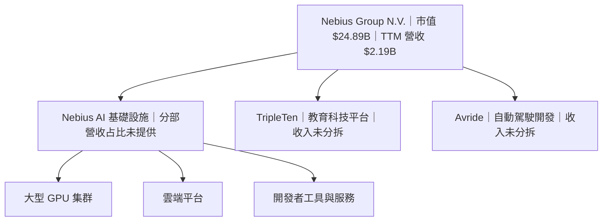
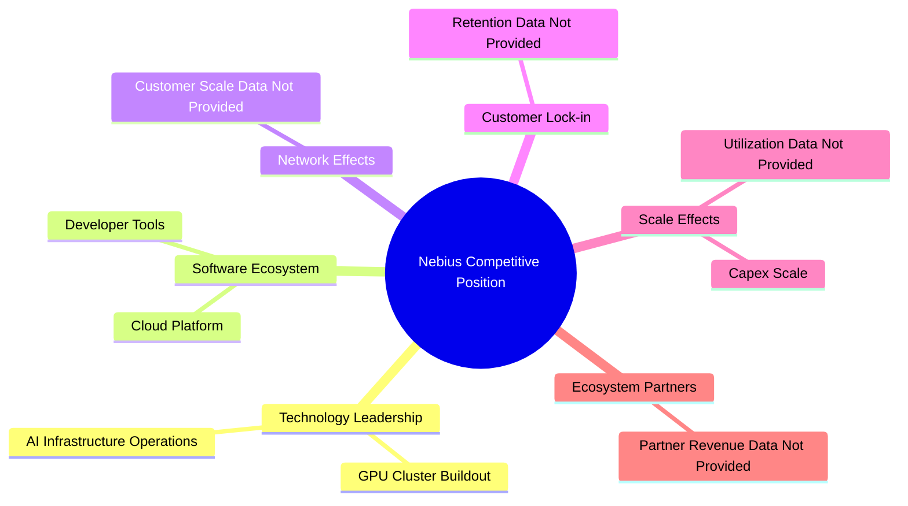
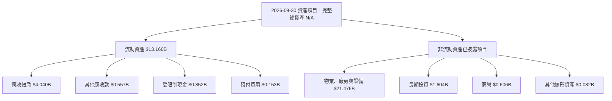
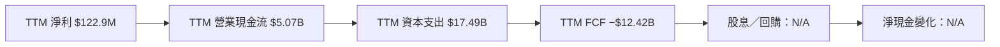
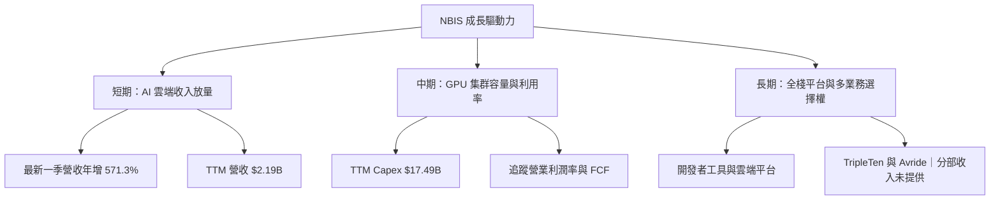
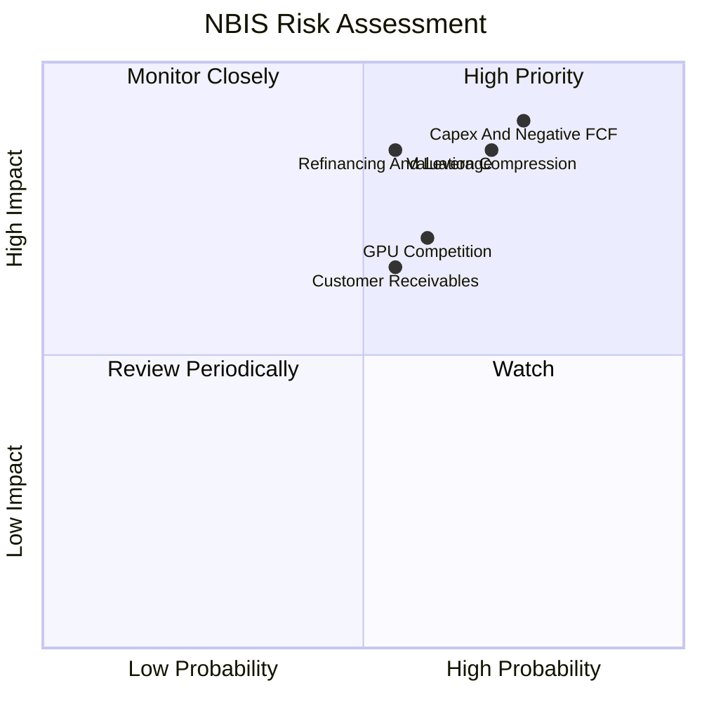
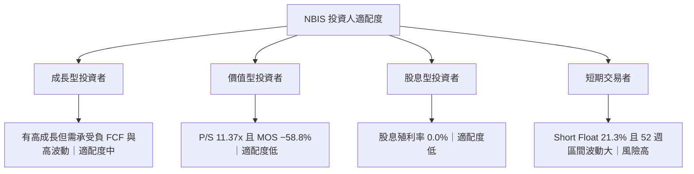

# NBIS 基本面深度分析報告
> **報告日期**：2026-11-27 ｜ **語言**：繁體中文 ｜ **數據來源**：Yahoo Finance、Finviz、StockAnalysis、Roic.ai 

## 目錄

| # | 章節 | 核心結論 |
|---|------|----------|
| 1 | 執行摘要 | 賣出；加權合理價值 $53.52，MOS −58.8% |
| 2 | 公司概覽與商業模式 | AI 基礎設施具成長性，但分部營收與市占率未提供，護城河仍待驗證 |
| 3 | 損益表深度分析 | TTM 營收 $2.19B；最新一季年增 571.3%，但 TTM 營業利益率 −23.0% |
| 4 | 資產負債表分析 | 淨負債 $8.67B；流動比率 5.306，但應收帳款天數 673 天 |
| 5 | 現金流量深度分析 | TTM FCF −$12.42B、FCF Yield −49.90%，資本投入與現金流轉換風險高 |
| 6 | 獲利能力與資本效率 | WACC 7.18%；ROIC 缺少可比資料，無法證明已創造股東價值 |
| 7 | 相對估值分析 | NBIS P/S 11.37x，高於同業 P/S 中位數 4.5x |
| 8 | DCF 內在價值評估 | TTM 營業利益為負，DCF 不適用；採用既定估值方法加權 |
| 9 | 成長催化劑 | GPU 集群與 AI 雲端需求是主要催化劑；TAM 與時間表數據未提供 |
| 10 | 風險矩陣 | 資本支出、融資／槓桿、估值波動為前三大風險 |
| 11 | 投資建議 | 依 MOS 評級賣出；等待估值收斂與現金流改善再評估 |

---

## 1. 執行摘要

NBIS 的 2026-11-25 收盤價為 **$84.99**，TTM 營收 **$2.19B**，最新一季營收年增 **571.3%**；然而 TTM 營業利益率為 **−23.0%**，TTM FCF 為 **−$12.42B**，淨負債為 **$8.67B**。估值方法給出的加權合理價值為 **$53.52**，安全邊際 **MOS −58.8%**，依規則 20 評級為 **🔴 賣出**。分析師共識目標價 $231.60 高於現價，但其只占既定估值權重的 10%，不足以抵銷同業 P/S 方法所反映的估值折價與負 FCF 風險。

### 1.0 一頁式投資儀表板（Portfolio Manager 30 秒速讀）

| 項目 | 內容 |
|------|------|
| **投資論點（3 句）** | ① 最新一季營收年增 **571.3%**，AI 基礎設施需求迅速推升規模。② TTM 營業利益率 **−23.0%**、FCF **−$12.42B**，擴張仍未轉化為穩定自由現金流。③ 加權合理價值 **$53.52**，較現價 $84.99 低 **37.0%**，估值風險偏高。 |
| **綜合評分** | **4.3/10**（引用 1.1；六項算術平均） |
| **財務健康** | 🔴 淨負債 **$8.67B**，且 TTM FCF **−$12.42B**；流動比率 5.306 提供短期緩衝，但不能消除投資融資需求。 |
| **ROIC vs WACC** | ROIC：**N/A**；WACC：**7.18%**。缺少可核驗 ROIC，不能確認是否創造價值。 |
| **FCF 趨勢** | TTM FCF **−$12.42B**，FCF Yield **−49.90%**；資本支出高於營業現金流。 |
| **估值** | Forward P/E **−27.919214x** ｜ EV/EBITDA **54.828x** ｜ FCF Yield **−49.90%** |
| **DCF 內在價值（基準）** | **N/A**（TTM 營業利益為負，不建立 DCF）｜ DCF 折溢價：N/A |
| **安全邊際（MOS）** | **−58.8%＝($53.52 − $84.99) ÷ $53.52**；基準為 8.8 加權合理價值，🔴 無安全邊際 |
| **預期報酬（基準情境 12M）** | DCF 基準情境：N/A；以加權合理價值相對現價衡量，隱含上行空間 **−37.0%** |
| **關鍵風險（前二）** | 大規模資本支出與負 FCF；淨負債和股價波動／高空頭比例。 |
| **評級 + 信心度** | 🔴 **賣出** ｜ 信心：中（估值方法有明確輸入，但財報資料存在口徑不一致） |

### 1.1 綜合評分卡（全報告唯一）

| 維度 | 評分（1–10） | 主要依據（引用數字與其來源章節） |
|------|--------------|----------------------------------|
| 成長性 | 9.0 | 最新一季營收年增 571.3%，TTM 營收 $2.19B；TTM 成長率 N/A（第 3 章）。 |
| 獲利能力 | 3.0 | TTM 營業利益率 −23.0%；ROIC 與 F-Score N/A（第 3、6 章）。 |
| 財務健康 | 4.0 | 淨負債 $8.67B、流動比率 5.306、DSO 673 天（第 4 章）。 |
| 估值 | 1.0 | MOS −58.8%；NBIS P/S 11.37x，相對同業中位數 4.5x（第 7、8 章）。 |
| 護城河 | 5.0 | AI 全棧 GPU、雲平台與開發者工具提供產品差異化可能；未提供客戶留存、市占率或分部營收以驗證（第 2 章）。 |
| 管理層與資本配置 | 4.0 | 年度 Capex 由 2024 年 $807.5M 升至 2025 年 $4.07B；TTM Capex $17.49B、TTM FCF −$12.42B（第 5 章）。 |
| **綜合評分** | **4.3** | **(9.0 + 3.0 + 4.0 + 1.0 + 5.0 + 4.0) ÷ 6 = 4.3** |

### 1.2 五大投資論點 + 三大核心風險

| 類型 | 項目 | 具體依據 | 信心度 |
|------|------|----------|--------|
| 🟢 **投資論點①** | AI 基礎設施收入迅速擴張 | 最新一季營收 $980.8M，年增 571.3%；代表 AI 算力需求轉化為實際收入，但高增速能否延續尚待確認。 | 🟢 高 |
| 🟢 **投資論點②** | 毛利率具備正向規模效應跡象 | TTM 毛利率 76.0%；若 GPU 利用率與產品組合維持，可能支持毛利，但尚未帶動整體營業獲利。 | 🟡 中 |
| 🟢 **投資論點③** | 現金與短期投資仍提供流動性 | 現金及短期投資 $7.43B、流動比率 5.306；可提供短期緩衝，但需對照 Capex 與負債規模。 | 🟡 中 |
| 🟢 **投資論點④** | 多業務平台提供擴張選擇權 | Nebius AI 基礎設施以外，亦有 TripleTen 與 Avride；各業務營收占比未提供，不能量化其估值貢獻。 | 🟡 中 |
| 🟢 **投資論點⑤** | 機構持股提供一定市場關注度 | 機構持股 61.9%；這不等同於基本面保證，也可能放大持倉調整造成的波動。 | 🟡 中 |
| 🟡 **風險①** | 資本支出超前於內部現金流 | TTM Capex $17.49B、OCF $5.07B，兩者差額反映 TTM FCF −$12.42B。 | 🔴 高衝擊 |
| 🔴 **風險②** | 估值高於同業基準 | P/S 11.37x，Peer P/S 中位數 4.5x；若市場估值收斂，股價可能承受壓力。 | 🔴 高衝擊 |
| 🔴 **風險③** | 淨負債與市場波動 | 淨負債 $8.67B、Beta 原始值 1.54、Short % Float 21.3%；融資與交易波動風險較高。 | 🔴 高衝擊 |

### 1.3 快速統計卡片

| 指標 | 公司實際值（期間） | 同業中位數 | 狀態 |
|------|--------------------|------------|------|
| 營收成長（TTM） | **N/A** | — | 🟡 不可比較 |
| 營收成長（最新一季年增） | **571.3%** | **29.6%** | 🟢 增速高，但基期與可持續性需驗證 |
| 毛利率（TTM） | **76.0%** | **66.8%** | 🟢 高於同業中位數 |
| 營業利益率（TTM） | **−23.0%** | — | 🔴 虧損 |
| ROIC（TTM） | **N/A** | — | 🟡 數據不足 |
| Forward P/E | **−27.919214x** | **9.4x** | 🔴 公司預估盈餘為負，倍數不可直接解讀 |
| FCF Yield（TTM） | **−49.90%** | — | 🔴 大幅負值 |
| Piotroski F-Score | **N/A** | — | 🟡 缺少所需 SEC 跨期資料 |

### 1.4 投資結論

```text
╔══════════════════════════════════════════════════════════════════╗
║                    📊 投資結論摘要                               ║
╠══════════════════════════════════════════════════════════════════╣
║  評級：🔴 賣出（依 8.8 MOS 門檻，未作質化上調或下調）            ║
║  價格（2026-11-25 收盤）：$84.99                                ║
║  DCF 內在價值（基準）：N/A（TTM 營業利益為負）                   ║
║  安全邊際 MOS：−58.8%（加權合理價值 $53.52 為分母）             ║
║  加權合理價值（8.8）：$53.52                                    ║
║  綜合評分：4.3/10（引用 1.1）                                    ║
║  適合投資人：能承受高波動、理解 AI 基礎設施融資風險的成長型投資人║
╚══════════════════════════════════════════════════════════════════╝
```

---

## 2. 公司概覽與商業模式

### 2.1 業務結構與收入來源

公司摘要指出 Nebius 建設 AI 全棧基礎設施，包括大型 GPU 集群、雲端平台、開發者工具與服務；另有 TripleTen 教育科技平台及 Avride 自動駕駛業務。分部營收、分部利潤及各自占比未提供，因此不推定收入比例。



### 2.2 市場份額

市場份額數據未提供，無法可靠量化 Nebius 在 AI 雲端或 GPU 基礎設施市場的占比。以營收規模觀察，公司 TTM 營收為 $2.19B，最新一季營收年增 571.3%；CoreWeave（CRWV）同期最新一季年增 168.2%，但兩者業務組合、基期與財報口徑可能不同，不能僅據此推斷市場份額。

### 2.3 競爭護城河分析



### 2.4 護城河強度

| 護城河項目 | 強度（強／中／弱） | 證據（引用數字或事實） | 會削弱它的情況 |
|------------|--------------------|------------------------|----------------|
| 技術與算力供給 | 中 | 提供大型 GPU 集群、AI 雲端平台；TTM 營收 $2.19B，最新一季年增 571.3%。 | GPU 供應緊張、算力代際更替、利用率不足或價格競爭。 |
| 軟體生態系統 | 弱至中 | 提供開發者工具與服務，但客戶數、平台使用率與留存率未提供。 | 軟體功能差異化不足，客戶可轉向大型雲端供應商。 |
| 網路效應 | 弱 | 缺少用戶規模、互動數據或網路效應相關指標。 | 競爭平台形成更完整的開發者與客戶網絡。 |
| 客戶鎖定 | 未證實 | DSO 673 天，代表應收帳款相對收入偏高；但無法單憑此數字確認客戶留存或議價能力。 | 客戶集中、合約期限短、客戶多雲部署或轉換成本低。 |
| 規模效應 | 中 | TTM Capex $17.49B，資本投入規模大；但 TTM FCF 為 −$12.42B，規模尚未轉成現金流優勢。 | 資產利用率不足、折舊攀升、融資成本上升。 |
| 生態夥伴 | 未證實 | 公司業務描述涵蓋多元服務；合作夥伴與合作收入未提供。 | 夥伴轉向競品、硬體或雲服務供應商議價能力提升。 |

護城河評分 **5.0/10**：收入成長與全棧產品構成潛在差異化，但市占、留存、客戶集中度及分部獲利均缺乏可量化證據。

---

## 3. 損益表深度分析

### 3.1 年度收入成長趨勢（近 4 年）

下列收入取自年度損益表；YoY 按相鄰年度收入計算。FY2022–FY2025 收入 CAGR 約 239.7%，但起始基數僅 $13.5M，CAGR 不應直接外推。

```text
╔══════════════════════════════════════════════════════════════════╗
║              NBIS 年度收入趨勢（FY2022-FY2025）                 ║
╠══════════════════════════════════════════════════════════════════╣
║ FY2022  $13.5M    █                         YoY：N/A             ║
║ FY2023   $9.8M    █                         YoY：−27.4% 🔴       ║
║ FY2024  $91.5M    █████                     YoY：+833.7% 🟢      ║
║ FY2025 $529.8M    █████████████████████████ YoY：+479.0% 🟢      ║
║                                                                  ║
║ FY2022–FY2025 CAGR：約 +239.7%（低基期影響顯著）                 ║
╚══════════════════════════════════════════════════════════════════╝
```

計算：FY2022 至 FY2025 為三個年度間隔，\((529.8 ÷ 13.5)^{1/3}−1≈239.7\%\)。FY2025 增長與 AI 基礎設施擴張相符；但 FY2022–FY2023 曾經收縮，且最新季度速度遠高於年度歷史平均，基期、併購／業務組合與收入確認差異需持續核實。

### 3.2 季度收入趨勢分析

| 季度 | 營收 | QoQ 成長 | YoY 成長 | 備註 |
|------|------:|---------:|---------:|------|
| 2025 Q4 | $227.7M | +347.2% | +546.9% | QoQ 以 2025 Q3 $50.9M 為比較基數。 |
| 2026 Q1 | $399.0M | +75.2% | +683.9% | 對比 2025 Q1 $50.9M。 |
| 2026 Q2 | $582.3M | +45.9% | +454.0% | 對比 2025 Q2 $105.1M。 |
| 2026 Q3 | $980.8M | +68.4% | **+571.3%** | 最新季度年增率依指定財務指標引用。 |

QoQ 計算以季度營收相鄰比值推導；2025 Q4 的比較基期較小，增幅容易放大。2026 Q3 營收較 Q2 增加 $398.5M，顯示收入擴張仍快，但不能據此假設其後季度維持同一速度。

### 3.3 利潤率演變分析

| 利潤率指標 | FY2022 | FY2023 | FY2024 | FY2025 | TTM／最新季 | 評估 |
|------------|--------|--------|--------|--------|-------------|------|
| 毛利率 | 約 −110.4% | −100.0% | 約 52.2% | 約 68.6% | TTM **76.0%** | 🟢 改善顯著；TTM 毛利提升尚未轉成正向 TTM 營業獲利。 |
| 營業利益率 | 約 −1,170.4% | 約 −2,915.3% | 約 −436.7% | 約 −115.5% | TTM **−23.0%**；最新季 **−18.7%** | 🔴 仍為負；年度歷史值受小收入基數影響極大。 |
| 淨利率 | 約 5,523.0% | 約 2,462.2% | 約 −700.4% | 約 15.6% | TTM **5.7%** | 🟡 淨利率被非營業項目與單季盈虧波動影響，不能替代營業獲利判斷。 |

年度毛利率與營業利益率按年度毛利、營業利益除以收入計算；FY2022–FY2023 收入基數低，百分比極端，解讀應以金額與近期趨勢為主。TTM 毛利率 76.0% 與營業利益率 −23.0% 同時出現，說明營運、研發、管理及其他營業費用負擔仍重。年度資料顯示研發支出由 2022 年 $58.3M 增至 2025 年 $177.3M，有利於產品開發，但短期壓低營業利潤。

> 財務來源間存在口徑差異：2026 Q3 損益表列示營業利益 $50.4M，而品質指標列示最新季度營業利益率 −18.7%。本報告對該比率依指定優先數據引用，不用單季營業利益自行替代。

### 3.4 費用結構分析

各營業費用分項的 TTM 完整數據未提供，故不製作費用占比圓餅圖。可確認 FY2025 研發支出為 $177.3M，低於同期收入 $529.8M，但單一費用項目不能代表完整費用結構。

### 3.5 季度 EPS 趨勢與盈餘品質（Quality of Earnings）

| 季度 | EPS 實際值／盈餘資料 | EPS 預期與超預期情況 |
|------|----------------------|----------------------|
| 2025 Q4 | StockAnalysis EPS 約 −$1.11；損益表淨利 −$268.8M | 預期值 N/A，無法判定超預期或不及預期。 |
| 2026 Q1 | EPS 約 $2.11；淨利 $621.2M | 預期值 N/A；大額正淨利與後續季度反轉，盈餘波動大。 |
| 2026 Q2 | EPS 約 −$0.78；淨利 −$190.4M | 預期值 N/A，無法判定超預期或不及預期。 |
| 2026 Q3 | EPS 約 −$0.14；淨利 −$37.5M | 預期值 N/A，無法判定超預期或不及預期。 |

Yahoo Finance 的 EPS beat/miss 歷史中，四季 EPS Estimate 與 Actual 均為 nan；因此不能將空缺判為「超預期」或「不及預期」。EPS 與淨利數據亦顯示季度波動，FY2026 Q1 的 $621.2M 淨利不宜直接視為可持續獲利。

| 盈餘品質項目 | 數值／佔比 | 評估 |
|--------------|-----------|------|
| 股權薪酬 SBC / 營收 | 依最近四季 SBC $221.4M ÷ TTM 營收 $2.19B，約 **10.1%** | 🔴 占比高，持續發股會稀釋既有股東；此為季度 SBC 加總的估算。 |
| SBC / 營業現金流 | $221.4M ÷ $5.07B，約 **4.4%** | 🟡 SBC 低於該口徑 OCF，但 OCF 受季度大幅波動及營運資金影響。 |
| FCF / 淨利（現金轉換率） | −$12.42B ÷ TTM 淨利 $122.9M，約 **−10,106%** | 🔴 資本支出遠高於 OCF，FCF 不支持當期帳面獲利。 |
| 一次性／非經常性損益 | 季度淨利從 $621.2M 到 −$190.4M，再到 −$37.5M；具體一次性項目 N/A | 🟡 波動顯示非營業或一次性影響可能重大，但缺少附註無法逐項識別。 |
| 有效稅率異常 | 最新年度有效稅率 **29.0%** | 🟡 單一年度稅率；季度稅項拆解未提供，不能據此推定正常化稅率。 |
| 資本化支出 vs 費用化 | TTM Capex $17.49B；資本化政策與資本化利息資料未提供 | 🟡 大額投資先列資產、後由折舊攤銷反映；需檢視資產壽命、利用率與資本化政策。 |

**盈餘品質結論**：GAAP TTM 淨利為正，但營業利益率為負、FCF 大幅為負、季度淨利波動很大，帳面淨利的可持續性尚未得到現金流驗證。估值應優先觀察營業獲利與投資回報，而不應單靠 TTM EPS 或單季淨利推導。

---

## 4. 資產負債表分析

### 4.1 資產結構分解

最新季度提供流動資產與部分非流動資產細項，但最新總資產與分項完整勾稽數據未提供；下圖只列來源明確提供的細項，不視為全部資產結構。



### 4.2 流動性與營運資金分析

| 指標 | 最新值 | 歷史參考 | 評估 |
|------|-------:|----------|------|
| 流動比率 | 5.306 | FY2025 年末流動資產 $4.71B、流動負債 $1.53B | 🟢 短期帳面流動性高；需留意資產中應收與受限制現金的可用性。 |
| 速動比率 | 4.847 | 歷史可比序列未提供 | 🟢 顯示短期償付緩衝，但不能代替現金流分析。 |
| 現金及短期投資 | $7.43B | FY2025 年末 $3.753B | 🟢 現金增加；同時負債與投資支出亦大幅上升。 |

| 指標 | 最新 TTM | 一年前 TTM | 變化 | 解讀 |
|------|----------|------------|------|------|
| DSO 應收帳款天數 | **673 天** | N/A | N/A | 應收帳款相對 TTM 收入偏高；可能與大型合約付款條件或資料口徑有關，需追蹤回款。 |
| DIO 存貨天數 | **N/A** | N/A | N/A | 公司未報告相應存貨餘額；不填補。 |
| DPO 應付帳款天數 | **368 天** | N/A | N/A | 顯示應付帳款相對營業成本天數偏高，但缺少一年前數據，不能判斷議價力變化。 |
| CCC 現金轉換週期 | **N/A** | N/A | N/A | DIO 缺失，現金轉換週期不可計算。 |

品質數據沒有一年前 DSO／DIO／DPO／CCC，故不推算變化。DSO 的高值應視為收款風險監控訊號，而非直接結論；大型基礎設施合約可能造成應收帳款與收入時間差。

### 4.3 債務結構分析

```text
╔══════════════════════════════════════════════════════════════════╗
║                   NBIS 債務健康診斷                              ║
╠══════════════════════════════════════════════════════════════════╣
║  總債務：        $16.10B  ████████████████████  🔴 高            ║
║  現金+短期投資：  $7.43B  █████████              🟡 有緩衝        ║
║  淨負債：         $8.67B  ███████████            🔴 淨負債        ║
║                                                                  ║
║  Debt/Equity：   130.875x（來源口徑；槓桿偏高）                   ║
║  Debt/EBITDA：   N/A（TTM EBITDA 未提供可核驗的同口徑金額）       ║
║  利息保障倍數：  N/A（利息費用與營業利潤均無法形成可靠倍數）     ║
║  流動比率：      5.306x 🟢 短期資產覆蓋較高                      ║
╚══════════════════════════════════════════════════════════════════╝
```

Debt/Equity 數據為來源給定值；由於最新季度負債組成、權益與該比率的口徑未完整提供，不另行反算。公司持有 $7.43B 現金及短期投資，但總債務為 $16.10B，淨負債仍達 $8.67B。短期流動性不等於無需融資，尤其 TTM FCF 為負。

### 4.4 股東權益趨勢

| 年末 | 股東權益 | YoY 變化 | 觀察 |
|------|---------:|---------:|------|
| 2022-12-31 | $4.25B | — | 年度比較起點。 |
| 2023-12-31 | $3.29B | −22.6% | 權益下降。 |
| 2024-12-31 | $3.25B | −1.2% | 大致持平。 |
| 2025-12-31 | $4.59B | +41.2% | 權益回升；需結合融資與股份變化判斷每股價值。 |

---

## 5. 現金流量深度分析

### 5.1 現金流量瀑布圖

提供的年度與季度淨利與 TTM 營業現金流時間口徑不完全一致，以下只連接能確認的 TTM 現金流數字；未提供的項目標為 N/A。



### 5.2 FCF 轉換率趨勢

| 年度／TTM | FCF | 淨利 | FCF／淨利 | 評估 |
|-----------|----:|-----:|---------:|------|
| 2022 | $682.4M | $745.6M | 約 91.5% | 🟡 正現金流，但年度收入及業務結構與現況差異大。 |
| 2023 | $746.9M | $241.3M | 約 309.7% | 🟡 FCF 高於淨利，可能受營運資金與資本支出偏低影響。 |
| 2024 | −$561.9M | −$641.4M | 約 87.6% | 🟡 虧損伴隨負 FCF。 |
| 2025 | −$3.68B | $82.5M | 約 −4,460% | 🔴 Capex 大幅擴張使現金流與淨利背離。 |
| TTM 至 2026-09-30 | **−$12.42B** | $122.9M | 約 **−10,106%** | 🔴 當期淨利不代表可分配現金流。 |

### 5.3 自由現金流趨勢

```text
╔══════════════════════════════════════════════════════════════════╗
║               NBIS 自由現金流：年度與 TTM                       ║
╠══════════════════════════════════════════════════════════════════╣
║ 2022       +$0.68B   正 FCF；Capex $0.015B                       ║
║ 2023       +$0.75B   正 FCF；Capex $0.083B                       ║
║ 2024       −$0.56B   負 FCF；Capex $0.808B                       ║
║ 2025       −$3.68B   負 FCF；Capex $4.07B                        ║
║ TTM 2026Q3 −$12.42B  FCF Yield −49.90%                           ║
╠══════════════════════════════════════════════════════════════════╣
║ 方向：資本投入顯著擴大，現金流轉負且負值擴大；短期回報尚未驗證。║
╚══════════════════════════════════════════════════════════════════╝
```

公司年度 Capex 從 2023 年 $82.9M、2024 年 $807.5M，升至 2025 年 $4.07B；TTM Capex 為 $17.49B。這種投資可用於擴增 GPU 與資料中心容量，但如果新增容量的上架率、定價或客戶回款不足，則折舊和融資成本會先於回報增加。

### 5.4 資本配置評估

各用途的 TTM 完整金額未提供，故不製作資本配置圓餅圖。

| 資本配置項目 | 可得數據 | 評估 |
|--------------|----------|------|
| Capex | TTM $17.49B；FY2025 $4.07B | 主要可見資本用途，增長速度高；應以新增容量利用率和投資回報驗證。 |
| 研發 | FY2025 $177.3M | 研發支出持續增加，但占整體資本投入比重未提供。 |
| 股息 | 殖利率 0.0% | 無股息回報。 |
| 回購 | N/A | 回購金額未提供。 |
| 債務／現金變化 | 總債務 $16.10B、現金及短期投資 $7.43B | 淨負債 $8.67B；需觀察融資是否持續支持擴張。 |

---

## 6. 獲利能力與資本效率

### 6.1 ROE / ROA / ROIC 趨勢

| 指標 | 最新可用值 | 歷史／趨勢 | 評估 |
|------|-----------:|------------|------|
| ROE | **1.5%（TTM）** | 年度可比序列未提供一致口徑 | 🟡 正值但回報偏低；季度淨利波動使其代表性有限。 |
| ROA | **−1.0%（TTM）** | 年度可比序列未提供一致口徑 | 🔴 資產尚未帶來穩定正回報。 |
| ROIC | **N/A** | 沒有可引用的最新 TTM ROIC | 🟡 無法判定投入資本回報是否超過資金成本。 |
| 行業均值 | 未提供 | 不作估計 | — |

### 6.2 ROIC vs WACC 分析（核心價值創造判斷）

```text
╔══════════════════════════════════════════════════════════════════╗
║                ROIC vs WACC 深度分析                            ║
╠══════════════════════════════════════════════════════════════════╣
║  WACC（直接採用成本資本資料）：                                 ║
║  ├── 無風險利率（10Y 美債）：       4.85%                        ║
║  ├── ERP（假設值）：                 5.00%                        ║
║  ├── 原始 Beta：                     1.54                         ║
║  ├── 調整後 Beta：                   1.36                         ║
║  ├── 股權成本（給定）：              11.64%                       ║
║  ├── 稅前債務成本（給定）：          0.38%                        ║
║  ├── 有效稅率：                      29.0%                        ║
║  ├── 股權／債務權重：                60.7%／39.3%                  ║
║  └── ✅ WACC（給定）：                7.18%                        ║
║                                                                  ║
║  ROIC（TTM）：N/A；NOPAT 與投入資本的同口徑數據不完整。          ║
║  EVA = ROIC − WACC：N/A；不能判定公司目前在創造或摧毀價值。     ║
╚══════════════════════════════════════════════════════════════════╝
```

原始 Beta 1.54 經調整為 **1.36**，調整方式為 \((2/3 × 1.54)+(1/3 × 1)=1.36\)。無風險利率 4.85%、ERP 5.00%、稅前債務成本 0.38%、有效稅率 29.0% 與資本權重均採成本資本資料給定值。WACC 直接採用 **7.18%**；由於可得的分項四捨五入後未必精確重現該值，不另行改算或替代。

ROIC 缺失，不能把 TTM 營業利益率或 ROE 當作 ROIC。因此目前只能說 NBIS 面臨 7.18% 的資本成本門檻，尚無可核驗數據證明其投入資本回報已超過此門檻。

### 6.3 杜邦三因素分解

**N/A**：品質數據指出缺少可用的淨利、收入、總資產或正股東權益，無法可靠計算淨利率 × 資產週轉率 × 權益乘數。雖然另有來源提供 ROE 1.5%（TTM），不以不完整資料重建杜邦三因素。

### 6.4 財務體質：Piotroski F-Score

**N/A**：需要相隔一年的兩個 TTM 期間及 SEC 申報資料；目前提供的季度財務資料不足以判定九項測試。缺失各項結果不代表未通過，故不列出推測性測試表。

---

## 7. 相對估值分析

### 7.1 同業估值比較表格

同業倍數均採 Yahoo Finance 同業倍數資料；本公司倍數採公司估值數據。

| 估值指標 | **NBIS** | **CRWV** | **ORCL** | **MSFT** | 本公司評估 |
|----------|---------:|---------:|---------:|---------:|-----------|
| **Trailing P/E** | N/A | N/A | 16.3x | 25.6x | 🟡 NBIS TTM EPS 為負，P/E 不適用。 |
| **Forward P/E** | −27.919214x | −23.9x | 9.4x | 20.2x | 🔴 NBIS 預估 EPS 為負，不能視為正常低倍數。 |
| **P/S Ratio** | 11.368058x | 2.4x | 4.5x | 10.5x | 🔴 高於同業中位數 4.5x。 |
| **EV/EBITDA** | 54.828x | 16.5x | 13.1x | 18.0x | 🔴 明顯高於同業中位數 16.5x；獲利口徑與成長差異需留意。 |
| **最新季度營收 YoY** | 571.3% | 168.2% | 29.6% | 18.8% | 🟢 增速高，但不等於合理估值。 |
| **TTM 毛利率** | 76.0% | 66.8% | 64.0% | 67.7% | 🟢 高於同業中位數 66.8%。 |

Peer 中位數按三家公司數值排序後取中間值：Forward P/E **9.4x**、P/S **4.5x**、EV/EBITDA **16.5x**、最新季度營收年增 **29.6%**、毛利率 **66.8%**。NBIS 的營收成長與毛利率有優勢，但負營業利益與負 FCF 使高倍數需要更強的未來轉化證據。

### 7.2 歷史估值區間分析

**N/A（數據未提供：缺少公司歷史 P/E、P/S 或 EV/EBITDA 估值區間及百分位資料）**。價格資料顯示 2026-11-25 收盤價 $84.99，距 52 週高點 $299.86 約低 71.7%，高於 52 週低點 $73.52 約 15.6%；股價區間不等同估值區間，不能據此推算歷史估值百分位。

### 7.3 情境價值（Bear / Base / Bull）

**N/A（DCF 無法計算：TTM 營業利益為負，不建立負營業利益折現模型；財務數據沒有可引用的 DCF Scenarios）**。因此不提供悲觀、基準與樂觀情境目標價。

### 7.4 相對估值隱含價格區間

```text
╔══════════════════════════════════════════════════════════════════╗
║                 既定估值方法與價格位置                           ║
╠══════════════════════════════════════════════════════════════════╣
║ 同業 P/S 方法：         $33.73／股（權重 90%）                  ║
║ 分析師共識目標價：      $231.60／股（權重 10%）                 ║
║ 加權合理價值：          $53.52／股                              ║
║                                                                  ║
║ $33.73 ── $53.52 ───────────── 現價 $84.99 ───────── $231.60    ║
║ 同業 P/S   加權合理價值          現價              分析師共識     ║
╚══════════════════════════════════════════════════════════════════╝
```

同業 P/S 方法採同業中位數 **4.5x**（CRWV、ORCL、MSFT）乘以公司 TTM 營收；既定方法輸出每股價值 **$33.73**。同業 Forward P/E 因不可計算而未列入既定估值方法。需注意，提供的 $33.73 與「TTM 營收 × 4.5x ÷ 流通股數」按報表中其他已列數字直接重算會有差異；依規則本報告保留既定估值方法原值，不自行替換。

---

## 8. DCF 內在價值評估（Discounted Cash Flow）

> **DCF MODEL：N/A。** TTM 營業利益為負；以虧損營業基礎折現未來現金流不適合作為可稽核內在價值模型。依指定估值資料，不自行建立 DCF、敏感度矩陣或情境目標價。

### 8.0 估值推理鏈（Thinking Logic）

公司價值的主要可驗證來源是 AI 基礎設施收入，其 TTM 營收為 **$2.19B**；另有 TripleTen 與 Avride，但分部收入占比未提供，不能額外量化選擇權價值。當前估值的主導風險是收入成長能否轉成營業獲利與正 FCF：TTM 營業利益率 **−23.0%**、FCF **−$12.42B**。由於 DCF 模型被指定為 N/A，本節不假設預測期、長期利潤率、永續成長率或終值。

| 決策點 | 本報告採用 | 理由（含數字） | 曾考慮但否決 | 否決理由 |
|--------|-----------|----------------|--------------|----------|
| 現金流定義 | N/A | 不建立 DCF，無現金流折現計算。 | FCFF／FCFE | TTM 營業利益為負，既定 DCF 模型明確為 N/A。 |
| 預測期 N | N/A | 無有效 DCF 預測期間。 | 任意 5 年或 10 年 | 沒有既定模型數字，不能自行設定。 |
| 終值方法 | N/A | 無終值計算。 | Gordon Growth／退出倍數 | 不得自行建立或推導。 |
| EBIT 基礎 | N/A | 不建模。 | GAAP／非 GAAP | 避免對負營業利益進行黑箱外推。 |

推理鏈最脆弱之處是高增長能否帶來營業利潤與 FCF 改善；若營收成長減速但 Capex 維持高位，估值壓力會加重。數據不足以量化其對 DCF 每股價值的影響。

### 8.1 模型假設總表（Model Inputs）

**N/A（DCF MODEL 不可用：TTM 營業利益為負）**。因此不列預測期、營收 CAGR、期末營業利潤率、稅率、Capex 比率、D&A、營運資金、SBC、稀釋率、永續成長率或終值方法等自行建模假設。

### 8.2 折現率推導（WACC）

WACC 作為成本資本指標可引用，但不代表本報告建立了 DCF。

```text
╔══════════════════════════════════════════════════════════════════╗
║                    WACC 資料（非 DCF 建模）                      ║
╠══════════════════════════════════════════════════════════════════╣
║  無風險利率 Rf：                 4.85%                           ║
║  ERP（假設值）：                 5.00%                           ║
║  原始 Beta：                     1.54                            ║
║  調整後 Beta：                   1.36                            ║
║  股權成本（來源給定）：          11.64%                          ║
║  稅前債務成本（來源給定）：      0.38%                           ║
║  有效稅率：                      29.0%                           ║
║  股權／債務權重：                60.7%／39.3%                    ║
║  WACC（來源給定）：              7.18%                           ║
╚══════════════════════════════════════════════════════════════════╝
```

### 8.3 逐年自由現金流預測（基準情境）

**N/A（DCF 無法計算：TTM 營業利益為負；沒有逐年預測、FCFF 與折現因子可引用）**。不列年度預測表或逐步演算，以免自行建立模型。

### 8.4 終值計算（Terminal Value）

**N/A（沒有 DCF 預測期最後一年 FCFF、永續成長率或終值資料）**。因此不計算 Gordon Growth 或退出倍數終值，也不假設終值占企業價值比例。

### 8.5 企業價值 → 每股內在價值（Bridge）

**N/A（DCF 模型未建立）**。不計算預測期現值、企業價值、股權價值或 DCF 每股內在價值；DCF 折溢價亦為 N/A。現金、債務與股數已有資料，但不足以補足缺失的 DCF 現金流預測。

### 8.6 敏感性分析（WACC × 永續成長率）

**N/A（沒有 DCF 基準現金流、終值與每股基準值）**。不製作 WACC × 永續成長率矩陣，也不提供虛構情境價值。

### 8.7 反推 DCF（Reverse DCF）

**N/A（沒有可用 DCF 模型可供反解）**。現價無法在缺少營運現金流預測與終值假設下反推出唯一的營收 CAGR、營業利潤率、永續成長率或預測期。

### 8.8 估值三角驗證與安全邊際

| 估值方法 | 隱含每股價值 | 上行空間（÷現價） | 權重 | 說明 |
|----------|--------------:|------------------:|------:|------|
| 同業 P/S | **$33.73** | **−60.3%** | **90%** | 同業中位數 P/S 4.5x；既定方法輸出值。 |
| 分析師共識目標價 | **$231.60** | **+172.5%** | **10%** | 20 位分析師平均目標價。 |
| **加權合理價值** | **$53.52** | **−37.0%** | **100%** | 既定加權結果。 |

逐步演算：

\[
\$33.73 \times 90\% + \$231.60 \times 10\%
= \$30.357 + \$23.160
= \$53.517
\approx \$53.52
\]

權重合計 \(90\%+10\%=100\%\)。公司類型為未獲利公司，依固定方法使用同業 P/S 與分析師共識目標價；不可計算的同業 Forward P/E 未納入既定方法。

- **安全邊際 MOS**  
  \[
  (\$53.52-\$84.99)\div \$53.52
  =-\$31.47\div \$53.52
  =-58.8\%
  \]
- **上行空間**  
  \[
  (\$53.52-\$84.99)\div \$84.99
  =-\$31.47\div \$84.99
  =-37.0\%
  \]

MOS 依規則 20 對應 **🔴 賣出**，未作一級質化調整。估值方法給出的同業 P/S 價值 $33.73 低於現價，而分析師共識目標價 $231.60 對加權結果影響有限。

```text
╔══════════════════════════════════════════════════════════════════╗
║                  估值區間與安全邊際                              ║
╠══════════════════════════════════════════════════════════════════╣
║  $33.73 ───────── $53.52 ─────────── [$84.99] ───────── $231.60  ║
║  同業 P/S        加權合理價值          現價          分析師共識    ║
║                                                                  ║
║  MOS = ($53.52 − $84.99) ÷ $53.52 = −58.8%                      ║
║  上行空間 = ($53.52 − $84.99) ÷ $84.99 = −37.0%                ║
║  DCF 基準價值：N/A                                               ║
║  以 MOS ≥ 10% 對應的價格上限：$53.52 × 90% = $48.17             ║
╚══════════════════════════════════════════════════════════════════╝
```

$48.17 是由加權合理價值計算的觀察參考價，不是與「賣出」評級矛盾的積極買入建議；若股價跌至該區域，仍需先確認 FCF、融資與業務轉化趨勢。

> 🔎 **程式複算（Python，依本節各項自動重算）**
>
> 加權合理價值 = $33.73 × 90% + $231.60 × 10% = **$53.52**（權重合計 100%）
>
> 以價格 $84.99 計：MOS = **-58.8%**，上行空間 = **-37.0%**
>
> ✅ 與本節所寫數值一致。

### 8.9 DCF 模型的局限與失效條件

- **終值依賴度**：N/A，沒有 DCF 終值與企業價值分解。
- **最脆弱假設**：本報告不設定 DCF 假設；基本面最需驗證的是營收能否轉化為營業獲利，以及 Capex 是否能帶來足夠回報。
- **不適用情境說明**：TTM 營業利益率 −23.0%、TTM FCF −$12.42B，傳統 DCF 的短期現金流預測可信度低。現階段宜以同業 P/S、營收品質、容量利用率、單位經濟性及後續現金流作交叉檢驗。
- **與第 10 章風險矩陣的連結**：Capex 超支會惡化 FCF；AI 雲端價格競爭會壓低毛利與營業利益；再融資或利率變動可能提高資本成本。

### 8.10 複算檢核表（Audit Trail）

| # | 檢核項目 | 檢查方式 | 結果 |
|---|----------|----------|------|
| 1 | 高／中敏感度輸入四段式推導 | DCF 不建模，無此類輸入 | N/A |
| 2 | 每個 DCF 假設有依據 | DCF 輸入均未建立 | N/A |
| 3 | WACC 五步算式與乘加覆核 | 採用來源給定 WACC 7.18%，不另建立 DCF WACC | N/A |
| 4 | Kd 分母與權重債務範圍一致 | 沒有完整 DCF 債務拆分供覆核 | N/A |
| 5 | WACC 與第 6.2 節一致 | 兩處均引用 7.18% | ✅ |
| 6 | 逐年預測期欄位與 N | DCF 為 N/A | N/A |
| 7 | FY+1 FCFF 與 PV 可複算 | 無預測表 | N/A |
| 8 | 預測期 PV 加總 | 無預測表 | N/A |
| 9 | WACC > g | g 未設定 | N/A |
| 10 | 終值基於 FY+N FCFF 並折現 N 期 | 無終值 | N/A |
| 11 | EV 至每股價值橋接 | DCF 橋接未計算 | N/A |
| 12 | SBC 組合相容 | 不建立 DCF SBC 假設 | N/A |
| 13 | 敏感性矩陣基準格與 DCF 一致 | 矩陣未建立 | N/A |
| 14 | 敏感性矩陣有效格 | 矩陣未建立 | N/A |
| 15 | 三情境機率加總 | DCF 情境未提供 | N/A |
| 16 | 反推 DCF 一次只解一變數 | Reverse DCF 未建立 | N/A |
| 17 | MOS 分母及評級一致 | MOS 以 $53.52 為分母；執行摘要同為 −58.8% | ✅ |
| 18 | 完整輸出至第 11 章 | 本報告包含 11 章 | ✅ |
| 19 | 加權合理價值等於方法加權總和 | $33.73×90%+$231.60×10%=$53.517≈$53.52 | ✅ |
| 20 | 評級符合 MOS 門檻 | MOS −58.8% < −25%，評級賣出 | ✅ |

---

## 9. 成長催化劑

### 9.1 催化劑時間軸

可查證的季度或年度催化劑日期未提供，不以未確認日期建立甘特時間軸。近期可追蹤的營運里程碑包括 GPU 容量部署、營收持續性、營業利潤率與 FCF 改善。

### 9.2 TAM 市場規模分析

**N/A（TAM 數據未提供）**。公司 TTM 營收為 $2.19B，最新一季營收年增 571.3%，顯示目前收入擴張速度高；但沒有可引用的 AI 雲端、GPU 算力或自動駕駛 TAM 金額，不能計算市場滲透率。營收增長能否延續，需觀察客戶需求、已部署容量的利用率與價格。

### 9.3 成長驅動力結構圖



---

## 10. 風險矩陣

### 10.1 風險評分矩陣

下圖中的機率與衝擊位置屬定性風險判斷，不是公司財務數據；數字軸為圖表座標，不代表事件機率的統計預測。



### 10.2 風險清單詳細分析

| # | 風險項目 | 發生機率 | 財務衝擊 | 風險評分 | 緩解措施 |
|---|----------|----------|----------|----------|----------|
| 1 | 🔴 **資本支出與負 FCF** | 高；定性評估 | TTM FCF −$12.42B，FCF Yield −49.90%；若容量利用率不足，資金需求與資產減損風險增加。 | 🔴 高 | 逐季監控 Capex、OCF、FCF、已上線容量利用率及新增收入。 |
| 2 | 🔴 **估值收斂** | 高；定性評估 | P/S 11.37x 對比同業中位數 4.5x；估值回歸可能壓低股價。 | 🔴 高 | 以收入成長、營業利潤率及同業倍數同步判斷估值。 |
| 3 | 🔴 **融資與槓桿風險** | 中高；定性評估 | 總債務 $16.10B、淨負債 $8.67B；持續負 FCF 可能增加外部資金需求。 | 🔴 高 | 追蹤債務到期、融資成本、現金餘額與新增融資稀釋。 |
| 4 | 🟡 **應收帳款與回款風險** | 中；定性評估 | DSO 673 天；收入增長若未伴隨回款，營運資金壓力可能升高。 | 🟡 中高 | 追蹤 DSO、應收帳款增幅與現金回收；要求合約付款條件透明。 |
| 5 | 🟡 **GPU 雲端競爭與價格壓力** | 中高；定性評估 | CRWV 最新一季營收年增 168.2%；ORCL、MSFT 亦提供雲端算力，競爭者具規模。 | 🟡 中高 | 追蹤毛利率、客戶續約、容量利用率與每單位算力收入。 |
| 6 | 🟡 **股價與空頭波動** | 中高；定性評估 | Short % Float 21.3%、Beta 1.54；價格過去 52 週高低為 $299.86 至 $73.52。 | 🟡 中高 | 控制倉位與槓桿，避免以短期價格波動替代基本面判斷。 |

---

## 11. 投資建議

### 11.1 最終評級與評分

加權合理價值 $53.52 相對 2026-11-25 收盤價 $84.99 得出 **MOS −58.8%**，依規則 20 評級為 **🔴 賣出**；未作一級質化調整。綜合評分為 **4.3/10**，六項評分依序為成長性 9.0、獲利能力 3.0、財務健康 4.0、估值 1.0、護城河 5.0、管理層與資本配置 4.0。

### 11.2 合理價值與隱含報酬率

| 估值項目 | 每股價值 | 相對現價 $84.99 | 機率／權重 | 解讀 |
|----------|---------:|----------------:|-----------:|------|
| 同業 P/S 方法 | $33.73 | −60.3% | 權重 90% | 既定估值方法輸出。 |
| 分析師共識目標價 | $231.60 | +172.5% | 權重 10% | 20 位分析師平均目標價。 |
| **加權合理價值** | **$53.52** | **−37.0%** | **權重 100%** | 本報告 MOS 的價值基準。 |
| DCF 悲觀／基準／樂觀情境 | N/A | N/A | N/A | DCF 模型 N/A，沒有可引用情境值。 |

### 11.3 買入時機與觸發因素

```text
╔══════════════════════════════════════════════════════════════════╗
║                  ✅ 觀察與交易觸發因素 Checklist                 ║
╠══════════════════════════════════════════════════════════════════╣
║  重新評估買入前，建議多數符合：                                  ║
║  ☐ TTM FCF 明顯改善，且連續季度資本支出不再快於營業現金流       ║
║  ☐ TTM 營業利益率由 −23.0% 持續改善，並朝損益兩平前進           ║
║  ☐ DSO 由 673 天下降，應收帳款增速不再明顯高於收入增速           ║
║  ☐ GPU 容量利用率、客戶續約與合約回款有可查證改善                ║
║                                                                  ║
║  估值觀察參考：                                                  ║
║  ☐ 股價接近或低於 $53.52 加權合理價值後，再檢視基本面             ║
║  ☐ $48.17 為 MOS 10% 對應的參考上限，不是無條件買入訊號          ║
║                                                                  ║
║  減碼／退出觸發條件：                                            ║
║  ☐ FCF 持續惡化且融資或債務同步增加                              ║
║  ☐ 營收增速大幅回落但營業利益率未改善                            ║
║  ☐ 應收帳款持續快速增加、DSO 進一步上升                          ║
╚══════════════════════════════════════════════════════════════════╝
```

### 11.4 投資人適配度分析



### 11.5 每季財報監控清單（Quarterly Watch List）

| 監控指標 | 現況／基準 | 觸發加碼重新評估 | 觸發減碼／風險升高 |
|----------|------------|------------------|--------------------|
| 營收年增 | 最新一季 571.3%；TTM 成長率 N/A | 連續兩季維持高成長且回款同步改善 | 連續兩季大幅減速，並低於最近已披露季度增速趨勢 |
| 營業利益率 | TTM −23.0%；最新季 −18.7% | 連續季度改善，並在收入擴張下縮小虧損 | 利潤率再度惡化或費用增長快於毛利 |
| 毛利率 | TTM 76.0% | 維持或改善且未以價格大幅折讓換取收入 | 明顯下滑，顯示定價或利用率轉弱 |
| Capex | TTM $17.49B | 投資增速下降或新增容量轉化為收入及現金流 | Capex 維持高位但收入與利用率未跟上 |
| FCF | TTM −$12.42B | 逐季收窄，最終朝正值改善 | 負 FCF 擴大且債務同步上升 |
| 應收帳款／DSO | DSO 673 天 | DSO 持續回落、回款與收入同步 | DSO 上升或應收帳款明顯快於收入增長 |
| 淨負債 | $8.67B | 淨負債下降且不依賴大量股權稀釋 | 淨負債快速增加、融資成本或稀釋上升 |
| SBC | 最近四季估算 $221.4M，約為 TTM 營收 10.1% | SBC 占營收下降，股數稀釋受控 | SBC 占比上升或股份數快速增加 |
| 財測與訂單 | 管理層財測及訂單數據未提供 | 財測上修且轉化為收入、回款 | 財測下修、訂單延遲或取消 |

### 11.6 反面論證：什麼會證明論點錯誤（What Would Change My Mind）

```text
╔══════════════════════════════════════════════════════════════════╗
║              ⚠️ 論點失效條件（Disconfirming Evidence）           ║
╠══════════════════════════════════════════════════════════════════╣
║  多頭論點需在下列情況重新檢視或退出：                            ║
║  ☐ 最新一季營收年增連續兩季低於 100%，且沒有新增成長來源         ║
║  ☐ TTM 營業利益率連續兩季低於 −23.0%                              ║
║  ☐ TTM FCF 低於 −$12.42B，或負 FCF 擴大且融資同步增加             ║
║  ☐ DSO 高於 673 天並持續上升，回款不能跟上收入                    ║
║  ☐ 淨負債高於目前 $8.67B，且沒有明確的現金流改善路徑              ║
║  ☐ SBC／營收高於最近四季估算的約 10.1%，或流通股數加速增加        ║
║  ☐ 未來可核驗 ROIC 低於 WACC 7.18%，代表資本投入未覆蓋資金成本     ║
╚══════════════════════════════════════════════════════════════════╝
```

> **免責聲明**：本報告為 AI 自動生成，僅供研究參考，不構成投資建議。投資有風險，入市需謹慎。

---

## 資料與來源

| 項目 | 內容 |
|------|------|
| 價格 | 84.99 USD，2026-11-25 收盤（Yahoo Finance 日線） |
| 財務報表 | Yahoo quarterly statements (no SEC filing data)，最新季度 2026-09-30（TTM = four quarters to this date） |
| 有回應的資料來源 | Yahoo Finance、Finviz、StockAnalysis、Roic.ai |
| 未回應的資料來源 | SEC 申報資料 (XBRL) |
| 由程式計算 | TTM 數字、WACC、DCF 模型、估值方法與權重、加權合理價值、MOS、評級門檻、F-Score、杜邦分解、營運資金天數、綜合評分 |
| 撰寫模型 | openai / gpt-6-luna |

> 本區塊由產生報告的程式依實際取得的資料填寫，非模型撰寫。「由程式計算」的數字不是模型的估計；其餘判斷（評分、情境、策略）是模型的分析。
