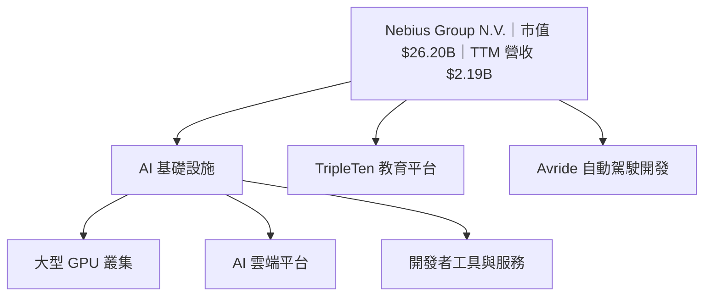
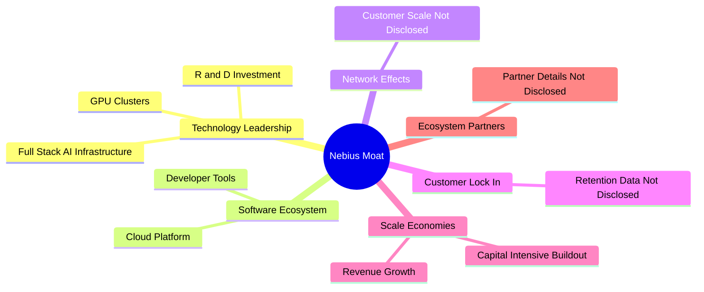
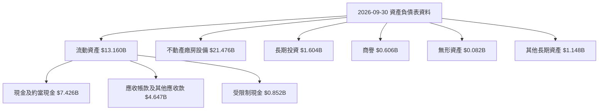
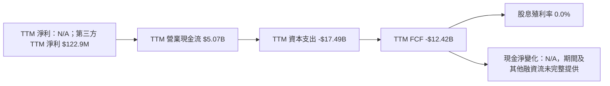
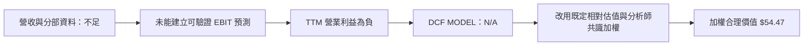
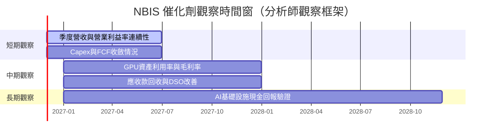
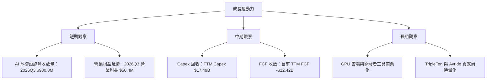
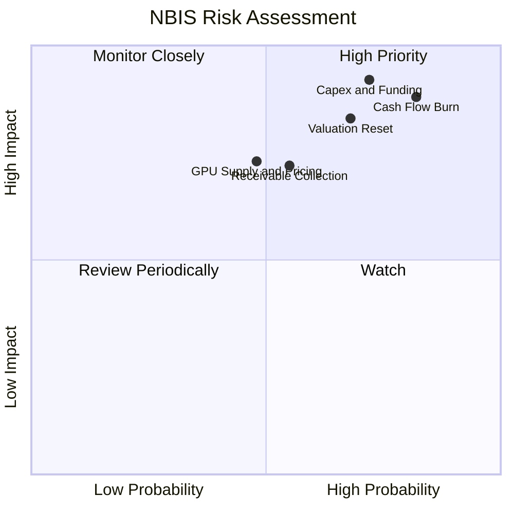
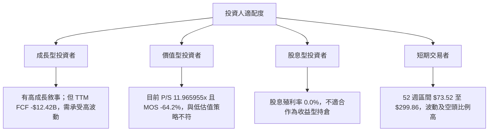

# NBIS 基本面深度分析報告
> **報告日期**：2026-11-28 ｜ **語言**：繁體中文 ｜ **數據來源**：Yahoo Finance、Finviz、StockAnalysis、Roic.ai ｜ **分析師**：CFA 級機構研究

## 目錄

| # | 章節 | 核心結論 |
|---|------|----------|
| 1 | 執行摘要 | 賣出；加權合理價值 $54.47，安全邊際 MOS -64.2% |
| 2 | 公司概覽與商業模式 | AI 基礎設施是核心敘事，但收入分部與市場份額資料不足以驗證護城河 |
| 3 | 損益表深度分析 | TTM 營收 $2.19B；最新一季年增 571.3%，TTM 營業利益率 -23.0% |
| 4 | 資產負債表分析 | 淨負債 $8.67B；流動比率 5.306，但應收帳款周轉偏慢 |
| 5 | 現金流量深度分析 | TTM FCF -$12.42B，資本支出高於營業現金流 |
| 6 | 獲利能力與資本效率 | ROIC 未提供，無法證明已超越 7.37% WACC 創造價值 |
| 7 | 相對估值分析 | 公司 P/S 11.97x，高於同業中位數 4.7x |
| 8 | DCF 內在價值評估 | DCF 不適用：TTM 營業利益為負；估值採既定方法三角驗證 |
| 9 | 成長催化劑 | AI 算力需求與業務放量是主要機會，但 TAM 與業務分部數據未提供 |
| 10 | 風險矩陣 | 資本支出與融資、現金流轉負、估值回落為前三大風險 |
| 11 | 投資建議 | 依 MOS 評級為賣出；需觀察現金流、負債及盈利轉正進度 |

## 1. 執行摘要

### 1.0 一頁式投資儀表板

| 項目 | 內容 |
|------|------|
| **投資論點（3 句）** | ① TTM 營收 $2.19B，最新一季營收年增 571.3%，顯示 AI 基礎設施業務快速放量。② TTM 營業利益率 -23.0%、FCF -$12.42B，成長尚未轉化為穩定自由現金流。③ 2026-11-27 收盤價 $89.46，對照加權合理價值 $54.47，MOS 為 -64.2%，估值風險偏高。 |
| **綜合評分** | **4.5/10**（引用 1.1 評分卡） |
| **財務健康** | 🔴 淨負債 $8.67B、TTM FCF -$12.42B；流動比率 5.306 提供一定短期緩衝，但不等於長期融資風險消失。 |
| **ROIC vs WACC** | ROIC：N/A；WACC：7.37%。缺少可比 ROIC，不能判定已創造或摧毀股東價值。 |
| **FCF 趨勢** | TTM FCF 為 -$12.42B，投資支出大幅超過營業現金流；FCF Yield -47.40%。 |
| **估值** | Forward P/E -29.38761x｜EV/EBITDA 56.967x｜FCF Yield -47.40%。負盈餘使 Forward P/E 的經濟解讀有限。 |
| **DCF 內在價值（基準）** | N/A（TTM 營業利益為負，DCF MODEL 未提供）；折溢價 N/A。 |
| **安全邊際（MOS）** | **-64.2%**＝($54.47 − $89.46) ÷ $54.47；以 8.8 加權合理價值為基準。🔴 |
| **預期報酬（基準情境 12M）** | DCF 情境未提供；以加權合理價值比較現價的上行空間為 **-39.1%**，不是 DCF 12 個月預測。 |
| **關鍵風險（前二）** | 大額資本支出持續壓低 FCF；淨負債 $8.67B 且公司仍處於營業虧損狀態。 |
| **評級 + 信心度** | 🔴 **賣出** ｜ 信心：中（負 FCF 與高估值可量化，但 DCF 不適用、分部資料有限） |

### 1.1 綜合評分卡

| 維度 | 評分（1–10） | 主要依據（引用數字與其來源章節） |
|------|--------------|----------------------------------|
| 成長性 | 9.0 | TTM 營收 $2.19B；最新一季年增 571.3%，但 TTM 成長率為 N/A（第 3 章）。 |
| 獲利能力 | 3.0 | TTM 營業利益率 -23.0%、ROIC N/A，無法驗證營運已跨過資本成本（第 3、6 章）。 |
| 財務健康 | 4.0 | 淨負債 $8.67B、流動比率 5.306；DSO 673 天、TTM FCF -$12.42B（第 4、5 章）。 |
| 估值 | 1.0 | MOS -64.2%；本公司 P/S 11.965955x，Peer P/S 中位數 4.7x（第 7、8 章）。 |
| 護城河 | 6.0 | 公司提供 GPU 叢集、AI 雲端平台及開發者工具，但沒有市場份額、客戶留存或各業務收入占比資料（第 2 章）。 |
| 管理層與資本配置 | 4.0 | FY2025 Capex $4.07B、TTM Capex $17.49B；FY2025 SBC $83.2M，股數與投資報酬資料不足以判定資本配置效率（第 3、5 章）。 |
| **綜合評分** | **4.5** | 六項算術平均：$(9+3+4+1+6+4)÷6=4.5$。 |

### 1.2 五大投資論點 + 三大核心風險

| 類型 | 項目 | 具體依據 | 信心度 |
|------|------|----------|--------|
| 🟢 **投資論點①** | AI 基礎設施營收快速放量 | 最新一季營收 $980.8M，年增 571.3%；營收由 2025Q4 $227.7M 增至 2026Q3 $980.8M。 | 🟢 高 |
| 🟢 **投資論點②** | TTM 毛利率具一定承載能力 | TTM 毛利率 76.0%，高於 CRWV 66.8%、ORCL 64.0%、MSFT 67.7%；但毛利率尚未帶來正 TTM 營業利益。 | 🟡 中 |
| 🟢 **投資論點③** | 短期流動性指標尚可 | 現金及短期投資 $7.43B，流動比率 5.306、速動比率 4.847。 | 🟡 中 |
| 🟢 **投資論點④** | 多元業務具選擇權 | 公司概述包含 AI 基礎設施、TripleTen 教育平台與 Avride 自動駕駛開發；分部財務資料未提供，選擇權難以量化。 | 🟡 中 |
| 🟢 **投資論點⑤** | 機構持股提供市場參與度 | 機構持股 61.9%，但不能單獨作為基本面品質或估值支撐證據。 | 🟡 中 |
| 🟡 **風險①** | 資本支出大幅超過營業現金流 | TTM OCF $5.07B、Capex $17.49B、FCF -$12.42B。若投資回收慢於折舊與融資成本，可能持續消耗資本。 | 🔴 高 |
| 🔴 **風險②** | 估值顯著高於同業銷售倍數 | NBIS P/S 11.965955x，Peer P/S 中位數 4.7x；公司仍虧損，估值對成長延續高度敏感。 | 🔴 高 |
| 🔴 **風險③** | 淨負債及應收帳款周轉壓力 | 淨負債 $8.67B；DSO 673 天。若應收款回收期延長，現金流壓力可能高於損益表所示。 | 🔴 高 |

### 1.3 快速統計卡片

| 指標 | 公司實際值（期間） | 同業中位數 | 狀態 |
|------|--------------------|------------|------|
| 營收成長（TTM） | **N/A** | — | 🟡 無法比較 |
| 營收成長（最新一季年增） | **571.3%** | 29.6% | 🟢 |
| 毛利率（TTM） | **76.0%** | 66.8% | 🟢 |
| 營業利益率（TTM） | **-23.0%** | — | 🔴 |
| ROIC（TTM） | **N/A** | — | 🟡 |
| Forward P/E | **-29.38761x** | 9.7x* | 🔴 不具直接可比性 |
| FCF Yield（TTM） | **-47.40%** | — | 🔴 |
| Piotroski F-Score | **N/A** | — | 🟡 |

\* 同業 Forward P/E 中位數為 CRWV -24.8x、ORCL 9.7x、MSFT 20.3x 的中位數；負盈餘公司之 P/E 倍數不宜作為可靠估值錨點。

### 1.4 投資結論

```text
╔══════════════════════════════════════════════════════════════════╗
║                    📊 投資結論摘要                               ║
╠══════════════════════════════════════════════════════════════════╣
║  評級：賣出（MOS -64.2%，按規則 20）                             ║
║  價格（2026-11-27 收盤）：$89.46                                 ║
║  DCF 內在價值（基準）：N/A（TTM 營業利益為負）                   ║
║  安全邊際 MOS：-64.2%（以加權合理價值 $54.47 為分母）            ║
║  加權合理價值（8.8）：$54.47                                     ║
║  DCF 情境價值：N/A（DCF MODEL 未提供）                           ║
║  綜合評分：4.5/10（引用 1.1）                                    ║
║  適合投資人：可承受高波動與高資本支出風險、並能持續追蹤營運者；  ║
║              不適合以現金流穩定或低估值為核心的投資人。          ║
╚══════════════════════════════════════════════════════════════════╝
```

## 2. 公司概覽與商業模式

### 2.1 業務結構與收入來源



已披露的公司概述將 AI 全棧基礎設施列為核心業務，涵蓋 GPU 叢集、雲端平台與開發者工具；亦提及 TripleTen 與 Avride。**各業務收入金額及占比未提供**，不以合併營收反推分部規模。

### 2.2 市場份額

市場份額數據未提供，近期新聞亦未提供可直接引用的份額數字與年份，因此不繪製市場份額圖。NBIS TTM 營收 $2.19B，最新一季年增 571.3%；CRWV 最新一季年增 168.2%。兩者增長率可作動能參照，但公司業務範圍與營收基數不同，不能據此推定市場份額。

### 2.3 競爭護城河分析



### 2.4 護城河強度

| 護城河項目 | 強度（強／中／弱） | 證據（引用數字或事實） | 會削弱它的情況 |
|------------|--------------------|------------------------|----------------|
| 技術與算力基礎設施 | 中 | 提供大型 GPU 叢集、AI 雲端平台與開發者工具；TTM 毛利率 76.0%。 | GPU 供應受限、算力價格下跌，或大型雲端供應商加速自建。 |
| 軟體與開發者生態 | 弱至中 | 公司提供開發者工具，但使用者數、留存率與軟體收入占比未提供。 | 開發者可低成本跨平台遷移，或平台服務缺乏差異化。 |
| 網路效應 | 弱／未證實 | 客戶數及網路效應指標未提供。 | 客戶集中、缺乏跨客戶資料或社群效應。 |
| 客戶鎖定 | 弱／未證實 | 合約期限、續約率與客戶取得成本未提供；DSO 673 天也提示需追蹤收款條件。 | 客戶轉換成本低、合約續約率下降或付款週期延長。 |
| 規模效應 | 中 | 最新一季營收 $980.8M，年增 571.3%；同時 TTM Capex $17.49B，資本需求龐大。 | 利用率不佳、設備折舊快於需求與定價能力提升。 |
| 生態夥伴 | 弱／未證實 | 公司概述未列出可量化的合作夥伴與收入貢獻。 | 供應商或合作方轉向競爭對手、合作條件惡化。 |

護城河評分引用 1.1 的 **6.0/10**：快速成長與全棧產品提供可能的競爭基礎，但缺少客戶留存、分部收入與市場份額等驗證指標。

## 3. 損益表深度分析

### 3.1 年度收入成長趨勢（近4年）

年度營收數據來自年報彙整；年度 CAGR 為依 FY2022–FY2025 年營收計算，不等同於 TTM 成長率。

```text
╔══════════════════════════════════════════════════════════════════╗
║              NBIS 年度收入趨勢（FY2022–FY2025）                  ║
╠══════════════════════════════════════════════════════════════════╣
║  FY2022  $0.014B  █░░░░░░░░░░░░░░░░░░░░░░░  YoY：—             ║
║  FY2023  $0.010B  ░░░░░░░░░░░░░░░░░░░░░░░  YoY：-27.4% 🔴      ║
║  FY2024  $0.092B  ████░░░░░░░░░░░░░░░░░░░  YoY：+833.7% 🟢     ║
║  FY2025  $0.530B  ████████████████████████  YoY：+479.0% 🟢     ║
╠══════════════════════════════════════════════════════════════════╣
║  FY2022–FY2025 年營收 CAGR：依年報數據計算約 +240%                ║
║  注意：FY2022–FY2025 年度 CAGR 不可替代 TTM 成長率；TTM 成長率 N/A║
╚══════════════════════════════════════════════════════════════════╝
```

計算依據：FY2023 YoY 為 $9.8M ÷ $13.5M − 1；FY2024 為 $91.5M ÷ $9.8M − 1；FY2025 為 $529.8M ÷ $91.5M − 1。FY2023 的低基期和後續業務組合變動使年度成長率容易出現極端波動。

### 3.2 季度收入趨勢分析

| 季度 | 營收 | QoQ 成長 | YoY 成長 | 備註 |
|------|------:|---------:|---------:|------|
| 2025Q4 | $227.7M | +55.9% | +546.88% | QoQ 以 2025Q3 $146.1M 為基準。 |
| 2026Q1 | $399.0M | +75.2% | +683.89% | 對比 2025Q4。 |
| 2026Q2 | $582.3M | +45.9% | +454.04% | 對比 2026Q1。 |
| 2026Q3 | $980.8M | +68.4% | +571.3% | YoY 為單季年增率，不是 TTM 成長率。 |

QoQ 均為依季度營收自行計算，四捨五入至一位小數；較高增速顯示業務在加速擴張，但單季營收快速上升也伴隨高 Capex 與營運資金需求，不能直接推論自由現金流同步改善。

### 3.3 利潤率演變分析

| 利潤率指標 | FY2022 | FY2023 | FY2024 | FY2025 | 趨勢 | 評估 |
|------------|--------|--------|--------|--------|------|------|
| **毛利率** | -110.4% | -100.0% | 52.2% | 68.6% | 由負轉正並上升；FY2025 毛利率為 $363.6M ÷ $529.8M。 | 🟡 |
| **營業利益率** | -1,170.4% | -2,915.3% | -436.7% | -115.5% | 絕對虧損率收斂，但 FY2025 營業虧損仍達 $611.7M。 | 🔴 |

註：年度毛利率與營業利益率由年度損益表計算；跨年比較受極低基期影響。最新 TTM 毛利率為 76.0%、營業利益率為 -23.0%；最新單季營業利益率為 -18.7%，三者期間不同，不應混用。

**利潤率演變深度解析**：FY2024–FY2025 毛利率改善，可能與業務組合轉向 AI 基礎設施及營收規模擴大有關；但資料未提供分部成本、GPU 利用率與單位成本，無法將改善完全歸因於定價或效率。FY2025 營業利益仍為 -$611.7M，代表研發、銷售與其他營運費用仍超過毛利。至 2026Q3，單季營業利益轉正為 $50.4M，但 TTM 營業利益仍為負，需觀察是否持續，而非將單季轉正視為成熟獲利。

### 3.4 費用結構分析

費用結構圖不呈現：資料提供 FY2025 研發費用 $177.3M，但未提供完整、同口徑的銷售管理費用及各項營運費用拆分；以不完整資料繪製圓餅圖會造成比例誤導。可確定 FY2025 營收 $529.8M、毛利 $363.6M、營業虧損 -$611.7M，研發費用 $177.3M。

### 3.5 季度 EPS 趨勢與盈餘品質（Quality of Earnings）

| 季度 | EPS 實際值（第三方季度資料） | EPS 預期／超預期判斷 | 損益補充 |
|------|-----------------------------:|----------------------|----------|
| 2025Q4 | -$1.11 | 預期值缺漏，無法判定 | 淨損 -$268.8M |
| 2026Q1 | $2.11（另有資料列 $2.40，口徑不一致） | 預期值缺漏，無法判定 | 淨利 $621.2M，與其他季度明顯波動 |
| 2026Q2 | -$0.78（另有資料列 -$0.68） | 預期值缺漏，無法判定 | 淨損 -$190.4M |
| 2026Q3 | -$0.14（另有資料列 -$0.13） | 預期值缺漏，無法判定 | 淨損 -$37.5M |

EPS estimate 與 actual 的財報事件資料均為 NaN，不能判斷超預期或不及預期。第三方季度 EPS 數列本身亦有差異，因此僅列示並提示口徑不一致，不據此推導目標價。FY2026Q1 淨利大幅為正、但相鄰季度為虧損，顯示淨利可能受到非營運項目或一次性項目影響；具體項目資料不足，不能確認成因。

| 盈餘品質項目 | 數值／佔比 | 評估 |
|--------------|-----------|------|
| 股權薪酬 SBC / 營收 | 最新四季 SBC 合計 $221.4M ÷ TTM 營收 $2.19B = **約 10.1%** | 🔴 SBC 代表股東稀釋成本；若以新股支付，會降低每股價值。 |
| SBC / 營業現金流 | $221.4M ÷ $5.07B = **約 4.4%** | 🟡 比率看似不高，但 OCF 可能含營運資金大幅變化，不能因此視為 SBC 成本低。 |
| FCF / 淨利（現金轉換率） | TTM FCF -$12.42B；StockAnalysis TTM 淨利 $122.9M；比率約 **-101.1x** | 🔴 現金流轉換嚴重為負；分母受非經常性損益影響時倍數尤其不穩定。 |
| 一次性／非經常性損益 | FY2026季度淨利大幅波動；具體一次性項目 N/A | 🔴 無法確認非經常性損益明細，GAAP 淨利的持續性需保留疑問。 |
| 有效稅率異常 | 最新年度有效稅率 29.0% | 🟡 公司當期有虧損季度及獲利季度，單一年度稅率不宜直接外推。 |
| 資本化支出 vs 費用化 | TTM Capex $17.49B；折舊攤銷明細 N/A | 🔴 大額資本化投資可能令當期損益尚未完整反映資產使用成本；折舊與資產壽命資料不足。 |

**盈餘品質結論**：收入增長有營運數字支持，但利潤與現金流的穩定性不足。TTM FCF -$12.42B、SBC 約占 TTM 營收 10.1%，且淨利受季度波動影響。估值不宜只依賴會計淨利或單季營業轉正，應優先追蹤利用率、資本開支回收與經常性現金流。

## 4. 資產負債表分析

### 4.1 資產結構分解



上圖僅列出來源中可辨識的資產項目，不代表各項目已完整加總為總資產；最新季度總資產總額未在資料中明確提供。

### 4.2 流動性與營運資金分析

| 指標 | 最新 TTM | 一年前 TTM | 變化 | 解讀 |
|------|----------|------------|------|------|
| DSO 應收帳款天數 | **673 天** | N/A | N/A | 應收款占營收比偏高；應檢視客戶付款條款、回款及應收款組成。 |
| DIO 存貨天數 | **N/A** | N/A | N/A | 公司未報告可用存貨餘額，不推定為零天。 |
| DPO 應付帳款天數 | **368 天** | N/A | N/A | 可能反映供應商付款週期較長；需與供應商條款及資本支出採購安排核對。 |
| CCC 現金轉換週期 | **N/A** | N/A | N/A | 因 DIO N/A，無法依公式計算 CCC。 |

| 流動性指標 | 數值 | 評估 |
|------------|------:|------|
| 流動比率 | 5.306 | 🟢 短期帳面流動性較充裕，但不代表現金可自由用於營運。 |
| 速動比率 | 4.847 | 🟢 存貨非主要短期流動性來源。 |
| 現金及短期投資 | $7.43B | 🟡 相對於總債務 $16.10B 仍不足以消除淨負債。 |

### 4.3 債務結構分析

```text
╔══════════════════════════════════════════════════════════════════╗
║                   NBIS 債務健康診斷                              ║
╠══════════════════════════════════════════════════════════════════╣
║  總債務：          $16.10B   ████████████████████  🔴            ║
║  現金及短期投資：   $7.43B   █████████░░░░░░░░░░░  🟡            ║
║  淨負債：           $8.67B   ███████████░░░░░░░░░  🔴            ║
║                                                                  ║
║  Debt/Equity：130.875（來源未明確標示倍數或百分比，不改寫單位）  ║
║  Debt/EBITDA：N/A（未提供可比的最新 TTM EBITDA／口徑）            ║
║  Interest Coverage：N/A（利息保障倍數資料未提供）                 ║
║  流動比率：5.306 ｜ 速動比率：4.847                              ║
╚══════════════════════════════════════════════════════════════════╝
```

### 4.4 股東權益趨勢

```text
╔══════════════════════════════════════════════════════════════════╗
║                   股東權益年度變化                               ║
╠══════════════════════════════════════════════════════════════════╣
║  FY2022  $4.25B   ████████████████████                           ║
║  FY2023  $3.29B   ███████████████                                ║
║  FY2024  $3.25B   ███████████████                                ║
║  FY2025  $4.59B   ██████████████████████                         ║
╚══════════════════════════════════════════════════════════════════╝
```

FY2025 股東權益較 FY2024 增加 $1.34B，但資料未提供權益變化的完整拆分，不能將變動單獨歸因於募資、損益或其他綜合收益。

## 5. 現金流量深度分析

### 5.1 現金流量瀑布圖



### 5.2 FCF 轉換率趨勢

| 年度／期間 | FCF | 淨利 | FCF / 淨利 | 解讀 |
|------------|----:|-----:|-----------:|------|
| FY2022 | $682.4M | $745.6M | 91.5% | 正向現金轉換，但為不同成長階段的年度數據。 |
| FY2023 | $746.9M | $241.3M | 309.7% | FCF 高於淨利；營運資金與非現金項目可能造成差異。 |
| FY2024 | -$561.9M | -$641.4M | 87.6% | 損失與現金消耗同向。 |
| FY2025 | -$3.68B | $82.5M | -44.6x | FCF 與淨利背離，Capex 擴張是主要壓力來源。 |
| TTM 至 2026-09-30 | -$12.42B | TTM 淨利 $122.9M（StockAnalysis） | 約 -101.1x | 現金流與獲利轉換品質偏弱，且不同來源口徑需留意。 |

### 5.3 自由現金流趨勢

```text
╔══════════════════════════════════════════════════════════════════╗
║              NBIS 自由現金流：年度實際與 TTM                     ║
╠══════════════════════════════════════════════════════════════════╣
║  FY2022  +$0.68B   ████░░░░░░░░░░░░░░░░░  正 FCF                ║
║  FY2023  +$0.75B   ████░░░░░░░░░░░░░░░░░  正 FCF                ║
║  FY2024  -$0.56B   ░░░░░░░░░░░░░░░░░░░░░  負 FCF                ║
║  FY2025  -$3.68B   ░░░░░░░░░░░░░░░░░░░░░  Capex 擴大            ║
║  TTM     -$12.42B  ░░░░░░░░░░░░░░░░░░░░░  FCF Yield -47.40%     ║
╚══════════════════════════════════════════════════════════════════╝
```

### 5.4 資本配置評估

資本配置圓餅圖不呈現：資料沒有完整、同口徑的回購、股息、投資、Capex 與留存資金拆分。已知資料如下：

| 項目 | 數值 | 評估 |
|------|------:|------|
| TTM Capex | $17.49B | 🔴 主要現金用途，遠超 TTM OCF $5.07B。 |
| FY2025 Capex | $4.07B | 🔴 較 FY2024 $807.5M 大幅增加，擴張速度需由需求與利用率驗證。 |
| 股息殖利率 | 0.0% | 不以現金股息回饋股東。 |
| FY2025 SBC | $83.2M | 🟡 股權薪酬會造成稀釋；應連同流通股數變化追蹤。 |
| 股票回購金額 | N/A | 數據未提供。 |

## 6. 獲利能力與資本效率

### 6.1 ROE / ROA / ROIC 趨勢

| 指標 | 最新可用值 | 歷史／趨勢 | 評估 |
|------|-----------:|------------|------|
| ROE | 1.5% TTM | FY2024 淨損、FY2025 淨利 $82.5M；季度淨利波動顯著。 | 🟡 數值偏低，且受一次性或非營運項目影響的可能性需核實。 |
| ROA | -1.0% TTM | 最新年度資產規模顯著擴張，盈利與資產尚未匹配。 | 🔴 資產回報未達成熟獲利水平。 |
| ROIC | N/A | 缺少可供一致計算的投入資本／NOPAT 指標。 | 🟡 不能判斷資本回報是否超過 WACC。 |
| WACC | 7.37% | 使用資本成本資料所列數值。 | 是價值創造比較基準，不代表公司已達到該回報。 |

行業均值資料未提供，因此不作行業平均對照。

### 6.2 ROIC vs WACC 分析（核心價值創造判斷）

```text
╔══════════════════════════════════════════════════════════════════╗
║                ROIC vs WACC 深度分析                             ║
╠══════════════════════════════════════════════════════════════════╣
║  WACC（資本成本資料所列）：7.37%                                  ║
║  ├── 無風險利率（10Y美債）：4.94%                                 ║
║  ├── 市場風險溢酬（假設）：5.00%                                 ║
║  ├── 原始 Beta：1.54；採用調整後 Beta：1.36                     ║
║  ├── 股權成本：11.73%（資本成本資料所列）                        ║
║  ├── 稅前債務成本：0.38%；稅率：29.0%                            ║
║  ├── 股權／債務權重：61.9%／38.1%                                ║
║  └── ✅ 採用 WACC：7.37%（依資本成本資料，不另行替換）           ║
║                                                                  ║
║  ROIC：N/A（品質指標資料缺少可計算項目）                          ║
║  EVA = ROIC − WACC：N/A                                          ║
║                                                                  ║
║  價值創造結論：ROIC 無法核實，不能判定已超越 7.37% WACC；         ║
║  TTM 營業利益率 -23.0%、FCF -$12.42B，現階段證據不足以認定創值。 ║
╚══════════════════════════════════════════════════════════════════╝
```

原始 Beta 1.54 經調整為 1.36，調整方式為 \(⅔×1.54+⅓×1\)。資本成本資料直接提供 WACC 7.37%；以已四捨五入的組成數字自行相乘可能出現約 0.01 個百分點尾差，因此本報告採用 7.37%，不以重新計算的四捨五入值取代。

### 6.3 杜邦三因素分解

N/A（品質指標資料指出，缺少可一致計算的淨利、營收、總資產或正股東權益組合；不補算或推定各因素）。

| 因素 | 數值（TTM） | 解讀 |
|------|-------------|------|
| 淨利率 | N/A | 品質指標列為 N/A。 |
| 資產週轉率 | N/A | 品質指標列為 N/A。 |
| 權益乘數 | N/A | 品質指標列為 N/A。 |
| **ROE** | **N/A** | 杜邦三因素分解整體不適用；另列報的 ROE 1.5% 不足以構成品質指標的完整分解。 |

### 6.4 財務體質：Piotroski F-Score

N/A：缺少相隔一年的兩個 TTM SEC 申報資料期，九項測試與總分均無法判定；不自行補填測試結果。

## 7. 相對估值分析

### 7.1 同業估值比較表格

| 估值指標 | **NBIS** | **CRWV** | **ORCL** | **MSFT** | NBIS 評估 |
|----------|---------:|---------:|---------:|---------:|-----------|
| **Trailing P/E** | N/A | N/A | 16.8x | 25.7x | 🔴 NBIS TTM EPS 為 -$0.26，P/E 不適用。 |
| **Forward P/E** | -29.38761x | -24.8x | 9.7x | 20.3x | 🔴 NBIS、CRWV 為負值，不能當作一般正盈餘倍數比較。 |
| **P/S Ratio** | 11.965955x | 2.5x | 4.7x | 10.6x | 🔴 NBIS 高於三家 Peer P/S 中位數 4.7x。 |
| **EV/EBITDA（TTM）** | 56.967x | 16.6x | 13.4x | 18.1x | 🔴 NBIS 倍數明顯較高；公司 TTM 營業利益仍為負。 |
| **最新一季營收年增** | 571.3% | 168.2% | 29.6% | 18.8% | 🟢 NBIS 增速較高，但不能單憑增速證明估值合理。 |
| **毛利率（TTM）** | 76.0% | 66.8% | 64.0% | 67.7% | 🟢 高於三家 Peer 中位數 66.8%，但尚未轉化為 TTM 營業獲利。 |

同業數據來源為 Yahoo Finance Peer multiples。相對估值的重點是：NBIS 營收增速更高、毛利率亦較高，但 P/S 與 EV/EBITDA 同時處於高位；市場要求公司將成長轉化為較持續的利潤與現金流。

### 7.2 歷史估值區間分析

N/A（Valuation vs own history 的歷史 P/E 區間與當前百分位數未提供；公司 TTM EPS 為負，歷史 P/E 比較亦受負盈餘限制）。

價格資料顯示 2026-11-27 收盤價 $89.46，52 週高點 $299.86、低點 $73.52；現價較 52 週高點低約 70.2%。這是價格表現而非歷史估值百分位，不能替代估值區間資料。

### 7.3 情境價值（Bear / Base / Bull）

N/A（DCF 無法計算：TTM 營業利益為負，DCF MODEL 未提供）。依資料規則，不自行設定悲觀、基準與樂觀情境目標價。

### 7.4 相對估值隱含價格區間

```text
╔══════════════════════════════════════════════════════════════════╗
║                 相對估值方法與現價位置                           ║
╠══════════════════════════════════════════════════════════════════╣
║  同業 P/S：$34.79 ───────── 現價 $89.46                         ║
║  分析師共識：$231.60                                             ║
║                                                                  ║
║  同業 P/S 估值：較現價低 61.1%                                   ║
║  分析師共識：較現價高 158.9%                                     ║
╚══════════════════════════════════════════════════════════════════╝
```

- **同業 P/S：$34.79**。Peer P/S 中位數 4.7x（CRWV 2.5x、ORCL 4.7x、MSFT 10.6x），乘以 NBIS TTM 營收作相對估值；方法與每股價值依既定估值方法資料列示。
- **分析師共識目標價：$231.60**。20 位分析師平均目標價；屬市場觀點參考，不等於可驗證的現金流價值。
- 同業 Forward P/E 因無法計算，不納入估值方法，其權重依既定估值方法規則分配。

## 8. DCF 內在價值評估（Discounted Cash Flow）

### 8.0 估值推理鏈（Thinking Logic）

**估值可行性先行判斷**：TTM 營業利益率 -23.0%，TTM FCF -$12.42B。依模型規則，TTM 營業利益不為正，DCF MODEL 標示 N/A；因此本章不建立自有 DCF、不估算 WACC 情境下的逐年 FCFF 或終值，也不給 DCF 每股內在價值。

公司價值長期取決於 AI 基礎設施能否形成持續收入、將毛利轉化為正營業利潤，以及高額 GPU／資料中心投資能否帶來正自由現金流；但業務收入分部占比與 DCF 所需預測假設均未提供，不能把敘事性成長直接轉成現金流估值。

| 決策點 | 本報告採用 | 理由（含數字） | 曾考慮但否決 | 否決理由 |
|--------|-----------|----------------|--------------|----------|
| 現金流定義 | DCF N/A | TTM 營業利益為負、TTM FCF -$12.42B。 | 自建 FCFF 預測 | 缺少程式所列 DCF 模型輸入與計算結果，禁止另建模型。 |
| 預測期 N | N/A | DCF MODEL 未提供年數。 | 任意設定 5 年或其他年數 | 缺少可驗證的營運預測依據。 |
| 終值方法 | N/A | DCF MODEL 未提供終值計算。 | Gordon Growth／退出倍數 | 以負 TTM 營業利益建立預測不符合模型規則。 |
| EBIT 基礎 | N/A | 未有可引用的 DCF 基準模型。 | 另選 GAAP 或非 GAAP 並預測 | 將造成自建 DCF，違反本報告數據規則。 |

**最脆弱的一環**：公司能否將巨額 Capex 轉化為可持續營業獲利與現金流。現有 TTM FCF -$12.42B 代表現階段不宜以穩態 DCF 數字作為估值錨。



### 8.1 模型假設總表（Model Inputs）

N/A（DCF MODEL 未提供；原因為 TTM 營業利益不為正）。因此預測期長度、營收 CAGR、期末營業利潤率、稅率、Capex／營收、D&A／營收、營運資金變動、EBIT 基礎、SBC 處理、股數稀釋率、永續成長率與終值方法均不適用；不以假設值重建模型。

### 8.2 折現率推導（WACC）

DCF 折現率使用資本成本資料提供的 **WACC 7.37%**，但本公司 DCF 本身為 N/A，故此數值不產生 DCF 估值。

```text
╔══════════════════════════════════════════════════════════════════╗
║                    WACC 資本成本資料                             ║
╠══════════════════════════════════════════════════════════════════╣
║  無風險利率（10Y Treasury）：4.94%                               ║
║  市場風險溢酬（假設）：5.00%                                     ║
║  原始 Beta：1.54；Beta used（adjusted）：1.36                    ║
║  股權成本（資料所列）：11.73%                                    ║
║  稅前債務成本：0.38% ｜ 有效稅率：29.0%                          ║
║  股權／債務權重：61.9%／38.1%                                    ║
║  WACC（資料所列，採用值）：7.37%                                 ║
║                                                                  ║
║  注意：顯示至兩位小數的輸入存在四捨五入；以顯示值重算的微小尾差 ║
║  不取代程式提供的 WACC 7.37%。                                   ║
╚══════════════════════════════════════════════════════════════════╝
```

### 8.3 逐年自由現金流預測（基準情境）

N/A（DCF MODEL 未提供；TTM 營業利益為負）。無法列出 FY+1 至 FY+N 的逐年預測、FCFF、折現因子及現值；不自行預測或填補資料。

### 8.4 終值計算（Terminal Value）

適用性檢查：N/A（DCF MODEL 未提供永續成長率 \(g\) 或基準預測期，無法檢查 WACC 與 \(g\) 關係）。Gordon Growth 與退出倍數終值均不計算。

### 8.5 企業價值 → 每股內在價值（Bridge）

N/A（DCF MODEL 未提供企業價值、現金及債務橋接、稀釋股數或每股 DCF 價值）。本節不計算 DCF 折溢價；加權合理價值的安全邊際統一於 8.8 計算。

### 8.6 敏感性分析（WACC × 永續成長率）

N/A（沒有基準 FCFF、終值與 DCF 每股價值，無法產生敏感性矩陣；不自建模型或填入情境數字）。

### 8.7 反推 DCF（Reverse DCF）

N/A（缺少可供反推的 DCF 基準模型與逐年現金流；不能用現價同時或分別反解營收 CAGR、利潤率或永續成長率）。因此不提供市場隱含營運假設或試算軌跡。

### 8.8 估值三角驗證與安全邊際

| 估值方法 | 隱含每股價值 | 上行空間（÷現價） | 權重 | 說明 |
|----------|--------------:|-------------------:|-----:|------|
| 同業 P/S | $34.79 | -61.1% | 90% | 同業中位數 P/S 4.7x 乘以公司 TTM 營收，依既定估值方法列示。 |
| 分析師共識目標價 | $231.60 | +158.9% | 10% | 20 位分析師平均目標價，作為參考方法。 |
| **加權合理價值** | **$54.47** | **-39.1%** | **100%** | 公司類型為未獲利公司；同業 Forward P/E 因不可計算而排除，權重由可用方法承接。 |

**逐步演算（權重外顯）**：

- 同業 P/S 加權值：$34.79 × 90% = $31.311。
- 分析師共識加權值：$231.60 × 10% = $23.160。
- 加權合理價值：$31.311 + $23.160 = **$54.471，按分位呈示為 $54.47**。
- 權重合計：90% + 10% = 100%。

安全邊際與上行空間：

- **MOS**＝($54.47 − $89.46) ÷ $54.47＝**-64.2%**。
- **上行空間**＝($54.47 − $89.46) ÷ $89.46＝**-39.1%**。
- **折溢價**以 DCF 基準內在價值為分母；DCF N/A，因此本報告不計算折溢價。
- MOS 負值低於 -25%，按評級規則為賣出，沒有依質化因素上調或下調。

```text
╔══════════════════════════════════════════════════════════════════╗
║                  估值區間與安全邊際                              ║
╠══════════════════════════════════════════════════════════════════╣
║  $34.79 ─────── [$54.47] ─────── $89.46 ─────── $231.60         ║
║  同業 P/S       加權合理值       現價           分析師共識        ║
║                                                                  ║
║  安全邊際 MOS = ($54.47 − $89.46) ÷ $54.47 = -64.2%             ║
║  MOS 評估：🔴 負安全邊際；現價高於加權合理價值                   ║
║  上行空間 = ($54.47 − $89.46) ÷ $89.46 = -39.1%                 ║
║                                                                  ║
║  MOS 達 10% 的價格上限：$54.47 × (1 − 10%) = $49.02             ║
║  此為估值門檻，不代表目前建議買入；當前評級仍為賣出。            ║
╚══════════════════════════════════════════════════════════════════╝
```

> 🔎 **程式複算（Python，依本節各項自動重算）**
>
> 加權合理價值 = $34.79 × 90% + $231.60 × 10% = **$54.47**（權重合計 100%）
>
> 以價格 $89.46 計：MOS = **-64.2%**，上行空間 = **-39.1%**
>
> ✅ 與本節所寫數值一致。

### 8.9 DCF 模型的局限與失效條件

- **終值依賴度**：N/A；DCF 模型未提供終值與企業價值，不能計算終值占比。
- **最脆弱的假設**：模型未提供營收成長、獲利率或終值假設，不能列出模型內的敏感度數字。基本面最需驗證的是 Capex 投資回收與正現金流形成。
- **不適用情境說明**：TTM 營業利益率 -23.0%、TTM FCF -$12.42B 且 Capex $17.49B，成熟穩態 DCF 的可靠度低。現階段以 EV/Sales／P/S 相對估值、單位經濟性與資產投資回報追蹤較合適；其中單位經濟性資料目前不足。
- **與第 10 章風險矩陣的連結**：GPU 供應、算力定價與利用率會影響收入成長與毛利；融資成本與資本需求會影響負債及股權成本；客戶回款則直接影響營運資金和 FCF。

### 8.10 複算檢核表（Audit Trail）

| # | 檢核項目 | 檢查方式 | 結果 |
|---|----------|----------|------|
| 1 | 高／中敏感度假設完整推導 | DCF 假設未提供，未自建模型。 | N/A |
| 2 | 每個假設都有來歷 | 不適用；沒有填入自選 DCF 假設。 | N/A |
| 3 | WACC 五步算式及重新計算 | 採用資本成本資料原值 7.37%，未重算替換。 | N/A（DCF 未建模） |
| 4 | Kd 分母與債務權重範圍一致 | 不自行重建 WACC 資本結構。 | N/A |
| 5 | WACC 與第 6.2 節一致 | 兩處均引用 7.37%。 | ✅ |
| 6 | 逐年表格年度數等於 N | 預測期 N 未提供，無逐年表。 | N/A |
| 7 | FY+1 FCFF 與 PV 算式 | 無 DCF 現金流模型。 | N/A |
| 8 | 預測期 PV 加總 | 無預測期 PV。 | N/A |
| 9 | WACC 與 g 關係 | g 未提供。 | N/A |
| 10 | 終值基期及折現期 | 終值未提供。 | N/A |
| 11 | EV 至每股價值橋接 | DCF EV 與每股價值未提供。 | N/A |
| 12 | SBC 三要素組合 | 不適用；DCF 未建模，未另扣 SBC 或假設稀釋率。 | N/A |
| 13 | 矩陣基準格與 DCF 每股價值一致 | 無 DCF 敏感度矩陣。 | N/A |
| 14 | 矩陣有效格符合 WACC > g | 無矩陣。 | N/A |
| 15 | 三情境機率相加為 100% | DCF 情境未提供。 | N/A |
| 16 | 反推 DCF 每列只放開一項變數 | 未進行反推。 | N/A |
| 17 | MOS 與 1.0 一致；折溢價基準正確 | MOS 均為 -64.2%；DCF 折溢價標示 N/A。 | ✅ |
| 18 | 完整輸出至第 11 章 | 全部 11 章均列示。 | ✅ |
| 19 | 8.8 加權價值等於方法加總 | $34.79×90% + $231.60×10% = $54.471；呈示 $54.47。 | ✅ |
| 20 | 評級符合 MOS 門檻 | MOS -64.2% < -25%，採賣出，未調整。 | ✅ |

## 9. 成長催化劑

### 9.1 催化劑時間軸

下列為**分析師設定的觀察時間窗**，不是公司正式財測或已公告交付日期。



### 9.2 TAM 市場規模分析

N/A（TAM 數據未提供）。公司 TTM 營收 $2.19B，最新一季營收年增 571.3%，顯示營收基礎快速擴大，但沒有市場規模、公司市場份額及業務分部收入資料，不能計算滲透率或以 TAM 推導估值。

### 9.3 成長驅動力結構圖



## 10. 風險矩陣

### 10.1 風險評分矩陣

以下機率及衝擊位置為分析師定性估計，不是財務數據或公司預測。



### 10.2 風險清單詳細分析

| # | 風險項目 | 發生機率 | 財務衝擊 | 風險評分 | 緩解措施 |
|---|----------|----------|----------|----------|----------|
| 1 | 🔴 **資本支出與融資壓力** | 高（分析師估計 70%） | 高：TTM Capex $17.49B，TTM FCF -$12.42B；若投資回收不足，融資需求可能增加。 | 🔴 9/10 | 逐季追蹤 Capex、現金、借款與已投入資產利用率；要求收入增長與現金流改善同步。 |
| 2 | 🔴 **負 FCF 延續** | 高（分析師估計 80%） | 高：FCF Yield -47.40%；目前 OCF 無法覆蓋 Capex。 | 🔴 9/10 | 觀察 OCF 來源、營運資金變化與 Capex 分期；若連續數季 FCF 惡化，重新評估資本需求。 |
| 3 | 🔴 **估值倍數下修** | 高（分析師估計 65%） | 高：NBIS P/S 11.965955x，Peer P/S 中位數 4.7x。 | 🔴 8/10 | 以營收、毛利及每股稀釋同步評估；不把高營收增速直接等同合理估值。 |
| 4 | 🟡 **應收款回收週期延長** | 中高（分析師估計 55%） | 中高：DSO 673 天，可能令帳面營收未及時轉為現金。 | 🟡 7/10 | 檢查應收款餘額、帳齡、壞帳準備與主要客戶付款條件。 |
| 5 | 🟡 **GPU 供應、定價與利用率波動** | 中（分析師估計 48%） | 高：設備投資大，若利用率或租用價格下降，毛利與資產回報承壓。 | 🟡 7/10 | 追蹤可用算力、利用率、租用價格、客戶承諾及折舊費用。 |

## 11. 投資建議

### 11.1 最終評級與評分

MOS 為 -64.2%，低於賣出門檻 -25%，因此按規則 20 評級為 **賣出**，沒有因質化因素調整。綜合評分引用 1.1 的 **4.5/10**；六項分數為成長性 9.0、獲利能力 3.0、財務健康 4.0、估值 1.0、護城河 6.0、管理層與資本配置 4.0。

### 11.2 合理價值與隱含報酬率

| 估值項目 | 每股價值 | 相對 2026-11-27 收盤價 $89.46 | 機率／權重 |
|----------|---------:|-------------------------------:|------------:|
| 加權合理價值 | $54.47 | 上行空間 -39.1%；MOS -64.2% | 估值方法權重 100% |
| DCF 悲觀情境 | N/A | N/A | DCF MODEL 未提供 |
| DCF 基準情境 | N/A | N/A | DCF MODEL 未提供 |
| DCF 樂觀情境 | N/A | N/A | DCF MODEL 未提供 |

### 11.3 買入時機與觸發因素

```text
╔══════════════════════════════════════════════════════════════════╗
║                  ✅ 買入觸發因素 Checklist                       ║
╠══════════════════════════════════════════════════════════════════╣
║  目前結論：MOS 為負、評級為賣出；不以高單季增長單獨觸發買入。    ║
║                                                                  ║
║  重新評估買入條件（需多數符合）：                                ║
║  ☐ 股價進入約 $49.02 以下，對應加權合理價值 $54.47 的 10% MOS   ║
║  ☐ 營業利益率不只單季轉正，且持續改善                            ║
║  ☐ TTM FCF 明確收斂，Capex 與 OCF 差距連續縮小                   ║
║  ☐ DSO 由 673 天下降，且應收款增速低於營收增速                   ║
║                                                                  ║
║  加碼觸發條件（至少一項成立且估值未惡化）：                      ║
║  ☐ 多季營收成長持續，並同步提升營業利益與現金流                  ║
║  ☐ 淨負債下降，且下降並非由一次性資產出售造成                    ║
║                                                                  ║
║  減碼／退出觸發條件：                                            ║
║  ☐ TTM FCF 進一步惡化或融資需求持續上升                          ║
║  ☐ 應收款週轉惡化、DSO 持續高於目前 673 天                       ║
║  ☐ 營收增長放緩但估值仍顯著高於同業銷售倍數                      ║
╚══════════════════════════════════════════════════════════════════╝
```

$49.02 為估值門檻計算：$54.47 ×（1 − 10%）= $49.023，呈示至美分為 $49.02；這是觀察價格，不是保證達到的市場低點。

### 11.4 投資人適配度分析



### 11.5 每季財報監控清單（Quarterly Watch List）

下表門檻是分析師設定的監控條件，不是公司正式指引。

| 監控項目 | 目前基準 | 加碼／改善訊號 | 減碼／警戒訊號 |
|----------|----------|----------------|----------------|
| 營收年增率 | 2026Q3 單季年增 571.3% | 成長延續，且不是只靠低基期；分部資料開始披露。 | 連續兩季低於 100%，且毛利或現金流同步惡化。 |
| 營業利益率 | TTM -23.0%；最新季 -18.7% | 連續數季改善並維持轉正。 | 連續兩季較最新單季水平再收縮 5 個百分點以上。 |
| Capex | TTM $17.49B | Capex 增速低於收入增速，且資產利用率提高。 | Capex 繼續增加但收入、毛利及利用率未同步改善。 |
| FCF | TTM -$12.42B | 連續季度改善，並逐步接近損益兩平。 | TTM FCF 低於 -$12.42B 且現金餘額下降。 |
| OCF | TTM $5.07B | 營業現金流來源透明、扣除營運資金變化後仍改善。 | OCF 轉負或主要依賴延遲付款與一次性營運資金流入。 |
| DSO／應收帳款 | DSO 673 天 | DSO 下降且應收帳款增速不高於營收增速。 | DSO 持續高於 673 天或壞帳準備上升。 |
| SBC／股數 | 最新四季 SBC 約 $221.4M；流通股數資料口徑有差異 | SBC 占營收下降、每股營收與每股現金流同步改善。 | SBC 占營收持續高於約 10%，且股數明顯擴大。 |
| 淨負債 | $8.67B | 淨負債下降且 FCF 改善。 | 淨負債繼續上升、現金下降或再融資成本增加。 |
| 財測與訂單 | 公司財測／積壓訂單數據未提供 | 財測提升並由實際收入、現金回收驗證。 | 財測下修或訂單轉收入延遲。 |

### 11.6 反面論證：什麼會證明論點錯誤（What Would Change My Mind）

```text
╔══════════════════════════════════════════════════════════════════╗
║              ⚠️ 論點失效條件（Disconfirming Evidence）           ║
╠══════════════════════════════════════════════════════════════════╣
║  多頭論點應在下列任一情況發生時重新檢視：                        ║
║  ☐ 最新一季營收年增率連續兩季低於 100%，且沒有可驗證的需求恢復    ║
║  ☐ TTM 營業利益率低於 -23.0% 並連續兩季惡化                      ║
║  ☐ TTM FCF 低於目前 -$12.42B，或融資需求增加而利用率未改善       ║
║  ☐ 淨負債高於目前 $8.67B 且現金及短期投資低於 $7.43B             ║
║  ☐ DSO 高於目前 673 天並伴隨應收款減值或壞帳準備上升             ║
║  ☐ ROIC 資料公布後仍低於 7.37% WACC，且無明確改善趨勢             ║
║  ☐ SBC 持續約占營收 10% 或更高，而每股營收與每股 FCF 未改善       ║
╚══════════════════════════════════════════════════════════════════╝
```

> **免責聲明**：本報告為 AI 自動生成，僅供研究參考，不構成投資建議。投資有風險，入市需謹慎。

---

## 資料與來源

| 項目 | 內容 |
|------|------|
| 價格 | 89.46 USD，2026-11-27 收盤（Yahoo Finance 日線） |
| 財務報表 | Yahoo quarterly statements (no SEC filing data)，最新季度 2026-09-30（TTM = four quarters to this date） |
| 有回應的資料來源 | Yahoo Finance、Finviz、StockAnalysis、Roic.ai |
| 未回應的資料來源 | SEC 申報資料 (XBRL) |
| 由程式計算 | TTM 數字、WACC、DCF 模型、估值方法與權重、加權合理價值、MOS、評級門檻、F-Score、杜邦分解、營運資金天數、綜合評分 |
| 撰寫模型 | openai / gpt-6-luna |

> 本區塊由產生報告的程式依實際取得的資料填寫，非模型撰寫。「由程式計算」的數字不是模型的估計；其餘判斷（評分、情境、策略）是模型的分析。
