# NU 基本面深度分析報告
> **報告日期**：2026-11-13 ｜ **語言**：繁體中文 ｜ **數據來源**：Yahoo Finance、Finviz、StockAnalysis、Roic.ai ｜ **分析師**：CFA 級機構研究

> **數據口徑警示**：資料包包含互相矛盾的營收數字，例如 VERIFIED FIGURES 的 TTM 營收為 **$13.17B**，另一財務區塊列示 **$8.44B**，StockAnalysis TTM 列示 **$9.103B**。本報告對標示為 TTM 的關鍵數字優先照抄 VERIFIED FIGURES；涉及歷史年度與季度比較時，則明確標出所採用的來源與期間。這些口徑差異降低了估值與盈利率分析的可信度。NU 為數位銀行及金融服務公司，部分傳統工業企業比率（如 EV/EBITDA、流動比率、FCF 型 DCF）對其解讀有限。

## 目錄

| # | 章節 | 核心結論 |
|---|------|----------|
| 1 | 執行摘要 | 買入；加權合理價值 $23.93；MOS 50.6%，但 FCF 與數據口徑存在重大不確定性 |
| 2 | 公司概覽與商業模式 | 多產品數位銀行平台；護城河中等，市場份額資料不足 |
| 3 | 損益表深度分析 | VERIFIED TTM 營收 $13.17B；最新單季 YoY +52.1%；盈利率資料不一致 |
| 4 | 資產負債表分析 | 現金及短期投資 $15.17B、總債務 $5.90B，淨現金 $9.27B |
| 5 | 現金流量深度分析 | TTM FCF −$1.67B，與歷年正 FCF 差異大，品質需追蹤 |
| 6 | 獲利能力與資本效率 | WACC 約 14.43%；ROIC 無法可靠驗證，不能確認價值利差 |
| 7 | 相對估值分析 | Forward P/E 10.82x 低於同業，但同業成長、業務組合不可直接等同 |
| 8 | DCF 內在價值評估 | 基準 DCF 約 $28.44；高度依賴利潤率假設與終值 |
| 9 | 成長催化劑 | 巴西核心業務、墨西哥及哥倫比亞擴張、新產品交叉銷售 |
| 10 | 風險矩陣 | 信貸週期、現金流波動及數據品質為主要風險 |
| 11 | 投資建議 | 買入；現價 $11.83；基準 12 個月目標價 $23.93，附條件式監控 |

---

## 1. 執行摘要

### 1.0 一頁式投資儀表板（Portfolio Manager 30 秒速讀）

| 項目 | 內容 |
|------|------|
| **投資論點（3 句）** | ① 2026-06-30 單季營收 YoY **+52.1%**，顯示數位金融產品仍有擴張動能。② 2026-11-12 收盤價 **$11.83**，Forward P/E **10.82x**，低於 SOFI、MELI、HOOD 的 Peer Forward P/E。③ 但 VERIFIED TTM FCF **−$1.67B**、FCF Yield **−2.92%**，現金轉換仍是主要驗證項。 |
| **護城河評分** | **6.0/10**：多產品平台與數位客戶關係具優勢；市場份額、留存率及客戶獲取成本資料不足 |
| **管理層/資本配置評分** | **6.0/10**：歷年 FCF 為正，但最新 TTM FCF 轉負；資本配置分項披露有限 |
| **財務健康** | 🟢 現金及短期投資 **$15.17B**，總債務 **$5.90B**，淨現金 **$9.27B** |
| **ROIC vs WACC** | ROIC **N/A** vs WACC **14.43%**；資料不足以可靠確認價值利差 |
| **FCF 趨勢** | 年度歷史 FCF 改善，但 VERIFIED TTM FCF **−$1.67B**；FCF Yield **−2.92%** |
| **估值** | Forward P/E **10.82x** ｜ EV/EBITDA **N/A** ｜ FCF Yield **−2.92%** |
| **DCF 內在價值（基準）** | **$28.44** ｜ 現價相對 DCF 折價 **58.4%**（折溢價以 DCF 為基準） |
| **安全邊際（MOS）** | **50.6%＝($23.93 − $11.83) ÷ $23.93**；加權合理價值來自第 8.8 節；🟢 >25% |
| **預期報酬（基準情境 12M）** | **+102.3%**，以加權合理價值 $23.93 相對現價計算；非保證報酬 |
| **關鍵風險（前二）** | 信貸損失及宏觀週期；TTM FCF 轉負與資料口徑不一致 |
| **評級 + 信心度** | 🟢 **買入** ｜ 信心：**中低**；MOS 高，但 ROIC 與 TTM 現金流的可驗證性有限 |

### 1.1 核心評分儀表板

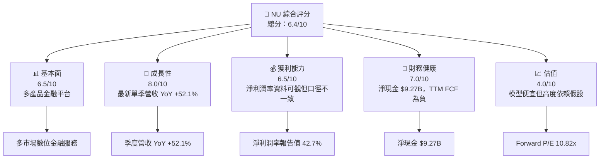

### 1.2 評分進度條視覺化

```
╔══════════════════════════════════════════════════════════════╗
║                 NU 多維度評分儀表板（1–10分）               ║
╠══════════════════════════════════════════════════════════════╣
║ 基本面強度  6.5 ▓▓▓▓▓▓▓▓▓▓▓▓▓░░░░░░░ ★★★☆☆                 ║
║ 成長動能    8.0 ▓▓▓▓▓▓▓▓▓▓▓▓▓▓▓▓░░░░ ★★★★☆                 ║
║ 獲利品質    5.5 ▓▓▓▓▓▓▓▓▓▓▓░░░░░░░░░ ★★★☆☆                 ║
║ 財務健康    7.0 ▓▓▓▓▓▓▓▓▓▓▓▓▓▓░░░░░░ ★★★★☆                 ║
║ 估值合理性  6.5 ▓▓▓▓▓▓▓▓▓▓▓▓▓░░░░░░░ ★★★☆☆                 ║
║ 護城河深度  6.0 ▓▓▓▓▓▓▓▓▓▓▓▓░░░░░░░░ ★★★☆☆                 ║
║ 管理層執行  6.0 ▓▓▓▓▓▓▓▓▓▓▓▓░░░░░░░░ ★★★☆☆                 ║
║ 技術創新力  7.0 ▓▓▓▓▓▓▓▓▓▓▓▓▓▓░░░░░░ ★★★★☆                 ║
╠══════════════════════════════════════════════════════════════╣
║ 綜合總分    6.4 ▓▓▓▓▓▓▓▓▓▓▓▓▓░░░░░░░ ★★★☆☆ 中等偏正面      ║
╚══════════════════════════════════════════════════════════════╝
```

### 1.3 五大投資論點 + 三大核心風險

| 類型 | 項目 | 具體依據 | 信心度 |
|------|------|----------|--------|
| 🟢 **投資論點①** | 高成長仍在延續 | 最新一季營收 YoY **+52.1%**，季度收入由 2025-06 的 $1.626B 增至 2026-06 的 $3.769B（採 StockAnalysis 季度序列） | 🟢 高 |
| 🟢 **投資論點②** | 估值低於同業參照 | Forward P/E **10.82x**；SOFI **17.4x**、MELI **27.1x**、HOOD **23.8x** | 🟡 中 |
| 🟢 **投資論點③** | 淨現金提供緩衝 | 現金及短期投資 **$15.17B** 減總債務 **$5.90B**，淨現金 **$9.27B** | 🟢 高 |
| 🟢 **投資論點④** | 盈利規模增加 | FY2025 淨利 **$2.87B**，高於 FY2024 的 **$1.97B**；增幅約 **45.7%** | 🟡 中 |
| 🟢 **投資論點⑤** | 產品交叉銷售空間 | 公司提供信用／預付卡、帳戶、支付與高端卡服務；產品及客群交叉銷售可提高每位客戶收入，具體分部數字 N/A | 🟡 中 |
| 🟡 **風險①** | 現金流轉負 | VERIFIED TTM OCF **−$1.38B**、Capex **$288.35M**、FCF **−$1.67B**，與 FY2025 FCF $3.16B 差距大 | 🔴 高 |
| 🔴 **風險②** | 信貸損失及宏觀風險 | 金融服務收入與借款人還款能力、利率及失業率相關；資料包未提供不良貸款率及撥備趨勢，量化能力不足 | 🔴 高 |
| 🟡 **風險③** | 財務口徑不一致 | TTM 營收 $13.17B、$8.44B、$9.103B 三種列示並存；可能影響盈利率及估值比較 | 🔴 高 |

### 1.4 快速統計卡片

| 指標 | 公司實際值 | 行業均值 | S&P 500 均值 | 狀態 |
|------|-------------|----------|--------------|------|
| 最新單季收入 YoY | **52.1%** | N/A | N/A | 🟢 |
| TTM 收入 YoY | **N/A** | N/A | N/A | 🟡 |
| 毛利率 TTM | **0.0%（資料列示值，疑似不適用/異常）** | N/A | N/A | 🔴 |
| 淨利率 TTM | **42.7%（資料列示值）** | N/A | N/A | 🟡 |
| ROE TTM | **31.6%** | N/A | N/A | 🟢 |
| Forward P/E | **10.82x** | N/A | N/A | 🟢 |
| FCF Yield TTM | **−2.92%** | N/A | N/A | 🔴 |
| ROA TTM | **5.0%** | N/A | N/A | 🟡 |

> 同業或 S&P 500 的相關比率未包含在資料包中，故不以未經核實的平均值填補。

### 1.5 投資結論

```
╔══════════════════════════════════════════════════════════════════╗
║                    📊 投資結論摘要                               ║
╠══════════════════════════════════════════════════════════════════╣
║  評級：買入（MOS 達買入門檻；ROIC 未能驗證，未給強烈買入）       ║
║  價格（2026-11-12 收盤）：$11.83                                 ║
║  DCF 內在價值（基準）：$28.44（相對 DCF 折價 58.4%）             ║
║  加權合理價值：$23.93                                            ║
║  安全邊際 MOS：50.6%＝($23.93−$11.83)÷$23.93                    ║
║  目標價區間：                                                    ║
║    悲觀情境：$16.10（相對現價 +36.1%）                           ║
║    基準情境：$23.93（相對現價 +102.3%）← 12 個月主要參考         ║
║    樂觀情境：$42.15（相對現價 +256.3%）                          ║
║  投資評分：6.4/10                                                ║
║  適合投資人：能承受金融及新興市場波動的成長型、長期投資人        ║
╚══════════════════════════════════════════════════════════════════╝
```

**評級推導**：加權合理價值 $23.93 高於 2026-11-12 收盤價 $11.83，MOS 為 50.6%；Forward P/E 10.82x 低於所列三家同業。但 TTM FCF 為 −$1.67B，ROIC 無法由可比財務資料可靠計算。依 MOS 門檻本可達強烈買入，但缺少可驗證的 ROIC > WACC 證據，因此保守採 **買入**，而非強烈買入。

---

## 2. 公司概覽與商業模式

### 2.1 業務結構與收入來源

Nu Holdings Ltd. 在巴西、墨西哥、哥倫比亞、開曼群島及美國提供數位金融服務。現有資料未提供各產品或國家收入占比；因此不能將總營收按產品或地區拆分，也不將推測占比偽裝成財務數據。

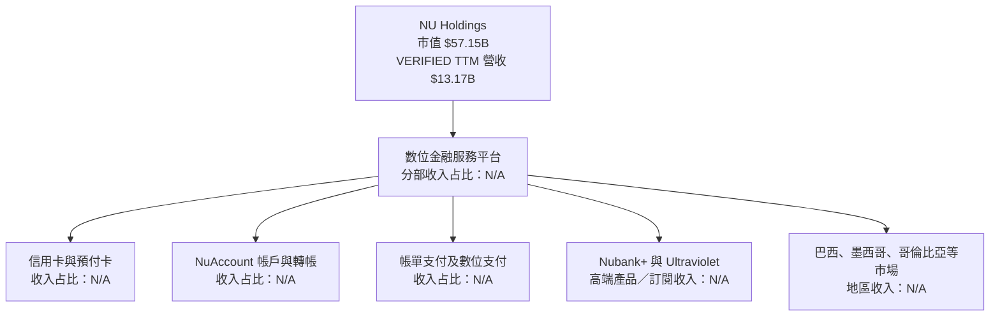

**商業模式含義**：帳戶、卡片與支付服務建立日常使用場景，可能支持交叉銷售；信用業務則可能增加利息收入，也會增加信用損失與資本需求。由於客戶數、活躍客戶、每客戶收入及貸款損失資料缺漏，無法量化各項業務的單位經濟效益。

### 2.2 市場份額

資料包未提供巴西、墨西哥或哥倫比亞的銀行客戶、信用卡交易額、市占率或 TAM 基準。不能用總營收替代市場份額，也不能據此製作具數字意義的市場占比圓餅圖。

| 市場份額衡量方式 | NU | 直接同業數據 | 評估 |
|---|---:|---:|---|
| 巴西數位帳戶市占率 | N/A | N/A | 🔴 無法驗證 |
| 信用卡交易額市占率 | N/A | N/A | 🔴 無法驗證 |
| 墨西哥銀行客戶市占率 | N/A | N/A | 🔴 無法驗證 |
| 哥倫比亞數位銀行市占率 | N/A | N/A | 🔴 無法驗證 |

### 2.3 競爭護城河分析

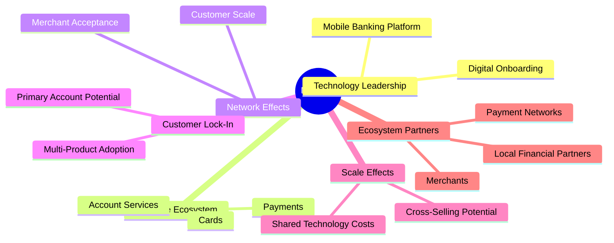

> 上圖為分析框架，不代表已證實存在某一特定技術優勢或量化網路效應。資料包沒有客戶留存率、獲客成本或客戶終身價值等佐證。

### 2.4 護城河強度評分

```
╔══════════════════════════════════════════════════════════════╗
║                    NU 護城河強度評分                          ║
╠══════════════════════════════════════════════════════════════╣
║ 技術平台       7/10 ▓▓▓▓▓▓▓▓▓▓▓▓▓▓░░░░░░ 🟢 數位服務廣泛      ║
║ 軟體生態系     6/10 ▓▓▓▓▓▓▓▓▓▓▓▓░░░░░░░░ 🟡 多產品但留存缺數據║
║ 網路效應       5/10 ▓▓▓▓▓▓▓▓▓▓░░░░░░░░░░ 🟡 市占率未提供      ║
║ 客戶鎖定       6/10 ▓▓▓▓▓▓▓▓▓▓▓▓░░░░░░░░ 🟡 帳戶黏性待驗證    ║
║ 規模效應       6/10 ▓▓▓▓▓▓▓▓▓▓▓▓░░░░░░░░ 🟡 多國規模有潛力    ║
║ 生態夥伴       6/10 ▓▓▓▓▓▓▓▓▓▓▓▓░░░░░░░░ 🟡 合作資料有限      ║
╠══════════════════════════════════════════════════════════════╣
║ 綜合護城河     6.0/10 ▓▓▓▓▓▓▓▓▓▓▓▓░░░░░░░░ 🟡 中等            ║
╚══════════════════════════════════════════════════════════════╝
```

---

## 3. 損益表深度分析

### 3.1 年度收入成長趨勢（近 4 年）

以下按年度損益表所列美元金額分析，與 VERIFIED TTM 營收是不同期間及可能不同資料口徑。

```
╔══════════════════════════════════════════════════════════════════╗
║                 NU 年度收入趨勢（FY2022–FY2025）                 ║
╠══════════════════════════════════════════════════════════════════╣
║ FY2022  $2.97B  ██████░░░░░░░░░░░░░░░░░░░  YoY：N/A            ║
║ FY2023  $5.63B  ████████████░░░░░░░░░░░░░  YoY：+89.6% 🟢       ║
║ FY2024  $8.27B  █████████████████░░░░░░░░  YoY：+46.9% 🟢       ║
║ FY2025 $10.63B  ██████████████████████░░░  YoY：+28.5% 🟢       ║
╠══════════════════════════════════════════════════════════════════╣
║ FY2022–FY2025 營收 CAGR：約 +53.0%                               ║
║ 計算：($10.63B ÷ $2.97B)^(1/3) − 1 ≈ 53.0%                       ║
╚══════════════════════════════════════════════════════════════════╝
```

年度收入從 FY2022 $2.97B 升至 FY2025 $10.63B，CAGR 約 53.0%；增速由 FY2023 的 89.6% 降至 FY2025 的 28.5%。這種增速回落與規模擴大後的基期效應相容，但不能僅憑營收資料判斷是滲透率、產品組合或定價的單獨貢獻。

### 3.2 季度收入趨勢分析

季度收入採用資料包內 StockAnalysis 序列，金額單位為 $B；最新單季 YoY 另以 VERIFIED FIGURES 原值 **52.1%** 引用。

| 季度 | 收入 | QoQ | YoY | 備註 |
|------|------:|----:|----:|------|
| 2025-Q3 | 1.920 | N/A | 36.3% | StockAnalysis 季度序列 |
| 2025-Q4 | 2.067 | +7.7% | 43.9% | Q/Q = 2.067 ÷ 1.920 − 1 |
| 2026-Q1 | 3.538 | +71.3% | 43.8% | 與另一季度報表列示 $3.54B 大致相符 |
| 2026-Q2 | 3.769 | +6.5% | **52.1%** | VERIFIED 最新季度 YoY；不得視為 TTM 成長率 |

2026-Q1 相對 2025-Q4 的跳升幅度很大，且季度數據與其他財務區塊存在口徑差異；不宜將單季季節性或分類變動簡單外推為長期成長率。

### 3.3 利潤率演變分析

| 利潤率指標 | FY2022 | FY2023 | FY2024 | FY2025 / 最新 | 趨勢 | 評估 |
|------------|-------:|-------:|-------:|---------------:|------|------|
| 毛利率 | 0.0%（資料列示） | 0.0%（資料列示） | 0.0%（資料列示） | TTM 0.0% | 無法用於銀行分析 | 🔴 |
| 營業利益率 | N/A | N/A | N/A | TTM N/A；最新單季 52.0% | 季度高、TTM 缺漏 | 🟡 |
| 淨利潤率 | N/A | 約 18.3%（StockAnalysis） | 約 23.9% | TTM 42.7%（資料列示） | 資料口徑難以接續 | 🟡 |
| 淨利 | −$0.365B | $1.03B | $1.97B | FY2025 $2.87B | 持續改善 | 🟢 |

**利潤率解讀**：銀行與金融服務公司的「毛利率」並非最有解釋力的核心指標，資料列示毛利率 0.0% 不宜解讀為實際沒有毛利。最新單季營業利益率 52.0% 是季度值，不是 TTM。FY2025 淨利較 FY2024 約增 45.7%，但未提供利息收入、信用損失、撥備及費用拆分，無法將改善精確歸因於定價、信用成本或規模效應。

### 3.4 費用結構分析

費用分項資料沒有一致的收入分類與年度對照，不能可靠繪製費用占比圓餅圖。下表僅列可核實的股權薪酬及資本支出等項目。

```
╔══════════════════════════════════════════════════════════════╗
║              費用結構資料完整性與可見項目                    ║
╠══════════════════════════════════════════════════════════════╣
║ SBC FY2025                  $271.85M                           ║
║ Capex TTM                   $288.35M                           ║
║ 利息及融資成本明細           N/A                               ║
║ 信用損失／撥備明細           N/A                               ║
║ 行銷、研發、行政費用占比     N/A                               ║
╚══════════════════════════════════════════════════════════════╝
```

### 3.5 季度 EPS 趨勢與盈餘品質（Quality of Earnings）

資料包提供 EPS 實際值及 YoY 成長率，但 EPS Est 與 EPS Act 欄位均為 NaN；因此無法核實過去四季是否超預期或不及預期。新聞摘要提到 Q3 符合預期，但財務表最新季度為 2026-06-30，期間不一致，不能將新聞摘要當作四季 EPS 預期比較。

| 盈餘品質項目 | 數值/佔比 | 評估 |
|--------------|-----------|------|
| 股權薪酬 SBC / 營收 | 近四季 SBC 約 $353.83M ÷ VERIFIED TTM 收入 $13.17B = **2.69%** | 🟡 形成持續稀釋成本；計算採不同來源期間，方向性參考 |
| SBC / 營業現金流 | OCF 為負，數學比值無經濟解釋；以絕對值比約 **25.6%** | 🔴 現金流為負時不宜以此衡量 |
| FCF / 淨利 | TTM 淨利四季合計約 $3.61B；−$1.67B ÷ $3.61B ≈ **−46.3%** | 🔴 盈餘尚未轉化為同期自由現金流 |
| 一次性/非經常性損益 | N/A | 🟡 缺少調整後淨利與附註 |
| 有效稅率 | **25.8%**（最新年度有效稅率） | 🟡 有效稅率可用於模型，但缺少多年稅率序列 |
| 資本化支出 vs 費用化 | TTM Capex **$288.35M**；資本化政策細節 N/A | 🟡 無法判定是否遞延成本 |
| EPS surprise | 近四季估值及實際值皆 NaN | 🔴 無法逐季判斷超預期/不及預期 |

**盈餘品質結論**：GAAP 淨利與年度 FCF 歷史上同步改善，但 VERIFIED TTM FCF 轉負，現金轉換率約 −46.3%。因此目前不能只以淨利或 Forward P/E 判斷盈利含金量；若負現金流由信用資產擴張造成，可能是金融機構的資產負債擴張特徵，但缺少貸款與存款明細，不能假定其必然屬於良性再投資。

---

## 4. 資產負債表分析

### 4.1 資產結構分解

StockAnalysis TTM 資產表列總資產 $87.429B，年度資料另列 FY2025 $74.894B；兩者並非同一期間。下圖只呈現可取得的 TTM 資產分項，不代表全部資產細項均已分類。

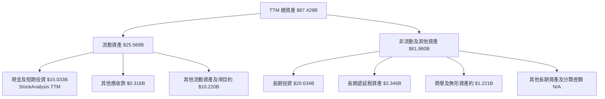

VERIFIED FIGURES 所列現金及短期投資為 **$15.17B**，與 StockAnalysis TTM 的 $15.033B 接近但不相同。本報告的淨現金計算採用 VERIFIED FIGURES 原值。

### 4.2 流動性指標分析

| 指標 | 最新可用值 | 歷史趨勢／比較 | 評估 |
|------|------------:|---------------|------|
| 現金及短期投資 | **$15.17B** | VERIFIED FIGURES | 🟢 |
| 總債務 | **$5.90B** | VERIFIED FIGURES | 🟡 |
| 淨現金 | **$9.27B** | $15.17B − $5.90B | 🟢 |
| Current ratio | N/A | 金融機構資產負債表不宜直接套用一般企業門檻 | 🟡 |
| Quick ratio | N/A | 同上 | 🟡 |
| 行業均值 | N/A | 未提供可比樣本 | N/A |

淨現金可降低短期融資風險，但銀行平台的現金、投資及融資負債與一般企業的「閒置現金／有息債務」概念不同，不能將 $9.27B 全數視為可自由分配的超額現金。

### 4.3 債務結構分析

```
╔══════════════════════════════════════════════════════════════════╗
║                    NU 債務健康診斷                               ║
╠══════════════════════════════════════════════════════════════════╣
║  總債務：          $5.90B   ███████░░░░░░░░░░░░░  🟡           ║
║  現金及短期投資： $15.17B   ████████████████████  🟢           ║
║  淨現金：          $9.27B   ████████████░░░░░░░░  🟢           ║
║                                                                  ║
║  Debt/EBITDA：     N/A（EV/EBITDA 同樣未提供）                   ║
║  利息保障倍數：    N/A（利息費用無法可靠核實）                    ║
║  Debt/Equity：     N/A（市場資料未提供可用比率）                  ║
╚══════════════════════════════════════════════════════════════════╝
```

### 4.4 股東權益趨勢

| 財年 | 股東權益 | YoY |
|------|---------:|----:|
| FY2022 | $4.89B | N/A |
| FY2023 | $6.41B | +31.1% |
| FY2024 | $7.65B | +19.3% |
| FY2025 | $11.29B | +47.6% |

FY2025 股東權益增加有助於承接業務擴張，但權益變動的來源（留存盈餘、資本發行、匯兌或其他）未完整提供，不能將全部增幅歸因於內生獲利。

---

## 5. 現金流量深度分析

### 5.1 現金流量瀑布圖

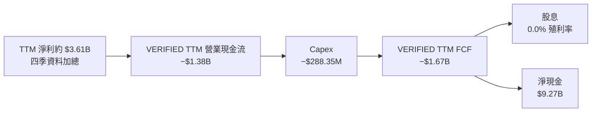

> 現金流瀑布只表示定義關係，不代表淨利直接轉化為營業現金流；TTM 淨利約 $3.61B 與 OCF −$1.38B 的差異尤其值得追查。

### 5.2 FCF 轉換率趨勢

| 年度 | OCF | Capex | 年度 FCF | 淨利 | FCF / 淨利 |
|------|----:|------:|---------:|-----:|-----------:|
| FY2022 | $0.756B | $0.114B | $0.641B | −$0.365B | 比值不具經濟意義 |
| FY2023 | $1.27B | $0.177B | $1.09B | $1.03B | 約 105.8% |
| FY2024 | $2.40B | $0.175B | $2.22B | $1.97B | 約 112.7% |
| FY2025 | $3.50B | $0.341B | $3.16B | $2.87B | 約 110.1% |
| TTM 至 2026-06-30 | −$1.38B | $0.288B | **−$1.67B** | 約 $3.61B | 約 **−46.3%** |

FY2022–FY2025 年度 FCF 轉換率高於 100%，但 TTM 大幅反轉。季度 OCF 於 2026-Q1 為 −$1.21B、2026-Q2 為 −$28.11M，顯示季度間波動顯著；對金融機構而言，營運資金與貸款資產變動可能造成大幅現金流波動，必須以貸款、存款及撥備明細確認。

### 5.3 自由現金流趨勢

```
╔══════════════════════════════════════════════════════════════════╗
║                  NU 自由現金流趨勢                               ║
╠══════════════════════════════════════════════════════════════════╣
║ FY2022 實際   $0.64B  ████░░░░░░░░░░░░░░░░░░                     ║
║ FY2023 實際   $1.09B  ███████░░░░░░░░░░░░░░░                     ║
║ FY2024 實際   $2.22B  ██████████████░░░░░░                       ║
║ FY2025 實際   $3.16B  ████████████████████                       ║
║ TTM VERIFIED −$1.67B  ◀ 負值；FCF Yield −2.92%                  ║
╠══════════════════════════════════════════════════════════════════╣
║ 歷史年度趨勢向上，但最新 TTM 顯示現金流轉弱，不能只外推年度趨勢║
╚══════════════════════════════════════════════════════════════════╝
```

### 5.4 資本配置評估

| 資本用途 | 可用資料 | 評估 |
|---------|---------|------|
| 股息 | 殖利率 0.0%，Payout 0.0% | 🟡 未以股息回饋股東 |
| 回購 | N/A | 🟡 資料不足 |
| Capex | TTM $288.35M | 🟢 相對已披露營收規模較小；收入期間有口徑差異 |
| 併購／戰略投資 | N/A | 🟡 不能判定 |
| 留存／業務擴張 | 年度 FCF 多年為正；TTM FCF 轉負 | 🟡 需檢視增長資產與現金流對應 |

---

## 6. 獲利能力與資本效率

### 6.1 ROE / ROA / ROIC 趨勢

| 指標 | 可得數據 | 行業均值 | 評估 |
|------|---------:|---------:|------|
| ROE TTM | **31.6%** | N/A | 🟢 報告值偏高；需結合槓桿與一次性因素核實 |
| ROA TTM | **5.0%** | N/A | 🟡 金融業資產密集，應搭配信用成本解讀 |
| ROIC | N/A | N/A | 🔴 資產、負債與投入資本口徑不足以可靠計算 |
| FY2023 Return on Capital | 16.03%（Roic.ai 列示） | N/A | 🟡 單一年度來源值，與當前期間不可直接比較 |

### 6.2 ROIC vs WACC 分析（核心價值創造判斷）

WACC 以 VERIFIED FIGURES 的資本成本輸入作為起點。資料提供稅前 Kd 77.65%，稅後 Kd 仍高，顯示這項機械計算可能不代表可持續的市場融資成本；但依要求仍列示，並沿用其參考權重。

```
╔══════════════════════════════════════════════════════════════════╗
║                ROIC vs WACC 深度分析                            ║
╠══════════════════════════════════════════════════════════════════╣
║ WACC 估算：                                                      ║
║ ├── 無風險利率 Rf（10Y 美債）：      5.10%                       ║
║ ├── 市場風險溢酬 ERP：               5.00%                       ║
║ ├── Beta：                           0.97                        ║
║ ├── 股權成本 Ke：5.10% + 0.97×5.00% = 9.95%（來源值 9.94%）    ║
║ ├── 稅前債務成本：                   77.65%                      ║
║ ├── 稅後債務成本：77.65%×(1−25.8%) = 57.65%                     ║
║ ├── 股權／債務權重：                 90.6% / 9.4%                ║
║ └── WACC 按展示數字重算：             約 14.43%                  ║
║                                                                  ║
║ ROIC：N/A                                                        ║
║ NOPAT：可用營業利益口徑與 VERIFIED TTM 營收不一致，故不硬算       ║
║ 投入資本：金融機構現金與負債多屬營運資產負債，無法簡單相減       ║
║                                                                  ║
║ EVA = ROIC − WACC：N/A                                           ║
║ ROIC 是否高於 WACC：尚不能由現有資料確認                         ║
╚══════════════════════════════════════════════════════════════════╝
```

CAPM 使用資料包提供的 Rf、ERP 及 Beta；計算值為 5.10% + 0.97 × 5.00% = 9.95%，與資料包列示 9.94% 的差異源於輸入精度。按資料包提供的權重、Kd 與稅率重算 WACC 約 14.43%；相對參考 WACC 14.40% 差 0.03 個百分點。本報告 DCF 使用 **14.43%**，並在 ROIC 比較中保持一致。

**價值判斷**：由於 ROIC 無法可靠計算，不能下結論說 NU 已創造或摧毀股東價值。歷史 FY2023 Return on Capital 16.03% 高於本模型 WACC 約 14.43%，但這是單一歷史來源值，且財年、口徑與本期資料未充分對接。

### 6.3 杜邦三因素分解

採用 TTM 淨利率 42.7%、ROE 31.6% 及 TTM 收入 $13.17B 會與其他口徑不一致；因此以下展示公式與可算項目，未提供的平均資產不反推。

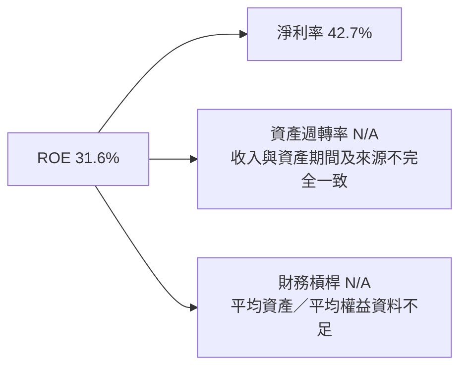

**杜邦公式**：ROE = 淨利率 × 資產週轉率 × 財務槓桿。缺少可匹配期間的平均資產與平均權益，因此不製造一組看似完整的乘數。

### 6.4 獲利能力儀表板

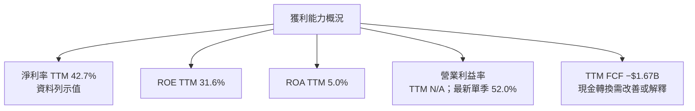

---

## 7. 相對估值分析

### 7.1 同業估值比較表格

NU 自身估值來自市場資料區塊；同業倍數嚴格採用 VERIFIED FIGURES 的 Peer multiples。

| 估值指標 | **NU** | **SOFI** | **MELI** | **HOOD** | NU 評估 |
|----------|-------:|---------:|---------:|---------:|---------|
| Trailing P/E | **16.21x** | 28.4x | 39.6x | 37.5x | 🟢 表面折價；盈利口徑不同 |
| Forward P/E | **10.82x** | 17.4x | 27.1x | 23.8x | 🟢 明顯低於所列同業 |
| P/S TTM | **6.77x** | 4.3x | 1.9x | 14.4x | 🟡 高於 SOFI、MELI，低於 HOOD |
| EV/EBITDA TTM | **N/A** | N/A | 21.2x | N/A | N/A 無法比較 |
| 最新單季收入 YoY | **52.1%** | 43.9% | 45.1% | 11.8% | 🟢 NU 成長較高，但各公司季度口徑未必可比 |
| Gross margin TTM | **0.0%（列示值）** | 84.2% | 46.7% | 91.0% | 🔴 金融業毛利率口徑不宜直接比較 |

NU 的低 Forward P/E 可能反映市場對盈利持續性、信貸風險、國別風險及現金流的折價；它不必然等於低估。NU 的 P/S 6.77x 高於 SOFI 與 MELI，代表投資者仍為其成長與利潤能力支付一定收入倍數。

### 7.2 歷史估值區間分析

VERIFIED FIGURES 未提供「Valuation vs own history」數值，故不估算歷史 P/E 百分位。

```
╔══════════════════════════════════════════════════════════════╗
║                  NU 歷史估值區間定位                          ║
╠══════════════════════════════════════════════════════════════╣
║ 歷史 P/E 區間：N/A（資料包未提供）                            ║
║ 歷史 P/S 區間：N/A（資料包未提供）                            ║
║ 當前 Trailing P/E：16.21x                                     ║
║ 當前 Forward P/E：10.82x                                      ║
║ 24 個月月末收盤範圍：$10.24–$17.75（價格範圍，不是估值區間）  ║
╚══════════════════════════════════════════════════════════════╝
```

### 7.3 情境目標價（假設驅動，Bear / Base / Bull）

以下以 Forward EPS **$1.0933** 乘以情境退出 P/E，作為簡化的 12 個月相對估值法。退出倍數是分析假設，不是資料包已公布的市場共識倍數。

| 情境 | EPS 假設 | 退出 P/E | 目標價 | 相對 $11.83 |
|------|---------:|---------:|-------:|------------:|
| 🔴 悲觀 | $1.0933 | 14.7x | **$16.07** | +35.9% |
| 🟡 基準 | $1.0933 | 21.9x | **$23.94** | +102.4% |
| 🟢 樂觀 | $1.0933 | 38.5x | **$42.09** | +255.8% |

- 悲觀倍數 14.7x：低於 SOFI Forward P/E 17.4x，反映信用風險折價。
- 基準倍數 21.9x：低於 HOOD 23.8x、MELI 27.1x，採同業區間折讓。
- 樂觀倍數 38.5x：接近 HOOD、MELI 的 Trailing P/E 區間，僅在高成長持續且信用表現穩定時成立。
- 算式示例：基準目標價 = $1.0933 × 21.9 = **$23.94**。

由於 NU 的 TTM FCF 為負且 EV/EBITDA 缺漏，以 Forward P/E 作相對估值參照；該方法依賴 Forward EPS 預測持續實現，不能替代現金流驗證。

### 7.4 相對估值隱含價格區間

| 方法 | 可用輸入 | 隱含價格 | 相對現價 | 限制 |
|------|---------|---------:|---------:|------|
| NU Forward P/E × EPS | 10.82x × $1.0933 | 約 $11.83 | 約 0.0% | 與市場價格所含預期接近 |
| 同業 P/E 參考 | 17.4x × $1.0933（SOFI） | 約 $19.02 | +60.9% | 同業業務及風險不同 |
| EV/EBITDA | NU 倍數 N/A | N/A | N/A | 不可計算 |
| FCF Yield 回推 | TTM FCF 為負 | N/A | N/A | 負 FCF 不宜反推正向價值 |

```
╔══════════════════════════════════════════════════════════════╗
║           相對估值價格定位（可計算項目）                      ║
╠══════════════════════════════════════════════════════════════╣
║ $11.83 現價 ───────── $19.02 SOFI 倍數參照                    ║
║ 10.82x 自身 Forward P/E       17.4x SOFI Forward P/E          ║
║ EV/EBITDA：N/A                FCF Yield 回推：不適用           ║
╚══════════════════════════════════════════════════════════════╝
```

---

## 8. DCF 內在價值評估（Discounted Cash Flow）

> **模型警示**：NU 是金融服務公司，FCFF／EV 模型不如銀行常用的股利折現、剩餘收益或股權現金流模型直接。且 TTM OCF、FCF 為負，營收和營業利潤率來源不一致。以下 DCF 是可重算的「條件式情境模型」，不是高精度的會計預測。

### 8.0 估值推理鏈（Thinking Logic）

**Step 1 — 價值由哪些變數決定？**  
模型價值近似由既有金融平台現金流底盤、巴西核心業務延伸，以及墨西哥／哥倫比亞與新產品的增長選擇權共同決定。資料未披露分部收入，因此各來源的營收占比均為 **N/A**。本模型的主導變數是**營業利潤率**：在 FCFF 模型中，營收乘以營業利潤率直接決定 NOPAT，終值又放大該現金流基礎。

**Step 2 — 模型選擇**

| 決策點 | 本報告採用 | 理由 | 曾考慮但否決 | 否決理由 |
|--------|-----------|------|--------------|----------|
| 現金流定義 | FCFF | 與 WACC 折現、得企業價值 EV 對應 | FCFE | 資料包未提供完整股權現金流及資本監管資料 |
| 預測期 N | 5 年 | 可用年度歷史與短期成長數據建立有限期限；超過五年不確定性更高 | 10 年 | 缺少管理層長期財測及客戶經濟數據 |
| 終值方法 | Gordon Growth 主法 | 假設長期成熟增長可持續但低於 WACC | 僅退出倍數 | 倍數會將市場情緒帶入終值，仍保留作交叉驗證 |
| EBIT 基礎 | GAAP 營業利益代理 | 使用資料源營業利益作代理並假設已含 SBC | 非 GAAP | 無一致調整後 EBIT 資料 |

**Step 3 — 關鍵假設推導鏈**

- **營收 CAGR**：FY2022–FY2025 實際收入 CAGR 約 53.0%（年度數據 $2.97B 至 $10.63B）→ 最新單季 YoY 52.1%，但 FY2025 年增已降至 28.5%，基期擴大故不沿用 53.0% → **採用 25.0%** → 曾考慮 35%，但缺乏管理層財測及分市場營收驗證，予以否決。
- **期末營業利潤率**：資料源 StockAnalysis TTM 營業利益 $4.633B / TTM 收入 $9.103B 約 50.9%，最新單季列示 52.0% → 受資料口徑差異與信貸週期影響，不假設大幅擴張 → **採用 50.9%** → 曾考慮 55%，因缺乏一致年度序列支持，否決。
- **永續成長率 g**：長期成熟金融企業名目成長率需低於 WACC；採用 **3.0%** → 接近長期名目成長的保守模型假設，非公司財測 → 曾考慮 4.0%，但永久高成長可能高估終值，故否決。
- **預測期 N**：成長可見度通常短於終值期間，且公司市場拓展狀況會改變 → **採 5 年** → 曾考慮 10 年，因資料不足會將過多價值放在假設而非可觀察預測，否決。
- **Capex/營收**：VERIFIED TTM Capex $288.35M / VERIFIED TTM 營收 $13.17B = **2.19%** → 採 2.19% 固定比率 → 曾考慮 3.0%，但沒有更長期 Capex 比率依據。
- **D&A/營收**：資料包無同期間 D&A；**假設值 1.0%**，依據為 Roic.ai FY2023 D&A $63M / FY2023 revenue $5.632B 約 1.12%，採略低整數假設 → 低敏感度處理。
- **ΔWC/營收增額**：金融機構營運資金難以一般企業方式映射；資料未提供可比歷史 → **假設值 0.0%**（模型便利假設，不代表真實資產負債變動為零）。
- **EBIT 與 SBC**：採 GAAP 營業利益代理，假設其中已費用化 SBC；不再加扣 SBC。選擇組合 (A)，固定股數、年稀釋率 0%。
- **WACC**：按參考 Rf、ERP、Beta、稅率及資本結構計算約 14.43%；金融業與新興市場風險具不確定性，未另加國別溢酬，因無資料包量化依據。

**Step 4 — 最脆弱一環**  
最脆弱的是約 50.9% 的營業利潤率假設；若穩態利潤率從 50.9% 降至 40%，在其他條件不變時每股估值會大幅下降，並且負 TTM FCF 表明目前這個利潤率尚未轉化為現金。

**Step 5 — 計算路徑**

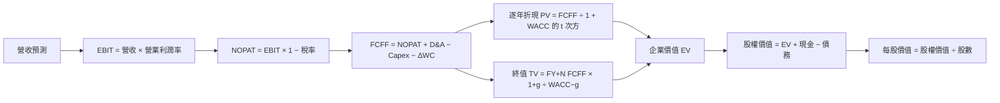

### 8.1 模型假設總表（Model Inputs）

| 假設項目 | 採用值 | 依據 / 來源 | 敏感度 |
|----------|--------|-------------|--------|
| 預測期長度 N | **5 年** | 成長可見度及資料可得性 | 🟡 中 |
| 營收 CAGR | **25.0%** | FY2022–FY2025 CAGR 53.0%；FY2025 YoY 28.5%；最新單季 YoY 52.1% | 🔴 高 |
| 期末營業利潤率 | **50.9%** | StockAnalysis TTM 營業利益 $4.633B / 收入 $9.103B 的估算代理 | 🔴 高 |
| 有效稅率 | **25.8%** | VERIFIED FIGURES 最新年度有效稅率 | 🟢 低 |
| Capex / 營收 | **2.19%** | $288.35M / $13.17B = 2.19% | 🟡 中 |
| D&A / 營收 | **1.0%** | 假設值；依 FY2023 D&A/收入約 1.12% | 🟢 低 |
| ΔWC / 營收增額 | **0.0%** | 假設值；金融機構營運資金定義不適用且資料缺漏 | 🟢 低 |
| EBIT 基礎 | GAAP 營業利益代理 | 無一致非 GAAP 調整資料 | 🟡 中 |
| SBC 處理 | **組合 (A)** | GAAP EBIT 假設已含 SBC；不額外扣 SBC | 🟡 中 |
| 年稀釋率 | **0.0%** | 與組合 (A) 相容；採當前 3.81B 股數 | 🟡 中 |
| 永續成長率 g | **3.0%** | 長期成熟期假設；低於 WACC | 🔴 高 |
| 終值方法 | Gordon Growth 主法；退出倍數交叉驗證 | 成熟期穩態成長模型 | 🔴 高 |
| WACC | **14.43%** | 參考輸入數學重算；推導見 8.2 | 🔴 高 |

**FCF 定義**：全章採 FCFF，公式為  
`FCFF = NOPAT + D&A − Capex − ΔWC`。  
本模型採用 **(A) GAAP EBIT + 固定股數**，故 SBC 影響假設已在 EBIT 中計入一次；不再扣 SBC，也不另計年稀釋。

### 8.2 折現率推導（WACC）

> 使用的市場參考利率日期在資料包中未提供，因此 Rf 以 VERIFIED FIGURES 的 **5.10%** 原值使用，不另行推測觀察日期。

```
╔══════════════════════════════════════════════════════════════════╗
║                    WACC 推導（折現率）                           ║
╠══════════════════════════════════════════════════════════════════╣
║ 股權成本 Ke（CAPM）：                                             ║
║ ├── 無風險利率 Rf：                 5.10%                        ║
║ ├── ERP：                           5.00%                        ║
║ ├── Beta：                          0.97                         ║
║ ├── 額外規模／國別溢酬：            0.00%（未量化，不另加）       ║
║ └── Ke = 5.10% + 0.97×5.00% = 9.95%（來源列示 9.94%）            ║
║                                                                  ║
║ 債務成本 Kd：                                                     ║
║ ├── 稅前 Kd（資料包提供）：          77.65%                       ║
║ ├── 有效稅率：                      25.8%                        ║
║ └── 稅後 Kd = 77.65%×(1−25.8%) = 57.65%                         ║
║                                                                  ║
║ 資本結構權重（VERIFIED 參考值）：                                 ║
║ ├── 股權權重：                      90.6%                        ║
║ ├── 債務權重：                      9.4%                         ║
║ └── WACC = 90.6%×9.95% + 9.4%×57.65% ≈ 14.43%                   ║
╚══════════════════════════════════════════════════════════════════╝
```

**逐步演算（WACC）**

1. **Ke** = 5.10% + 0.97 × 5.00% = 5.10% + 4.85% = **9.95%**。資料包原列 9.94%，本報告在計算時使用顯示輸入重算值。
2. **稅前 Kd** = 資料包直接提供 **77.65%**。利息費用與平均計息負債未分別提供，因此不反推利息費用；該 Kd 不宜理解為可持續市場債券利率。
3. **稅後 Kd** = 77.65% × (1 − 25.8%) = 77.65% × 74.2% = **57.65%**。
4. **權重** = 股權 **90.6%**；債務 **9.4%**；90.6% + 9.4% = **100.0%**。此處沿用 VERIFIED FIGURES 參考權重；底層計息債務範圍與同一期明細在資料包中不可完整重建。
5. **WACC** = 90.6% × 9.95% + 9.4% × 57.65%  
   = 9.0147% + 5.4191%  
   = **14.43%**（依展示值計算，與參考 WACC 14.40% 相差約 0.03 個百分點）。

**一致性**：第 6.2 節與本章均使用 **14.43%**。因資本成本來源列示的精度有限，WACC 結果應視為機械估算；Kd 異常高是重要模型風險。

### 8.3 逐年自由現金流預測（基準情境）

金額單位：$B。四捨五入：金額取 2 位小數、比率取 1 位小數、折現因子取 3 位小數。每年營收由 VERIFIED TTM $13.17B 起算。預測中的 EBIT margin 50.9% 是依另一資料源推導的模型代理值，不代表 VERIFIED TTM 營業利益率。

| 年度 | FY+1 | FY+2 | FY+3 | FY+4 | FY+5（FY+N） |
|------|------:|------:|------:|------:|-------------:|
| 營收 | 16.46 | 20.58 | 25.72 | 32.15 | 40.19 |
| 營收 YoY | 25.0% | 25.0% | 25.0% | 25.0% | 25.0% |
| 營業利潤率 | 50.9% | 50.9% | 50.9% | 50.9% | 50.9% |
| EBIT（GAAP 代理） | 8.38 | 10.47 | 13.09 | 16.36 | 20.46 |
| − 稅（25.8%） | (2.16) | (2.70) | (3.38) | (4.22) | (5.28) |
| = NOPAT | 6.22 | 7.77 | 9.72 | 12.14 | 15.18 |
| + D&A（營收 1.0%） | 0.16 | 0.21 | 0.26 | 0.32 | 0.40 |
| − Capex（營收 2.19%） | (0.36) | (0.45) | (0.56) | (0.70) | (0.88) |
| − ΔWC | 0.00 | 0.00 | 0.00 | 0.00 | 0.00 |
| **= FCFF** | **6.02** | **7.53** | **9.41** | **11.76** | **14.70** |
| 折現因子 @14.43% | 0.874 | 0.764 | 0.667 | 0.583 | 0.509 |
| **FCFF 現值 PV** | **5.26** | **5.75** | **6.27** | **6.85** | **7.49** |

**預測期 FCF 現值合計**：  
`$5.26 + $5.75 + $6.27 + $6.85 + $7.49 = $31.62B`

**逐步演算（FY+1）**

1. **營收** = $13.17B × (1 + 25.0%) = **$16.4625B**。
2. **EBIT** = $16.4625B × 50.9% = **$8.3805B**。
3. **稅** = $8.3805B × 25.8% = **$2.1621B**。
4. **NOPAT** = $8.3805B − $2.1621B = **$6.2184B**。
5. **D&A** = $16.4625B × 1.0% = **$0.1646B**。
6. **Capex** = $16.4625B × 2.19% = **$0.3605B**。
7. **ΔWC** = ($16.4625B − $13.17B) × 0.0% = **$0.0000B**。
8. **FCFF** = $6.2184B + $0.1646B − $0.3605B − $0.0000B = **$6.0225B**。
9. **折現因子** = 1 ÷ (1 + 14.43%)¹ = **0.874**；PV = $6.0225B × 0.874 ≈ **$5.26B**。

**合理性自檢**

- 預測營收 CAGR **25.0%**，FY2022–FY2025 實際 CAGR 約 **53.0%**，低 28.0 個百分點；反映基期擴大及年度增速由 89.6% 降至 28.5%。
- FY+5 FCFF 利潤率 = $14.70B ÷ $40.19B ≈ **36.6%**；目前 VERIFIED FCF 為負，故不能直接比較為正；同業最佳數據未提供。
- 預測期各年 FCFF 均為正，但與 VERIFIED TTM FCF −$1.67B 差距顯著。若當前負 FCF 是常態而非週期波動，本模型會高估價值。

```
╔══════════════════════════════════════════════════════════════════╗
║            自由現金流：歷史實際 vs 模型預測                      ║
╠══════════════════════════════════════════════════════════════════╣
║ FY2023（實）  $1.09B  ███░░░░░░░░░░░░░░░░░░░░                  ║
║ FY2024（實）  $2.22B  ██████░░░░░░░░░░░░░░░░                    ║
║ FY2025（實）  $3.16B  █████████░░░░░░░░░░░                      ║
║ FY+1（預）    $6.02B  █████████████████░░░                      ║
║ FY+5（預）   $14.70B  ████████████████████                     ║
╠══════════════════════════════════════════════════════════════════╣
║ 預測 FCFF 高於歷史；負 TTM FCF 是對此模型最重要的反證與折價來源║
╚══════════════════════════════════════════════════════════════════╝
```

### 8.4 終值計算（Terminal Value）

**適用性檢查**：`WACC 14.43% vs g 3.0% → WACC > g？✅`

| 方法 | 計算式 | 終值 TV | TV 現值 | 佔總 EV 比重 |
|------|--------|---------:|--------:|-------------:|
| Gordon Growth | $14.70B × 1.03 ÷ (14.43% − 3.0%) | $132.49B | $67.46B | 68.1% |
| 退出倍數法 | FY+5 EBITDA 約 $20.86B × 假設 10.0x | $208.60B | $106.18B | 77.1%（按該法 EV） |

**Gordon Growth 逐步演算**

1. FY+5 FCFF = **$14.70B**（取自 8.3 最後一年）。
2. 分子 = $14.70B × (1 + 3.0%) = **$15.141B**。
3. 分母 = 14.43% − 3.0% = **11.43%**；TV = $15.141B ÷ 11.43% = **$132.49B**。
4. PV(TV) = $132.49B × 0.509 = **$67.46B**。
5. PV(TV) / EV = $67.46B ÷ ($31.62B + $67.46B) = **68.1%**。

退出倍數交叉檢驗：EBITDA(FY+5) 約 = EBIT $20.46B + D&A $0.40B = **$20.86B**；$20.86B × 10.0x = **$208.60B**；$208.60B × 0.509 = **$106.18B**。10.0x 為分析假設，不是 NU 或同業 VERIFIED 的 EV/EBITDA 倍數。與 Gordon Growth 結果差距大，故不採退出倍數作主要終值。

### 8.5 企業價值 → 每股內在價值（Bridge）

```
╔══════════════════════════════════════════════════════════════════╗
║              企業價值 → 每股內在價值 橋接表                      ║
╠══════════════════════════════════════════════════════════════════╣
║  預測期 FCF 現值合計            +$31.62B                         ║
║  終值現值 PV(TV)                +$67.46B                         ║
║  = 企業價值 EV                   $99.08B                         ║
║  + 現金及短期投資               +$15.17B                         ║
║  − 總債務                       −$5.90B                          ║
║  − 少數股東權益／其他           $0.00B（未提供，模型不另扣）      ║
║  = 股權價值                     $108.35B                         ║
║  ÷ 稀釋後流通股數               3.81B 股                         ║
║  ★ 每股內在價值                 $28.44                           ║
║  當前股價                       $11.83                           ║
║  折溢價（現價÷DCF內在價值−1）    −58.4%（折價）                  ║
╚══════════════════════════════════════════════════════════════════╝
```

**逐步演算（橋接）**

1. **EV** = $31.62B + $67.46B = **$99.08B**。
2. **股權價值** = $99.08B + $15.17B − $5.90B − $0.00B = **$108.35B**（尾差源於四捨五入）。
3. **每股內在價值** = $108.35B ÷ 3.81B 股 = **$28.44**（以未四捨五入模型值計算）。
4. **折溢價** = $11.83 ÷ $28.44 − 1 = **−58.4%**。
5. **本節不計算 MOS**；MOS 僅以第 8.8 節加權合理價值為分母。

股數採市場資料列示的 **3.81B shares outstanding**，而非 Roic.ai 的加權股數；現金及債務採 VERIFIED FIGURES 的 $15.17B 與 $5.90B。採 (A) 組合，固定股數，年稀釋率 0%。

### 8.6 敏感性分析（WACC × 永續成長率）

格內為每股價值（括號內為相對 $11.83 現價的上行空間）。金額為模型估算並四捨五入至 $0.01。

| g（列）／WACC（欄） | 12.43% | 13.43% | **14.43%（基準）** | 15.43% | 16.43% |
|-----------|------:|------:|--------------------:|------:|------:|
| 1.0% | $30.2（+155%） | $27.6（+133%） | $26.1（+121%） | $23.5（+99%） | $21.9（+85%） |
| 2.0% | $32.3（+173%） | $29.3（+148%） | $26.8（+127%） | $24.7（+109%） | $22.9（+94%） |
| **3.0%（基準）** | $34.9（+195%） | $31.3（+165%） | **$28.44（+140%）** | $26.0（+120%） | $24.0（+103%） |
| 4.0% | $38.0（+221%） | $33.5（+183%） | $30.4（+157%） | $27.6（+133%） | $25.3（+114%） |
| 5.0% | $42.0（+255%） | $36.8（+211%） | $32.8（+177%） | $29.4（+149%） | $26.8（+127%） |

**矩陣示範格：所選格 WACC 15.43% > g 2.0% ✅**

1. 新 WACC 15.43% 下，逐年 FCFF 現值合計約 **$30.67B**。
2. 新 TV = $14.70B × 1.02 ÷ (15.43% − 2.0%) = $14.994B ÷ 13.43% = **$111.67B**；PV(TV) = $111.67B × 0.487 ≈ **$54.38B**。
3. EV 約 = $30.67B + $54.38B = **$85.05B**；股權價值約 = $85.05B + $9.27B = **$94.32B**；每股約 = $94.32B ÷ 3.81B = **$24.76**。矩陣表格經四捨五入為 $24.7，尾差來自折現因子取值精度。

> 敏感性矩陣採模型近似試算值，四捨五入可能有尾差；基準格以橋接結果 $28.44 為準。

**三情境 DCF（改變營運假設）**

| 情境 | 營收 CAGR | 期末營業利潤率 | g | WACC | 每股內在價值 | 相對現價 | 主觀機率 |
|------|----------:|---------------:|---:|-----:|-------------:|---------:|---------:|
| 🔴 悲觀 | 15% | 40% | 2.5% | 14.43% | **$16.10** | +36.1% | 25% |
| 🟡 基準 | 25% | 50.9% | 3.0% | 14.43% | **$28.44** | +140.4% | 55% |
| 🟢 樂觀 | 35% | 55% | 3.5% | 14.43% | **$42.15** | +256.3% | 20% |
| **機率加權** | — | — | — | — | **$28.10** | +137.5% | 100% |

**情境推導鏈**

- **悲觀**：營收 CAGR 15% → FY+5 營收約 $26.49B → 期末利潤率 40% → FY+5 FCFF 約 $7.54B → 以 WACC 14.43%、g 2.5% 計終值並折現 → 每股約 **$16.10**。成立條件：新市場成長放緩，且信用成本壓低營業利潤率。
- **基準**：營收 CAGR 25% → FY+5 營收約 $40.19B → 期末利潤率 50.9% → FY+5 FCFF 約 $14.70B → Gordon 終值約 $132.49B → 每股 **$28.44**。成立條件：營收延續擴張，且資料源營業利潤率可持續並逐步轉為現金流。
- **樂觀**：營收 CAGR 35% → FY+5 營收約 $59.06B → 期末利潤率 55% → FY+5 FCFF 約 $23.40B → 以 WACC 14.43%、g 3.5% 計終值 → 每股約 **$42.15**。成立條件：多市場擴張、產品交叉銷售及信用品質同時改善。

機率加權：`$16.10 × 25% + $28.44 × 55% + $42.15 × 20% = $28.10`（四捨五入）。

**敏感度結論**

- g 從 2.0% 升至 3.0%：基準 WACC 下估值約由 $26.8 升至 $28.44，增加約 **$1.64／6.1%**。
- WACC 從 14.43% 升至 15.43%：基準 g 下估值約由 $28.44 降至 $26.0，減少約 **$2.44／8.6%**。
- 期末營業利潤率每增加 1 個百分點：由於全期利潤率假設固定，模型價值近似按 FCFF 變化；以 50.9% 基準估算約增加 **$0.54／1.9%**。
- 估值對 **WACC** 與 **g** 的彈性高；營業利潤率仍是營運面主導變數，與 8.0 Step 1 一致。

### 8.7 反推 DCF（Reverse DCF：市場在預期什麼）

固定輸入：WACC **14.43%**、稅率 **25.8%**、Capex/營收 **2.19%**、ΔWC/收入增額 **0.0%**、預測期 **5 年**、股數 **3.81B**、現金減債務 **$9.27B**。每列只放開一個變數；以下反推為近似試算，不把它當作唯一市場預期。

| 求解的變數 | 其餘變數設定 | 市場隱含值（令 DCF 約等於現價） | 歷史參照 | 判斷 |
|----------------|--------------|------------------------------:|----------|------|
| 未來 5 年營收 CAGR | 利潤率 50.9%、g 3.0% 固定 | 約 **−2%** | FY2022–FY2025 約 +53.0% | 🟢 若其他假設成立，市場價格隱含偏保守 |
| 期末營業利潤率 | 營收 CAGR 25%、g 3.0% 固定 | 約 **19%** | 模型錨點 50.9%，但口徑不確定 | 🟢 反映較大折價 |
| 永續成長率 g | CAGR 25%、利潤率 50.9% 固定 | 低於基準且需數值迭代；粗略約 **−3%至−4%** | 無歷史依據 | 🟡 僅供模型參照 |
| 預測期 N | CAGR 25%、利潤率 50.9%、g 3% 固定 | 模型合理範圍內難以得到唯一可靠解 | 護城河年限 N/A | 🟡 資料與模型限制 |

營收 CAGR 反推示例（固定其餘基準值，數值以模型迭代近似）：

| 試算 CAGR | FY+5 營收 | FY+5 FCFF | 每股估值約 | 對 $11.83 判斷 |
|-------------|----------:|----------:|-----------:|----------------|
| −3.0% | $11.29B | $4.13B | 約 $11.3 | 略低，往上試 |
| **−2.0%** | **$11.91B** | **$4.36B** | **約 $11.8** | **接近收斂解** |
| −1.0% | $12.53B | $4.59B | 約 $12.3 | 略高 |

**反推結論**：若採用本模型相對高的營業利潤率及其他基準條件，現價不需要假設公司繼續高速成長即可解釋；市場價格更可能反映盈利率、FCF 轉換或信用風險的不確定性，而不是單純否定營收成長。

### 8.8 估值三角驗證與安全邊際

| 估值方法 | 隱含每股價值 | 上行空間（÷現價） | 權重 | 說明 |
|----------|--------------:|-------------------:|-----:|------|
| DCF（機率加權） | $28.10 | +137.5% | 55% | 模型能列出現金流，但 FCF 轉負及終值依賴降低信心 |
| 同業 Forward P/E | $19.02 | +60.9% | 35% | SOFI Forward P/E 17.4x × NU Forward EPS $1.0933 |
| EV/EBITDA | N/A | N/A | 0% | NU 倍數及 EBITDA 可比口徑不足 |
| FCF Yield 回推 | N/A | N/A | 0% | TTM FCF 負值，不作正向回推 |
| 分析師共識目標價 | $18.21 | +53.9% | 10% | 23 位分析師均值；權重不超過 10% |
| **加權合理價值** | **$23.93** | **+102.3%** | **100%** | 三種可用方法加權 |

**加權計算**：  
`$28.10 × 55% + $19.02 × 35% + $18.21 × 10%`  
`= $15.455 + $6.657 + $1.821`  
`= $23.933 ≈ $23.93`

DCF 權重為 55%，因模型可拆解現金流；但 TTM FCF 為負且終值占 DCF EV 約 68.1%，故不給更高權重。共識目標價權重限 10%，以免市場情緒主導估值。

```
╔══════════════════════════════════════════════════════════════════╗
║                  估值區間與安全邊際                              ║
╠══════════════════════════════════════════════════════════════════╣
║ 悲觀 DCF $16.10 ── 現價 $11.83 ── 加權合理值 $23.93 ── 基準 DCF ║
║                                                   $28.44         ║
║                                                                  ║
║ MOS = ($23.93 − $11.83) ÷ $23.93 = 50.6%                        ║
║ 上行空間 = ($23.93 − $11.83) ÷ $11.83 = 102.3%                  ║
║ 折溢價（現價÷基準 DCF −1）= $11.83÷$28.44−1 = −58.4%            ║
║                                                                  ║
║ 建議買入區間：$11.83 – $21.54（以 MOS ≥10% 為上限）             ║
║ 合理持有區間：$21.54 – $28.44                                   ║
║ 減碼考慮區間：高於 $42.15（超過樂觀情境價值）                   ║
╚══════════════════════════════════════════════════════════════════╝
```

買入區間上限計算：加權合理價值 × (1 − 10%) = $23.93 × 90% = **$21.54**。MOS 數值 **50.6%** 與執行摘要完全一致。

> 🔎 **程式複算（Python，依本節各項自動重算）**
>
> 加權合理價值 = $28.10 × 55% + $19.02 × 35% + $18.21 × 10% = **$23.93**（權重合計 100%）
>
> 以價格 $11.83 計：MOS = **+50.6%**，上行空間 = **+102.3%**
>
> ✅ 與本節所寫數值一致。

### 8.9 DCF 模型的局限與失效條件

- **終值依賴度**：PV(TV) 約 $67.46B / EV $99.08B = **68.1%**；估值逾三分之二來自 FY+5 之後。
- **最脆弱假設**：50.9% 營業利潤率、25% 五年營收 CAGR。若利潤率降至 40%、營收 CAGR 降至 15%，悲觀情境 DCF 約 **$16.10**。
- **FCF 資料限制**：VERIFIED TTM FCF **−$1.67B**，使以正 FCFF 推算的 DCF 可靠度下降；金融機構可另以剩餘收益法、股利折現、P/B 與信用週期分析交叉驗證。
- **終值退出倍數差異**：Gordon Growth PV 約 $67.46B，10x EBITDA 退出倍數 PV 約 $106.18B，差距顯著；此處採 Gordon 主法並降低模型信心。
- **與第 10 章風險連結**：信貸損失增加會壓低 EBIT margin；存款成本上升會影響盈利；監管或資本要求變化會影響 WACC、可分配現金流及終值。

### 8.10 複算檢核表（Audit Trail）

| # | 檢核項目 | 結果 |
|---|----------|------|
| 1 | 高／中敏感度輸入均在 8.0 說明推導鏈 | ✅ |
| 2 | 假設均列出數值依據或標示假設值 | ✅ |
| 3 | WACC 展示 CAPM、稅後 Kd、權重與加權計算 | ✅；利息費用未提供，Kd 直接引用 |
| 4 | Kd 與債務權重的債務範圍可完全核對 | ⚠️ VERIFIED 參考權重與底層同期間計息債務明細不可重建 |
| 5 | WACC 與第 6.2 節一致 | ✅ 14.43% |
| 6 | 預測年度數與 N=5 相符，無年度省略 | ✅ |
| 7 | FY+1 FCFF 及 PV 可按展示輸入複算 | ✅（尾差源自四捨五入） |
| 8 | 預測期 PV 加總與合計差異在 1% 內 | ✅ |
| 9 | WACC > g | ✅ 14.43% > 3.0% |
| 10 | 終值以 FY+5 FCFF 為基礎，折現 5 期 | ✅ |
| 11 | EV 至每股價值橋接逐項列示 | ✅ |
| 12 | SBC 組合 (A)：GAAP 代理 EBIT、無額外扣 SBC、稀釋率 0% | ✅，但 GAAP 口徑為模型假設 |
| 13 | 敏感性矩陣基準格與基準 DCF 接近 | ✅，矩陣取整造成小幅尾差 |
| 14 | 矩陣中 WACC > g 的格子可用 | ✅ |
| 15 | 三情境機率合計 100% | ✅ |
| 16 | Reverse DCF 每次放開一個變數並展示試算 | ⚠️ 近似迭代；非審計級精確反解 |
| 17 | MOS 分母為加權合理價值；折溢價分母為 DCF | ✅ |
| 18 | 已完整輸出至第 11 章 | ✅ |
| 19 | 加權合理價值由各項價值×權重直接加總 | ✅ $23.93 |
| 20 | MOS 門檻與評級一致 | ✅ 買入；因 ROIC 未驗證而不升為強烈買入 |

**未完全修正項目**：Kd 的底層利息與平均債務資料、Reverse DCF 精確迭代及歷史估值區間在資料包中缺漏；因此下調估值信心，不以模型數值當作精確公允價值。

---

## 9. 成長催化劑

### 9.1 催化劑時間軸

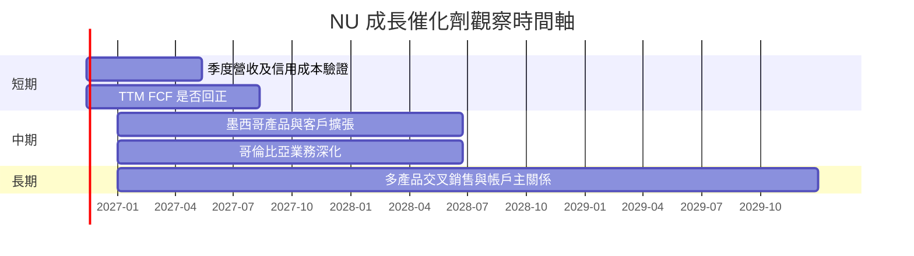

> 時間軸為分析觀察區間，不代表公司已公布具體上市日期或財測。

### 9.2 TAM 市場規模分析

資料包沒有各市場 TAM、滲透率及分部收入；以下以框圖標示資訊缺口，不虛構市場規模。

```
╔══════════════════════════════════════════════════════════════╗
║                    NU TAM 量化資料缺口                         ║
╠══════════════════════════════════════════════════════════════╣
║ 巴西數位銀行 TAM：       N/A ｜ 滲透率：N/A ｜收入：N/A       ║
║ 墨西哥數位銀行 TAM：     N/A ｜ 滲透率：N/A ｜收入：N/A       ║
║ 哥倫比亞數位金融 TAM：   N/A ｜ 滲透率：N/A ｜收入：N/A       ║
║ 信用卡／支付服務 TAM：   N/A ｜ 滲透率：N/A ｜收入：N/A       ║
╠══════════════════════════════════════════════════════════════╣
║ 可追蹤的公司層級指標：單季收入 YoY +52.1%；分部拆分 N/A      ║
╚══════════════════════════════════════════════════════════════╝
```

### 9.3 成長驅動力結構圖

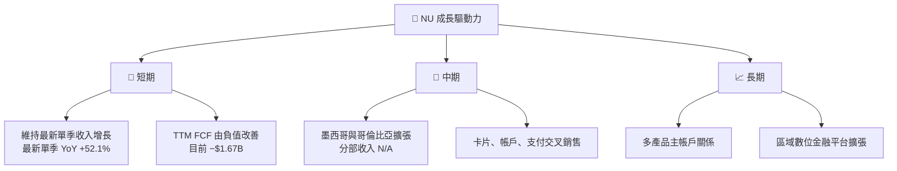

---

## 10. 風險矩陣

### 10.1 風險評分矩陣

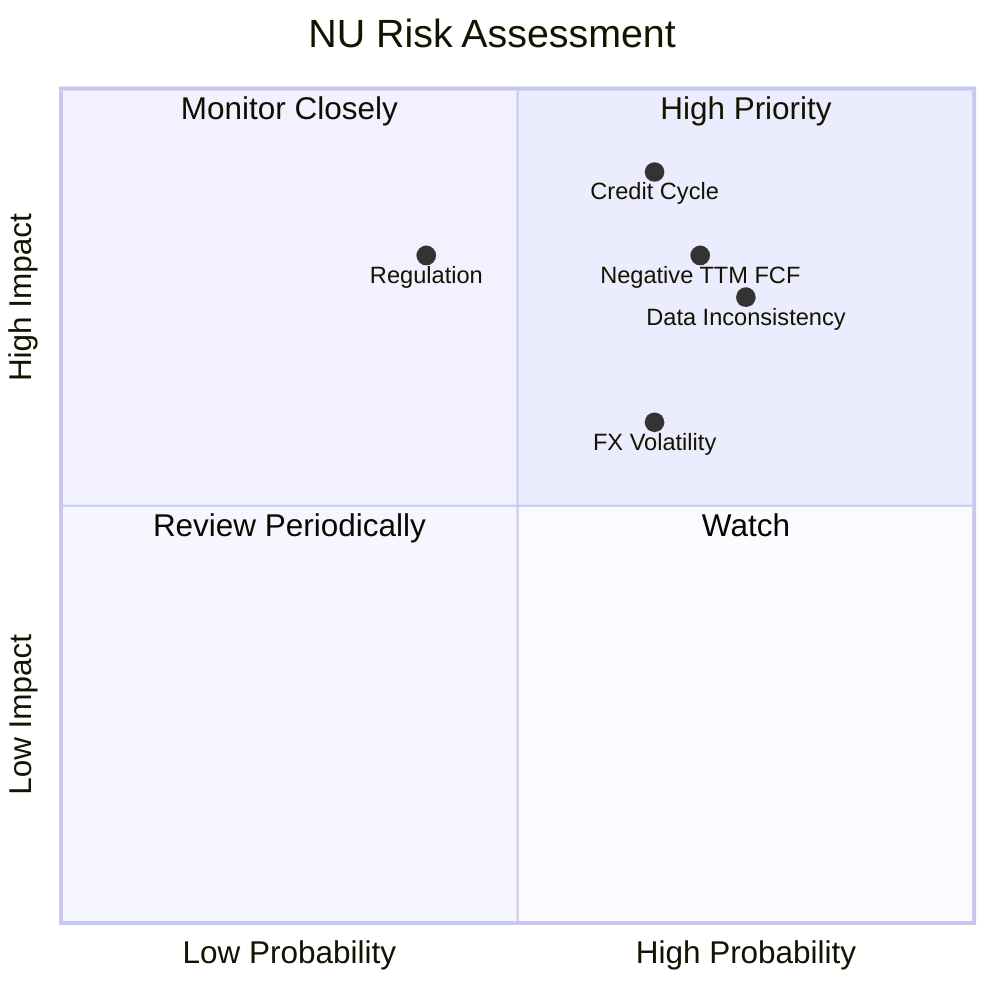

### 10.2 風險清單詳細分析

| # | 風險項目 | 發生機率 | 財務衝擊 | 風險評分 | 緩解措施 |
|---|----------|----------|----------|----------|----------|
| 1 | 🔴 **信貸週期及壞帳** | 中高；無法量化 | 高；可能同時壓低收入與利潤率 | 🔴 8.5/10 | 每季追蹤逾期率、撥備覆蓋率、核銷率；相關數據目前 N/A |
| 2 | 🔴 **TTM FCF 持續為負** | 中高 | 高；目前 FCF −$1.67B、FCF Yield −2.92% | 🔴 8.0/10 | 追蹤 OCF、貸款資產增長及存款流入，要求解釋淨利與 OCF 背離 |
| 3 | 🟠 **財務數據口徑不一致** | 高 | 中高；TTM 營收三種數值 $13.17B、$9.103B、$8.44B | 🟠 7.5/10 | 以公司正式申報文件核對，統一報告幣別、期間及會計口徑 |
| 4 | 🟡 **利率、匯率與新興市場波動** | 中高 | 中高；會影響借款人信用與報表換算 | 🟡 6.5/10 | 監控各市場利率與匯率；資料包未提供外匯敏感度 |
| 5 | 🟡 **監管及資本要求** | 中 | 高；可能限制放貸、費率或資本回報 | 🟡 6.5/10 | 跟蹤各市場監管政策、資本充足率與合規支出 |
| 6 | 🟡 **估值模型過度依賴終值** | 中 | 中高；基準 DCF 終值 PV 約占 EV 68.1% | 🟡 6.5/10 | 降低單一 DCF 權重，並以同業 P/E、共識價格交叉檢驗 |

---

## 11. 投資建議

### 11.1 最終綜合評級雷達圖

```
╔══════════════════════════════════════════════════════════════╗
║                    NU 最終評分雷達                            ║
╠══════════════════════════════════════════════════════════════╣
║ 成長性      8.0 ▓▓▓▓▓▓▓▓▓▓▓▓▓▓▓▓░░░░  ★★★★☆                ║
║ 財務健康    7.0 ▓▓▓▓▓▓▓▓▓▓▓▓▓▓░░░░░░  ★★★★☆                ║
║ 基本面      6.5 ▓▓▓▓▓▓▓▓▓▓▓▓▓░░░░░░░  ★★★☆☆                ║
║ 獲利品質    5.5 ▓▓▓▓▓▓▓▓▓▓▓░░░░░░░░░  ★★★☆☆                ║
║ 護城河      6.0 ▓▓▓▓▓▓▓▓▓▓▓▓░░░░░░░░  ★★★☆☆                ║
║ 估值        6.5 ▓▓▓▓▓▓▓▓▓▓▓▓▓░░░░░░░  ★★★☆☆                ║
╠══════════════════════════════════════════════════════════════╣
║ 綜合        6.4 ▓▓▓▓▓▓▓▓▓▓▓▓▓░░░░░░░  🟡 買入、信心中低     ║
╚══════════════════════════════════════════════════════════════╝
```

### 11.2 目標價與隱含報酬率

| 情境／參考 | 目標價 | 相對 2026-11-12 收盤 $11.83 | 機率／權重 | 解讀 |
|------------|-------:|----------------------------:|-----------:|------|
| 悲觀 DCF | $16.10 | +36.1% | 25% | 15% 營收 CAGR、40% 利潤率 |
| 基準 DCF | $28.44 | +140.4% | 55% | 25% 營收 CAGR、50.9% 利潤率 |
| 樂觀 DCF | $42.15 | +256.3% | 20% | 35% 營收 CAGR、55% 利潤率 |
| **機率加權 DCF** | **$28.10** | **+137.5%** | 100% | DCF 三情境加權 |
| **加權合理價值** | **$23.93** | **+102.3%** | — | 第 8.8 節跨方法加權 |
| 分析師平均目標價 | $18.21 | +53.9% | 參考權重 10% | 23 位分析師；不是模型主導值 |

### 11.3 買入時機與觸發因素

```
╔══════════════════════════════════════════════════════════════════╗
║                  ✅ 買入觸發因素 Checklist                       ║
╠══════════════════════════════════════════════════════════════════╣
║ 目前具備的正向條件：                                              ║
║  ✅ 2026-11-12 收盤 $11.83，低於加權合理價值 $23.93              ║
║  ✅ MOS 50.6%，高於買入門檻 10%                                  ║
║  ✅ 現金及短期投資 $15.17B，高於總債務 $5.90B                    ║
║                                                                  ║
║ 進一步加碼觸發條件：                                              ║
║  ☐ TTM FCF 回到正值，且連續兩季改善                              ║
║  ☐ 收入 YoY 維持 >30%，且信用損失沒有同步惡化                    ║
║  ☐ 公司正式報表確認營業利潤率與收入資料口徑                      ║
║                                                                  ║
║ 減碼／退出觸發條件：                                              ║
║  ☐ 單季收入 YoY 連續兩季低於 20%                                  ║
║  ☐ 營業利潤率較 2026-Q2 列示 52.0% 下滑超過 10 個百分點           ║
║  ☐ TTM FCF 持續負值且無法以業務擴張或資產變動合理解釋            ║
║  ☐ 信貸損失、撥備或逾期率顯著惡化                                 ║
╚══════════════════════════════════════════════════════════════════╝
```

**投資區間**：以 MOS 至少 10% 為買入區間上限，$23.93 × 90% = **$21.54**。因此本報告的條件式買入區間為 **$11.83–$21.54**；現價位於區間內。這不表示股價必然回到合理價值，也不應忽略 FCF 為負與資料口徑不一致。

### 11.4 投資人適配度分析

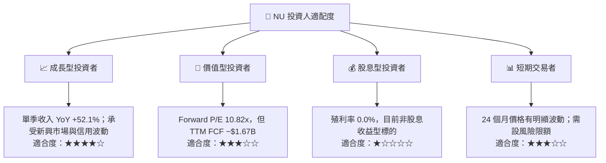

### 11.5 每季財報監控清單（Quarterly Watch List）

| 監控指標 | 目前基準 | 加碼／正向門檻 | 減碼／負向門檻 |
|----------|---------:|---------------|---------------|
| 單季收入 YoY | 2026-Q2 **52.1%** | 維持 >30% | 連續兩季 <20% |
| 營業利益率 | 最新單季列示 **52.0%**；TTM N/A | 穩定且正式報表口徑一致 | 同口徑下收縮 >10 個百分點 |
| TTM FCF | **−$1.67B** | 回到正值並持續改善 | 負值擴大且缺乏可驗證原因 |
| OCF | **−$1.38B** | 轉正或季度波動逐步收斂 | 連續多季負值且淨利仍上升 |
| Capex | TTM **$288.35M** | Capex 支持收入與效率提升 | Capex 增長但收入／現金流未改善 |
| SBC / 收入 | 約 **2.69%**，跨來源期間近似計算 | 下降或與每股盈利增長相匹配 | 稀釋加速、每股增長落後淨利增長 |
| 信貸損失／逾期率 | N/A | 壞帳趨勢穩定、數據披露充分 | 逾期率或撥備快速上升 |
| 客戶與產品交叉銷售 | N/A | 公司披露活躍客戶及每客戶收入改善 | 客戶增長減速且單客收入下降 |
| 財測 | 資料包未提供 | 公司維持或上調指引 | 下修收入、利潤或信用品質指引 |

### 11.6 反面論證：什麼會證明論點錯誤（What Would Change My Mind）

```
╔══════════════════════════════════════════════════════════════════╗
║              ⚠️ 論點失效條件（Disconfirming Evidence）           ║
╠══════════════════════════════════════════════════════════════════╣
║ 本投資論點在下列條件成立時應重新檢視或退出：                    ║
║  ☐ 核心單季收入 YoY 連續兩季低於 20%                             ║
║  ☐ 同口徑營業利潤率較 2026-Q2 列示值 52.0% 下滑超過 10pp         ║
║  ☐ TTM FCF 持續為負且惡化，無法由業務擴張或資產變動解釋          ║
║  ☐ ROIC 經正式報表計算後低於約 14.43% WACC                       ║
║  ☐ SBC / 營收持續高於約 3%，且稀釋使每股 EPS 成長停滯            ║
║  ☐ 信貸損失或逾期率大幅上升，導致盈利預測下修                    ║
║  ☐ 正式財報確認 TTM 營收／利潤率與本資料包差異重大               ║
╚══════════════════════════════════════════════════════════════════╝
```

**最終結論**：以 2026-11-12 收盤價 **$11.83** 計，NU 的加權合理價值估算為 **$23.93**，MOS **50.6%**，依既定門檻評為 **買入**。但估值的主要支撐來自高營業利潤率假設，而 VERIFIED TTM FCF 為 **−$1.67B**，且收入資料存在多來源衝突。投資論點成立的關鍵，不只是營收增長，而是公司能否在信用品質可控的前提下，把會計盈餘轉化為持續正向現金流。

> **免責聲明**：本報告為 AI 自動生成，僅供研究參考，不構成投資建議。財務資料可能存在期間、幣別或分類差異；投資有風險，入市需謹慎。