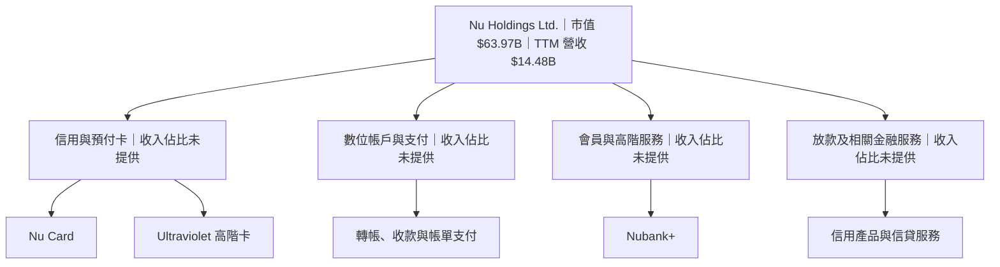
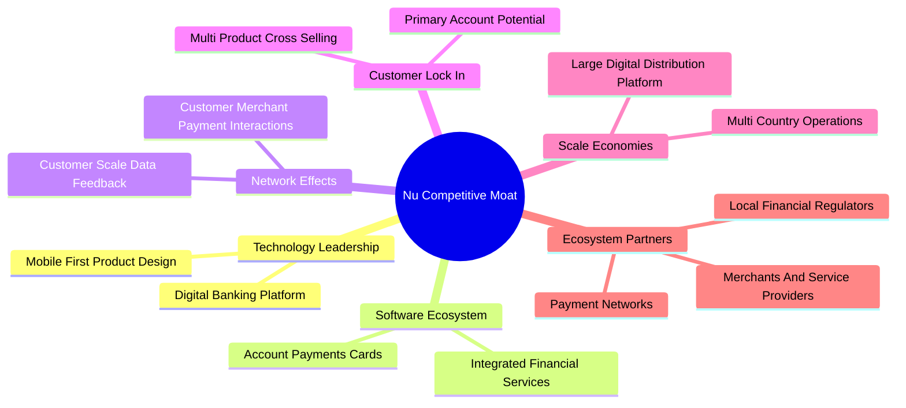
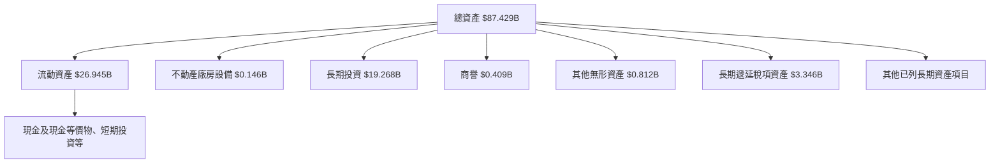
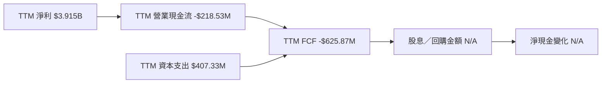
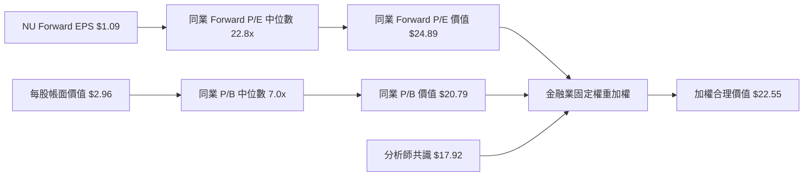
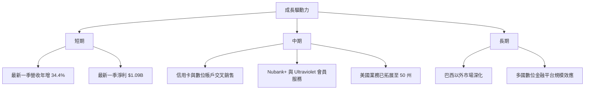
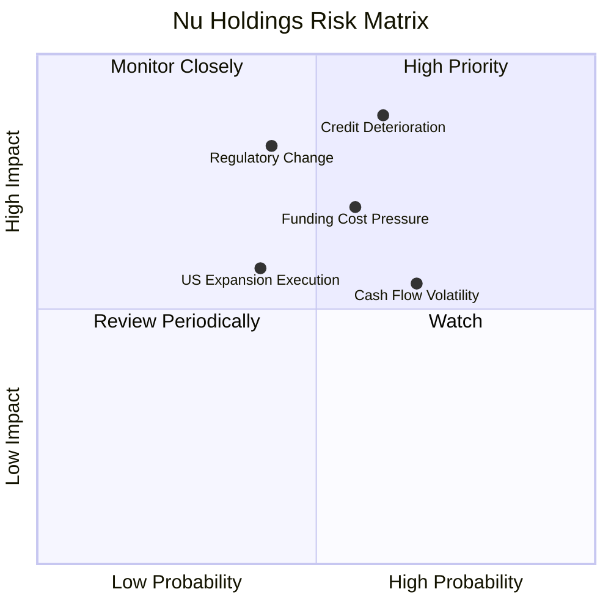
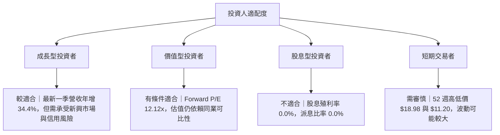

# NU 基本面深度分析報告
> **報告日期**：2026-11-14 ｜ **語言**：繁體中文 ｜ **數據來源**：Yahoo Finance、Finviz、StockAnalysis、Roic.ai ｜ **分析師**：CFA 級機構研究

---

## 目錄

| # | 章節 | 核心結論 |
|---|------|----------|
| 1 | 執行摘要 | 買入；加權合理價值 $22.55，MOS +41.4% |
| 2 | 公司概覽與商業模式 | 數位金融平台具規模與生態系優勢，市場份額數據未提供 |
| 3 | 損益表深度分析 | 最新一季營收年增 34.4%；TTM 營收成長率不可得 |
| 4 | 資產負債表分析 | 淨現金 $9.32B；銀行資產負債表不宜以一般企業流動比率判斷 |
| 5 | 現金流量深度分析 | TTM FCF -$625.87M，近期營業現金流波動大 |
| 6 | 獲利能力與資本效率 | ROTCE 29.8%；一般 ROIC 對放款機構不適用 |
| 7 | 相對估值分析 | Forward P/E、P/B 相對估值支持高於現價的價值區間 |
| 8 | DCF 內在價值評估 | DCF 不適用於銀行式放款機構；以固定權重相對估值三角驗證 |
| 9 | 成長催化劑 | 信貸、跨產品交叉銷售與美國市場拓展是主要觀察項 |
| 10 | 風險矩陣 | 信用風險、監管與資金成本是主要風險 |
| 11 | 投資建議 | 買入；建議買入區間 $13.22–$20.30，並密切監控信用與現金流 |

---

## 1. 執行摘要

Nu Holdings 最新一季營收年增 **34.4%**、單季營業利益率 **50.9%**，TTM 有形權益報酬率（ROTCE）為 **29.8%**；但 TTM 自由現金流為 **-$625.87M**，且淨沖銷率、逾放比與 CET1 等核心銀行風險指標未提供。以同業 Forward P/E、同業 P/B 與分析師共識目標價所形成的加權合理價值 **$22.55** 計算，對照 **2026-11-13 收盤價 $13.22**，MOS 為 **+41.4%**、上行空間為 **+70.6%**，因此依 MOS 規則 20 評級為**買入**。ROIC 不適用於此放款機構，故不以「ROIC 高於 WACC」作為升級至強烈買入的理由。

### 1.0 一頁式投資儀表板

| 項目 | 內容 |
|------|------|
| **投資論點（3 句）** | ① 最新一季營收年增 **34.4%**，表明仍有高增長動能。② 單季營業利益率 **50.9%**、TTM ROTCE **29.8%**，顯示獲利能力與資本回報具吸引力。③ TTM FCF **-$625.87M**，信用品質與現金流仍須確認，不能只以會計獲利推斷可分配現金。 |
| **綜合評分** | **7.8/10**（引用 1.1 評分卡） |
| **財務健康** | 🟡 現金及短期投資 **$15.45B**、總債務 **$6.12B**、淨現金 **$9.32B**；但放款機構的流動性不宜只看現金淨額。 |
| **ROIC vs WACC** | ROIC：**N/A（金融業不適用）**；WACC：**14.00%**。可參照 ROTCE **29.8%**，但 ROTCE 與 ROIC 定義不同。 |
| **FCF 趨勢** | TTM FCF **-$625.87M**、FCF Yield **-0.98%**；與 FY2025 FCF **$3.16B** 相比，近期現金流明顯轉弱且季度波動大。 |
| **估值** | Forward P/E **12.12x** ｜ EV/EBITDA **N/A** ｜ FCF Yield **-0.98%** |
| **DCF 內在價值（基準）** | **N/A**（放款機構現金流反映資金運用與融資，不適用一般企業 FCFF DCF）；DCF 折溢價 **N/A** |
| **安全邊際（MOS）** | **+41.4%**＝($22.55 − $13.22) ÷ $22.55；🟢 >25% 充足。基準為 8.8 加權合理價值。 |
| **預期報酬（基準情境 12M）** | **+35.6%**，以 23 位分析師平均目標價 **$17.92** 對照現價計算；此為共識目標價參考，並非 DCF 情境。 |
| **關鍵風險（前二）** | 信貸惡化造成撥備與沖銷上升；利率、監管及跨國擴張使資金成本和合規成本提高。 |
| **評級 + 信心度** | 🟢 **買入** ｜ 信心：中（估值方法顯示折價，但信用品質數據與現金流資料有缺口） |

### 1.1 綜合評分卡（全報告唯一）

| 維度 | 評分（1–10） | 主要依據（引用數字與其來源章節） |
|------|--------------|----------------------------------|
| 成長性 | 8.5 | 最新一季營收年增 **34.4%**；年度營收由 FY2022 **$2.97B** 增至 FY2025 **$10.63B**，詳見 3.1–3.2。 |
| 獲利能力 | 8.0 | 最新一季營業利益率 **50.9%**、ROTCE **29.8%**；但 TTM FCF 為負，且 ROIC 不適用，詳見 3.3、5、6。 |
| 財務健康 | 7.5 | 現金及短期投資 **$15.45B**、總債務 **$6.12B**、淨現金 **$9.32B**；缺少 CET1、逾放比及淨沖銷率，詳見 4、6.4。 |
| 估值 | 8.5 | 加權合理價值 **$22.55**、MOS **+41.4%**；估值依賴同業倍數與共識目標價，詳見 7–8.8。 |
| 護城河 | 8.0 | 多國數位金融平台與多產品組合具規模及交叉銷售優勢；但未提供客戶數、留存率或市場份額，詳見第 2 章。 |
| 管理層與資本配置 | 6.5 | FY2025 SBC **$271.85M**，約為 FY2025 營收的 **2.6%**；股息殖利率 **0.0%**，回購與稀釋趨勢資料有限，詳見 3.5、5.4。 |
| **綜合評分** | **7.8** | 六項算術平均：(**8.5 + 8.0 + 7.5 + 8.5 + 8.0 + 6.5**) ÷ 6 = **7.8**（四捨五入至一位小數） |

### 1.2 五大投資論點 + 三大核心風險

| 類型 | 項目 | 具體依據 | 信心度 |
|------|------|----------|--------|
| 🟢 **投資論點①** | 收入仍維持雙位數增長 | 最新一季營收年增 **34.4%**；FY2025 年收入 **$10.63B**，高於 FY2024 的 **$8.27B**。若增長延續，能支撐產品交叉銷售與規模經濟。 | 🟢 高 |
| 🟢 **投資論點②** | 單季營運獲利能力高 | 最新一季營業利益率 **50.9%**；但 TTM 營業利益率為 N/A，需確認單季表現能否持續。 | 🟢 中高 |
| 🟢 **投資論點③** | 有形資本回報高 | TTM ROTCE **29.8%**，高於 WACC **14.00%**；兩者不是同一口徑，但支持其帳面有形權益運用效率良好的初步判斷。 | 🟢 中 |
| 🟢 **投資論點④** | 資本緩衝有一定規模 | 現金及短期投資 **$15.45B**，總債務 **$6.12B**，淨現金 **$9.32B**。對銀行而言仍應結合存款結構、資產流動性與監管資本判斷。 | 🟢 中 |
| 🟢 **投資論點⑤** | 相對估值支持現價上方價值 | 同業 Forward P/E 法價值 **$24.89**、同業 P/B 法 **$20.79**、分析師平均目標價 **$17.92**；固定權重後合理價值 **$22.55**。 | 🟢 中 |
| 🟡 **風險①** | 信貸惡化與撥備上升 | 淨沖銷率及逾放比未提供。若壞帳率上升，會直接侵蝕淨利息收入和股東權益回報。 | 🔴 高衝擊 |
| 🟡 **風險②** | 現金流波動與資金需求 | TTM 營業現金流 **-$218.53M**，資本支出 **$407.33M**，TTM FCF **-$625.87M**。放款增長可能導致資金流出，但現金流轉負仍需拆分原因。 | 🟡 中高 |
| 🔴 **風險③** | 跨國監管、匯率與擴張執行 | 業務涵蓋巴西、墨西哥、哥倫比亞等市場，美國業務亦有拓展消息；不同監管與匯率環境可能增加成本和資本需求。 | 🟡 中 |

### 1.3 快速統計卡片

| 指標 | 公司實際值（期間） | 同業中位數 | 狀態 |
|------|--------------------|------------|------|
| 營收成長（TTM） | **N/A** | — | 🟡 不可判定 |
| 營收成長（最新一季年增） | **34.4%** | **43.9%** | 🟡 低於三家同業中位數 |
| 毛利率（TTM） | **N/A（銀行業口徑不具可比性）** | **84.2%** | 🟡 不宜直接比較 |
| 營業利益率（TTM） | **N/A** | — | 🟡 不可判定 |
| ROIC（TTM） | **N/A（金融業不適用）** | — | 🟡 不適用 |
| Forward P/E | **12.12x** | **22.8x** | 🟢 相對較低 |
| FCF Yield（TTM） | **-0.98%** | — | 🔴 近期現金流偏弱 |
| Piotroski F-Score | **N/A（不適用於放款機構）** | — | 🟡 不適用 |

### 1.4 投資結論

```
╔══════════════════════════════════════════════════════════════════╗
║                    📊 投資結論摘要                               ║
╠══════════════════════════════════════════════════════════════════╣
║  評級：買入（依 MOS 門檻；未作質化調整）                         ║
║  價格（2026-11-13 收盤）：$13.22                                 ║
║  DCF 內在價值（基準）：N/A（放款機構不適用一般 FCFF DCF）        ║
║  安全邊際 MOS：+41.4%（以加權合理價值為分母）                   ║
║  加權合理價值（8.8）：$22.55                                     ║
║  綜合評分：7.8/10（引用 1.1）                                    ║
║  適合投資人：願意承擔新興市場信用與監管風險的成長型投資人        ║
╚══════════════════════════════════════════════════════════════════╝
```

---

## 2. 公司概覽與商業模式

### 2.1 業務結構與收入來源

公司簡介顯示 Nu Holdings 在巴西、墨西哥、哥倫比亞、開曼群島及美國營運數位金融平台，產品包括信用卡、預付卡、帳戶轉帳與帳單支付，以及不同層級的會員和服務。未提供各產品線營收拆分，因此圖中不推估營收佔比。



**資料口徑提醒：**財務來源對 TTM 收入存在差異：主要核驗數據為 **$14.48B**，其他資料表另列 TTM **$9.10B**。本報告涉及核驗 TTM 收入時採用 **$14.48B**；不以不同口徑數字相除或拼接計算利潤率。

### 2.2 市場份額

市場份額數據未提供，近期新聞亦未提供可核實的市佔率數字，因此不製作市佔率圖表。Nu 最新一季營收年增 **34.4%**，低於 SOFI、MELI、HOOD 最新季度營收年增中位數 **43.9%**；但三家公司業務組合不同，這只能作成長速度參考，不能直接代表競爭位置或市場份額。

### 2.3 競爭護城河分析



### 2.4 護城河強度

| 護城河項目 | 強度（強／中／弱） | 證據（引用數字或事實） | 會削弱它的情況 |
|------------|--------------------|------------------------|----------------|
| 數位技術與產品體驗 | 中 | 產品涵蓋數位帳戶、信用卡、預付卡、支付及高階會員；目前沒有客戶留存率、活躍用戶或單位成本資料。 | 競爭者複製體驗、獲客成本上升，或系統故障與資安事件。 |
| 產品生態系 | 中至強 | 多產品有助交叉銷售；公司在多個拉丁美洲市場營運。產品별收入及客戶持有產品數未提供。 | 客戶只使用單一產品、交叉銷售未提高客戶終身價值。 |
| 規模效應 | 中 | FY2025 收入 **$10.63B**；最新一季營收年增 **34.4%**。 | 增長需要較高信用成本或行銷投入，規模未轉化為單位獲利改善。 |
| 客戶鎖定 | 中 | 帳戶、支付、卡片等服務可能增加日常使用；缺乏留存、轉換率與客戶獲取成本資料。 | 客戶多平台使用、轉換成本低，或競爭者提供更高存款收益與更低借貸成本。 |
| 生態夥伴 | 中 | 需要支付網絡、商戶及各地監管體系支持，具備一定合作網絡。 | 支付規則、監管要求或合作條件改變。 |

護城河評分引用 1.1 的 **8.0/10**：其多產品數位金融平台與跨市場營運構成優勢，但缺少客戶留存、單位經濟及市佔率數據，限制了證據強度。

---

## 3. 損益表深度分析

### 3.1 年度收入成長趨勢（近 4 年）

FY2022 至 FY2025 營收由 **$2.97B** 增至 **$10.63B**，三年複合年增率約 **53.0%**。此計算來自年度收入序列，與 TTM 成長率不是同一概念；TTM 對前一個 TTM 的成長率目前為 N/A。

```
╔══════════════════════════════════════════════════════════════════╗
║                 Nu Holdings 年度收入趨勢（FY2022–FY2025）        ║
╠══════════════════════════════════════════════════════════════════╣
║  FY2022  $2.97B  ██████░░░░░░░░░░░░░░░░░░  YoY：基期            ║
║  FY2023  $5.63B  █████████████░░░░░░░░░░░  YoY：+89.6% 🟢       ║
║  FY2024  $8.27B  ██████████████████░░░░░░  YoY：+46.9% 🟢       ║
║  FY2025 $10.63B  ████████████████████████  YoY：+28.5% 🟢       ║
║                                                                  ║
║  3 年收入 CAGR：約 +53.0%                                        ║
╚══════════════════════════════════════════════════════════════════╝
```

計算：  
- FY2023 YoY = ($5.63B ÷ $2.97B) − 1 = **89.6%**  
- FY2024 YoY = ($8.27B ÷ $5.63B) − 1 = **46.9%**  
- FY2025 YoY = ($10.63B ÷ $8.27B) − 1 = **28.5%**  
- FY2022–FY2025 CAGR = ($10.63B ÷ $2.97B)^(1/3) − 1 = **約 53.0%**

成長率逐年放緩，但仍維持高成長。從基期擴大後，維持同等百分比增長更困難；未來需觀察新產品、跨售與新市場是否能補足基期效應。

### 3.2 季度收入趨勢分析

| 季度 | 營收 | QoQ 成長 | YoY 成長 | 備註 |
|------|------|----------|----------|------|
| 2025-12-31 | $3.14B | — | N/A | 年末季度；比較來源口徑存在差異。 |
| 2026-03-31 | $3.54B | **+12.7%** | N/A | 按季度財務表計算：$3.54B ÷ $3.14B − 1。 |
| 2026-06-30 | $3.77B | **+6.5%** | N/A | 增速較前季放緩；季節性及產品組合可能影響。 |
| 2026-09-30 | $4.03B | **+6.9%** | **+34.4%** | 最新季度年增率按財務數據引用；不得標作 TTM。 |

季度財務表所列收入與另一資料來源的季度收入金額不完全一致，因此 QoQ 依同一季度財務表的金額計算，YoY 則直接引用最新季度年增率 **34.4%**。不能由來源不同的季度金額硬推年度成長。

### 3.3 利潤率演變分析

| 利潤率指標 | FY2022 | FY2023 | FY2024 | FY2025 | 趨勢 | 評估 |
|------------|--------|--------|--------|--------|------|------|
| 毛利率 | N/A | N/A | N/A | N/A | 銀行收入結構與一般企業毛利率不可直接比較；年度毛利資料未提供可比序列。 | 🟡 |
| 營業利益率 | N/A | N/A | N/A | N/A | 年度一致口徑數據未提供；TTM 亦為 N/A。 | 🟡 |
| 最新季度營業利益率 | — | — | — | — | 2026Q3 為 **50.9%**，為單季數據，不應外推成 TTM。 | 🟢 |
| 淨利率 | **-12.3%** | **18.3%** | **23.8%** | **27.0%** | 由虧損轉盈，近年持續改善。 | 🟢 |

淨利率依年度淨利除以年度營收計算。年度淨利由 FY2022 **-$364.58M** 增至 FY2025 **$2.87B**，營收則由 **$2.97B** 增至 **$10.63B**。改善與收入規模擴大、獲利轉正相符，但現有資料不足以拆解信用撥備、融資成本、定價及產品組合各自的貢獻。最新季度營業利益率 **50.9%** 是單季數字，不能用來填補 TTM 營業利益率缺漏。

### 3.4 費用結構分析

費用結構、信用撥備、利息支出及營運費用的完整拆分未提供，因此不製作 Mermaid 圓餅圖或估算費用佔比。成本收入比代理值為 **68.1%**，但該代理值包含信用撥備，通常高於公司自行公布的效率比率，不能直接視為一般營運費用率。

### 3.5 季度 EPS 趨勢與盈餘品質（Quality of Earnings）

EPS 預估與實際值的歷史資料為 NaN，故不能判斷最近四季是否超預期或不及預期。可確認的季度 EPS 序列來自 StockAnalysis，季度數據與其他財務來源存在口徑差異，僅作趨勢參考。

| 季度 | EPS | EPS YoY | EPS surprise | 評估 |
|------|-----|---------|--------------|------|
| 2025-12-31 | $0.18 | +60.87% | N/A | EPS 成長，但估計值與實際值均未提供。 |
| 2026-03-31 | $0.18 | +55.93% | N/A | YoY 成長；季對季基本持平。 |
| 2026-06-30 | $0.22 | +66.31% | N/A | EPS 較前季上升；無法確認是否由營收、成本或撥備帶動。 |
| 2026-09-30 | $0.23 | +40.13% | N/A | EPS YoY 仍為正，但增速低於前兩季所列數值。 |

| 盈餘品質項目 | 數值/佔比 | 評估 |
|--------------|-----------|------|
| 股權薪酬 SBC / 營收 | FY2025 SBC **$271.85M** ÷ FY2025 營收 **$10.63B** = **2.6%** | 🟡 屬可觀察的股東稀釋成本；SBC TTM 未單獨核驗。 |
| SBC / 營業現金流 | FY2025 **$271.85M ÷ $3.50B = 7.8%** | 🟢 FY2025 正營業現金流期間，SBC 相對 OCF 不高；不代表最新 TTM 狀況。 |
| FCF / 淨利（現金轉換率） | TTM FCF **-$625.87M** ÷ TTM 淨利 **$3.915B** = **-16.0%** | 🔴 會計獲利沒有轉換成正的 TTM FCF；銀行放款增長可令現金流受資產配置影響，須查明原因。 |
| 一次性/非經常性損益 | N/A（細項未提供） | 無法判斷一次性項目是否影響當期盈餘。 |
| 有效稅率異常 | **25.8%**（最新年度有效稅率） | 未有多年稅務明細可確認是否異常；不能推定淨利主要由稅務利益帶動。 |
| 資本化支出 vs 費用化 | TTM 資本支出 **$407.33M**；資本化政策細節 N/A | 無法判斷是否有成本遞延或資本化偏高情況。 |

**盈餘品質結論：**FY2025 OCF 與 FCF 分別為 **$3.50B**、**$3.16B**，但最新 TTM FCF 降至 **-$625.87M**，現金轉換短期惡化。銀行放款與金融資產增長可能造成營業現金流波動，但目前欠缺貸款增長、存款變化、信用撥備及現金流分類細節，故不宜將 TTM 負 FCF 全部解讀為獲利品質惡化，也不能直接忽略。估值應依賴盈利、帳面價值及資產品質資料交叉驗證。

---

## 4. 資產負債表分析

### 4.1 資產結構分解

最新可用資產負債表資料截至 2026-09-30，總資產 **$87.429B**。已列出的資產明細並未完整覆蓋總資產，以下圖表僅呈現來源提供的項目，不推算缺少的資產類別。



其中現金及短期投資 **$15.446B**；長期投資 **$19.268B**。金融機構資產組成須結合金融資產流動性及監管分類理解，不能將所有現金與投資均視為可自由分配資金。

### 4.2 流動性與營運資金分析

| 流動性指標 | 最新值 | 歷史趨勢 | 評估 |
|------------|--------|----------|------|
| 現金及短期投資 | **$15.45B** | N/A（季度序列口徑不一致） | 🟢 具資金緩衝，但須與客戶存款及監管流動性需求一起評估。 |
| 總債務 | **$6.12B** | N/A（季度資料與年度資料差異明顯） | 🟡 對金融業需區分融資負債、存款與其他負債。 |
| 淨現金 | **$9.32B** | N/A | 🟢 來源提供值；現金減債務約為 $9.33B，與 $9.32B 的差異可由四捨五入造成。 |
| Current ratio / Quick ratio | N/A | N/A | 不宜以一般企業短期資產／負債比率套用銀行資產負債表。 |
| DSO / DIO / DPO / CCC | 不適用（金融業） | 不適用（金融業） | 傳統存貨及應付帳款現金轉換週期不適合放款機構。 |

### 4.3 債務結構分析

```
╔══════════════════════════════════════════════════════════════════╗
║                   Nu Holdings 債務健康診斷                       ║
╠══════════════════════════════════════════════════════════════════╣
║  總債務：        $6.12B     ████████░░░░░░░░░░░░  🟡            ║
║  現金+短期投資： $15.45B    ████████████████████  🟢            ║
║  淨現金：        $9.32B     ████████████░░░░░░░░  🟢            ║
║                                                                  ║
║  Debt/Equity：N/A（未提供可比口徑）                              ║
║  Debt/EBITDA：N/A（EV/EBITDA 為 N/A）                            ║
║  Interest Coverage：N/A（利息覆蓋所需明細未提供）               ║
║  CET1／監管資本比率：N/A（數據未提供）                           ║
╚══════════════════════════════════════════════════════════════════╝
```

總債務與現金淨額提供初步緩衝資訊，但不能據此推論銀行監管資本充足或存款流動性安全。年度資產負債表 FY2025 顯示總債務 **$1.90B**，與最新 TTM 數據 **$6.12B** 不同，可能涉及資料期間或負債分類差異，分析時不混用。

### 4.4 股東權益趨勢

| 年度 | 股東權益 | YoY 成長 | 解讀 |
|------|----------|----------|------|
| FY2022 | $4.89B | — | 淨利為 **-$364.58M**；資本基礎較小。 |
| FY2023 | $6.41B | **+31.1%** | 盈利轉正，權益增長。 |
| FY2024 | $7.65B | **+19.4%** | 權益持續增加。 |
| FY2025 | $11.29B | **+47.6%** | 增幅較大；需結合留存盈餘、發股與其他綜合收益拆解。 |

```
╔══════════════════════════════════════════════════════════════════╗
║                股東權益趨勢（年度資料）                          ║
╠══════════════════════════════════════════════════════════════════╣
║  FY2022  $4.89B  ██████████░░░░░░░░░░░░                        ║
║  FY2023  $6.41B  █████████████░░░░░░░                            ║
║  FY2024  $7.65B  ████████████████░░░░                            ║
║  FY2025 $11.29B  ████████████████████████                        ║
║  資料來源：年度資產負債表；不代表每股帳面價值同步增長。          ║
╚══════════════════════════════════════════════════════════════════╝
```

---

## 5. 現金流量深度分析

### 5.1 現金流量瀑布圖

銀行的營業現金流可能受貸款、存款及金融資產變動影響；以下圖示保留財務數據中的關係，不將「股息／回購」或「淨現金變化」設為未提供的數值。



### 5.2 FCF 轉換率趨勢

| 年度／期間 | FCF | 淨利 | FCF / 淨利 | 解讀 |
|------------|-----|------|------------|------|
| FY2022 | $641.27M | -$364.58M | 約 **-175.8%** | 淨利為負，比例方向容易誤讀，不宜作為一般現金轉換指標。 |
| FY2023 | $1.09B | $1.03B | 約 **105.9%** | FCF 略高於淨利。 |
| FY2024 | $2.22B | $1.97B | 約 **112.7%** | 現金轉換高於會計淨利。 |
| FY2025 | $3.16B | $2.87B | 約 **110.1%** | 年度現金流轉換仍良好。 |
| TTM 至 2026-09-30 | **-$625.87M** | **$3.915B** | **-16.0%** | 轉為負值；須釐清放款資產變化與融資現金流。 |

TTM 比率以同一期間的 FCF 及所列 TTM 淨利計算；不同資料來源的收入欄位存在口徑差異，因此不以收入反推現金流。

### 5.3 自由現金流趨勢

| 期間 | OCF | Capex | FCF | 備註 |
|------|-----|-------|-----|------|
| FY2022 | $755.57M | $114.31M | $641.27M | 年度正 FCF。 |
| FY2023 | $1.27B | $177.00M | $1.09B | 年度 FCF 增長。 |
| FY2024 | $2.40B | $174.99M | $2.22B | OCF 上升，資本支出相對穩定。 |
| FY2025 | $3.50B | $340.77M | $3.16B | 年度現金流表現較高。 |
| TTM 至 2026-09-30 | **-$218.53M** | **$407.33M** | **-$625.87M** | 核驗值；FCF Yield **-0.98%**。 |

```
╔══════════════════════════════════════════════════════════════════╗
║                 自由現金流：年度實際 vs 最新 TTM                  ║
╠══════════════════════════════════════════════════════════════════╣
║  FY2022  $0.64B  █████░░░░░░░░░░░░░░░  FCF Yield：N/A            ║
║  FY2023  $1.09B  ████████░░░░░░░░░░░░  FCF Yield：N/A            ║
║  FY2024  $2.22B  █████████████████░░░  FCF Yield：N/A            ║
║  FY2025  $3.16B  ████████████████████████  FCF Yield：N/A        ║
║  TTM     -$0.63B 負值；FCF Yield：-0.98%                         ║
╠══════════════════════════════════════════════════════════════════╣
║  注意：最新 TTM 與 FY2025 年度方向相反，現金流需進一步拆解。       ║
╚══════════════════════════════════════════════════════════════════╝
```

歷史年度 FCF Yield 缺少相同期間市值，故不自行估算；最新 TTM FCF Yield 直接引用 **-0.98%**。

### 5.4 資本配置評估

股息殖利率 **0.0%**、派息比率 **0.0%**。回購金額與投資支出完整分配資料未提供，因此不製作配置圓餅圖，也不把未披露的金額當成零。

| 資本配置項目 | 可用數據 | 評估 |
|--------------|----------|------|
| 資本支出 | TTM **$407.33M**；FY2025 **$340.77M** | 投資數額增加可能支援技術和營運能力，但資本支出用途明細未提供。 |
| 股息 | 殖利率 **0.0%**；派息比率 **0.0%** | 未以現金股息回饋股東。 |
| 回購 | N/A | 回購金額及股份數變化未能由現有資料確認。 |
| SBC | FY2025 **$271.85M** | 形成股東稀釋成本，需追蹤每股盈餘與流通股數。 |
| 留存盈餘／再投資 | N/A | 留存盈餘的用途拆分未提供。 |

---

## 6. 獲利能力與資本效率

### 6.1 ROE / ROA / ROIC 趨勢

| 指標 | 可用數值 | 評估 |
|------|----------|------|
| ROE（TTM） | **31.5%** | 回報率高；金融業 ROE 受槓桿及監管資本影響，須配合資產品質解讀。 |
| ROA（TTM） | **5.0%** | 相較非金融企業更具參考性，但仍需檢視放款信用風險與資產分類。 |
| ROTCE（TTM） | **29.8%** | 有形權益回報高；不等於 ROIC。 |
| ROIC | N/A | 對以金融資產、負債及放款為核心的機構，一般企業投入資本定義不適用。 |
| Piotroski F-Score | N/A | 不適用於放款機構。 |

未提供可比行業均值，因此不加入行業均值欄。ROE、ROA 的歷年可比序列亦不足，故不以單一 TTM 數字宣稱長期趨勢。

### 6.2 ROIC vs WACC 分析（核心價值創造判斷）

放款機構的負債是營運資金來源，傳統 ROIC 的「營運資本」和投入資本定義會失真。因此本節不將 ROTCE 改稱 ROIC，也不以 ROIC-WACC 的差值直接判斷 EVA；以下列出資本成本來源，並將 ROTCE 作為補充回報指標。

```
╔══════════════════════════════════════════════════════════════════╗
║              ROIC vs WACC 深度分析（金融業口徑）                  ║
╠══════════════════════════════════════════════════════════════════╣
║  WACC／資本成本來源：                                             ║
║  ├── 無風險利率（10Y 美債）：       5.15%                        ║
║  ├── 市場風險溢酬 ERP：             5.00%                        ║
║  ├── Beta（調整後）：               0.98                         ║
║  ├── 股權成本：                     10.05%                       ║
║  ├── 稅前債務成本：                 74.76%                       ║
║  ├── 有效稅率：                     25.8%                        ║
║  ├── 股權／債務權重：               91.3%／8.7%                  ║
║  ├── 計算 WACC：                    14.02%                       ║
║  └── 採用 WACC：                    14.00%（觸及 7%–14% 上限）   ║
║                                                                  ║
║  ROTCE（TTM）：                    29.8%                         ║
║  ROTCE − 股權成本：                29.8% − 10.05% = +19.75 pp   ║
║  ROIC：N/A（金融業不適用）                                        ║
║                                                                  ║
║  結論：ROTCE 顯示有形權益回報高於股權成本，但不等於 ROIC>WACC。  ║
║  若信用損失上升或帳面權益計算口徑變化，該差距可能收窄。          ║
╚══════════════════════════════════════════════════════════════════╝
```

來源列出的 Beta 原始值為 **0.97**，調整方式為 **⅔ × 0.97 + ⅓ × 1 = 0.98**（四捨五入）。無風險利率與 ERP 分別為 **5.15%**、**5.00%**；股權成本為 **5.15% + 0.98 × 5.00% = 10.05%**。債務成本高達 **74.76%**，稅後成本按 **74.76% × (1 − 25.8%) = 55.46%**，此數值可能受金融業融資費用分母和分類影響，不宜直接解讀為一般公司債市場借款成本。資本成本計算值 **14.02%** 被限制在 **7%–14%** 區間，故採用 **14.00%**；此值與估值輸入一致。

### 6.3 杜邦三因素分解

| 因素 | 數值（TTM） | 解讀 |
|------|-------------|------|
| 淨利率 | N/A | 品質指標計算所需淨利、收入及資產口徑不完整且來源有差異。 |
| 資產週轉率 | N/A | 同上。 |
| 權益乘數 | N/A | 同上。 |
| **ROE** | **N/A（DuPont 指標未計算）** | 不補算或以不同口徑拼接；另有一般資料來源列示 ROE TTM 31.5%，但不能視為已核驗杜邦三因素。 |

### 6.4 財務體質：Piotroski F-Score 與貸款機構指標

Piotroski F-Score 為 **N/A**：貸款增長會造成營業現金流流出，傳統現金流測試會錯讀銀行營運，故不適用。九項測試未提供各自結果，不臆造分項。

| 貸款機構指標 | 數值（TTM 至 2026-09-30） | 解讀 |
|--------------|--------------------------|------|
| 淨利息收入 NII ÷ 總營收 | **84.7%** | 收入主要由淨利息收入構成；不是淨利差。 |
| 淨利差代理值：NII ÷ 平均總資產 | **15.74%** | 代理值使用平均總資產而非生息資產，通常高於公司正式公布的 NIM。 |
| 成本收入比代理值 | **68.1%** | 以營收減稅前淨利再除以營收，包含信用撥備，通常高於正式效率比率。 |
| ROTCE | **29.8%** | 淨利除以有形帳面價值，與 ROIC 不同。 |
| P/TBV | **4.87x** | 股價相對有形帳面價值倍數偏高，須由未來有形權益回報支撐。 |
| 放款淨額 ÷ 總資產 | **14.0%** | 顯示放款占總資產比例；不代表信用風險本身。 |
| 淨沖銷率 | **N/A（數據未提供）** | 核心信用品質資料缺口。 |
| 逾放比 | **N/A（數據未提供）** | 核心信用品質資料缺口。 |
| CET1 | **N/A（數據未提供）** | 無法以此報告確認監管資本緩衝。 |

---

## 7. 相對估值分析

### 7.1 同業估值比較表格

Nu 自身倍數取財務資料的估值欄；競爭對手倍數依 Yahoo 同業數據。Nu 自身 P/E、P/S 與同業口徑可能因財報與市場資料期間不同而存在誤差，以下作相對估值參考，並非完全同口徑的銀行同業比較。

| 估值指標 | **NU** | **SOFI** | **MELI** | **HOOD** | NU 評估 |
|----------|--------|---------|---------|---------|----------|
| **Trailing P/E** | **16.53x** | 28.0x | 40.0x | 35.9x | 🟢 低於同業中位數 35.9x；公司與同業業務組合不同。 |
| **Forward P/E** | **12.12x** | 17.1x | 28.1x | 22.8x | 🟢 低於同業中位數 22.8x；以市場資料 Forward EPS 為基礎。 |
| **P/S Ratio** | **7.03x** | 4.3x | 2.0x | 13.8x | 🟡 高於同業中位數 4.3x；金融公司收入確認口徑差異大。 |
| **EV/EBITDA** | N/A | N/A | 21.4x | N/A | 🟡 可計算同業有限，不採用於本公司的估值。 |
| **最新季度營收 YoY** | **34.4%** | 43.9% | 45.1% | 11.8% | 🟡 NU 低於三家同業中位數 43.9%，但季度和業務結構不完全一致。 |
| **Gross margin TTM** | N/A（金融業口徑不可比） | 84.2% | 46.7% | 91.0% | 不作直接評級比較；傳統毛利率不適合用來排序金融機構。 |

NU Forward P/E **12.12x** 低於同業中位數 **22.8x**，但市場低估可能反映新興市場、信用週期及監管風險；不能只以倍數折價認定股票必然低估。相對估值方法使用同業中位數，而非 NU 自身倍數回推現價。

### 7.2 歷史估值區間分析

歷史估值倍數區間及當前歷史百分位數未提供，故不自行估算或以股價區間替代估值區間。

```
╔══════════════════════════════════════════════════════════════════╗
║                   歷史估值區間分析                               ║
╠══════════════════════════════════════════════════════════════════╣
║  N/A：未提供 Valuation vs own history 的估值倍數區間與百分位。   ║
║  24 個月月末股價在 2026-11 為 $13.22；此為價格歷史，不是 P/E 區間。║
╚══════════════════════════════════════════════════════════════════╝
```

### 7.3 情境價值（Bear / Base / Bull）

**N/A（DCF 無法計算：放款機構現金流是融資與放貸活動的一部分，不適用一般企業 FCFF DCF；DCF MODEL 未提供情境值。）**不另行設定悲觀、基準或樂觀 DCF 目標價。

### 7.4 相對估值隱含價格區間

估值方法與倍數依固定金融業權重，僅列已提供的方法：

```
╔══════════════════════════════════════════════════════════════════╗
║                    相對估值每股價值參考                          ║
╠══════════════════════════════════════════════════════════════════╣
║  $13.22 現價 ─── $17.92 分析師共識 ─── $20.79 同業 P/B           ║
║                                  └────── $24.89 同業 Forward P/E  ║
╚══════════════════════════════════════════════════════════════════╝
```

| 方法 | 每股價值 | 依據 |
|------|----------|------|
| 同業 Forward P/E | **$24.89** | SOFI、MELI、HOOD 的 Forward P/E 中位數 **22.8x** × NU Forward EPS **$1.09**。 |
| 同業 P/B | **$20.79** | 同業 P/B 中位數 **7.0x** × 每股帳面價值 **$2.96**。 |
| 分析師共識目標價 | **$17.92** | 23 位分析師平均目標價；不是基於本文 DCF。 |

---

## 8. DCF 內在價值評估（Discounted Cash Flow）

> **本報告不建立一般企業 DCF。** Nu 是以放款及金融資產負債管理為核心的金融機構；營業現金流與貸款發放、存款及融資變動高度相連，將其視為一般企業 FCFF 會把金融營運資金錯當成自由現金流。資料來源已將 DCF 模型標示為 N/A，故 8.1–8.7 不另建模型、不提供虛構的內在價值或情境目標價。

### 8.0 估值推理鏈（Thinking Logic）

**Step 1 — 價值來源：**NU 的價值主要由既有放款及支付業務的風險調整後盈利、平台交叉銷售與新市場拓展構成；各板塊營收佔比未提供，不能拆成數字。估值最敏感的變數應為信用成本與持續有形權益回報，而不是一般企業的 FCFF 利潤率。

**Step 2 — 模型選擇：**不採用 FCFF/FCFE DCF；改用金融業固定權重估值方法：同業 Forward P/E、同業 P/B 與分析師共識目標價。理由是目前有 Forward EPS **$1.09**、每股帳面價值 **$2.96**、同業倍數及分析師平均目標價 **$17.92**，但缺少可建立銀行專用估值模型的放款、存款、信用成本、資本比率及信用週期資料。

| 決策點 | 本報告採用 | 理由（含數字） | 曾考慮但否決 | 否決理由 |
|--------|-----------|----------------|--------------|----------|
| 現金流定義 | 不採一般 FCFF／FCFE | TTM OCF **-$218.53M**、FCF **-$625.87M**，且貸款發放本身會影響營業現金流 | 一般企業 FCFF | 可能把銀行放款及融資活動誤判成自由現金流 |
| 預測期 N | N/A | DCF 模型未提供 | 5 年或 10 年 | 無經營假設及可複算模型支持 |
| 終值方法 | N/A | 不適用一般企業 DCF | Gordon Growth／退出倍數 | 缺少可用 FCFF 與可靠終值基礎 |
| 盈利基礎 | 同業 Forward P/E、P/B | Forward EPS **$1.09**；每股帳面價值 **$2.96** | 非 GAAP EBITDA | EV/EBITDA 不適合此處且自身倍數 N/A |

**Step 3 — 假設推導：**8.1–8.7 所需營收 CAGR、期末營業利潤率、稅率預測、資本支出率、稀釋率、g、終值及 DCF WACC 模型輸入均不適用，因此不作無來源的假設。

**Step 4 — 最脆弱環節：**相對估值的主要不確定性是同業倍數是否能反映 NU 的信用風險與市場風險；若逾放與淨沖銷顯著惡化，Forward P/E 與 P/B 都可能下修。量化情境需信用品質及監管資本資料，現有資訊不足以給出下修幅度。

**Step 5 — 計算路徑：**一般 DCF 路徑不適用；本報告估值路徑為：



### 8.1 模型假設總表（Model Inputs）

**N/A（DCF MODEL 未提供；原因：放款機構現金流屬融資與放貸營運，不能以一般企業 FCFF DCF 建模。）**

### 8.2 折現率推導（WACC）

本報告的 WACC **14.00%** 是資本成本資料中的公司整體估計值，可用於一般資本成本參考；**不作為本報告 DCF 折現率**，因 DCF 不適用。

| 輸入 | 數值 | 推導／解讀 |
|------|------|------------|
| 10 年期美國公債無風險利率 | **5.15%** | 資本成本資料所列；觀察日期未提供，故不另填日期。 |
| ERP | **5.00%** | 資料列為假設值；依資料來源設定，未提供更細的歷史推導。 |
| 原始 Beta | **0.97** | Yahoo Finance。 |
| 調整後 Beta | **0.98** | ⅔ × 0.97 + ⅓ × 1 = 約 0.98。 |
| 股權成本 Ke | **10.05%** | 5.15% + 0.98 × 5.00% = 10.05%。 |
| 稅前債務成本 | **74.76%** | 資料來源列示；因金融業利息費用和負債分母分類可能造成偏高，不自行替換。 |
| 有效稅率 | **25.8%** | 最新年度有效稅率。 |
| 股權／債務權重 | **91.3%／8.7%** | 資本成本資料列示。 |
| WACC | 計算值 **14.02%**；採用 **14.00%** | 計算值受 7%–14% 範圍限制，故採用上限 **14.00%**。 |

### 8.3 逐年自由現金流預測（基準情境）

**N/A（DCF MODEL 未提供；不得另建銀行一般企業 DCF，也不以負 TTM FCF 直接外推。）**

### 8.4 終值計算（Terminal Value）

**N/A（沒有 DCF 預測現金流、永續成長率及終值假設，故不計 Gordon Growth 或退出倍數。）**

### 8.5 企業價值 → 每股內在價值（Bridge）

**N/A（沒有 DCF 企業價值及相應橋接模型；DCF 每股內在價值與折溢價均不適用。）**因此不計算 DCF 基準 MOS；全報告 MOS 只以 8.8 加權合理價值為基準。

### 8.6 敏感性分析（WACC × 永續成長率）

**N/A（無 DCF 基準值、永續成長率或 DCF 敏感度矩陣；不自行建模。）**同理，DCF 三情境及其機率加權值均不提供。

### 8.7 反推 DCF（Reverse DCF：市場在預期什麼）

**N/A（DCF MODEL 未提供，且不能以現價單一方程式自行反推多個變數。）**本報告不宣稱市場隱含營收 CAGR、營業利潤率、永續成長率或高成長期數。

### 8.8 估值三角驗證與安全邊際

下表方法名稱、每股價值及權重依金融業固定估值方法資料照列。DCF 方法未列入該估值方法集合，也不另加方法。

| 估值方法 | 隱含每股價值 | 上行空間（÷現價） | 權重 | 說明 |
|----------|--------------|-------------------|------|------|
| 同業 Forward P/E | **$24.89** | **+88.3%** | **50%** | 同業中位數 **22.8x** × Forward EPS **$1.09**。 |
| 同業 P/B | **$20.79** | **+57.3%** | **40%** | 同業 P/B 中位數 **7.0x** ×每股帳面價值 **$2.96**。 |
| 分析師共識目標價 | **$17.92** | **+35.6%** | **10%** | 23 位分析師平均目標價。 |
| **加權合理價值** | **$22.55** | **+70.6%** | **100%** | 公司類型為金融業，方法與權重依固定規則；DCF 因不適用而未列入該方法集合。 |

逐步演算（使用未四捨五入的權重乘積）：

- 同業 Forward P/E 加權值：**$24.89 × 50% = $12.445**
- 同業 P/B 加權值：**$20.79 × 40% = $8.316**
- 分析師共識加權值：**$17.92 × 10% = $1.792**
- 加權合理價值：**$12.445 + $8.316 + $1.792 = $22.553 ≈ $22.55**
- 權重合計：**50% + 40% + 10% = 100%**

以加權合理價值 **$22.55** 與 **2026-11-13 收盤價 $13.22** 計算：

- **MOS**＝($22.55 − $13.22) ÷ $22.55＝$9.33 ÷ $22.55＝**41.4%**
- **上行空間**＝($22.55 − $13.22) ÷ $13.22＝$9.33 ÷ $13.22＝**70.6%**
- **折溢價**相對 DCF 基準值：N/A（DCF 基準值不存在，不能用加權合理價值代替）

```
╔══════════════════════════════════════════════════════════════════╗
║                  估值區間與安全邊際                              ║
╠══════════════════════════════════════════════════════════════════╣
║  $13.22 現價 ───── $17.92 共識 ───── [$22.55 加權合理價值]       ║
║                                      $20.79 P/B  $24.89 P/E      ║
║                                                                  ║
║  MOS = ($22.55 − $13.22) ÷ $22.55 = +41.4%                     ║
║  MOS 評估：🟢 >25% 充足                                          ║
║  上行空間 = ($22.55 − $13.22) ÷ $13.22 = +70.6%                 ║
║  DCF 基準折溢價：N/A                                             ║
║  建議買入區間：$13.22 – $20.30                                   ║
╚══════════════════════════════════════════════════════════════════╝
```

建議買入區間上限 **$20.30** 對應相對加權合理價值約 10% 折價：$22.55 × 90% = **$20.295 ≈ $20.30**。該區間以目前價值方法估值為基準，並非 DCF 價格區間。

> 🔎 **程式複算（Python，依本節各項自動重算）**
>
> 加權合理價值 = $24.89 × 50% + $20.79 × 40% + $17.92 × 10% = **$22.55**（權重合計 100%）
>
> 以價格 $13.22 計：MOS = **+41.4%**，上行空間 = **+70.6%**
>
> ✅ 與本節所寫數值一致。

### 8.9 DCF 模型的局限與失效條件

- **終值依賴度：**N/A，沒有 DCF 終值或企業價值，不能計算終值佔比。
- **最脆弱的估值假設：**同業 Forward P/E 中位數 **22.8x** 和同業 P/B 中位數 **7.0x** 是否適用於 NU。若 NU 信用風險、資本需求或盈利增速相較同業惡化，兩項倍數都可能下修。
- **不適用情境：**一般企業 DCF 不適合直接套用；應優先檢視銀行盈利倍數、P/TBV、ROTCE、信用成本、監管資本，以及放款與存款成長。
- **與第 10 章風險矩陣的連結：**信用惡化會削弱預期 EPS 和帳面價值；監管資本要求上升可能降低可分配資本；資金成本上升會壓低淨利差與 P/B 支撐能力。

### 8.10 複算檢核表（Audit Trail）

| # | 檢核項目 | 檢查方式 | 結果 |
|---|----------|----------|------|
| 1 | DCF 高／中敏感度輸入皆有推導 | DCF 未建模，沒有模型輸入可檢查。 | N/A（DCF 不適用） |
| 2 | 每個 DCF 假設均有來歷 | 未採用 DCF 假設。 | N/A（DCF 不適用） |
| 3 | WACC 五步算式與權重驗算 | 資料列示 Ke、Kd、權重及 WACC；權重為 91.3% + 8.7% = 100%，採用 14.00%。 | ✅ |
| 4 | Kd 分母與債務權重範圍一致 | 直接採用來源提供的資本成本輸入；借款明細及負債分類未提供，不能獨立重建。 | 部分驗證；來源數值已照列 |
| 5 | WACC 與 6.2 節一致 | 兩處均採用 **14.00%**。 | ✅ |
| 6 | 預測年度數等於 N、無省略 | 無 DCF 預測年度。 | N/A（DCF 不適用） |
| 7 | FY+1 九步算式可複算 | 無 FY+1 預測。 | N/A（DCF 不適用） |
| 8 | 預測期 PV 加總可驗算 | 無預測期 PV。 | N/A（DCF 不適用） |
| 9 | WACC > g | 無 g 假設。 | N/A（DCF 不適用） |
| 10 | 終值基於 FY+N 並折現 N 期 | 無終值。 | N/A（DCF 不適用） |
| 11 | EV 至每股價值橋接 | 無 DCF EV 橋接。 | N/A（DCF 不適用） |
| 12 | SBC 模型組合符合規則 | 無 DCF 模型；未將 SBC 重複扣除或加入 DCF 股數。 | N/A（DCF 不適用） |
| 13 | 敏感度矩陣基準格等於 DCF 每股價值 | 無矩陣及 DCF 基準價值。 | N/A（DCF 不適用） |
| 14 | 矩陣 WACC > g 的有效性 | 無矩陣。 | N/A（DCF 不適用） |
| 15 | DCF 三情境機率合計 100% | 無 DCF 情境。 | N/A（DCF 不適用） |
| 16 | Reverse DCF 一次只解一個變數且有軌跡 | 未作反推。 | N/A（DCF 不適用） |
| 17 | MOS 基準與折溢價基準一致 | MOS 使用 8.8 加權價值；DCF 折溢價標 N/A。 | ✅ |
| 18 | 報告完整至第 11 章 | 已輸出 11 章。 | ✅ |
| 19 | 加權合理價值等於加權總和 | $12.445 + $8.316 + $1.792 = $22.553 ≈ **$22.55**。 | ✅ |
| 20 | 評級符合 MOS 門檻 | MOS **+41.4%**，依固定門檻評為 **買入**；ROIC 不適用，未升級強烈買入。 | ✅ |

---

## 9. 成長催化劑

### 9.1 催化劑時間軸

可核實資料指出 NU 美國業務近期擴展至全美 50 州，但未提供具體啟動日期、用戶目標或未來財測。由於缺少可核對的正式時間表，不以估計日期製作甘特圖。

| 時間範圍 | 催化劑 | 可追蹤的量化證據 |
|----------|--------|------------------|
| 近期 | 信貸增長及最新季度獲利 | 最新一季營收年增 **34.4%**；淨利 **$1.09B**。 |
| 近期至中期 | 美國市場覆蓋與產品落地 | 新聞提及已擴展至 50 州；尚未提供美國客戶數、收入及獲客成本。 |
| 中期 | 多產品交叉銷售與高階會員 | 產品有 Nu Card、Nubank+、Ultraviolet 等；各產品營收與使用率未提供。 |
| 長期 | 墨西哥、哥倫比亞等市場深化 | 公司在多國營運；市場份額、當地監管資本與盈利數據未提供。 |

### 9.2 TAM 市場規模分析

**N/A（TAM 數據未提供）。**NU FY2025 營收為 **$10.63B**，最新一季收入年增 **34.4%**，可見現有平台仍有增長；但沒有可引用的市場總額與滲透率數字，不能計算 TAM 佔比或市佔率。

### 9.3 成長驅動力結構圖



---

## 10. 風險矩陣

### 10.1 風險評分矩陣

圖中位置為質化風險判斷，不是財務數據預測；座標僅用於呈現相對機率與衝擊排序。



### 10.2 風險清單詳細分析

| # | 風險項目 | 發生機率 | 財務衝擊 | 風險評分 | 緩解措施 |
|---|----------|----------|----------|----------|----------|
| 1 | 🔴 **信用風險惡化** | 中高 | 高；可能提升信用撥備、沖銷並壓低淨利及 ROTCE | 高 | 每季要求披露逾放比、淨沖銷率、信用成本及貸款組合變化；若信用指標連續惡化，重新評估 P/E、P/B 假設。 |
| 2 | 🔴 **監管與資本要求變化** | 中 | 高；可能限制放款增長或提高資本需求 | 高 | 追蹤各市場監管公告、CET1／當地資本比率及資本留存需求；目前 CET1 未提供。 |
| 3 | 🟡 **資金成本與利率風險** | 中 | 中高；資金成本上升可能壓縮淨利差 | 中高 | 追蹤 NII、貸款定價、融資成本及存款結構；現有淨利差代理值為 **15.74%**，但不是正式 NIM。 |
| 4 | 🟡 **TTM 現金流轉負** | 中高 | 中高；TTM FCF **-$625.87M**、FCF Yield **-0.98%** | 中高 | 拆解放款增長、存款流入、營運支出及資本支出；評估未來數季能否恢復正 FCF。 |
| 5 | 🟡 **跨國拓展執行與匯率風險** | 中 | 中；新市場可能增加獲客、合規及技術投入 | 中 | 追蹤新市場營收、損益、獲客成本與當地資本需求；美國業務收入及客戶數目前未提供。 |
| 6 | 🟡 **估值方法的同業可比性** | 中 | 中；同業倍數下降可能降低相對估值 | 中 | 使用 Forward P/E、P/B、ROTCE 與信用指標共同判斷，避免只依賴單一倍數。 |

---

## 11. 投資建議

### 11.1 最終評級與評分

NU 的 MOS 為 **+41.4%**，按規則 20 評級為**買入**，未作質化上調或下調。1.1 評分卡的綜合評分為 **7.8/10**；其支持因素是最新季度營收年增 **34.4%**、ROTCE **29.8%** 及 **$9.32B** 淨現金，主要保留因素是 TTM FCF **-$625.87M** 及核心信用指標缺漏。

### 11.2 合理價值與隱含報酬率

| 估值參考 | 每股價值 | 相對 2026-11-13 收盤價 $13.22 | 備註 |
|----------|----------|-------------------------------|------|
| 同業 Forward P/E | $24.89 | +88.3% | 同業中位數倍數 × Forward EPS。 |
| 同業 P/B | $20.79 | +57.3% | 同業 P/B 中位數 × 每股帳面價值。 |
| 分析師共識 | $17.92 | +35.6% | 23 位分析師平均目標價。 |
| **加權合理價值** | **$22.55** | **+70.6%** | 固定權重 50%／40%／10%。 |
| DCF 悲觀／基準／樂觀情境 | N/A | N/A | 金融業 DCF 模型未提供且不自行建模。 |

### 11.3 買入時機與觸發因素

```
╔══════════════════════════════════════════════════════════════════╗
║                  ✅ 買入觸發因素 Checklist                      ║
╠══════════════════════════════════════════════════════════════════╣
║  目前可支持分批建立部位的條件：                                  ║
║  ✅ 2026-11-13 收盤價 $13.22，低於加權合理價值 $22.55           ║
║  ✅ MOS +41.4%，高於買入規則最低 10% 門檻                        ║
║  ✅ 最新一季營收年增 34.4%，最新一季營業利益率 50.9%             ║
║                                                                  ║
║  加碼前優先確認：                                                ║
║  ☐ 最新季逾放比、淨沖銷率沒有連續惡化                            ║
║  ☐ 最新季度 FCF 改善，且能說明放款與存款對現金流的影響            ║
║  ☐ 美國業務披露可核實的收入、活躍客戶或單位經濟數據               ║
║                                                                  ║
║  減碼／重新評估觸發條件：                                        ║
║  ☐ 最新一季營收年增連續兩季低於 20%                              ║
║  ☐ 最新季度營業利益率由 50.9% 下滑超過 10 個百分點               ║
║  ☐ FCF 持續為負且貸款增長無法解釋現金流出                        ║
║  ☐ 公司披露的信用指標顯示逾放或淨沖銷快速上升                    ║
╚══════════════════════════════════════════════════════════════════╝
```

上述門檻為投資監控觸發條件，不是公司財測或已發生的結果。投資者可依風險承受能力分批進場；若股價高於 **$20.30**，則 MOS 會低於約 10%，不再符合本報告設定的買入區間上限。

### 11.4 投資人適配度分析



### 11.5 每季財報監控清單（Quarterly Watch List）

| 監控指標 | 目前基準 | 加碼觸發 | 減碼／重新評估觸發 |
|----------|----------|----------|---------------------|
| 營收年增率（單季） | 最新季度 **34.4%** | 維持高於 **30%**，且成長伴隨獲利改善 | 連續兩季低於 **20%** |
| 單季營業利益率 | 最新季度 **50.9%**；TTM N/A | 維持在 **45%** 以上，且信用指標穩定 | 較 50.9% 下滑超過 **10 個百分點** |
| 淨利息收入佔營收 | TTM **84.7%** | 持續穩定且淨利差代理值未明顯下滑 | NII 佔比明顯下降且無非利息收入補償 |
| 淨利差代理值 | **15.74%** | 稳定或改善；需留意這不是正式 NIM | 持續下滑並伴隨資金成本上升 |
| 信用品質 | 淨沖銷率、逾放比 N/A | 公司披露且指標穩定 | 逾放及淨沖銷持續惡化 |
| 營業現金流／FCF | TTM OCF **-$218.53M**；FCF **-$625.87M** | 負值收窄或轉正，且能由放款和存款變化解釋 | FCF 持續惡化且缺少可驗證的營運原因 |
| 資本與槓桿 | 淨現金 **$9.32B**；CET1 N/A | 公布資本充足資料並維持緩衝 | 資本監管要求增加或資本緩衝下降 |
| SBC | FY2025 **$271.85M**，約收入 **2.6%** | SBC 相對收入下降且流通股數穩定 | SBC 長期快於收入增長、稀釋擴大 |
| 美國拓展 | 已有全美 50 州拓展消息；營收 N/A | 披露收入、客戶數及單位經濟 | 投入增加但收入與獲客成效長期未披露或未改善 |

### 11.6 反面論證：什麼會證明論點錯誤（What Would Change My Mind）

```
╔══════════════════════════════════════════════════════════════════╗
║              ⚠️ 論點失效條件（Disconfirming Evidence）           ║
╠══════════════════════════════════════════════════════════════════╣
║  出現下列情況時，應重新檢視估值及投資論點：                      ║
║  ☐ 最新一季營收年增連續兩季低於 20%                              ║
║  ☐ 單季營業利益率較目前 50.9% 收縮超過 10 個百分點               ║
║  ☐ TTM FCF 持續低於 -$625.87M，且無法由放款與存款增長解釋        ║
║  ☐ 公司披露逾放比或淨沖銷率快速上升                              ║
║  ☐ ROTCE 由目前 29.8% 明顯下滑，且低於股權成本 10.05%            ║
║  ☐ 同業估值倍數下修，令 8.8 加權合理價值降至現價 $13.22 以下     ║
║  ☐ 美國或其他新市場投入增加，卻未形成可核實收入或獲利貢獻        ║
╚══════════════════════════════════════════════════════════════════╝
```

> **免責聲明**：本報告為 AI 自動生成，僅供研究參考，不構成投資建議。投資有風險，入市需謹慎。

---

## 資料與來源

| 項目 | 內容 |
|------|------|
| 價格 | 13.22 USD，2026-11-13 收盤（Yahoo Finance 日線） |
| 財務報表 | Yahoo quarterly statements (no SEC filing data)，最新季度 2026-09-30（TTM = four quarters to this date） |
| 有回應的資料來源 | Yahoo Finance、Finviz、StockAnalysis、Roic.ai |
| 未回應的資料來源 | SEC 申報資料 (XBRL) |
| 由程式計算 | TTM 數字、WACC、DCF 模型、估值方法與權重、加權合理價值、MOS、評級門檻、F-Score、杜邦分解、營運資金天數、綜合評分 |
| 撰寫模型 | openai / gpt-6-luna |

> 本區塊由產生報告的程式依實際取得的資料填寫，非模型撰寫。「由程式計算」的數字不是模型的估計；其餘判斷（評分、情境、策略）是模型的分析。
