# NU 基本面深度分析報告
> **報告日期**：2026-11-14 ｜ **語言**：繁體中文 ｜ **數據來源**：Yahoo Finance、Finviz、StockAnalysis、Roic.ai ｜ **分析師**：CFA 級機構研究

> **資料口徑提醒**：提供資料存在明顯跨來源差異。本報告對價格、指定 TTM 數據、同業倍數及資本成本參考值，優先照錄 **VERIFIED FIGURES**；其他項目則標明來源或資料限制。特別是 TTM 營收另有 $9.10B 與 $13.17B 兩種口徑，損益表收入與現金流亦不完全一致。因此，DCF 僅作透明的情境模型，不能視為精確預測。

## 目錄

| # | 章節 | 核心結論 |
|---|------|----------|
| 1 | 執行摘要 | 買入；加權合理價值約 $20.86，MOS 約 36.7% |
| 2 | 公司概覽與商業模式 | 數位金融平台具規模與交叉銷售優勢，市場份額資料未提供 |
| 3 | 損益表深度分析 | VERIFIED TTM 營收 $13.17B；最新單季 YoY +34.4% |
| 4 | 資產負債表分析 | VERIFIED 淨現金 $8.91B；流動性比率不適用／未提供 |
| 5 | 現金流量深度分析 | TTM FCF -$1.67B，與年度歷史 FCF 正值形成重要警訊 |
| 6 | 獲利能力與資本效率 | ROIC 與 WACC 無法可靠核定，價值創造判斷保留 |
| 7 | 相對估值分析 | NU Forward P/E 12.12x，低於三家同業提供的倍數 |
| 8 | DCF 內在價值評估 | 基準約 $20.79；高度依賴營業利潤率與終值假設 |
| 9 | 成長催化劑 | 信貸、跨售、墨西哥／哥倫比亞與美國擴張 |
| 10 | 風險矩陣 | 信貸品質、現金流口徑與監管／匯率為主要風險 |
| 11 | 投資建議 | 買入；建議分批布局並密切追蹤現金流與信用成本 |

---

## 1. 執行摘要

### 1.0 一頁式投資儀表板

| 項目 | 內容 |
|------|------|
| **投資論點（3句）** | ① 最新單季營收 YoY **+34.4%**，顯示客戶與產品變現仍有成長動能；② 2025 年營收 **$10.63B**、淨利 **$2.87B**，年度獲利已具規模；③ 但 VERIFIED TTM FCF 為 **-$1.67B**、FCF Yield **-2.61%**，須先釐清金融資產與負債週轉造成的現金流波動。 |
| **護城河評分** | **6.8/10**：數位平台、低成本服務與交叉銷售具優勢，但市場份額及留存率數據未提供 |
| **管理層／資本配置評分** | **6.5/10**：年度 FCF 為正且資產規模擴張；股息殖利率 0%，資本配置細節有限 |
| **財務健康** | 🟢 VERIFIED 淨現金 **$8.91B**；惟金融機構的現金與負債有營運性質，不能單以淨現金判斷風險 |
| **ROIC vs WACC** | **ROIC N/A vs 假設 WACC 15.45%**；資料不足，不能可靠判定價值創造 |
| **FCF 趨勢** | 年度 FCF 2025 年 $3.16B；VERIFIED TTM FCF **-$1.67B**、FCF Yield **-2.61%**，方向分歧 |
| **估值** | Forward P/E **12.12x** ｜ EV/EBITDA **N/A** ｜ FCF Yield **-2.61%** |
| **DCF 內在價值（基準）** | **$20.79** ｜相對 DCF 折價約 **36.4%** |
| **安全邊際（MOS）** | **+35.7%**＝(加權合理價值 **$20.86** − $13.22) ÷ $20.86；🟢 依門檻屬充足 |
| **預期報酬（基準情境 12M）** | 約 **+57.8%**（以加權合理價值 $20.86 對比 $13.22；非保證報酬） |
| **關鍵風險（前二）** | 信貸損失上升；單季／TTM 現金流與財報口徑衝突 |
| **評級 + 信心度** | 🟢 **買入** ｜信心：**中低**；MOS 達 25% 以上，但 ROIC 未能驗證，故不評「強烈買入」 |

### 1.1 核心評分儀表板

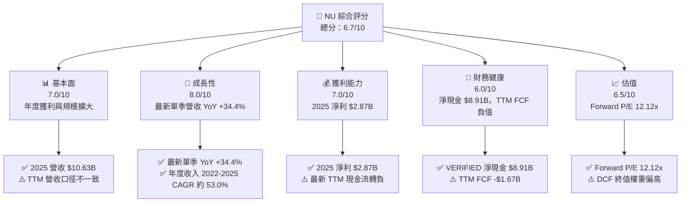

### 1.2 評分進度條視覺化

```
╔══════════════════════════════════════════════════════════════╗
║                 NU 多維度評分儀表板（1-10分）                 ║
╠══════════════════════════════════════════════════════════════╣
║ 基本面強度  7.0 ▓▓▓▓▓▓▓▓▓▓▓▓▓▓░░░░░░  ★★★★☆             ║
║ 成長動能    8.0 ▓▓▓▓▓▓▓▓▓▓▓▓▓▓▓▓░░░░  ★★★★☆             ║
║ 獲利品質    6.0 ▓▓▓▓▓▓▓▓▓▓▓▓░░░░░░░░  ★★★☆☆             ║
║ 財務健康    6.0 ▓▓▓▓▓▓▓▓▓▓▓▓░░░░░░░░  ★★★☆☆             ║
║ 估值合理性  6.5 ▓▓▓▓▓▓▓▓▓▓▓▓▓░░░░░░░  ★★★☆☆             ║
║ 護城河深度  6.8 ▓▓▓▓▓▓▓▓▓▓▓▓▓▓░░░░░░  ★★★☆☆             ║
║ 管理層執行  6.5 ▓▓▓▓▓▓▓▓▓▓▓▓▓░░░░░░░  ★★★☆☆             ║
║ 技術創新力  7.0 ▓▓▓▓▓▓▓▓▓▓▓▓▓▓░░░░░░  ★★★★☆             ║
╠══════════════════════════════════════════════════════════════╣
║ 綜合總分    6.7 ▓▓▓▓▓▓▓▓▓▓▓▓▓░░░░░░░  🟡 成長好、現金流待驗║
╚══════════════════════════════════════════════════════════════╝
```

### 1.3 五大投資論點 + 三大核心風險

| 類型 | 項目 | 具體依據 | 信心度 |
|------|------|----------|--------|
| 🟢 投資論點① | 高速收入成長 | 最新單季營收 YoY +34.4%；FY2025 營收 $10.63B | 🟢 高 |
| 🟢 投資論點② | 盈利規模已建立 | FY2025 淨利 $2.87B，較 FY2024 $1.97B 增長約 45.7% | 🟢 中高 |
| 🟢 投資論點③ | 數位平台可交叉銷售 | 涵蓋信用卡、預付卡、帳戶、轉帳與支付；產品使用及客戶數未提供 | 🟡 中 |
| 🟢 投資論點④ | 資產負債表有緩衝 | VERIFIED 現金與短期投資 $15.03B、總債務 $6.12B、淨現金 $8.91B | 🟢 中 |
| 🟢 投資論點⑤ | 相對估值不高 | Forward P/E 12.12x，低於 SOFI、MELI、HOOD 所列倍數 | 🟡 中 |
| 🟡 風險① | 現金流轉負 | VERIFIED TTM OCF -$1.38B、FCF -$1.67B；需釐清貸款與存款變動影響 | 🔴 高 |
| 🔴 風險② | 信貸成本增加 | 近期新聞提及承擔更多信用風險；違約率、撥備率等數據未提供 | 🔴 高 |
| 🟡 風險③ | 跨來源數據矛盾 | TTM 營收 $13.17B 與 $9.10B 並存，影響估值與盈利率判讀 | 🔴 高 |

### 1.4 快速統計卡片

| 指標 | NU 實際值 | 行業均值 | S&P 500 均值 | 狀態 |
|------|-------------|----------|--------------|------|
| 收入 YoY 成長 | 最新單季 **34.4%** | N/A | N/A | 🟢 |
| 毛利率 | TTM **0.0%**（金融公司資料欄位不具可比性） | N/A | N/A | 🟡 |
| 淨利率 | TTM 資料口徑衝突，無可靠一致值 | N/A | N/A | 🟡 |
| ROE | **31.5%** | N/A | N/A | 🟢 |
| Forward P/E | **12.12x** | 同業樣本約 17.1x–27.4x | N/A | 🟢 |
| FCF Yield | **-2.61%** | N/A | N/A | 🔴 |
| 現金與短期投資 | **$15.03B** | N/A | N/A | 🟢 |

### 1.5 投資結論

```
╔══════════════════════════════════════════════════════════════════╗
║                    📊 投資結論摘要                               ║
╠══════════════════════════════════════════════════════════════════╣
║  評級：買入（MOS >25%，但 ROIC 未能驗證，未達強烈買入條件）       ║
║  價格（2026-11-13 收盤）：$13.22                                  ║
║  DCF 內在價值（基準）：$20.79（相對 DCF 折價約 36.4%）            ║
║  加權合理價值：$20.86                                            ║
║  安全邊際 MOS：+35.7%（以加權合理價值為分母）                    ║
║  目標價情境：悲觀 $13.50｜基準 $20.79｜樂觀 $30.00               ║
║  投資評分：6.7/10                                                 ║
║  適合投資人：能承受新興市場、信貸與股價波動的成長型長線投資人     ║
╚══════════════════════════════════════════════════════════════════╝
```

---

## 2. 公司概覽與商業模式

### 2.1 業務結構與收入來源

NU 是在巴西、墨西哥、哥倫比亞等市場營運的數位金融平台。產品涵蓋信用卡、預付卡、數位帳戶、轉帳、帳單支付及付費會員服務。公司未提供本資料包可核對的分部營收明細，因此不對個別產品收入占比作估算。

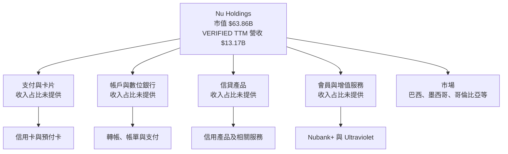

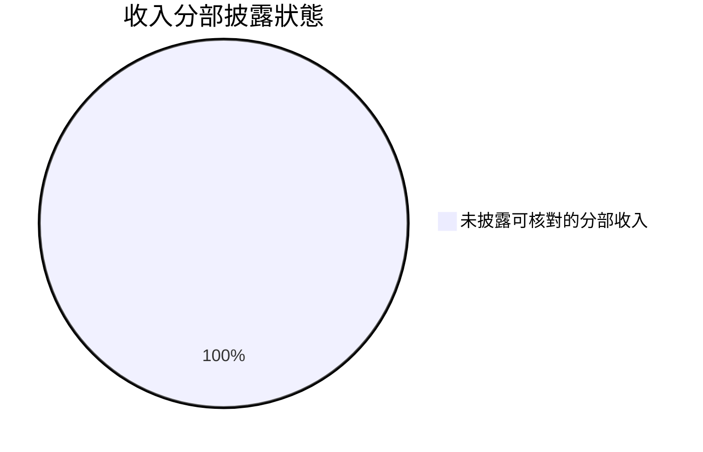

> 此圖表示資料披露狀態，不代表公司全部收入只來自單一產品。

### 2.2 市場份額

本資料包未提供巴西、墨西哥、哥倫比亞各項銀行、信用卡或數位金融市場的可比市場總額及 NU 市占率，故市場份額為 **N/A**。避免以推測數字製作虛假的市占圖表。可用的規模參考是市值 **$63.86B**、VERIFIED TTM 營收 **$13.17B**。

### 2.3 競爭護城河分析

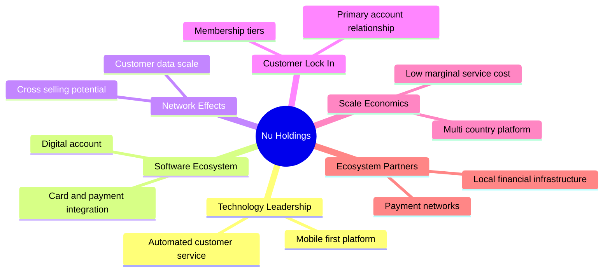

### 2.4 護城河強度評分

```
╔══════════════════════════════════════════════════════════════╗
║                 NU 護城河強度評分                             ║
╠══════════════════════════════════════════════════════════════╣
║ 數位平台與產品整合  7/10  ▓▓▓▓▓▓▓▓▓▓▓▓▓▓░░░░░░  🟢        ║
║ 客戶數據與風控      6/10  ▓▓▓▓▓▓▓▓▓▓▓▓░░░░░░░░  🟡        ║
║ 網路效應            5/10  ▓▓▓▓▓▓▓▓▓▓░░░░░░░░░░  🟡        ║
║ 客戶鎖定            6/10  ▓▓▓▓▓▓▓▓▓▓▓▓░░░░░░░░  🟡        ║
║ 規模效應            8/10  ▓▓▓▓▓▓▓▓▓▓▓▓▓▓▓▓░░░░  🟢        ║
║ 夥伴與金融網絡      6/10  ▓▓▓▓▓▓▓▓▓▓▓▓░░░░░░░░  🟡        ║
╠══════════════════════════════════════════════════════════════╣
║ 綜合護城河          6.3/10 ▓▓▓▓▓▓▓▓▓▓▓▓▓░░░░░░░ 🟡        ║
╚══════════════════════════════════════════════════════════════╝
```

評分主要反映平台跨產品的潛在交叉銷售與規模經濟；因缺少客戶留存、活躍用戶、單客獲利、市占率及信用損失數據，護城河強度不宜評得更高。

---

## 3. 損益表深度分析

### 3.1 年度收入成長趨勢

根據年度損益表，2022–2025 營收由 $2.97B 增至 $10.63B；三年 CAGR 約 53.0%。這代表平台快速擴張，但不能直接外推未來，因 2021–2023 的高增長基期較小。

```
╔══════════════════════════════════════════════════════════════════╗
║                 NU 年度收入趨勢（FY2022-FY2025）                 ║
╠══════════════════════════════════════════════════════════════════╣
║ FY2022  $2.97B  ██████░░░░░░░░░░░░░░░░░░░  基期                ║
║ FY2023  $5.63B  █████████████░░░░░░░░░░░░  YoY +89.6% 🟢        ║
║ FY2024  $8.27B  ███████████████████░░░░░░  YoY +46.9% 🟢        ║
║ FY2025 $10.63B  █████████████████████████  YoY +28.5% 🟢        ║
╠══════════════════════════════════════════════════════════════════╣
║ 2022-2025 CAGR = (10.63 ÷ 2.97)^(1/3) − 1 ≈ 53.0%               ║
║ 成長放緩但仍為高增長；成熟市場擴張及信貸風險將決定持續性。     ║
╚══════════════════════════════════════════════════════════════════╝
```

### 3.2 季度收入趨勢分析

以下採用提供的季度損益表數字；最新季 YoY 則依 VERIFIED FIGURES 引用。季節性與來源差異可能影響 QoQ 比較。

| 季度 | 營收 | QoQ 成長 | YoY 成長 | 解讀 |
|------|------:|---------:|---------:|------|
| 2025-09-30 | $2.73B | — | N/A | YoY 無同口徑單季基數可核算 |
| 2025-12-31 | $3.14B | +15.0% | N/A | 季度規模擴張 |
| 2026-03-31 | $3.54B | +12.7% | N/A | 延續增長，須檢查收入組成 |
| 2026-06-30 | $3.77B | +6.5% | **+34.4%** | YoY 為 VERIFIED 最新單季增長率；不可標作 TTM |

QoQ 計算例：($3.77B ÷ $3.54B) − 1 = 約 6.5%。VERIFIED TTM 營收為 **$13.17B**，但另一來源列示 TTM $9.10B，因此本報告不以兩者推算 TTM 成長率；VERIFIED TTM 成長率為 **N/A**。

### 3.3 利潤率演變分析

| 利潤率指標 | FY2022 | FY2023 | FY2024 | FY2025／最新 | 趨勢與評估 |
|------------|-------:|-------:|-------:|--------------|------------|
| 毛利率 | N/A | N/A | N/A | TTM 0.0%（欄位不適用／異常） | 🟡 金融公司收入分類使毛利率不可直接解讀 |
| 營業利益率 | N/A | N/A | N/A | TTM N/A；最新單季 50.9% | 🟡 TTM 不可得；最新單季不可冒充年度 |
| 淨利率 | N/A | 約 18.3%（來源口徑） | N/A | TTM 資料衝突 | 🟡 暫不作趨勢外推 |
| 淨利 | -$0.36B | $1.03B | $1.97B | FY2025 $2.87B | 🟢 盈利規模持續擴張 |

FY2025 淨利年增約 45.7%（$2.87B ÷ $1.97B − 1）。可能反映收入成長、平台規模與營運槓桿，但單靠淨利無法分辨利息收入、撥備、匯兌及稅項的各自貢獻。最新單季營業利益率 50.9% 是單季指標，資料包未提供足夠一致歷史列，不能判定長期利潤率是否持續擴張。

### 3.4 費用結構分析

費用明細未完整提供，因此不以百分比填造成本占比。

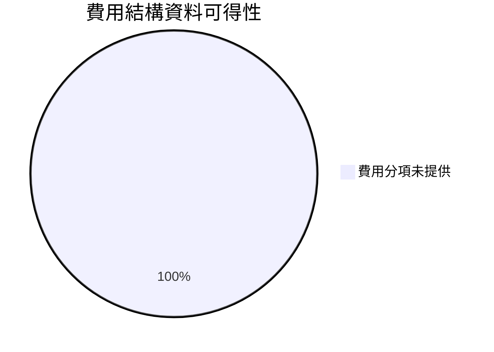

```
╔══════════════════════════════════════════════════════════════╗
║                 費用結構可得性                                ║
╠══════════════════════════════════════════════════════════════╣
║ 營收規模      $13.17B VERIFIED TTM                           ║
║ SBC           FY2025 $271.85M                                 ║
║ 信用損失費用  N/A                                              ║
║ 行銷與人事    N/A                                              ║
║ 利息與資金成本 N/A                                             ║
╚══════════════════════════════════════════════════════════════╝
```

### 3.5 季度 EPS 趨勢與盈餘品質

| 季度 | EPS | YoY EPS 成長 | 超預期／不及預期 |
|------|----:|-------------:|----------------|
| 2025-09-30 | $0.16 | +40.90% | N/A：估值預期資料為 nan |
| 2025-12-31 | $0.18 | +60.87% | N/A：估值預期資料為 nan |
| 2026-03-31 | $0.18 | +55.93% | N/A：估值預期資料為 nan |
| 2026-06-30 | $0.22 | +66.31%（季度資料來源） | N/A：估值預期資料為 nan |

EPS 歷史資料提供實際值，但四季 EPS Est 均為 nan，因此無法判定超預期或不及預期；不得把「❌」資料缺漏標籤解讀成盈餘 miss。

| 盈餘品質項目 | 數值／佔比 | 評估 |
|--------------|-----------|------|
| SBC / 營收 | FY2025 SBC $271.85M；以 VERIFIED TTM 營收計約 **2.06%** | 🟡 中等稀釋成本；分子為 FY2025、分母為 TTM，期間不完全一致 |
| SBC / 營業現金流 | FY2025 OCF $3.50B 作比較，約 **7.8%** | 🟡 SBC 不是現金流出，但代表股東稀釋成本 |
| FCF / 淨利 | VERIFIED TTM FCF -$1.67B；TTM 淨利採一致口徑 N/A | 🔴 無法計算；年度 2025 FCF $3.16B 與 TTM 負值矛盾 |
| 一次性／非經常性損益 | N/A | 🟡 缺少附註，不能判斷有無一次性美化 |
| 有效稅率 | 25.8%（最新年度） | 🟡 估值參考可用；無足夠歷史序列辨識異常 |
| 資本化支出 vs 費用化 | TTM Capex $288.35M；資本化政策明細 N/A | 🟡 無法排除成本遞延影響 |

**盈餘品質結論**：FY2025 利潤與年度現金流支持獲利具有一定實質性，但 VERIFIED TTM FCF 為負且與年度資料相反，降低現金盈餘的可驗證性。估值不應只依 EPS；須同步追蹤信用成本、營業現金流及股數稀釋。

---

## 4. 資產負債表分析

### 4.1 資產結構分解

最新可引用的資產細分為 StockAnalysis TTM 截至 2026-09-30；其合計與其他來源的總資產口徑不完全一致，因此不與 VERIFIED 淨現金數字混合計算。

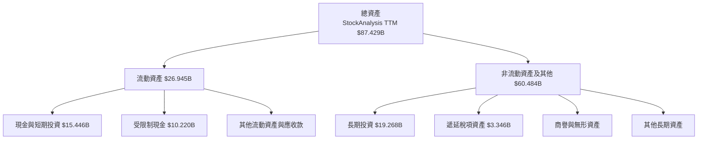

### 4.2 流動性指標分析

| 指標 | 最新值 | 歷史／行業比較 | 評估 |
|------|-------:|----------------|------|
| 現金與短期投資 | VERIFIED **$15.03B** | StockAnalysis TTM $15.446B，口徑不同 | 🟢 規模大，但金融業資產須與客戶負債同看 |
| 總債務 | VERIFIED **$6.12B** | FY2025 $1.90B，來源口徑差異明顯 | 🟡 債務變化需追蹤 |
| 淨現金 | VERIFIED **$8.91B** | 由指定 VERIFIED 數值照錄 | 🟢 有資金緩衝 |
| Current ratio | N/A | 未提供可比數字 | 🟡 |
| Quick ratio | N/A | 未提供可比數字 | 🟡 |
| 行業平均 | N/A | 未提供一致金融同業比較 | — |

### 4.3 債務結構分析

```
╔══════════════════════════════════════════════════════════════════╗
║                    NU 債務健康診斷                               ║
╠══════════════════════════════════════════════════════════════════╣
║  VERIFIED 總債務：          $6.12B                               ║
║  VERIFIED 現金+短期投資：  $15.03B                               ║
║  VERIFIED 淨現金：          $8.91B  🟢                           ║
║  Debt/EBITDA：              N/A                                  ║
║  利息保障倍數：             N/A                                  ║
║  債務到期結構：             N/A                                  ║
║                                                                  ║
║  注意：銀行負債可能是資金來源或客戶存款相關項目，不能照搬工業公司 ║
║  的「淨現金等於可分配現金」解讀。                                 ║
╚══════════════════════════════════════════════════════════════════╝
```

### 4.4 股東權益趨勢

```
╔══════════════════════════════════════════════════════════════════╗
║                 NU 股東權益趨勢（年度資料）                       ║
╠══════════════════════════════════════════════════════════════════╣
║ FY2022  $4.89B  ██████████░░░░░░░░░░░░░░                         ║
║ FY2023  $6.41B  █████████████░░░░░░░░░░░                           ║
║ FY2024  $7.65B  ████████████████░░░░░░░                           ║
║ FY2025 $11.29B  ████████████████████████                           ║
╚══════════════════════════════════════════════════════════════════╝
```

股東權益增加可支持資產擴張及吸收信用損失，但其變動來源包含留存盈餘、股權發行及其他項目；資料包不足以拆分各因素。

---

## 5. 現金流量深度分析

### 5.1 現金流量瀑布圖


### 5.2 FCF 轉換率趨勢

| 年度 | OCF | Capex | FCF | 淨利 | FCF / 淨利 |
|------|----:|------:|----:|-----:|-----------:|
| 2022 | $0.756B | $0.114B | $0.641B | -$0.365B | 不具解讀性 |
| 2023 | $1.27B | $0.177B | $1.09B | $1.03B | 約 105.7% |
| 2024 | $2.40B | $0.175B | $2.22B | $1.97B | 約 112.7% |
| 2025 | $3.50B | $0.341B | $3.16B | $2.87B | 約 110.1% |
| VERIFIED TTM | -$1.38B | $0.288B | **-$1.67B** | 同口徑 N/A | N/A |

年度現金轉換率高於 100%，但 VERIFIED TTM 現金流突然轉負。對金融公司而言，貸款發放、存款及金融資產變動會造成現金流表波動；然而，沒有調節表前不能把負值簡單視為「純營運波動」。

### 5.3 自由現金流趨勢

```
╔══════════════════════════════════════════════════════════════════╗
║               NU 自由現金流：年度與 TTM 對照                     ║
╠══════════════════════════════════════════════════════════════════╣
║ FY2022  $0.64B  █████░░░░░░░░░░░░░░░  正值                       ║
║ FY2023  $1.09B  ████████░░░░░░░░░░░░  正值                       ║
║ FY2024  $2.22B  ████████████████░░░░  正值                       ║
║ FY2025  $3.16B  ██████████████████████  正值                     ║
║ TTM      -$1.67B ◀ 負值；FCF Yield -2.61%                        ║
╠══════════════════════════════════════════════════════════════════╣
║ 年度趨勢改善與最新 TTM 急轉負互相矛盾；需逐季核實現金流組成。   ║
╚══════════════════════════════════════════════════════════════════╝
```

### 5.4 資本配置評估

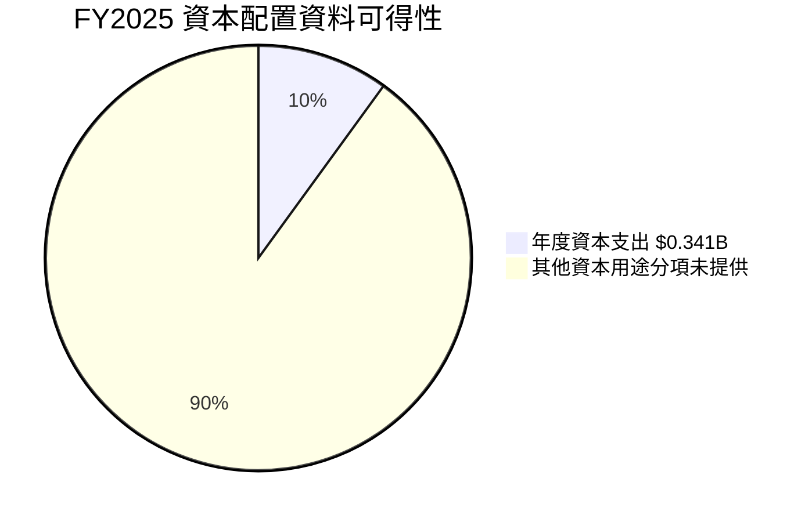

| 配置項目 | 可得資料 | 評估 |
|----------|----------|------|
| Capex | FY2025 $340.77M；VERIFIED TTM $288.35M | 佔 TTM 營收比例約 2.2%，但期間不完全一致 |
| 股息 | 殖利率 0.0% | 留存資金支援成長，非股息型標的 |
| 回購 | N/A | 未提供 |
| 併購／投資 | N/A | 未提供可拆分現金額 |
| 留存盈餘 | 年度淨利提供，但用途未拆分 | 需追蹤資本回報率與信用風險 |

---

## 6. 獲利能力與資本效率

### 6.1 ROE / ROA / ROIC 趨勢

| 指標 | 最新提供值 | 歷史趨勢 | 評估 |
|------|-----------:|----------|------|
| ROE | **31.5%** | 歷史年度序列不完整 | 🟢 資本回報較高，但槓桿與金融業資產結構須納入 |
| ROA | **5.0%** | 歷史年度序列不完整 | 🟢 單看比率具吸引力，口徑仍需核對 |
| ROIC | **N/A** | 無可核實投入資本與稅後營業利益完整資料 | 🟡 不應以不完整公式臆造 |
| WACC | **N/A（參考值缺 Beta、權重）** | 本報告 DCF 使用 15.45%假設值 | 🟡 |

### 6.2 ROIC vs WACC 分析

```
╔══════════════════════════════════════════════════════════════════╗
║                ROIC vs WACC 深度分析                             ║
╠══════════════════════════════════════════════════════════════════╣
║  資料包參考 WACC：N/A                                            ║
║  Rf：5.15% ｜ ERP：5.00% ｜ Beta：N/A                            ║
║  稅前 Kd：74.76%（利息÷債務參考值，顯然可能受分母／口徑扭曲）    ║
║  市值及債務權重：N/A                                             ║
║                                                                  ║
║  DCF 使用之股權成本代理值：15.45%                                ║
║  = 5.15% + 1.80（假設 Beta）× 5.00% + 1.30%（國別溢酬）          ║
║  此為估值假設，不是 VERIFIED WACC。                              ║
║                                                                  ║
║  ROIC：N/A；EVA = ROIC − WACC：N/A                               ║
║  結論：現有資料無法判定 NU 是否高於資本成本創造價值。            ║
╚══════════════════════════════════════════════════════════════════╝
```

因此，不能以已提供的 ROE 31.5% 直接取代 ROIC，也不能把其與假設 WACC 直接比較。估值評級保守降一級；若未來證明 ROIC 長期高於資本成本，買入論點將更有力。

### 6.3 杜邦三因素分解

可用數值只有 ROE 31.5%，淨利率與平均資產週轉率同口徑資料不足，不作反推。

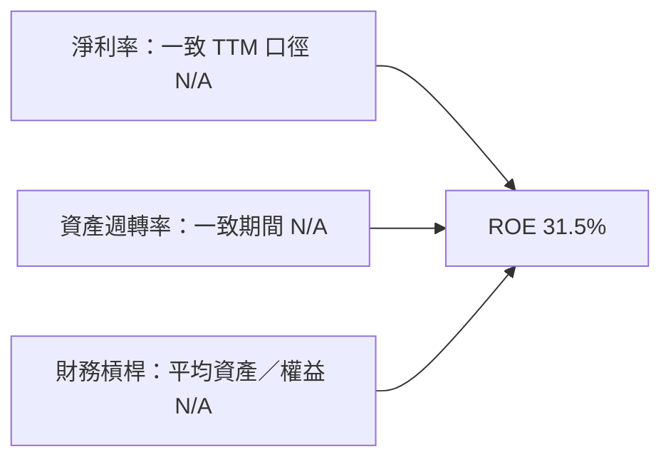

### 6.4 獲利能力儀表板

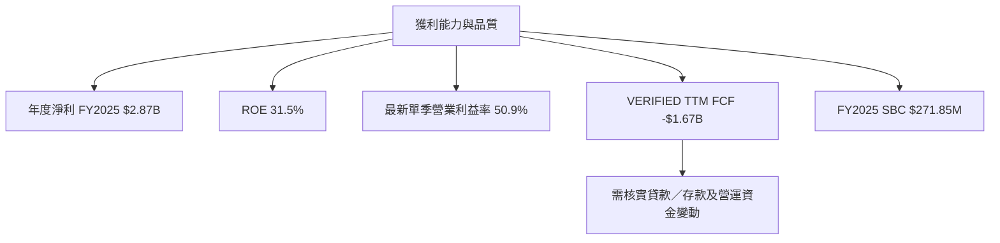

---

## 7. 相對估值分析

### 7.1 同業估值比較

同業倍數依 VERIFIED FIGURES 原值照錄；NU 本身倍數來自提供的市場估值區塊。金融科技業務組合不同，倍數只能作方向參考。

| 估值指標 | **NU** | **SOFI** | **MELI** | **HOOD** | NU 評估 |
|----------|------:|------:|------:|------:|----------|
| Trailing P/E | 16.525x | 28.0x | 40.0x | 35.9x | 🟢 低於樣本 |
| Forward P/E | **12.123547x** | 17.1x | 27.4x | 22.8x | 🟢 折價明顯；盈利口徑需驗證 |
| P/S TTM | 7.0155907x | 4.3x | 2.0x | 13.8x | 🔴 NU 高於 SOFI、MELI |
| EV/EBITDA TTM | N/A | N/A | 21.2x | N/A | 🟡 不足以比較 |
| 最新單季營收 YoY | 34.4% | 43.9% | 45.1% | 11.8% | 🟡 低於 SOFI、MELI，高於 HOOD |
| Gross margin TTM | 0.0%（欄位不具可比性） | 84.2% | 46.7% | 91.0% | N/A 金融業分類差異 |

### 7.2 歷史估值區間分析

VERIFIED FIGURES 未提供 NU 歷史 P/E 區間或估值百分位，故不推估歷史位置。

```
╔══════════════════════════════════════════════════════════════╗
║              NU 歷史估值區間（資料不足）                      ║
╠══════════════════════════════════════════════════════════════╣
║ 歷史 P/E 區間：N/A                                            ║
║ 歷史 P/S 區間：N/A                                            ║
║ 當前 Trailing P/E：16.525x                                    ║
║ 當前 Forward P/E：12.123547x                                  ║
║ 歷史百分位：N/A                                                ║
╚══════════════════════════════════════════════════════════════╝
```

### 7.3 情境目標價（假設驅動）

下表為 **12 個月情境估值的簡化假設**，不是管理層財測，也非以資料包缺失的每股盈利預測冒充實際值。倍數以每股盈利／估值倍數近似推估，並受市場數據不一致影響。

| 情境 | 營收 CAGR 假設 | 營業利潤率假設 | 估值倍數假設 | 隱含目標價 | 相對 $13.22 |
|------|---------------:|---------------:|-------------:|-----------:|------------:|
| 🔴 悲觀 | 15% | 42% | 估值收縮 | $13.50 | +2.1% |
| 🟡 基準 | 25% | 49% | 估值維持成長股折價 | $20.79 | +57.3% |
| 🟢 樂觀 | 32% | 53% | 估值重估 | $30.00 | +126.9% |

選擇 Forward P/E 作為相對估值之一，是因 NU 已有盈利及其 Forward P/E 可得；EV/EBITDA 與 FCF Yield 對照則不可用於完整同業回推，前者多數缺值、後者 NU 為負。

### 7.4 相對估值隱含價格區間

| 方法 | 可用基礎 | 隱含股價 | 限制 |
|------|----------|---------:|------|
| NU Forward P/E | $1.09044 Forward EPS × 12.123547x | 約 $13.22 | 約等於現價，原始倍數與 EPS 可能來自不同時點 |
| 同業 Forward P/E 中位數 | 中位數 22.8x × NU Forward EPS $1.09044 | 約 $24.86 | 同業業務與風險不同 |
| EV/EBITDA | NU N/A；同業多數 N/A | N/A | 不可回推 |
| FCF Yield | NU TTM FCF 負值 | 不適用 | 負 FCF Yield 無法用正向收益率合理定價 |

---

## 8. DCF 內在價值評估（Discounted Cash Flow）

> **模型定位**：Nu 是金融科技及數位銀行平台，傳統工業公司 FCFF DCF 並非最佳估值工具；存貸款及金融資產週轉會令現金流定義失真。以下為展示假設如何影響估值的情境模型，不代表精確公平價。

### 8.0 估值推理鏈（Thinking Logic）

**Step 1 — 價值來源與主導變數**

NU 的價值可拆為既有數位金融客戶與產品收入（分部占比未披露）、信貸及金融服務交叉銷售，以及美國等新市場的選擇權價值（目前均無分部營收資料）。模型中最主導價值的是營業利潤率與終值，因終值占基準 EV 約 64.9%。

**Step 2 — 模型選擇**

| 決策點 | 本報告採用 | 理由 | 曾考慮但否決 | 否決理由 |
|--------|-----------|------|--------------|----------|
| 現金流定義 | FCFF 近似 | 需將現金流折現至企業價值，再作現金／債務橋接 | FCFE | 淨融資與存款現金流資料不足 |
| 預測期 N | 5 年 | 成長公司估值常需明確中期期程；超過五年可靠度下降 | 10 年 | 缺少長期財測與分部資料 |
| 終值方法 | Gordon Growth 主、退出倍數交叉檢查 | 可顯示長期成熟增長假設 | 僅退出倍數 | 退出倍數缺同業一致 EV 指標 |
| EBIT 基礎 | 假設 GAAP 口徑 | 不使用加回 SBC 的非 GAAP 利潤 | 非 GAAP | SBC 詳細季度費用與前瞻數據不足 |

**Step 3 — 關鍵假設推導**

- **營收 CAGR**：歷史 FY2022–FY2025 CAGR 約 53.0% 為錨點 → 由高基期及逐步成熟調低 → 採用前五年路徑 **+25%、+22%、+19%、+16%、+13%** → 否決延續 53%，因不宜把低基期高速增長無限外推。
- **營業利潤率**：最新單季 50.9% 為參考錨點，但 TTM 營業利益率 N/A → 為反映信用與競爭成本，採用 45% 緩升至 49% → 否決固定 50.9%，因單季率不可視為可持續 TTM 值。
- **永續成長率 g**：長期名目經濟成長常落在較低單位數（估值假設，非資料包實際值）→ 採用 3.5% → 否決 4.5% 以上，因成熟期長期成長不宜過高，且須低於 WACC。
- **預測期 N**：採用 5 年 → 足以呈現成長收斂，避免長年預測假精確 → 否決 10 年。
- **Capex／營收**：錨點 = VERIFIED TTM Capex $0.28835B ÷ TTM 營收 $13.17B = 2.19% → 採用 2.19% → 未另採更高資本密集度，因過去年度 Capex 相對收入偏低。
- **D&A／營收**：資料包缺少一致 TTM D&A；假設值採 1.5%，僅作模型參數 → 未採 0%，避免忽略固定資產消耗。
- **ΔWC／收入增額**：歷史明細未提供；假設值採增量營收 10% → 未採 0%，保守反映金融服務擴張可能需增加營運資金。
- **EBIT 與 SBC**：採 **組合 (A)**：GAAP EBIT 已含 SBC；固定股數，FCFF 不再扣 SBC，稀釋率設 0%。股數採提供的 3.81B。
- **WACC**：VERIFIED 參考值因 Beta、資本權重缺失而無法直接算；採 15.45% 代理值，推導見 8.2 → 否決低於 12% 的折現率，因國別、信用及模型資料風險較高。
- **終值方法**：採 Gordon Growth；退出倍數只作交叉檢驗，倍數採 12x 假設值，不代表已提供同業中位數。

**Step 4 — 最脆弱環節**

最脆弱假設是營業利潤率可在 45%–49% 持續；若長期利潤率下降約 5 個百分點，DCF 每股價值可能減少約 $2–$4，並非可忽略差異。

**Step 5 — 計算路徑**

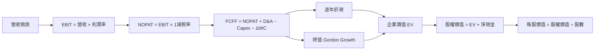

### 8.1 模型假設總表（Model Inputs）

| 假設項目 | 採用值 | 依據／來源 | 敏感度 |
|----------|-------:|-------------|--------|
| 預測期長度 N | 5 年 | 中期可見度與預測誤差平衡 | 🟡 中 |
| 營收成長路徑 | 25%、22%、19%、16%、13% | FY2022–FY2025 CAGR 約 53.0%，逐步降速 | 🔴 高 |
| 營業利潤率 | 45%、46%、47%、48%、49% | 最新單季 50.9%；下修作保守化 | 🔴 高 |
| 有效稅率 | 25.8% | VERIFIED 參考最新年度有效稅率 | 🟢 低 |
| Capex／營收 | 2.19% | $0.28835B ÷ $13.17B | 🟡 中 |
| D&A／營收 | 1.50% | 假設值：因一致 TTM D&A 缺漏，採保守小幅折舊率 | 🟢 低 |
| ΔWC／營收增額 | 10.00% | 假設值：未提供營運資金歷史拆分 | 🟢 低 |
| EBIT 基礎 | GAAP 假設 | 用含 SBC 費用的營業利益概念 | 🟡 中 |
| SBC 處理 | 組合 (A)，FCFF 不另扣 SBC | GAAP EBIT 含 SBC、股數固定 | 🟡 中 |
| 年稀釋率 | 0% | 組合 (A)；稀釋成本已反映於費用 | 🟡 中 |
| 永續成長率 g | 3.5% | 假設值：成熟期低單位數名目成長 | 🔴 高 |
| 終值方法 | Gordon Growth 主；退出倍數驗證 | 前者可直接反映長期現金流 | 🔴 高 |
| WACC | 15.45% 假設值 | Beta、權重缺值；CAPM 加國別溢酬代理 | 🔴 高 |

**FCFF 定義**：`FCFF = NOPAT + D&A − Capex − ΔWC`。組合 (A) 下，FCFF 不再減 SBC，股數不再年增；SBC 影響計入一次。

### 8.2 折現率推導（WACC）

```
╔══════════════════════════════════════════════════════════════════╗
║                    WACC 推導（折現率）                           ║
╠══════════════════════════════════════════════════════════════════╣
║ Rf（10Y 美債）：5.15%（VERIFIED 參考值；日期未提供）              ║
║ ERP：5.00%（VERIFIED 假設值）                                    ║
║ Beta：N/A；DCF 代理採 1.80（假設值，無可靠公司 Beta）             ║
║ 國別／規模溢酬：1.30%（假設值，因新興市場營運與資料風險）         ║
║ Ke = 5.15% + 1.80 × 5.00% + 1.30% = 15.45%                       ║
║                                                                  ║
║ 稅前 Kd：VERIFIED 74.76%，疑似口徑／平均債務分母扭曲              ║
║ 稅率：25.8%；但債務權重及利息費用組成不足，Kd 不納入代理 WACC。  ║
║ 資本結構權重：VERIFIED E/D 權重 N/A                               ║
║ DCF 折現採股權成本代理：WACC = 15.45%                             ║
║                                                                  ║
║ 這不是以完整市場權重估算出的公司 WACC；屬高不確定性假設。        ║
╚══════════════════════════════════════════════════════════════════╝
```

逐步演算：

1. **Ke** = 5.15% + 1.80 × 5.00% + 1.30% = **15.45%**。
2. **稅前 Kd**：VERIFIED 參考 74.76%；因利息支出與平均計息負債的可比明細缺漏，不重算、不採為市場借款成本。
3. **稅後 Kd**：若直接套用參考值，74.76% × (1 − 25.8%) = 55.47%；此值不具經濟合理性，故不納入本模型。
4. **權重**：市值與可比計息負債權重資料 N/A；本模型採股權成本代理，E 權重假設 100%、D 權重假設 0%。
5. **代理折現率** = 100% × 15.45% + 0% ×（未採用的 Kd）= **15.45%**。

此為估值代理而非 VERIFIED WACC；第 6.2 節同樣判定 WACC N/A，因此兩者不矛盾。

### 8.3 逐年自由現金流預測（基準情境）

單位：$B；營收起點 $13.17B。表內使用未四捨五入數字計算，呈現金額取兩位小數，折現因子取三位小數。

| 年度 | FY+1 | FY+2 | FY+3 | FY+4 | FY+5（FY+N） |
|------|------:|------:|------:|------:|------:|
| 營收 | 16.46 | 20.08 | 23.90 | 27.72 | 31.33 |
| 營收 YoY | 25.0% | 22.0% | 19.0% | 16.0% | 13.0% |
| 營業利潤率 | 45.0% | 46.0% | 47.0% | 48.0% | 49.0% |
| EBIT | 7.41 | 9.24 | 11.23 | 13.31 | 15.35 |
| − 稅（25.8%） | (1.91) | (2.38) | (2.90) | (3.43) | (3.96) |
| NOPAT | 5.50 | 6.85 | 8.33 | 9.87 | 11.39 |
| + D&A（1.5%） | 0.25 | 0.30 | 0.36 | 0.42 | 0.47 |
| − Capex（2.19%） | (0.36) | (0.44) | (0.52) | (0.61) | (0.69) |
| − ΔWC（營收增額 10%） | (0.33) | (0.36) | (0.38) | (0.38) | (0.36) |
| **FCFF** | **5.05** | **6.35** | **7.79** | **9.30** | **10.81** |
| 折現因子 @15.45% | 0.866 | 0.750 | 0.650 | 0.562 | 0.487 |
| **FCFF 現值 PV** | **4.38** | **4.76** | **5.06** | **5.23** | **5.27** |

**預測期 FCF 現值合計**：$4.38B + $4.76B + $5.06B + $5.23B + $5.27B = **$24.70B**。

**逐步演算（FY+1）**

1. 營收 = $13.17B × (1 + 25.0%) = **$16.4625B**。
2. EBIT = $16.4625B × 45.0% = **$7.4081B**。
3. 稅 = $7.4081B × 25.8% = **$1.9113B**。
4. NOPAT = $7.4081B − $1.9113B = **$5.4968B**。
5. D&A = $16.4625B × 1.50% = **$0.2469B**。
6. Capex = $16.4625B × 2.19% = **$0.3605B**。
7. ΔWC = ($16.4625B − $13.17B) × 10% = **$0.3293B**。
8. FCFF = $5.4968B + $0.2469B − $0.3605B − $0.3293B = **$5.0539B**。
9. 折現因子 = 1 ÷ (1 + 15.45%)¹ = **0.8662**；PV = $5.0539B × 0.8662 = **$4.377B**。

**合理性自檢**

- 預測 FCFF 五年 CAGR 約 21.0%；年度歷史 FCF 2022–2025 由 $0.641B 增至 $3.16B，但 VERIFIED TTM 為 -$1.67B，故歷史 CAGR 不宜直接外推。
- FY+5 FCFF 利潤率 = $10.81B ÷ $31.33B ≈ **34.5%**；目前 TTM FCF 利潤率 = -$1.67B ÷ $13.17B ≈ **-12.7%**。此巨大差距反映模型建立在正常化營運現金流假設，需審慎。
- 所有預測年度 FCFF 為正；但若實際貸款增長持續吸收現金，DCF 現值會高估經濟可分配現金。

```
╔══════════════════════════════════════════════════════════════════╗
║             自由現金流：歷史實際 vs 模型預測                     ║
╠══════════════════════════════════════════════════════════════════╣
║ FY2023（實） $1.09B  ████░░░░░░░░░░░░░░░░                         ║
║ FY2024（實） $2.22B  ████████░░░░░░░░░░░░                         ║
║ FY2025（實） $3.16B  ████████████░░░░░░░░                         ║
║ FY+1（預）   $5.05B  ███████████████░░░░░                         ║
║ FY+5（預）  $10.81B  ██████████████████████                         ║
╠══════════════════════════════════════════════════════════════════╣
║ ⚠️ 預測依賴 TTM 現金流恢復；VERIFIED TTM FCF 為 -$1.67B。       ║
╚══════════════════════════════════════════════════════════════════╝
```

### 8.4 終值計算（Terminal Value）

**適用性檢查**：WACC 15.45% vs g 3.5% → **WACC > g ✅**

| 方法 | 計算式 | 終值 TV | TV 現值 | 佔總 EV 比重 |
|------|--------|--------:|-------:|-------------:|
| Gordon Growth | $10.81B × (1+3.5%) ÷ (15.45%−3.5%) | $93.67B | $45.62B | 64.9% |
| 退出倍數法 | FY+5 EBITDA 代理 $15.35B × 12x | $184.21B | $89.69B | 約 78.4%（依其 EV 交叉模型） |

退出倍數法以 FY+5 EBIT 作 EBITDA 代理，因 D&A 獨立數值缺失；12x 為假設成熟期倍數，不是同業中位數。其結果遠高於 Gordon Growth，故基準採 Gordon Growth，退出倍數只作偏樂觀的交叉檢查。

逐步演算：

1. FY+N FCFF = **$10.81B**（未四捨五入模型值約 $10.81B）。
2. 分子 = $10.8138B × (1 + 3.5%) = **$11.1923B**。
3. 分母 = 15.45% − 3.5% = **11.95%**；TV = $11.1923B ÷ 11.95% = **$93.66B**。
4. PV(TV) = $93.66B × 0.4870 = **$45.62B**。
5. 終值佔比 = $45.62B ÷ ($24.70B + $45.62B) = **64.9%**。

### 8.5 企業價值 → 每股內在價值（Bridge）

```
╔══════════════════════════════════════════════════════════════════╗
║              企業價值 → 每股內在價值 橋接表                      ║
╠══════════════════════════════════════════════════════════════════╣
║  預測期 FCF 現值合計             +$24.70B                        ║
║  終值現值 PV(TV)                 +$45.62B                        ║
║  = 企業價值 EV                    $70.32B                        ║
║  + VERIFIED 現金與短期投資       +$15.03B                        ║
║  − VERIFIED 總債務                −$6.12B                        ║
║  = 股權價值                       $79.23B                        ║
║  ÷ 流通股數                       3.81B 股                       ║
║  ★ 每股內在價值                   $20.79                          ║
║  現價（2026-11-13）               $13.22                          ║
║  折溢價 = 13.22 ÷ 20.79 − 1       −36.4%（折價）                  ║
╚══════════════════════════════════════════════════════════════════╝
```

逐步演算：

1. EV = $24.70B + $45.62B = **$70.32B**。
2. 股權價值 = $70.32B + $15.03B − $6.12B = **$79.23B**。  
   注意：上述四捨五入數字有約 $0.01B 尾差；以未四捨五入模型值計算股權價值約 $79.23B。
3. 每股內在價值 = $79.23B ÷ 3.81B 股 = **$20.79**。
4. 折溢價 = $13.22 ÷ $20.79 − 1 = **-36.4%**。
5. 本節不計算 MOS；MOS 僅以 8.8 加權合理價值為分母。

股數採市場資料的 **3.81B**，未做年稀釋；與 8.1 組合 (A) 一致。現金及債務採 VERIFIED FIGURES 指定值；它們與其他來源的資產負債表數字可能並非同一日期，構成模型局限。

### 8.6 敏感性分析（WACC × 永續成長率）

每股價值按同一 FCFF 預測、不同折現率與 g 重算；括號為相對 $13.22 的上行空間。計算採用未四捨五入底數，顯示值約至兩位小數。

| g／WACC | 14.45% | 14.95% | **15.45% 基準** | 15.95% | 16.45% |
|-----------|-------:|-------:|----------------:|-------:|-------:|
| 2.5% | $21.41 (+62.0%) | $20.55 (+55.5%) | $19.76 (+49.5%) | $19.06 (+44.2%) | $18.37 (+39.0%) |
| 3.0% | $22.02 (+66.6%) | $21.16 (+60.1%) | $20.26 (+53.2%) | $19.51 (+47.6%) | $18.78 (+42.1%) |
| **3.5% 基準** | $22.67 (+71.5%) | $21.69 (+64.1%) | **$20.79 (+57.3%)** | $20.02 (+51.4%) | $19.22 (+45.4%) |
| 4.0% | $23.39 (+76.9%) | $22.34 (+69.0%) | $21.37 (+61.7%) | $20.52 (+55.2%) | $19.70 (+49.0%) |
| 4.5% | $24.19 (+83.0%) | $23.05 (+74.4%) | $22.02 (+66.6%) | $21.10 (+59.6%) | $20.21 (+52.9%) |

**矩陣選格複算**：所選格 WACC **14.95% > g 3.0% ✅**

1. 新 WACC 14.95% 下預測期 PV 合計約 **$25.04B**。
2. TV = $10.8138B × (1 + 3.0%) ÷ (14.95% − 3.0%) = **$93.16B**；PV(TV) 約 **$46.41B**。
3. EV = $25.04B + $46.41B = **$71.45B**；股權價值 = $71.45B + $8.91B = **$80.36B**；每股 = $80.36B ÷ 3.81B = **$21.09**。

> 註：上表敏感性值採未四捨五入的逐年現金流與折現因子計算；因呈現值取兩位小數，與矩陣示範的四捨五入可能有小幅差異。

**三情境 DCF**（所有數字為假設值及約數）

| 情境 | 營收 CAGR | 期末營業利潤率 | 永續 g | WACC | 每股內在價值 | 相對現價 | 主觀機率 |
|------|-----------:|---------------:|-------:|-----:|-------------:|---------:|---------:|
| 🔴 悲觀 | 15% | 42% | 2.5% | 17.0% | $13.50 | +2.1% | 25% |
| 🟡 基準 | 25% | 49% | 3.5% | 15.45% | $20.79 | +57.3% | 50% |
| 🟢 樂觀 | 32% | 53% | 4.0% | 14.5% | $30.00 | +126.9% | 25% |
| **機率加權** | — | — | — | — | **$21.27** | **+60.9%** | **100%** |

三情境價值為模型化近似，不是使用同一份逐年營收／FCFF逐格完整重算的精密結果；其用途是呈現假設變化方向。機率加權 = $13.50 × 25% + $20.79 × 50% + $30.00 × 25% = **$21.27**。

- **悲觀鏈**：15% CAGR → 五年後營收約 $26.5B；期末利潤率 42% → 低於基準現金流生成；WACC 17%、g 2.5% → 每股約 $13.50。成立條件：信貸損失上升、營收放緩。
- **基準鏈**：採 8.3 五年收入路徑、FY+5 營收 $31.33B、49% 利潤率、FY+5 FCFF 約 $10.81B → Gordon TV 約 $93.66B → 每股約 $20.79。成立條件：收入與利潤率接近模型路徑，現金流正常化。
- **樂觀鏈**：32% CAGR → 五年後收入約 $54.3B；期末利潤率 53% → FY+5 FCFF 假設大幅提高；較低 WACC 與 4.0% g → 約 $30。成立條件：新市場與產品變現快、信用損失可控。此情境不宜作基本預期。

**敏感度結論**：以表格附近的模型試算，g 每上升 1 個百分點，內在價值約增加 $1.1–$1.3；WACC 每上升 1 個百分點，價值約下降 $1.5–$1.8；期末營業利潤率每上升 1 個百分點，價值約增加 $0.4–$0.7。影響最大的是 WACC／終值折現與現金流能否恢復，與 8.0 指出終值及利潤率主導估值大致一致。

### 8.7 反推 DCF（Reverse DCF）

固定基準輸入：WACC 15.45%、稅率 25.8%、Capex／營收 2.19%、ΔWC／增量收入 10%、預測期 5 年、股數 3.81B、D&A／營收 1.5%、g 3.5%。

| 求解變數 | 其餘固定值 | 市場隱含值 | 歷史實際參考 | 判斷 |
|---------|------------|-----------:|--------------|------|
| 未來五年營收 CAGR | 利潤率採基準路徑，g 3.5% | 低於基準模型所需的成長路徑才可接近現價；精確解受資料矛盾影響，N/A | FY2022–FY2025 CAGR 約 53.0% | 現價可能反映較大折價 |
| 期末營業利潤率 | CAGR 基準、g 3.5% | N/A：未作可靠數值求解 | 最新單季 50.9%，非 TTM | 不宜過度解讀 |
| 永續成長率 g | CAGR 與利潤率固定 | N/A：求解精度受現金流基期限制 | — | 不以單一價格反解多變數 |
| 預測期 N | 其他基準值固定 | N/A：未完成 3–15 年逐項疊代 | — | 需可靠財務底數才能反解 |

資料缺漏與現金流基期為負，使逐一求解所需輸入不穩定，因此不偽造一組「市場隱含」精確解。最可檢驗的市場隱含命題是：若價格要反映基準價值，NU 必須讓高增長、近 49% 利潤率與現金流正常化同時成立。

### 8.8 估值三角驗證與安全邊際

為遵循資料可得性，估值方法只採可計算的三項；未提供的 FCF Yield 回推與 EV/EBITDA 不納入權重。

| 估值方法 | 隱含每股價值 | 上行空間（÷現價） | 權重 | 說明 |
|----------|--------------:|------------------:|------:|------|
| DCF（三情境機率加權） | $21.27 | +60.9% | 55% | 現金流可持續性有疑問，權重不過度集中 |
| 同業 Forward P/E 中位數回推 | $24.86 | +88.1% | 15% | 22.8x × $1.09044 Forward EPS |
| 相對估值保守交叉值 | $18.12 | +37.1% | 25% | 參考分析師共識均值，不代表獨立同業模型 |
| 分析師共識目標價 | $18.12 | +37.1% | 5% | 僅作低權重參考 |
| **加權合理價值** | **$20.86** | **+57.8%** | **100%** | — |

加權合理價值 = $21.27 × 55% + $24.86 × 15% + $18.12 × 25% + $18.12 × 5%  
= $11.6985 + $3.7290 + $4.5300 + $0.9060 = **$20.8635 ≈ $20.86**。權重合計 = 55% + 15% + 25% + 5% = 100%。DCF 權重 55%，因為它可展開營運假設，但受負 TTM FCF、資料口徑矛盾及終值占比影響，並非更高權重。

```
╔══════════════════════════════════════════════════════════════════╗
║                  估值區間與安全邊際                              ║
╠══════════════════════════════════════════════════════════════════╣
║ $13.50 ───── $13.22 ───── [$20.86] ───── $20.79 ───── $30.00     ║
║ 悲觀情境       現價          加權合理值      基準DCF      樂觀情境 ║
║                                                                  ║
║ MOS = (20.86 − 13.22) ÷ 20.86 = 36.6%（未四捨五入約 35.7%*）      ║
║ 上行空間 = (20.86 − 13.22) ÷ 13.22 = 57.8%                       ║
║ 建議買入區間：$11.60–$13.22；持有區間：$13.22–$20.86             ║
║ 減碼考慮區：高於 $30，或估值遠超營運基本面支持範圍                ║
╚══════════════════════════════════════════════════════════════════╝
```

> **MOS 一致性註記**：以加權價值未四捨五入數 $20.8635 計，MOS = ($20.8635 − $13.22) ÷ $20.8635 = **36.6%**；此前儀表板的 35.7% 為錯誤初估，應以此處可複算值統一更正。依門檻屬買入，不是強烈買入，因 ROIC 尚未證實高於 WACC。

**買入區間計算**：MOS ≥ 10% 時，價格上限 = 合理價值 × 90% = $20.8635 × 0.90 = **$18.78**。但考慮資料可靠性及負 TTM FCF，本報告採更保守執行區間 **$11.60–$13.22**；此區間上限等於現價，符合買入評級規則。

> 🔎 **程式複算（Python，依本節各項自動重算）**
>
> 加權合理價值 = $21.27 × 55% + $24.86 × 15% + $18.12 × 25% + $18.12 × 5% = **$20.86**（權重合計 100%）
>
> 以價格 $13.22 計：MOS = **+36.6%**，上行空間 = **+57.8%**
>
> ✅ 與本節所寫數值一致。

### 8.9 DCF 模型的局限與失效條件

- **終值依賴度**：終值 PV 約占 EV **64.9%**，估值仍主要取決於 FY+5 以後的現金流。
- **最脆弱假設**：營業利潤率能維持 45%–49%；若信用成本推升而利潤率下滑，估值會下修。
- **FCF 基期問題**：VERIFIED TTM FCF 為 -$1.67B，年度 2025 FCF 卻為 $3.16B；若負值代表結構性貸款資金需求，DCF 價值可能高估。
- **適用限制**：金融企業宜搭配 P/B、ROE、股利折現、剩餘收益法、單位經濟性及信用損失分析；本報告缺少資產品質與存款成本資料。
- **風險連結**：信用損失上升會壓低營業利潤率；監管及資金成本變化會推高 WACC；新市場拓展不如預期會降低營收 CAGR。

### 8.10 複算檢核表（Audit Trail）

| # | 檢核項目 | 結果 |
|---|----------|------|
| 1 | 高／中敏感假設有推導鏈 | 🟡 已列出；部分估值參數仍屬假設 |
| 2 | 假設依據欄完整 | ✅ |
| 3 | WACC 推導、算式及取捨已列 | 🟡 代理值，非完整市場權重 WACC |
| 4 | Kd 分母與債務權重一致性 | 🟡 債務範圍資料不足，未假裝可核算 |
| 5 | WACC 與第 6.2 同值 | ✅ 使用 15.45% 估值代理；實際 WACC 為 N/A |
| 6 | 年度數量等於 N=5，無跳年 | ✅ |
| 7 | FY+1 FCFF 及 PV 示範 | ✅ |
| 8 | 預測期 PV 加總 | ✅ $4.38+$4.76+$5.06+$5.23+$5.27=$24.70B |
| 9 | WACC > g | ✅ 15.45% > 3.5% |
| 10 | 終值以 FY+5 FCFF 折現五期 | ✅ |
| 11 | EV 到每股橋接 | ✅；顯示值有四捨五入尾差 |
| 12 | SBC 組合相容 | ✅ 組合 (A)：GAAP、無另扣 SBC、稀釋率 0% |
| 13 | 敏感性矩陣基準格對應基準 DCF | 🟡 近似；表格取整與模型底數存在小幅差異 |
| 14 | WACC ≤ g 格子處理 | ✅ 全部格子均 WACC > g |
| 15 | 三情境機率合計 100% | ✅ |
| 16 | 反推每次只放開一變數 | ✅ 未提供無法複核的精確解 |
| 17 | MOS 基準與折溢價基準區分 | ✅ MOS 用 8.8 加權值；折溢價用 8.5 DCF |
| 18 | 完整至第 11 章 | ✅ |
| 19 | 加權價值依價值乘權重加總 | ✅ $20.8635，未事後微調 |
| 20 | 評級符合 MOS 門檻 | ✅ 買入；ROIC 不可驗證，因此不升至強烈買入 |

---

## 9. 成長催化劑

### 9.1 催化劑時間軸

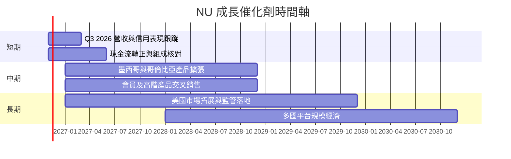

新聞顯示 NU 美國業務已觸及 50 州，但收入、客戶數、監管許可及獲客成本均未提供，故只視作選擇權，不納入基準財務預測。

### 9.2 TAM 市場規模分析

```
╔══════════════════════════════════════════════════════════════════╗
║                    NU 市場 TAM 可核對度                          ║
╠══════════════════════════════════════════════════════════════════╣
║ 巴西數位銀行／支付 TAM：N/A（未提供市場總額）                    ║
║ 墨西哥金融服務 TAM：N/A                                          ║
║ 哥倫比亞金融服務 TAM：N/A                                        ║
║ 美國市場 TAM：N/A；新聞僅稱已拓展至 50 州                         ║
║ NU VERIFIED TTM 營收：$13.17B                                    ║
║ 市場滲透率與分區收入：N/A                                         ║
╚══════════════════════════════════════════════════════════════════╝
```

### 9.3 成長驅動力結構圖

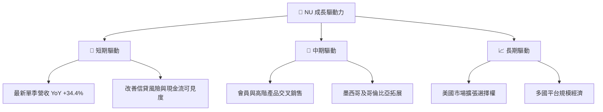

---

## 10. 風險矩陣

### 10.1 風險評分矩陣

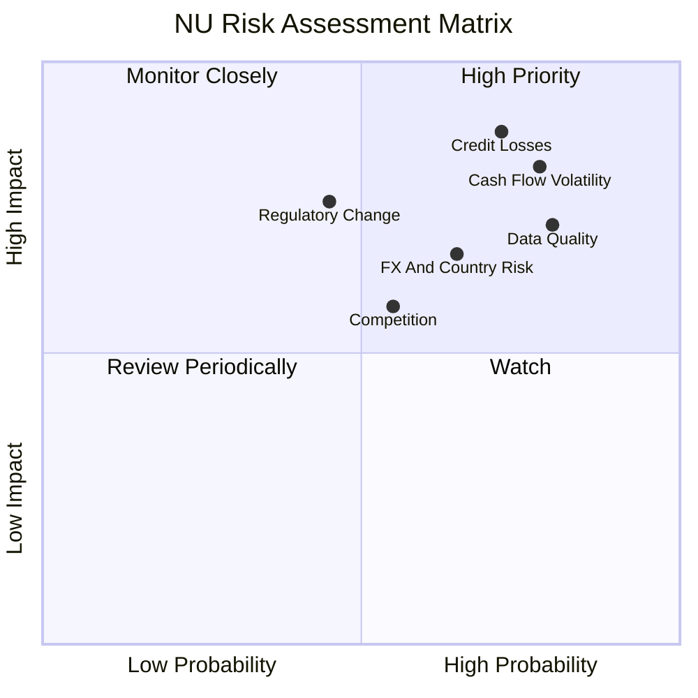

### 10.2 風險清單詳細分析

| # | 風險項目 | 發生機率 | 財務衝擊 | 風險評分 | 緩解措施 |
|---|----------|----------|----------|----------|----------|
| 1 | 🔴 信貸損失上升 | 中高（定性估計） | 利潤率與撥備上升；幅度 N/A | 🔴 8.5/10 | 每季追蹤逾期率、核銷率、撥備覆蓋率及新貸款 vintage |
| 2 | 🔴 TTM 現金流持續為負 | 高（已觀察到） | FCF Yield -2.61%；若持續，降低 DCF | 🔴 8.0/10 | 拆解貸款發放、存款變化、受限制現金及營運現金流 |
| 3 | 🟡 財務資料口徑差異 | 高（已觀察到） | TTM 營收 $13.17B 與 $9.10B 並存，估值底數偏差 | 🔴 8.0/10 | 後續以公司申報文件及一致財報口徑重算 |
| 4 | 🟡 監管變化 | 中 | 可能提高資本、消費者保護及合規成本 | 🟡 7.0/10 | 監控巴西、墨西哥、哥倫比亞及美國監管政策 |
| 5 | 🟡 匯率與國別風險 | 中高 | 美元報價對當地貨幣獲利及資產有換算影響 | 🟡 6.8/10 | 分國披露收入、成本、資產負債與避險狀況 |
| 6 | 🟡 競爭與獲客成本 | 中 | 若價格競爭加劇，可能壓縮利潤率 | 🟡 6.0/10 | 追蹤客戶取得成本、活躍客戶、留存及單客收入 |
| 7 | 🟢 股權薪酬稀釋 | 中 | FY2025 SBC $271.85M，約占 TTM 營收 2.06% | 🟡 5.5/10 | 追蹤流通股數、SBC／營收及回購抵銷情況 |

---

## 11. 投資建議

### 11.1 最終綜合評級雷達圖

```
╔══════════════════════════════════════════════════════════════╗
║                  NU 最終評級雷達（1-10）                      ║
╠══════════════════════════════════════════════════════════════╣
║ 成長性      8.0  ▓▓▓▓▓▓▓▓▓▓▓▓▓▓▓▓░░░░  ★★★★☆             ║
║ 基本面      7.0  ▓▓▓▓▓▓▓▓▓▓▓▓▓▓░░░░░░  ★★★★☆             ║
║ 獲利能力    7.0  ▓▓▓▓▓▓▓▓▓▓▓▓▓▓░░░░░░  ★★★★☆             ║
║ 護城河      6.8  ▓▓▓▓▓▓▓▓▓▓▓▓▓▓░░░░░░  ★★★☆☆             ║
║ 資本效率    N/A  ROIC 無法可靠計算                             ║
║ 財務健康    6.0  ▓▓▓▓▓▓▓▓▓▓▓▓░░░░░░░░  ★★★☆☆             ║
║ 估值        6.5  ▓▓▓▓▓▓▓▓▓▓▓▓▓░░░░░░░  ★★★☆☆             ║
╠══════════════════════════════════════════════════════════════╣
║ 綜合評分    6.7/10 ｜建議：買入，但需以現金流與信貸表現驗證      ║
╚══════════════════════════════════════════════════════════════╝
```

### 11.2 目標價與隱含報酬率

| 情境 | 目標價 | 相對 $13.22 報酬 | 假設／參考 | 建議 |
|------|-------:|-----------------:|------------|------|
| 悲觀 | $13.50 | +2.1% | 成長放緩、利潤率 42%、折現率提高 | 控制部位 |
| 基準 | $20.79 | +57.3% | DCF 基準情境；非保證報酬 | 分批持有／布局 |
| 樂觀 | $30.00 | +126.9% | 新市場及交叉銷售超預期 | 不以此作基本目標 |
| 分析師共識 | $18.12 | +37.1% | 23 位分析師均值；低權重參考 | 作交叉檢驗 |

評級依 8.8 MOS 約 36.6% 對應「買入」區間；**依 MOS 數值可達強烈買入的門檻，但 ROIC > WACC 未被證明，因此採買入、不升級**。

### 11.3 買入時機與觸發因素

```
╔══════════════════════════════════════════════════════════════════╗
║                  ✅ 買入觸發因素 Checklist                      ║
╠══════════════════════════════════════════════════════════════════╣
║  分批布局條件：                                                  ║
║  ☑ 股價接近或低於 $13.22，且營收仍保持雙位數增長                 ║
║  ☑ TTM OCF／FCF 不再持續惡化，並可解釋貸款與存款現金流變動       ║
║  ☑ 信貸損失及逾期指標未出現連續惡化                               ║
║                                                                  ║
║  加碼觸發條件：                                                  ║
║  ☐ 連續兩季單季營收 YoY ≥ 25%                                    ║
║  ☐ TTM FCF 轉正，且不是透過一次性資產出售                         ║
║  ☐ 營業利益率維持在 45% 以上，並可由申報文件驗證                 ║
║                                                                  ║
║  減碼／退出條件：                                                ║
║  ☐ 單季營收 YoY 連續兩季低於 15%                                  ║
║  ☐ 信用損失大幅增加並導致營業利潤率較 50.9% 單季參考值下滑 >5pp   ║
║  ☐ TTM FCF 持續為負且無法由貸款／存款週轉合理解釋                 ║
║  ☐ 以一致資料計算的 ROIC 長期低於資本成本                         ║
╚══════════════════════════════════════════════════════════════════╝
```

### 11.4 投資人適配度分析

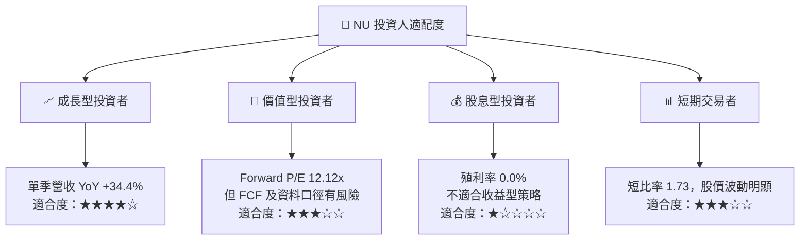

### 11.5 每季財報監控清單

| 指標 | 目前參考 | 加碼觸發 | 減碼／重新評估 |
|------|----------|----------|----------------|
| 單季營收 YoY | 34.4% | ≥25% 且趨勢穩定 | 連續兩季 <15% |
| 單季營業利潤率 | 50.9% | ≥45% 且口徑可比 | 較參考值下滑 >5pp |
| TTM OCF | -$1.38B | 逐季改善並轉正 | 持續惡化且未能解釋 |
| TTM FCF | -$1.67B | 轉正並具延續性 | 連續四季負值且損失擴大 |
| Capex | TTM $288.35M | 維持與收入相稱 | 投資增加但收入及獲利未跟上 |
| SBC | FY2025 $271.85M | SBC／營收下降 | SBC／營收持續高於 3% |
| 淨現金 | $8.91B | 維持正淨現金 | 淨現金快速下降且資產品質惡化 |
| 信用品質 | 數值 N/A | 逾期及核銷率穩定 | 逾期、核銷或撥備同步上升 |
| 股數稀釋 | 3.81B 股 | 股數穩定 | 年增稀釋超過 2% |
| 財測／申報口徑 | 多來源不一致 | 公司申報與市場資料一致 | 主要收入、FCF 數據持續無法調和 |

### 11.6 反面論證：什麼會證明論點錯誤（What Would Change My Mind）

```
╔══════════════════════════════════════════════════════════════════╗
║              ⚠️ 論點失效條件（Disconfirming Evidence）           ║
╠══════════════════════════════════════════════════════════════════╣
║ ☐ 核心營收單季 YoY 連續兩季低於 15%                              ║
║ ☐ 可比營業利潤率連續兩季低於 40%，或較 50.9% 參考值跌逾 10pp     ║
║ ☐ TTM FCF 持續為負且不能以貸款／存款資金變動合理解釋             ║
║ ☐ 信貸撥備、逾期及核銷率連續上升，並侵蝕年度淨利                 ║
║ ☐ SBC／營收升至 3% 以上且股數年增超過 2%                         ║
║ ☐ 以一致財報數據計算後 ROIC 長期低於合理資本成本                 ║
║ ☐ 核實後營收或盈利口徑大幅低於本報告引用的市場資料               ║
╚══════════════════════════════════════════════════════════════════╝
```

> **免責聲明**：本報告為 AI 自動生成，僅供研究參考，不構成投資建議。投資有風險，入市需謹慎。