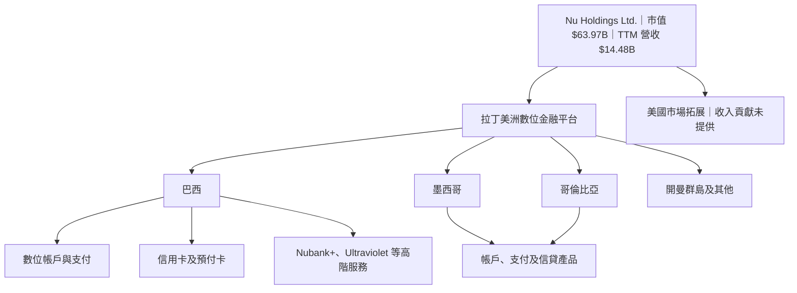
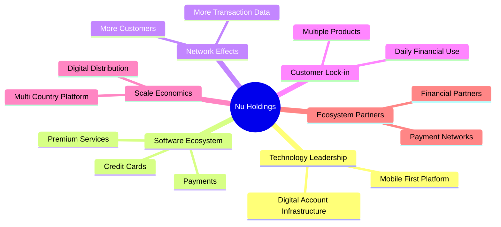
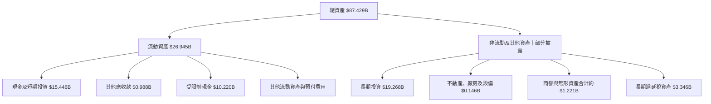
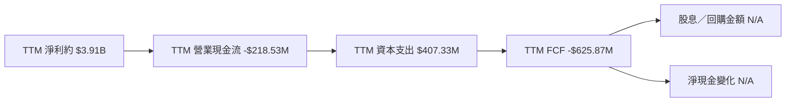
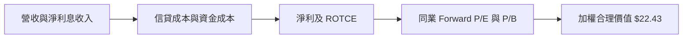
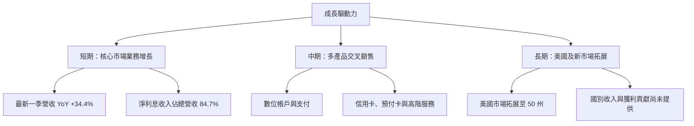
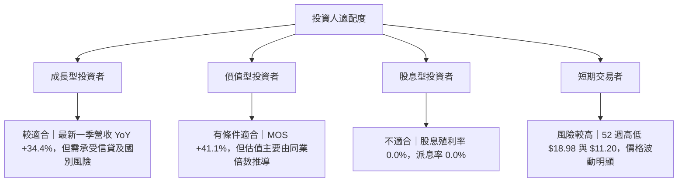

# NU 基本面深度分析報告
> **報告日期**：2026-11-15 ｜ **語言**：繁體中文 ｜ **數據來源**：Yahoo Finance、Finviz、StockAnalysis、Roic.ai 

## 目錄

| # | 章節 | 核心結論 |
|---|------|----------|
| 1 | 執行摘要 | 評級買入；加權合理價值 $22.43；MOS +41.1% |
| 2 | 公司概覽與商業模式 | 數位金融平台具規模優勢；市場份額與分部收入比例未提供 |
| 3 | 損益表深度分析 | 最新一季營收年增 34.4%；TTM 營收成長率不可得 |
| 4 | 資產負債表分析 | 淨現金 $9.32B；流動性指標不適合金融機構套用 |
| 5 | 現金流量深度分析 | TTM FCF 為 -$625.87M，與淨利及 FY2025 現金流明顯背離 |
| 6 | 獲利能力與資本效率 | ROTCE 29.8%；傳統 ROIC 對放款機構不適用，無法與 WACC 直接比較 |
| 7 | 相對估值分析 | Forward P/E 低於同業中位數；同業估值支持較現價高的參考價值 |
| 8 | DCF 內在價值評估 | DCF 不適用於放款機構；以財務業同業估值與共識目標價三角驗證 |
| 9 | 成長催化劑 | 拉美核心業務擴張及美國市場拓展是主要選擇權 |
| 10 | 風險矩陣 | 信貸品質、監管與現金流可讀性是主要風險 |
| 11 | 投資建議 | 買入；建議買入區間 $13.22–$20.19，持續監控信貸與資金成本 |

---

## 1. 執行摘要

### 1.0 一頁式投資儀表板（Portfolio Manager 30 秒速讀）

| 項目 | 內容 |
|------|------|
| **投資論點（3 句）** | ① 最新一季營收年增 **34.4%**，反映平台仍在擴張；但 TTM 成長率不可得，不能把單季成長外推為全年。② TTM 有形權益報酬率 **29.8%**，顯示現有股東權益獲利能力高；但信貸品質與資本充足率數據未提供。③ 2026-11-13 收盤價 **$13.22**，低於加權合理價值 **$22.43**；加權估值主要由同業 Forward P/E 與 P/B 推導。 |
| **綜合評分** | **7.3/10**（引用 1.1 六項平均） |
| **財務健康** | 🟡 現金及短期投資 $15.45B、總債務 $6.12B、淨現金 $9.32B；但 TTM FCF 為 -$625.87M，信貸品質指標缺漏 |
| **ROIC vs WACC** | 傳統 ROIC：N/A（金融業口徑不適用／資料不足）；WACC **14.00%**。不能據此判定 ROIC 是否高於 WACC |
| **FCF 趨勢** | TTM FCF 為負，FCF Yield **-0.98%**；貸款成長會影響金融機構營業現金流，不能直接按一般企業 FCF 解讀 |
| **估值** | Forward P/E **12.235756x** ｜ EV/EBITDA **N/A** ｜ FCF Yield **-0.98%** |
| **DCF 內在價值（基準）** | N/A（金融機構現金流是資金來源與放貸活動的一部分，不適合套用一般企業 FCFF DCF）；DCF 折溢價 N/A |
| **安全邊際（MOS）** | **+41.1%**＝($22.43 − $13.22) ÷ $22.43；🟢 >25% 充足。分母為 8.8 節加權合理價值 |
| **預期報酬（基準情境 12M）** | 無 DCF 基準情境；分析師共識目標價 $17.83，較現價上行 **34.9%**，僅作市場參考 |
| **關鍵風險（前二）** | 信貸損失上升（淨沖銷率、逾放比未提供）；監管或資金成本變化壓縮利差 |
| **評級 + 信心度** | 🟢 **買入** ｜ 信心：中（估值折價具吸引力，但缺少資產品質與資本充足率關鍵資料） |

> 評級依 8.8 節 MOS +41.1% 落在「買入」門檻；雖 MOS 超過 25%，但 ROIC 對金融業不可直接比較、無法確認 ROIC > WACC，因此不是「強烈買入」。未作質化調整。

### 1.1 綜合評分卡（全報告唯一）

| 維度 | 評分（1–10） | 主要依據（引用數字與其來源章節） |
|------|--------------|----------------------------------|
| 成長性 | 8.0 | 最新一季營收年增 34.4%；TTM 成長率 N/A，見 3.2 |
| 獲利能力 | 8.0 | 最新一季營業利益率 50.9%、ROTCE 29.8%；傳統 ROIC 與 Piotroski F-Score 不適用，見 3.3、6.4 |
| 財務健康 | 7.0 | 淨現金 $9.32B；但 TTM FCF -$625.87M，且淨沖銷率、逾放比、CET1 未提供，見 4、5、6.4 |
| 估值 | 8.0 | MOS +41.1%；同業 Forward P/E 中位數 22.8x，NU Forward P/E 12.235756x，見 7、8.8 |
| 護城河 | 7.0 | 多國數位金融平台與產品組合；市場份額、客戶數及留存率數據未提供，見 2 |
| 管理層與資本配置 | 6.0 | FY2025 FCF $3.16B、SBC $271.85M；股息殖利率及派息率均為 0%，但回購資料未提供，見 5 |
| **綜合評分** | **7.3** | 六項算術平均：(8.0 + 8.0 + 7.0 + 8.0 + 7.0 + 6.0) ÷ 6 = **7.3** |

### 1.2 五大投資論點 + 三大核心風險

| 類型 | 項目 | 具體依據 | 信心度 |
|------|------|----------|--------|
| 🟢 **投資論點①** | 核心平台仍在成長 | 最新一季營收 $4.03B，年增 34.4%；擴大產品使用及客戶滲透可提高單一客戶收入，但客戶數與收入分部未提供 | 🟢 高 |
| 🟢 **投資論點②** | 有形權益獲利能力高 | ROTCE 29.8%；若能維持且信貸損失受控，可支持較高帳面價值倍數 | 🟢 中 |
| 🟢 **投資論點③** | 資產負債表淨現金 | 現金及短期投資 $15.45B，總債務 $6.12B，淨現金 $9.32B；提供一定資金緩衝 | 🟢 中 |
| 🟢 **投資論點④** | 同業相對估值有折價 | NU Forward P/E 12.235756x，低於同業中位數 22.8x；折價可能反映市場對巴西、信用週期及資料品質的風險補償 | 🟡 中 |
| 🟢 **投資論點⑤** | 美國拓展提供額外選擇權 | 近期消息指出 Nubank U.S. 已拓展至全美 50 州；收入貢獻、獲客成本與盈利時間表未提供，尚不能計入基準估值 | 🟡 中 |
| 🟡 **風險①** | 信貸品質惡化 | 淨沖銷率、逾放比未提供；若信用卡及無擔保貸款損失上升，利潤率與 ROTCE 可能快速下行 | 🟡 中 |
| 🔴 **風險②** | 金融監管、利率及資金成本 | 巴西、墨西哥、哥倫比亞均有不同金融規範；成本收入比代理值 68.1% 且含信貸準備，成本或監管變動可能侵蝕利潤 | 🔴 高 |
| 🟡 **風險③** | 現金流數據口徑及可讀性 | TTM FCF -$625.87M，但 FY2025 FCF $3.16B；需要確認貸款增長、資金流及資本支出對現金流的影響 | 🟡 中 |

### 1.3 快速統計卡片

| 指標 | 公司實際值（期間） | 同業中位數 | 狀態 |
|------|--------------------|------------|------|
| 營收成長（TTM） | **N/A** | — | 🟡 |
| 營收成長（最新一季年增） | **34.4%** | **43.9%** | 🟡 |
| 毛利率（TTM） | **0.0%（資料來源列示值；銀行業不具可比性）** | **84.2%** | 🟡 |
| 營業利益率（TTM） | **N/A** | — | 🟡 |
| ROIC（TTM） | **N/A（金融業不適用／資料不足）** | — | 🟡 |
| Forward P/E | **12.235756x** | **22.8x** | 🟢 |
| FCF Yield（TTM） | **-0.98%** | — | 🔴 |
| Piotroski F-Score | **N/A（不適用放款機構）** | — | 🟡 |

### 1.4 投資結論

```text
╔══════════════════════════════════════════════════════════════════╗
║                    📊 投資結論摘要                               ║
╠══════════════════════════════════════════════════════════════════╣
║  評級：買入（MOS +41.1%；ROIC 無法與 WACC 直接比較）             ║
║  價格（2026-11-13 收盤）：$13.22                                 ║
║  DCF 內在價值（基準）：N/A（金融業現金流不適用一般 FCFF DCF）   ║
║  安全邊際 MOS：+41.1%（＝($22.43−$13.22)÷$22.43）               ║
║  加權合理價值（8.8）：$22.43                                     ║
║  綜合評分：7.3/10（引用 1.1）                                    ║
║  適合投資人：可承受拉美信貸、匯率及監管風險的成長型長線投資人   ║
╚══════════════════════════════════════════════════════════════════╝
```

---

## 2. 公司概覽與商業模式

### 2.1 業務結構與收入來源

公司資料描述 Nu Holdings 在巴西、墨西哥、哥倫比亞、開曼群島及美國提供數位金融平台服務，包含信用卡與預付卡、存款帳戶、轉帳繳費及訂閱／高階服務。各產品收入及收入佔比未提供，不能拆分金額或繪製收入比例圖。



> TTM 營收依 Yahoo Finance 季度報表計算值引用。其他來源同時列有 TTM 營收 $9.10B，數據存在口徑或來源差異；本報告財務數據採用標示為 VERIFIED 的 $14.48B，不把兩者混算。

### 2.2 市場份額

市場份額數據未提供。NU 的 TTM 營收為 $14.48B、最新一季營收年增 34.4%；同業最新一季營收年增中位數為 43.9%，顯示其仍具規模與增長，但不能以此推算市場份額。

### 2.3 競爭護城河分析



### 2.4 護城河強度

| 護城河項目 | 強度（強／中／弱） | 證據（引用數字或事實） | 會削弱它的情況 |
|------------|--------------------|------------------------|----------------|
| 技術與數位平台 | 中 | 以行動端提供帳戶、支付、卡片及信貸服務；營收規模達 TTM $14.48B | 系統故障、資安事件或競爭者快速複製 |
| 軟體生態系統 | 中 | 產品涵蓋支付、卡片、帳戶及高階服務；收入分部佔比未提供 | 使用者只使用單一產品、交叉銷售不及預期 |
| 網路效應 | 中 | 交易與信貸資料可能改善風險評估；客戶數與留存率未提供，無法量化 | 資料優勢未轉化為較低損失率或較低獲客成本 |
| 客戶鎖定 | 中 | 數位帳戶與日常支付具有使用黏著的可能性；存款留存率未提供 | 高息競爭、客戶多平台使用或存款外流 |
| 規模效應 | 中 | 多國經營且最新一季營收年增 34.4% | 國別監管分散成本上升、規模未能降低成本 |
| 生態夥伴 | 弱至中 | 使用卡片、支付等金融服務場景；合作方及依賴程度未提供 | 支付網路、銀行合作條款或監管要求改變 |

護城河評分 **7.0/10** 的依據是多產品數位平台與跨市場經營具擴張可能，但缺少客戶、留存、獲客成本及市場份額數據驗證其強度。

---

## 3. 損益表深度分析

### 3.1 年度收入成長趨勢（近 4 年）

年度營收（USD）：2022 年 $2.97B、2023 年 $5.63B、2024 年 $8.27B、2025 年 $10.63B。下列年增率以年度報表相鄰年份計算，四捨五入至一位小數。

```text
╔══════════════════════════════════════════════════════════════════╗
║              Nu Holdings 年度收入趨勢（FY2022–FY2025）          ║
╠══════════════════════════════════════════════════════════════════╣
║  FY2022  $2.97B  ██████░░░░░░░░░░░░░░░░░░  基期                ║
║  FY2023  $5.63B  ████████████░░░░░░░░░░░░  YoY: +89.6% 🟢      ║
║  FY2024  $8.27B  ██████████████████░░░░░░  YoY: +46.9% 🟢      ║
║  FY2025 $10.63B  ████████████████████████  YoY: +28.5% 🟢      ║
╠══════════════════════════════════════════════════════════════════╣
║  FY2022–FY2025 營收 CAGR：(10.63÷2.97)^(1÷3)−1 = 約 53.0%       ║
╚══════════════════════════════════════════════════════════════════╝
```

年度增速由 89.6% 降至 28.5%，屬高基期下的增速正常化。FY2025 營收仍增加 $2.36B；若產品交叉銷售及新市場擴張維持，增速放緩未必代表收入轉弱，但 TTM 對比成長率為 N/A，不能據此判定當前 TTM 成長趨勢。

### 3.2 季度收入趨勢分析

採用季度損益表列示的數字計算 QoQ；季度年增率僅在來源明確提供時引用。金額與其他資料來源存在差異，見 2.1 註記。

| 季度 | 營收 | QoQ | YoY | 備註 |
|------|------|-----|-----|------|
| 2025Q4 | $3.14B | — | N/A | 比較基期 |
| 2026Q1 | $3.54B | +12.7% | N/A | 相對 2025Q4 增加 $0.40B |
| 2026Q2 | $3.77B | +6.5% | N/A | 相對 2026Q1 增加 $0.23B |
| 2026Q3 | $4.03B | +6.9% | +34.4% | 最新一季年增率為單季同比，不是 TTM |

季度營收逐季上升，代表收入動能仍在；但不同季度增幅有波動，而且金融服務收入會受利率、信貸餘額與季節性影響，不宜只用單季年增率線性外推。

### 3.3 利潤率演變分析

| 指標 | FY2022 | FY2023 | FY2024 | FY2025 | 最新可得 | 評估 |
|------|--------|--------|--------|--------|----------|------|
| 毛利率 | N/A | N/A | N/A | N/A | TTM 資料來源列示 0.0% | 🔴 金融業毛利率概念不具可比性；同業毛利率亦不宜直接解讀為銀行毛利 |
| 淨利率 | -12.3% | 18.3% | 23.8% | 27.0% | N/A | 🟢 由虧轉盈並逐年提高；FY2022–FY2025 淨利從 -$364.58M 增至 $2.87B |
| 營業利益率 | N/A | N/A | N/A | N/A | 最新一季 50.9%；TTM N/A | 🟡 單季數字不能代替 TTM，也不足以建立年度趨勢 |

FY2022 至 FY2025 淨利率提升，與獲利從負轉正、收入擴張及營運規模增加一致；但不同來源收入及利潤資料有差異，且各期信貸準備、稅項與產品組合拆分未提供，不能把改善單獨歸因於某一項成本下降。最新一季營業利益率 50.9% 是單季數字，不應外推為全年利潤率。

### 3.4 費用結構分析

費用分項（例如利息費用、信貸損失準備、營運費用）的完整金額與比例未提供，故不繪製費用圓餅圖，以免虛構比例。可引用的成本收入比代理值為 68.1%，但其公式包含信貸準備，**高於公司自行公布的效率比率口徑**，不能視為純營運費用率。

### 3.5 季度 EPS 趨勢與盈餘品質（Quality of Earnings）

過去四季實際 EPS 可由季度資料讀取為 2025Q4 $0.18、2026Q1 $0.18、2026Q2 $0.22、2026Q3 $0.23。EPS 預估值缺失，因此無法判定超預期或不及預期；公布的 Beat/Miss 欄位預估值為 nan，不代表盈餘實際不及預期。

| 季度 | EPS 實際 | EPS 預估 | 超預期／不及預期 | 可能解讀 |
|------|----------|----------|-------------------|----------|
| 2025Q4 | $0.18 | N/A | 無法判定 | 實際值可確認，預估值缺漏 |
| 2026Q1 | $0.18 | N/A | 無法判定 | QoQ 持平 |
| 2026Q2 | $0.22 | N/A | 無法判定 | 每股盈餘增加 |
| 2026Q3 | $0.23 | N/A | 無法判定 | 每股盈餘續增；最新一季 EPS 年增 40.1% |

| 盈餘品質項目 | 數值／佔比 | 評估 |
|--------------|------------|------|
| 股權薪酬 SBC / 營收 | 約 **2.72%**；SBC TTM $394.13M ÷ 營收 TTM $14.48B | 🟡 SBC 對淨利有成本，也會造成股東稀釋；此處 SBC TTM 由四季列示數字加總 |
| SBC / 營業現金流 | **-180.4%**；$394.13M ÷ -$218.53M | 🔴 分母為負，比例經濟意義有限；顯示當期 OCF 不足以涵蓋 SBC |
| FCF / 淨利 | 約 **-16.0%**；-$625.87M ÷ 約 $3.91B | 🔴 TTM 現金轉換率為負；金融業放貸活動會扭曲 CFO/FCF，需與貸款增長及存款變化一併看 |
| 一次性／非經常性損益 | N/A | 無完整調節表，不能判定一次性項目是否抬高或壓低盈餘 |
| 有效稅率異常 | 25.8%（最新年度有效稅率） | 🟡 未見足夠年度序列判斷異常；目前模型採用值不代表逐季稅率固定 |
| 資本化支出 vs 費用化 | TTM 資本支出 $407.33M；資本化政策細節 N/A | 🟡 無法評估資本化支出是否延遲費用認列 |

**盈餘品質結論：** GAAP 獲利近年增加，且最新一季 EPS 年增 40.1%；但 TTM FCF 為負、SBC 約佔 TTM 營收 2.72%，且缺少一次性損益與信貸準備調節。對金融業而言，貸款發放會使現金流呈現企業經營現金流以外的資金流特徵，因此不應單憑負 FCF 判定淨利虛增；但投資人應要求更完整的貸款、存款與撥備調節來確認盈餘含金量。

---

## 4. 資產負債表分析

### 4.1 資產結構分解

以下金額採 2026-09-30 StockAnalysis 資產負債表資料；細項未能與總資產完整勾稽，故只作披露項目展示，不視為完整資產拆分。



細項與總資產存在未勾稽差異，且受限制現金、金融投資項目可能受金融機構分類影響；不宜以圖中單一類別推算資產占比。

### 4.2 流動性與營運資金分析

| 指標 | 最新值 | 歷史趨勢 | 解讀 |
|------|--------|----------|------|
| 現金及短期投資 | $15.45B（截至 2026-09-30） | N/A | 依 VERIFIED 數字引用；可提供流動性緩衝，但不等同全部可自由運用資金 |
| 總債務 | $6.12B | N/A | 金融業債務與融資結構須連同存款、借款及資產端評估 |
| 淨現金 | $9.32B | N/A | 現金及短期投資扣除總債務後的披露值 |
| Current Ratio / Quick Ratio | N/A | 不適用傳統解讀 | 金融業流動資產及流動負債分類與一般企業不同 |
| DSO／DIO／DPO／CCC | 不適用（金融業） | 不適用（金融業） | 貸款、存款及資金調度不適合用製造業營運資金週轉天數描述 |

### 4.3 債務結構分析

```text
╔══════════════════════════════════════════════════════════════════╗
║                   NU 債務健康診斷                                ║
╠══════════════════════════════════════════════════════════════════╣
║  總債務：          $6.12B     金融業融資負債，須看資產端對應     ║
║  現金及短期投資： $15.45B     流動性緩衝                         ║
║  淨現金：          $9.32B     🟢 正淨現金                        ║
║  Debt/Equity：     N/A        數據未提供                         ║
║  Debt/EBITDA：     N/A        EV/EBITDA亦未提供                  ║
║  Interest Coverage：N/A       利息保障倍數未提供                 ║
╚══════════════════════════════════════════════════════════════════╝
```

資料表中的總債務適合按披露值引用，但對銀行型企業，存款及融資來源本身是業務運作的一部分；因此淨現金只能作資產負債表簡化觀察，不能替代 CET1、流動性覆蓋率或資產負債期限分析。上述監管指標均未提供。

### 4.4 股東權益趨勢

| 財年 | 股東權益 | YoY |
|------|----------|-----|
| 2022 | $4.89B | — |
| 2023 | $6.41B | +31.1% |
| 2024 | $7.65B | +19.4% |
| 2025 | $11.29B | +47.6% |

FY2025 股東權益增加 $3.64B，增幅 47.6%；同期淨利為 $2.87B，權益增加幅度高於當年淨利，可能涉及其他權益變動或資本項目，但具體調節未提供。

```text
╔══════════════════════════════════════════════════════════════════╗
║                    股東權益趨勢（年度）                         ║
╠══════════════════════════════════════════════════════════════════╣
║  2022  $4.89B  ██████████░░░░░░░░░░░░░░                          ║
║  2023  $6.41B  ██████████████░░░░░░░░░░                          ║
║  2024  $7.65B  █████████████████░░░░░░░                          ║
║  2025 $11.29B  █████████████████████████                         ║
╚══════════════════════════════════════════════════════════════════╝
```

---

## 5. 現金流量深度分析

### 5.1 現金流量瀑布圖

金融業營業現金流包含貸款及資金流動，不宜把股息、回購或淨現金變化當作營業現金流的固定下游項目；缺少的數字不予填補。



### 5.2 FCF 轉換率趨勢

| 期間 | 營業現金流 | 資本支出 | FCF | 淨利 | FCF／淨利 |
|------|------------|----------|-----|------|-----------|
| FY2023 | $1.27B | $177.00M | $1.09B | $1.03B | 約 105.8% |
| FY2024 | $2.40B | $174.99M | $2.22B | $1.97B | 約 112.7% |
| FY2025 | $3.50B | $340.77M | $3.16B | $2.87B | 約 110.1% |
| TTM 至 2026-09-30 | -$218.53M | $407.33M | -$625.87M | 約 $3.91B | 約 -16.0% |

年度 FCF／淨利比率約 106%–113%，但 TTM 轉為負值，反映較大的期間差異。貸款發放、存款變化及現金流分類可能造成波動，應以金融機構資金與信貸指標解釋，而非視為一般企業經營效率的直接變化。

### 5.3 自由現金流趨勢

```text
╔══════════════════════════════════════════════════════════════════╗
║                   FCF 歷史趨勢（USD）                           ║
╠══════════════════════════════════════════════════════════════════╣
║  FY2023  $1.09B   ███████████░░░░░░░░░░░░░  正                  ║
║  FY2024  $2.22B   ██████████████████████░░░  正                  ║
║  FY2025  $3.16B   █████████████████████████  正                  ║
║  TTM     -$0.63B  ◀█████░░░░░░░░░░░░░░░░░░  負                  ║
║  TTM FCF Yield：-0.98%                                           ║
╚══════════════════════════════════════════════════════════════════╝
```

FY2025 FCF 為 $3.16B，但最新 TTM FCF -$625.87M，且 FCF Yield -0.98%。此反轉使一般企業的現金流折現與 FCF Yield 估值失去穩定解讀基礎；對 NU 應優先追蹤貸款增長、存款流入、撥備及監管資本。

### 5.4 資本配置評估

回購、投資、股息與留存的年度完整拆分未提供，故不繪製資本配置圓餅圖。

| 資本配置項目 | 可得資料 | 評估 |
|--------------|----------|------|
| 資本支出 | FY2025 $340.77M；TTM $407.33M | TTM 支出增加，但金額本身不能代表金融業整體再投資需求 |
| 股權薪酬 | FY2025 $271.85M；TTM 約 $394.13M | 形成稀釋成本，需監控每股盈餘增速是否持續高於股數增速 |
| 股息 | 殖利率 0.0%；派息率 0.0% | 盈餘以留存及再投資為主 |
| 回購 | N/A | 回購金額及股份變化資料不完整 |
| 投資與留存 | N/A | 無法分解至各用途 |

---

## 6. 獲利能力與資本效率

### 6.1 ROE / ROA / ROIC 趨勢

| 指標 | FY2025／TTM 可得值 | 歷史比較 | 評估 |
|------|-------------------|----------|------|
| ROE | TTM 31.5% | 多年度 ROE 序列未提供 | 🟢 較高；但無法用杜邦資料拆解槓桿與淨利率貢獻 |
| ROA | TTM 5.0% | 多年度 ROA 序列未提供 | 🟢 顯示資產有獲利能力，但需配合信貸損失及資產品質判讀 |
| ROTCE | TTM 29.8% | 歷史序列未提供 | 🟢 有形權益報酬表現較高 |
| ROIC | N/A | 金融業口徑不適用／資料不足 | 不以一般企業投資資本定義與 WACC 比較 |

### 6.2 ROIC vs WACC 分析（核心價值創造判斷）

放款機構的存款、借款及貸款資產都是核心營運項目，傳統以 NOPAT 除以「股東權益＋債務−現金」計算 ROIC 容易失真；目前亦沒有可重算所需的利息、營運資本及資產口徑資料。因此本節不虛構 ROIC，也不推導 EVA。

```text
╔══════════════════════════════════════════════════════════════════╗
║                ROIC vs WACC 深度分析                            ║
╠══════════════════════════════════════════════════════════════════╣
║  無風險利率（10Y 美債）：5.15%                                   ║
║  股權風險溢酬 ERP：5.00%                                         ║
║  原始 Beta：0.97；調整後 Beta：0.98                              ║
║  股權成本 Ke：10.05%（Cost of Capital 列示值）                   ║
║  稅前債務成本：74.76%；有效稅率：25.8%                           ║
║  股權／債務權重：91.3%／8.7%                                     ║
║  WACC：14.00%（計算值 14.02%，上限限制後採用 14.00%）            ║
║                                                                  ║
║  NU ROIC：N/A（金融業不適用／資料不足）                          ║
║  EVA＝ROIC−WACC：N/A                                             ║
║  結論：無法用傳統 ROIC-WACC 判定價值創造；ROTCE 為 29.8%，       ║
║        是較適合金融機構的獲利參考，但不等同 ROIC。               ║
╚══════════════════════════════════════════════════════════════════╝
```

WACC 依 Cost of Capital 的固定輸入引用；此處的 14.00% 亦為第 8 章指定折現率。債務成本 74.76% 顯著偏高，應視為來源模型中利息／債務口徑的異常警訊，不能把它解讀為公司一般市場融資利率。因為指定 WACC 模型已計入該輸入，本報告不自行替換或另算 WACC。

### 6.3 杜邦三因素分解

**N/A**（品質指標列示為 N/A：缺少適用且一致的淨利、營收、總資產或正股東權益組合以供杜邦分解）。因此不補算淨利率、資產週轉率及權益乘數，也不推斷 ROE 是否由槓桿驅動。

### 6.4 財務體質：放款機構指標

Piotroski F-Score 為 **N/A**：其現金流測試會將放款增長造成的營業現金流流出誤判為負面，因此不適用放款機構。九項測試結果亦不適用，不能列為通過或未通過。

| 放款機構指標 | 數值（TTM 至 2026-09-30） | 解讀 |
|--------------|--------------------------|------|
| 淨利息收入 NII ÷ 總營收 | **84.7%** | 收入主要由淨利息收入構成，代表利差及信貸業務是主要獲利來源 |
| 淨利差代理值 NII ÷ 平均總資產 | **15.74%** | 代理值；分母使用總資產而非生息資產，因此高於正式 NIM 的可能性較高 |
| 成本收入比代理值 | **68.1%** | 公式為（營收−稅前淨利）÷營收，包含信貸準備，因此高於公司公布的效率比率 |
| ROTCE | **29.8%** | 淨利除以有形帳面價值，適合與銀行業獲利能力比較，但受資產品質影響 |
| P/TBV | **4.87x** | 市場願意為每單位有形帳面價值支付較高倍數；需由持續高 ROTCE 支持 |
| 放款淨額 ÷ 總資產 | **14.0%** | 反映列示的放款資產占比；不能單獨判斷放貸集中度或風險 |
| 淨沖銷率 | **N/A（數據未提供）** | 信貸損失趨勢的核心缺項 |
| 逾放比 | **N/A（數據未提供）** | 無法評估不良貸款比例 |
| CET1 | **N/A（數據未提供）** | 無法評估監管資本緩衝 |

---

## 7. 相對估值分析

### 7.1 同業估值比較表格

同業倍數及營收成長引用 Yahoo Finance Peer multiples；NU 倍數引用 Yahoo Finance 與 Finviz 合併的市場估值資料。NU 與同業商業模式不完全相同，因此相對估值只作參考。

| 估值指標 | **NU** | **SOFI** | **MELI** | **HOOD** | NU 評估 |
|----------|-------:|--------:|--------:|--------:|---------|
| **Trailing P/E** | 16.525x | 28.0x | 40.0x | 35.9x | 🟢 明顯折價；需留意市場風險溢價與資料口徑 |
| **Forward P/E** | 12.235756x | 17.1x | 27.4x | 22.8x | 🟢 低於同業中位數 22.8x |
| **P/S** | 7.0269847x | 4.3x | 2.0x | 13.8x | 🟡 高於 SOFI、MELI，低於 HOOD；金融機構 P/S 解讀有限 |
| **EV/EBITDA** | N/A | N/A | 21.4x | N/A | 🟡 可比較資料不足 |
| **最新一季營收 YoY** | 34.4% | 43.9% | 45.1% | 11.8% | 🟡 低於 SOFI、MELI，但高於 HOOD |
| **毛利率 TTM** | 0.0%（來源列示，金融業不具可比性） | 84.2% | 46.7% | 91.0% | 不宜用來比較銀行型金融服務公司的獲利能力 |

### 7.2 歷史估值區間分析

N/A（未提供「Valuation vs own history」估值歷史區間數值，不能自行估計歷史百分位或 P/E 區間）。

可確認的價格歷史顯示，月末收盤價由 2026-01 的 $17.75 下跌至 2026-10 的 $11.61，之後在 2026-11 回升至 $13.22；這是價格表現，不等同於估值倍數歷史區間。

### 7.3 情境價值（Bear / Base / Bull）

N/A（DCF 無法計算：放款機構的現金流是資金來源與貸款活動的一部分，不適合建立一般企業 FCFF DCF；不可自行設定 DCF 情境目標價）。

### 7.4 相對估值隱含價格區間

```text
╔══════════════════════════════════════════════════════════════════╗
║             相對估值方法回推每股價值                             ║
╠══════════════════════════════════════════════════════════════════╣
║  $13.22 現價 ── $17.83 共識 ── $20.79 同業 P/B ── $24.67 P/E   ║
╚══════════════════════════════════════════════════════════════════╝
```

| 方法 | 每股價值 | 相對現價 | 推導依據 |
|------|---------:|---------:|----------|
| 同業 Forward P/E | $24.67 | +86.6% | SOFI、MELI、HOOD Forward P/E 中位數 22.8x × NU Forward EPS $1.08 |
| 同業 P/B | $20.79 | +57.3% | 同業 P/B 中位數 7.0x × 每股帳面價值 $2.96 |
| 分析師共識目標價 | $17.83 | +34.9% | 23 位分析師平均目標價 |

以上價格為估值方法輸出，不代表預期必然達成；其中同業中位數倍數包含商業模式、國別與獲利能力不同的公司。

---

## 8. DCF 內在價值評估（Discounted Cash Flow）

### 8.0 估值推理鏈（Thinking Logic）

**Step 1 — 公司價值由何決定？**  
NU 的價值主要由既有金融服務的淨利息收入與信貸損失、資金成本與資本充足度，以及新市場拓展選擇權決定。可得收入結構資料顯示 NII 佔總營收 84.7%；其他分部佔比未提供，因此不能拆分「主業／第二曲線」營收比例。對銀行而言，信貸成本與資金成本比一般公司自由現金流更能主導估值。

**Step 2 — 模型選擇**

| 決策點 | 本報告採用 | 理由（含數字） | 曾考慮但否決 | 否決理由 |
|--------|-----------|----------------|--------------|----------|
| 現金流定義 | N/A | TTM OCF -$218.53M、FCF -$625.87M；放款與資金流是營運活動核心 | FCFF／FCFE | 一般 FCFF DCF 不適合銀行型金融機構 |
| 預測期 N | N/A | DCF MODEL 明確為 N/A | 自行選 5–10 年 | 禁止自建或補造 DCF |
| 終值方法 | N/A | 無適用 DCF 模型輸出 | Gordon Growth／退出倍數 | 不能基於不存在的現金流預測計算 |
| EBIT 基礎 | N/A | 無適用模型 | GAAP EBIT／非 GAAP EBIT | 不建一般企業 FCFF 模型 |

**Step 3 — 假設推導鏈**  
DCF 模型區塊為 N/A，故營收 CAGR、營業利潤率、預測年數、永續成長率、終值方法及逐年 FCFF 均不提供。若自行補入任何假設，會違反「DCF 由程式提供模型數字且不可另建」的要求。

**Step 4 — 最脆弱的一環**  
相對估值最脆弱的假設是 NU 可持續維持高 ROTCE，且信貸損失不會快速上升；若不成立，市場給予的 P/TBV 與 Forward P/E 應下修。因 DCF 為 N/A，無法給出 DCF 估值下修金額。

**Step 5 — 計算路徑**



### 8.1 模型假設總表（Model Inputs）

DCF MODEL：**N/A**（放款機構的現金流屬資金來源及貸款活動，不適用一般企業自由現金流模型）。因此無預測期、營收 CAGR、營業利潤率、稅率、Capex／營收、D&A／營收、ΔWC、SBC 模式、股數稀釋率、永續成長率或終值假設；不自建模型。

### 8.2 折現率推導（WACC）

WACC 固定採用 Cost of Capital 提供值，供第 6.2 與本節一致引用。原始 Beta 0.97，調整方式為 **⅔ × 0.97 + ⅓ = 約 0.98**，使用調整後 Beta 0.98。

```text
╔══════════════════════════════════════════════════════════════════╗
║                    WACC 推導（折現率）                           ║
╠══════════════════════════════════════════════════════════════════╣
║  無風險利率 Rf：5.15%；ERP：5.00%；調整後 Beta：0.98             ║
║  Ke（CAPM）：5.15% + 0.98 × 5.00% = 10.05%                       ║
║  規模／國別溢酬：未另加；指定成本資本模型未列此項                 ║
║  稅前債務成本：74.76%；有效稅率：25.8%                           ║
║  稅後 Kd：74.76% × (1−25.8%) = 55.47%                            ║
║  股權／債務權重：91.3%／8.7%                                     ║
║  原始計算 WACC：14.02%；限制於 7%–14% 範圍後採用 14.00%          ║
╚══════════════════════════════════════════════════════════════════╝
```

逐步演算（採用來源列示數字；債務成本底層利息費用及平均計息負債未單獨提供，因此不反推）：

1. **Ke** = 5.15% + 0.98 × 5.00% = **10.05%**
2. **稅前 Kd** = **74.76%**（指定成本資本輸入；利息費用與平均計息負債明細 N/A）
3. **稅後 Kd** = 74.76% × (1 − 25.8%) = 74.76% × 74.2% = **55.47%**
4. **權重**：股權 91.3%、債務 8.7%；合計 91.3% + 8.7% = **100.0%**
5. **WACC** = 91.3% × 10.05% + 8.7% × 55.47% = 9.17565% + 4.826?% = 約 **14.00%**；模型未四捨五入值為 14.02%，因設定上限採用 **14.00%**。

> 債務成本輸入異常偏高，且缺少其分母與利息費用明細，為 WACC 可靠度的限制；本報告依指定輸入採用 14.00%，不另行估算替代 WACC。市場市值與總債務資料分別為 $63.97B、$6.12B，但指定權重採用值為 91.3%／8.7%。

### 8.3 逐年自由現金流預測（基準情境）

**N/A**（DCF MODEL：N/A）。不提供逐年營收、EBIT、NOPAT、FCFF、折現因子、FCFF 現值總和或歷史對預測圖；無模型輸出，不能自行填造。

### 8.4 終值計算（Terminal Value）

**N/A**（沒有 DCF 預測期最後一年 FCFF、永續成長率或終值模型）。因此不計算 Gordon Growth 或退出倍數終值，也不適用 WACC 與 g 的比較。

### 8.5 企業價值 → 每股內在價值（Bridge）

**N/A**（沒有 DCF 企業價值或股權價值可供橋接）。DCF 折溢價亦為 N/A。  
**本節不計算 MOS**：MOS 僅以 8.8 的加權合理價值為分母；本報告 MOS 為 +41.1%。

### 8.6 敏感性分析（WACC × 永續成長率）

N/A（DCF MODEL 未提供敏感性矩陣、基準 DCF 值或情境分析；不自行建立矩陣、三情境或敏感度算式）。

### 8.7 反推 DCF（Reverse DCF）

N/A（無 DCF 模型，不能以現價反解營收 CAGR、營業利潤率、永續成長率或預測年數）。本報告以同業 Forward P/E、P/B 及分析師共識進行估值交叉檢驗，而不是偽作 DCF 反推。

### 8.8 估值三角驗證與安全邊際

| 估值方法 | 隱含每股價值 | 上行空間（÷現價） | 權重 | 說明 |
|----------|--------------|-------------------|------|------|
| 同業 Forward P/E | $24.67 | +86.6% | 50% | 同業 Forward P/E 中位數 22.8x × Forward EPS $1.08 |
| 同業 P/B | $20.79 | +57.3% | 40% | 同業 P/B 中位數 7.0x × 每股帳面價值 $2.96 |
| 分析師共識目標價 | $17.83 | +34.9% | 10% | 23 位分析師平均目標價 |
| **加權合理價值** | **$22.43** | **+69.7%** | **100%** | 金融業固定估值方法與權重；DCF 未納入，因 DCF MODEL 為 N/A |

逐步演算（權重總和 100%）：

\[
24.67 \times 50\% + 20.79 \times 40\% + 17.83 \times 10\%
= 12.335 + 8.316 + 1.783
= 22.434 \approx \$22.43
\]

價格基準為 2026-11-13 收盤價 $13.22：

\[
\text{MOS}=(22.43-13.22)\div22.43
=9.21\div22.43
\approx \mathbf{41.1\%}
\]

\[
\text{上行空間}=(22.43-13.22)\div13.22
=9.21\div13.22
\approx \mathbf{69.7\%}
\]

```text
╔══════════════════════════════════════════════════════════════════╗
║                  估值區間與安全邊際                              ║
╠══════════════════════════════════════════════════════════════════╣
║  $13.22 現價 ───── $17.83 共識 ───── [$22.43] 加權合理價值      ║
║                                                                  ║
║  安全邊際 MOS = (22.43−13.22)÷22.43 = +41.1%                   ║
║  MOS 評估：🟢 >25% 充足                                          ║
║  上行空間 = (22.43−13.22)÷13.22 = +69.7%                        ║
║  DCF 基準值：N/A；不以相對估值冒充 DCF 價值                     ║
║                                                                  ║
║  建議買入區間：$13.22 – $20.19                                   ║
║  合理持有區間：$20.19 – $24.67                                   ║
║  減碼考慮區間：高於 $24.67，需重新檢視盈餘與倍數假設            ║
╚══════════════════════════════════════════════════════════════════╝
```

建議買入區間上限依 MOS 10% 門檻推算：$22.43 × (1 − 10%) = **$20.19**；評級為買入，區間包含現價。減碼參考 $24.67 為同業 Forward P/E 估值輸出，不是 DCF 樂觀情境。

> 🔎 **程式複算（Python，依本節各項自動重算）**
>
> 加權合理價值 = $24.67 × 50% + $20.79 × 40% + $17.83 × 10% = **$22.43**（權重合計 100%）
>
> 以價格 $13.22 計：MOS = **+41.1%**，上行空間 = **+69.7%**
>
> ✅ 與本節所寫數值一致。

### 8.9 DCF 模型的局限與失效條件

- **終值依賴度：** N/A，沒有 DCF 終值及 EV 可計算。
- **最脆弱的估值假設：** 同業 Forward P/E 中位數 22.8x 可否適用於 NU，以及高 ROTCE 29.8% 是否能在信貸品質穩定下延續。若信用損失上升，P/E、P/B 都可能同步下修。
- **不適用情境：** 金融機構 TTM FCF -$625.87M，且貸款與資金流動屬核心業務；一般企業 DCF 可靠度低。應以有形帳面價值、ROTCE、同業 P/B、Forward P/E 及信貸品質分析為主。
- **與第 10 章風險連結：** 信貸損失會降低淨利與 ROTCE；監管資本要求可能限制放貸與資本回報；資金成本上升會壓縮利差並使同業估值倍數不再適用。

### 8.10 複算檢核表（Audit Trail）

| # | 檢核項目 | 檢查方式 | 結果 |
|---|----------|----------|------|
| 1 | DCF 高／中敏感度假設均有完整推導 | DCF 模型為 N/A，無模型假設 | N/A |
| 2 | 每個 DCF 假設都有來歷 | 未另設 DCF 假設 | N/A |
| 3 | WACC 算式及權重 | 引用成本資本輸入；91.3% + 8.7% = 100%；採用受上限限制後 14.00% | ✅ |
| 4 | Kd 分母與權重的 D 範圍一致 | 底層平均計息負債明細未提供；不反推 Kd，也不宣稱可獨立複算 | N/A |
| 5 | WACC 與第 6.2 節同值 | 兩處均為 14.00% | ✅ |
| 6 | 逐年表格年度數等於 N | DCF 模型為 N/A，無逐年表格 | N/A |
| 7 | FY+1 FCFF 與 PV 算式可複算 | 無模型輸出 | N/A |
| 8 | 預測期 PV 合計可複算 | 無模型輸出 | N/A |
| 9 | WACC > g | 無 g 假設 | N/A |
| 10 | 終值以 FY+N 現金流及 N 期折現 | 無模型輸出 | N/A |
| 11 | EV 至每股價值橋接可複算 | 無 DCF EV 或股權價值 | N/A |
| 12 | SBC 組合相容 | 沒有 DCF EBIT／股數假設；未把 SBC 錯誤放入 DCF | N/A |
| 13 | 敏感性矩陣基準格等於 DCF 基準值 | 無 DCF 矩陣 | N/A |
| 14 | 矩陣僅有 WACC > g 有效格 | 無 DCF 矩陣 | N/A |
| 15 | 三情境機率合計 100% | 無 DCF 情境 | N/A |
| 16 | Reverse DCF 一次只放開一個變數 | 無 DCF 模型 | N/A |
| 17 | MOS 分母為 8.8 加權合理價值；DCF 折溢價以 DCF 值計 | MOS +41.1%；DCF 折溢價 N/A | ✅ |
| 18 | 報告完整至第 11 章 | 章節 1–11 齊全 | ✅ |
| 19 | 加權合理價值為方法加權總和，無事後調整 | 12.335 + 8.316 + 1.783 = $22.434 ≈ $22.43 | ✅ |
| 20 | 評級符合 MOS 門檻 | MOS +41.1%；因 ROIC 無法確認高於 WACC，採「買入」 | ✅ |

---

## 9. 成長催化劑

### 9.1 催化劑時間軸

催化劑的確切預期日期及管理層時間表未提供，因此不使用帶有虛構日期的 Gantt 圖。

| 時間範圍 | 催化劑 | 可追蹤的證據 |
|----------|--------|--------------|
| 短期 | 核心市場持續增加收入 | 最新一季營收 $4.03B、YoY +34.4%；追蹤後續季度增速與信貸成本 |
| 中期 | 產品交叉銷售及高階服務 | NuAccount、卡片、Nubank+、Ultraviolet；產品別客戶及收入貢獻未提供 |
| 中長期 | 美國市場拓展 | 消息指出業務拓展至全美 50 州；收入、獲客成本及盈虧時間表未提供 |
| 長期 | 多國平台擴張 | 已在巴西、墨西哥、哥倫比亞等市場經營；國別市場滲透率與獲利資料未提供 |

### 9.2 TAM 市場規模分析

N/A（TAM 數據未提供）。NU 的 TTM 營收為 $14.48B，最新一季營收年增 34.4%，說明公司仍有擴張動能；但沒有可引用的銀行、支付或信貸市場 TAM 數字，不推算滲透率或市場規模。

### 9.3 成長驅動力結構圖



---

## 10. 風險矩陣

### 10.1 風險評分矩陣

N/A（沒有經來源校準的風險發生機率與財務衝擊數據；不以主觀座標製作看似精確的 quadrantChart）。以下風險排序為定性研究判斷，不代表統計機率。

### 10.2 風險清單詳細分析

| # | 風險項目 | 發生機率 | 財務衝擊 | 風險評估 | 緩解措施 |
|---|----------|----------|----------|----------|----------|
| 1 | 🔴 信貸品質惡化 | 中至高；量化機率 N/A | 高；淨沖銷率、逾放比未提供，無法計算損失敏感度 | 🔴 高衝擊 | 每季追蹤逾放、沖銷、撥備覆蓋率、分產品及分國別貸款品質；若惡化須下修 P/E 與 P/B |
| 2 | 🔴 監管與資本要求變更 | 中；量化機率 N/A | 高；CET1 及監管緩衝未提供 | 🔴 高衝擊 | 追蹤監管公告、資本充足率與可分配資本，避免以帳面現金等同自由資本 |
| 3 | 🟡 利率、資金成本與淨利差變化 | 中；量化機率 N/A | 中至高；NII 佔收入 84.7%，利差變動可能影響主要收入來源 | 🟠 中高 | 監控存款定價、借款成本、資產負債久期及淨利差代理值 |
| 4 | 🟡 數據口徑及現金流波動 | 已觀察到明顯差異 | TTM FCF -$625.87M，FY2025 FCF $3.16B | 🟠 中高 | 以 SEC 申報資料及公司業績文件交叉核實現金流、貸款增長及資金變動 |
| 5 | 🟡 多國擴張與外匯風險 | 中；量化機率 N/A | 中；營收按美元列示但各國收入拆分未提供 | 🟡 中 | 按國別追蹤營收、獲利、匯率敏感度及監管成本 |
| 6 | 🟡 估值倍數回落 | 中；量化機率 N/A | 同業 Forward P/E 中位數 22.8x；若無法維持高 ROTCE，估值折價可能擴大 | 🟠 中高 | 以 Forward P/E、P/TBV、ROTCE 與信用指標共同判斷，不單靠目標價 |

---

## 11. 投資建議

### 11.1 最終評級與評分

**評級為買入**，與 8.8 節 MOS +41.1% 的規則評級一致；因金融業傳統 ROIC 無法與 WACC 比較，且淨沖銷率、逾放比及 CET1 未提供，不升級為強烈買入。1.1 節綜合評分為 **7.3/10**，六項分數依序為成長性 8.0、獲利能力 8.0、財務健康 7.0、估值 8.0、護城河 7.0、管理層與資本配置 6.0。

### 11.2 合理價值與隱含報酬率

| 估值項目 | 每股價值 | 相對 2026-11-13 收盤價 $13.22 | 機率／權重 |
|----------|---------:|-----------------------------:|-----------|
| 加權合理價值 | $22.43 | +69.7% 上行空間 | 固定估值權重加總 100% |
| 同業 Forward P/E | $24.67 | +86.6% | 50% 權重 |
| 同業 P/B | $20.79 | +57.3% | 40% 權重 |
| 分析師共識目標價 | $17.83 | +34.9% | 10% 權重 |
| DCF 悲觀／基準／樂觀情境 | N/A | N/A | DCF 不適用，未設定情境 |

### 11.3 買入時機與觸發因素

```text
╔══════════════════════════════════════════════════════════════════╗
║                  ✅ 買入觸發因素 Checklist                      ║
╠══════════════════════════════════════════════════════════════════╣
║  目前價格基準：2026-11-13 收盤 $13.22；加權合理價值 $22.43     ║
║                                                                  ║
║  建議買入條件：                                                  ║
║  ✅ 股價不高於 $20.19，對應相對加權合理價值至少約 10% MOS       ║
║  ✅ 最新季度營收年增維持在 30% 左右或以上，並確認不是單季異常   ║
║  ✅ 信貸品質及監管資本指標維持穩定，且能取得公司正式披露數據   ║
║                                                                  ║
║  加碼觸發條件：                                                  ║
║  ☐ 營收增長維持、ROTCE 仍接近或高於目前 29.8%                   ║
║  ☐ TTM FCF 回正，並能由貸款及存款變化資料解釋現金流改善         ║
║  ☐ 逾放、淨沖銷及 CET1 數據可核實且沒有明顯惡化                 ║
║                                                                  ║
║  減碼／重新評估條件：                                            ║
║  ☐ 股價高於 $24.67，已超過同業 Forward P/E 估值輸出             ║
║  ☐ 營收增長連續兩季低於 20%，或 ROTCE 明顯低於目前 29.8%        ║
║  ☐ 信貸損失快速上升、監管資本不足，或存款資金成本顯著惡化       ║
╚══════════════════════════════════════════════════════════════════╝
```

買入區間上限 $20.19 的計算為 $22.43 × 90%；這是依規則 MOS 10% 門檻換算的價格，不是 DCF 價格目標。因評級為買入，建議區間包含現價 $13.22。

### 11.4 投資人適配度分析



### 11.5 每季財報監控清單（Quarterly Watch List）

| 監控指標 | 目前基準 | 加碼觀察門檻 | 減碼／重新評估門檻 |
|----------|----------|--------------|--------------------|
| 營收成長 | 最新一季 YoY 34.4% | 維持約 30% 或以上，且跨季一致 | 連續兩季低於 20% |
| 營業利益率 | 最新一季 50.9%；TTM N/A | 維持高水準並確認口徑一致 | 連續兩季明顯下滑，或年減超過 5 個百分點 |
| ROTCE | TTM 29.8% | 接近或高於目前水準 | 低於 20% 且非短期一次性因素 |
| 淨利息收入佔比 | TTM 84.7% | NII 增長與信用品質同步健康 | NII 下滑且資金成本上升 |
| 淨利差代理值 | 15.74% | 穩定或改善；需與正式 NIM 對照 | 連續下降且未由費用效率改善抵銷 |
| 成本收入比代理值 | 68.1% | 下降或穩定；注意其含信貸準備 | 上升並伴隨信貸撥備惡化 |
| 信貸品質 | 淨沖銷率、逾放比 N/A | 正式披露後保持穩定 | 逾放及沖銷連續惡化 |
| CET1／資本充足 | N/A | 取得正式披露並保持監管緩衝 | 低於管理層或監管目標 |
| TTM FCF | -$625.87M | 轉正或能清楚解釋資金流出 | 持續為負且無法由貸款增長解釋 |
| SBC | TTM 約 $394.13M；FY2025 $271.85M | SBC 增速低於每股盈餘增速 | SBC／營收持續升高、股份稀釋加速 |
| Forward EPS | $1.08044 | 財測上修且獲利品質支持 | 預估下修或實際 EPS 增長轉負 |

### 11.6 反面論證：什麼會證明論點錯誤（What Would Change My Mind）

```text
╔══════════════════════════════════════════════════════════════════╗
║              ⚠️ 論點失效條件（Disconfirming Evidence）           ║
╠══════════════════════════════════════════════════════════════════╣
║  本投資論點在下列情況成立時應重新檢視或退出：                    ║
║  ☐ 最新一季營收年增連續兩季低於 20%                              ║
║  ☐ ROTCE 由 TTM 29.8% 下滑至 20% 以下，且未見短期恢復因素       ║
║  ☐ 最新一季營業利益率由 50.9% 收縮超過 5 個百分點並持續兩季     ║
║  ☐ TTM FCF 持續為負，且公司無法用貸款／存款資金流變化解釋       ║
║  ☐ 淨沖銷率、逾放比惡化，或 CET1 顯示資本緩衝不足               ║
║  ☐ 同業 Forward P/E 折價仍擴大，同時 NU 盈利或 ROTCE 下修        ║
║  ☐ SBC／營收高於目前約 2.72%，並伴隨流通股數持續稀釋            ║
╚══════════════════════════════════════════════════════════════════╝
```

若以上條件出現，尤其是信貸品質惡化並伴隨 ROTCE 下滑，將推翻「高獲利能力可支撐同業估值收斂」的核心多頭論點，應重新評估持有理由與估值方法。

> **免責聲明**：本報告為 AI 自動生成，僅供研究參考，不構成投資建議。投資有風險，入市需謹慎。

---

## 資料與來源

| 項目 | 內容 |
|------|------|
| 價格 | 13.22 USD，2026-11-13 收盤（Yahoo Finance 日線） |
| 財務報表 | Yahoo quarterly statements (no SEC filing data)，最新季度 2026-09-30（TTM = four quarters to this date） |
| 有回應的資料來源 | Yahoo Finance、Finviz、StockAnalysis、Roic.ai |
| 未回應的資料來源 | SEC 申報資料 (XBRL) |
| 由程式計算 | TTM 數字、WACC、DCF 模型、估值方法與權重、加權合理價值、MOS、評級門檻、F-Score、杜邦分解、營運資金天數、綜合評分 |
| 撰寫模型 | openai / gpt-6-luna |

> 本區塊由產生報告的程式依實際取得的資料填寫，非模型撰寫。「由程式計算」的數字不是模型的估計；其餘判斷（評分、情境、策略）是模型的分析。
