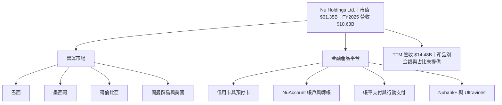
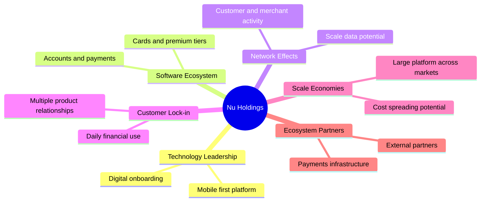
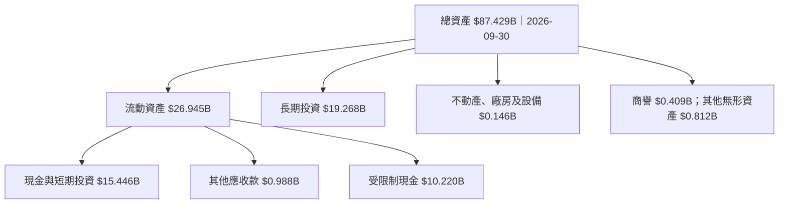
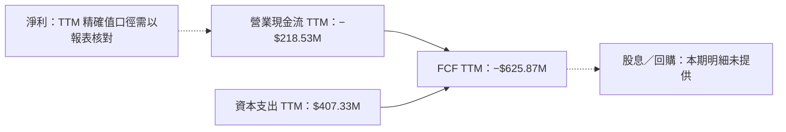
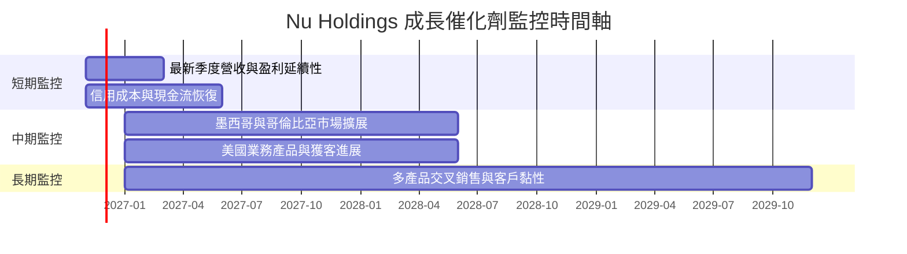
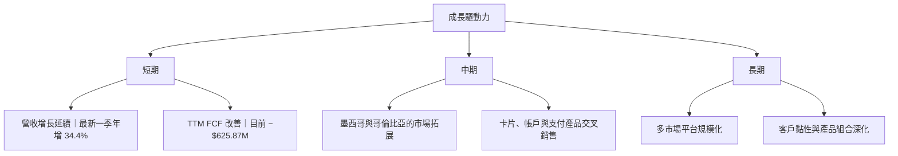
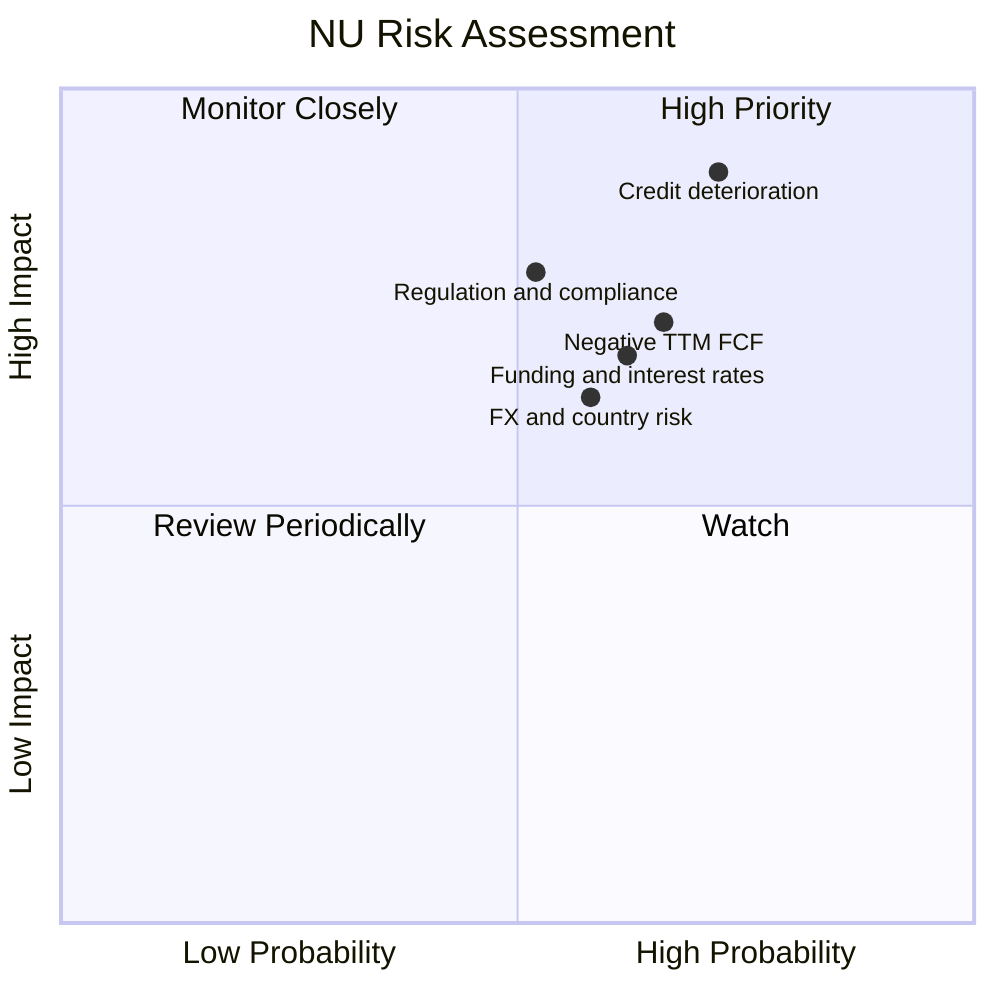
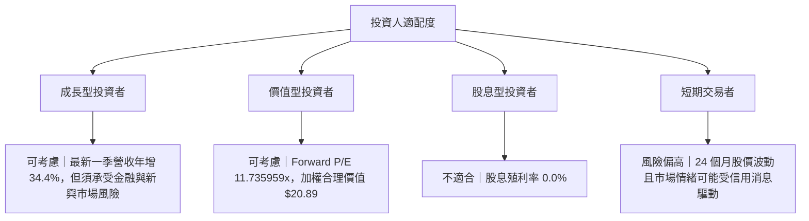

# NU 基本面深度分析報告
> **報告日期**：2026-11-17 ｜ **語言**：繁體中文 ｜ **數據來源**：Yahoo Finance、Finviz、StockAnalysis、Roic.ai ｜ **分析師**：CFA 級機構研究

## 目錄

| # | 章節 | 核心結論 |
|---|------|----------|
| 1 | 執行摘要 | 買入；加權合理價值 $20.89；MOS +39.3% |
| 2 | 公司概覽與商業模式 | 數位金融平台具規模優勢；市場份額數據未提供 |
| 3 | 損益表深度分析 | 最新一季營收年增 34.4%；TTM 營收成長率不可得 |
| 4 | 資產負債表分析 | 現金與短期投資 $15.45B；淨現金 $9.32B |
| 5 | 現金流量深度分析 | TTM FCF −$625.87M；與年度歷史現金流需分期間解讀 |
| 6 | 獲利能力與資本效率 | ROTCE 29.8%；傳統 ROIC 對金融業不適用 |
| 7 | 相對估值分析 | Forward P/E 低於所列同業；歷史估值區間數據未提供 |
| 8 | DCF 內在價值評估 | DCF 不適用；以金融業相對估值加權得 $20.89 |
| 9 | 成長催化劑 | 新市場與產品擴展具催化潛力；TAM 數字未提供 |
| 10 | 風險矩陣 | 信用、監管與跨市場執行為主要風險 |
| 11 | 投資建議 | 買入；建議區間 $12.68–$18.80，按估值與風險逐步部署 |

---

## 1. 執行摘要

截至 2026-11-16 收盤價為 **$12.68**。依固定金融業估值方法，同業 Forward P/E、同業 P/B 與分析師共識目標價加權後的合理價值為 **$20.89**，相對現價的 MOS 為 **+39.3%**，按評級門檻屬於「買入」。支持投資論點的數據包括最新一季營收年增 **34.4%**、TTM 淨現金 **$9.32B**、ROTCE **29.8%**；但 TTM FCF 為 **−$625.87M**，且金融業 ROIC 無法與 WACC 作一般公司式比較，因此不評為強烈買入。

### 1.0 一頁式投資儀表板（Portfolio Manager 30 秒速讀）

| 項目 | 內容 |
|------|------|
| **投資論點（3 句）** | ① 最新一季營收年增 **34.4%**，反映平台仍具擴張動能。② 現金與短期投資 **$15.45B**、淨現金 **$9.32B**，提供資金緩衝。③ ROTCE **29.8%**，顯示目前帳面資本回報具吸引力，但信用品質資料缺漏，需審慎看待。 |
| **綜合評分** | **7.5/10**（引用 1.1 評分卡） |
| **財務健康** | 🟡 現金高於總債務，但銀行流動性不宜用一般公司流動比率判讀；TTM FCF 為負。 |
| **ROIC vs WACC** | **ROIC：N/A；WACC：14.00%**。NU 為放款機構，傳統 ROIC 指標不適用，不能據此判定價值創造或摧毀。 |
| **FCF 趨勢** | TTM FCF **−$625.87M**；FCF Yield **−1.02%**。金融業貸款與存款變化會影響現金流，不能單獨視為經濟獲利能力。 |
| **估值** | Forward P/E **11.735959x** ｜ EV/EBITDA **N/A** ｜ FCF Yield **−1.02%** |
| **DCF 內在價值（基準）** | **N/A**；金融業資金流即營運資金，DCF 的一般企業自由現金流定義不適用，故 DCF 折溢價為 N/A。 |
| **安全邊際（MOS）** | **+39.3%＝($20.89 − $12.68) ÷ $20.89**｜🟢 >25% 充足；分母為 8.8 節加權合理價值。 |
| **預期報酬（基準情境 12M）** | DCF 情境未提供，故 12 個月基準預期報酬 **N/A**。加權合理價值相對現價上行空間為 **+64.7%**，不等同 12 個月報酬預測。 |
| **關鍵風險（前二）** | 信用損失與資產品質惡化；拉美市場監管、利率及匯率變化。 |
| **評級 + 信心度** | 🟢 **買入** ｜ 信心：中（估值折價明確，但信用品質與季度盈餘預期資料不足） |

### 1.1 綜合評分卡（全報告唯一）

| 維度 | 評分（1–10） | 主要依據（引用數字與其來源章節） |
|------|--------------|----------------------------------|
| 成長性 | 8.0 | 最新一季營收年增 34.4%；TTM 營收年增率 N/A（第 3 章）。 |
| 獲利能力 | 8.0 | ROTCE 29.8%；最新一季營業利益率 50.9%，但 TTM 營業利益率 N/A，兩者口徑不能混用（第 3、6 章）。 |
| 財務健康 | 7.0 | 現金與短期投資 $15.45B、淨現金 $9.32B；TTM FCF −$625.87M，且銀行資產品質指標缺漏（第 4、5、6 章）。 |
| 估值 | 8.0 | 加權合理價值 $20.89、MOS +39.3%；同業 Forward P/E 中位數 21.1x（第 7、8 章）。 |
| 護城河 | 8.0 | 五個市場營運、數位帳戶與卡片等多產品平台；但用戶、留存與市場份額數據未提供（第 2 章）。 |
| 管理層與資本配置 | 6.0 | FY2025 SBC $271.85M，約佔該年度營收 2.6%；未提供回購、資本配置目標與稀釋股數歷史的完整資料（第 3、5 章）。 |
| **綜合評分** | **7.5** | 六項算術平均：(8.0+8.0+7.0+8.0+8.0+6.0) ÷ 6 = **7.5**。 |

### 1.2 五大投資論點 + 三大核心風險

| 類型 | 項目 | 具體依據 | 信心度 |
|------|------|----------|--------|
| 🟢 **投資論點①** | 數位平台仍在擴張 | 最新一季營收 $4.03B、年增 34.4%；若增長持續，固定成本可由更大營收基礎攤提。 | 🟢 高 |
| 🟢 **投資論點②** | 資本回報具吸引力 | ROTCE 29.8%，反映有形股東資本的回報能力；但需同時檢查放款損失與資本充足度。 | 🟢 中 |
| 🟢 **投資論點③** | 淨現金提供緩衝 | 現金與短期投資 $15.45B、總債務 $6.12B、淨現金 $9.32B；有助承受融資與投資需求。 | 🟢 高 |
| 🟢 **投資論點④** | 相對估值有折價 | Forward P/E 11.735959x，低於三家同業中位數 21.1x；估值折價也可能反映更高的國別與信用風險。 | 🟡 中 |
| 🟢 **投資論點⑤** | 業務地域有擴張選擇權 | 業務涵蓋巴西、墨西哥、哥倫比亞、開曼群島及美國；新市場拓展能否轉為持續盈利尚待驗證。 | 🟡 中 |
| 🟡 **風險①** | 信用品質資訊不足 | 淨沖銷率、逾放比及 CET1 均未提供，無法判斷貸款組合在景氣惡化下的損失吸收能力。 | 🟡 中 |
| 🔴 **風險②** | TTM 現金流轉負 | TTM OCF −$218.53M、資本支出 $407.33M、FCF −$625.87M；若持續且非貸款組合變化造成，獲利現金轉換將受質疑。 | 🔴 高衝擊 |
| 🔴 **風險③** | 市場與監管風險 | 跨多個拉美市場經營，利率、消費者信貸規範及匯率變動可能同時壓抑放款需求與信用品質。 | 🔴 高衝擊 |

### 1.3 快速統計卡片

| 指標 | 公司實際值（期間） | 同業中位數 | 狀態 |
|------|--------------------|------------|------|
| 營收成長（TTM） | **N/A** | — | 🟡 |
| 營收成長（最新一季年增） | **34.4%** | **43.9%** | 🟡 |
| 毛利率（TTM） | **0.0%（資料欄位值，不宜視為可比金融業毛利率）** | **84.2%** | 🔴 |
| 營業利益率（TTM） | **N/A** | — | 🟡 |
| ROIC（TTM） | **N/A（金融業不適用）** | — | 🟡 |
| Forward P/E | **11.735959x** | **21.1x** | 🟢 |
| FCF Yield（TTM） | **−1.02%** | — | 🔴 |
| Piotroski F-Score | **N/A（不適用金融業）** | — | 🟡 |

### 1.4 投資結論

╔══════════════════════════════════════════════════════════════════╗  
║　　　　　　　　　📊 投資結論摘要　　　　　　　　　　　　　　║  
╠══════════════════════════════════════════════════════════════════╣  
║ 評級：買入（MOS +39.3%，依固定門檻）　　　　　　　　　　　　║  
║ 價格（2026-11-16 收盤）：$12.68　　　　　　　　　　　　　　　║  
║ DCF 內在價值（基準）：N/A（金融業 DCF 不適用）　　　　　　　║  
║ 安全邊際 MOS：+39.3%＝($20.89−$12.68)÷$20.89　　　　　　　　║  
║ 加權合理價值（8.8）：$20.89　　　　　　　　　　　　　　　　　║  
║ 綜合評分：7.5/10（引用 1.1）　　　　　　　　　　　　　　　　║  
║ 適合投資人：能承受新興市場與金融信用風險的成長型、長線投資人 ║  
╚══════════════════════════════════════════════════════════════════╝

---

## 2. 公司概覽與商業模式

### 2.1 業務結構與收入來源

NU Holdings 提供數位金融平台，主要涵蓋巴西、墨西哥、哥倫比亞、開曼群島及美國。FY2025 營收為 **$10.63B**；另有季度報表彙整的 TTM 營收 **$14.48B**。其他來源的營收欄位存在不一致，因此此處分別標示期間，不以其中一個數字推算業務占比。

### 2.2 市場份額

市場份額數據未提供，因此無法量化 NU 在巴西或其他市場的市佔率。可確認的相對規模是 FY2025 營收 **$10.63B**、最新一季年增 **34.4%**；同業最新一季營收年增率為 SOFI **43.9%**、MELI **45.1%**、HOOD **11.8%**，NU 的增速高於 HOOD、低於 SOFI 與 MELI。

### 2.3 競爭護城河分析

### 2.4 護城河強度

| 護城河項目 | 強度（強／中／弱） | 證據（引用數字或事實） | 會削弱它的情況 |
|------------|--------------------|------------------------|----------------|
| 技術與數位分銷 | 中 | 行動帳戶、卡片、轉帳與支付整合於數位平台；客戶數及獲客成本未提供。 | 系統故障、資安事件或對手以更低成本獲客。 |
| 軟體生態系統 | 中 | 提供帳戶、支付、卡片及不同服務層級；各產品收入占比未提供。 | 交叉銷售率低，或客戶只使用單一產品。 |
| 網路效應 | 中 | 多市場平台與支付活動可能累積資料及使用便利性；市場份額、交易量未提供。 | 使用者與商戶活躍度不足以形成明顯網路外部性。 |
| 客戶鎖定 | 中 | 帳戶、付款、信用卡等日常金融服務有提高使用黏性的可能；留存數據未提供。 | 客戶能低成本轉移存款或將交易分散至競爭平台。 |
| 規模效應 | 中 | FY2025 營收 $10.63B，最新一季營收年增 34.4%；規模可攤提科技與合規成本。 | 信用損失、客服與合規成本增速超過收入。 |
| 生態夥伴 | 弱至中 | 提供支付與金融服務，但合作夥伴收入或依賴度未提供。 | 關鍵支付或金融基礎設施合作條件轉差。 |

1.1「護城河」評分 **8.0/10**，依據是跨市場、多產品數位平台與最新一季 34.4% 的營收成長；缺少客戶留存、市佔與獲客成本數字，限制了評分信心。

---

## 3. 損益表深度分析

### 3.1 年度收入成長趨勢（近4年）

FY2022–FY2025 營收來自年度損益表。三年 CAGR 計算為 \((10.63 ÷ 2.97)^{1/3}−1\)，約 **53.0%**；高速增長仍在，但年度增幅呈放緩趨勢。

╔══════════════════════════════════════════════════════════════════╗  
║　　　　　　　Nu Holdings 年度收入趨勢（FY2022–FY2025）　　　　║  
╠══════════════════════════════════════════════════════════════════╣  
║ FY2022　$2.97B　██████　　　　　　　　　YoY：基期　　　　　║  
║ FY2023　$5.63B　███████████　　　　　　 YoY：+89.6% 🟢　　　║  
║ FY2024　$8.27B　████████████████　　　　YoY：+46.9% 🟢　　　║  
║ FY2025　$10.63B █████████████████████　 YoY：+28.5% 🟢　　　║  
╠══════════════════════════════════════════════════════════════════╣  
║ FY2022–FY2025 三年營收 CAGR：約 +53.0%　　　　　　　　　　　║  
╚══════════════════════════════════════════════════════════════════╝

上述 CAGR 由年度營收計算；TTM 營收增長率在季度報表數據中為 **N/A**，不能用單季年增率取代。

### 3.2 季度收入趨勢分析

| 季度 | 營收 | QoQ 成長 | YoY 成長 | 備註 |
|------|------|----------|----------|------|
| 2025 Q4 | $3.14B | — | — | 年度損益表與季度彙整口徑存在差異，未提供同口徑上一年季度值。 |
| 2026 Q1 | $3.54B | **+12.7%** | **43.75%（StockAnalysis）** | QoQ 以 $3.54B ÷ $3.14B − 1 計算；YoY 來源季度成長欄。 |
| 2026 Q2 | $3.77B | **+6.5%** | **52.15%（StockAnalysis）** | QoQ 以 $3.77B ÷ $3.54B − 1 計算；跨來源季度值有差異。 |
| 2026 Q3 | $4.03B | **+6.9%** | **34.4%（Yahoo Finance）** | 最新一季年增率為單季數字，不是 TTM 成長率。 |

QoQ 成長率以季度報表列示的金額計算。不同來源季度營收金額並不完全一致，因此 YoY 成長率採用來源本身提供的單季成長欄，不將兩種來源的季度金額混算。

### 3.3 利潤率演變分析

| 利潤率指標 | FY2022 | FY2023 | FY2024 | FY2025 | 趨勢 | 評估 |
|------------|--------|--------|--------|--------|------|------|
| 毛利率 | N/A | N/A | N/A | N/A | 金融業毛利率口徑不適用；彙整值 0.0% 不具解讀性。 | 🟡 |
| 營業利益率 | N/A | N/A | N/A | N/A | StockAnalysis 未提供可一致核對的年度比率。 | 🟡 |
| 淨利率 | N/A | N/A | N/A | N/A | 營收口徑來源有差異，不以混合來源自行推算。 | 🟡 |

**利潤率演變深度解析：**已知最新一季營業利益率為 **50.9%**，但 TTM 營業利益率為 N/A，兩者不能當作同一期間趨勢。金融業收入與信用損失、利息支出及貸款組合密切相關；在成本收入比代理值包含信用準備的情況下，應優先追蹤信用成本與實際效率指標，而不能依一般公司的毛利率推斷營運槓桿。

### 3.4 費用結構分析

費用明細與各項金額未提供，無法建立數據支持的費用結構圖。金融業的成本收入比代理值為 **68.1%**，但該代理值以「營收減稅前淨利」計算，包含信用準備，通常高於公司自行公布的效率比率，不能直接視為純營運費用占比。

### 3.5 季度 EPS 趨勢與盈餘品質（Quality of Earnings）

| 盈餘品質項目 | 數值／佔比 | 評估 |
|--------------|-----------|------|
| 股權薪酬 SBC / 營收 | FY2025：$271.85M ÷ $10.63B = **2.6%** | 🟡 對股東有稀釋成本；需持續觀察股數變化與員工留任效益。 |
| SBC / 營業現金流 | FY2025：$271.85M ÷ $3.50B = **7.8%** | 🟡 SBC 規模可觀但低於該年度 OCF；此比率是年度口徑，不與 TTM 負 OCF 混用。 |
| FCF / 淨利（現金轉換率） | TTM：−$625.87M ÷ 約 $3.92B = **約 −16.0%** | 🔴 TTM 現金轉換轉負；金融業貸款活動會使現金流波動，但仍需查明成因。 |
| 一次性／非經常性損益 | N/A（未提供可核對明細） | 🟡 無法判定本期盈餘是否受一次性項目影響。 |
| 有效稅率異常 | **25.8%**（最新年度） | 🟡 未提供多年可比有效稅率，無法判斷是否偏離常態。 |
| 資本化支出 vs 費用化 | TTM 資本支出 **$407.33M**；資本化政策明細 N/A | 🟡 無法判斷資本化是否遞延成本或改變當期盈餘。 |

季度盈餘追蹤方面，過去四季 EPS Est 與 EPS Act 的分析師預期值均為 **N/A**，因此不能判斷超預期或不及預期。可觀察的 StockAnalysis 單季 EPS 為 2025 Q4 **$0.18**、2026 Q1 **$0.18**、Q2 **$0.22**、Q3 **$0.23**；Q3 2026 EPS 年增 **40.13%**，與盈利增長一致，但不等同於盈餘超預期。

**盈餘品質結論：**年度 SBC 約占 FY2025 營收 2.6%，對每股價值有持續稀釋成本；TTM FCF 為負則削弱現金盈餘轉換證據。金融業的現金流可能受貸款投放與存款變化影響，現有資料不足以斷言 GAAP 淨利高估，但投資者應要求後續季度現金流改善，並取得信用品質和一次性損益明細。

---

## 4. 資產負債表分析

### 4.1 資產結構分解

截至 2026-09-30，StockAnalysis 列示總資產 **$87.429B**、流動資產 **$26.945B**、長期投資 **$19.268B**。金融機構資產常含大量金融資產與受限制現金，以下只呈現已列示數據，不將未列項目反推成完整比例。

### 4.2 流動性與營運資金分析

銀行資產負債表的流動比率與速動比率不宜用一般企業方式解讀；Yahoo Finance 未提供這兩項比率。金融業不適用一般製造業 DSO／DIO／DPO／CCC 營運資金天數分析。

| 指標 | 最新數值 | 評估 |
|------|----------|------|
| 現金與短期投資 | **$15.45B** | 🟢 名目資金規模高，但需區分自有流動性與客戶資金相關項目。 |
| 總債務 | **$6.12B** | 🟡 債務規模需與銀行資產、存款及資本監管要求一併分析。 |
| 淨現金 | **$9.32B** | 🟢 數據列示為正；現金減債務依四捨五入約有 $0.01B 差異。 |
| 流動比率／速動比率 | N/A | 金融業不適用一般企業指標；數據未提供。 |
| DSO／DIO／DPO／CCC | 不適用 | 金融業貸款與資金結構不適用一般營運資金天數分析。 |

### 4.3 債務結構分析

╔══════════════════════════════════════════════════════════════════╗  
║　　　　　　　　Nu Holdings 債務健康診斷　　　　　　　　　　　║  
╠══════════════════════════════════════════════════════════════════╣  
║ 總債務：　　　　$6.12B　　🟡 需結合金融資產及資本要求看　　　║  
║ 現金+短期投資：$15.45B　 🟢 高於總債務　　　　　　　　　　　║  
║ 淨現金：　　　　$9.32B　　🟢 正淨現金　　　　　　　　　　　║  
║ Debt/EBITDA：　 N/A　　　金融業 EBITDA 不適合作主要指標　　　║  
║ Interest Coverage：N/A　　相關利息費用與可比口徑未提供　　　║  
║ Debt/Equity：　 N/A　　　來源未提供可核對值　　　　　　　　　║  
╚══════════════════════════════════════════════════════════════════╝

### 4.4 股東權益趨勢

╔══════════════════════════════════════════════════════════════════╗  
║　　　　　　　　Nu Holdings 股東權益變化　　　　　　　　　　　║  
╠══════════════════════════════════════════════════════════════════╣  
║ FY2022　$4.89B　█████████　　　　　　　　　　　　　　　　║  
║ FY2023　$6.41B　████████████　　　　　　　　　　　　　　　║  
║ FY2024　$7.65B　███████████████　　　　　　　　　　　　　　║  
║ FY2025　$11.29B ██████████████████████　　　　　　　　　　　║  
╚══════════════════════════════════════════════════════════════════╝

股東權益由 FY2022 的 $4.89B 增至 FY2025 的 $11.29B，擴大有助於支持金融業資產增長；但股東權益增加的構成（留存盈餘、發股或其他項目）未提供完整拆解。

---

## 5. 現金流量深度分析

### 5.1 現金流量瀑布圖

以下依 TTM 至 2026-09-30 的程式計算數字呈現 OCF、資本支出與 FCF。金融業淨利至營業現金流的勾稽受放款與資金流變化影響，不能把它當作一般企業的現金流瀑布。

### 5.2 FCF 轉換率趨勢

| 期間 | OCF | 資本支出 | FCF | FCF／淨利 |
|------|-----|----------|-----|----------|
| FY2023 | $1.27B | $177.00M | $1.09B | 約 105.7%（依年度淨利 $1.03B） |
| FY2024 | $2.40B | $174.99M | $2.22B | 約 112.7%（依年度淨利 $1.97B） |
| FY2025 | $3.50B | $340.77M | $3.16B | 約 110.1%（依年度淨利 $2.87B） |
| TTM 至 2026-09-30 | −$218.53M | $407.33M | **−$625.87M** | 約 **−16.0%** |

年度 FCF/淨利比率使用表列年度數字計算，呈現 FY2023–FY2025 年度現金流轉換超過 100%；TTM 卻轉負，是必須追查的期間反轉。銀行貸款增長可使 OCF 受資產負債表變動扭曲，分析時應與貸款淨額、存款及信用損失一併核對。

### 5.3 自由現金流趨勢

╔══════════════════════════════════════════════════════════════════╗  
║　　　　　　　自由現金流：年度歷史與最新 TTM　　　　　　　　　║  
╠══════════════════════════════════════════════════════════════════╣  
║ FY2023　$1.09B　███████████　　　　　　　　　　　　　　　　║  
║ FY2024　$2.22B　██████████████████████　　　　　　　　　　　║  
║ FY2025　$3.16B　███████████████████████████████　　　　　　　║  
║ TTM　　−$0.626B　負值；不可用正向進度條表示　　　　　　　　　║  
╠══════════════════════════════════════════════════════════════════╣  
║ TTM FCF Yield：−1.02%；金融業 FCF 對貸款與存款變化高度敏感　　║  
╚══════════════════════════════════════════════════════════════════╝

### 5.4 資本配置評估

資本配置的股息、回購、併購及投資金額未提供足以計算完整比例的明細，因此不繪製比例圖。可確認 FY2025 資本支出 **$340.77M**、SBC **$271.85M**；股息殖利率與派息率均為 **0.0%**。目前資料無法量化留存資金在貸款投放、技術投資或資本緩衝間的分配。

---

## 6. 獲利能力與資本效率

### 6.1 ROE / ROA / ROIC 趨勢

| 指標 | 最新可得值 | 歷史趨勢 | 評估 |
|------|------------|----------|------|
| ROE | TTM **31.5%** | 年度歷史序列未完整提供 | 🟢 回報高，但資本槓桿與權益口徑未能完整拆解。 |
| ROA | TTM **5.0%** | 年度歷史序列未完整提供 | 🟢 對金融業具有參考價值，仍需結合信用損失解讀。 |
| ROTCE | TTM **29.8%** | 歷史序列未提供 | 🟢 有形權益回報具吸引力；應與資產品質及資本充足度共同判斷。 |
| ROIC | N/A（金融業不適用） | N/A | 傳統 ROIC 不適合金融業，行業均值資料未提供。 |

### 6.2 ROIC vs WACC 分析（核心價值創造判斷）

金融業的存款及其他融資是營運投入的一部分，因此以一般企業「營運資本、淨負債、NOPAT」計算的 ROIC 不適用。NU 的 **ROIC 為 N/A**，無法用 ROIC−WACC 判斷經濟價值增加；WACC 依資本成本數據列示為 **14.00%**，與第 8 章採用值一致。此處不計算 EVA，也不把 ROTCE 直接替代 ROIC。

╔══════════════════════════════════════════════════════════════════╗  
║　　　　　　資本效率與 WACC：金融業適用性檢查　　　　　　　　　║  
╠══════════════════════════════════════════════════════════════════╣  
║ 無風險利率（10Y 美債）：　　　　　　　　　5.12%　　　　　　　║  
║ 市場風險溢酬（假設值）：　　　　　　　　　5.00%　　　　　　　║  
║ Beta 原始值：0.97；採用調整後 Beta：　　　 0.98　　　　　　　║  
║ 股權成本 Ke：　　　　　　　　　　　　　　10.01%　　　　　　║  
║ 稅前債務成本（輸入值）：　　　　　　　　 74.76%　　　　　　║  
║ 股權／債務權重：　　　　　　　　　　　　 90.9%／9.1%　　　║  
║ 計算 WACC：14.14%；採用 WACC：　　　　　　14.00%　　　　　　║  
║ 採用值受 7%–14% 區間上限限制；ROIC：　　　N/A　　　　　　　║  
╠══════════════════════════════════════════════════════════════════╣  
║ 結論：金融業 ROIC 不適用；不能以 ROTCE 直接與 WACC 比較。　　 ║  
╚══════════════════════════════════════════════════════════════════╝

### 6.3 杜邦三因素分解

| 因素 | 數值（TTM） | 解讀 |
|------|-------------|------|
| 淨利率 | N/A | 淨利、營收等口徑未能按品質指標組合完整核對。 |
| 資產週轉率 | N/A | 杜邦品質指標未提供。 |
| 權益乘數 | N/A | 杜邦品質指標未提供。 |
| **ROE** | **N/A（杜邦分解）** | 品質指標計算結果為 N/A；雖另有 ROE TTM 31.5%，但不能反推三因素。 |

### 6.4 財務體質：金融業貸款指標

Piotroski F-Score 不適用金融業：貸款增長會被誤讀為營業現金流出，相關現金流測試不適用。以下依貸款機構指標分析。

| 指標 | 數值 | 解讀 |
|------|------|------|
| 淨利息收入 NII／總營收 | **84.7%** | 收入高度依賴利差與放款收益；利率或信用成本變化會影響獲利。 |
| 淨利差代理值 NII／平均總資產 | **15.74%** | 這是代理值；分母為平均總資產而非生息資產，因此高於正式 NIM，不能當作公司公布的淨利差。 |
| 成本收入比代理值 | **68.1%** | 由營收與稅前淨利差額計算，包含信用準備，通常高於公司自行公布的效率比率。 |
| ROTCE | **29.8%** | 淨利除以有形帳面價值；反映有形資本回報，但仍需與信用風險併讀。 |
| P/TBV | **4.68x** | 市場對有形帳面價值給予溢價；若回報率下滑，估值可能收縮。 |
| 放款淨額／總資產 | **14.0%** | 資產配置中放款淨額占比；不足以單獨推斷風險，需結合貸款分類與擔保資訊。 |
| 淨沖銷率 | **N/A（數據未提供）** | 無法評估實際信用損失趨勢。 |
| 逾放比 | **N/A（數據未提供）** | 無法評估逾期貸款惡化程度。 |
| CET1 | **N/A（數據未提供）** | 無法直接判斷監管資本緩衝。 |

---

## 7. 相對估值分析

### 7.1 同業估值比較

同業倍數依 Yahoo Finance 同業資料。NU 的 Forward P/E 依估值欄數值照列；同業 Forward P/E 的中位數為 **21.1x**，也是金融業估值方法所用倍數。金融業毛利率與一般金融科技平台口徑未必可比。

| 估值指標 | **NU** | **SOFI** | **MELI** | **HOOD** | 本公司評估 |
|----------|----------|---------|---------|---------|-----------|
| **Trailing P/E** | **15.85x** | 27.0x | 39.2x | 33.2x | 🟢 NU 倍數較低，但成長、國別與信用風險不同。 |
| **Forward P/E** | **11.735959x** | 16.5x | 27.5x | 21.1x | 🟢 低於三家同業；相對估值存在折價。 |
| **P/S Ratio** | **6.739952x** | 4.1x | 1.9x | 12.8x | 🟡 位於同業區間中段偏高；金融業 P/S 需配合淨利率與風險判斷。 |
| **EV/EBITDA** | N/A | N/A | 21.0x | N/A | 🟡 同業可比數量有限，不作估值結論。 |
| **最新一季營收年增** | **34.4%** | 43.9% | 45.1% | 11.8% | 🟡 高於 HOOD、低於 SOFI 與 MELI。 |
| **毛利率（TTM）** | 0.0%（欄位值不宜解讀） | 84.2% | 46.7% | 91.0% | 🔴 口徑可比性不足，不據此評斷金融業盈利能力。 |

### 7.2 歷史估值區間分析

N/A（未提供可核對的「自身歷史估值區間」或歷史百分位數據）。目前 P/E 不能據此宣稱位於自身歷史高位或低位。

### 7.3 情境價值（Bear / Base / Bull）

N/A（DCF 無法計算：金融業資金流即其融資與營運活動，通常不適合用一般企業 FCF DCF；沒有提供 DCF MODEL 的 Scenarios，因此不給情境目標價）。

### 7.4 相對估值隱含價格區間

╔══════════════════════════════════════════════════════════════════╗  
║　　　　　　　　相對估值回推每股價值　　　　　　　　　　　　　║  
╠══════════════════════════════════════════════════════════════════╣  
║ 現價　　　　　　$12.68　　　　　　　　　　　　　　　　　　　║  
║ 同業 P/B　　　　$19.24　　Peer median 6.5x × BVPS $2.96　　　║  
║ 分析師共識　　　$17.83　　23 位分析師平均目標價　　　　　　 ║  
║ 同業 Forward P/E $22.83　　Peer median 21.1x × Forward EPS $1.08 ║  
╚══════════════════════════════════════════════════════════════════╝

Forward P/E 同業中位數由 SOFI、MELI、HOOD 的同業估值資料計算；估值方法給定的 Forward EPS 為 **$1.08**。相對估值結果是估值方法輸入，不代表短期價格必然收斂。

---

## 8. DCF 內在價值評估（Discounted Cash Flow）

金融業的貸款投放、存款及其他融資活動直接影響現金流，企業自由現金流不適合用一般非金融企業方式建模。因此 DCF MODEL 為 **N/A**；依規則不自行建立 DCF、不輸出虛構的逐年 FCFF、終值、敏感度矩陣或 DCF 情境價值。

### 8.0 估值推理鏈（Thinking Logic）

本公司屬金融業，估值主要參考盈利能力與帳面價值，而非以企業 FCF 折現。現有可用的估值錨點為同業 Forward P/E、同業 P/B 及分析師共識目標價；DCF 的預測期、逐年現金流與終值模型沒有提供，也不適合自行補建。最脆弱的估值環節是同業倍數能否適用於 NU：若信用品質或跨市場風險高於同業，倍數折價可能合理。

### 8.1 模型假設總表（Model Inputs）

N/A（DCF MODEL 不適用金融業；不得另建 DCF 假設表或自行設定營收 CAGR、預測期、終值及稀釋股數）。

### 8.2 折現率推導（WACC）

此處列示資本成本資料供參考，不將其用作 NU 的 DCF 折現率。依資本成本資料：無風險利率 **5.12%**、ERP（假設）**5.00%**、原始 Beta **0.97**、採用調整後 Beta **0.98**；調整方法為 \(⅔×0.97+⅓\)，結果四捨五入為 0.98。股權成本為 **10.01%**，稅前債務成本輸入值 **74.76%**，有效稅率 **25.8%**，股權／債務權重 **90.9%／9.1%**。計算 WACC 為 **14.14%**，受 7%–14% 區間上限限制後採用 **14.00%**。原始資料未提供 10Y 殖利率日期、債務成本計算明細或風險溢酬的獨立研究依據；故不補造這些輸入來源。

### 8.3 逐年自由現金流預測（基準情境）

N/A（不建立金融業企業自由現金流 DCF；沒有模型預測期、營收與 FCFF 預測數據）。

### 8.4 終值計算（Terminal Value）

N/A（DCF 無模型終值；不使用 Gordon Growth 或退出倍數自行推算）。

### 8.5 企業價值 → 每股內在價值（Bridge）

N/A（DCF 的 EV、淨負債橋接與每股內在價值未計算）。本節不計算 MOS；MOS 僅以 8.8 加權合理價值為分母。

### 8.6 敏感性分析（WACC × 永續成長率）

N/A（無 DCF 基準值、WACC 測試範圍及永續成長率，無法建立可複算的 5×5 敏感度矩陣）。

### 8.7 反推 DCF（Reverse DCF）

N/A（金融業 DCF 模型不適用；現價無法透過未提供的 DCF 模型反推出單一營運假設）。

### 8.8 估值三角驗證與安全邊際

| 估值方法 | 隱含每股價值 | 上行空間（÷現價） | 權重 | 說明 |
|----------|--------------|-------------------|------|------|
| 同業 Forward P/E | **$22.83** | **+80.0%** | **50%** | 同業中位數 21.1x × Forward EPS $1.08。 |
| 同業 P/B | **$19.24** | **+51.7%** | **40%** | 同業中位數 6.5x × 每股帳面價值 $2.96。 |
| 分析師共識目標價 | **$17.83** | **+40.6%** | **10%** | 23 位分析師平均目標價。 |
| **加權合理價值** | **$20.89** | **+64.7%** | **100%** | 金融業固定估值權重；DCF 未納入，因不適用。 |

逐步演算：

**加權合理價值**  
\(22.83×50\% + 19.24×40\% + 17.83×10\%\)  
\(=11.415+7.696+1.783=20.894\)  
四捨五入至美分為 **$20.89**。

**安全邊際 MOS**  
\((20.89−12.68)÷20.89=8.21÷20.89=39.3\%\)。

**隱含上行空間**  
\((20.89−12.68)÷12.68=8.21÷12.68=64.7\%\)。

MOS 的基準是加權合理價值；DCF 基準內在價值不存在，因此折溢價 N/A。

╔══════════════════════════════════════════════════════════════════╗  
║　　　　　　　　估值區間與安全邊際　　　　　　　　　　　　　　║  
╠══════════════════════════════════════════════════════════════════╣  
║ $12.68 現價　────　$17.83 共識　────　$20.89 加權合理價值　║  
║　　　　　　　　　　　　　　　　　　　　　　　　　　　　　　║  
║ 安全邊際 MOS = ($20.89−$12.68)÷$20.89 = +39.3%　　　　　　　║  
║ MOS 評估：🟢 >25% 充足　　　　　　　　　　　　　　　　　　　║  
║ 上行空間 = ($20.89−$12.68)÷$12.68 = +64.7%　　　　　　　　║  
║ 建議買入區間：$12.68–$18.80（以合理價值 90% 作 MOS 10% 上限）║  
║ 合理持有區間：$18.80–$20.89　　　　　　　　　　　　　　　　 ║  
║ 減碼考慮區間：高於 $20.89 後重新評估，不代表固定賣出價　　　║  
╚══════════════════════════════════════════════════════════════════╝

買入區間上限計算：\(20.89×(1−10\%)=18.801\)，四捨五入為 **$18.80**；下限採用 2026-11-16 收盤價 **$12.68**，與「買入」評級相容。這是估值紀律區間，不是價格保證。

> 🔎 **程式複算（Python，依本節各項自動重算）**
>
> 加權合理價值 = $22.83 × 50% + $19.24 × 40% + $17.83 × 10% = **$20.89**（權重合計 100%）
>
> 以價格 $12.68 計：MOS = **+39.3%**，上行空間 = **+64.7%**
>
> ✅ 與本節所寫數值一致。

### 8.9 DCF 模型的局限與失效條件

- **終值依賴度：** N/A，無 DCF 終值模型。
- **最脆弱的假設：** 加權估值對同業倍數與盈利預測敏感。Forward P/E 方法使用 21.1x 同業中位數與 $1.08 Forward EPS；若盈利預測下修或可比倍數收縮，該方法隱含價值將下降。
- **不適用情境說明：** 銀行與放款機構的貸款、存款及資金成本是核心營運活動，傳統 FCFF 可能把正常資產負債擴張錯當作現金流惡化，或反向高估可分配現金。應以盈利、帳面價值、資產品質與資本充足度為主。
- **與第 10 章風險矩陣連結：** 信用損失上升會壓低盈利與 ROTCE；監管資本要求上升可能限制股東回報；跨市場利率與匯率變動可能影響利差與信用需求。

### 8.10 複算檢核表（Audit Trail）

| # | 檢核項目 | 檢查方式 | 結果 |
|---|----------|----------|------|
| 1 | DCF 高／中敏感度假設四段推導 | DCF MODEL 為 N/A，不存在可核對的 DCF 輸入 | N/A |
| 2 | DCF 假設有來歷 | 不建立 DCF 假設 | N/A |
| 3 | WACC 五步算式與權重 | 報告照列程式提供的 WACC 與組成；未另行重算 | N/A |
| 4 | Kd 分母與 D 權重範圍一致 | DCF 不適用；原始 WACC 輸入未提供足夠債務明細驗算 | N/A |
| 5 | WACC 與第 6.2 節同值 | 兩處均列示採用值 14.00% | ✅ |
| 6 | 逐年表格年度數等於 N | 無 DCF 預測表 | N/A |
| 7 | FY+1 FCFF 可複算 | 無 DCF 預測 | N/A |
| 8 | 預測期 PV 加總 | 無 DCF 預測 | N/A |
| 9 | WACC > g | 無 DCF 永續成長率 | N/A |
| 10 | 終值基於 FY+N 並折現 N 期 | 無 DCF 終值 | N/A |
| 11 | EV 至每股價值橋接 | 無 DCF 橋接 | N/A |
| 12 | SBC 三要素組合相容 | 不使用 DCF SBC 模型；品質分析採實際年度 SBC | N/A |
| 13 | 敏感度矩陣基準格一致 | 無 DCF 敏感度矩陣 | N/A |
| 14 | 敏感度格子符合 WACC > g | 無 DCF 敏感度矩陣 | N/A |
| 15 | 三情境機率加總 | 未提供 DCF 情境 | N/A |
| 16 | 反推 DCF 每列只解一個變數 | 不建立反推 DCF | N/A |
| 17 | MOS 分母與 DCF 折溢價基準正確 | MOS 以 $20.89 加權合理價值計算；DCF 折溢價 N/A | ✅ |
| 18 | 完整輸出至第 11 章 | 章節齊全 | ✅ |
| 19 | 加權合理價值等於方法加權和 | $22.83×50%+$19.24×40%+$17.83×10%=$20.894，四捨五入 $20.89 | ✅ |
| 20 | 評級符合 MOS 門檻 | MOS +39.3%、低於 25% 以上強烈買入門檻所要求的 ROIC 判斷條件；採「買入」 | ✅ |

---

## 9. 成長催化劑

### 9.1 催化劑時間軸

數據未提供具體產品上線或財務目標日期，以下時間軸以監控期間分類，不代表公司承諾時程。

### 9.2 TAM 市場規模分析

N/A（TAM 數據未提供）。NU 最新一季營收年增 **34.4%**，FY2025 營收 **$10.63B**，且營運覆蓋多個國家，顯示仍有擴展空間；但缺少市場規模、市佔率與各國收入拆分，不能量化可服務市場或滲透率。

### 9.3 成長驅動力結構圖

---

## 10. 風險矩陣

### 10.1 風險評分矩陣

以下座標是分析師對風險相對機率與衝擊的**定性判斷**，不是公司披露的統計概率或財務預測。

### 10.2 風險清單詳細分析

| # | 風險項目 | 發生機率 | 財務衝擊 | 風險評分 | 緩解措施 |
|---|----------|----------|----------|----------|----------|
| 1 | 🔴 **信用損失惡化** | 中高；定性評估 | 高；可能壓低淨利及 ROTCE | 🔴 高 | 每季追蹤淨沖銷率、逾放比、逾期遷徙與貸款組合；目前這些指標未提供。 |
| 2 | 🔴 **TTM 現金流持續為負** | 中高；已觀察到 TTM FCF −$625.87M | 中高；若非正常放款資金流，可能代表盈餘現金轉換轉弱 | 🔴 高 | 區分貸款增長、存款變化與資本支出；要求後續 OCF、FCF 與淨利的期間勾稽改善。 |
| 3 | 🟠 **拉美監管與合規變化** | 中；定性評估 | 高；可能增加合規成本或限制產品條件 | 🟠 中高 | 分國監控監管變化、定價與產品調整成本，避免以單一市場情況外推整體業務。 |
| 4 | 🟠 **利率、融資與資金成本變化** | 中；定性評估 | 中高；可能壓縮利差或改變放款需求 | 🟠 中高 | 追蹤淨利息收入占比 **84.7%** 與淨利差代理值 **15.74%**，並要求公司披露正式利率敏感度。 |
| 5 | 🟡 **匯率與國別風險** | 中；定性評估 | 中；可能影響財報換算及客戶償付能力 | 🟡 中 | 監控各國收入、成本與資產負債幣別配對；目前國別收入拆分未提供。 |

---

## 11. 投資建議

### 11.1 最終評級與評分

NU 的評級為 **買入**，依據 8.8 節 MOS **+39.3%**，且加權合理價值 **$20.89** 高於 2026-11-16 收盤價 **$12.68**；此評級未作質化升降級調整。1.1 的綜合評分為 **7.5/10**，六項分數依序為成長性 8.0、獲利能力 8.0、財務健康 7.0、估值 8.0、護城河 8.0、管理層與資本配置 6.0。

### 11.2 合理價值與隱含報酬率

| 方法／情境 | 每股價值 | 相對現價 | 機率 |
|------------|----------|----------|------|
| 加權合理價值 | **$20.89** | **+64.7% 上行空間** | 固定估值權重 |
| 悲觀 DCF 情境 | N/A | N/A | N/A |
| 基準 DCF 情境 | N/A | N/A | N/A |
| 樂觀 DCF 情境 | N/A | N/A | N/A |

DCF 為 N/A，故不提供 DCF 情境目標價；加權合理價值是多種估值方法的參考，不是保證 12 個月內達到的價格。

### 11.3 買入時機與觸發因素

╔══════════════════════════════════════════════════════════════════╗  
║　　　　　　　　✅ 買入觸發因素 Checklist　　　　　　　　　　　║  
╠══════════════════════════════════════════════════════════════════╣  
║ 逐步部署條件：　　　　　　　　　　　　　　　　　　　　　　　║  
║ ✅ 股價位於 $12.68–$18.80，且投資論點與估值折價未改變。　　　║  
║ ✅ 最新一季營收年增維持正增長，並追蹤是否延續 34.4% 水準。　║  
║ ✅ 信用品質披露可確認逾放與沖銷未出現持續惡化。　　　　　　　║  
║　　　　　　　　　　　　　　　　　　　　　　　　　　　　　　║  
║ 加碼觸發條件：　　　　　　　　　　　　　　　　　　　　　　　║  
║ ☐ TTM FCF 由 −$625.87M 改善，並能解釋貸款活動對 OCF 的影響。║  
║ ☐ ROTCE 維持接近目前 29.8%，且信用損失指標沒有顯著惡化。　　║  
║ ☐ 公司披露資本充足度及貸款品質數據，降低評估不確定性。　　　║  
║　　　　　　　　　　　　　　　　　　　　　　　　　　　　　　║  
║ 減碼／重新評估條件：　　　　　　　　　　　　　　　　　　　　║  
║ ☐ 股價高於 $20.89 時，重新檢驗同業倍數與盈利預測支撐。　　　║  
║ ☐ 營收連續兩季年增低於 20%，或最新季度營業利益率明顯收縮。　║  
║ ☐ TTM FCF 持續為負且無法以貸款組合與資金流變化合理解釋。　 ║  
║ ☐ 逾放、沖銷或資本充足度惡化，足以改變風險報酬判斷。　　　　║  
╚══════════════════════════════════════════════════════════════════╝

### 11.4 投資人適配度分析

### 11.5 每季財報監控清單（Quarterly Watch List）

| 監控指標 | 最新參考值 | 觸發加碼／改善條件 | 觸發減碼／惡化條件 |
|----------|------------|-------------------|-------------------|
| 營收增長 | 最新一季年增 **34.4%** | 成長維持正值且產品及地區來源更清晰。 | 連續兩季年增低於 **20%**。 |
| 營業利益率 | 最新一季 **50.9%**；TTM N/A | 維持或改善，並確認不是一次性因素。 | 相對最新季度水準收縮超過 **5 個百分點**。 |
| TTM FCF | **−$625.87M** | OCF 與 FCF 改善，且能與貸款增長及資金變化勾稽。 | FCF 持續負值且公司無法解釋原因。 |
| SBC／營收 | FY2025 **2.6%** | SBC 占比穩定或下降，且股數稀釋可控。 | SBC 占營收持續上升並伴隨股數增加。 |
| ROTCE | TTM **29.8%** | 維持較高回報且信用損失穩定。 | ROTCE 明顯下降並伴隨信用成本上升。 |
| 淨沖銷率、逾放比、CET1 | N/A（未提供） | 公司披露並維持在可接受範圍。 | 指標惡化或資本緩衝不足。 |
| 資本支出 | TTM **$407.33M** | 投資支出與市場擴張、產品成果相符。 | 支出增加但營收或營運效率未改善。 |
| 財測與盈利預期 | EPS 預期／實際值未提供 | 後續披露可核對的分析師預期與實際結果。 | 預期多次下修或實際盈利顯著低於市場預期。 |

### 11.6 反面論證：什麼會證明論點錯誤（What Would Change My Mind）

╔══════════════════════════════════════════════════════════════════╗  
║　　　　　　　⚠️ 論點失效條件（Disconfirming Evidence）　　　　　║  
╠══════════════════════════════════════════════════════════════════╣  
║ 本投資論點在下列情況成立時應重新檢視或退出：　　　　　　　　║  
║ ☐ 最新一季營收年增連續兩季低於 20%。　　　　　　　　　　　 ║  
║ ☐ 最新一季營業利益率由 50.9% 下滑超過 5 個百分點，且非短期投資造成。║  
║ ☐ TTM FCF 持續為負，且貸款增長、存款變化不能解釋現金流反轉。║  
║ ☐ ROTCE 由 29.8% 持續下降，並同時出現信用損失惡化。　　　　 ║  
║ ☐ 淨沖銷率、逾放比或 CET1 披露後顯示資產品質或資本緩衝不足。║  
║ ☐ 同業倍數收縮或 Forward EPS 下修，使 $20.89 加權估值不再成立。║  
╚══════════════════════════════════════════════════════════════════╝

> **免責聲明**：本報告為 AI 自動生成，僅供研究參考，不構成投資建議。投資有風險，入市需謹慎。

---

## 資料與來源

| 項目 | 內容 |
|------|------|
| 價格 | 12.68 USD，2026-11-16 收盤（Yahoo Finance 日線） |
| 財務報表 | Yahoo quarterly statements (no SEC filing data)，最新季度 2026-09-30（TTM = four quarters to this date） |
| 有回應的資料來源 | Yahoo Finance、Finviz、StockAnalysis、Roic.ai |
| 未回應的資料來源 | SEC 申報資料 (XBRL) |
| 由程式計算 | TTM 數字、WACC、DCF 模型、估值方法與權重、加權合理價值、MOS、評級門檻、F-Score、杜邦分解、營運資金天數、綜合評分 |
| 撰寫模型 | openai / gpt-6-luna |

> 本區塊由產生報告的程式依實際取得的資料填寫，非模型撰寫。「由程式計算」的數字不是模型的估計；其餘判斷（評分、情境、策略）是模型的分析。
