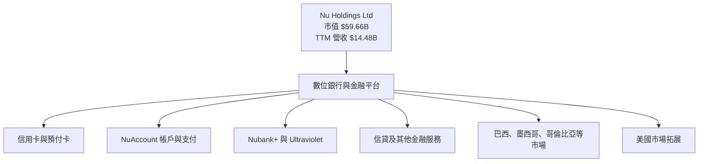
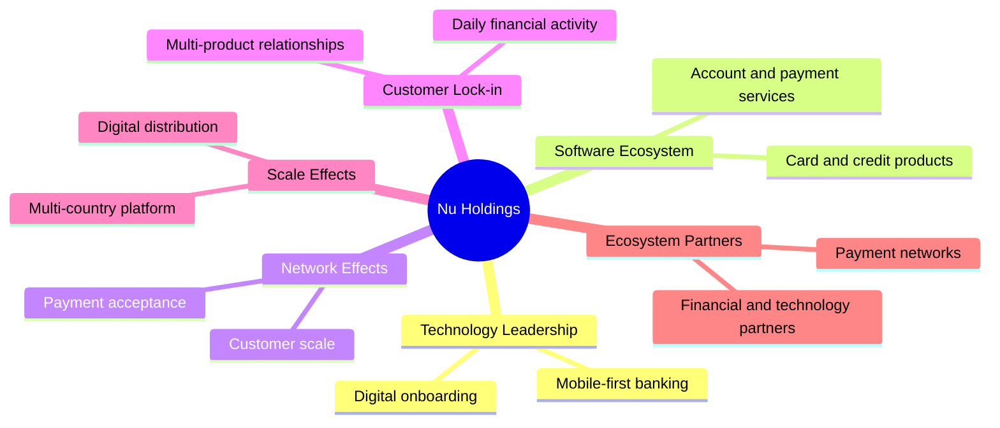
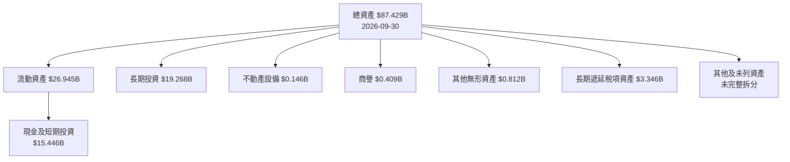
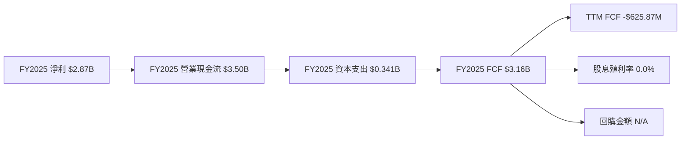
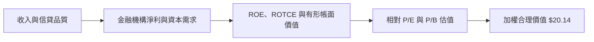
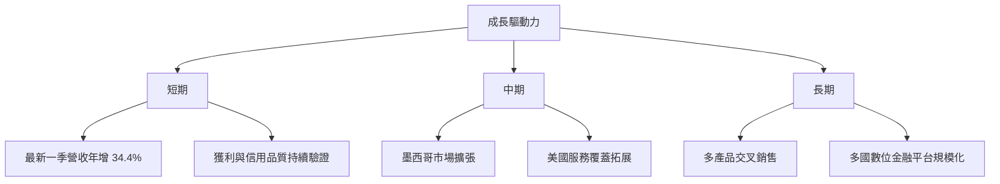
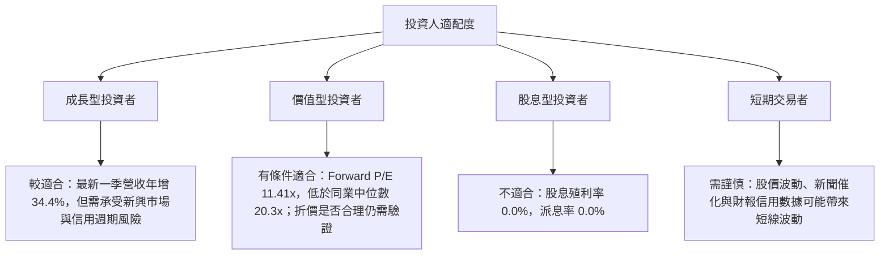

# NU 基本面深度分析報告
> **報告日期**：2026-11-18 ｜ **語言**：繁體中文 ｜ **數據來源**：Yahoo Finance、Finviz、StockAnalysis、Roic.ai ｜ **分析師**：CFA 級機構研究

## 目錄

| # | 章節 | 核心結論 |
|---|------|----------|
| 1 | 執行摘要 | 買入；加權合理價值 $20.14；MOS +38.8% |
| 2 | 公司概覽與商業模式 | 數位金融平台具規模與多產品交叉銷售潛力；市場份額數據未提供 |
| 3 | 損益表深度分析 | 最新一季營收年增 34.4%；TTM 營收成長率未提供，盈餘品質需留意現金流背離 |
| 4 | 資產負債表分析 | 現金及短期投資 $15.45B、總債務 $6.12B、淨現金 $9.32B |
| 5 | 現金流量深度分析 | TTM FCF -$625.87M、FCF Yield -1.05%；與 FY2025 年度 FCF 正值數據存在期間差異 |
| 6 | 獲利能力與資本效率 | ROIC 不適用／無法判定；ROTCE 29.8% 高於 14.00% WACC，但兩者不能直接等同 |
| 7 | 相對估值分析 | NU Forward P/E 11.41x 低於同業中位數 20.3x；相對估值方法支持高於現價 |
| 8 | DCF 內在價值評估 | DCF 不適用於貸款機構現金流；依三種指定方法計算加權合理價值 $20.14 |
| 9 | 成長催化劑 | 最新一季營收年增 34.4%；墨西哥與美國擴張具選擇權，市場規模數據未提供 |
| 10 | 風險矩陣 | 信用風險、監管與匯率風險，以及負 TTM FCF 為主要監控項目 |
| 11 | 投資建議 | 買入；買入區間 $12.33–$18.13；以信用品質與現金流轉換作為追蹤重點 |

---

## 1. 執行摘要

NU 的估值支持買入，但財務數據需帶著來源差異解讀：2026-11-17 收盤價為 **$12.33**；指定估值方法計算的加權合理價值為 **$20.14**，對應 MOS **+38.8%**、上行空間 **+63.3%**。最新一季營收年增 **34.4%**，TTM 營收為 **$14.48B**；但 TTM FCF 為 **-$625.87M**，FCF Yield 為 **-1.05%**，且 ROIC 沒有可用數值。依 MOS 與 ROIC 判斷，本報告採用程式計算的「買入」評級：MOS 雖超過 25%，但沒有證據證明 ROIC 高於 WACC，因此不符合「強烈買入」條件。

### 1.0 一頁式投資儀表板

| 項目 | 內容 |
|------|------|
| **投資論點（3 句）** | ① 最新一季營收年增 **34.4%**，反映平台仍在擴張，但不能據此替代缺失的 TTM 成長率。② 現金及短期投資 **$15.45B**，高於總債務 **$6.12B**，淨現金 **$9.32B**，提供資金緩衝。③ 加權合理價值 **$20.14** 高於現價 **$12.33**，但 TTM FCF **-$625.87M** 要求投資人持續檢驗現金流品質。 |
| **綜合評分** | **7.5/10**（引用 1.1 評分卡） |
| **財務健康** | 🟢 淨現金 **$9.32B**；但短期與速動比率未提供，不能單靠現金淨額判定完整流動性。 |
| **ROIC vs WACC** | ROIC：N/A；WACC：**14.00%**。金融業應以 ROTCE、資產品質等配合判斷；ROTCE **29.8%** 僅作參考，不等同 ROIC。 |
| **FCF 趨勢** | FY2025 年度 FCF **$3.16B**，但 TTM FCF **-$625.87M**；TTM FCF Yield **-1.05%**，兩組數據需核對季度期間與口徑。 |
| **估值** | Forward P/E **11.41x**｜EV/EBITDA **N/A**｜FCF Yield **-1.05%** |
| **DCF 內在價值（基準）** | **N/A**；貸款機構的營業現金流包含資金來源與放款活動，不以一般企業 FCF DCF 估值。 |
| **現價相對 DCF 折溢價** | N/A（沒有 DCF 基準內在價值） |
| **安全邊際（MOS）** | **+38.8%**＝($20.14 − $12.33) ÷ $20.14；以 8.8 加權合理價值為基準。🟢 >25% |
| **預期報酬（基準情境 12M）** | **+63.3%**＝($20.14 − $12.33) ÷ $12.33；這是相對加權合理價值的上行空間，不是 DCF 情境報酬。 |
| **關鍵風險（前二）** | 信用損失及資產品質惡化；TTM FCF 負值且與年度現金流數據存在差異。 |
| **評級 + 信心度** | 🟢 **買入**｜信心：中；主要折價來自相對估值方法，現金流與信貸指標資料不足。 |

### 1.1 綜合評分卡

| 維度 | 評分（1–10） | 主要依據（引用數字與其來源章節） |
|------|--------------|----------------------------------|
| 成長性 | 8.0 | 最新一季營收年增 **34.4%**；TTM 成長率 N/A，見第 3 章。 |
| 獲利能力 | 8.0 | ROTCE **29.8%**；但 ROIC、TTM 營業利益率與逾放／沖銷指標缺乏，見第 6 章。 |
| 財務健康 | 7.0 | 淨現金 **$9.32B**；流動比率、CET1、逾放比均未提供，見第 4、6 章。 |
| 估值 | 7.0 | MOS **+38.8%**；NU Forward P/E **11.41x**，同業 Forward P/E 中位數 **20.3x**，見第 7、8 章。 |
| 護城河 | 8.0 | 巴西、墨西哥、哥倫比亞等市場的多產品數位銀行平台；市場份額、客戶數及留存數據未提供，見第 2 章。 |
| 管理層與資本配置 | 7.0 | FY2025 SBC **$271.85M**，相當於該年營收約 **2.6%**；股息殖利率 **0.0%**，回購數據未提供。 |
| **綜合評分** | **7.5** | 六項算術平均：(8.0 + 8.0 + 7.0 + 7.0 + 8.0 + 7.0) ÷ 6 = **7.5**。 |

### 1.2 五大投資論點 + 三大核心風險

| 類型 | 項目 | 具體依據 | 信心度 |
|------|------|----------|--------|
| 🟢 **投資論點①** | 高速營收擴張 | 最新一季營收年增 **34.4%**；對平台型金融服務而言，收入成長可支撐交叉銷售與營運槓桿，但客戶與產品別資料未提供。 | 🟢 高 |
| 🟢 **投資論點②** | 淨現金提供緩衝 | 現金及短期投資 **$15.45B**，總債務 **$6.12B**，淨現金 **$9.32B**。 | 🟢 高 |
| 🟢 **投資論點③** | ROTCE 顯示帳面資本回報佳 | ROTCE **29.8%**，P/TBV **4.55x**；但需以資產品質指標驗證回報能否持續。 | 🟡 中 |
| 🟢 **投資論點④** | 相對估值折價 | Forward P/E **11.41x**，低於同業 Forward P/E 中位數 **20.3x**；折價可能反映成長、國別及信用風險。 | 🟡 中 |
| 🟢 **投資論點⑤** | 多國市場擴張選擇權 | 公司業務涉及巴西、墨西哥、哥倫比亞、開曼群島及美國；美國擴張新聞提供定性催化，但各市場收入與獲利未提供。 | 🟡 中 |
| 🟡 **風險①** | 信用週期與貸款品質 | 淨沖銷率、逾放比、CET1 均 N/A；若信用成本上升，將影響利潤、資本與估值。 | 🟡 中 |
| 🔴 **風險②** | 現金流與盈餘轉換背離 | TTM FCF **-$625.87M**，但 FY2025 FCF **$3.16B**；需釐清貸款成長造成的營業現金流變化與期間口徑。 | 🔴 高衝擊 |
| 🟡 **風險③** | 拉丁美洲監管、匯率與利率變動 | 收入與資產涉及多國市場；財務數據未提供各幣別曝險與避險比率，盈利可能受匯率及監管政策影響。 | 🟡 中 |

### 1.3 快速統計卡片

| 指標 | 公司實際值（期間） | 同業中位數 | 狀態 |
|------|--------------------|------------|------|
| 營收（TTM） | **$14.48B**；TTM 成長率 N/A | — | 🟡 成長率缺資料 |
| 營收成長（最新一季年增） | **34.4%** | **43.9%** | 🟡 低於同業中位數 |
| 毛利率（TTM） | **0.0%**（來源欄位；對銀行分析解讀有限） | **84.2%** | 🔴 不宜直接橫向比較 |
| 營業利益率（TTM） | **N/A** | — | 🟡 未提供 |
| ROIC（TTM） | **N/A** | — | 🟡 金融業不宜直接使用一般 ROIC |
| Forward P/E | **11.41x** | **20.3x** | 🟢 相對較低 |
| FCF Yield（TTM） | **-1.05%** | — | 🔴 負值 |
| Piotroski F-Score | **N/A** | — | 🟡 不適用貸款機構 |

### 1.4 投資結論

╔══════════════════════════════════════════════════════════════════╗  
║                    📊 投資結論摘要                               ║  
╠══════════════════════════════════════════════════════════════════╣  
║  評級：買入（按規則 20；MOS 充足，但 ROIC > WACC 未獲證實）       ║  
║  價格（2026-11-17 收盤）：$12.33                                 ║  
║  DCF 內在價值（基準）：N/A（貸款機構 DCF 不適用）                 ║  
║  安全邊際 MOS：+38.8%（以加權合理價值 $20.14 為分母）            ║  
║  加權合理價值（8.8）：$20.14                                     ║  
║  綜合評分：7.5/10（引用 1.1）                                    ║  
║  適合投資人：能承受新興市場、信用週期與股價波動的成長型投資人     ║  
╚══════════════════════════════════════════════════════════════════╝

---

## 2. 公司概覽與商業模式

### 2.1 業務結構與收入來源

公司提供數位銀行與金融服務，包括信用卡、預付卡、支付、帳戶及其他金融產品。財務資料沒有提供產品別營收、客戶數或收入佔比，因此不對各業務板塊填入比例或金額。

### 2.2 市場份額

市場份額資料未提供，不能以公司營收直接推導各國滲透率。可確認的是 TTM 營收 **$14.48B**，最新一季營收年增 **34.4%**；同業 SOFI、MELI 最新一季營收年增率分別為 **43.9%**、**45.1%**，HOOD 為 **11.8%**。NU 的成長高於 HOOD、低於 SOFI 與 MELI，但三者業務組合並不完全相同。

### 2.3 競爭護城河分析

### 2.4 護城河強度

| 護城河項目 | 強度（強／中／弱） | 證據（引用數字或事實） | 會削弱它的情況 |
|------------|--------------------|------------------------|----------------|
| 技術與數位服務 | 中 | 公司以行動端數位金融平台服務多國市場；技術投入與客戶使用數據未提供。 | 系統中斷、資安事件或競爭者以更低成本複製服務。 |
| 產品生態系統 | 中 | 信用卡、預付卡、帳戶、轉帳支付與高端產品並存；各產品交叉銷售率未提供。 | 客戶主要使用單一產品，或交叉銷售未能提高留存與單位收益。 |
| 網路效應 | 中 | 支付與帳戶使用可能隨客戶規模提升服務價值；客戶數及商戶網絡數據缺失。 | 支付網絡未形成雙邊效應，客戶可輕易轉換。 |
| 客戶鎖定 | 中 | 多產品平台具提高主要金融關係黏著度的可能；留存率及客戶獲取成本未提供。 | 存款利率、信用條件或服務體驗落後同業。 |
| 規模效應 | 中 | TTM 營收 **$14.48B**，跨多國經營；各國成本與獲利拆分缺失。 | 新市場拓展成本上升，規模沒有轉化為更低服務成本。 |
| 生態夥伴 | 中 | 業務涉及支付、卡片及金融服務合作鏈；合作夥伴經濟條件未提供。 | 合作方議價力提高或監管限制第三方合作。 |

1.1 的護城河分數為 **8.0/10**，主要根據多國數位金融平台與多產品組合；因客戶留存、客戶數及市場份額資料缺失，不能把平台規模直接等同於已驗證的網路效應。

---

## 3. 損益表深度分析

### 3.1 年度收入成長趨勢（近 4 年）

年度營收採年度損益表數據；成長率依相鄰年度數字計算，四捨五入至一位小數。FY2022–FY2025 營收 CAGR 為 **53.0%**，但年度營收成長率逐步放緩，顯示高速擴張仍在延續、基期亦快速墊高。

╔══════════════════════════════════════════════════════════════════╗  
║              Nu Holdings 年度收入趨勢（FY2022–FY2025）           ║  
╠══════════════════════════════════════════════════════════════════╣  
║ FY2022  $2.97B   ██████░░░░░░░░░░░░░░░░░░  基期               ║  
║ FY2023  $5.63B   ███████████░░░░░░░░░░░░░  YoY: +89.6% 🟢     ║  
║ FY2024  $8.27B   ████████████████░░░░░░░░  YoY: +46.9% 🟢     ║  
║ FY2025  $10.63B  █████████████████████░░░  YoY: +28.5% 🟢     ║  
╠══════════════════════════════════════════════════════════════════╣  
║ FY2022–FY2025 營收 CAGR：(10.63 ÷ 2.97)^(1/3) − 1 = 53.0%       ║  
╚══════════════════════════════════════════════════════════════════╝

> **資料差異提示：**年度損益表列示 FY2025 營收 **$10.63B**；StockAnalysis 年度表另列 FY2025 營收 **$6.991B**，而 VERIFIED FIGURES 的 TTM 營收為 **$14.48B**。來源期間與口徑不一致，本報告不將不同來源的數字拼接成同一條成長序列；圖表使用年度損益表原值。

### 3.2 季度收入趨勢分析

季度營收的不同來源亦存在差異。以下季增率依 StockAnalysis 同一季度序列計算；最新一季年增率以財務數據指定值 **34.4%** 為準。金額不與另一組季度損益表的 $4.03B、$3.77B、$3.54B、$3.14B 混用。

| 季度 | 季營收（StockAnalysis，$B） | QoQ | 最新一季／來源 YoY | 備註 |
|------|------------------------------:|----:|--------------------:|------|
| 2025 Q4 | 2.067 | N/A | +43.88% | 前季同一序列資料不足以計算 QoQ。 |
| 2026 Q1 | 1.981 | -4.2% | +43.75% | 季營收回落，但 YoY 仍高。 |
| 2026 Q2 | 2.474 | +24.9% | +52.15% | 季增較快；與不同資料源的季度金額不可直接合併。 |
| 2026 Q3 | 2.580 | +4.3% | **+34.4%** | YoY 以指定的最新一季年增率為準；StockAnalysis 顯示 34.42%。 |

最新一季營收仍年增 **34.4%**，但相較前兩季列示的年增速度有所放緩。由於季度金額來源有差異，短期成長方向可觀察，精確的連續季度動能則應以公司正式季報統一口徑追蹤。

### 3.3 利潤率演變分析

| 利潤率指標 | FY2022 | FY2023 | FY2024 | FY2025 | 趨勢 | 評估 |
|------------|--------|--------|--------|--------|------|------|
| **毛利率** | 0.0%（資料欄位） | 0.0%（資料欄位） | 0.0%（資料欄位） | 0.0%（資料欄位） | 金融業與資料供應商欄位定義不適配 | 🟡 不宜作為核心判斷 |
| **營業利益率** | N/A | N/A | N/A | N/A | 歷年同口徑數據未提供 | 🟡 |
| **淨利率** | -12.3% | 18.3% | 23.8% | 27.0% | 由虧轉盈並擴張 | 🟢 |
| **最新一季營業利益率** | — | — | — | **50.9%** | 單季數據，不代表 TTM | 🟡 |

淨利率依年度收入與淨利計算。FY2022 淨虧損 **$364.58M**，之後 FY2023 淨利 **$1.03B**、FY2024 **$1.97B**、FY2025 **$2.87B**；年度淨利率由轉盈後持續上升，反映收入擴張與成本槓桿的可能性。不過，銀行或金融科技銀行的利息成本、信貸損失與資金成本需拆分才能判斷營業槓桿來源；可用資料沒有提供完整費用明細，因此不把單季營業利益率 **50.9%** 外推至年度。

### 3.4 費用結構分析

利息支出、信用損失準備、行銷、科技、人事及其他營業費用的金額拆分未提供。由於沒有可驗證的費用項目比例，本節不繪製費用圓餅圖，也不以營收與淨利差額反推費用組成。

### 3.5 季度 EPS 趨勢與盈餘品質（Quality of Earnings）

| 季度 | EPS（StockAnalysis） | EPS YoY | 預估值／超預期情況 |
|------|---------------------:|--------:|--------------------|
| 2025 Q4 | $0.18 | +60.87% | 預估值與實際值均為 NaN；無法判定 beat／miss。 |
| 2026 Q1 | $0.18 | +55.93% | 預估值與實際值均為 NaN；無法判定 beat／miss。 |
| 2026 Q2 | $0.22 | +66.31% | 預估值與實際值均為 NaN；無法判定 beat／miss。 |
| 2026 Q3 | $0.23 | +40.13% | 預估值與實際值均為 NaN；無法判定 beat／miss。 |

盈餘品質指標以可取得的 TTM／年度數據計算，並標明口徑限制：

| 盈餘品質項目 | 數值／佔比 | 評估 |
|--------------|-----------|------|
| 股權薪酬 SBC / 營收 | 最近四季 SBC 合計 **$394.13M** ÷ TTM 營收 **$14.48B** = **2.72%** | 🟡 SBC 對經濟利益有稀釋；這是費用比率，不代表股數稀釋率。 |
| SBC / 營業現金流 | **$394.13M ÷ -$218.53M = -180.4%** | 🔴 OCF 為負，該比率不宜作正向品質指標；SBC 金額高於 OCF 絕對值。 |
| FCF / 淨利（現金轉換率） | **-$625.87M ÷ $3.915B = -16.0%** | 🔴 TTM FCF 與正淨利背離；金融業放款與存款變化會使營業現金流不像一般企業自由現金流。 |
| 一次性／非經常性損益 | N/A | 未提供調節表，無法判定一次性項目是否美化盈餘。 |
| 有效稅率異常 | **25.8%**（最新年度有效稅率） | 🟡 未見可確認的異常，但缺少多年有效稅率序列。 |
| 資本化支出 vs 費用化 | TTM Capex **$407.33M**；資本化政策細節 N/A | 🟡 不足以評估是否有成本遞延或資本化支出偏高。 |

FY2025 SBC 為 **$271.85M**，FY2025 營收 **$10.63B**，比例約 **2.6%**；最近四季 SBC 對 TTM 營收約 **2.72%**。目前數據無法證明 GAAP 淨利被一次性項目高估；較明確的警訊是 TTM FCF 為負、與年度現金流呈現落差。對金融機構而言，需回到貸款、存款與監管資本變化解讀現金流，不宜單靠一般企業的 FCF／淨利比率下結論。

---

## 4. 資產負債表分析

### 4.1 資產結構分解

以下按 2026-09-30 資產負債表列示的 StockAnalysis 數據呈現。各科目不是完整的互斥分項，且存在未列示資產，因此不以圖中子項加總推算總資產。

財務數據也列示現金與短期投資 **$15.45B**；該數字與資產負債表不同欄位有四捨五入及分類差異，本報告以 VERIFIED FIGURES 的 **$15.45B** 作淨現金分析基礎。

### 4.2 流動性與營運資金分析

| 指標 | 數值 | 評估 |
|------|------:|------|
| 現金及短期投資 | **$15.45B** | 🟢 可觀的金融資產緩衝，但需區分受限現金與可自由動用資金。 |
| 總債務 | **$6.12B** | 🟡 比年度資產負債表中的 FY2025 債務高；兩期不同，不能直接當作同日比較。 |
| 淨現金 | **$9.32B** | 🟢 現金及短期投資扣除總債務後仍為正。 |
| 流動比率／速動比率 | N/A | 金融業科目結構與一般企業不同，且數據未提供。 |
| Piotroski F-Score | N/A | 不適用貸款機構；貸款成長會使現金流測試失真。 |
| DSO／DIO／DPO／CCC | 不適用（金融業） | 銀行資產負債表主要由金融資產、存款與融資構成，傳統營運資金週期不具代表性。 |

淨現金由指定的現金及短期投資 **$15.45B** 減總債務 **$6.12B** 得到 **$9.32B**，反映帳面資金緩衝；但沒有存款組成、受限資金、流動性覆蓋與資本充足率資料，故不能把淨現金直接當成所有壓力情境下可自由用於股東回報的資金。

### 4.3 債務結構分析

╔══════════════════════════════════════════════════════════════════╗  
║                   Nu Holdings 債務健康診斷                       ║  
╠══════════════════════════════════════════════════════════════════╣  
║ 總債務：          $6.12B                                         ║  
║ 現金及短期投資：  $15.45B                                        ║  
║ 淨現金：          $9.32B  🟢                                     ║  
║ Debt/Equity：     N/A（資料未提供可比口徑）                      ║  
║ Debt/EBITDA：     N/A（EV/EBITDA 亦為 N/A）                      ║  
║ Interest Coverage：N/A（利息費用與利息保障倍數口徑不足）         ║  
║ 備註：金融機構的資金負債須與存款及監管資本一併分析               ║  
╚══════════════════════════════════════════════════════════════════╝

總債務 **$6.12B** 與年度表 FY2025 總債務 **$1.90B** 並非同一日期，可能涉及資料來源與定義差異；本報告引用指定的最新總債務值，但不把年度值當作其直接比較基期。

### 4.4 股東權益趨勢

╔══════════════════════════════════════════════════════════════════╗  
║                 股東權益趨勢（年度，USD）                        ║  
╠══════════════════════════════════════════════════════════════════╣  
║ FY2022  $4.89B   ████████░░░░░░░░░░░░░░░░                       ║  
║ FY2023  $6.41B   ███████████░░░░░░░░░░░░░                       ║  
║ FY2024  $7.65B   █████████████░░░░░░░░░░░                       ║  
║ FY2025  $11.29B  ████████████████████░░░░                       ║  
╚══════════════════════════════════════════════════════════════════╝

股東權益由 FY2022 **$4.89B** 增至 FY2025 **$11.29B**，約為原來的 **2.3 倍**。權益擴張提升了吸收損失的帳面緩衝，但其監管資本品質與風險加權資產比率未提供，不能據此取代 CET1 分析。

---

## 5. 現金流量深度分析

### 5.1 現金流量瀑布圖

以下同時呈現 FY2025 年度營運現金流與指定 TTM FCF，並避免把貸款機構的放款資金流視為一般非金融企業的經濟 FCF。

### 5.2 FCF 轉換率趨勢

年度 FCF 及淨利以年度報表數據計算；對金融機構，FCF 轉換率僅作現金流觀察，不等同可分配現金流品質。

| 年度 | FCF | 淨利 | FCF / 淨利 | 解讀 |
|------|----:|-----:|-----------:|------|
| FY2022 | $0.641B | -$0.365B | -175.8% | 正 FCF 與淨虧損並存，比率不具一般經濟含義。 |
| FY2023 | $1.09B | $1.03B | 105.8% | 年度 FCF 略高於淨利。 |
| FY2024 | $2.22B | $1.97B | 112.7% | 仍高於淨利，需結合貸款及存款現金流解讀。 |
| FY2025 | $3.16B | $2.87B | 110.1% | 年度現金流轉換率高於 100%。 |
| TTM 至 2026-09-30 | **-$625.87M** | **$3.915B** | **-16.0%** | TTM 與年度序列方向不同，須核對期間、貸款成長與來源口徑。 |

### 5.3 自由現金流趨勢

╔══════════════════════════════════════════════════════════════════╗  
║               自由現金流趨勢（年度財務報表）                     ║  
╠══════════════════════════════════════════════════════════════════╣  
║ FY2022  $0.641B  ████░░░░░░░░░░░░░░░░░  FCF Yield：N/A          ║  
║ FY2023  $1.09B   ███████░░░░░░░░░░░░░░  FCF Yield：N/A          ║  
║ FY2024  $2.22B   ██████████████░░░░░░░  FCF Yield：N/A          ║  
║ FY2025  $3.16B   ████████████████████░  FCF Yield：N/A          ║  
║ TTM      -$0.626B 低於零             FCF Yield：-1.05% 🔴       ║  
╚══════════════════════════════════════════════════════════════════╝

價格資料中的市值為 **$59.66B**，指定的 TTM FCF Yield 為 **-1.05%**。年度 FCF 與 TTM FCF 不同方向，不能單靠 FY2025 的正 FCF 推論最近一年現金流仍強，也不能把金融機構的貸款發放現金流出直接等同於企業自由現金流惡化。

### 5.4 資本配置評估

| 資本用途 | 可取得數據 | 評估 |
|----------|------------|------|
| 資本支出 | FY2025 **$340.77M**；TTM **$407.33M** | 用於平台與營運基礎建設的具體回報率未提供。 |
| 股息 | 殖利率 **0.0%**；派息率 **0.0%** | 目前未以股息作主要股東回報。 |
| 股票回購 | N/A | 回購金額與股數變化口徑未提供。 |
| 股權薪酬 | FY2025 **$271.85M**；最近四季合計 **$394.13M** | SBC 會稀釋股東經濟權益，應追蹤股數變化。 |
| 留存／投資 | N/A | 內部擴張與信貸投放的資金配置拆分未提供。 |

因為沒有各資本用途的可比金額與完整資本配置比例，本節不繪製比例圓餅圖。對股東而言，現階段需將零股息、SBC 稀釋與成長再投資的資本回報一起觀察。

---

## 6. 獲利能力與資本效率

### 6.1 ROE / ROA / ROIC 趨勢

| 指標 | 數值 | 期間 | 評估 |
|------|------:|------|------|
| ROE | **31.5%** | TTM | 🟢 回報率高，但受金融槓桿、資產品質及權益口徑影響。 |
| ROA | **5.0%** | TTM | 🟢 對金融機構具參考價值；需與信用成本及資產品質共同判讀。 |
| ROIC | N/A | TTM | 一般企業投入資本定義不適用或資料不足。 |
| ROTCE | **29.8%** | TTM | 🟢 有形權益回報高；不是 ROIC 的替代值。 |
| 同業／行業均值 | N/A | — | 未提供可比的同口徑行業資料。 |

### 6.2 ROIC vs WACC 分析（核心價值創造判斷）

金融機構以資金中介為核心，債務與存款是營運投入，而非一般企業單純的融資負債；因此 **ROIC 對 NU 不宜作為唯一資本效率指標**。目前無法計算可比 ROIC，以下呈現指定 WACC，並以 ROTCE 作輔助觀察。

╔══════════════════════════════════════════════════════════════════╗  
║                ROIC vs WACC 深度分析                            ║  
╠══════════════════════════════════════════════════════════════════╣  
║ ROIC：N/A（金融業口徑不適用／必要資料缺漏）                       ║  
║ WACC：14.00%（指定折現率；計算值 14.23%，受限於 7%–14% 區間）    ║  
║ 無風險利率：5.10% ｜ ERP：5.00% ｜ 調整後 Beta：0.98             ║  
║ 股權成本 Ke：10.00%                                              ║  
║ 稅前債務成本：74.76% ｜ 有效稅率：25.8%                          ║  
║ 股權／債務權重：90.7%／9.3%                                     ║  
║ ROTCE：29.8%（代理參考，非 ROIC）                                ║  
║ ROTCE − WACC：29.8% − 14.00% = +15.8 個百分點                    ║  
║ 判斷：ROTCE 高於 WACC 是正向訊號，但不能據此直接宣告 ROIC > WACC  ║  
╚══════════════════════════════════════════════════════════════════╝

提供的資本成本計算值為 **14.23%**，並依規則限制於 **7%–14%** 區間，故採用 **14.00%**。資料列示的稅前債務成本 **74.76%** 顯著偏高，可能不代表邊際融資成本；在沒有利息費用明細與平均計息負債拆分前，不以此數字推導企業經濟利差。更重要的是，NU 的 ROIC N/A，而 ROTCE **29.8%** 與 WACC 的比較只能作為不同口徑的參考，不能取代「ROIC 是否高於 WACC」的正式判斷。

### 6.3 杜邦三因素分解

| 因素 | 數值（TTM） | 解讀 |
|------|-------------|------|
| 淨利率 | N/A | QUALITY FIGURES 的 DuPont 指標未能計算。 |
| 資產週轉率 | N/A | 必要資料缺漏。 |
| 權益乘數 | N/A | 必要資料缺漏。 |
| **ROE** | **N/A（DuPont）** | QUALITY FIGURES 指出淨利、營收、總資產或正股東權益資料不足以形成一致分解；另列示的 ROE 31.5% 不可冒充杜邦三因素結果。 |

### 6.4 財務體質：Piotroski F-Score 與貸款機構指標

Piotroski F-Score **N/A**，原因是其現金流測試會將貸款成長所需的營業現金流出誤判為負面訊號。九項測試結果因此沒有提供，不逐項補造或推估。

| 貸款機構指標 | 數值 | 解讀 |
|--------------|-----:|------|
| 淨利息收入 NII／總營收 | **84.7%** | 利息收入扣除利息支出後的收入佔比高；不是單純貸款收益率。 |
| 淨利差代理值 | **15.74%** | NII ÷ 平均總資產；由於沒有生息資產分母，通常高於公司自行公布的 NIM。 |
| 成本收入比代理值 | **68.1%** | (營收 − 稅前淨利) ÷ 營收；包含信用損失準備，因而高於一般報導效率比率。 |
| ROTCE | **29.8%** | 淨利 ÷ 有形帳面價值，顯示有形股東資本回報。 |
| P/TBV | **4.55x** | 市場價格相對有形帳面價值的倍數；較高倍數要求較高且可持續的 ROTCE。 |
| 放款淨額／總資產 | **14.0%** | 反映放款佔資產比例；資產配置其餘項目未在此指標中拆解。 |
| 淨沖銷率 | **N/A（數據未提供）** | 不補引用記憶值。 |
| 逾放比 | **N/A（數據未提供）** | 不補引用記憶值。 |
| CET1 | **N/A（數據未提供）** | 不補引用記憶值。 |

---

## 7. 相對估值分析

### 7.1 同業估值比較

公司目前倍數採市場資料；同業倍數依 Yahoo Finance 同業資料。NU 的營收成長率使用最新一季年增率，不能標示為 TTM 成長率。

| 估值指標 | **NU** | **SOFI** | **MELI** | **HOOD** | NU 評估 |
|----------|-------:|--------:|--------:|--------:|----------|
| **Trailing P/E** | **15.41x** | 26.0x | 38.5x | 31.9x | 🟢 低於三家同業；差異可能反映業務與市場風險。 |
| **Forward P/E** | **11.41x** | 15.9x | 26.9x | 20.3x | 🟢 低於同業；同業中位數為 **20.3x**。 |
| **P/S Ratio** | **6.55x** | 4.0x | 1.9x | 12.3x | 🟡 高於 SOFI、MELI，低於 HOOD；金融業收入確認差異使 P/S 解讀有限。 |
| **EV/EBITDA** | N/A | N/A | 20.7x | N/A | 🟡 僅 MELI 有值，不宜作三方比較。 |
| **最新一季營收 YoY** | **34.4%** | 43.9% | 45.1% | 11.8% | 🟡 低於 SOFI、MELI，高於 HOOD。 |
| **Gross Margin TTM** | **0.0%（來源欄位）** | 84.2% | 46.7% | 91.0% | 🔴 定義與金融機構收入結構不具直接可比性。 |

同業中位數 Forward P/E 為 **20.3x**；該數值亦是 SOFI、MELI、HOOD 三個 Forward P/E 中的中位數。相對估值不表示 NU 應必然交易於同業倍數，因國別、產品結構、信用風險與成長品質均可能造成折價。

### 7.2 歷史估值區間分析

N/A（未提供「Valuation vs own history」歷史估值區間資料；不以股價歷史代替 P/E 歷史百分位。）

### 7.3 情境價值（Bear / Base / Bull）

N/A（DCF MODEL 未建立。貸款機構現金流同時包含融資與放款活動，不適用一般企業 FCFF DCF；因此不提供悲觀、基準、樂觀 DCF 情境目標價。）

### 7.4 相對估值隱含價格區間

╔══════════════════════════════════════════════════════════════════╗  
║                 相對估值方法隱含每股價值                         ║  
╠══════════════════════════════════════════════════════════════════╣  
║ 同業 P/B：           $18.48  ───────────────                     ║  
║ 現價（2026-11-17）： $12.33  ───────────────                     ║  
║ 分析師共識目標價：   $17.85  ───────────────                     ║  
║ 同業 Forward P/E：   $21.92  ───────────────                     ║  
║ 加權合理價值：       $20.14  ───────────────                     ║  
╚══════════════════════════════════════════════════════════════════╝

| 方法 | 每股價值 | 依據 |
|------|---------:|------|
| 同業 Forward P/E | **$21.92** | SOFI、MELI、HOOD 的同業 Forward P/E 中位數 **20.3x** × NU Forward EPS **$1.08**。 |
| 同業 P/B | **$18.48** | 同業 P/B 中位數 **6.2x** × NU 每股帳面價值 **$2.96**。 |
| 分析師共識目標價 | **$17.85** | 23 位分析師平均目標價。 |

上述相對估值方法皆高於現價 **$12.33**；同業倍數可能高估 NU 若其未能維持增長與 ROTCE，因此不應把相對估值溢價直接視為保證的價格收斂。

---

## 8. DCF 內在價值評估（Discounted Cash Flow）

> **估值框架說明：**Nu Holdings 是貸款機構。其營業現金流會受到貸款成長、存款與資金調度影響，不能直接以一般企業 FCF 代表可供所有資本提供者支配的自由現金流。程式計算的 DCF MODEL 為 N/A，依規則不另建 DCF，也不虛構 DCF 內在價值、DCF 情境或敏感度矩陣。以下區分「DCF 未能計算」與「相對估值合理價值」。

### 8.0 估值推理鏈（Thinking Logic）

**Step 1 — NU 的價值由哪些因素決定？**

NU 的價值主要由貸款與金融產品的風險調整後獲利、ROTCE 能否在擴張中維持，以及巴西以外新市場能否形成可持續獲利決定。最新一季營收年增 **34.4%**，但各產品及地區營收佔比未提供，因此無法量化「主業、第二成長曲線、新業務」的營收比例。對估值最敏感的不是一般企業 FCFF，而是信貸品質與可持續有形資本回報；目前淨沖銷率、逾放比與 CET1 均未提供。

**Step 2 — 模型選擇**

| 決策點 | 本報告採用 | 理由（含數字） | 曾考慮但否決 | 否決理由 |
|--------|-----------|----------------|--------------|----------|
| 現金流定義 | 不建一般 FCFF／FCFE DCF | 指定 TTM FCF **-$625.87M**，且銀行貸款成長現金流屬資金運用。 | 一般 FCFF | 營業現金流不能直接視為企業可分配現金流。 |
| 預測期 N | N/A | DCF MODEL：N/A。 | 任意設定 5–10 年 | 沒有程式模型輸出，不能自行造預測。 |
| 終值方法 | N/A | 未建立 DCF。 | Gordon Growth、退出倍數 | 沒有逐年 FCFF 及終值基礎。 |
| EBIT 基礎 | N/A | 不建立 DCF。 | GAAP／非 GAAP EBIT 外推 | 金融機構估值應以銀行獲利與資本回報框架為主。 |

**Step 3 — 關鍵假設推導**

DCF 模型輸出為 N/A，故營收 CAGR、期末營業利潤率、稅率、Capex、D&A、ΔWC、SBC 組合、股數稀釋率、永續成長率與終值方法均不設採用值。這些輸入不能從現有金融業財務數字推回一套可稽核的 DCF。

**Step 4 — 最脆弱的一環**

最脆弱的不是某一個 DCF 假設，而是使用一般企業自由現金流框架衡量貸款機構；若忽略放款與存款資金流，DCF 可能把營運現金流波動錯當成企業現金創造能力，方向與幅度均無法用現有數據量化。

**Step 5 — 計算路徑**

由於 DCF MODEL 為 N/A，以下流程不產生數值結果：

### 8.1 模型假設總表（Model Inputs）

N/A（DCF MODEL：N/A。金融機構貸款現金流包含資金來源與貸款投放，不以一般企業自由現金流作估值；依規則不自行另建模型。）

### 8.2 折現率推導（WACC）

DCF 不適用，但依資本成本數據，於第 6.2 節採用的 WACC 為 **14.00%**，本節沿用同一數值作資本成本參考，不代表本報告實際以該折現率計算 DCF。

╔══════════════════════════════════════════════════════════════════╗  
║                    WACC 推導（折現率參考）                       ║  
╠══════════════════════════════════════════════════════════════════╣  
║ 無風險利率 Rf（10Y Treasury）：       5.10%                     ║  
║ ERP（假設值）：                        5.00%                     ║  
║ 原始 Beta（Yahoo）：                   0.97                      ║  
║ 調整 Beta：                            ⅔ × 0.97 + ⅓ × 1.00       ║  
║                                        = 0.98                    ║  
║ 股權成本 Ke：                          5.10% + 0.98 × 5.00%     ║  
║                                        = 10.00%                  ║  
║ 稅前債務成本：                         74.76%                    ║  
║ 有效稅率：                             25.8%                     ║  
║ 稅後 Kd：                              74.76% × (1−25.8%)       ║  
║                                        = 55.47%                  ║  
║ 股權／債務權重：                       90.7%／9.3%              ║  
║ 未限制計算值：                         14.23%                    ║  
║ 採用 WACC：                            14.00%（受限於 7%–14%）  ║  
╚══════════════════════════════════════════════════════════════════╝

逐步演算（資本成本參考）：

1. **Ke** = 5.10% + 0.98 × 5.00% = 5.10% + 4.90% = **10.00%**。
2. **稅前 Kd** = 指定資本成本資料 **74.76%**；利息費用及平均計息負債拆分未提供，無法獨立重建此比率。
3. **稅後 Kd** = 74.76% × (1 − 25.8%) = 74.76% × 74.2% = **55.47%**。
4. **權重** = 股權 **90.7%**、債務 **9.3%**；兩者合計 **100.0%**。資本成本輸入提供該權重，未在此以不同日期股數與債務重新推算。
5. **未限制 WACC** = 90.7% × 10.00% + 9.3% × 55.47% = 9.07% + 5.1587% = **14.2287% ≈ 14.23%**；依 7%–14% 區間採用 **14.00%**。

**輸入來歷與限制：**10 年期美債無風險利率為 **5.10%**；ERP **5.00%** 為資本成本資料中的假設值；原始 Beta **0.97**，按三分之二原始 Beta 加三分之一市場 Beta 1.00 調整為 **0.98**。未另加規模或國別溢酬。稅前債務成本 **74.76%** 的經濟意義需審慎看待，可能受到金融機構負債定義影響。第 6.2 節與本節均採 **14.00%**。

### 8.3 逐年自由現金流預測（基準情境）

N/A（DCF MODEL：N/A；沒有逐年 FCFF 預測。金融機構的放款與融資現金流不能直接依一般企業 FCFF 定義預測。）

### 8.4 終值計算（Terminal Value）

N/A（沒有預測期 FCFF、終值年度或程式計算的終值；不自行設定 Gordon Growth 或退出倍數。）

### 8.5 企業價值 → 每股內在價值（Bridge）

N/A（沒有 DCF 企業價值、現金與債務橋接及 DCF 每股內在價值。指定 DCF MODEL 為 N/A；因此本節不計算 DCF 折溢價或 DCF MOS。）

### 8.6 敏感性分析（WACC × 永續成長率）

N/A（未建立 DCF，沒有 WACC × 永續成長率矩陣，也沒有可用的 DCF 三情境每股價值。）

### 8.7 反推 DCF（Reverse DCF）

N/A（沒有可供反推的 DCF 方程式。以現價 **$12.33** 只能與指定相對估值方法比較，不能反推出營收 CAGR、利潤率或永續成長率。）

### 8.8 估值三角驗證與安全邊際

公司類型為 **financial**，指定方法及固定權重如下；DCF 基準價值不適用，估值方法清單中也沒有 DCF 權重，因此不增列 DCF。

| 估值方法 | 隱含每股價值 | 上行空間（÷現價） | 權重 | 說明 |
|----------|--------------:|-------------------:|-----:|------|
| 同業 Forward P/E | **$21.92** | **+77.8%** | **50%** | 同業中位數 **20.3x** × Forward EPS **$1.08**。 |
| 同業 P/B | **$18.48** | **+49.9%** | **40%** | 同業中位數 **6.2x** ×每股帳面價值 **$2.96**。 |
| 分析師共識目標價 | **$17.85** | **+44.8%** | **10%** | 23 位分析師平均目標價。 |
| **加權合理價值** | **$20.14** | **+63.3%** | **100%** | 依金融業固定估值權重加權；沒有可計算的 DCF 方法被加入。 |

逐步演算（方法列示值以美分精度呈現，總值採程式計算的未四捨五入結果）：

- 同業 Forward P/E 貢獻：$21.92 × 50% = **$10.960**。
- 同業 P/B 貢獻：$18.48 × 40% = **$7.392**。
- 分析師共識貢獻：$17.85 × 10% = **$1.785**。
- 加權合計：$10.960 + $7.392 + $1.785 = **$20.137 ≈ $20.14**。
- 權重合計：50% + 40% + 10% = **100%**。

#### 安全邊際與價格區間

╔══════════════════════════════════════════════════════════════════╗  
║                  估值區間與安全邊際                              ║  
╠══════════════════════════════════════════════════════════════════╣  
║ $12.33 ───────── $17.85 ───────── [$20.14] ───────── $21.92     ║  
║ 現價             分析師共識       加權合理值       Forward P/E    ║  
║                                                                  ║  
║ MOS = (20.14 − 12.33) ÷ 20.14 = 7.81 ÷ 20.14 = +38.8%           ║  
║ 上行空間 = (20.14 − 12.33) ÷ 12.33 = 7.81 ÷ 12.33 = +63.3%     ║  
║                                                                  ║  
║ 建議買入區間：$12.33 – $18.13（以 MOS ≥10% 為上限條件）         ║  
║ 合理持有區間：$18.13 – $20.14                                   ║  
║ 減碼考慮區間：高於 $21.92，並重新檢視成長與信用風險假設          ║  
╚══════════════════════════════════════════════════════════════════╝

買入上限計算：$20.14 × (1 − 10%) = **$18.126 ≈ $18.13**。該區間上限高於現價，與買入評級一致。此價格區間以相對估值及加權合理價值為依據，不是 DCF 估值區間。

> 🔎 **程式複算（Python，依本節各項自動重算）**
>
> 加權合理價值 = $21.92 × 50% + $18.48 × 40% + $17.85 × 10% = **$20.14**（權重合計 100%）
>
> 以價格 $12.33 計：MOS = **+38.8%**，上行空間 = **+63.3%**
>
> ✅ 與本節所寫數值一致。

### 8.9 DCF 模型的局限與失效條件

本報告沒有 DCF，故沒有終值佔 EV 比重或 DCF 敏感度數字可列。相對估值亦受以下限制：

- **信用資料缺口：**淨沖銷率、逾放比與 CET1 均未提供；若信用成本增加，當期淨利與 ROTCE 可能下滑。
- **TTM 現金流背離：**TTM FCF **-$625.87M**，與 FY2025 FCF **$3.16B** 方向相反；若負值主要源於正常貸款擴張，解讀與若由資金壓力造成將截然不同。
- **同業可比性：**SOFI、MELI、HOOD 的收入組成、國別與監管架構不同；Forward P/E 中位數 **20.3x** 不代表 NU 必須達到該倍數。
- **資料來源差異：**年度及季度收入表存在同一期間不同金額，應以正式季報統一口徑重估。
- **與第 10 章的連結：**信用惡化會削弱淨利、ROTCE 與 P/TBV 支撐；利率、監管與匯率變化會影響融資成本、資產負債表與市場給予的估值倍數。

### 8.10 複算檢核表（Audit Trail）

| # | 檢核項目 | 結果 |
|---|----------|------|
| 1 | 高／中敏感度 DCF 假設四段式推導 | N/A：未建立 DCF。 |
| 2 | DCF 每個假設均有依據 | N/A：DCF 輸入不存在；未自行補值。 |
| 3 | WACC 公式及加權計算 | ✅ 依指定輸入計算未限制值約 **14.23%**，採用值 **14.00%**。 |
| 4 | Kd 分母與 D 權重同一計息負債範圍 | N/A：輸入未提供可重建的平均計息負債拆分；未另造 D。 |
| 5 | WACC 與第 6.2 節相同 | ✅ 均採 **14.00%**。 |
| 6 | 逐年預測年數及省略符號 | N/A：沒有逐年 DCF 預測。 |
| 7 | FY+1 FCFF／PV 代表年度複算 | N/A：沒有 FCFF 預測。 |
| 8 | 預測期 PV 加總 | N/A：沒有預測期 PV。 |
| 9 | WACC > g | N/A：沒有 g。 |
| 10 | 終值基於預測期最後一年並折現 | N/A：沒有終值。 |
| 11 | EV 至每股 DCF 價值橋接 | N/A：沒有 DCF EV。 |
| 12 | SBC 組合 A／B／C 一致性 | N/A：沒有 DCF 的 EBIT 與股數組合；盈餘品質章節另列 SBC。 |
| 13 | 敏感度矩陣基準格與 DCF 價值一致 | N/A：沒有敏感度矩陣。 |
| 14 | 矩陣有效格符合 WACC > g | N/A：沒有矩陣。 |
| 15 | 三情境機率加總 | N/A：沒有 DCF 情境。 |
| 16 | 反推 DCF 一次解一個變數 | N/A：沒有 DCF 方程式。 |
| 17 | MOS 分母為 8.8 加權合理價值；折溢價使用 DCF | ✅ MOS 使用 **$20.14**；DCF 折溢價為 N/A。 |
| 18 | 完整輸出至第 11 章 | ✅ |
| 19 | 加權合理價值等於方法加權總和 | ✅ $10.960 + $7.392 + $1.785 = $20.137 ≈ **$20.14**。 |
| 20 | 評級符合 MOS 規則 | ✅ MOS **+38.8%**；ROIC > WACC 未能證實，採「買入」而非「強烈買入」。 |

---

## 9. 成長催化劑

### 9.1 催化劑時間軸

財務數據及新聞沒有提供可量化的具體營收貢獻與明確交付時程，以下按短、中、長期列出可追蹤方向，不虛構日期或預測數字。

| 時間範圍 | 催化劑 | 可驗證指標 |
|----------|--------|------------|
| 短期 | 2026 Q3 財報後市場對獲利與成長的反應；新聞提及 Q3 結果及收入成長 | 下一季營收年增、淨利、信用損失與營業現金流。 |
| 中期 | 墨西哥數位金融市場擴張 | 墨西哥客戶、產品滲透率與收入占比；目前數據未提供。 |
| 中期 | 美國服務覆蓋擴張 | 新聞稱 Nubank U.S. 已觸及 50 州；實際客戶、收入及損益貢獻未提供。 |
| 長期 | 多產品交叉銷售與高端產品 | 各產品客戶滲透率、留存率、單客收入與信用表現。 |

### 9.2 TAM 市場規模分析

N/A（TAM 數據未提供）。可用的公司規模指標為 TTM 營收 **$14.48B** 與最新一季營收年增 **34.4%**；但缺少巴西、墨西哥、哥倫比亞及美國各市場的可服務市場規模、客戶滲透率與公司收入占比，不能可靠計算 TAM 或滲透率。

### 9.3 成長驅動力結構圖

---

## 10. 風險矩陣

### 10.1 風險評估

發生機率與衝擊的量化座標未提供，因此不以主觀數字繪製 quadrantChart。下表按定性優先級排序，並以可追蹤財務門檻描述風險。

| 優先級 | 風險項目 | 發生可能性 | 財務衝擊方向 | 風險依據 |
|--------|----------|------------|--------------|----------|
| 高 | 信用品質惡化 | 中至高 | 信用損失增加，壓低淨利與 ROTCE | 淨沖銷率、逾放比、CET1 均 N/A。 |
| 高 | TTM FCF 持續為負 | 中 | 對資金管理與估值造成壓力 | TTM FCF **-$625.87M**；FCF Yield **-1.05%**。 |
| 中高 | 收入成長減速 | 中 | 降低估值溢價及營運槓桿 | 最新一季收入年增 **34.4%**，低於 SOFI **43.9%**、MELI **45.1%**。 |
| 中 | 國別監管與匯率 | 中 | 影響成本、利率、資本及美元計價回報 | 多國經營；各國曝險及避險比例未提供。 |
| 中 | 資料口徑與透明度 | 中 | 降低估值可信度 | 同期間收入、債務與現金流資料有多來源差異。 |
| 中 | 估值倍數回落 | 中 | 股價可能下修，即使盈利仍成長 | Forward P/E **11.41x** 低於同業中位數，但低估值也可能反映風險。 |

### 10.2 風險清單詳細分析

| # | 風險項目 | 發生機率 | 財務衝擊 | 風險評分 | 緩解措施 |
|---|----------|----------|----------|----------|----------|
| 1 | 🔴 **貸款信用風險** | 中至高；未有可驗證百分比 | 信用成本上升可能降低淨利、ROE 與 ROTCE；量化幅度 N/A。 | 定性高 | 每季追蹤逾放比、淨沖銷率、撥備覆蓋與 CET1；目前相關數據不足，應以正式季報補足。 |
| 2 | 🔴 **TTM 現金流轉負** | 已發生 | TTM FCF **-$625.87M**、FCF Yield **-1.05%**；若與信貸擴張無關，可能反映現金生成轉弱。 | 定性高 | 對照放款成長、存款變動與年度／季度現金流調節表；不能只看淨利。 |
| 3 | 🟡 **成長率回落** | 中 | 最新一季年增 **34.4%**，低於 SOFI、MELI 的同業最新季度成長率。 | 定性中 | 追蹤收入成長是否連續兩季低於 20%，並拆分國別與產品成長。 |
| 4 | 🟡 **監管及國別風險** | 中 | 無可引用的收入／資產國別比例，無法量化單一國家衝擊。 | 定性中 | 追蹤主要市場監管變動、資本要求、利率及匯率曝險。 |
| 5 | 🟡 **資料口徑差異** | 已存在 | 同期收入、總債務及現金流的不同來源數字有差距，影響估值與趨勢判讀。 | 定性中 | 以 SEC 申報資料與公司正式季報統一期間和會計口徑；目前可用來源未包含 SEC 數據。 |

---

## 11. 投資建議

### 11.1 最終評級與評分

評級為 **買入**：加權合理價值 **$20.14** 對現價 **$12.33** 對應 MOS **+38.8%**，但 ROIC > WACC 尚未證實，因此不評為強烈買入。1.1 綜合評分為 **7.5/10**，六項分數依序為成長性 **8.0**、獲利能力 **8.0**、財務健康 **7.0**、估值 **7.0**、護城河 **8.0**、管理層與資本配置 **7.0**。

### 11.2 合理價值與隱含報酬率

| 估值項目 | 每股價值 | 相對現價 $12.33 | 備註 |
|----------|---------:|----------------:|------|
| 同業 Forward P/E | **$21.92** | **+77.8%** | 同業中位數倍數 × NU Forward EPS。 |
| 同業 P/B | **$18.48** | **+49.9%** | 同業中位數倍數 × 每股帳面價值。 |
| 分析師共識 | **$17.85** | **+44.8%** | 23 位分析師平均目標價。 |
| **加權合理價值** | **$20.14** | **+63.3%** | 固定權重 50%／40%／10%。 |
| 悲觀／基準／樂觀 DCF | N/A | N/A | DCF MODEL：N/A，不提供 DCF 情境目標價。 |

### 11.3 買入時機與觸發因素

╔══════════════════════════════════════════════════════════════════╗  
║                  ✅ 買入觸發因素 Checklist                       ║  
╠══════════════════════════════════════════════════════════════════╣  
║  可考慮分批建立部位：                                            ║  
║  ✅ 現價 $12.33 低於加權合理價值 $20.14                           ║  
║  ✅ 現價對應 MOS +38.8%，高於 25%                                ║  
║  ✅ 淨現金 $9.32B，帳面資金緩衝為正                              ║  
║                                                                  ║  
║  加碼前確認：                                                    ║  
║  ☐ 最新一季營收年增率維持 20% 以上                               ║  
║  ☐ TTM FCF 改善至非負，或公司能清楚解釋負值與放款成長的關係     ║  
║  ☐ 公布並維持逾放比、淨沖銷率與 CET1 等核心信貸指標             ║  
║                                                                  ║  
║  減碼／重新檢視條件：                                            ║  
║  ☐ 最新一季營收年增率連續兩季低於 20%                            ║  
║  ☐ 信用損失上升造成 ROTCE 明顯回落                               ║  
║  ☐ TTM FCF 持續為負且無法由貸款成長與資金配置解釋                ║  
║  ☐ 股價高於 $21.92，且盈利或信用表現未同步改善                   ║  
╚══════════════════════════════════════════════════════════════════╝

### 11.4 投資人適配度分析

### 11.5 每季財報監控清單（Quarterly Watch List）

| 監控指標 | 目前基準 | 加碼觸發 | 減碼／重新檢視觸發 |
|----------|----------|----------|--------------------|
| 營收成長 | 最新一季年增 **34.4%** | 維持 **≥30%**，且各季口徑一致 | 連續兩季 **<20%** |
| EPS 成長 | 最新一季年增 **40.1%** | 盈餘成長與營收成長相符，並非一次性項目帶動 | EPS 成長跌至 0% 以下，或連兩季明顯落後營收 |
| TTM 營業利益率 | N/A | 取得可比資料並確認維持或改善 | 營業利潤率連兩季收縮；須先取得統一口徑數據 |
| ROTCE | **29.8%** | 維持在 **25%** 以上且資產品質穩定 | 跌破 **20%** 或信用成本快速上升 |
| TTM FCF | **-$625.87M** | 轉為非負，或公司提供清楚可核對的貸款資金流解釋 | 持續為負且淨現金明顯減少 |
| 信貸品質 | 淨沖銷率、逾放比 N/A | 季報公布且維持穩定 | 逾放與沖銷同步上升；依公司正式指標判斷 |
| 資本充足 | CET1 N/A | 公布並維持在監管要求之上 | 接近監管門檻或資本需求增加 |
| SBC／稀釋 | 最近四季 SBC **$394.13M** | SBC／營收持平或下降，流通股數增幅受控 | SBC／營收持續上升或股數顯著擴張 |
| 市場擴張 | 美國覆蓋新聞提及 50 州；收入貢獻 N/A | 新市場收入與單位經濟性可量化 | 新市場擴張增加費用但未形成收入或正向貢獻 |
| 財報資料一致性 | 多來源季度收入及債務數據有差異 | 正式季報能解釋期間與口徑 | 重要數據差異持續且無法調節 |

### 11.6 反面論證：什麼會證明論點錯誤（What Would Change My Mind）

╔══════════════════════════════════════════════════════════════════╗  
║              ⚠️ 論點失效條件（Disconfirming Evidence）            ║  
╠══════════════════════════════════════════════════════════════════╣  
║ 本投資論點在下列情況成立時應重新檢視或退出：                     ║  
║ ☐ 最新一季營收年增率連續兩季低於 20%                             ║  
║ ☐ TTM 淨利轉負，或 EPS 年增率連續兩季低於 0%                     ║  
║ ☐ ROTCE 跌破 20%，且無法以短期擴張或可驗證因素解釋               ║  
║ ☐ TTM FCF 持續為負，且現金及短期投資由 $15.45B 顯著下降           ║  
║ ☐ 公布的逾放比、淨沖銷率顯著惡化，或 CET1 接近監管要求           ║  
║ ☐ 經可信數據計算的 ROIC 低於 WACC，或資本回報持續低於資金成本    ║  
║ ☐ SBC／營收高於目前約 2.72% 並持續上升，且流通股數同步擴張        ║  
║ ☐ 正式財報無法調節現有收入、債務與現金流資料的重大口徑差異        ║  
╚══════════════════════════════════════════════════════════════════╝

> **免責聲明：**本報告為 AI 自動生成，僅供研究參考，不構成投資建議。投資有風險，入市需謹慎。

---

## 資料與來源

| 項目 | 內容 |
|------|------|
| 價格 | 12.33 USD，2026-11-17 收盤（Yahoo Finance 即時報價（該交易日已收盤）） |
| 財務報表 | Yahoo quarterly statements (no SEC filing data)，最新季度 2026-09-30（TTM = four quarters to this date） |
| 有回應的資料來源 | Yahoo Finance、Finviz、StockAnalysis、Roic.ai |
| 未回應的資料來源 | SEC 申報資料 (XBRL) |
| 由程式計算 | TTM 數字、WACC、DCF 模型、估值方法與權重、加權合理價值、MOS、評級門檻、F-Score、杜邦分解、營運資金天數、綜合評分 |
| 撰寫模型 | openai / gpt-6-luna |

> 本區塊由產生報告的程式依實際取得的資料填寫，非模型撰寫。「由程式計算」的數字不是模型的估計；其餘判斷（評分、情境、策略）是模型的分析。
