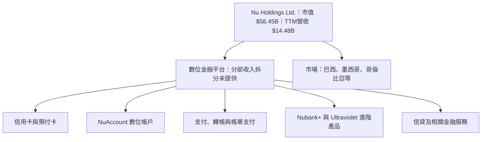
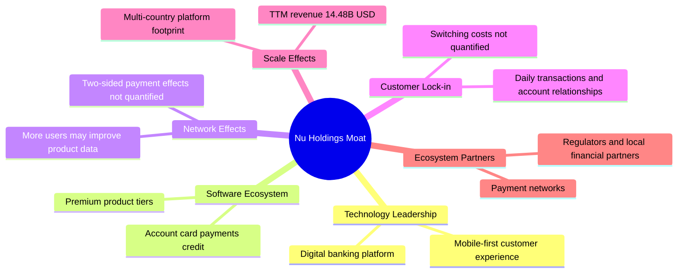
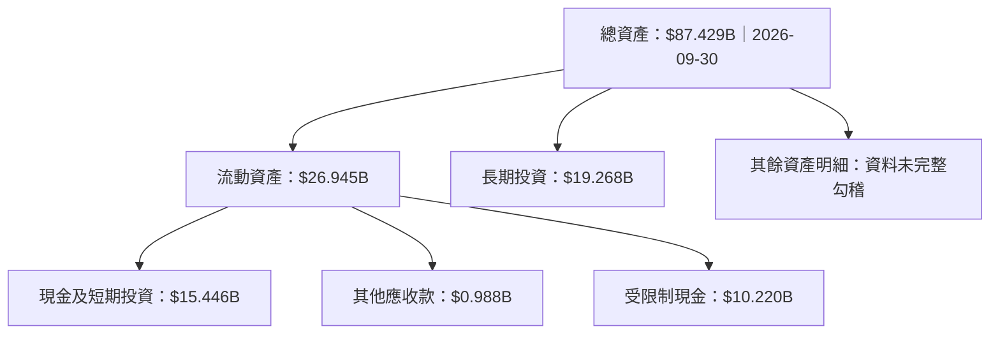
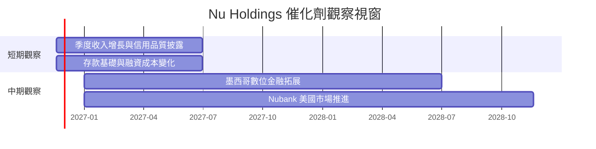
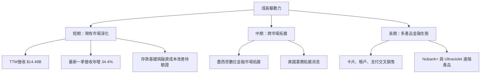
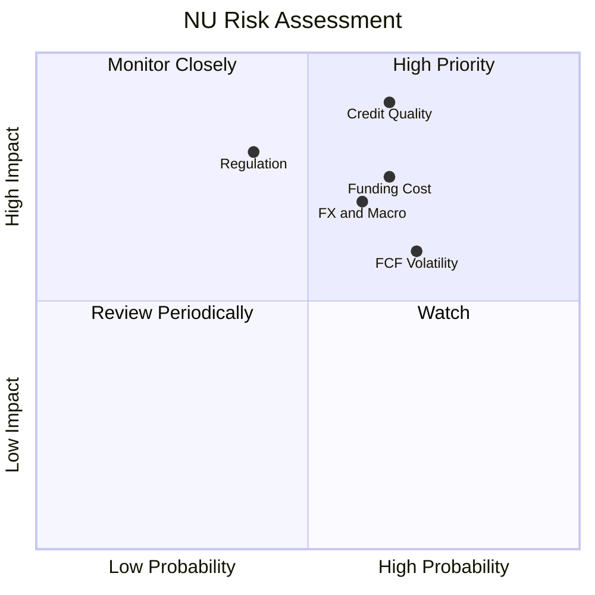
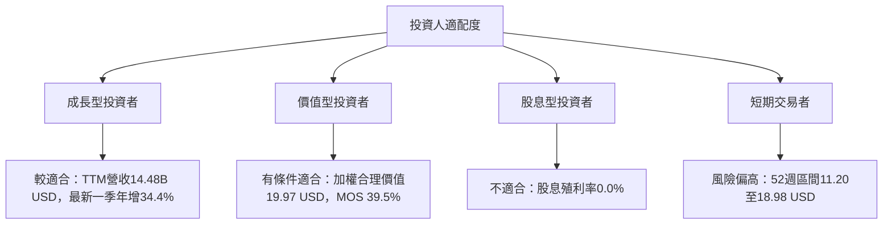

# NU 基本面深度分析報告
> **報告日期**：2026-11-19 ｜ **語言**：繁體中文 ｜ **數據來源**：Yahoo Finance、Finviz、StockAnalysis、Roic.ai ｜ **分析師**：CFA 級機構研究

> **資料口徑說明**：財務資料由多個資料來源合併，部分項目口徑互有差異。本報告對指定的價格、TTM 營收、TTM 自由現金流、資本成本、同業倍數及估值方法，優先採用程式核對數字；其他歷史趨勢則標明對應來源及期間，不將不同口徑數字混合推算。

## 目錄

| # | 章節 | 核心結論 |
|---|------|----------|
| 1 | 執行摘要 | 買入；加權合理價值 $19.97；MOS +39.5% |
| 2 | 公司概覽與商業模式 | 數位金融平台具規模與產品交叉銷售空間；市場份額數據未提供 |
| 3 | 損益表深度分析 | TTM 營收 $14.48B；最新一季營收年增 34.4%；TTM 營業利益率 N/A |
| 4 | 資產負債表分析 | 現金及短期投資 $15.45B；淨現金 $9.32B |
| 5 | 現金流量深度分析 | TTM FCF -$625.87M、FCF Yield -1.07%；年度與 TTM 現金流方向相反 |
| 6 | 獲利能力與資本效率 | ROTCE 29.8%；ROIC 不適用於銀行式放款業務，不能直接與 WACC 等同比較 |
| 7 | 相對估值分析 | 公司 Forward P/E 11.34x；估值方法支持 $17.81–$21.60 的每股價值 |
| 8 | DCF 內在價值評估 | DCF 不適用；金融機構的放款與融資現金流不宜直接視為企業自由現金流 |
| 9 | 成長催化劑 | 拉美數位金融滲透、新產品交叉銷售及美國拓展是主要觀察方向 |
| 10 | 風險矩陣 | 信貸品質、利率與融資成本、監管與匯率為主要風險 |
| 11 | 投資建議 | 買入；建議區間以加權合理價值與 MOS 門檻推導 |

## 1. 執行摘要

截至 2026-11-18 收盤，NU 股價為 **$12.08**。指定估值方法以同業 Forward P/E 評值 $21.60、同業 P/B 評值 $18.47、分析師共識目標價 $17.81 加權，得到**加權合理價值 $19.97**；安全邊際 **MOS = ($19.97 − $12.08) ÷ $19.97 = +39.5%**，上行空間則為 **($19.97 − $12.08) ÷ $12.08 = +65.3%**。因此，依 MOS 規則 20 評級為**買入**。支持論點的營運數據包括 TTM 營收 $14.48B、最新一季營收年增 34.4%、金融業 ROTCE 29.8%；但 TTM FCF 為 -$625.87M，且信用品質指標缺漏，估值與現金流品質仍有重要不確定性。

### 1.0 一頁式投資儀表板（Portfolio Manager 30 秒速讀）

| 項目 | 內容 |
|------|------|
| **投資論點（3 句）** | ① TTM 營收 $14.48B，最新一季年增 34.4%，顯示收入規模仍在擴張。② ROTCE 為 29.8%，但這是金融業權益回報指標，不等同 ROIC。③ 加權合理價值 $19.97，較 $12.08 收盤價提供 39.5% MOS；惟 TTM FCF 為 -$625.87M。 |
| **綜合評分** | **7.5/10**（引用 1.1 評分卡） |
| **財務健康** | 🟢 現金及短期投資 $15.45B，總債務 $6.12B，核對數值列示淨現金 $9.32B；銀行流動性比率不適用於一般工業公司框架。 |
| **ROIC vs WACC** | ROIC：N/A（金融業不適用／資料不足）；WACC：14.00%。不能用 ROTCE 直接取代 ROIC，但 ROTCE 29.8% 提供較適合金融業的權益獲利參考。 |
| **FCF 趨勢** | TTM FCF 為負，FCF Yield **-1.07%**；應與放款成長造成的資金流出一併判讀。 |
| **估值** | Forward P/E **11.342722x** ｜ EV/EBITDA **N/A** ｜ FCF Yield **-1.07%** |
| **DCF 內在價值（基準）** | N/A；金融機構 DCF 不適用，故不計算相對 DCF 折溢價。 |
| **安全邊際（MOS）** | **+39.5%**＝($19.97 加權合理價值 − $12.08 現價) ÷ $19.97；🟢 >25% 充足。 |
| **預期報酬（基準情境 12M）** | DCF 情境模型 N/A；以加權合理價值作估值參考，上行空間為 **+65.3%**，不等同承諾的一年報酬。 |
| **關鍵風險（前二）** | 信貸損失惡化（淨沖銷率、逾放比未提供）；TTM FCF 為負且資金流量受放款增長與資產負債配置影響。 |
| **評級 + 信心度** | 🟢 **買入** ｜ 信心：中低（估值資料支持折價，但信貸品質與現金流資料不完整） |

### 1.1 綜合評分卡（全報告唯一）

| 維度 | 評分（1–10） | 主要依據（引用數字與其來源章節） |
|------|--------------|----------------------------------|
| 成長性 | 8.0 | TTM 營收 $14.48B；最新一季營收年增 34.4%（第 3 章）。 |
| 獲利能力 | 7.5 | 最新一季營業利益率 50.9%，但 TTM 營業利益率 N/A；ROTCE 29.8%（第 3、6 章）。 |
| 財務健康 | 7.0 | 現金及短期投資 $15.45B、總債務 $6.12B、淨現金 $9.32B；信用品質與 CET1 未提供（第 4、6 章）。 |
| 估值 | 8.5 | MOS +39.5%、Forward P/E 11.342722x；DCF 不適用（第 7、8 章）。 |
| 護城河 | 7.5 | 多國數位銀行平台、多層級卡片與支付產品；未提供市場份額、活躍客戶數及單客獲利數據（第 2 章）。 |
| 管理層與資本配置 | 6.5 | FY2025 SBC $271.85M；未提供可核驗的回購、股利及資本配置目標，TTM FCF 為負（第 3、5 章）。 |
| **綜合評分** | **7.5** | 六項算術平均：(8.0 + 7.5 + 7.0 + 8.5 + 7.5 + 6.5) ÷ 6 = 7.5。 |

### 1.2 五大投資論點 + 三大核心風險

| 類型 | 項目 | 具體依據 | 信心度 |
|------|------|----------|--------|
| 🟢 **投資論點①** | 高速收入擴張 | TTM 營收 $14.48B；最新一季年增 34.4%，季度收入從 2025-12-31 的 $3.14B 增至 2026-09-30 的 $4.03B。 | 🟢 高 |
| 🟢 **投資論點②** | 金融業權益回報具吸引力 | ROTCE 29.8%；高於 14.00% WACC 數字，但 ROTCE 與 ROIC 定義不同，不直接當作 ROIC 利差。 | 🟡 中 |
| 🟢 **投資論點③** | 估值方法支持折價 | 加權合理價值 $19.97，較現價 $12.08 的 MOS 為 +39.5%。 | 🟡 中 |
| 🟢 **投資論點④** | 資產負債表有淨現金 | 現金及短期投資 $15.45B，債務 $6.12B，資料列示淨現金 $9.32B。 | 🟢 高 |
| 🟢 **投資論點⑤** | 多產品、多國拓展選擇權 | 公司在巴西、墨西哥、哥倫比亞等市場提供卡片、帳戶、支付及其他金融產品；美國業務擴展消息提供長期選擇權，但尚無分部收入量化。 | 🟡 中 |
| 🟡 **風險①** | 信貸週期與放款品質 | 淨沖銷率、逾放比、CET1 均未提供；若信用成本上升，可能侵蝕利潤及資本緩衝。 | 🟡 中 |
| 🔴 **風險②** | TTM 現金流轉負 | TTM OCF -$218.53M、資本支出 $407.33M、FCF -$625.87M；需辨別是放款擴張造成的正常資金占用或核心獲利轉現金能力變弱。 | 🔴 高衝擊 |
| 🔴 **風險③** | 拉美宏觀、匯率及監管 | 業務跨巴西、墨西哥、哥倫比亞等市場；資料未提供各地收入、貨幣曝險及監管資本需求拆分。 | 🟡 中 |

### 1.3 快速統計卡片

| 指標 | 公司實際值（期間） | 同業中位數 | 狀態 |
|------|--------------------|------------|------|
| 營收成長（TTM） | **N/A**（TTM vs prior TTM 未提供） | — | 🟡 |
| 營收成長（最新一季年增） | **34.4%** | 43.9%（SOFI）、45.1%（MELI）、11.8%（HOOD）的中位數為 43.9% | 🟡 |
| 毛利率（TTM） | **0.0%**（資料來源口徑對金融機構不具可比性） | 同業中位數 84.2%（三家中位數） | 🔴 不宜直接比較 |
| 營業利益率（TTM） | **N/A** | — | 🟡 |
| Forward P/E | **11.342722x** | **20.3x**（SOFI 15.7x、MELI 26.9x、HOOD 20.3x 的中位數） | 🟢 |
| FCF Yield（TTM） | **-1.07%** | — | 🔴 |
| Piotroski F-Score | **N/A（不適用於放款機構）** | — | 🟡 |

### 1.4 投資結論

```text
╔══════════════════════════════════════════════════════════════════╗
║                    📊 投資結論摘要                               ║
╠══════════════════════════════════════════════════════════════════╣
║  評級：買入（依 8.8 的 MOS 門檻，未作質化調整）                  ║
║  價格（2026-11-18 收盤）：$12.08                                 ║
║  DCF 內在價值（基準）：N/A（金融業 DCF 不適用）                  ║
║  安全邊際 MOS：+39.5%（以加權合理價值 $19.97 為分母）            ║
║  加權合理價值（8.8）：$19.97                                     ║
║  綜合評分：7.5/10（引用 1.1）                                    ║
║  適合投資人：可承受拉美金融與信貸風險、追求成長的中長期投資人    ║
╚══════════════════════════════════════════════════════════════════╝
```

## 2. 公司概覽與商業模式

### 2.1 業務結構與收入來源

Nu Holdings 提供跨多國的數位金融平台，包括信用與預付卡、數位帳戶、支付、轉帳及進階卡片方案。已知 TTM 營收為 **$14.48B**，最新一季營收為 **$4.03B**；各業務營收占比及軟體、服務收入拆分未提供，因此不以圖表臆測分部比例。



### 2.2 市場份額

市場份額數據未提供，近期新聞摘要亦未附可核驗的份額數字與年份，因此不估算滲透率。可確認的規模指標是 TTM 營收 $14.48B、最新一季營收年增 34.4%；同業比較中，NU 最新一季增速低於 SOFI 的 43.9% 與 MELI 的 45.1%，高於 HOOD 的 11.8%。

### 2.3 競爭護城河分析



### 2.4 護城河強度

| 護城河項目 | 強度（強／中／弱） | 證據（引用數字或事實） | 會削弱它的情況 |
|------------|--------------------|------------------------|----------------|
| 技術與數位體驗 | 中 | 公司以數位銀行平台提供帳戶、卡片、支付等產品；沒有成本優勢或留存率資料可量化。 | 客戶體驗落後、服務中斷或詐欺損失升高。 |
| 軟體生態系統 | 中 | 產品包含 NuAccount、信用與預付卡、Nubank+、Ultraviolet 等層級。 | 交叉銷售低、產品使用率與單客收入停滯。 |
| 網路效應 | 中偏弱 | 支付與帳戶有形成交易網路的可能；活躍客戶、商戶接受度與交易密度數據未提供。 | 競爭者提供更高回饋、降低交易黏性。 |
| 客戶鎖定 | 中 | 日常帳戶、卡片及支付可建立使用習慣；留存率與轉戶成本數據未提供。 | 客戶同時持有多家銀行產品，轉換成本低。 |
| 規模效應 | 中偏強 | TTM 營收 $14.48B、跨多個拉美市場經營。 | 信貸損失或服務成本增速快於收入，削弱規模經濟。 |
| 生態夥伴 | 中 | 卡片、支付與金融產品需依賴網路、監管及當地服務夥伴；具體合約與集中度未提供。 | 夥伴條件惡化、監管限制或支付網路成本上升。 |

1.1「護城河」評分為 **7.5/10**，理由是多產品與跨市場平台提供擴張基礎，但缺乏市場份額、留存率、客戶獲取成本及單客經濟數據，尚不足以將護城河判定為已被充分量化驗證。

## 3. 損益表深度分析

### 3.1 年度收入成長趨勢（近 4 年）

年度損益表列示收入為 2022 年 $2.97B、2023 年 $5.63B、2024 年 $8.27B、2025 年 $10.63B。此年度序列與另一來源的部分年度資料口徑不完全一致；以下只在該序列內計算成長率。FY2022 至 FY2025 CAGR 約為 **53.0%**。

```text
╔══════════════════════════════════════════════════════════════════╗
║              Nu Holdings 年度收入趨勢（FY2022-FY2025）          ║
╠══════════════════════════════════════════════════════════════════╣
║  FY2022  $2.97B   ██████░░░░░░░░░░░░░░░░░░░  基期             ║
║  FY2023  $5.63B   █████████████░░░░░░░░░░░░  YoY: +89.6% 🟢   ║
║  FY2024  $8.27B   ███████████████████░░░░░░  YoY: +46.9% 🟢   ║
║  FY2025  $10.63B  █████████████████████████  YoY: +28.5% 🟢   ║
╠══════════════════════════════════════════════════════════════════╣
║  FY2022–FY2025 CAGR：約 +53.0%                                   ║
║  計算：($10.63B ÷ $2.97B)^(1/3) − 1 ≈ 53.0%                    ║
╚══════════════════════════════════════════════════════════════════╝
```

年度增速由 2023 年的 89.6% 降至 2025 年的 28.5%，反映規模擴大後成長率正常化；但最新季度收入年增仍為 34.4%，高於 FY2025 年度增速，代表季度收入動能在最新資料期仍具韌性。年度序列與 TTM $14.48B 並非同一財報切分口徑，故不以年度序列推算 TTM 成長率。

### 3.2 季度收入趨勢分析

| 季度 | 營收 | QoQ 成長 | YoY 成長 | 備註 |
|------|------:|----------:|----------:|------|
| 2025-12-31 | $3.14B | N/A（前一季未列） | N/A | 最新四季中的比較基期。 |
| 2026-03-31 | $3.54B | +12.7% | N/A | QoQ = $3.54B ÷ $3.14B − 1；單季 YoY 未在一致口徑的表格列示。 |
| 2026-06-30 | $3.77B | +6.5% | N/A | QoQ = $3.77B ÷ $3.54B − 1。 |
| 2026-09-30 | $4.03B | +6.9% | **+34.4%** | 34.4% 是已核對的最新一季年增率，不是 TTM 成長率。 |

季度收入連續增加，最新一季 QoQ 約 6.9%、YoY 34.4%。收入擴張有助於攤薄科技、客服及合規平台成本；但若增量收入主要來自承擔較高信用風險的放款，收入成長不必然等於風險調整後獲利同步提升。

### 3.3 利潤率演變分析

| 利潤率指標 | FY2022 | FY2023 | FY2024 | FY2025／最新 | 趨勢 | 評估 |
|------------|--------|--------|--------|--------------|------|------|
| 毛利率 | N/A | N/A | N/A | TTM 0.0%（金融業口徑不可直接比較） | 無法以工業公司毛利率解讀 | 🔴 不宜直接比較 |
| 營業利益率 | N/A | N/A | N/A | TTM N/A；最新一季 50.9% | 單季數字不能替代 TTM | 🟡 |
| 淨利率 | 年度完整序列不足以一致計算 | 年度淨利及收入來源口徑不完全一致 | N/A | Yahoo／Finviz 彙整欄列 43.0%，但與 TTM 收入口徑無法完全勾稽 | 不宜把來源混算 | 🟡 |

最新一季營業利益率為 50.9%，但 TTM 營業利益率缺失，無法確認改善是否持續。金融機構收入與成本分類和非金融企業不同；資料中 TTM 毛利率 0.0% 不宜直接解讀為沒有經濟毛利。後續應追蹤同一財報口徑下的淨利息收入、信用成本及營運費用率。

### 3.4 費用結構分析

費用明細、利息費用、信用損失準備及各項營運成本的 TTM 金額未提供完整一致拆分，因此不繪製費用比例圓餅圖，避免以未核實比例補齊。可用的金融業代理指標是成本收入比代理值 **68.1%**，但該數值包含信用準備，通常高於公司正式公布的效率比率，不能視為純營運費用率。

### 3.5 季度 EPS 趨勢與盈餘品質（Quality of Earnings）

| 季度 | EPS 實際值 | EPS 預估／超預期狀況 | 說明 |
|------|-----------:|----------------------|------|
| 2025-12-31 | $0.18 | 預估值 N/A；無法判定 | EPS 資料源顯示實際值，估計值為 NaN。 |
| 2026-03-31 | $0.18 | 預估值 N/A；無法判定 | EPS 資料源顯示實際值，估計值為 NaN。 |
| 2026-06-30 | $0.22 | 預估值 N/A；無法判定 | EPS 資料源顯示實際值，估計值為 NaN。 |
| 2026-09-30 | $0.23 | 預估值 N/A；無法判定 | 此 EPS 值來自 StockAnalysis 季度資料；估計值缺失，不能宣稱超預期或不及預期。 |

| 盈餘品質項目 | 數值／佔比 | 評估 |
|--------------|------------|------|
| 股權薪酬 SBC / 營收 | FY2025：$271.85M ÷ $10.63B = **2.6%** | 🟡 SBC 仍造成股東稀釋；TTM SBC 未提供，不延伸為 TTM 比率。 |
| SBC / 營業現金流 | FY2025：$271.85M ÷ $3.50B = **7.8%** | 🟡 以 FY2025 年度口徑計算；SBC 是非現金費用，但仍有股權成本。 |
| FCF / 淨利（現金轉換率） | FY2025 年度：$3.16B ÷ $2.87B = **110.1%**；TTM 不計算 | 🟢 FY2025 轉換率高於 100%；但最新 TTM FCF 已轉負，期間與方向須分開評估。 |
| 一次性／非經常性損益 | N/A（明細未提供） | 🟡 不能確認是否有一次性項目影響淨利。 |
| 有效稅率 | **25.8%**（最新年度有效稅率） | 🟢 未提供長期稅率序列，尚不能判定異常或一次性稅務利益。 |
| 資本化支出 vs 費用化 | TTM Capex $407.33M；資本化政策明細 N/A | 🟡 有資本支出金額，但無法判定資本化與費用化政策是否改變。 |

**盈餘品質結論**：FY2025 年度 FCF $3.16B 高於淨利 $2.87B，顯示該年度現金轉換具支持；然而 TTM FCF 已為 -$625.87M，代表不能把 FY2025 現金轉換率外推至目前。金融業現金流易受放款與存款增長影響，單看負 FCF 不足以判定獲利失真，仍需信用品質、存款流量及資產負債表變化資料。

## 4. 資產負債表分析

### 4.1 資產結構分解

財報資料列示 2026-09-30 總資產 **$87.429B**、流動資產 **$26.945B**、長期投資 **$19.268B**。其他明細無法完整勾稽至總資產，故圖中只展示已列示項目，不推算未列示的「其他資產」。



### 4.2 流動性與營運資金分析

| 指標 | 最新值 | 評估 |
|------|------:|------|
| 現金及短期投資 | $15.45B | 可觀資金緩衝；金融業需同時考慮存款負債與監管流動性要求。 |
| 總債務 | $6.12B | 市場資料彙整值；債務構成與到期分布未提供。 |
| 淨現金 | $9.32B | 按核對資料原值引用，未以其他來源重算替換。 |
| Current Ratio／Quick Ratio | N/A | 不適合直接以一般企業流動比率分析銀行式資產負債表。 |

金融業營運資金天數指標不適用；DSO、DIO、DPO 與 CCC 通常用於製造、零售等有應收、存貨及供應商帳款週期的企業，不能將放款餘額誤當一般貿易應收款或存貨。

### 4.3 債務結構分析

```text
╔══════════════════════════════════════════════════════════════════╗
║                   Nu Holdings 債務健康診斷                       ║
╠══════════════════════════════════════════════════════════════════╣
║  總債務：              $6.12B    ███████░░░░░░░░░░░░             ║
║  現金及短期投資：     $15.45B    ████████████████████           ║
║  淨現金：              $9.32B    🟢 正淨現金                     ║
║                                                                  ║
║  Debt/EBITDA：         N/A（TTM EBITDA 不可用）                  ║
║  Interest Coverage：   N/A（利息保障倍數資料未提供）            ║
║  Current Ratio：       N/A（銀行式金融機構不宜直接套用）        ║
╚══════════════════════════════════════════════════════════════════╝
```

以公司層面現金及短期投資與總債務比較，NU 有正淨現金緩衝；但金融機構的現金及證券可能同時用於監管、支付與客戶資金管理，不能全部視為可自由分配現金。

### 4.4 股東權益趨勢

| 年度 | 股東權益 | YoY 變化 | 解讀 |
|------|---------:|---------:|------|
| 2022 | $4.89B | — | 起始比較點。 |
| 2023 | $6.41B | +31.0% | 資本基礎擴大。 |
| 2024 | $7.65B | +19.4% | 增幅仍為正。 |
| 2025 | $11.29B | +47.6% | 增長較快；未提供股利、回購、匯兌與其他綜合損益拆分。 |

```text
╔══════════════════════════════════════════════════════════════════╗
║                股東權益趨勢（USD）                              ║
╠══════════════════════════════════════════════════════════════════╣
║  2022  $4.89B   █████████░░░░░░░░░░░                             ║
║  2023  $6.41B   ████████████░░░░░░░                             ║
║  2024  $7.65B   ███████████████░░░░                             ║
║  2025  $11.29B  ██████████████████████                          ║
╚══════════════════════════════════════════════════════════════════╝
```

## 5. 現金流量深度分析

### 5.1 現金流量瀑布圖

最新 TTM 數據為 OCF -$218.53M、資本支出 $407.33M、FCF -$625.87M。股息、回購及由營業現金流至現金餘額變化的完整橋接資料未提供。


### 5.2 FCF 轉換率趨勢

| 年度 | 營業現金流 | 資本支出 | FCF | 淨利 | FCF / 淨利 |
|------|-----------:|---------:|----:|-----:|-----------:|
| 2022 | $755.57M | $114.31M | $641.27M | -$364.58M | 不宜以負淨利作正向轉換率解讀 |
| 2023 | $1.27B | $177.00M | $1.09B | $1.03B | 約 105.7% |
| 2024 | $2.40B | $174.99M | $2.22B | $1.97B | 約 112.6% |
| 2025 | $3.50B | $340.77M | $3.16B | $2.87B | 約 110.1% |
| TTM 至 2026-09-30 | -$218.53M | $407.33M | **-$625.87M** | TTM 淨利資料口徑未完全勾稽 | N/A |

年度 FCF 在 2022–2025 持續為正，但最新 TTM 為負。對銀行及放款平台而言，營業現金流可能因貸款發放、存款變動及交易結算產生大幅波動；因此應以信用損失、資本充足率、存款穩定度與盈利能力聯合判斷，而不是將 TTM FCF 單獨視為企業自由現金流。

### 5.3 自由現金流趨勢

```text
╔══════════════════════════════════════════════════════════════════╗
║                   自由現金流趨勢（USD）                          ║
╠══════════════════════════════════════════════════════════════════╣
║  FY2022  $0.64B    ████░░░░░░░░░░░░░░░░░░░                    ║
║  FY2023  $1.09B    ████████░░░░░░░░░░░░░░                    ║
║  FY2024  $2.22B    ███████████████░░░░░░                    ║
║  FY2025  $3.16B    █████████████████████░                    ║
║  TTM     -$0.626B  負值；FCF Yield：-1.07%                     ║
╚══════════════════════════════════════════════════════════════════╝
```

TTM FCF Yield **-1.07%** 意味著按指定 FCF 定義，最近四季現金流相對市值為負。年度 FCF 仍能提供長期背景，但不能以 FY2025 的 $3.16B 取代 TTM 數值。

### 5.4 資本配置評估

資本配置各項的完整現金金額未提供，故不繪製會暗示比例的圓餅圖。

| 項目 | 可用數據 | 評估 |
|------|----------|------|
| Capex | TTM $407.33M；FY2025 $340.77M | 金額可見，但用途拆分及資本報酬資料不足。 |
| 股權薪酬 | FY2025 $271.85M | 約佔 FY2025 營收 2.6%，是需要持續追蹤的股東稀釋成本。 |
| 股息 | 股息殖利率 0.0% | 未見股息回報。 |
| 回購 | N/A | 未提供可核驗金額。 |
| 留存／放款擴張 | N/A | 無法將淨現金變化分解至各項用途。 |

## 6. 獲利能力與資本效率

### 6.1 ROE / ROA / ROIC 趨勢

| 指標 | 可用數值 | 解讀 |
|------|---------|------|
| ROE（TTM） | 31.5% | 資本回報具吸引力；資料未提供完整多年一致序列。 |
| ROA（TTM） | 5.0% | 需結合放款品質與資產風險判斷。 |
| ROTCE（TTM） | 29.8% | 金融業有形權益回報指標，比一般工業 ROIC 更貼近股東資本回報。 |
| ROIC | N/A | 金融機構資產與負債是營運本身，傳統投入資本及 NOPAT 不宜照搬。 |
| 行業均值對比 | N/A | 沒有可核實同口徑產業均值，故不比較。 |

### 6.2 ROIC vs WACC 分析（核心價值創造判斷）

ROIC 不適用於放款機構的傳統資本效率框架；因此以下完整列出資本成本作為參考，並以金融業 ROTCE 輔助討論，而不宣稱 ROTCE 就是 ROIC。

```text
╔══════════════════════════════════════════════════════════════════╗
║                ROIC vs WACC 深度分析                            ║
╠══════════════════════════════════════════════════════════════════╣
║  資本成本輸入：                                                  ║
║  ├── 無風險利率（10Y 美債）：              5.07%                 ║
║  ├── 股權風險溢酬：                        5.00%                 ║
║  ├── 原始 Beta：                           0.97                  ║
║  ├── 調整後 Beta：                         0.98                  ║
║  ├── 股權成本：                            9.96%                 ║
║  ├── 稅前債務成本：                        74.76%                ║
║  ├── 最新年度有效稅率：                    25.8%                 ║
║  ├── 股權／債務權重：                      90.5%／9.5%           ║
║  └── WACC：                                14.00%                ║
║       未限制計算值 14.28%，受 7%–14% 區間限制                  ║
║                                                                  ║
║  金融業替代獲利指標：                                            ║
║  ├── ROTCE：                               29.8%                 ║
║  ├── ROIC：                                N/A                   ║
║  └── ROTCE 與 WACC 的數字差：               15.8 個百分點         ║
║                                                                  ║
║  判斷：不能據此聲稱 ROIC > WACC；需以 ROTCE、信用損失、          ║
║        資本充足率及資金成本共同評估價值創造。                    ║
╚══════════════════════════════════════════════════════════════════╝
```

WACC 的核對計算值為 14.28%，資本成本資料已將 WACC 限制在 7%–14% 區間，因此採用值為 **14.00%**。ROTCE 29.8% 減去採用 WACC 14.00% 為 15.8 個百分點，但前者是有形權益報酬率，後者是企業加權資本成本；由於資產負債表與資本成本口徑不同，此差值僅作方向性參考，不能作正式 EVA。

### 6.3 杜邦三因素分解

**N/A**：品質指標資料指出，淨利、營收、總資產或正股東權益資料組合不足，無法提供可核實且口徑一致的杜邦三因素；不自行補算。

### 6.4 財務體質：金融業放款指標

Piotroski F-Score **N/A**，因其現金流測試會將放款成長造成的現金流出誤判為低品質訊號，不適用於放款機構。依金融業專用指標分析如下：

| 指標 | 數值（TTM 至 2026-09-30） | 解讀 |
|------|--------------------------|------|
| 淨利息收入 NII / 總營收 | **84.7%** | 收入主要來自淨利息收入，對存款成本、放款收益率及利率敏感。 |
| 淨利差代理值 | **15.74%** | 以 NII ÷ 平均總資產估算；由於沒有生息資產數據，該值高於正式 NIM，不可直接當作公司公布的淨利差。 |
| 成本收入比代理值 | **68.1%** | (營收 − 稅前淨利) ÷ 營收；包含信用準備，因此高於正式效率比率。 |
| ROTCE | **29.8%** | 淨利 ÷ 有形帳面價值，反映股東有形資本回報。 |
| P/TBV | **4.45x** | 市場支付約 4.45 倍有形帳面價值；反映市場對成長及獲利能力的估值。 |
| 放款淨額 / 總資產 | **14.0%** | 資產組成指標；仍需結合其他金融資產及負債結構解讀。 |
| 淨沖銷率 | **N/A（數據未提供）** | 不能判斷信用損失實際趨勢。 |
| 逾放比 | **N/A（數據未提供）** | 無法衡量不良放款占比。 |
| CET1 | **N/A（數據未提供）** | 無法評估核心監管資本緩衝。 |

## 7. 相對估值分析

### 7.1 同業估值比較表格

| 估值指標 | **NU** | **SOFI** | **MELI** | **HOOD** | NU 評估 |
|----------|------:|---------:|---------:|---------:|---------|
| **Trailing P/E** | 15.1x | 25.7x | 38.2x | 31.9x | 🟢 低於所列同業；業務與盈利口徑仍有差異。 |
| **Forward P/E** | 11.342722x | 15.7x | 26.9x | 20.3x | 🟢 NU 低於同業中位數 20.3x。 |
| **P/S Ratio（TTM）** | 6.4210267x | 3.9x | 1.9x | 12.3x | 🟡 高於 SOFI、MELI，低於 HOOD；不同商業模式使可比性有限。 |
| **EV/EBITDA（TTM）** | N/A | N/A | 20.5x | N/A | 🟡 僅 MELI 有數據，不作同業中位數比較。 |
| **最新一季營收 YoY** | 34.4% | 43.9% | 45.1% | 11.8% | 🟡 高於 HOOD，低於 SOFI 與 MELI。 |
| **毛利率（TTM）** | 0.0%（口徑疑似不適合金融業比較） | 84.2% | 46.7% | 91.0% | 🔴 不將 NU 的資料欄位直接解讀為一般企業毛利率。 |

同業倍數來自 Yahoo Finance 同業資料。NU Forward P/E 低於同業中位數，但 P/S 高於 SOFI 與 MELI，顯示以盈餘衡量時估值偏低，以收入衡量則不屬於低倍數。銀行／金融平台的收入定義與商品型平台不同，應避免只依單一倍數判斷。

### 7.2 歷史估值區間分析

```text
╔══════════════════════════════════════════════════════════════════╗
║                 歷史估值區間分析                                ║
╠══════════════════════════════════════════════════════════════════╣
║  N/A（未提供 Valuation vs own history 的歷史倍數區間或百分位）  ║
║  不以現有股價區間推算歷史 P/E 分位，以免混淆價格與估值倍數。    ║
╚══════════════════════════════════════════════════════════════════╝
```

價格資料顯示 52 週高點 $18.98、低點 $11.20，2026-11-18 收盤 $12.08；這是價格區間，不是歷史估值倍數區間。

### 7.3 情境價值（Bear / Base / Bull）

**N/A（DCF 無法計算：放款機構的現金流是資金來源與資金運用的一部分，不能直接視為一般企業自由現金流；指定 DCF 模型未提供可用情境值。）** 因此不自行設定悲觀、基準或樂觀情境目標價。

### 7.4 相對估值隱含價格區間

```text
╔══════════════════════════════════════════════════════════════════╗
║                    相對估值每股價值                              ║
╠══════════════════════════════════════════════════════════════════╣
║  $12.08 現價 ── $17.81 分析師共識 ── $18.47 同業 P/B             ║
║                   └────────────── $21.60 同業 Forward P/E         ║
╚══════════════════════════════════════════════════════════════════╝
```

| 方法 | 每股價值 | 相對現價變化 | 依據 |
|------|---------:|-------------:|------|
| 同業 Forward P/E | **$21.60** | **+78.8%** | 同業中位數 Forward P/E 20.3x × NU Forward EPS $1.06。 |
| 同業 P/B | **$18.47** | **+52.9%** | 同業中位數 P/B 6.2x × 帳面價值每股 $2.96。 |
| 分析師共識目標價 | **$17.81** | **+47.4%** | 23 位分析師平均目標價。 |

上述方法均為估值參考，特別是 P/B 受銀行資產品質、ROE 與資本需求影響；在缺少逾放、淨沖銷及 CET1 資料時，應對其適用性保持審慎。

## 8. DCF 內在價值評估（Discounted Cash Flow）

### 8.0 估值推理鏈（Thinking Logic）

**金融業適用性判斷**：NU 的放款、存款及相關融資現金流是業務本身，而非一般企業可任意分配的自由現金流。TTM OCF 為 -$218.53M、資本支出 $407.33M、按指定定義計算的 FCF 為 -$625.87M；銀行業現金流亦受貸款發放及存款變動影響。指定 DCF 模型因此標示 N/A，本報告不自行建立 DCF，也不輸出 DCF 情境價值或每股內在價值。

| 決策點 | 本報告採用 | 理由 | 曾考慮但否決 | 否決理由 |
|--------|-----------|------|--------------|----------|
| 現金流定義 | N/A | 放款及融資現金流屬金融機構營運資金核心，不宜直接套用一般 FCFF。 | FCFF／FCFE | 缺少適合金融業的資本及信用損失預測模型。 |
| 預測期 N | N/A | 指定 DCF 模型為 N/A。 | 5–10 年一般企業模型 | 會自行建立未經核對的模型輸入。 |
| 終值方法 | N/A | 無可用 DCF 預測現金流與終值。 | Gordon Growth、退出倍數 | 無法以提供資料合理推導。 |
| EBIT 基礎 | N/A | 金融業更適合以淨利、帳面價值、ROTCE、資產品質分析。 | GAAP EBIT DCF | TTM EBIT 及 DCF 模型輸入不完整。 |

### 8.1 模型假設總表（Model Inputs）

**N/A（指定金融業 DCF 模型不適用；不建立預測期、營收 CAGR、利潤率、終值、股數稀釋或營運資金假設。）**

### 8.2 折現率推導（WACC）

資本成本資料提供 WACC 採用值 **14.00%**。原始 Beta 為 0.97，依調整公式 ⅔ × 0.97 + ⅓ 得調整後 Beta 0.98；資料列示股權成本 9.96%、稅前債務成本 74.76%、有效稅率 25.8%、股權與債務權重 90.5%／9.5%。

```text
╔══════════════════════════════════════════════════════════════════╗
║                    WACC 資料引用                                ║
╠══════════════════════════════════════════════════════════════════╣
║  無風險利率 Rf（10Y 美債）：           5.07%                     ║
║  市場風險溢酬 ERP：                    5.00%                     ║
║  原始 Beta：                           0.97                      ║
║  調整後 Beta：                         0.98                      ║
║  股權成本 Ke：                         9.96%                     ║
║  稅前債務成本 Kd：                     74.76%                    ║
║  有效稅率：                            25.8%                     ║
║  股權／債務權重：                      90.5%／9.5%               ║
║  WACC 計算值：                         14.28%                    ║
║  區間限制後採用值：                    14.00%                    ║
╚══════════════════════════════════════════════════════════════════╝
```

此處不另行推導或替換資本成本輸入；資料說明計算值 14.28% 被限制在 7%–14% 區間，故採用 14.00%。第 6.2 節亦使用同一 WACC。WACC 雖可作資本成本背景，但不代表可據此建立一般企業 DCF。

### 8.3 逐年自由現金流預測（基準情境）

**N/A（金融業 DCF 模型不適用；沒有逐年 FCFF 預測、折現因子或可稽核的模型計算。）**

### 8.4 終值計算（Terminal Value）

**N/A（沒有可用的 FY+N 現金流，也未提供永續成長率或退出倍數模型；不計算 Gordon Growth 或退出倍數終值。）**

### 8.5 企業價值 → 每股內在價值（Bridge）

```text
╔══════════════════════════════════════════════════════════════════╗
║              企業價值 → 每股內在價值 橋接表                      ║
╠══════════════════════════════════════════════════════════════════╣
║  預測期 FCF 現值合計            N/A                              ║
║  終值現值 PV(TV)                N/A                              ║
║  = 企業價值 EV                  N/A                              ║
║  + 現金及短期投資               N/A（不套用非金融 DCF 橋接）     ║
║  − 債務                         N/A（不套用非金融 DCF 橋接）     ║
║  = 股權價值                     N/A                              ║
║  ÷ 稀釋後流通股數               N/A                              ║
║  ★ 每股 DCF 內在價值            N/A                              ║
║  當前股價（2026-11-18 收盤）    $12.08                           ║
║  DCF 折溢價                     N/A                              ║
╚══════════════════════════════════════════════════════════════════╝
```

### 8.6 敏感性分析與三情境 DCF

**N/A（DCF 模型未提供，且金融業 DCF 不適用。）** 因此沒有可用的 WACC × 永續成長率矩陣、情境價值或機率加權估值；不自行試算或補入假設值。

### 8.7 反推 DCF（Reverse DCF）

**N/A（無可用 DCF 模型，不能從現價單獨反推營收 CAGR、利潤率、永續成長率或預測期。）** 對 NU 更可操作的市場預期衡量方式，是追蹤收入成長、ROTCE、放款品質、資金成本與 P/TBV 的變化，而非將單一股價反解成一般企業 DCF 輸入。

### 8.8 估值三角驗證與安全邊際

| 估值方法 | 隱含每股價值 | 上行空間（÷現價） | 權重 | 說明 |
|----------|--------------|-------------------|------|------|
| 同業 Forward P/E | $21.60 | +78.8% | 50% | 同業中位數 20.3x × NU Forward EPS $1.06。 |
| 同業 P/B | $18.47 | +52.9% | 40% | 同業中位數 6.2x × 帳面價值每股 $2.96。 |
| 分析師共識目標價 | $17.81 | +47.4% | 10% | 23 位分析師平均目標價。 |
| **加權合理價值** | **$19.97** | **+65.3%** | **100%** | 金融公司固定權重方法。 |

**逐步演算（權重外顯）**：

加權合理價值  
= $21.60 × 50% + $18.47 × 40% + $17.81 × 10%  
= $10.80 + $7.388 + $1.781  
= $19.969  
= **$19.97**（金額取至美分）

MOS = ($19.97 − $12.08) ÷ $19.97  
= $7.89 ÷ $19.97  
= **+39.5%**

上行空間 = ($19.97 − $12.08) ÷ $12.08  
= $7.89 ÷ $12.08  
= **+65.3%**

上述權重適用於金融公司估值方法。相對方法沒有加入 DCF；DCF 不適用而未列入方法組合。

```text
╔══════════════════════════════════════════════════════════════════╗
║                  估值區間與安全邊際                              ║
╠══════════════════════════════════════════════════════════════════╣
║  $12.08 現價 ── $17.81 共識 ── [$19.97 加權合理價值] ── $21.60   ║
║                                                                  ║
║  安全邊際 MOS = ($19.97 − $12.08) ÷ $19.97 = +39.5%             ║
║  MOS 評估：🟢 >25% 充足                                          ║
║  上行空間 = ($19.97 − $12.08) ÷ $12.08 = +65.3%                 ║
║                                                                  ║
║  建議買入區間：$12.08 – $17.97                                   ║
║  上限推導：$19.97 × (1 − 10%) = $17.973 ≈ $17.97                ║
║  合理持有區間：$17.97 – $19.97（估值逐步接近合理價值）          ║
║  減碼考慮區間：高於 $21.60（同業 P/E 估值上端參考）             ║
║                                                                  ║
║  DCF 目標及 DCF 情境：N/A                                        ║
╚══════════════════════════════════════════════════════════════════╝
```

> 🔎 **程式複算（Python，依本節各項自動重算）**
>
> 加權合理價值 = $21.60 × 50% + $18.47 × 40% + $17.81 × 10% = **$19.97**（權重合計 100%）
>
> 以價格 $12.08 計：MOS = **+39.5%**，上行空間 = **+65.3%**
>
> ✅ 與本節所寫數值一致。

### 8.9 DCF 模型的局限與失效條件

本報告不採用 DCF，故無終值依賴度或 DCF 敏感性可揭露。主要估值限制如下：

- **相對估值依賴假設**：Forward P/E 估值依賴 EPS 可持續性，若信貸損失上升或盈餘預期下修，$21.60 的同業倍數估值會下調。
- **P/B 對資產品質敏感**：P/TBV 4.45x、同業 P/B 中位數 6.2x；若逾放及沖銷升高、ROTCE 下滑，帳面價值倍數可能收縮。
- **金融業關鍵資料缺口**：淨沖銷率、逾放比及 CET1 未提供，限制了信用成本與資本韌性的獨立驗證。
- **現金流口徑限制**：TTM FCF -$625.87M，但銀行的貸款與存款現金流具有營運性；不適合直接用一般企業 FCF 結論推導估值。
- **連結第 10 章風險**：信用損失惡化會壓低 EPS、ROTCE 與可支持的 P/B；資金成本攀升會壓縮淨利差；監管資本要求提高可能限制放款成長與資本回報。

### 8.10 複算檢核表（Audit Trail）

| # | 檢核項目 | 檢查方式 | 結果 |
|---|----------|----------|------|
| 1 | 高／中敏感度 DCF 輸入推導 | DCF 模型為 N/A，沒有模型輸入可逐項推導。 | N/A |
| 2 | 每個 DCF 假設均有來歷 | 未建立 DCF 假設。 | N/A |
| 3 | WACC 輸入與採用值 | 引用資本成本資料：計算值 14.28%，區間限制後採用 14.00%。 | ✅ |
| 4 | Kd 分母與債務權重同範圍 | 不重新推導 Kd 或資本權重，直接採用資料列示值；無法在此核對底層負債明細。 | N/A |
| 5 | WACC 與第 6.2 節一致 | 兩處均為 14.00%。 | ✅ |
| 6 | 預測年度數與 N | DCF 模型為 N/A，無預測年度。 | N/A |
| 7 | FY+1 FCFF 及 PV 算式 | 無 DCF 預測。 | N/A |
| 8 | 預測期 PV 加總 | 無 DCF 預測。 | N/A |
| 9 | WACC > g | 未提供 g，不適用。 | N/A |
| 10 | 終值基期及折現期間 | 無終值計算。 | N/A |
| 11 | EV 至每股價值橋接 | 不適用金融業一般企業 DCF 橋接。 | N/A |
| 12 | SBC EBIT 基礎、扣除與股數稀釋一致性 | 未建立 DCF，沒有 SBC 模型組合。 |
| 13 | 敏感性矩陣基準格 | 無矩陣。 | N/A |
| 14 | 矩陣有效格 | 無矩陣。 | N/A |
| 15 | 情境機率加總 | 無 DCF 情境。 | N/A |
| 16 | 反推 DCF 每列單一變數 | 無反推模型。 | N/A |
| 17 | MOS 分母及 DCF 折溢價基準 | MOS 只以 $19.97 加權合理價值計算；DCF 折溢價 N/A。 | ✅ |
| 18 | 報告完整至第 11 章 | 已列出第 1 至第 11 章。 | ✅ |
| 19 | 加權合理價值加總 | $21.60×50% + $18.47×40% + $17.81×10% = $19.969，四捨五入 $19.97。 | ✅ |
| 20 | 評級符合 MOS 門檻 | MOS +39.5%，ROIC 不適用；依規則 20 對應買入。 | ✅ |

## 9. 成長催化劑

### 9.1 催化劑時間軸

下列時間為研究追蹤視窗，不是公司財測或已公告完成日期；催化劑本身以現有公司業務與新聞摘要為依據。



關鍵不是拓展市場的新聞標題本身，而是新市場是否能帶來可觀察的客戶、存款、營收與風險調整後利潤；目前沒有各地收入拆分與獲客成本數字。

### 9.2 TAM 市場規模分析

**N/A（TAM 數據未提供）**：沒有可引用的 TAM 金額、來源與年份，因此不計算市場滲透率。以公司實際規模觀察，TTM 營收為 $14.48B，最新一季營收年增 34.4%；墨西哥與美國拓展可能擴大成長空間，但需由分部收入、客戶活躍度與風險調整後獲利數據驗證。

### 9.3 成長驅動力結構圖



## 10. 風險矩陣

### 10.1 風險評分矩陣

下列座標為分析師主觀排序，並非歷史事件頻率的統計估計。



### 10.2 風險清單詳細分析

| # | 風險項目 | 發生機率 | 財務衝擊 | 風險評分 | 緩解措施 |
|---|----------|----------|----------|----------|----------|
| 1 | 🔴 **信用品質惡化** | 中高（分析師定性） | 高；可能提高貸款損失準備、壓低淨利與 ROTCE。 | 🔴 8.5/10（風險排序用，非公司評分卡） | 每季追蹤淨沖銷率、逾放比、逾期遷徙率與信貸組合；目前上述關鍵比率 N/A。 |
| 2 | 🔴 **融資成本上升／淨利差收窄** | 中高 | 高；NII 佔總營收 84.7%，利率與存款成本變動可能直接影響收入。 | 🔴 8.0/10 | 追蹤存款成本、NII、淨利差及存款組成；目前只有 NII 佔比及代理淨利差。 |
| 3 | 🟠 **監管資本與金融規範變動** | 中 | 高；CET1 未提供，監管資本需求可能限制放款與分配能力。 | 🟠 7.5/10 | 追蹤各市場監管公告與 CET1／資本緩衝。 |
| 4 | 🟠 **拉美宏觀與匯率波動** | 中 | 中高；多國經營可能導致收入、資本與信用週期受不同貨幣與經濟環境影響。 | 🟠 7.0/10 | 追蹤各市場收入、貸款品質及匯率敏感度披露。 |
| 5 | 🟡 **TTM FCF 為負及現金流波動** | 中高 | 中；TTM FCF -$625.87M，可能反映放款資金需求，也可能反映現金轉換壓力。 | 🟡 6.5/10 | 將營運現金流與放款淨增、存款變化、資本支出分開核對。 |
| 6 | 🟡 **新市場拓展執行風險** | 中 | 中；美國拓展仍需驗證獲客成本、合規成本與獲利貢獻。 | 🟡 6.0/10 | 新市場須披露客戶規模、收入、成本與信貸風險；未有數據前不給成長貢獻估值。 |

## 11. 投資建議

### 11.1 最終評級與評分

NU 的 **MOS 為 +39.5%**，符合規則 20 的買入區間；本報告未依質化因素調整一級。1.1 評分卡的六項分數為成長性 8.0、獲利能力 7.5、財務健康 7.0、估值 8.5、護城河 7.5、管理層與資本配置 6.5，綜合評分 **7.5/10**。DCF 不適用，評級主要由相對估值及加權合理價值支持，故對評級的信心為中低。

### 11.2 合理價值與隱含報酬率

| 估值參考 | 每股價值 | 相對 2026-11-18 收盤 $12.08 | 機率 |
|----------|---------:|----------------------------:|------|
| 加權合理價值 | **$19.97** | **+65.3% 上行空間** | 不適用 |
| 同業 Forward P/E | $21.60 | +78.8% | 不適用 |
| 同業 P/B | $18.47 | +52.9% | 不適用 |
| 分析師共識目標價 | $17.81 | +47.4% | 不適用 |
| DCF 悲觀／基準／樂觀情境 | N/A | N/A | N/A |

估值參考的上行空間不是報酬保證，實際結果取決於未來 EPS、資產品質、資金成本及市場估值倍數。

### 11.3 買入時機與觸發因素

```text
╔══════════════════════════════════════════════════════════════════╗
║                  ✅ 買入觸發因素 Checklist                      ║
╠══════════════════════════════════════════════════════════════════╣
║  立即評估買入的條件（多數符合）：                                ║
║  ✅ 股價仍低於 8.8 加權合理價值 $19.97                           ║
║  ✅ 最新一季營收年增 34.4%，季度收入 QoQ 仍為正                  ║
║  ✅ 淨現金列示 $9.32B，提供資產負債表緩衝                        ║
║                                                                  ║
║  加碼觸發條件（出現以下任一並確認品質）：                        ║
║  ☐ 連續兩季營收年增維持在 30% 以上，且信用品質沒有惡化           ║
║  ☐ TTM FCF 轉正，並能以放款、存款與Capex明細解釋現金流改善       ║
║  ☐ 公司披露淨沖銷率、逾放比及 CET1，且趨勢支持風險可控          ║
║                                                                  ║
║  減碼／停損觸發條件（出現以下任一）：                            ║
║  ☐ 股價高於 $21.60 且盈餘增長未同步支持估值                      ║
║  ☐ 信貸損失上升並造成 ROTCE 明顯下降                              ║
║  ☐ TTM FCF 持續為負，且非放款擴張或資產負債表配置可解釋          ║
║  ☐ 監管資本緩衝下降，或資金成本使 NII 佔比收益承壓               ║
╚══════════════════════════════════════════════════════════════════╝
```

買入區間以加權合理價值推算 MOS 至少 10% 的價格上限：**$19.97 × 90% = $17.973，約 $17.97**。依規則，買入評級下區間涵蓋現價；但若缺少信用品質披露，建議採分批配置並保留風險預算。

### 11.4 投資人適配度分析



### 11.5 每季財報監控清單（Quarterly Watch List）

| 指標 | 最新基準 | 加碼觀察門檻 | 減碼／重新評估門檻 |
|------|----------|--------------|--------------------|
| 營收成長 | 最新一季 YoY 34.4% | 維持 ≥30%，並由交易、帳戶或產品活動支持 | 連續兩季 <20% |
| 營業利益率 | 最新一季 50.9%；TTM N/A | 單季維持或改善，且披露口徑一致 | 連續兩季較最新可比基準下降超過 5 個百分點 |
| 淨利息收入占比 | TTM 84.7% | 同時披露淨利差及資金成本，趨勢穩定 | NII 增長落後收入且融資成本上升 |
| ROTCE | TTM 29.8% | 保持高於 20% 且信用成本穩定（分析監控門檻） | 跌破 15% 或連續兩季下滑 |
| FCF | TTM -$625.87M | 轉正，或清楚披露負值與放款成長的對應關係 | 持續為負且不能由貸款、存款及投資變化解釋 |
| 信貸品質 | 淨沖銷率、逾放比未提供 | 定期披露並維持穩定或改善 | 淨沖銷率或逾放比連續兩季惡化 |
| CET1 | N/A | 披露後資本緩衝穩定 | CET1 顯著下降或監管資本壓力上升 |
| SBC | FY2025 $271.85M | SBC/營收下降或股數稀釋受控 | SBC/營收連續上升，且獲利增速落後稀釋 |
| 存款與融資成本 | 精確指標 N/A | 存款增長且成本穩定 | 存款流失、成本上升或融資來源集中 |
| 新市場拓展 | 美國拓展消息；分部數據 N/A | 披露客戶、收入及獲利貢獻 | 只見投入增加而無分部營收與效率改善 |

### 11.6 反面論證：什麼會證明論點錯誤（What Would Change My Mind）

```text
╔══════════════════════════════════════════════════════════════════╗
║              ⚠️ 論點失效條件（Disconfirming Evidence）           ║
╠══════════════════════════════════════════════════════════════════╣
║  本投資論點在下列情況成立時應重新檢視或退出：                    ║
║  ☐ 最新一季營收年增低於 20%，並連續兩季未回升                    ║
║  ☐ 營業利益率相對最新單季 50.9% 基準下降超過 5 個百分點          ║
║  ☐ TTM FCF 持續為負，且無法由放款或存款擴張解釋                  ║
║  ☐ ROTCE 由 29.8% 下滑至 15% 以下，或信貸成本顯著上升            ║
║  ☐ 淨沖銷率、逾放比惡化，或 CET1 顯示資本緩衝不足                ║
║  ☐ 加權合理價值因 EPS 下修或同業倍數收縮而降至現價以下            ║
║  ☐ 美國或其他新市場持續增加投入，卻未提供可驗證的收入與獲利貢獻  ║
╚══════════════════════════════════════════════════════════════════╝
```

---

> **免責聲明**：本報告為 AI 自動生成，僅供研究參考，不構成個別化投資建議。投資有風險，入市需謹慎。

---

## 資料與來源

| 項目 | 內容 |
|------|------|
| 價格 | 12.08 USD，2026-11-18 收盤（Yahoo Finance 即時報價（該交易日已收盤）） |
| 財務報表 | Yahoo quarterly statements (no SEC filing data)，最新季度 2026-09-30（TTM = four quarters to this date） |
| 有回應的資料來源 | Yahoo Finance、Finviz、StockAnalysis、Roic.ai |
| 未回應的資料來源 | SEC 申報資料 (XBRL) |
| 由程式計算 | TTM 數字、WACC、DCF 模型、估值方法與權重、加權合理價值、MOS、評級門檻、F-Score、杜邦分解、營運資金天數、綜合評分 |
| 撰寫模型 | openai / gpt-6-luna |

> 本區塊由產生報告的程式依實際取得的資料填寫，非模型撰寫。「由程式計算」的數字不是模型的估計；其餘判斷（評分、情境、策略）是模型的分析。
