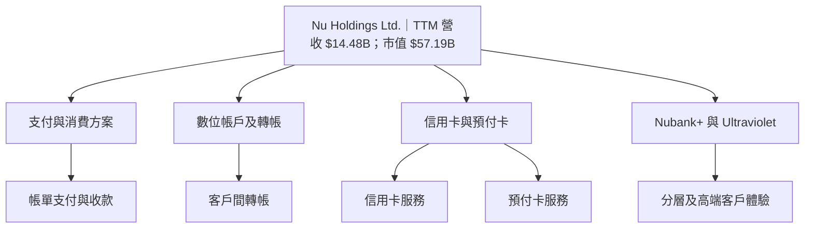
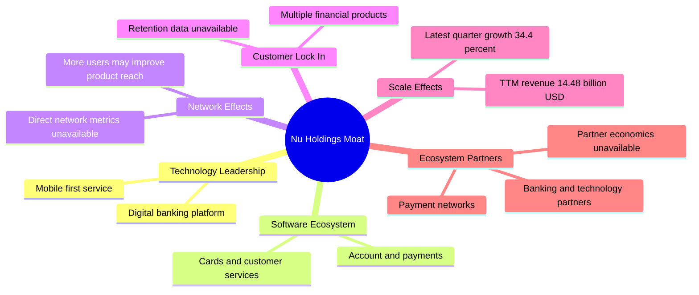
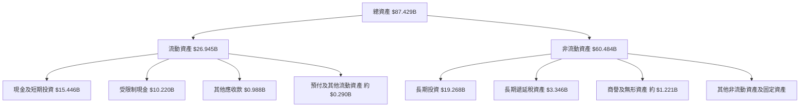
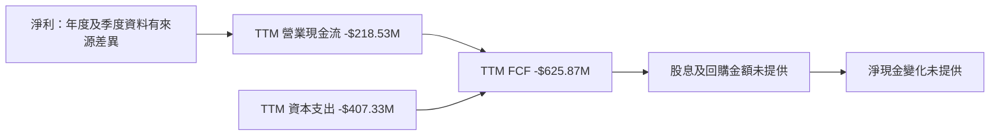
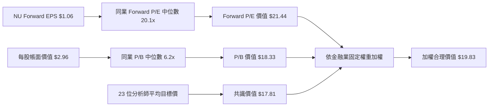
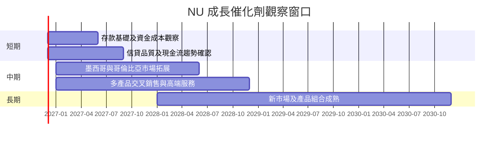
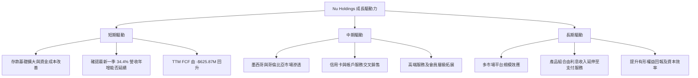
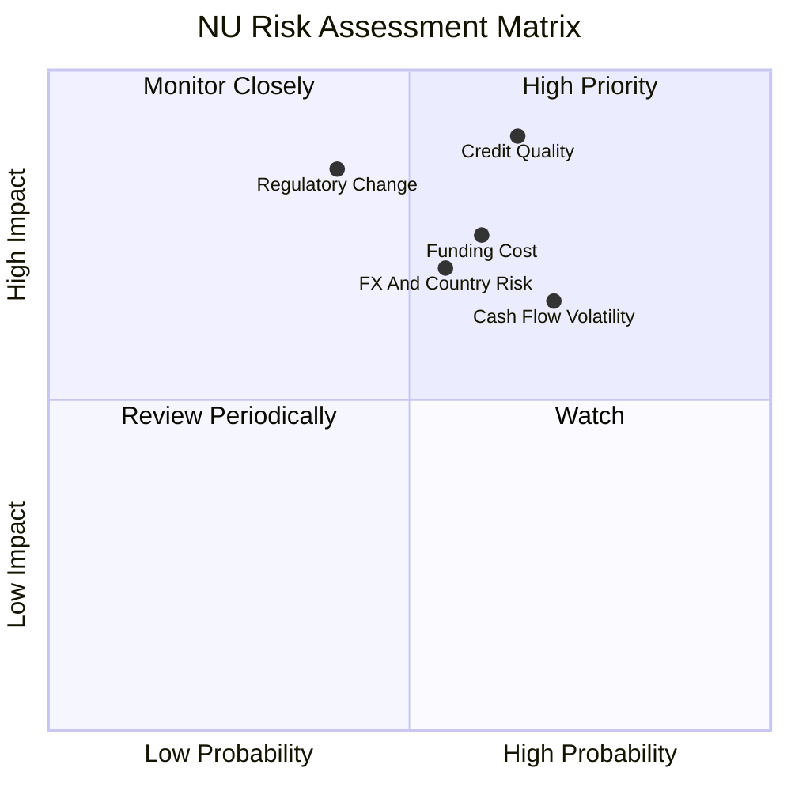
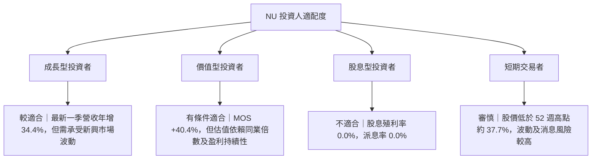

# NU 基本面深度分析報告
> **報告日期**：2026-11-20 ｜ **語言**：繁體中文 ｜ **數據來源**：Yahoo Finance、Finviz、StockAnalysis、Roic.ai ｜ **分析師**：CFA 級機構研究

> **資料口徑提示**：不同資料來源對 NU 的收入、季度收入與部分利潤率數據存在重大差異。例如 Yahoo Finance 顯示 FY2025 營收 $10.63B、TTM 營收 $14.48B；StockAnalysis.com 顯示 FY2025 營收 $6.991B、TTM 營收 $9.103B。以下對受規則約束的數字優先採用已核實數據；遇到來源衝突時明確標示，不將不同口徑混合推導。財報來源註明為 Yahoo Finance 季度財務報表，非 SEC 申報資料。

## 目錄

| # | 章節 | 核心結論 |
|---|------|----------|
| 1 | 執行摘要 | 買入；加權合理價值 $19.83；MOS +40.4% |
| 2 | 公司概覽與商業模式 | 多產品數位金融平台；市場份額及分部收入數據未提供 |
| 3 | 損益表深度分析 | 最新一季營收年增 34.4%；TTM 營收成長率不可得 |
| 4 | 資產負債表分析 | 現金及短期投資 $15.45B、淨現金 $9.32B |
| 5 | 現金流量深度分析 | TTM FCF -$625.87M，與歷年正 FCF 形成明顯反差 |
| 6 | 獲利能力與資本效率 | ROTCE 29.8%；一般工業公司 ROIC 不適用／不可得 |
| 7 | 相對估值分析 | NU Forward P/E 低於所列同業中位數；估值方法指向 $17.81–$21.44 |
| 8 | DCF 內在價值評估 | DCF 不適用於貸款機構；依金融業估值方法計算 MOS |
| 9 | 成長催化劑 | 墨西哥等市場拓展、產品交叉銷售及存款成本改善 |
| 10 | 風險矩陣 | 信貸品質、監管／匯率及現金流波動為主要風險 |
| 11 | 投資建議 | 買入；以 $19.83 加權合理價值作估值基準 |

---

## 1. 執行摘要

截至 2026-11-19 收盤，NU 股價為 **$11.82**。依同業 Forward P/E、同業 P/B 與分析師共識目標價加權，合理價值為 **$19.83**，MOS 為 **+40.4%**，依評級門檻為**買入**。支持估值的營運證據包括最新一季營收年增 **34.4%**、單季營業利益率 **50.9%**、TTM 有形權益報酬率（ROTCE）**29.8%**；但 TTM FCF 為 **-$625.87M**，且收入資料源互有差異，因此不採用傳統企業 FCFF DCF，並對資產品質和現金流持續性保留審慎。

### 1.0 一頁式投資儀表板（Portfolio Manager 30 秒速讀）

| 項目 | 內容 |
|------|------|
| **投資論點（3 句）** | ① 最新一季營收年增 **34.4%**，顯示仍有高成長動能。② 最新一季營業利益率 **50.9%**、TTM ROTCE **29.8%**，表明目前獲利能力可觀。③ 加權合理價值 **$19.83** 高於 2026-11-19 收盤價 **$11.82**；但 TTM FCF **-$625.87M** 是重要反證。 |
| **綜合評分** | **7.7/10**（引用 1.1 評分卡） |
| **財務健康** | 🟢 現金及短期投資 **$15.45B**、淨現金 **$9.32B**；惟貸款機構的流動性不能單靠一般企業流動比率評估。 |
| **ROIC vs WACC** | 一般公司 ROIC：**N/A**；WACC：**14.00%**。銀行 ROTCE 為 **29.8%**，與 WACC 定義並非完全可比，不直接宣稱 ROIC 高於 WACC。 |
| **FCF 趨勢** | 年度 FCF 從 FY2023 **$1.09B**、FY2024 **$2.22B**、FY2025 **$3.16B** 增長；但 TTM FCF **-$625.87M**，TTM FCF Yield **-1.09%**。 |
| **估值** | Forward P/E **11.10x** ｜ EV/EBITDA **N/A** ｜ FCF Yield **-1.09%** |
| **DCF 內在價值（基準）** | **N/A**；貸款機構的資金流動不適合以一般 FCFF DCF 衡量，因此沒有 DCF 折溢價。 |
| **安全邊際（MOS）** | **+40.4%＝($19.83 − $11.82) ÷ $19.83**；基準為 8.8 加權合理價值。🟢 >25% |
| **預期報酬（基準情境 12M）** | **+67.8%**，指股價收斂至 8.8 加權合理價值的隱含上行空間，不是 DCF 情境預測。 |
| **關鍵風險（前二）** | ① 信貸品質惡化而淨沖銷率、逾放比未提供。② TTM FCF 轉負，現金轉換波動需查明。 |
| **評級 + 信心度** | 🟢 **買入** ｜ 信心：**中**；估值空間明顯，但現金流與信貸指標缺口限制信心。 |

### 1.1 綜合評分卡（全報告唯一）

| 維度 | 評分（1–10） | 主要依據（引用數字與其來源章節） |
|------|--------------|----------------------------------|
| 成長性 | 8.0 | 最新一季營收年增 **34.4%**；TTM 營收成長率 N/A，且來源間營收口徑不一致（第 3 章）。 |
| 獲利能力 | 8.0 | 最新一季營業利益率 **50.9%**；TTM ROTCE **29.8%**，但 TTM FCF 為負（第 3、5、6 章）。 |
| 財務健康 | 7.0 | 現金及短期投資 **$15.45B**、淨現金 **$9.32B**；信貸品質及 CET1 數據未提供（第 4、6 章）。 |
| 估值 | 8.0 | MOS **+40.4%**；NU Forward P/E **11.10x**，低於所列同業 Forward P/E 中位數 **20.1x**（第 7、8.8 節）。 |
| 護城河 | 8.0 | 產品涵蓋信用卡、預付卡、存款與付款服務；最新一季營收年增 **34.4%**，但客戶留存、活躍用戶等數據未提供（第 2 章）。 |
| 管理層與資本配置 | 7.0 | FY2025 SBC **$271.85M**，約為 Yahoo 年度營收 **$10.63B** 的 **2.6%**；股息殖利率與派息率均為 **0.0%**（第 3、5 章）。 |
| **綜合評分** | **7.7** | 六項算術平均：\((8+8+7+8+8+7) ÷ 6 = 7.7\)，四捨五入至小數一位。 |

### 1.2 五大投資論點 + 三大核心風險

| 類型 | 項目 | 具體依據 | 信心度 |
|------|------|----------|--------|
| 🟢 **投資論點①** | 收入仍在擴張 | 最新一季營收年增 **34.4%**；TTM 營收成長率未提供，故不能將單季成長外推為全年成長。 | 🟢 高 |
| 🟢 **投資論點②** | 獲利能力具吸引力 | 最新一季營業利益率 **50.9%**；TTM ROTCE **29.8%**。 | 🟢 高 |
| 🟢 **投資論點③** | 淨現金提供財務緩衝 | 現金及短期投資 **$15.45B**，總債務 **$6.12B**，核實淨現金 **$9.32B**。 | 🟢 高 |
| 🟢 **投資論點④** | 相對估值較低 | NU Forward P/E **11.10x**，低於 SOFI、MELI、HOOD 的 Forward P/E 中位數 **20.1x**。 | 🟡 中 |
| 🟢 **投資論點⑤** | 產品與地區拓展有選擇權 | 業務涵蓋巴西、墨西哥、哥倫比亞等市場，產品包括信用卡、預付卡、帳戶及付款服務；各市場收入拆分未提供。 | 🟡 中 |
| 🟡 **風險①** | TTM 現金流轉負 | TTM OCF **-$218.53M**、Capex **$407.33M**、FCF **-$625.87M**；需辨別貸款成長、存款與其他資金流動造成的波動。 | 🔴 高衝擊 |
| 🔴 **風險②** | 信貸品質資料不足 | 淨沖銷率、逾放比、CET1 均未提供；難以獨立判斷貸款損失緩衝及資本充足性。 | 🔴 高衝擊 |
| 🟡 **風險③** | 財務資料口徑不一致 | FY2025 營收在 Yahoo Finance 為 **$10.63B**、StockAnalysis.com 為 **$6.991B**；TTM 亦分別為 **$14.48B**、**$9.103B**。 | 🟡 中 |

### 1.3 快速統計卡片

| 指標 | 公司實際值（期間） | 同業中位數 | 狀態 |
|------|--------------------|------------|------|
| 營收成長（TTM） | **N/A** | — | 🟡 尚無可引用的 TTM 同比數據 |
| 營收成長（最新一季年增） | **34.4%** | **43.9%** | 🟡 低於所列三家同業中位數 |
| 毛利率（TTM） | Yahoo Finance 顯示 **0.0%**，對貸款機構不是可比的經濟毛利率 | **84.2%** | 🟡 不作同口徑比較 |
| 營業利益率（TTM） | **N/A** | — | 🟡 無可引用 TTM 值 |
| ROIC（TTM） | **N/A**（貸款機構不採一般工業公司 ROIC 框架） | — | — |
| Forward P/E | **11.10x** | **20.1x** | 🟢 低於同業中位數 |
| FCF Yield（TTM） | **-1.09%** | — | 🔴 負值 |
| Piotroski F-Score | **N/A**（不適用貸款機構） | — | — |

### 1.4 投資結論

╔══════════════════════════════════════════════════════════════════╗  
║                    📊 投資結論摘要                               ║  
╠══════════════════════════════════════════════════════════════════╣  
║  評級：🟢 買入（MOS +40.4%，符合 10%–25% 以上買入門檻）          ║  
║  價格（2026-11-19 收盤）：$11.82                                 ║  
║  DCF 內在價值（基準）：N/A（貸款機構不適用一般 FCFF DCF）        ║  
║  安全邊際 MOS：+40.4%＝($19.83−$11.82)÷$19.83                   ║  
║  加權合理價值（8.8）：$19.83                                     ║  
║  綜合評分：7.7/10（引用 1.1）                                    ║  
║  適合投資人：能承受金融科技及新興市場波動的成長型、長線投資人    ║  
╚══════════════════════════════════════════════════════════════════╝

---

## 2. 公司概覽與商業模式

### 2.1 業務結構與收入來源

Nu Holdings Ltd. 經營數位金融平台，服務地區包括巴西、墨西哥、哥倫比亞、開曼群島及美國。資料列出的產品包括信用卡及預付卡、數位帳戶、付款服務，以及 Nubank+、Ultraviolet 等分層服務。公司未提供可核對的分部收入金額與收入佔比，因此下圖只呈現業務類別，不將未披露的分部佔比臆測為收入數字。

**收入拆分說明**：最新一季營收為 **$4.03B**，但年度及 TTM 收入在來源間有差異；各產品線金額、金融利息收入與手續費收入佔比未提供，故不能繪製有比例的收入圓餅圖。

### 2.2 市場份額

市場份額數據未提供，現有資料亦無可引用的市場總額或市佔率。可觀察的相對規模指標是 TTM 營收 **$14.48B**（Yahoo Finance 核實值）與最新一季營收年增 **34.4%**；但與同業的收入規模比較會受財務口徑、業務範圍和資料源差異影響，不宜據此推算市佔率。

### 2.3 競爭護城河分析

### 2.4 護城河強度

| 護城河項目 | 強度（強／中／弱） | 證據（引用數字或事實） | 會削弱它的情況 |
|------------|--------------------|------------------------|----------------|
| 技術與數位服務 | 中 | 多地區提供數位帳戶、信用卡、預付卡及付款服務；最新一季營收年增 **34.4%**。 | 服務中斷、資料安全事件、競爭者以低成本複製功能。 |
| 軟體生態系統 | 中 | 帳戶、付款、卡片及分層服務組合可能增加交叉銷售；產品別營收及交叉銷售率未提供。 | 低活躍率、低產品滲透、獲客成本上升。 |
| 網路效應 | 弱至中 | 用戶與交易擴張有機會提升平台效用，但用戶數、交易密度及商戶網絡數據未提供。 | 用戶增長未轉化為活躍交易或低成本資金。 |
| 客戶鎖定 | 中 | 多類金融服務有助提升使用場景；客戶留存率與每戶產品數未提供。 | 客戶可低成本轉換平台，或其他銀行提高存款與信用卡優惠。 |
| 規模效應 | 中 | TTM 營收核實值 **$14.48B**，具一定經營規模；但分部單位經濟與獲客成本數據未提供。 | 信貸損失、監管支出與獲客成本增幅高於收入增長。 |
| 生態夥伴 | 弱至中 | 支付與金融服務通常依賴支付網絡、銀行及技術合作；合作夥伴收入與成本分攤未披露。 | 合作條件改變、支付網絡費率上升或夥伴關係中止。 |

**1.1 護城河分數為 8.0/10**，理由是多產品數位金融平台與最新一季 **34.4%** 的營收年增具支持，但缺少用戶留存、客戶獲取成本、產品滲透率等直接護城河指標。

---

## 3. 損益表深度分析

### 3.1 年度收入成長趨勢（近 4 年）

以下年度數字取自 Yahoo Finance 年度損益表；它與 StockAnalysis.com 年度收入系列不一致，應視為單一來源口徑，不宜與另一來源拼接。YoY 及 CAGR 由同一年度序列計算，金額以十億美元計。

╔══════════════════════════════════════════════════════════════════╗  
║            Nu Holdings 年度收入趨勢（FY2022–FY2025）              ║  
╠══════════════════════════════════════════════════════════════════╣  
║  FY2022  $2.97B   ██████░░░░░░░░░░░░░░░░░░░  YoY：基期          ║  
║  FY2023  $5.63B   █████████████░░░░░░░░░░░░  YoY：+89.6% 🟢     ║  
║  FY2024  $8.27B   ██████████████████░░░░░░░  YoY：+46.9% 🟢     ║  
║  FY2025 $10.63B   ███████████████████████░░  YoY：+28.5% 🟢     ║  
║                                                                  ║  
║  FY2022–FY2025 三年 CAGR：+53.0%                                 ║  
╚══════════════════════════════════════════════════════════════════╝

計算方式：FY2023 YoY＝\((5.63÷2.97)-1=89.6\%\)；FY2024 YoY＝\((8.27÷5.63)-1=46.9\%\)；FY2025 YoY＝\((10.63÷8.27)-1=28.5\%\)。三年 CAGR＝\((10.63÷2.97)^{1/3}-1=53.0\%\)。增長率逐年放緩，但收入仍擴大；若放緩來自規模擴張後的基數效應，仍可支撐獲利增長，若同時伴隨貸款需求減弱或競爭加劇，則會壓低收入及估值。

### 3.2 季度收入趨勢分析

| 季度 | 營收 | QoQ 成長 | YoY 成長 | 備註 |
|------|------:|---------:|---------:|------|
| 2025 Q4 | $3.14B | — | N/A | 以 Yahoo Finance 季度損益表序列為準。 |
| 2026 Q1 | $3.54B | +12.7% | N/A | QoQ＝\((3.54÷3.14)-1\)。 |
| 2026 Q2 | $3.77B | +6.5% | N/A | QoQ＝\((3.77÷3.54)-1\)。 |
| 2026 Q3 | $4.03B | +6.9% | **+34.4%** | 最新一季年增率採核實值；不得稱為 TTM 成長率。 |

QoQ 成長顯示營收持續增加，但單季 QoQ 會受季節性、交易量及貸款發放時點影響。另 StockAnalysis.com 列示的相同季度營收分別為 $2.067B、$1.981B、$2.474B、$2.580B，與 Yahoo Finance 季度值不一致；故此表只在單一季度序列內計算 QoQ，且對跨來源的季度金額不作合併。

### 3.3 利潤率演變分析

| 利潤率指標 | FY2022 | FY2023 | FY2024 | FY2025／最新 | 趨勢 | 評估 |
|------------|--------|--------|--------|--------------|------|------|
| **毛利率** | N/A | N/A | N/A | Yahoo Finance 顯示 TTM **0.0%** | 不適用於金融機構的一般商品毛利解讀 | 🟡 不以此指標評估 |
| **營業利益率** | N/A | N/A | N/A | TTM **N/A**；最新一季 **50.9%** | 只有最新一季可引用 | 🟢 單季表現高，但不能代替 TTM 趨勢 |
| **淨利率** | N/A | N/A | N/A | Yahoo 報表摘要 TTM **43.0%** | 來源間利潤／收入口徑存在差異 | 🟡 需與財報核對 |

**利潤率演變深度解析**：貸款機構的利息收入、資金成本、信貸損失及準備金共同決定獲利，傳統毛利率並非核心比較指標。最新一季營業利益率 **50.9%** 是單季數值；TTM 營業利益率未提供。收入來源不一致，且缺少可用的年度利息費用、信用損失準備與分部數據，因此不能將利潤率改善歸因於特定產品組合或成本控制，也不應把單季比率直接外推全年。

### 3.4 費用結構分析

金融機構的主要成本通常包括存款與融資成本、信用損失、員工與科技支出、行銷、支付處理及監管成本；但本資料未提供足以拆分的費用金額，亦未提供可一致比較的完整費用明細。因此不繪製費用比例圓餅圖，以免將未披露數字製成圖表。

可引用的單一費用項目是 FY2025 股權薪酬（SBC）**$271.85M**；它不是完整營業費用，不能代表總費用結構。

### 3.5 季度 EPS 趨勢與盈餘品質（Quality of Earnings）

季度實際 EPS 來源列示 2025 Q4 **$0.18**、2026 Q1 **$0.18**、2026 Q2 **$0.22**、2026 Q3 **$0.23**。該序列與另一季度財報摘要存在口徑差異。EPS 估計值資料皆為 NaN，因此無法可靠判斷過去四季是否超預期或不及預期；不把缺失的預期 EPS 當作零或自行補值。

| 盈餘品質項目 | 數值／佔比 | 評估 |
|--------------|-----------|------|
| 股權薪酬 SBC／營收 | FY2025：$271.85M ÷ $10.63B = **2.6%**；FY2025 SBC 取年度報表，營收取 Yahoo Finance 年度序列。以 TTM SBC 約 $394.13M ÷ TTM 核實營收 $14.48B = **約 2.7%**，但兩者口徑需留意。 | 🟡 SBC 會稀釋股東權益；比率並非極低，應追蹤 SBC 對稀釋股數的影響。 |
| SBC／營業現金流 | TTM OCF 為 **-$218.53M**，因此 SBC／OCF 約 **-180.4%**；負分母使此比率不適合作為正向覆蓋率。 | 🔴 TTM 現金流為負，無法以 OCF 支付 SBC 來評估其含金量。 |
| FCF／淨利（現金轉換率） | TTM FCF **-$625.87M** ÷ StockAnalysis.com TTM 淨利 **$3.915B** = **約 -16.0%** | 🔴 負值顯示本期淨利沒有轉化為正 FCF；貸款機構現金流包含貸款與存款變動，需配合銀行監管口徑解讀。 |
| 一次性／非經常性損益 | N/A；未提供完整調節表 | 🟡 無法確認單次交易或稅務項目是否影響當期淨利。 |
| 有效稅率異常 | 最新年度有效稅率 **25.8%**（用於資本成本輸入）；詳細季度稅率序列未提供 | 🟡 目前不能判斷是否有一次性稅務利益。 |
| 資本化支出 vs 費用化 | TTM Capex **$407.33M**；資本化開發成本與研發費用化明細未提供 | 🟡 無法量化是否有成本由費用化改為資本化。 |

**盈餘品質結論**：年度 FCF 連續增長與 TTM FCF 轉負並存，加上收入及淨利在不同資料來源間不一致，暫時不能將 GAAP 淨利視為完全可轉換為股東現金回報的盈餘。估值上採用金融機構同業倍數與有形帳面價值方法，而非以負的 TTM FCF 直接推導企業價值。

---

## 4. 資產負債表分析

### 4.1 資產結構分解

以下資產結構以 StockAnalysis.com 截至 2026-09-30 的資產負債表資料為準，單位為美元；不同來源的總資產數字可能不一致。

**解讀**：現金及短期投資 **$15.446B** 不等於全部現金資產，資產負債表另列受限制現金 **$10.220B**。受限制現金的用途及可動用條件未提供，因此不把它當作一般可自由分配現金。非流動資產以長期投資為重要項目，對金融機構而言其流動性與風險性質需進一步查閱財報附註。

### 4.2 流動性與營運資金分析

| 指標 | 最新值 | 評估 |
|------|--------|------|
| 現金及短期投資 | **$15.45B** | 能提供資金緩衝；但需與存款、客戶資金及監管限制一併看待。 |
| 總債務 | **$6.12B** | 使用核實數值；負債的期限與利率拆分未提供。 |
| 淨現金 | **$9.32B** | 🟢 淨現金狀態；核實值與現金及債務各自四捨五入後相減有微小差異。 |
| 流動比率、速動比率 | N/A | 對貸款機構一般企業流動比率參考有限，且缺少一致分類數據。 |
| DSO／DIO／DPO／CCC | 不適用（金融業） | 以貸款、存款及金融資產負債管理為主，不使用一般存貨與營運資金週期指標。 |

### 4.3 債務結構分析

╔══════════════════════════════════════════════════════════════════╗  
║                   Nu Holdings 債務健康診斷                       ║  
╠══════════════════════════════════════════════════════════════════╣  
║  總債務：       $6.12B    ████████░░░░░░░░░░░░                  ║  
║  現金及短期投資：$15.45B   ████████████████████                 ║  
║  核實淨現金：   $9.32B    ████████████░░░░░░░░  🟢              ║  
║                                                                  ║  
║  Debt/Equity：N/A；金融機構槓桿需配合監管資本指標判讀。          ║  
║  Debt/EBITDA：N/A；TTM EBITDA 不可用。                            ║  
║  Interest Coverage：N/A；未提供可用的利息保障倍數。               ║  
║  CET1：N/A；監管資本充足率未提供。                                ║  
╚══════════════════════════════════════════════════════════════════╝

淨現金是正向訊號，但不等同於所有資產均可自由用於還債或股東分配；銀行及金融科技公司的資金管理須考慮客戶存款、受限制資金及監管要求。現有資料不足以計算債務期限錯配或利息保障倍數。

### 4.4 股東權益趨勢

╔══════════════════════════════════════════════════════════════════╗  
║                 Nu Holdings 歷年股東權益                         ║  
╠══════════════════════════════════════════════════════════════════╣  
║  FY2022  $4.89B   █████████░░░░░░░░░░░░░░░░░░                  ║  
║  FY2023  $6.41B   ████████████░░░░░░░░░░░░░░                  ║  
║  FY2024  $7.65B   ███████████████░░░░░░░░░░░                  ║  
║  FY2025 $11.29B   ██████████████████████░░░░                  ║  
╚══════════════════════════════════════════════════════════════════╝

FY2022–FY2025 股東權益增加 **$6.40B**，由 **$4.89B** 升至 **$11.29B**。同期間淨利由 FY2022 虧損 **$364.58M** 轉為 FY2025 **$2.87B**；權益提升與獲利累積相符，但股數變化及其他權益調整未在此年度摘要內完整拆分，不能把全部增幅歸因於留存盈餘。

---

## 5. 現金流量深度分析

### 5.1 現金流量瀑布圖

圖中只呈現可核實現金流項目；股息、回購與淨現金變化的金額未提供，故不填入金額。

貸款機構的營業現金流可能受到貸款發放、客戶存款與金融資產變動影響，因此不能像非金融企業一樣直接把營業現金流變動全部視為營運獲利品質變化。不過 TTM OCF 與 FCF 均為負，仍需後續季度確認是否為暫時性資金部署，或持續性資金需求。

### 5.2 FCF 轉換率趨勢

| 期間 | FCF | 淨利 | FCF／淨利 | 解讀 |
|------|-----:|-----:|---------:|------|
| FY2022 | $641.27M | -$364.58M | 不具解讀意義 | 淨利為負，比例不適合解讀。 |
| FY2023 | $1.09B | $1.03B | 約 **105.8%** | 以同年度摘要數字計算，FCF 略高於淨利。 |
| FY2024 | $2.22B | $1.97B | 約 **112.7%** | 歷史現金轉換高於 100%。 |
| FY2025 | $3.16B | $2.87B | 約 **110.1%** | 年度現金轉換仍高，但與 TTM FCF 轉負的趨勢相反。 |
| TTM 至 2026-09-30 | **-$625.87M** | StockAnalysis TTM **$3.915B** | 約 **-16.0%** | 來源口徑有差異，且金融業現金流須配合貸款與存款變化判讀。 |

### 5.3 自由現金流趨勢

╔══════════════════════════════════════════════════════════════════╗  
║                 自由現金流：年度實際 vs TTM                      ║  
╠══════════════════════════════════════════════════════════════════╣  
║  FY2023  $1.09B    ███████░░░░░░░░░░░░░  FCF／淨利：約105.8%     ║  
║  FY2024  $2.22B    ██████████████░░░░░░  FCF／淨利：約112.7%     ║  
║  FY2025  $3.16B    ████████████████████  FCF／淨利：約110.1%     ║  
║  TTM     -$0.626B  ◀ 負值                 FCF Yield：-1.09%       ║  
╠══════════════════════════════════════════════════════════════════╣  
║  注意：TTM 資料與年度趨勢方向不同，應追蹤後續季度是否回正。      ║  
╚══════════════════════════════════════════════════════════════════╝

年度數列顯示 FY2023 至 FY2025 FCF 增加，但最新 TTM FCF 轉負。季度現金流在 2026 Q1 OCF **-$1.21B**，Q2 **-$28.11M**，Q3 **$192.49M**，呈現明顯波動；這使 TTM 負值可能受到特定季度資金流影響，但目前無法僅憑摘要判定其可逆性。

### 5.4 資本配置評估

資本配置比例圓餅圖所需的投資、回購、股息與留存現金支出拆分未提供，因此不繪製比例圖。

| 項目 | 可引用數據 | 評估 |
|------|------------|------|
| 資本支出 | TTM **$407.33M**；FY2025 報表 Capex 約 **$340.77M** | 需進一步區分基礎設施投資與維護性支出。 |
| SBC | FY2025 **$271.85M** | 股權薪酬會造成股東稀釋，須追蹤股份數變化。 |
| 股息 | 殖利率 **0.0%**、派息率 **0.0%** | 目前無股息現金回報。 |
| 股票回購 | 金額未提供 | 不推定公司有回購或以回購抵銷 SBC。 |
| 投資與留存 | 分配金額未提供 | 需要年報附註及資本配置披露才能評估。 |

---

## 6. 獲利能力與資本效率

### 6.1 ROE／ROA／ROIC 趨勢

| 指標 | 可引用數值 | 評估 |
|------|------------|------|
| ROE（TTM） | **31.5%** | 回報率高，但需配合資產負債表及監管資本解讀。 |
| ROA（TTM） | **5.0%** | 顯示資產獲利能力；與銀行業自身同口徑比較資料未提供。 |
| ROTCE（TTM） | **29.8%** | 金融機構更適用的有形權益報酬指標，數值具吸引力。 |
| ROIC（TTM） | **N/A** | 一般公司 ROIC 不適合直接套用於貸款機構，且計算所需項目未完整提供。 |

### 6.2 ROIC vs WACC 分析（核心價值創造判斷）

貸款機構的存款與借款是業務營運所需資金，不宜直接套用一般公司的投入資本與企業自由現金流框架；NU 的一般公司 ROIC 因而不提供。資本成本資料提供 WACC **14.00%**，但它與銀行 ROTCE 的分子、分母及資本結構定義不同，不能將 **29.8% ROTCE − 14.0% WACC** 稱為嚴格的經濟利差或 EVA。它只能提供方向性參考，不能替代監管資本回報分析。

╔══════════════════════════════════════════════════════════════════╗  
║                ROIC vs WACC 深度分析                             ║  
╠══════════════════════════════════════════════════════════════════╣  
║  WACC 輸入（資本成本資料）：                                      ║  
║  ├── 無風險利率（10Y 美債）：             5.05%                   ║  
║  ├── 市場風險溢酬 ERP：                   5.00%                   ║  
║  ├── 原始 Beta：                          0.97                    ║  
║  ├── 調整後 Beta：                        0.98                    ║  
║  ├── 股權成本 Ke：                        9.95%                   ║  
║  ├── 稅前債務成本：                       74.76%                  ║  
║  ├── 股權／債務權重：                     90.3%／9.7%             ║  
║  └── WACC：                               14.00%（採用值）        ║  
║                                                                  ║  
║  NU 一般公司 ROIC：N/A（金融機構不適用／資料不足）                ║  
║  金融業參考指標：TTM ROTCE 29.8%（與 WACC 不完全可比）            ║  
║  價值創造判斷：不能用 ROTCE 直接替代 ROIC；結論為未能嚴格判定。   ║  
╚══════════════════════════════════════════════════════════════════╝

### 6.3 杜邦三因素分解

N/A（品質指標計算結果：缺少可一致使用的淨利、營收、總資產或正權益口徑；不以不一致來源自行重建杜邦分解。）

### 6.4 財務體質：金融業 Lender Metrics

Piotroski F-Score 不適用貸款機構：貸款成長會造成營業現金流出，使一般現金流測試誤判；故不列九項分數或自行給分。

| 貸款機構指標 | 數值（TTM 至 2026-09-30） | 解讀 |
|--------------|---------------------------|------|
| 淨利息收入 NII／總營收 | **84.7%** | 顯示營收高度依賴利息收入；利率與資金成本是核心驅動。 |
| 淨利差代理值 NII／平均總資產 | **15.74%** | 這是以總資產為分母的代理值；因缺少生息資產，通常會高於銀行正式公布的 NIM。 |
| 成本收入比代理值 | **68.1%** | 採 \((營收−稅前淨利)÷營收\)，包含信用損失準備，通常高於公司公布的純營運效率比率。 |
| ROTCE | **29.8%** | 淨利除以有形帳面價值，衡量有形權益回報；不等同於 ROIC。 |
| P/TBV | **4.36x** | 市場對有形帳面價值給予高倍數，亦代表估值對回報持續性敏感。 |
| 放款淨額／總資產 | **14.0%** | 顯示此指標衡量的貸款淨額只佔總資產一部分；須注意其他金融資產分類。 |
| 淨沖銷率、逾放比、CET1 | **N/A（數據未提供）** | 無法完整評估信用損失與監管資本緩衝。 |

---

## 7. 相對估值分析

### 7.1 同業估值比較表格

SOFI、MELI 與 HOOD 是數位金融、金融科技或零售金融平台的參考同業，業務構成並非完全相同。比較倍數一律採用同業倍數資料。

| 估值指標 | **NU** | **SOFI** | **MELI** | **HOOD** | NU 評估 |
|----------|------:|--------:|--------:|--------:|----------|
| **Trailing P/E** | **14.775x** | 24.6x | 36.4x | 31.6x | 🟢 低於三家同業中位數 **31.6x**；需考慮業務與會計口徑差異。 |
| **Forward P/E** | **11.098591x** | 15.0x | 25.6x | 20.1x | 🟢 低於同業中位數 **20.1x**。 |
| **P/S Ratio** | **6.282826x** | 3.7x | 1.8x | 12.2x | 🟡 高於同業中位數 **3.7x**；可能反映收入定義及盈利能力差異。 |
| **EV/EBITDA** | **N/A** | N/A | 19.7x | N/A | 不具備足夠同業樣本，且 EBITDA 對金融業適用性有限。 |
| **最新一季營收年增** | **34.4%** | 43.9% | 45.1% | 11.8% | 🟡 低於同業中位數 **43.9%**，但高於 HOOD。 |
| **毛利率（TTM）** | Yahoo Finance 顯示 **0.0%**，金融業口徑不宜直接比較 | 84.2% | 46.7% | 91.0% | — 不作同口徑公司排序。 |

同業估值有助界定市場對金融科技平台的定價，但不能只以倍數高低判斷便宜或昂貴。NU 的 Forward P/E 明顯低於所列同業，另一方面其 P/S 高於 SOFI、MELI，顯示市場對收入品質、利潤轉換及業務構成的差異可能已反映於估值。

### 7.2 歷史估值區間分析

N/A（歷史估值區間及估值百分位數據未提供，不能自行估計 P/E 歷史區間或目前在區間中的位置。）

可引用的價格歷史顯示：2026-11-19 收盤 **$11.82**，低於 52 週高點 **$18.98** 約 **37.7%**，高於 52 週低點 **$11.20** 約 **5.5%**。價格相對高點的跌幅是價格走勢，不等同於歷史估值折價。

### 7.3 情境價值（Bear／Base／Bull）

N/A（DCF 無法計算：貸款機構的資金流量包含存款、貸款及金融資產配置，不能以一般企業 FCFF DCF 建模。依規則不另建 DCF，也不自行設定三情境 DCF 目標價。）

### 7.4 相對估值隱含價格區間

╔══════════════════════════════════════════════════════════════════╗  
║               相對估值方法回推價格與現價位置                     ║  
╠══════════════════════════════════════════════════════════════════╣  
║  $11.82 現價 ───────────── $17.81 ── $18.33 ── $21.44            ║  
║                          共識價     同業 P/B   同業 Forward P/E   ║  
╚══════════════════════════════════════════════════════════════════╝

| 方法 | 每股價值 | 相對現價上行空間 | 依據 |
|------|---------:|----------------:|------|
| 同業 Forward P/E | **$21.44** | **+81.4%** | SOFI、MELI、HOOD Forward P/E 中位數 **20.1x** × NU Forward EPS **$1.06**。 |
| 同業 P/B | **$18.33** | **+55.1%** | 三家同業 P/B 中位數 **6.2x** × NU 每股帳面價值 **$2.96**。 |
| 分析師共識目標價 | **$17.81** | **+50.7%** | 23 位分析師平均目標價。 |

以上為核實估值方法輸入，不把該區間當作保證報酬。P/B 及 P/E 都會受盈利週期、金融監管、信貸品質與股東權益品質影響。

---

## 8. DCF 內在價值評估（Discounted Cash Flow）

> **估值方法說明**：DCF 模型為 N/A。NU 是金融機構，其貸款及存款資金流屬核心業務現金流，不是一般非金融企業可直接用 OCF 減 Capex 得出的企業自由現金流。因此本章不自建 DCF、不給 DCF 每股內在價值，也不編造 WACC × 永續成長率矩陣或 DCF 三情境。估值改採核實的同業 Forward P/E、同業 P/B 與分析師共識。

### 8.0 估值推理鏈（Thinking Logic）

**Step 1 — 企業價值由哪些變數決定？**  
對金融機構，NU 的股權價值主要受利息收入與資金成本、信貸損失及資本回報、客戶與產品擴張影響。可引用的量化錨點是 NII 佔 TTM 營收 **84.7%**、最新一季營收年增 **34.4%**、ROTCE **29.8%**。各產品線營收佔比未提供，因此不能將營收拆成主業與新業務百分比。最重要的未解變數是**信貸品質及盈利能否轉成可持續股東回報**，因淨沖銷率、逾放比和 CET1 未提供，且 TTM FCF 為負。

**Step 2 — 採用哪一種估值方法？**

| 決策點 | 本報告採用 | 理由（含數字） | 曾考慮但否決 | 否決理由 |
|--------|-----------|----------------|--------------|----------|
| 現金流定義 | 不採一般 FCFF／FCFE DCF | TTM OCF **-$218.53M**、TTM FCF **-$625.87M**，貸款及存款資金流屬營運本身 | 一般企業 FCFF | 金融業資金結構與非金融企業不同，DCF 模型標示 N/A |
| 主要相對估值 | 同業 Forward P/E、同業 P/B、分析師共識 | 三方法價值分別 **$21.44、$18.33、$17.81** | EV/EBITDA | 金融業及同業 EBITDA 資料不足 |
| 終值／預測期 | 不適用 | DCF 模型 N/A | Gordon Growth、退出倍數 | 禁止自行建立 DCF |
| 盈利基礎 | 金融業相對倍數 | 同業 Forward P/E 中位數 **20.1x**，同業 P/B 中位數 **6.2x** | GAAP FCFF | 以金融業已核實方法估值，不將銀行資金流誤當企業 FCF |

**Step 3 — 核心假設推導鏈**  
本報告不對營收 CAGR、期末營業利潤率、永續成長率、Capex 比率、ΔWC、股數稀釋率或 DCF 預測期作假設，因為核實 DCF 模型為 N/A。採用的估值方法及權重則直接依金融公司類別固定輸入：同業 Forward P/E **50%**、同業 P/B **40%**、分析師共識 **10%**。

**Step 4 — 最脆弱的一環**  
相對估值依賴同業倍數可比性及 NU 盈利可持續性；若信貸損失上升，或 TTM 負 FCF 反映的資金需求持續，則目前相對倍數推導的每股價值可能偏高。

**Step 5 — 計算路徑圖**

### 8.1 模型假設總表（Model Inputs）

N/A（DCF MODEL 標示 N/A：貸款機構的資金流不適合一般企業 FCFF DCF。依規則不自行設定預測期、營收 CAGR、利潤率、終值或稀釋股數假設。）

### 8.2 折現率推導（WACC）

WACC 輸入僅用於資本效率參考；由於 DCF 不適用，該 WACC **不會被拿來折現本報告的 DCF 現金流**。資本成本資料提供的 WACC 為 **14.00%**，計算值 **14.35%** 被限制於 **7%–14%** 區間後採用 **14.00%**。10Y 無風險利率為 **5.05%**；資料未指定日內觀測時點，按資本成本資料日期口徑使用。Beta 原始值 **0.97**，調整後值 **0.98**，調整公式為 \(⅔×0.97+⅓×1=0.98\)。不另加規模或國別溢酬。

╔══════════════════════════════════════════════════════════════════╗  
║                    WACC 輸入（非 DCF 折現用途）                  ║  
╠══════════════════════════════════════════════════════════════════╣  
║  股權成本 Ke（CAPM）：                                           ║  
║  ├── 無風險利率 Rf：                    5.05%                    ║  
║  ├── ERP：                              5.00%                    ║  
║  ├── Beta 原始／調整後：                0.97／0.98               ║  
║  ├── 規模／國別溢酬：                   未另加                   ║  
║  └── Ke＝5.05%＋0.98×5.00%＝             9.95%                    ║  
║                                                                  ║  
║  債務成本：稅前 Kd＝74.76%；有效稅率＝25.8%                       ║  
║  稅後 Kd＝74.76%×(1−25.8%)＝             55.47%                   ║  
║  權重：股權 90.3%；債務 9.7%                                      ║  
║  計算 WACC：資本成本資料列示 14.35%；受 7%–14% 區間限制後採 14.00%║  
╚══════════════════════════════════════════════════════════════════╝

**逐步演算及口徑限制**

1. **Ke（CAPM）**＝\(5.05\%+0.98×5.00\%=9.95\%\)。
2. **稅前 Kd**＝**74.76%**（資本成本資料的利息／債務代理值）；未提供可核對的利息費用與平均計息負債細節，故不自行重建分子及分母。
3. **稅後 Kd**＝\(74.76\%×(1−25.8\%)=55.47\%\)。
4. **權重**＝股權 **90.3%**、債務 **9.7%**，合計 **100.0%**。股權市值與債務權重沿用資本成本輸入，不使用帳面權益另算。
5. **WACC**：資本成本資料列示計算值 **14.35%**，因其設定為 **7%–14%** 區間而採用 **14.00%**。由於已公布權重及成本經四捨五入，不能用展示的四捨五入輸入反推完全相同的 14.35%；遵從提供的 WACC，不另改算值。

### 8.3 逐年自由現金流預測（基準情境）

N/A（貸款機構現金流為資金來源與貸款配置的一部分；DCF MODEL 未提供逐年 FCFF，亦禁止另建模型。）

### 8.4 終值計算（Terminal Value）

N/A（沒有 DCF 預測期 FCFF、永續成長率或終值假設，不能計算 Gordon Growth 或退出倍數終值。）

### 8.5 企業價值 → 每股內在價值（Bridge）

N/A（沒有 DCF 企業價值及橋接輸入；本報告不提供 DCF 每股價值。注意：此處不計算 MOS，MOS 僅在 8.8 以加權合理價值為分母。）

### 8.6 敏感性分析（WACC × 永續成長率）

N/A（沒有 DCF 基準模型及 WACC × 永續成長率矩陣；不自行生成敏感性數字或 DCF 情境。）

### 8.7 反推 DCF（Reverse DCF：市場在預期什麼）

N/A（沒有 DCF 基準模型可供以現價反解；不得以單一股價擅自推算多個市場隱含變數。）

### 8.8 估值三角驗證與安全邊際

| 估值方法 | 隱含每股價值 | 上行空間（÷現價） | 權重 | 說明 |
|----------|--------------:|------------------:|------|------|
| 同業 Forward P/E | **$21.44** | **+81.4%** | **50%** | 同業 Forward P/E 中位數 **20.1x** × NU Forward EPS **$1.06**。 |
| 同業 P/B | **$18.33** | **+55.1%** | **40%** | 同業 P/B 中位數 **6.2x** × NU 每股帳面價值 **$2.96**。 |
| 分析師共識目標價 | **$17.81** | **+50.7%** | **10%** | 23 位分析師平均目標價。 |
| **加權合理價值** | **$19.83** | **+67.8%** | **100%** | 金融業固定估值權重；DCF、EV/EBITDA 未列入核實估值方法。 |

**逐步演算（權重外顯）**：

\[
\$21.44×50\%+\$18.33×40\%+\$17.81×10\%
=\$10.72+\$7.332+\$1.781
=\$19.833
\approx\mathbf{\$19.83}
\]

數字金額四捨五入至美分、比例至小數一位。金融業權重依核實估值方法固定，不是本報告自行調整；DCF 與 EV/EBITDA 因未提供或不適用而未列入方法表。

╔══════════════════════════════════════════════════════════════════╗  
║                   估值區間與安全邊際                             ║  
╠══════════════════════════════════════════════════════════════════╣  
║  $17.81 ───── $11.82 ───── [$19.83] ───── $18.33 ───── $21.44   ║  
║  分析師共識       現價          加權合理值       同業 P/B   Forward P/E║  
║                                                                  ║  
║  MOS＝($19.83−$11.82)÷$19.83＝+40.4%                            ║  
║  MOS 評估：🟢 >25%                                               ║  
║  上行空間＝($19.83−$11.82)÷$11.82＝+67.8%                       ║  
║  建議買入區間：$11.82–$17.85（以 MOS 至少 10% 計算）             ║  
║  合理持有區間：約 $17.85–$21.81（對應 MOS 約 +10% 至 −10%）      ║  
║  減碼考慮區間：高於約 $21.81（對應 MOS 低於 −10%）                ║  
╚══════════════════════════════════════════════════════════════════╝

買入區間上限依「MOS 至少 10%」計算：價格上限 \(=$19.83×(1−10\%)=$17.847≈$17.85\)。持有區間上界依 MOS 為 **−10%** 計算：價格 \(=$19.83×(1+10\%)=$21.813≈$21.81\)。以上是估值門檻推導，不是保證價格會到達該區間。

> 🔎 **程式複算（Python，依本節各項自動重算）**
>
> 加權合理價值 = $21.44 × 50% + $18.33 × 40% + $17.81 × 10% = **$19.83**（權重合計 100%）
>
> 以價格 $11.82 計：MOS = **+40.4%**，上行空間 = **+67.8%**
>
> ✅ 與本節所寫數值一致。

### 8.9 估值模型的局限與失效條件

- **估值方法限制**：DCF 不適用，因此沒有終值佔比、DCF 預測期或 DCF 敏感度可供引用。本報告的加權值主要受同業倍數及分析師共識影響。
- **最脆弱的假設**：Forward EPS **$1.06** 能否實現，以及同業 Forward P/E 中位數 **20.1x** 是否適用。若盈利低於預期或市場倍數下修，$21.44 的 Forward P/E 隱含價值將下降。
- **估值可靠度**：TTM FCF **-$625.87M**、收入資料來源不一致、信用風險指標缺失，降低單一合理價值的精確度。對金融機構應同時追蹤 ROTCE、P/TBV、信用損失及監管資本，而非只看一般企業 EV/EBITDA。
- **與風險矩陣連結**：信貸損失惡化會壓低 EPS 與 ROTCE；融資成本上升會壓縮 NII；監管或外匯波動會影響收入、資本需求及市場給予的估值倍數。

### 8.10 複算檢核表（Audit Trail）

| # | 檢核項目 | 檢查方式 | 結果 |
|---|----------|----------|------|
| 1 | 高／中敏感度 DCF 輸入都有四段式推導 | DCF MODEL 為 N/A，未設定此類輸入 | 不適用 |
| 2 | DCF 假設皆有來歷 | 未建立 DCF 假設；相對估值來源及倍數已列明 | ✅ |
| 3 | WACC 五步算式及重算 | 採用核實 WACC **14.00%**；列示計算值 **14.35%** 及上限約束 | ✅（依公布值；輸入四捨五入有尾差） |
| 4 | Kd 分母與權重 D 範圍一致 | 平均計息負債明細未提供，未自行重算 Kd 或債務權重 | 未能獨立核驗 |
| 5 | WACC 與第 6.2 節同值 | 兩處均為 **14.00%** | ✅ |
| 6 | DCF 年度欄位等於 N 且無省略 | DCF 不適用，未輸出年度預測 | 不適用 |
| 7 | FY+1 FCFF／PV 可複算 | 無 DCF 現金流表 | 不適用 |
| 8 | 預測期 PV 加總核對 | 無 DCF 預測期現值 | 不適用 |
| 9 | WACC > g 核對 | 未設定 g | 不適用 |
| 10 | 終值依 FY+N 現金流折現 | 無 DCF 終值 | 不適用 |
| 11 | EV 至每股價值橋接 | 無 DCF EV／股權價值 | 不適用 |
| 12 | SBC 組合一致性 | 未使用 DCF 股數或 SBC 扣減假設；已於 3.5 評估 SBC | 不適用 |
| 13 | 敏感性矩陣基準格等於 DCF 價值 | 無 DCF 矩陣 | 不適用 |
| 14 | 敏感性矩陣 WACC > g | 無 DCF 矩陣 | 不適用 |
| 15 | 三情境機率相加為 100% | 無 DCF 三情境 | 不適用 |
| 16 | 反推 DCF 每列只解一個變數 | 未建立反推 DCF | 不適用 |
| 17 | MOS 分母及一致性 | 以加權合理價值 **$19.83** 作分母；與 1.0 同為 **+40.4%** | ✅ |
| 18 | 報告完整至第 11 章 | 已完成全部 11 章 | ✅ |
| 19 | 加權價值等於價值乘權重之和 | 算式合計 **$19.833**，四捨五入 **$19.83** | ✅ |
| 20 | 評級符合 MOS 門檻 | MOS **+40.4%**，依規則為買入 | ✅ |

---

## 9. 成長催化劑

### 9.1 催化劑時間軸

以下時間軸為待驗證的研究觀察窗口，不是公司財測或已確認事件日期。

### 9.2 TAM 市場規模分析

N/A（TAM 市場規模數據未提供）。公司營運涵蓋巴西、墨西哥、哥倫比亞、開曼群島及美國；核實 TTM 營收為 **$14.48B**，最新一季營收年增 **34.4%**。這些數字可用來觀察公司規模與增長，但不足以計算市場滲透率或可服務市場金額。

### 9.3 成長驅動力結構圖

存款基礎擴大與資金成本下降是近期新聞及市場關注的催化方向，但資料未提供存款成本、活躍客戶、客戶獲取成本或分地區收入，因而把這些項目列為追蹤假說，而不是已證實的財務催化劑。

---

## 10. 風險矩陣

### 10.1 風險評分矩陣

下圖位置是分析師對風險機率與衝擊的**定性排序**，不是公司披露的發生概率或財務預測。

### 10.2 風險清單詳細分析

| # | 風險項目 | 發生機率 | 財務衝擊 | 風險評分 | 緩解措施 |
|---|----------|----------|----------|----------|----------|
| 1 | 🔴 **信貸品質惡化** | 中高；定性估計 | 高；準備金增加會壓低淨利、ROTCE 與帳面價值 | 🔴 高 | 每季追蹤淨沖銷率、逾放比、逾期貸款與準備覆蓋率；目前相關數據皆未提供。 |
| 2 | 🔴 **資金成本上升或存款流失** | 中高；定性估計 | 高；NII 佔 TTM 營收 **84.7%**，資金成本變化可能直接影響主要收入來源 | 🔴 高 | 追蹤存款成長、存款成本、存款期限及客戶資金穩定性。 |
| 3 | 🟠 **監管及資本要求改變** | 中；定性估計 | 高；可能提高合規成本、限制貸款成長或增加資本需求 | 🟠 中高 | 追蹤監管政策、資本要求及 CET1；CET1 目前未提供。 |
| 4 | 🟠 **新興市場匯率及宏觀風險** | 中；定性估計 | 中高；本地貨幣、利率與失業變化可能影響美元呈報收入及還款能力 | 🟠 中高 | 分地區披露收入、貸款與資產負債貨幣敞口；目前拆分未提供。 |
| 5 | 🟡 **TTM 現金流轉負並持續** | 中；定性估計 | 中高；TTM OCF **-$218.53M**、FCF **-$625.87M**，若非短期波動會降低內部資金供給 | 🟡 中高 | 追蹤 OCF、Capex 及貸款／存款資金變動；要求後續季度趨勢轉穩。 |
| 6 | 🟡 **估值及盈利預期落差** | 中；定性估計 | 中；加權合理價值以同業倍數與共識為依據，若 EPS 未達 **$1.06** 前瞻基礎，估值將下修 | 🟡 中 | 每季核對 EPS、Forward P/E 假設與共識修訂。 |

---

## 11. 投資建議

### 11.1 最終評級與評分

依加權合理價值 **$19.83** 與 2026-11-19 收盤價 **$11.82** 計得 MOS **+40.4%**，按評級規則為**買入**；未因質化因素調整評級。公司品質綜合評分為 **7.7/10**，六項分數依序為成長性 **8.0**、獲利能力 **8.0**、財務健康 **7.0**、估值 **8.0**、護城河 **8.0**、管理層與資本配置 **7.0**，完全引用 1.1 評分卡。買入評級的主要保留因素是 TTM FCF 負值及信貸品質資料缺口。

### 11.2 合理價值與隱含報酬率

| 估值項目 | 每股價值 | 相對 2026-11-19 收盤價 $11.82 | 性質 |
|----------|---------:|------------------------------:|------|
| 同業 Forward P/E | **$21.44** | **+81.4%** | 同業中位數倍數 × NU Forward EPS。 |
| 同業 P/B | **$18.33** | **+55.1%** | 同業中位數 P/B × NU 每股帳面價值。 |
| 分析師共識 | **$17.81** | **+50.7%** | 23 位分析師平均目標價。 |
| **加權合理價值** | **$19.83** | **+67.8%** | 50%／40%／10% 固定權重計算。 |
| DCF 悲觀／基準／樂觀情境 | **N/A** | — | DCF 不適用於本貸款機構，未提供情境目標價。 |

### 11.3 買入時機與觸發因素

╔══════════════════════════════════════════════════════════════════╗  
║                  ✅ 買入觸發因素 Checklist                       ║  
╠══════════════════════════════════════════════════════════════════╣  
║  分批建立部位前優先確認：                                        ║  
║  ✅ 最新一季營收年增維持約 34.4% 或以上，且收入口徑可核對。       ║  
║  ✅ 最新一季營業利益率約 50.9%，未出現持續性明顯收縮。             ║  
║  ✅ TTM FCF 轉正，或公司能解釋負 FCF 與貸款／存款資金流的關係。    ║  
║                                                                  ║  
║  加碼觸發條件：                                                  ║  
║  ☐ 信貸品質披露完善，淨沖銷率及逾放比未顯著惡化。                 ║  
║  ☐ 存款成長持續且資金成本下降，支持 NII 延續。                    ║  
║  ☐ 股價不高於約 $17.85，仍符合加權合理價值 MOS 至少 10% 的門檻。  ║  
║                                                                  ║  
║  減碼／重新評估觸發條件：                                        ║  
║  ☐ 股價高於約 $21.81，對應 MOS 低於 −10%。                       ║  
║  ☐ TTM FCF 持續為負，且並非由貸款或存款資金變動可解釋。            ║  
║  ☐ 信貸損失上升、盈利預期下修或資本監管要求提高。                 ║  
╚══════════════════════════════════════════════════════════════════╝

### 11.4 投資人適配度分析

### 11.5 每季財報監控清單（Quarterly Watch List）

| 指標 | 最新基準 | 觸發加碼／正向訊號 | 觸發減碼／負向訊號 |
|------|----------|--------------------|--------------------|
| 營收年增 | 最新一季 **34.4%** | 維持或高於 **30%**，且同口徑收入可核對 | 連續兩季低於 **20%** |
| 營業利益率 | 最新一季 **50.9%**；TTM N/A | 大致維持在 **50%** 附近或以上 | 較 **50.9%** 收縮超過 **5 個百分點**並持續 |
| 淨利息收入／營收 | TTM **84.7%** | NII 成長與營收相稱、資金成本可控 | NII 佔比下滑並伴隨淨利率惡化 |
| ROTCE | TTM **29.8%** | 維持高於 **25%** 且資產品質穩定 | 低於 **20%** 或快速下降 |
| TTM OCF／FCF | OCF **-$218.53M**；FCF **-$625.87M** | FCF 回正並能說明資金流改善來源 | FCF 連續兩季惡化且貸款品質同步轉弱 |
| 信貸品質 | 淨沖銷率、逾放比未提供 | 開始披露並保持穩定 | 逾期與沖銷上升、準備覆蓋不足 |
| 資本充足 | CET1 未提供 | 公布的監管資本維持充足 | 資本比率接近監管要求或需增資 |
| SBC／稀釋 | FY2025 SBC **$271.85M** | SBC／營收下降或股數增長受控 | SBC 上升且稀釋股數增速高於營收與 EPS 成長 |
| Capex | TTM **$407.33M** | 投資帶動收入與服務能力提升 | Capex 增長但沒有營收、效率或現金流改善 |
| EPS／分析師預期 | Forward EPS **$1.065**；EPS beat/miss 預期值缺失 | 實際 EPS 符合或高於可核實共識 | 盈利連續低於共識、Forward EPS 下修 |

### 11.6 反面論證：什麼會證明論點錯誤（What Would Change My Mind）

╔══════════════════════════════════════════════════════════════════╗  
║              ⚠️ 論點失效條件（Disconfirming Evidence）            ║  
╠══════════════════════════════════════════════════════════════════╣  
║  本投資論點在下列情況成立時應重新檢視或退出：                    ║  
║  ☐ 最新一季營收年增連續兩季低於 20%。                             ║  
║  ☐ 最新一季營業利益率由 50.9% 下滑超過 5 個百分點並持續。          ║  
║  ☐ TTM FCF 持續為負，且公司無法說明是貸款及存款資金流造成。        ║  
║  ☐ ROTCE 由 29.8% 下滑至低於 20%，或信用損失顯著上升。            ║  
║  ☐ 淨沖銷率、逾放比惡化或 CET1 低於監管要求緩衝。                 ║  
║  ☐ Forward EPS $1.065 被下修，且同業倍數比較不再支持目前估值。     ║  
║  ☐ 兩個主要收入來源出現重大資料口徑差異，且無法由正式財報核對。   ║  
╚══════════════════════════════════════════════════════════════════╝

> **免責聲明**：本報告為 AI 自動生成，僅供研究參考，不構成投資建議。投資有風險，入市需謹慎。

---

## 資料與來源

| 項目 | 內容 |
|------|------|
| 價格 | 11.82 USD，2026-11-19 收盤（Yahoo Finance 即時報價（該交易日已收盤）） |
| 財務報表 | Yahoo quarterly statements (no SEC filing data)，最新季度 2026-09-30（TTM = four quarters to this date） |
| 有回應的資料來源 | Yahoo Finance、Finviz、StockAnalysis、Roic.ai |
| 未回應的資料來源 | SEC 申報資料 (XBRL) |
| 由程式計算 | TTM 數字、WACC、DCF 模型、估值方法與權重、加權合理價值、MOS、評級門檻、F-Score、杜邦分解、營運資金天數、綜合評分 |
| 撰寫模型 | openai / gpt-6-luna |

> 本區塊由產生報告的程式依實際取得的資料填寫，非模型撰寫。「由程式計算」的數字不是模型的估計；其餘判斷（評分、情境、策略）是模型的分析。
