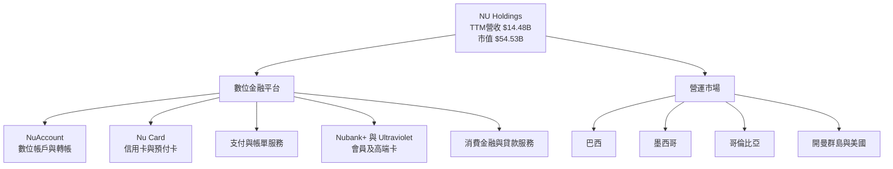
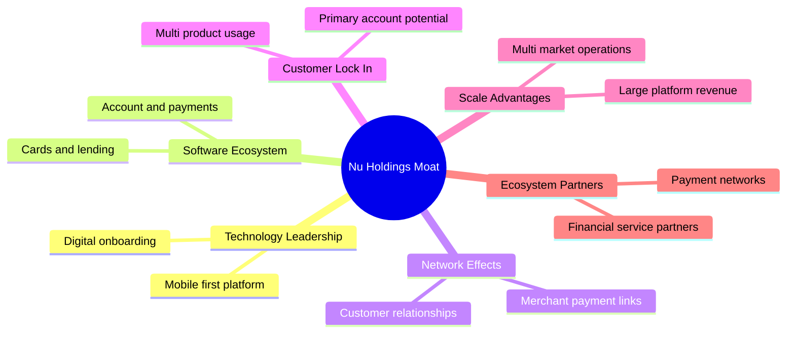
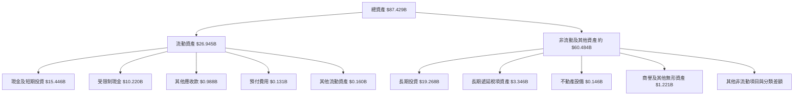
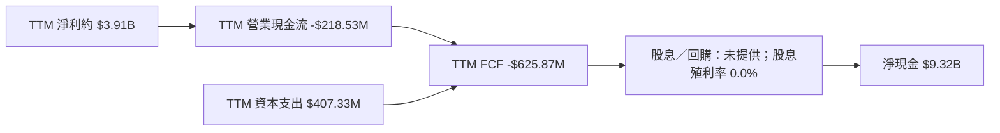
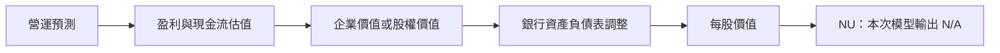
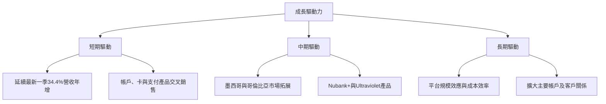
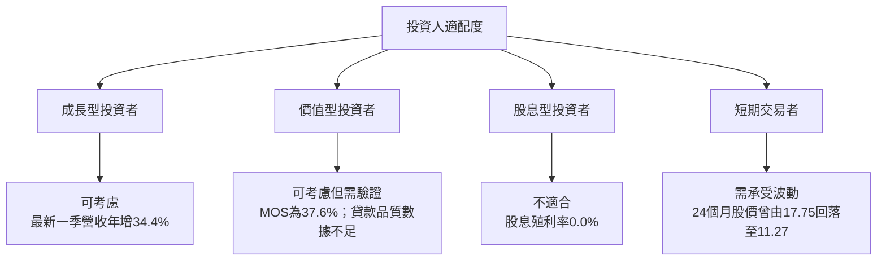

# NU 基本面深度分析報告
> **報告日期**：2026-11-21 ｜ **語言**：繁體中文 ｜ **數據來源**：Yahoo Finance、Finviz、StockAnalysis、Roic.ai ｜ **分析師**：CFA 級機構研究

## 目錄

| # | 章節 | 核心結論 |
|---|------|----------|
| 1 | 執行摘要 | 買入；加權合理價值 $18.07；MOS +37.6% |
| 2 | 公司概覽與商業模式 | 數位金融平台具規模與交叉銷售潛力；市場份額資料未提供 |
| 3 | 損益表深度分析 | TTM 營收 $14.48B；最新一季年增 34.4%；利潤率資料有來源差異 |
| 4 | 資產負債表分析 | 淨現金 $9.32B；流動性比率不適用或未提供 |
| 5 | 現金流量深度分析 | TTM FCF -$625.87M、FCF Yield -1.15%；短期現金轉換需關注 |
| 6 | 獲利能力與資本效率 | ROTCE 29.8%；銀行 ROIC 不適用，不能直接判定 ROIC 是否高於 WACC |
| 7 | 相對估值分析 | Forward P/E 10.62x，低於同業中位數 18.2x |
| 8 | DCF 內在價值評估 | 金融業 DCF 為 N/A；採用同業估值與分析師共識加權 |
| 9 | 成長催化劑 | 最新一季營收年增 34.4%；新市場與產品擴張可能帶來後續增長 |
| 10 | 風險矩陣 | 信用品質、監管與資金現金流是主要風險 |
| 11 | 投資建議 | 買入；建議買入區間 $11.27–$16.26，並設置營運監控門檻 |

---

## 1. 執行摘要

NU 的最新一季營收年增 **34.4%**、TTM 營收 **$14.48B**，現金及短期投資 **$15.45B**、淨現金 **$9.32B**；但 TTM 營業現金流為 **-$218.53M**、資本支出 **$407.33M**，因此 TTM FCF 為 **-$625.87M**、FCF Yield **-1.15%**。以同業 Forward P/E 與 P/B、分析師共識加權後，合理價值為 **$18.07**，相對 **2026-11-20 收盤價 $11.27** 的 MOS 為 **+37.6%**。依 MOS 評級門檻應為買入；ROIC 對銀行不適用且資料未提供，故採用估值區塊所列評級 **買入**，不另作質化調整。

### 1.0 一頁式投資儀表板（Portfolio Manager 30 秒速讀）

| 項目 | 內容 |
|------|------|
| **投資論點（3 句）** | ① TTM 營收 $14.48B，最新一季年增 34.4%，反映平台仍在擴張。② 現金及短期投資 $15.45B、淨現金 $9.32B，提供資金緩衝。③ TTM FCF -$625.87M、FCF Yield -1.15%，現金轉換弱點抵銷部分成長優勢。 |
| **綜合評分** | **7.8/10**（引用 1.1 評分卡） |
| **財務健康** | 🟡 現金及短期投資 $15.45B，高於總債務 $6.12B；但流動比率未提供，且 TTM FCF 為負。 |
| **ROIC vs WACC** | **ROIC：N/A；WACC：14.00%**。銀行 ROIC 不適用，ROTCE 29.8% 不能直接等同 ROIC。 |
| **FCF 趨勢** | TTM FCF 為負；最新 FCF Yield **-1.15%**。 |
| **估值** | Forward P/E **10.62x** ｜ EV/EBITDA **N/A** ｜ FCF Yield **-1.15%** |
| **DCF 內在價值（基準）** | **N/A**；金融業貸款與存款現金流屬營運資金來源，不宜直接套用一般企業 FCF DCF。 |
| **安全邊際（MOS）** | **+37.6%＝($18.07 − $11.27) ÷ $18.07**；🟢 >25% 充足。 |
| **預期報酬（基準情境 12M）** | **+60.3%**（加權合理價值相對現價的上行空間；非 DCF 情境價值）。 |
| **關鍵風險（前二）** | 信用品質惡化可能侵蝕利潤；巴西及其他市場的監管、利率與匯率變化可能壓低成長或估值。 |
| **評級 + 信心度** | 🟢 **買入** ｜ 信心：**中**；估值折價清楚，但 FCF 與貸款品質資料不足。 |

### 1.1 綜合評分卡（全報告唯一）

| 維度 | 評分（1–10） | 主要依據（引用數字與其來源章節） |
|------|--------------|----------------------------------|
| 成長性 | 8.5 | TTM 營收 $14.48B，最新一季營收年增 34.4%（第 3 章）；但 TTM 成長率 N/A。 |
| 獲利能力 | 8.0 | ROTCE 29.8%、最新一季營業利益率 50.9%（第 6、3 章）；銀行 ROIC N/A，且利潤率來源間有差異。 |
| 財務健康 | 7.5 | 淨現金 $9.32B、現金及短期投資 $15.45B；TTM FCF -$625.87M（第 4、5 章）。 |
| 估值 | 8.5 | MOS +37.6%，Forward P/E 10.62x，低於同業中位數 18.2x（第 7、8 章）。 |
| 護城河 | 7.5 | 多市場數位銀行平台、支付與借貸產品組合提供交叉銷售可能；但市場份額、客戶留存與單位經濟資料未提供（第 2 章）。 |
| 管理層與資本配置 | 6.5 | FY2025 SBC $271.85M，約為該年營收 2.6%；無股息，回購、併購與資本回報資料不足（第 3、5 章）。 |
| **綜合評分** | **7.8** | 六項算術平均：(8.5 + 8.0 + 7.5 + 8.5 + 7.5 + 6.5) ÷ 6 = 7.75，四捨五入至一位小數為 **7.8**。 |

### 1.2 五大投資論點 + 三大核心風險

| 類型 | 項目 | 具體依據 | 信心度 |
|------|------|----------|--------|
| 🟢 **投資論點①** | 高速營收擴張 | TTM 營收 $14.48B，最新一季營收年增 34.4%；平台收入擴張若伴隨成本率改善，可形成營運槓桿。 | 🟢 高 |
| 🟢 **投資論點②** | 現金緩衝充足 | 現金及短期投資 $15.45B、總債務 $6.12B、淨現金 $9.32B。 | 🟢 高 |
| 🟢 **投資論點③** | 盈利能力可觀 | ROTCE 29.8%；最新一季營業利益率資料為 50.9%，但需留意來源定義差異。 | 🟡 中 |
| 🟢 **投資論點④** | 相對估值折價 | NU Forward P/E 10.62x，低於同業 Forward P/E 中位數 18.2x；低倍數或反映風險折價，並非單純錯價。 | 🟡 中 |
| 🟢 **投資論點⑤** | 多市場與多產品擴張 | 業務涵蓋巴西、墨西哥、哥倫比亞等市場，並提供卡、支付、帳戶等服務；各市場貢獻比例未提供。 | 🟡 中 |
| 🟡 **風險①** | 現金流轉弱 | TTM OCF -$218.53M、Capex $407.33M，TTM FCF -$625.87M；對銀行而言貸款成長會耗用營運現金，但仍需看資本與信用品質。 | 🟡 中 |
| 🔴 **風險②** | 信用品質資料缺口 | 淨沖銷率、逾放比與 CET1 均未提供；無法量化貸款損失與資本緩衝。 | 🔴 高衝擊 |
| 🟡 **風險③** | 拉丁美洲監管、利率及匯率 | 多國營運使利率、貨幣與監管環境變化可能影響資金成本、貸款需求及美元報表換算。 | 🟡 中 |

### 1.3 快速統計卡片

| 指標 | 公司實際值（期間） | 同業中位數 | 狀態 |
|------|--------------------|------------|------|
| 營收成長（TTM） | **N/A** | — | 🟡 未提供 TTM 對前一 TTM 成長率 |
| 營收成長（最新一季年增） | **34.4%** | **43.9%** | 🟡 低於 SOFI、MELI、HOOD 的中位數 |
| 毛利率（TTM） | 金融機構不具可比性；資料源列 0.0% | **84.2%** | 🟡 不宜直接比較 |
| 營業利益率（TTM） | **N/A** | — | 🟡 未提供 |
| ROIC（TTM） | **N/A** | — | 🟡 銀行業不適用 |
| Forward P/E | **10.62x** | **18.2x** | 🟢 低於同業中位數 |
| FCF Yield（TTM） | **-1.15%** | — | 🔴 負值，需與銀行貸款現金流特性一併判讀 |
| Piotroski F-Score | **N/A** | — | 🟡 不適用放款機構 |

### 1.4 投資結論

╔══════════════════════════════════════════════════════════════════╗  
║                    📊 投資結論摘要                               ║  
╠══════════════════════════════════════════════════════════════════╣  
║  評級：買入（MOS +37.6%；按規則 20 的估值區塊評級）               ║  
║  價格（2026-11-20 收盤）：$11.27                                 ║  
║  DCF 內在價值（基準）：N/A（金融業 DCF 不適用）                   ║  
║  加權合理價值（8.8）：$18.07                                     ║  
║  安全邊際 MOS：+37.6%＝($18.07−$11.27)÷$18.07                   ║  
║  綜合評分：7.8/10（引用 1.1）                                    ║  
║  適合投資人：可承受新興市場、信用週期與監管風險的成長型投資人     ║  
╚══════════════════════════════════════════════════════════════════╝

---

## 2. 公司概覽與商業模式

### 2.1 業務結構與收入來源

公司資料描述 NU Holdings 提供數位銀行平台，涵蓋巴西、墨西哥、哥倫比亞、開曼群島及美國。TTM 營收採用財務資料中確認的 **$14.48B**；各產品的營收金額與營收佔比未提供，因此不拆分產品比例。

公司以數位平台提供帳戶、支付、卡與貸款服務，理論上可透過客戶關係降低交叉銷售成本。不過，客戶數、活躍客戶比例、各產品營收、存款成本與獲客成本均未提供，故無法量化單一客戶價值或產品組合的利潤貢獻。

### 2.2 市場份額

市場份額數據未提供，亦未提供可據以估算的市場規模及公司客戶數，故不繪製市場份額圖。相對規模方面，NU TTM 營收為 **$14.48B**，最新一季年增 **34.4%**；同業 SOFI、MELI、HOOD 最新一季營收年增率分別為 43.9%、45.1%、11.8%。NU 的增速高於 HOOD、低於 SOFI 與 MELI。

### 2.3 競爭護城河分析

這些是商業模式可能形成的護城河來源，不等於已驗證的競爭優勢。客戶留存率、每客戶收入、貸款損失率、商戶網路規模與技術投資回報等指標未提供，需以後續財報驗證。

### 2.4 護城河強度

| 護城河項目 | 強度（強／中／弱） | 證據（引用數字或事實） | 會削弱它的情況 |
|------------|--------------------|------------------------|----------------|
| 技術與數位平台 | 中 | 多國提供數位帳戶、支付、卡及貸款服務；最新一季營收年增 34.4%。 | 系統故障、網路安全事件或技術投入無法轉成較低成本與更高留存。 |
| 軟體生態系統 | 中 | 產品涵蓋帳戶、卡、支付及會員層級；各產品滲透率未提供。 | 客戶只使用單一產品、交叉銷售率偏低或產品差異化下降。 |
| 網路效應 | 弱至中 | 具支付與客戶平台基礎，但活躍用戶、商戶數及交易量未提供。 | 支付網絡規模不足、競爭者補貼或客戶多平台使用。 |
| 客戶鎖定 | 中 | 多產品組合可能增加主要帳戶使用，但留存與薪資入帳資料未提供。 | 客戶切換成本低、存款利率競爭或服務品質下降。 |
| 規模效應 | 中 | TTM 營收 $14.48B，跨多市場營運。 | 新市場獲客成本升高、監管成本或信用損失抵銷規模效益。 |
| 生態夥伴 | 弱至中 | 卡及支付產品涉及外部網路與合作方；具體伙伴收益分配未提供。 | 合作條件惡化、平台依賴第三方或支付費率下降。 |

**1.1「護城河」評分 7.5/10**：平台規模與多產品組合支持中等以上的競爭基礎，但缺少市場份額、留存率與單位經濟資料，尚不足以視為已量化證實的強護城河。

---

## 3. 損益表深度分析

### 3.1 年度收入成長趨勢（近4年）

年度收入使用所列年度財報數字；年增率按相鄰年度計算。2022 年至 2025 年收入 CAGR 約 53.0%，但這段期間包含快速擴張基期，不能直接外推為未來成長率。

╔══════════════════════════════════════════════════════════════════╗  
║              Nu Holdings 年度收入趨勢（FY2022-FY2025）           ║  
╠══════════════════════════════════════════════════════════════════╣  
║  FY2022  $2.97B   ██████░░░░░░░░░░░░░░░░░░░  YoY：—             ║  
║  FY2023  $5.63B   █████████████░░░░░░░░░░░░  YoY：+89.6% 🟢       ║  
║  FY2024  $8.27B   ███████████████████░░░░░░  YoY：+46.9% 🟢       ║  
║  FY2025  $10.63B  █████████████████████████  YoY：+28.6% 🟢       ║  
║                                                                  ║  
║  2022–2025 CAGR：(10.63 ÷ 2.97)^(1/3) − 1 ≈ 53.0%               ║  
╚══════════════════════════════════════════════════════════════════╝

年度收入由 FY2022 的 **$2.97B** 增至 FY2025 的 **$10.63B**，但年增率由 89.6% 降至 28.6%，呈現規模擴大後增速自然放緩的形態。FY2026 最新一季營收仍年增 34.4%，顯示近期增速尚未按 FY2025 年度增速進一步下滑；然而 TTM 對前一 TTM 成長率為 N/A，不宜把單季年增率外推成 TTM 成長率。

### 3.2 季度收入趨勢分析

以下以季度損益表列示的金額計算 QoQ；最新一季 YoY 直接引用財務數據。未提供其他季度的可一致核對 YoY 數字，故不補算或混用不同來源數列。

| 季度 | 營收 | QoQ 成長 | YoY 成長 | 備註 |
|------|------:|---------:|---------:|------|
| 2025 Q4 | $3.14B | — | — | 季度資料列示值。 |
| 2026 Q1 | $3.54B | +12.7% | — | QoQ = 3.54 ÷ 3.14 − 1。 |
| 2026 Q2 | $3.77B | +6.5% | — | QoQ = 3.77 ÷ 3.54 − 1。 |
| 2026 Q3 | $4.03B | +6.9% | **+34.4%** | YoY 為單季年增率，不是 TTM 成長率。 |

季度營收從 2025 Q4 的 $3.14B 升至 2026 Q3 的 $4.03B，連續 QoQ 增長。QoQ 增幅由 Q1 的 12.7% 收斂至 Q3 的 6.9%，可能同時反映季度基期擴大與季節性；僅憑這四季資料無法判斷是需求放緩或季節因素。

### 3.3 利潤率演變分析

| 利潤率指標 | FY2022 | FY2023 | FY2024 | FY2025 | 趨勢 | 評估 |
|------------|--------|--------|--------|--------|------|------|
| **毛利率** | N/A | N/A | N/A | N/A | 金融機構毛利率定義不具一般製造業可比性 | 🟡 |
| **營業利益率** | N/A | N/A | N/A | N/A | 年度可比歷史值未提供 | 🟡 |
| **淨利率** | -12.3% | 18.3% | 23.8% | 27.0% | 根據年度淨利與營收計算，2022 轉盈後逐年改善 | 🟢 |

年度淨利率按提供的年度營收與淨利計算：2025 為 $2.87B ÷ $10.63B ≈ 27.0%；2024 為 $1.97B ÷ $8.27B ≈ 23.8%；2023 為 $1.03B ÷ $5.63B ≈ 18.3%；2022 為 -$0.365B ÷ $2.97B ≈ -12.3%。改善方向與收入規模擴大、2022 年後轉盈相符，但不能單憑這些結果分辨定價、信用損失、資金成本與管理費用各自的貢獻。

資料另列 TTM 淨利率 43.0%、最新一季營業利益率 50.9%，但年度／季度財報及 StockAnalysis 的收入數列存在差異。故本報告保留資料來源所列數值並揭露口徑差異，不把單季營業利益率外推為 TTM，也不據此重建完整利潤率趨勢。

### 3.4 費用結構分析

金融機構的支出包含資金成本、信用損失準備、營運與技術成本等，但提供的資料沒有可完整對應的費用明細與各項金額。故不繪製費用結構圓餅圖，也不以營收減淨利反推費用組成。最新季度淨利為 $1.09B，反映獲利規模，但費用及信用準備的具體驅動因素仍需查閱公司申報文件逐項核實。

### 3.5 季度 EPS 趨勢與盈餘品質（Quality of Earnings）

財報 EPS beats/misses 表中 2025 Q4 至 2026 Q3 的分析師 EPS 預估與實際值均為缺值，故無法判斷近四季是否超預期或不及預期。另有季度 EPS 實際序列，但不同來源口徑有差異；因此不把缺失的市場預期數字補成估算。

| 盈餘品質項目 | 數值/佔比 | 評估 |
|--------------|-----------|------|
| 股權薪酬 SBC / 營收 | FY2025：$271.85M ÷ $10.63B ≈ **2.6%** | 🟡 有持續稀釋成本；占比未極端，但不能視為無成本。 |
| SBC / 營業現金流 | FY2025：$271.85M ÷ $3.50B ≈ **7.8%** | 🟡 SBC 是非現金費用，但股東承擔股數稀釋；需與股數變化一起追蹤。 |
| FCF / 淨利（現金轉換率） | TTM：-$625.87M ÷ 約 $3.91B ≈ **-16.0%** | 🔴 TTM 現金流未轉成正 FCF；銀行貸款成長會影響營運現金流，不能單獨當成獲利失真的證據。 |
| 一次性/非經常性損益 | **N/A（未提供明細）** | 🟡 無法判斷本期淨利是否受一次性項目影響。 |
| 有效稅率異常 | **25.8%**（最新年度有效稅率） | 🟢 未見資料顯示稅務利益異常；缺少逐年稅項明細，不宜進一步推論。 |
| 資本化支出 vs 費用化 | TTM Capex **$407.33M**；資本化政策細節 N/A | 🟡 資本化比例及研發費用化資料不足，無法判斷是否遞延成本。 |

FY2025 SBC 比例計算為 $271.85M ÷ $10.63B ≈ 2.6%；SBC 佔營業現金流約 7.8%。TTM FCF 轉換率使用財務數據所列 TTM FCF 與年度化淨利資料作近似比較，因利潤及現金流期間可能存在來源口徑差異，故僅作警示，不視為完全同口徑比率。

**盈餘品質結論**：年度淨利已連續三年為正且上升，但 TTM FCF 為負、一次性損益及資本化政策明細缺失。負 FCF 對放款機構需結合貸款發放與存款流入判讀；目前不能據此判定 GAAP 盈餘高估，但應降低對單一淨利指標的信任，並優先追蹤貸款損失、資本與現金流來源。

---

## 4. 資產負債表分析

### 4.1 資產結構分解

下圖採 StockAnalysis 截至 2026-09-30 的資產表列值，單位為十億美元。分項不一定涵蓋全部資產，且金融業資產結構不能簡化為一般企業的流動／非流動資產邏輯。

非流動及其他資產金額為總資產減流動資產所得的差額：$87.429B − $26.945B = $60.484B。這不是單一資產科目；圖中只列財報表列的具體項目，不將未列細項虛構成完整分類。

### 4.2 流動性與營運資金分析

| 指標 | 最新值 | 歷史趨勢／前期 | 評估 |
|------|--------|----------------|------|
| 現金及短期投資 | **$15.45B** | FY2025：$16.33B（StockAnalysis） | 🟡 仍具規模，但不同來源的期末數值有差異，採用財務資料核實值 $15.45B。 |
| 總債務 | **$6.12B** | FY2025 年度表列 $1.90B，口徑或期間不同 | 🟡 不宜直接以年度數值替代最新 TTM 債務。 |
| 淨現金 | **$9.32B** | 最新財務資料所列 | 🟢 現金與短期投資高於總債務。 |
| 流動比率／速動比率 | **N/A** | 金融業資產負債表不適合直接套用一般企業流動性比率；資料亦未提供 | 🟡 不作推算。 |

**營運資金天數**：金融業的貸款、存款與資金流向不適用一般企業 DSO／DIO／DPO／CCC；品質指標區亦未提供這些天數，故不列一般企業營運資金分析。

### 4.3 債務結構分析

╔══════════════════════════════════════════════════════════════════╗  
║                   Nu Holdings 債務健康診斷                       ║  
╠══════════════════════════════════════════════════════════════════╣  
║  總債務：              $6.12B   ████████░░░░░░░░░░░░              ║  
║  現金及短期投資：     $15.45B   ████████████████████              ║  
║  淨現金：              $9.32B   🟢 現金高於總債務                 ║  
║  Debt/EBITDA：          N/A     EBITDA 不適用或未提供             ║  
║  Interest Coverage：   N/A     利息支出與可比 EBIT 未提供         ║  
║  Debt/Equity：          N/A     資料未提供                         ║  
╚══════════════════════════════════════════════════════════════════╝

債務與現金的相減應為 $15.45B − $6.12B = $9.33B；資料核實的淨現金為 **$9.32B**。差異約 $0.01B，可能來自四捨五入或底層精度不同，因此本報告原值引用 $9.32B，不以四捨五入數反推替換。

### 4.4 股東權益趨勢

年度股東權益由 2022 年 $4.89B 升至 2025 年 $11.29B，反映盈利留存與資本累積。期間資料如下：

╔══════════════════════════════════════════════════════════════════╗  
║                  股東權益趨勢（年度）                            ║  
╠══════════════════════════════════════════════════════════════════╣  
║  FY2022  $4.89B   █████████░░░░░░░░░░░░░░░░                     ║  
║  FY2023  $6.41B   ██████████████░░░░░░░░░░░                     ║  
║  FY2024  $7.65B   █████████████████░░░░░░░░                     ║  
║  FY2025  $11.29B  █████████████████████████                     ║  
╚══════════════════════════════════════════════════════════════════╝

季度股數資料存在不一致：市場資料列流通股數 **3.82B**，Roic.ai 2026-09 列 **4.839B**；市值 $54.53B 亦與 3.82B 股乘以 $11.27 的簡單乘積不一致。本報告不自行反推市值或股數，估值直接引用核實估值方法的每股結果。

---

## 5. 現金流量深度分析

### 5.1 現金流量瀑布圖

TTM 現金流以核實數據計算，淨利使用季度淨利相加約 $3.91B 作方向性參考；放款機構淨利至營業現金流會受到存貸款與貸款發放影響，不能期待與非金融企業相同的線性瀑布。

這張圖呈現財務數據間的關係，而非將淨利直接等同營業現金流。放款與存款現金流是銀行營運的一部分；要判斷 FCF 轉負是否危險，必須與貸款成長、存款流入及監管資本配合檢視。

### 5.2 FCF 轉換率趨勢

| 年度 | FCF | 淨利 | FCF / 淨利 | 解讀 |
|------|----:|----:|-----------:|------|
| 2022 | $0.641B | -$0.365B | 不具解讀性 | 淨利為負，轉換率失去一般比較意義。 |
| 2023 | $1.09B | $1.03B | 約 105.7% | FCF 略高於淨利。 |
| 2024 | $2.22B | $1.97B | 約 112.7% | 現金流高於淨利。 |
| 2025 | $3.16B | $2.87B | 約 110.1% | 年度現金轉換仍高於 100%。 |
| TTM 至 2026-09-30 | **-$625.87M** | 約 $3.91B | 約 **-16.0%** | 轉為負值；需辨別貸款增長與資金流的影響。 |

歷年年度 FCF 與最新 TTM FCF 出現明顯反轉。季度現金流亦波動：2026 Q1 OCF 為 -$1.21B，2026 Q2 為 -$28.11M，2026 Q3 為 $192.49M。這種波動可能受銀行資產負債表變化影響，但沒有貸款、存款與證券現金流拆解，無法確認反轉原因。

### 5.3 自由現金流趨勢

| 期間 | FCF | FCF Yield | 評估 |
|------|----:|----------:|------|
| FY2022 | $0.641B | N/A | 年度正值。 |
| FY2023 | $1.09B | N/A | 年度較前一年增加。 |
| FY2024 | $2.22B | N/A | 年度續增。 |
| FY2025 | $3.16B | N/A | 年度最高，但不代表最新 TTM 延續。 |
| TTM 至 2026-09-30 | **-$625.87M** | **-1.15%** | 最新 TTM 轉負。 |

年度 FCF 依序上升與最新 TTM 轉負並存，顯示期間選擇對現金流結論影響很大。FCF Yield **-1.15%** 反映的是核實口徑「營業現金流 − 資本支出」，並非一般企業以 EBIT 推估的自由現金流。

### 5.4 資本配置評估

股息殖利率 **0.0%**、派息率 **0.0%**。年度資本支出與 SBC 數據可見，但回購、併購、投資組合配置與留存盈餘使用明細不足，無法建立完整資本配置比例圓餅圖。

| 資本配置項目 | 可得資料 | 評估 |
|--------------|----------|------|
| 資本支出 | TTM $407.33M | 以數位平台與金融基礎設施為核心的業務需要持續投資；投入回報資料未提供。 |
| 股息 | 殖利率 0.0%；派息率 0.0% | 無現金股息回報。 |
| 股份回購 | N/A | 回購金額與股數變化口徑不一，無法量化。 |
| SBC | FY2025 $271.85M | 股東承擔稀釋成本；應關注 SBC 與流通股數趨勢。 |
| 留存／其他投資 | N/A | 用途拆分未提供。 |

---

## 6. 獲利能力與資本效率

### 6.1 ROE / ROA / ROIC 趨勢

| 指標 | 可得數值 | 評估 |
|------|----------|------|
| ROE（TTM） | **31.5%** | 報表列示水準具吸引力；杜邦組成不可得，無法確認是否由槓桿主導。 |
| ROA（TTM） | **5.0%** | 以銀行業資產密集特性來看，需與信用品質及資金成本共同評估。 |
| ROTCE（TTM） | **29.8%** | 放款機構較適用的有形權益回報代理指標。 |
| ROIC | **N/A** | 金融機構負債為營運資金來源，傳統投入資本與 ROIC 口徑不具可比性。 |
| 行業均值對比 | N/A | 未提供可驗證的同業 ROE／ROA／ROTCE 均值。 |

### 6.2 ROIC vs WACC 分析（核心價值創造判斷）

金融機構資產負債表包含存款與借款等核心營運負債，傳統 ROIC 的投入資本定義不適合直接套用。NU 的 ROIC 為 **N/A**，因此不能用「ROIC 29.8%」替代；29.8% 是 ROTCE，不等於 ROIC。成本資本區塊列示 WACC 14.00%，但兩個指標口徑不同，不能直接判定價值創造利差。

╔══════════════════════════════════════════════════════════════════╗  
║                ROIC vs WACC 深度分析                            ║  
╠══════════════════════════════════════════════════════════════════╣  
║  WACC 輸入（採用成本資本區塊）：                                 ║  
║  ├── 無風險利率（10Y 美債）：       4.91%                        ║  
║  ├── 股權風險溢酬 ERP：              5.00%                        ║  
║  ├── 原始 Beta：                     0.97                         ║  
║  ├── 調整後 Beta：                   0.98                         ║  
║  ├── 股權成本： 4.91% + 0.98×5.00% = 9.81%                      ║  
║  ├── 稅前債務成本：                  74.76%                       ║  
║  ├── 有效稅率：                      25.8%                        ║  
║  ├── 權重：股權 89.9%，債務 10.1%                                 ║  
║  ├── 計算 WACC：                     14.42%                       ║  
║  └── 採用 WACC：                     14.00%（限制於 7%–14%）      ║  
║                                                                  ║  
║  ROIC：N/A（銀行業不適用）                                        ║  
║  ROTCE：29.8%（有形權益報酬代理，不等於 ROIC）                    ║  
║  EVA／ROIC − WACC：N/A；不能由 ROTCE 直接代替                    ║  
║  結論：現有資料不足以量化傳統 ROIC 相對 WACC 的價值利差。          ║  
╚══════════════════════════════════════════════════════════════════╝

計算資本成本區塊採用的股權成本為 9.81%，稅前債務成本為 74.76%，有效稅率 25.8%，資本權重為股權 89.9%、債務 10.1%。資料列示計算 WACC 14.42%，但模型將其限制於 7%–14% 區間，因此採用 **14.00%**。如此高的稅前債務成本可能反映「利息／債務」代理分母口徑問題，應視為模型限制，不可當作可觀察市場借款利率。

### 6.3 杜邦三因素分解

| 因素 | 數值（TTM） | 解讀 |
|------|-------------|------|
| 淨利率 | N/A | 品質指標列示 DuPont 為 N/A，因淨利、營收、總資產或正權益資料缺漏／口徑不足。 |
| 資產週轉率 | N/A | 不自行補算，且銀行資產週轉率對商業模式的解釋力有限。 |
| 權益乘數 | N/A | 不自行補算。 |
| **ROE** | **N/A（杜邦列）** | TTM ROE 另列 31.5%，但不能用缺失的三因素反推分解。 |

### 6.4 財務體質：Piotroski F-Score 與放款指標

Piotroski F-Score **N/A**：該分數不適用於放款機構，因貸款增長會形成營業現金流流出，造成現金流測試誤讀。

| 放款指標 | 數值 | 解讀 |
|----------|------|------|
| 淨利息收入 NII / 總營收 | **84.7%** | 營收高度依賴淨利息收入；對利率、存款成本與貸款收益率較敏感。 |
| 淨利差代理值 NII / 平均總資產 | **15.74%** | **代理值**；分母使用總資產而非生息資產，因此高於正式 NIM，不可等同銀行公布的 NIM。 |
| 成本收入比代理值 | **68.1%** | **代理值**；公式包含信用準備，通常高於公司自行公布的效率比率。 |
| ROTCE | **29.8%** | 淨利相對有形帳面價值的回報代理。 |
| P/TBV | **4.16x** | 股價相對有形帳面價值倍數；高倍數意味市場預期持續高回報。 |
| 放款淨額 / 總資產 | **14.0%** | 反映資料口徑下的貸款占比；不可與其他銀行口徑直接比較。 |
| 淨沖銷率 | **N/A（數據未提供）** | 信用品質評估缺口。 |
| 逾放比 | **N/A（數據未提供）** | 信用品質評估缺口。 |
| CET1 | **N/A（數據未提供）** | 無法量化監管資本緩衝。 |

---

## 7. 相對估值分析

### 7.1 同業估值比較表格

NU 的倍數來自市場估值資料；SOFI、MELI、HOOD 數字引用 Yahoo Finance 同業倍數。公司類型、營收結構與市場不同，倍數只能作參照，不是直接等價比較。

| 估值指標 | **NU** | **SOFI** | **MELI** | **HOOD** | 本公司評估 |
|----------|------:|--------:|--------:|--------:|-----------|
| **Trailing P/E** | 14.09x | 22.7x | 36.3x | 28.6x | 🟢 低於三家同業；但低倍數可能反映市場風險折價。 |
| **Forward P/E** | 10.62x | 13.9x | 25.6x | 18.2x | 🟢 低於同業中位數 18.2x。 |
| **P/S Ratio** | 5.99x | 3.5x | 1.8x | 11.0x | 🟡 位於同業範圍內；金融服務收入確認方式差異大。 |
| **EV/EBITDA** | N/A | N/A | 19.7x | N/A | 🟡 僅 MELI 有資料，不作可靠中位數比較。 |
| **最新一季營收年增** | 34.4% | 43.9% | 45.1% | 11.8% | 🟡 高於 HOOD，低於 SOFI、MELI。 |
| **TTM 毛利率** | 資料列 0.0%，金融業不具可比性 | 84.2% | 46.7% | 91.0% | 🟡 不以毛利率對不同金融商業模式排序。 |

同業 Forward P/E 中位數為 **18.2x**，NU 為 **10.62x**。但同業估值差異很大：MELI 的前瞻 P/E 為 25.6x，SOFI 為 13.9x，HOOD 為 18.2x；若 NU 的貸款損失或監管風險高於同業，低倍數可合理反映較高風險，而非必然上修空間。

### 7.2 歷史估值區間分析

╔══════════════════════════════════════════════════════════════════╗  
║                    NU 歷史估值區間分析                           ║  
╠══════════════════════════════════════════════════════════════════╣  
║  歷史 P/E 高低區間與當前歷史百分位：N/A（未提供）                ║  
║  當前 Trailing P/E：14.09x                                        ║  
║  當前 Forward P/E：10.62x                                         ║  
║  24 個月股價：2024-11 $12.53；2026-01 $17.75；                    ║  
║               2026-11 $11.27                                      ║  
║  結論：有股價歷史序列，但無歷史 P/E 分位資料，不推估百分位。      ║  
╚══════════════════════════════════════════════════════════════════╝

### 7.3 情境價值（Bear / Base / Bull）

**N/A（DCF 無法計算：金融機構貸款與存款現金流屬資金與營運安排，財務資料明確不提供 DCF 模型。）**因此不提供自行設定的悲觀／基準／樂觀 DCF 目標價。

### 7.4 相對估值隱含價格區間

╔══════════════════════════════════════════════════════════════════╗  
║                  相對估值隱含每股價值                            ║  
╠══════════════════════════════════════════════════════════════════╣  
║  $11.27 現價 ─── $16.60 同業 P/B ─── $17.63 共識 ─── $19.34 P/E  ║  
╚══════════════════════════════════════════════════════════════════╝

| 方法 | 每股價值 | 相對現價上行空間 | 依據 |
|------|---------:|-----------------:|------|
| 同業 Forward P/E | **$19.34** | **+71.6%** | SOFI、MELI、HOOD 同業 Forward P/E 中位數 18.2x × NU Forward EPS $1.06。 |
| 同業 P/B | **$16.60** | **+47.3%** | 同業 P/B 中位數 5.6x × NU 帳面價值每股 $2.96。 |
| 分析師共識目標價 | **$17.63** | **+56.4%** | 23 位分析師平均目標價。 |

各相對估值方法均引用核實估值方法的輸出值；不以 NU 自身當前估值倍數回推，避免結果機械式等於現價。

---

## 8. DCF 內在價值評估（Discounted Cash Flow）

### 8.0 估值推理鏈（Thinking Logic：在算之前先想清楚）

**重要限制：金融業 DCF 為 N/A。** DCF 模型將 NU 列為金融業，原因是銀行的貸款、存款與資金流量是營運本身，無法把一般企業 FCFF 定義直接套用於銀行。因此本章不自建模型、不虛構逐年現金流、終值、敏感度矩陣或 DCF 情境。

**Step 1 — 價值來源與主導變數**

NU 的估值可理解為既有數位帳戶、支付、卡及貸款業務的盈利能力，加上新市場與新產品的成長選擇權。可得數據只有 TTM 營收 $14.48B、淨利息收入占總營收 84.7%，各產品與市場收入佔比未提供。對銀行而言，貸款品質、資金成本與 ROTCE 的持續性，比一般企業的資本支出或營運資金假設更主導價值；但目前淨沖銷率、逾放比與 CET1 均 N/A。

**Step 2 — 模型選擇**

| 決策點 | 本報告採用 | 理由（含數字） | 曾考慮但否決 | 否決理由 |
|--------|-----------|----------------|--------------|----------|
| 現金流定義 | N/A | 金融業貸款與存款現金流是資金來源及營運的一部分；TTM OCF -$218.53M、FCF -$625.87M 不可按一般企業 FCFF 解讀。 | 一般 FCFF／FCFE DCF | 容易把貸款增長等營運現金流錯當自由現金流流失。 |
| 預測期 N | N/A | 無 DCF 模型預測期輸出。 | 5–10 年自建模型 | 無法以已核實模型輸入支持。 |
| 終值方法 | N/A | 無 DCF 終值輸出。 | Gordon Growth／退出倍數 | 不自行建模。 |
| EBIT 基礎 | N/A | 銀行估值改採盈利與帳面價值方法。 | GAAP／非 GAAP EBIT | 不與銀行估值方法混用。 |

**Step 3 — 假設推導鏈**

DCF 假設總表不存在，故無營收 CAGR、期末營業利潤率、稅率、Capex、D&A、營運資金、SBC 稀釋、WACC 情境或永續成長率可逐項推導。WACC 14.00% 僅用於成本資本及章節一致性參照，不代表已建立 DCF。

**Step 4 — 最脆弱的一環**

最脆弱的投資假設不是一般企業 FCF，而是 NU 能否在快速貸款成長下維持貸款品質與 ROTCE；若信用品質惡化，盈利與有形權益回報將下降，估值應下修。缺乏損失率及資本比率，無法給出可稽核的下修金額。

**Step 5 — 計算路徑圖**

以下為一般 DCF 的概念路徑，不代表 NU 有可計算的 DCF 數據；故不填入任何模型數字。

### 8.1 模型假設總表（Model Inputs）

| 假設項目 | 採用值 | 依據 / 來源 | 敏感度 |
|----------|--------|-------------|--------|
| 預測期長度 N | N/A | 金融業 DCF 模型未提供；不自建。 | N/A |
| 營收 CAGR（預測期） | N/A | TTM 對前一 TTM 成長率 N/A；單季年增 34.4% 不可替代 TTM 假設。 | N/A |
| 營業利潤率（期末） | N/A | TTM 營業利益率 N/A；最新一季 50.9% 不能外推為期末利潤率。 | N/A |
| 有效稅率 | 25.8%（成本資本資料所列） | 僅可作 WACC 欄位引用，不用以建立 DCF。 | N/A |
| Capex / 營收 | N/A | TTM Capex $407.33M，但銀行 DCF 不適用。 | N/A |
| 折舊攤銷 D&A / 營收 | N/A | DCF 假設未提供。 | N/A |
| 營運資金變動 / 營收增額 | N/A | 對放款機構一般企業口徑不適用。 | N/A |
| EBIT 基礎 | N/A | 不建立 DCF。 | N/A |
| SBC 處理 | N/A | 不建立 DCF。 | N/A |
| 年稀釋率 | N/A | 股數資料來源互有差異，且不建立 DCF。 | N/A |
| 永續成長率 g | N/A | 不建立 DCF。 | N/A |
| 終值方法 | N/A | 不建立 DCF。 | N/A |
| WACC | **14.00%** | 成本資本區塊列示；計算值 14.42%，受 7%–14% 區間上限限制。 | 已列示，非 DCF 模型輸入 |

本報告不採用 SBC 防呆組合 (A)、(B) 或 (C)，因為 DCF 模型不存在，沒有逐年 EBIT、FCFF 或稀釋股數計算可供選擇。

### 8.2 折現率推導（WACC）

╔══════════════════════════════════════════════════════════════════╗  
║                    WACC 推導（折現率）                           ║  
╠══════════════════════════════════════════════════════════════════╣  
║  股權成本 Ke（CAPM）：                                            ║  
║  ├── 無風險利率 Rf（10Y 美債）：      4.91%                       ║  
║  ├── 市場風險溢酬 ERP：               5.00%                       ║  
║  ├── 原始 Beta：                      0.97                        ║  
║  ├── 調整後 Beta：                    0.98                        ║  
║  ├── 調整方式：⅔ × 0.97 + ⅓ = 0.98                               ║  
║  └── Ke：4.91% + 0.98 × 5.00% = 9.81%                           ║  
║                                                                  ║  
║  債務成本：                                                       ║  
║  ├── 稅前債務成本（利息／債務）：     74.76%                      ║  
║  ├── 有效稅率：                       25.8%                       ║  
║  └── 稅後債務成本：未列示；不改寫輸入或另建模型                  ║  
║                                                                  ║  
║  資本結構權重：股權 89.9%／債務 10.1%                            ║  
║  ├── WACC 計算值：                    14.42%                      ║  
║  └── 採用 WACC：                      14.00%                      ║  
║      （限制於 7%–14% 區間；同第 6.2 節）                         ║  
╚══════════════════════════════════════════════════════════════════╝

- **Ke（CAPM）** = Rf + β × ERP = 4.91% + 0.98 × 5.00% = **9.81%**。
- **稅前 Kd** = **74.76%**，為成本資本資料所列「利息 ÷ 債務」代理值。利息金額及平均計息負債明細未提供，不能再拆算或改用其他負債口徑。
- **稅後 Kd**：公式若以有效稅率代入為 74.76% × (1 − 25.8%)，但本報告不把自行重算值替代程式列示的資本成本輸入；此外，缺少利息與債務明細，無法檢驗該代理值的可比性。
- **權重**：股權 89.9%、債務 10.1%，直接引用成本資本資料。個別市值、計息債務期末值及權重底層計算未提供，故不反推。
- **WACC**：採用值 **14.00%**；成本資本資料列計算值 **14.42%**，因受 7%–14% 區間限制而採用上限 14.00%。

**一致性檢查**：第 6.2 與本節均採 WACC **14.00%**。由於 DCF 模型為 N/A，此 WACC 不用來計算 NU 的每股內在價值。

### 8.3 逐年自由現金流預測（基準情境）

**N/A（數據未提供：DCF MODEL 明確不建立金融業現金流模型；無預測期年數與逐年假設。）**  
因此不列逐年 FCFF 表、九步演算、預測期現值合計、FCF CAGR 或歷史實際與模型預測 ASCII 圖，避免捏造未提供的模型數字。

### 8.4 終值計算（Terminal Value）

適用性檢查：WACC **14.00%**；永續成長率 g **N/A**；因 DCF 不適用而無法測試 WACC 是否大於 g。Gordon Growth 與退出倍數終值均為 **N/A**，不自行估算。

### 8.5 企業價值 → 每股內在價值（Bridge）

**N/A（DCF 模型未提供）**。企業價值、現金／債務橋接、少數股東權益、稀釋股數及 DCF 每股價值均不計算。市場資料與財報來源的股數存在差異，本報告不以不一致股數自建橋接。

DCF 折溢價：**N/A**。不以加權合理價值代替 DCF 內在價值，也不在本節計算 MOS。

### 8.6 敏感性分析（WACC × 永續成長率）

**N/A（DCF 模型未提供）**。沒有基準 FCFF、永續成長率與逐年折現現金流，故不建立 5×5 矩陣、不生成情境 DCF、敏感度彈性或機率加權價值。

### 8.7 反推 DCF（Reverse DCF：市場在預期什麼）

**N/A（DCF 模型未提供）**。缺少可用的 DCF 基準假設，無法在固定其他變數時逐一反解營收 CAGR、期末營業利潤率、永續成長率或預測期長度；不以單一股價方程式假稱已解出多項未知數。

### 8.8 估值三角驗證與安全邊際

DCF 方法因金融業模型不適用而不納入；估值區塊固定列出的三種方法與權重如下。

| 估值方法 | 隱含每股價值 | 上行空間（÷現價） | 權重 | 說明 |
|----------|--------------|-------------------|------|------|
| 同業 Forward P/E | **$19.34** | **+71.6%** | **50%** | 同業中位數 18.2x × NU Forward EPS $1.06。 |
| 同業 P/B | **$16.60** | **+47.3%** | **40%** | 同業中位數 P/B 5.6x × NU 帳面價值每股 $2.96。 |
| 分析師共識目標價 | **$17.63** | **+56.4%** | **10%** | 23 位分析師平均目標價。 |
| **加權合理價值** | **$18.07** | **+60.3%** | **100%** | 金融業固定估值方法權重。 |

**逐步演算（權重外顯）**

加權合理價值  
= $19.34 × 50% + $16.60 × 40% + $17.63 × 10%  
= $9.670 + $6.640 + $1.763  
= **$18.073，報告列示 $18.07**。

MOS  
= (加權合理價值 − 現價) ÷ 加權合理價值  
= ($18.07 − $11.27) ÷ $18.07  
= $6.80 ÷ $18.07  
= **37.6%**。

上行空間  
= (加權合理價值 − 現價) ÷ 現價  
= ($18.07 − $11.27) ÷ $11.27  
= $6.80 ÷ $11.27  
= **60.3%**。

折溢價 Premium/Discount 固定以 DCF 基準值為分母；因 DCF 基準價 N/A，本報告此處不計算 DCF 折溢價。三種非 DCF 方法權重合計 100%，同業 EV/EBITDA 因相關倍數資料不足而未列入估值方法區塊，故不另加此方法。

╔══════════════════════════════════════════════════════════════════╗  
║                  估值區間與安全邊際                              ║  
╠══════════════════════════════════════════════════════════════════╣  
║  $16.60 P/B ── $17.63 共識 ── [$18.07 加權合理值] ── $19.34 P/E  ║  
║  現價：$11.27                                                     ║  
║                                                                  ║  
║  安全邊際 MOS = ($18.07 − $11.27) ÷ $18.07 = +37.6%             ║  
║  MOS 評估：🟢 >25% 充足                                           ║  
║  上行空間 = ($18.07 − $11.27) ÷ $11.27 = +60.3%                 ║  
║  DCF 基準價：N/A                                                  ║  
║                                                                  ║  
║  建議買入區間：$11.27 – $16.26（加權價值的 90% 上限）            ║  
║  合理持有區間：$16.26 – $18.07（接近加權合理價值）                ║  
║  減碼考慮區間：高於 $18.07；需以盈利與風險更新合理價值            ║  
╚══════════════════════════════════════════════════════════════════╝

買入區間上限推導：$18.07 × (1 − 10%) = $16.263，四捨五入至 $16.26。此區間以加權合理價值提供至少 10% MOS 作為參考，不代表價格一定會回到該區間。

> 🔎 **程式複算（Python，依本節各項自動重算）**
>
> 加權合理價值 = $19.34 × 50% + $16.60 × 40% + $17.63 × 10% = **$18.07**（權重合計 100%）
>
> 以價格 $11.27 計：MOS = **+37.6%**，上行空間 = **+60.3%**
>
> ✅ 與本節所寫數值一致。

### 8.9 DCF 模型的局限與失效條件

- **終值依賴度**：N/A，未建立 DCF，無法計算終值占 EV 比例。
- **最脆弱假設**：DCF 假設不存在；投資核心的不確定性在貸款品質、資金成本與 ROTCE 能否維持。
- **不適用情境**：貸款與存款屬金融機構核心資金活動，使用一般企業 FCFF 會誤讀銀行現金流；本報告改用同業 Forward P/E、P/B 與分析師共識估值。
- **與第 10 章風險矩陣的連結**：信用品質惡化會壓低盈利與 ROTCE；監管資本上升可能限制股東可得回報；利率與存款競爭則會改變淨利息收入。
- **資料限制**：缺少淨沖銷率、逾放比、CET1、貸款及存款分部資料，使得即使採銀行專用估值方法，風險折價仍難以精準量化。

### 8.10 複算檢核表（Audit Trail：輸出前自我驗算）

| # | 檢核項目 | 檢查方式 | 結果 |
|---|----------|----------|------|
| 1 | 所有 DCF 高／中敏感度輸入均有推導 | DCF 為 N/A，未列模型假設 | N/A（無 DCF 輸入） |
| 2 | 每個假設都有來歷 | 模型輸入表逐項標明 N/A 原因或已列來源 | ✅ |
| 3 | WACC 五步算式與相乘相加 | 原始成本資本輸入引用；計算值 14.42%、採用值 14.00% | N/A（完整底層輸入未提供） |
| 4 | Kd 分母與權重 D 範圍一致 | 利息與計息負債明細未提供，無法檢查 | N/A |
| 5 | WACC 與第 6.2 節一致 | 兩節均為 14.00% | ✅ |
| 6 | 逐年表格年度數等於 N | DCF 模型不存在 | N/A |
| 7 | FY+1 九步 FCFF／PV 演算 | DCF 模型不存在 | N/A |
| 8 | 預測期 PV 相加 | 無預測期現值 | N/A |
| 9 | WACC > g | g 未提供 | N/A |
| 10 | 終值以 FY+N FCFF 為基礎 | 無終值模型 | N/A |
| 11 | EV 至每股價值橋接 | 無 DCF EV 或稀釋股數橋接 | N/A |
| 12 | SBC 組合相容 | 未建立 DCF，未宣告 A/B/C 組合 | N/A |
| 13 | 敏感性矩陣基準格與 DCF 每股價值一致 | 無矩陣 | N/A |
| 14 | 矩陣有效格滿足 WACC > g | 無矩陣 | N/A |
| 15 | DCF 情境機率合計 100% | 未提供 DCF 情境 | N/A |
| 16 | 反推 DCF 每列僅解一變數並有軌跡 | 無反推 DCF | N/A |
| 17 | MOS 基準、定義與儀表板一致 | MOS 均以 $18.07 加權合理價值為分母；DCF 折溢價為 N/A | ✅ |
| 18 | 報告完整至第 11 章 | 已列出 11 章 | ✅ |
| 19 | 加權合理價值為方法價值加權和 | $19.34×50% + $16.60×40% + $17.63×10% = $18.073，列示 $18.07 | ✅ |
| 20 | 評級符合 MOS 門檻 | MOS +37.6%，估值區塊列示評級為買入 | ✅ |

---

## 9. 成長催化劑

### 9.1 催化劑時間軸

沒有公司財測、產品推出日期或可驗證的具體時間表，不以主觀年份建立 Mermaid Gantt 日期。以下區分短中長期可能催化劑，時間為監控分類而非公司已承諾時程。

| 期間 | 催化劑 | 可檢驗的數據 |
|------|--------|--------------|
| 短期：未來財報 | 延續最新一季營收年增 34.4% 的趨勢 | 單季營收年增、QoQ 成長、淨利及 ROTCE。 |
| 中期：後續數季 | 多產品交叉銷售與新市場成熟 | 各市場收入、活躍客戶、每客戶收入及貸款品質；目前未提供。 |
| 長期：數年 | 平台規模效應與高端產品滲透 | 獲客成本、留存、資金成本、信用損失與資本回報；目前未提供。 |

### 9.2 TAM 市場規模分析

**N/A（TAM 數據未提供）**。公司業務遍及巴西、墨西哥、哥倫比亞等市場，最新 TTM 營收為 $14.48B、最新一季年增 34.4%。在沒有可引用的市場規模、公司客戶數與市場滲透率資料下，不估算 TAM 或滲透率。

### 9.3 成長驅動力結構圖

下圖呈現業務邏輯，不代表未披露的收入拆分或預測數字。

---

## 10. 風險矩陣

### 10.1 風險評分矩陣

資料沒有量化風險機率，且報告規則不允許為圖表虛構估算座標，因此不製作帶數值座標的 quadrantChart。以下以定性表格排序風險，機率不假裝為統計數值。

### 10.2 風險清單詳細分析

| # | 風險項目 | 發生機率 | 財務衝擊 | 風險評估 | 緩解措施 |
|---|----------|----------|----------|----------|----------|
| 1 | 🔴 **信用品質惡化** | 未量化；需持續監控 | 可能增加貸款損失準備、降低淨利及 ROTCE；損失率資料 N/A | 🔴 高衝擊 | 每季追蹤淨沖銷率、逾放比、貸款組合與備抵；若公司公布指標連續惡化，重新估值。 |
| 2 | 🔴 **監管資本與政策變化** | 未量化 | CET1 未提供；資本要求提高可能限制貸款擴張及股東回報 | 🔴 高衝擊 | 追蹤 CET1、監管公告、資本緩衝及各國牌照進度。 |
| 3 | 🟡 **利率與存款資金成本** | 未量化 | NII 占總營收 84.7%，資金成本或息差變化可能直接影響收入與獲利 | 🟡 高度重要 | 追蹤 NII、存款成本、貸款收益率、資金組合及正式 NIM。 |
| 4 | 🟡 **TTM 現金流波動** | 已觀察到 | TTM OCF -$218.53M、FCF -$625.87M、FCF Yield -1.15% | 🟡 中高 | 拆分貸款成長、存款流入、證券交易與資本支出；判斷負 FCF 是成長投資或資金流壓力。 |
| 5 | 🟡 **多國監管、匯率與市場風險** | 長期存在，機率未量化 | 多國政策、貨幣與宏觀環境可能影響美元換算營收、信用表現與成本 | 🟡 中高 | 分市場檢查收入、貸款品質及匯率敏感度；避免只依賴合併營收成長。 |
| 6 | 🟡 **估值方法及股數口徑不一致** | 已觀察到資料差異 | 市值 $54.53B、股價 $11.27、不同來源股數不一致；可能令簡單每股推算失真 | 🟡 中 | 以公司申報文件核實 ADR／普通股轉換、稀釋股數及市值口徑，再更新每股價值。 |

---

## 11. 投資建議

### 11.1 最終評級與評分

按加權合理價值 $18.07 與 2026-11-20 收盤價 $11.27 計算，MOS 為 **+37.6%**，估值區塊列示規則 20 評級為 **買入**，本報告不作一級調整。綜合評分引用 1.1 的 **7.8/10**；六項分數依序為成長性 8.5、獲利能力 8.0、財務健康 7.5、估值 8.5、護城河 7.5、管理層與資本配置 6.5。

### 11.2 合理價值與隱含報酬率

| 估值依據 | 每股價值 | 相對 2026-11-20 收盤價 $11.27 | 權重／機率 |
|----------|---------:|--------------------------------:|------------|
| 加權合理價值 | **$18.07** | **+60.3% 上行空間** | 估值方法權重合計 100% |
| 同業 Forward P/E | $19.34 | +71.6% | 50% |
| 同業 P/B | $16.60 | +47.3% | 40% |
| 分析師共識目標價 | $17.63 | +56.4% | 10% |
| DCF 悲觀／基準／樂觀 | N/A | N/A | DCF 模型未提供 |

### 11.3 買入時機與觸發因素

╔══════════════════════════════════════════════════════════════════╗  
║                  ✅ 買入觸發因素 Checklist                       ║  
╠══════════════════════════════════════════════════════════════════╣  
║  目前參考買入區間：$11.27–$16.26                                ║  
║                                                                  ║  
║  建立／持有部位前優先確認：                                       ║  
║  ✅ 2026-11-20 收盤價 $11.27，低於加權合理價值 $18.07             ║  
║  ✅ 最新一季營收年增 34.4%，後續財報未顯示連續明顯放緩            ║  
║  ✅ 淨現金 $9.32B，現金及短期投資 $15.45B                         ║  
║  ⚠️ 取得淨沖銷率、逾放比、CET1 等貸款品質與資本指標後再提高信心   ║  
║                                                                  ║  
║  加碼觸發條件：                                                   ║  
║  ☐ 股價仍低於 $16.26，且營收成長與 ROTCE 維持穩定                ║  
║  ☐ 負 FCF 能由貸款成長與存款變化合理解釋，資產品質未惡化          ║  
║  ☐ 公司公布信用品質與 CET1 資料，未呈現持續惡化                  ║  
║                                                                  ║  
║  減碼／重新評估觸發條件：                                         ║  
║  ☐ 股價高於 $18.07，且盈利或資產品質未同步上修                    ║  
║  ☐ 最新一季營收年增連續兩季低於 20%                               ║  
║  ☐ ROTCE 低於 20%，或淨沖銷率／逾放比持續上升                    ║  
║  ☐ TTM FCF 持續為負，且公司無法解釋其與貸款成長、資金流的關係    ║  
╚══════════════════════════════════════════════════════════════════╝

買入區間上限以加權合理價值的 90% 計算，即 $18.07 × 90% = $16.263，列示為 $16.26。這是估值紀律參考，不是對短期股價底部的預測。

### 11.4 投資人適配度分析

### 11.5 每季財報監控清單（Quarterly Watch List）

| 監控指標 | 目前基準 | 觸發加碼／正向條件 | 觸發減碼／負向條件 |
|----------|----------|--------------------|--------------------|
| 營收年增率 | 最新一季 **34.4%** | 維持 30% 以上且季度收入延續增長 | 連續兩季低於 20% |
| 季度營收 | 2026 Q3 **$4.03B** | QoQ 正增長，且不是依賴一次性收入 | 連續兩季 QoQ 下滑 |
| ROTCE | **29.8%** | 維持在 25% 以上且信用指標穩定 | 跌破 20% 或持續下滑 |
| NII / 總營收 | **84.7%** | NII 持續增長且資金成本可控 | NII 下降並伴隨存款成本上升 |
| 淨利差代理值 | **15.74%** | 穩定或改善；須與正式 NIM 區分 | 代理值下滑且信用損失增加 |
| 成本收入比代理值 | **68.1%** | 下降或穩定，且非以削減必要風控支出達成 | 上升並伴隨效率惡化 |
| FCF／FCF Yield | **-$625.87M／-1.15%** | 負值收窄，且可由貸款成長與資金流解釋 | 持續為負且無法解釋資金用途 |
| 淨沖銷率、逾放比、CET1 | N/A，待公司資料 | 指標穩定，資本緩衝充足 | 資產品質惡化或資本緩衝下降 |
| SBC 與稀釋股數 | FY2025 SBC **$271.85M**；股數來源不一致 | SBC／營收下降且稀釋趨緩 | SBC 占比上升或流通股持續擴張 |
| 管理層展望與監管 | 未提供定量財測 | 財測維持、牌照與市場擴張進展清晰 | 指引下修、牌照限制或監管成本上升 |

### 11.6 反面論證：什麼會證明論點錯誤（What Would Change My Mind）

╔══════════════════════════════════════════════════════════════════╗  
║              ⚠️ 論點失效條件（Disconfirming Evidence）            ║  
╠══════════════════════════════════════════════════════════════════╣  
║  本投資論點在下列情況成立時應重新檢視或退出：                    ║  
║                                                                  ║  
║  ☐ 最新一季營收年增率連續兩季低於 20%                            ║  
║  ☐ ROTCE 由目前 29.8% 降至 20% 以下並持續惡化                    ║  
║  ☐ 淨沖銷率或逾放比連續上升，且公司未能以定量資料解釋            ║  
║  ☐ CET1 或其他監管資本緩衝顯著下降                               ║  
║  ☐ TTM FCF 持續為負，且非由可驗證的健康貸款成長所致              ║  
║  ☐ 最新一季營業利益率較資料列示 50.9% 下降 10 個百分點以上，      ║  
║     並確認非資料口徑或季節因素                                   ║  
║  ☐ 同業估值折價仍在，但盈利與信用表現持續落後，令 $18.07 合理值   ║  
║     的盈利基礎不再成立                                             ║  
╚══════════════════════════════════════════════════════════════════╝

> **免責聲明**：本報告為 AI 自動生成，僅供研究參考，不構成投資建議。投資有風險，入市需謹慎。

---

## 資料與來源

| 項目 | 內容 |
|------|------|
| 價格 | 11.27 USD，2026-11-20 收盤（Yahoo Finance 日線） |
| 財務報表 | Yahoo quarterly statements (no SEC filing data)，最新季度 2026-09-30（TTM = four quarters to this date） |
| 有回應的資料來源 | Yahoo Finance、Finviz、StockAnalysis、Roic.ai |
| 未回應的資料來源 | SEC 申報資料 (XBRL) |
| 由程式計算 | TTM 數字、WACC、DCF 模型、估值方法與權重、加權合理價值、MOS、評級門檻、F-Score、杜邦分解、營運資金天數、綜合評分 |
| 撰寫模型 | openai / gpt-6-luna |

> 本區塊由產生報告的程式依實際取得的資料填寫，非模型撰寫。「由程式計算」的數字不是模型的估計；其餘判斷（評分、情境、策略）是模型的分析。
