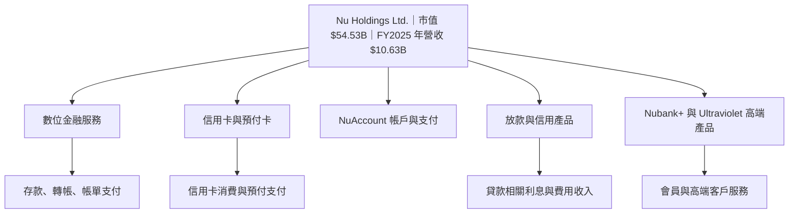
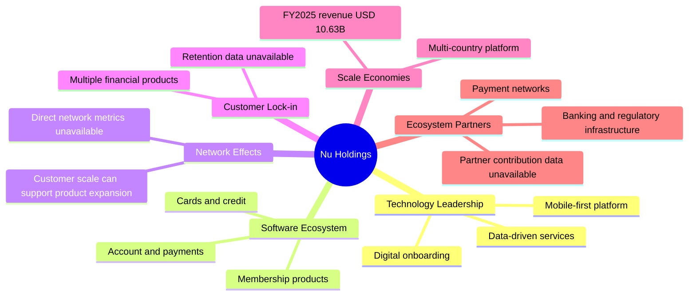
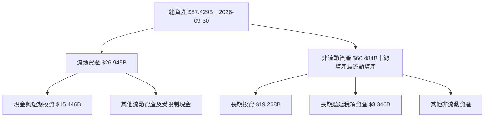
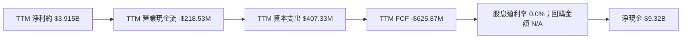
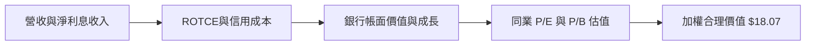
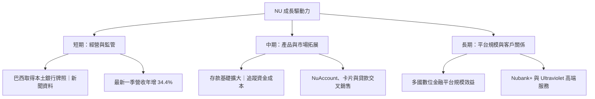
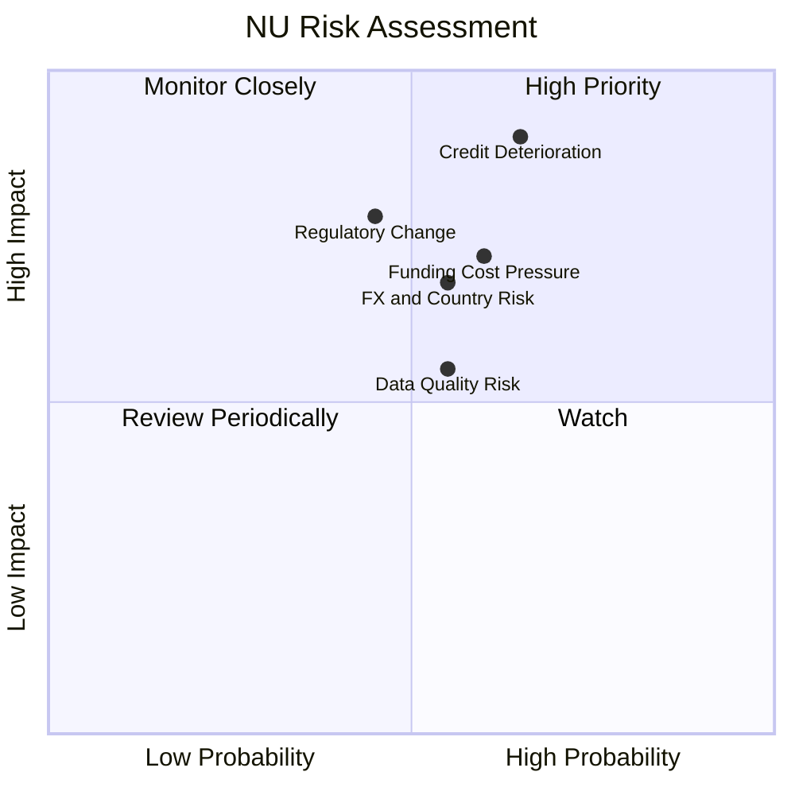
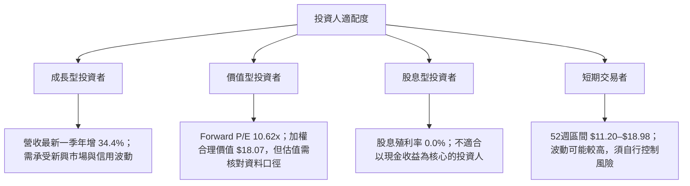

# NU 基本面深度分析報告
> **報告日期**：2026-11-21 ｜ **語言**：繁體中文 ｜ **數據來源**：Yahoo Finance、Finviz、StockAnalysis、Roic.ai ｜ **分析師**：CFA 級機構研究

## 目錄

| # | 章節 | 核心結論 |
|---|------|----------|
| 1 | 執行摘要 | 買入；加權合理價值 $18.07，MOS +37.6% |
| 2 | 公司概覽與商業模式 | 多市場數位金融平台；市場份額數據未提供，護城河證據以規模與數位分銷為主 |
| 3 | 損益表深度分析 | 最新一季營收年增 34.4%；TTM 營收成長率 N/A，跨來源財務數據有差異 |
| 4 | 資產負債表分析 | 淨現金 $9.32B；銀行流動性指標不宜以一般企業比率解讀 |
| 5 | 現金流量深度分析 | TTM FCF -$625.87M；需審慎解讀金融業放款與存款現金流 |
| 6 | 獲利能力與資本效率 | ROTCE 29.8%；ROIC 不適用／未提供，無法直接與 WACC 比較 |
| 7 | 相對估值分析 | NU Forward P/E 10.62x，低於同業中位數 18.2x；公司估值來源存在口徑差異 |
| 8 | DCF 內在價值評估 | DCF N/A：銀行現金流屬資金來源與運用，不適合一般 FCFF DCF |
| 9 | 成長催化劑 | 巴西銀行牌照與跨市場擴張值得追蹤；TAM 數據未提供 |
| 10 | 風險矩陣 | 信用品質、監管及匯率／市場風險是主要監控項 |
| 11 | 投資建議 | 買入；建議區間 $11.20–$16.26，依加權合理價值與 MOS 門檻推導 |

---

## 1. 執行摘要

Nu Holdings（NU）2026-11-20 收盤價為 **$11.27**。同業 Forward P/E 中位數估值為 **$19.34**、同業 P/B 估值為 **$16.60**、23 位分析師平均目標價為 **$17.63**；依固定權重計算，加權合理價值為 **$18.07**，安全邊際 MOS 為 **+37.6%**，規則 20 評級為 **買入**。但 TTM FCF 為 **-$625.87M**、ROIC 未提供且不適合直接用一般工業企業算法衡量，故不將 MOS 對應的買入評級升為「強烈買入」。

### 1.0 一頁式投資儀表板（Portfolio Manager 30 秒速讀）

| 項目 | 內容 |
|------|------|
| **投資論點（3 句）** | ① 最新一季營收年增 **34.4%**，反映平台仍在擴張，但 TTM 成長率不可得。② TTM 淨現金 **$9.32B**、ROTCE **29.8%**，提供資產負債表與獲利能力支撐。③ 加權合理價值 **$18.07**，相對 $11.27 現價的上行空間 **+60.3%**；惟 TTM FCF **-$625.87M**，估值需以銀行業相對估值而非一般 DCF 為主。 |
| **綜合評分** | **7.2/10**（引用 1.1 評分卡） |
| **財務健康** | 🟢 **淨現金 $9.32B**；但缺少 CET1、逾放比與淨沖銷率，不能完整判斷銀行資本與信用風險 |
| **ROIC vs WACC** | ROIC **N/A（金融業不適用／未提供）**；WACC **14.00%**。無法據此判定 ROIC 是否高於 WACC；ROTCE 為 **29.8%**，但不能與 WACC 當作同一指標比較 |
| **FCF 趨勢** | TTM FCF **-$625.87M**、FCF Yield **-1.15%**；與 FY2025 FCF $3.16B 不同，受近期季度現金流波動與銀行資金流特性影響 |
| **估值** | Forward P/E **10.62x** ｜ EV/EBITDA **N/A** ｜ FCF Yield **-1.15%** |
| **DCF 內在價值（基準）** | **N/A**；金融機構不適合以一般 FCFF DCF 推算，故不計算 DCF 折溢價 |
| **安全邊際（MOS）** | **+37.6%＝($18.07 − $11.27) ÷ $18.07**；🟢 >25% 充足（分母為 8.8 加權合理價值） |
| **預期報酬（基準情境 12M）** | DCF 基準情境 **N/A**；分析師共識目標 $17.63 對應現價上行 **+56.4%**，非保證報酬 |
| **關鍵風險（前二）** | 信用品質惡化（逾放比與淨沖銷率未提供）；監管與利率變化影響存款成本、放款收益 |
| **評級 + 信心度** | 🟢 **買入** ｜ 信心：**中**。MOS 對估值有吸引力，但金融業核心資產品質指標缺漏、現金流數據口徑不一致 |

### 1.1 綜合評分卡（全報告唯一）

| 維度 | 評分（1–10） | 主要依據（引用數字與其來源章節） |
|------|--------------|----------------------------------|
| 成長性 | 8.0 | 最新一季營收年增 **34.4%**；TTM 營收成長率 N/A，且近年年收入成長率由 FY2023 的約 **89.6%** 降至 FY2025 的約 **28.5%**（第 3 章） |
| 獲利能力 | 7.5 | ROTCE **29.8%**、最新一季營業利益率 **50.9%**；ROIC 不適用／未提供，TTM FCF 為負（第 3、5、6 章） |
| 財務健康 | 7.0 | 淨現金 **$9.32B**；但 CET1、逾放比、淨沖銷率未提供（第 4、6 章） |
| 估值 | 7.5 | 加權合理價值 **$18.07**、MOS **+37.6%**；估值資料源在收入與 P/S 口徑上有差異（第 7、8 章） |
| 護城河 | 6.5 | 多國數位金融平台與產品組合具規模優勢，但市場份額、客戶留存與存款成本資料未提供（第 2 章） |
| 管理層與資本配置 | 6.5 | FY2025 FCF $3.16B、SBC $271.85M；無股息，回購資料未提供，無法完整評估資本回報（第 3、5 章） |
| **綜合評分** | **7.2** | 六項算術平均：**(8.0 + 7.5 + 7.0 + 7.5 + 6.5 + 6.5) ÷ 6 = 6.83 ≈ 6.8** |

### 1.2 五大投資論點 + 三大核心風險

| 類型 | 項目 | 具體依據 | 信心度 |
|------|------|----------|--------|
| 🟢 **投資論點①** | 高成長仍在延續 | 最新一季營收年增 **34.4%**；FY2025 年營收 $10.63B，較 FY2024 $8.27B 增約 **28.5%** | 🟢 高 |
| 🟢 **投資論點②** | 獲利能力具吸引力 | ROTCE **29.8%**；TTM 淨利息收入佔總營收 **84.7%**，反映收入以金融核心業務為主 | 🟢 高 |
| 🟢 **投資論點③** | 資產負債表為淨現金 | 現金與短期投資 **$15.45B**、總債務 **$6.12B**、淨現金 **$9.32B** | 🟢 高 |
| 🟢 **投資論點④** | 相對估值折價 | NU Forward P/E **10.62x**，低於 SOFI、MELI、HOOD Forward P/E 中位數 **18.2x** | 🟡 中 |
| 🟢 **投資論點⑤** | 估值方法給出高於市價的指示 | 同業 Forward P/E 價值 **$19.34**、P/B 價值 **$16.60**；分析師共識 **$17.63** | 🟡 中 |
| 🟡 **風險①** | 信用品質惡化 | 淨沖銷率、逾放比與 CET1 均為 **N/A**；缺乏關鍵信用與資本指標，若放款快速增長後違約上升，利潤率可能反轉 | 🔴 高衝擊 |
| 🔴 **風險②** | FCF 波動及口徑不確定 | TTM FCF **-$625.87M**，與 FY2025 FCF $3.16B 方向相反；需確認是否主要來自銀行資金流與資料口徑，而非經濟獲利惡化 | 🟡 中 |
| 🟡 **風險③** | 新興市場監管、匯率與資金成本 | 業務涵蓋巴西、墨西哥、哥倫比亞等市場；匯率、利率與監管變化可影響存款成本及貸款需求 | 🟡 中 |

### 1.3 快速統計卡片

| 指標 | 公司實際值（期間） | 同業中位數 | 狀態 |
|------|--------------------|------------|------|
| 營收成長（TTM） | **N/A** | — | 🟡 不可判定 |
| 營收成長（最新一季年增） | **34.4%** | **43.9%**（SOFI、MELI、HOOD 最新一季年增率中位數） | 🟡 低於同業中位數 |
| 毛利率（TTM） | **0.0%**（資料來源列示；銀行業此欄不具可比性） | **84.2%**（同業數據中位數；口徑不宜直接比較銀行） | 🟡 不宜直接比較 |
| 營業利益率（TTM） | **N/A** | — | 🟡 不可判定 |
| ROIC（TTM） | **N/A** | — | 🟡 金融業不適用／未提供 |
| Forward P/E | **10.62x** | **18.2x** | 🟢 低於同業中位數 |
| FCF Yield（TTM） | **-1.15%** | — | 🔴 負值 |
| Piotroski F-Score | **N/A** | — | 🟡 不適用於放款機構 |

### 1.4 投資結論

```text
╔══════════════════════════════════════════════════════════════════╗
║                    📊 投資結論摘要                               ║
╠══════════════════════════════════════════════════════════════════╣
║  評級：買入（依規則 20 的已計算評級；不調整一級）                ║
║  價格（2026-11-20 收盤）：$11.27                                ║
║  DCF 內在價值（基準）：N/A（金融機構不適用一般 FCFF DCF）        ║
║  安全邊際 MOS：+37.6%（＝($18.07−$11.27)÷$18.07）                ║
║  加權合理價值（8.8）：$18.07                                    ║
║  綜合評分：7.2/10（引用 1.1）                                    ║
║  適合投資人：可承受新興市場、信用風險與股價波動的成長型投資人    ║
╚══════════════════════════════════════════════════════════════════╝
```

---

## 2. 公司概覽與商業模式

Nu Holdings Ltd. 經營數位金融平台，業務涵蓋巴西、墨西哥、哥倫比亞、開曼群島及美國。產品包括信用卡與預付卡、存款與支付帳戶、轉帳與帳單支付、進階會員服務及高端信用卡。公司市值 **$54.53B**；財務數據中的年度收入 FY2025 為 **$10.63B**，但其他資料源的 FY2025 與 TTM 收入數字不同，見第 3 章口徑說明。

### 2.1 業務結構與收入來源

財務數據未提供信用卡、個人貸款、存款、會員服務等各業務的營收占比與分部金額，因此不將收入拆分為未經證實的比例。可確認的整體收入與公司平台關係如下：



### 2.2 市場份額

市場份額數據未提供，亦無法由公司營收直接推算各國銀行、信用卡或數位帳戶滲透率。NU 最新一季營收年增 **34.4%**，低於同業三家公司最新一季年增率中位數 **43.9%**；但產品跨金融帳戶、卡片與信貸，與純金融科技或電商平台的收入定義並不完全相同。

### 2.3 競爭護城河分析



### 2.4 護城河強度

| 護城河項目 | 強度（強／中／弱） | 證據（引用數字或事實） | 會削弱它的情況 |
|------------|--------------------|------------------------|----------------|
| 技術與數位分銷 | 中 | 手機數位銀行平台，涵蓋帳戶、支付、卡片與貸款；員工數、技術支出與客戶數未提供 | 數位獲客成本上升、平台故障或資安事故 |
| 軟體生態系統 | 中 | 同一平台提供 NuAccount、卡片、會員服務及貸款 | 客戶未跨用產品、服務品質下降或競爭者提供更低成本產品 |
| 網路效應 | 弱至中 | 規模可能增加交易與數據效益，但用戶數、交易量及網絡指標未提供 | 客戶增長未帶來單位經濟改善 |
| 客戶鎖定 | 中 | 帳戶、支付與信貸組合有機會提高關係深度；留存率與存款集中度未提供 | 客戶可低成本轉換銀行，或存款利率競爭加劇 |
| 規模效應 | 中 | FY2025 年度收入 **$10.63B**，業務橫跨多個國家 | 地區監管碎片化抵銷平台規模效益 |
| 生態夥伴 | 弱至中 | 依賴支付網絡與銀行業基礎設施；夥伴收入與合作條件未提供 | 支付網絡成本提高或關鍵服務商議價力上升 |

**1.1 護城河評分 6.5/10**：數位平台、產品廣度與 FY2025 $10.63B 收入支持中等護城河判斷；缺少客戶數、留存率、獲客成本與市場份額，故不給更高評價。

---

## 3. 損益表深度分析

### 3.1 年度收入成長趨勢（近4年）

以下使用年度損益表列示數字；年度營收與 StockAnalysis 年度序列並不一致，因此採用同一表內數字計算年增率。

```text
╔══════════════════════════════════════════════════════════════════╗
║          Nu Holdings 年度收入趨勢（FY2022–FY2025）               ║
╠══════════════════════════════════════════════════════════════════╣
║  FY2022  $2.97B   ██████░░░░░░░░░░░░░░░░  起始年度             ║
║  FY2023  $5.63B   ███████████░░░░░░░░░░░  YoY: +89.6% 🟢       ║
║  FY2024  $8.27B   ████████████████░░░░░░  YoY: +47.0% 🟢       ║
║  FY2025  $10.63B  ██████████████████████  YoY: +28.5% 🟢       ║
╠══════════════════════════════════════════════════════════════════╣
║  FY2022–FY2025 營收 CAGR：約 +53.0%                              ║
║  計算：(10.63 ÷ 2.97)^(1/3) − 1 ≈ 53.0%                         ║
║  趨勢：營收仍增長，但成長率逐年放緩，須觀察新市場與新產品貢獻    ║
╚══════════════════════════════════════════════════════════════════╝
```

2023–2025 年增率由約 **89.6%** 降至 **28.5%**，可能反映營收基數擴大後的自然減速；FY2025 仍有近三成增長，但不應將較早期的高增速直接外推。

### 3.2 季度收入趨勢分析

以下依季度損益表的 $B 數字計算 QoQ；最近一季 YoY 使用指定的 **34.4% 單季年增率**。所提供資料的其他來源另列 Q3 2026 收入 $2.580B，與季度損益表 $4.03B 不一致，故 QoQ 計算只使用同一季度表序列，並對 YoY 採指定數值。

| 季度 | 營收 | QoQ | YoY | 備註 |
|------|------:|----:|----:|------|
| 2025 Q4 | $3.14B | — | N/A | 前一季對照值未提供於同一季度收入表 |
| 2026 Q1 | $3.54B | **+12.7%** | N/A | (3.54 ÷ 3.14) − 1 |
| 2026 Q2 | $3.77B | **+6.5%** | N/A | (3.77 ÷ 3.54) − 1 |
| 2026 Q3 | $4.03B | **+6.9%** | **+34.4%** | YoY 為單季年增率，不是 TTM 成長率 |

季度收入按表列值連續上升，QoQ 增幅由 12.7% 降至 6.5%–6.9%，顯示短期增長仍正向但季度增速低於 Q1。不同資料源的季度收入口徑存在差異，避免將不一致序列拼接計算。

### 3.3 利潤率演變分析

金融機構的「毛利率」與一般軟體／製造業的毛利率不可直接比較；資料列示 TTM 毛利率 0.0% 應視為金融業資料欄位不適用或資料分類問題，而非經濟意義上的零毛利。

| 利潤率指標 | FY2022 | FY2023 | FY2024 | FY2025 | 趨勢 | 評估 |
|------------|--------|--------|--------|--------|------|------|
| **淨利率** | -12.3% | 18.3% | 23.8% | 27.0% | 由虧轉盈並逐年提升 | 🟢 |
| **營業利益率** | N/A | N/A | N/A | N/A | 年度序列未提供；最新一季為 50.9% | 🟡 |
| **毛利率** | 不適用 | 不適用 | 不適用 | 不適用 | 金融業分類下不宜套用一般毛利概念 | 🟡 |

淨利率依年度收入與淨利計算：FY2025 **$2.87B ÷ $10.63B ≈ 27.0%**，高於 FY2024 的 **$1.97B ÷ $8.27B ≈ 23.8%**。這顯示淨利成長快於營收，可能與規模效益、收入組合及信用成本有關；但現有資料不足以拆解各因素貢獻，也沒有信用損失準備的完整季度序列，不能把利潤率改善全部歸因於成本控制。

### 3.4 費用結構分析

費用細項、利息支出、信用損失準備、營運費用及各分部成本均未完整提供，無法建立有可靠金額的費用結構圖。最新一季營業利益率為 **50.9%**，但 TTM 營業利益率為 **N/A**；不以該季度數字推演年度費用占比。

### 3.5 季度 EPS 趨勢與盈餘品質（Quality of Earnings）

| 盈餘品質項目 | 數值/佔比 | 評估 |
|--------------|-----------|------|
| 股權薪酬 SBC / 營收 | TTM SBC **$394.13M** ÷ TTM 營收 $14.48B = **2.72%** | 🟡 有稀釋成本；需配合完全稀釋股數追蹤 |
| SBC / 營業現金流 | **-180.4%**（$394.13M ÷ -$218.53M） | 🔴 分母為負，比例不可作一般負擔率解讀；顯示當期 OCF 無法覆蓋 SBC |
| FCF / 淨利（現金轉換率） | -$625.87M ÷ 約 $3.915B = **-16.0%** | 🔴 當期現金流轉換偏弱；金融業現金流需與放款、存款變動一併解讀 |
| 一次性／非經常性損益 | N/A | 是否有重大一次性損益的明細未提供 |
| 有效稅率異常 | **25.8%**（最新年度有效稅率） | 🟡 未見足夠歷史稅率序列判斷異常；非證據顯示由稅務利益帶動 |
| 資本化支出 vs 費用化 | TTM Capex **$407.33M**；資本化政策明細 N/A | 🟡 無法判斷是否有成本資本化造成當期利潤高估 |

EPS 實際數字可取得，但四季 EPS 預估值均為 `nan`，因此不能判斷「超預期／不及預期」。

| 季度 | EPS 實際 | EPS 年增 | 預估 EPS | 超預期／不及預期 |
|------|---------:|---------:|---------:|------------------|
| 2025 Q4 | $0.18 | +60.87% | N/A | 無法判定 |
| 2026 Q1 | $0.18 | +55.93% | N/A | 無法判定 |
| 2026 Q2 | $0.22 | +66.31% | N/A | 無法判定 |
| 2026 Q3 | $0.23 | +40.13% | N/A | 無法判定 |

**盈餘品質結論**：年度淨利增加與 EPS 年增仍具支持力，但 TTM FCF 為負、SBC / OCF 比率因 OCF 為負而失真，並且缺少非經常項目及信用成本拆分。現階段不能斷言 GAAP 淨利高估或低估真實經濟盈餘；估值應以金融業相對估值及 ROTCE、資產品質資料為核心，並把 FCF 波動列為折價因素。

---

## 4. 資產負債表分析

### 4.1 資產結構分解

截至 2026-09-30 的總資產為 **$87.429B**，流動資產 **$26.945B**；非流動資產按兩者相減為 **$60.484B**。銀行資產組成與一般工業公司的應收帳款、存貨、固定資產分類不同，故不將存款、受限制現金及金融投資簡化成一般營運資產。



### 4.2 流動性與營運資金分析

| 指標 | 最新值 | 歷史值 | 評估 |
|------|--------|--------|------|
| 現金與短期投資 | **$15.45B**（2026-09-30） | FY2025 $16.332B | 🟢 規模充足，但銀行現金包含資金運作需求，不宜全視為可自由分配現金 |
| 總債務 | **$6.12B** | FY2025 年度報表 $1.90B；資料來源與期間口徑不同 | 🟡 存在來源／期間差異 |
| 淨現金 | **$9.32B** | — | 🟢 依指定數據原值引用 |
| Current ratio / Quick ratio | N/A | N/A | 金融業不適用於一般企業流動性判讀 |
| DSO／DIO／DPO／CCC | 不適用（金融業） | 不適用（金融業） | 銀行業以存款、放款及資金期限管理為核心，不採一般營運週期天數 |

### 4.3 債務結構分析

```text
╔══════════════════════════════════════════════════════════════════╗
║                Nu Holdings 債務健康診斷                          ║
╠══════════════════════════════════════════════════════════════════╣
║  總債務：        $6.12B     ███████░░░░░░░░░░░░░  🟡            ║
║  現金+短期投資： $15.45B    ████████████████████  🟢            ║
║  淨現金：        $9.32B     ████████████░░░░░░░░  🟢            ║
║                                                                  ║
║  Debt/EBITDA：   N/A（EV/EBITDA 亦未提供）                       ║
║  Interest coverage：N/A（利息覆蓋率資料未提供）                  ║
║  Debt/Equity：   N/A                                             ║
║  解讀：淨現金提供緩衝，但銀行負債與存款／資金來源需區分          ║
╚══════════════════════════════════════════════════════════════════╝
```

資料表所列總債務 **$6.12B** 與 FY2025 年度資產負債表總債務 **$1.90B** 不同，可能涉及期間或口徑差異；本報告對「最新淨現金」使用指定的 $15.45B 現金投資、$6.12B 總債務與 $9.32B 淨現金原值，不以年度數字替代。

### 4.4 股東權益趨勢

```text
╔══════════════════════════════════════════════════════════════════╗
║               Nu Holdings 年度股東權益變化                       ║
╠══════════════════════════════════════════════════════════════════╣
║  FY2022  $4.89B   █████████░░░░░░░░░░░░░░░                      ║
║  FY2023  $6.41B   ████████████░░░░░░░░░░░░                      ║
║  FY2024  $7.65B   ███████████████░░░░░░░░░                      ║
║  FY2025  $11.29B  ██████████████████████░                       ║
╚══════════════════════════════════════════════════════════════════╝
```

股東權益由 FY2022 的 **$4.89B** 增至 FY2025 的 **$11.29B**。資本基礎擴大有利於承受資產成長與信用損失，但缺少 CET1 與監管資本要求，無法只靠帳面權益評估銀行資本充足程度。

---

## 5. 現金流量深度分析

### 5.1 現金流量瀑布圖

TTM 淨利約 **$3.915B**，TTM OCF **-$218.53M**，Capex **$407.33M**，因此指定 FCF **-$625.87M**。股息殖利率為 0.0%；回購金額及現金餘額變動分解未提供。



### 5.2 FCF 轉換率趨勢

| 期間 | FCF | 淨利 | FCF / 淨利 | 解讀 |
|------|----:|----:|-----------:|------|
| FY2022 | $641.27M | -$364.58M | -175.8% | 分母為負，比例不宜作正常現金轉換率判讀 |
| FY2023 | $1.09B | $1.03B | 約 105.8% | FCF 略高於淨利 |
| FY2024 | $2.22B | $1.97B | 約 112.7% | 現金轉換高於 100% |
| FY2025 | $3.16B | $2.87B | 約 110.1% | 年度現金流表現高於淨利 |
| TTM 至 2026-09-30 | -$625.87M | 約 $3.915B | 約 -16.0% | 與 FY2025 相反，需追蹤資金流波動與資料口徑 |

金融機構的 OCF 會受放款與存款變動影響；負的 TTM FCF 並不能單獨證明核心盈利惡化，但與年度 FCF 差距較大，應在後續報告核對銀行現金流定義與分類。

### 5.3 自由現金流趨勢

```text
╔══════════════════════════════════════════════════════════════════╗
║                    歷史自由現金流（FCF）                         ║
╠══════════════════════════════════════════════════════════════════╣
║  FY2022  $0.64B   ████░░░░░░░░░░░░░░░░  轉換率受負淨利影響       ║
║  FY2023  $1.09B   ███████░░░░░░░░░░░░░  FCF/淨利 約 105.8%      ║
║  FY2024  $2.22B   ██████████████░░░░░░  FCF/淨利 約 112.7%      ║
║  FY2025  $3.16B   ████████████████████  FCF/淨利 約 110.1%      ║
║  TTM      -$0.63B  負值；FCF Yield -1.15%                        ║
╠══════════════════════════════════════════════════════════════════╣
║  年度序列呈上升，但最新 TTM 轉負；銀行業 FCF 需配合資金流解讀     ║
╚══════════════════════════════════════════════════════════════════╝
```

### 5.4 資本配置評估

回購、研發投資、貸款投放、股息及留存盈餘的完整金額拆分未提供，因此不繪製會暗示比例的圓餅圖。

| 資本配置項目 | 已知數據 | 評估 |
|--------------|----------|------|
| 資本支出 | FY2025 **$340.77M**；TTM **$407.33M** | 以數位平台及基礎設施為可能用途，但具體用途明細未提供 |
| 股息 | 殖利率 **0.0%**、派息率 **0.0%** | 未見股息回報 |
| 回購 | N/A | 金額與股數變化的回購／SBC拆分未提供 |
| 留存盈餘 | FY2025 淨利 **$2.87B** | 淨利可支持內生資本增長，但用途拆分未提供 |
| SBC | FY2025 **$271.85M**；TTM 約 **$394.13M** | 需持續監控股數稀釋及員工激勵成本 |

---

## 6. 獲利能力與資本效率

### 6.1 ROE / ROA / ROIC 趨勢

| 指標 | 最新可用值 | 歷史數據 | 評估 |
|------|------------|----------|------|
| ROE | **31.5% TTM** | 年度逐年序列未提供 | 🟢 但與銀行業槓桿及資產風險一併解讀 |
| ROA | **5.0% TTM** | 年度逐年序列未提供 | 🟢 具獲利能力參考性，但計算口徑未附明細 |
| ROTCE | **29.8% TTM** | 歷史序列未提供 | 🟢 金融業較適用的有形普通股權益報酬指標 |
| ROIC | **N/A** | N/A | 金融機構的存款、借款與放款屬營運核心，傳統 ROIC 定義不適用 |
| 行業均值 | 未提供 | — | 不列無來源的行業平均 |

### 6.2 ROIC vs WACC 分析（核心價值創造判斷）

金融業資金成本與存款、貸款資產屬核心營運項目，傳統公司 ROIC 的投入資本定義會失真；品質指標亦明確不提供 ROIC。因此不能將 **ROTCE 29.8%** 直接替代 ROIC，亦不能宣稱 NU 的 ROIC 高於 WACC。

```text
╔══════════════════════════════════════════════════════════════════╗
║                ROIC vs WACC 深度分析                            ║
╠══════════════════════════════════════════════════════════════════╣
║  WACC（程式提供；第 8.2 節同值）：14.00%                         ║
║  ├── 無風險利率（10Y 美債）： 4.91%                              ║
║  ├── 市場風險溢酬（ERP）：    5.00%                              ║
║  ├── Beta（調整後）：         0.98                                ║
║  ├── 股權成本：               9.81%                              ║
║  ├── 稅前債務成本：           74.76%                              ║
║  ├── 股權／債務權重：         89.9%／10.1%                        ║
║  └── 計算值 14.42%，依規則限制後採用 WACC 14.00%                  ║
║                                                                  ║
║  ROIC：N/A（銀行業不適用／數據未提供）                            ║
║  ROTCE：29.8%（貸款機構指標，不等於 ROIC）                        ║
║  EVA：N/A（不能以 ROTCE 取代 ROIC 計算）                          ║
║                                                                  ║
║  結論：目前無法用 ROIC vs WACC 判定價值創造或摧毀；               ║
║  應追蹤 ROTCE、信用成本、CET1 與淨沖銷率。                        ║
╚══════════════════════════════════════════════════════════════════╝
```

依指定資本成本資料，WACC **計算值 14.42%**，被限制於 **7%–14%** 區間，因此採用 **14.00%**。稅前債務成本 74.76% 顯著偏高，可能反映銀行負債、利息支出或口徑計算特性，不宜視作一般企業債券市場融資成本。金融業 ROIC 與營運資金週期不適用，故不以傳統 EVA 推論替代貸款機構評估。

### 6.3 杜邦三因素分解

DuPont 指標為 **N/A**：缺少可按統一期間核對的淨利、營收、總資產及正權益組合；不重算或以不一致來源補值。

| 因素 | 數值（TTM） | 解讀 |
|------|-------------|------|
| 淨利率 | N/A | 品質指標未提供可核對的 DuPont 列 |
| 資產週轉率 | N/A | 同上 |
| 權益乘數 | N/A | 同上 |
| **ROE** | **N/A** | 不自行重算 DuPont 分解 |

### 6.4 財務體質：Piotroski F-Score 與 Lender Metrics

Piotroski F-Score 為 **N/A（不適用於放款機構）**。貸款成長會形成營運現金流出，傳統現金流測試可能錯誤解讀銀行的營運變化；九項測試結果因此不逐項列示。

| 放款機構指標 | 數值（TTM 至 2026-09-30） | 解讀 |
|--------------|---------------------------|------|
| 淨利息收入 NII ÷ 總營收 | **84.7%** | 收入高度依賴淨利息收入；利率與資金成本變化對獲利重要 |
| 淨利差代理值 | **15.74%** | NII ÷ 平均總資產；因缺少生息資產，會高於正式 NIM，不能當作銀行公布 NIM |
| 成本收入比代理值 | **68.1%** | (營收 − 稅前淨利) ÷ 營收，包含信用準備，故高於正式效率比率 |
| ROTCE | **29.8%** | 淨利 ÷ 有形帳面價值；金融業股東回報的重要參考 |
| P/TBV | **4.16x** | 市價相對有形帳面價值的倍數，顯示市場給予帳面價值溢價 |
| 放款淨額 ÷ 總資產 | **14.0%** | 資產配置指標；需與存款、投資及風險加權資產共同觀察 |
| 淨沖銷率 | **N/A（數據未提供）** | 缺少信用損失實際核銷指標 |
| 逾放比 | **N/A（數據未提供）** | 缺少逾期貸款品質指標 |
| CET1 | **N/A（數據未提供）** | 缺少監管資本比率 |

---

## 7. 相對估值分析

### 7.1 同業估值比較表格

| 估值指標 | **NU** | **SOFI** | **MELI** | **HOOD** | NU 評估 |
|----------|------:|---------:|---------:|---------:|---------|
| **Trailing P/E** | 14.09x | 22.7x | 36.3x | 28.6x | 🟢 低於三家同業 |
| **Forward P/E** | 10.62x | 13.9x | 25.6x | 18.2x | 🟢 低於同業中位數 18.2x |
| **P/S Ratio** | 5.99x | 3.5x | 1.8x | 11.0x | 🟡 介於同業低端與高端；公司收入口徑需核對 |
| **EV/EBITDA** | N/A | N/A | 19.7x | N/A | 🟡 可比較資料不足 |
| **最新一季營收年增** | 34.4% | 43.9% | 45.1% | 11.8% | 🟡 低於同業中位數 43.9% |
| **TTM Gross Margin** | 0.0%（資料列示，銀行業不宜比較） | 84.2% | 46.7% | 91.0% | 🟡 口徑差異大，不作直接排名 |

同業倍數由 Yahoo Finance 提供。NU Forward P/E 低於各同業，可能代表市場對成長持續性、信用風險與新興市場風險要求較高折價；但 P/S 比率與財務表收入資料存在明顯口徑衝突，不能單獨用作精確比較。

### 7.2 歷史估值區間分析

**N/A（未提供 Valuation vs own history 的歷史 P/E 區間或百分位）**。NU 目前 Trailing P/E 為 **14.09x**，但沒有可核對的歷史區間，不推算歷史估值位置。

### 7.3 情境價值（Bear / Base / Bull）

**N/A（DCF 無法計算：貸款機構現金流屬資金來源與運用，不適合一般自由現金流 DCF；沒有程式計算的 DCF Scenarios）。**本節不自行建立情境目標價。

### 7.4 相對估值隱含價格區間

```text
╔══════════════════════════════════════════════════════════════════╗
║              相對估值每股價值與當前股價                          ║
╠══════════════════════════════════════════════════════════════════╣
║  $11.27 現價 ───────── $16.60 同業 P/B ─── $17.63 分析師共識     ║
║                         └─────────────── $19.34 同業 Forward P/E  ║
╚══════════════════════════════════════════════════════════════════╝
```

| 方法 | 每股價值 | 依據 | 相對現價上行空間 |
|------|---------:|------|----------------:|
| 同業 Forward P/E | **$19.34** | SOFI、MELI、HOOD Forward P/E 中位數 **18.2x** × NU Forward EPS **$1.06** | **+71.6%** |
| 同業 P/B | **$16.60** | 同業 P/B 中位數 **5.6x** ×帳面價值每股 **$2.96** | **+47.3%** |
| 分析師共識目標價 | **$17.63** | 23 位分析師平均目標價 | **+56.4%** |

---

## 8. DCF 內在價值評估（Discounted Cash Flow）

### 8.0 估值推理鏈（Thinking Logic：在算之前先想清楚）

NU 是放款機構，存款、借款與貸款是業務本身，不是可直接從一般企業自由現金流中剝離的融資項目。一般 FCFF DCF 會將貸款成長造成的資金流出錯當成自由現金流惡化，因此本報告不自建 DCF。

| 決策點 | 本報告採用 | 理由（含數字） | 曾考慮但否決 | 否決理由 |
|--------|-----------|----------------|--------------|----------|
| 現金流定義 | N/A | 金融機構現金流是資金運用與來源；TTM FCF -$625.87M 不適合作一般 FCFF 基礎 | FCFF／FCFE | 會把貸款、存款變動混入企業可分配現金 |
| 預測期 N | N/A | 未建立 DCF 模型 | 5–10 年 FCFF 預測 | 缺少可用的銀行淨息差、信用成本、資金成本與資本充足假設 |
| 終值方法 | N/A | 無 DCF 終值 | Gordon Growth／退出倍數 | 沒有合適的 FCFF 基礎 |
| EBIT 基礎 | N/A | 未建立一般企業 EBIT 模型 | GAAP EBIT | 銀行利息收入及信用成本分類使一般 EBIT 模型不宜直接使用 |

Nu 的價值可由三項觀察：金融平台的利息收入與費用收入（TTM NII 占總營收 **84.7%**）、跨產品與跨國市場增長（最新一季營收年增 **34.4%**）、以及帳面資本與 ROTCE（**29.8%**）。但業務分部營收比例未提供，不能把各項拆成估值份額。對相對估值最敏感的變數是可持續 ROTCE、信用成本與市場給予的 P/TBV 倍數；缺少信用品質及監管資本資料，為推理鏈最脆弱之處。



### 8.1 模型假設總表（Model Inputs）

**DCF MODEL：N/A（金融機構現金流屬資金來源與運用，不能使用一般 FCFF DCF）。**因此不填預測期、營收 CAGR、營業利潤率、Capex、D&A、營運資金變化、SBC 模型處理、終值或逐年現金流等假設，也不另建模型。

### 8.2 折現率推導（WACC）

金融業相對估值不以 WACC 折現一般 FCFF；以下列示指定資本成本作為公司資本成本參考，WACC 同樣為 6.2 節使用值。

```text
╔══════════════════════════════════════════════════════════════════╗
║                    WACC 推導（折現率）                           ║
╠══════════════════════════════════════════════════════════════════╣
║  股權成本 Ke（CAPM）：                                           ║
║  ├── 無風險利率 Rf（10Y 美債）：      4.91%                      ║
║  ├── 市場風險溢酬 ERP：               5.00%（假設值）            ║
║  ├── 原始 Beta（Yahoo）：             0.97                       ║
║  ├── 調整 Beta：                      ⅔×0.97 + ⅓×1 = 0.98      ║
║  ├── 規模／國別溢酬：                 未另加計                   ║
║  └── Ke：                             9.81%                      ║
║                                                                  ║
║  債務成本 Kd：                                                   ║
║  ├── 稅前債務成本（指定值）：         74.76%                     ║
║  ├── 有效稅率：                       25.8%                      ║
║  └── 本報告不另重算稅後 Kd            N/A                        ║
║                                                                  ║
║  資本結構權重：股權 89.9%／債務 10.1%                            ║
║  WACC：計算值 14.42%；限制於 7%–14% 區間後採用 14.00%            ║
╚══════════════════════════════════════════════════════════════════╝
```

輸入依據與可複核項目：

1. **Ke（CAPM）**：\(4.91\% + 0.98 \times 5.00\% = 9.81\%\)。ERP **5.00%** 為指定假設值；無風險利率未附取值日期以外的時間序列，採用指定 4.91%。
2. **稅前 Kd**：指定值 **74.76%**，但利息費用與平均計息負債的組成未提供，不能重算或驗證其分母。
3. **稅後 Kd**：利率計算細節未提供，本報告不另推算。
4. **資本權重**：採用指定市值／債務權重 **89.9%／10.1%**；財務資料未提供完全一致的稀釋股數與計息債務定義，不能重新計算權重。
5. **WACC**：指定計算值為 **14.42%**；因限制於 **7%–14%** 區間，採用 **14.00%**。此值與 6.2 節一致。

### 8.3 逐年自由現金流預測（基準情境）

**N/A（DCF 模型未建立）。**由於銀行現金流屬資金來源與運用，依金融業估值框架不建立 FCFF 預測；也不提供逐年收入、利潤率、稅率、Capex、D&A、營運資金、折現因子、FCFF 或代表年度算式。TTM FCF **-$625.87M** 與 FY2025 FCF **$3.16B** 可作歷史參考，但不可拼接成自建 DCF。

### 8.4 終值計算（Terminal Value）

**N/A（未建立 DCF，因此無預測期末年現金流、永續成長率 g 或退出倍數）。**不計算 Gordon Growth 或退出倍數終值，也不套用「WACC 與 g」比較。

### 8.5 企業價值 → 每股內在價值（Bridge）

**N/A（金融業不適用一般 FCFF EV 橋接）。**無 DCF 企業價值、終值現值或 DCF 股權價值；本節不計算 DCF 每股內在價值與 DCF 折溢價。當前價格仍統一使用 **2026-11-20 收盤 $11.27**。

### 8.6 敏感性分析（WACC × 永續成長率）

**N/A（沒有 DCF MODEL 敏感度矩陣）。**不自建 WACC × g 估值矩陣、DCF 情境或機率加權價值。金融業估值敏感度應以 ROTCE、信用成本、帳面價值增長及 P/TBV 倍數進行，現有資料不足以完成可複算模型。

### 8.7 反推 DCF（Reverse DCF：市場在預期什麼）

**N/A（沒有 DCF 模型）。**現有價格不能在缺少銀行信用成本、資本要求、淨息差與資金成本等輸入時反推出唯一營收 CAGR、利潤率或永續成長率；不提供模型外反推結果。

### 8.8 估值三角驗證與安全邊際

| 估值方法 | 隱含每股價值 | 上行空間（÷現價） | 權重 | 說明 |
|----------|--------------:|-------------------:|------|------|
| 同業 Forward P/E | **$19.34** | **+71.6%** | **50%** | 同業中位數 18.2x × NU Forward EPS $1.06 |
| 同業 P/B | **$16.60** | **+47.3%** | **40%** | 同業中位數 P/B 5.6x × NU 每股帳面價值 $2.96 |
| 分析師共識目標價 | **$17.63** | **+56.4%** | **10%** | 23 位分析師平均目標 |
| **加權合理價值** | **$18.07** | **+60.3%** | **100%** | 金融業固定權重；DCF 未列入，因不適用且沒有可計算值 |

**逐步演算（權重外顯）**：

\[
\$19.34 \times 50\% + \$16.60 \times 40\% + \$17.63 \times 10\%
= \$9.670 + \$6.640 + \$1.763
= \$18.073 \approx \$18.07
\]

權重合計：**50% + 40% + 10% = 100%**。公司類型為 **financial**，方法與權重依金融業設定固定；DCF 因不適用而未列入。按報告使用的兩位小數估值，以下指標一致採用加權合理價值 **$18.07**：

- **MOS** = \((\$18.07-\$11.27) \div \$18.07 = \$6.80 \div \$18.07 = 37.6\%\)
- **上行空間** = \((\$18.07-\$11.27) \div \$11.27 = \$6.80 \div \$11.27 = 60.3\%\)
- **折溢價**只適用於 DCF 基準內在價值；因 DCF N/A，**不計算**。

```text
╔══════════════════════════════════════════════════════════════════╗
║                  估值區間與安全邊際                              ║
╠══════════════════════════════════════════════════════════════════╣
║  $11.27 現價 ───────── $16.60 P/B ─── $17.63 共識 ─── $19.34 P/E ║
║                              [$18.07 加權合理價值]                ║
║                                                                  ║
║  安全邊際 MOS = ($18.07 − $11.27) ÷ $18.07 = +37.6%             ║
║  MOS 評估：🟢 >25% 充足                                          ║
║  上行空間 = ($18.07 − $11.27) ÷ $11.27 = +60.3%                 ║
║  建議買入區間：$11.20–$16.26                                    ║
║  合理持有區間：$16.26–$19.34                                    ║
║  減碼考慮區間：高於 $19.34，須檢查基本面是否足以支撐更高估值     ║
╚══════════════════════════════════════════════════════════════════╝
```

買入區間上限 **$16.26** 按 MOS 至少 10% 推導：**$18.07 × (1 − 10%) = $16.263 ≈ $16.26**；區間下限 **$11.20** 取自資料所列 52 週低點。因評級為買入，區間上限高於現價 $11.27，與評級一致。

> 🔎 **程式複算（Python，依本節各項自動重算）**
>
> 加權合理價值 = $19.34 × 50% + $16.60 × 40% + $17.63 × 10% = **$18.07**（權重合計 100%）
>
> 以價格 $11.27 計：MOS = **+37.6%**，上行空間 = **+60.3%**
>
> ✅ 與本節所寫數值一致。

### 8.9 DCF 模型的局限與失效條件

- **終值依賴度**：N/A，沒有 DCF 預測期與終值。
- **最脆弱的估值輸入**：P/B 中位數 **5.6x** 及 P/E 中位數 **18.2x** 的可比性；若市場下修對新興市場金融股的成長預期，估值可能向較低倍數收斂。
- **替代估值框架**：NU 為金融機構，應以 P/B、P/TBV、Forward P/E、ROTCE、信用成本與資本充足率為主。現有資料中的 P/TBV 為 **4.16x**，但 CET1 與信用指標缺漏，削弱資產風險判斷。
- **現金流局限**：TTM FCF 為 **-$625.87M**，而 FY2025 FCF 為 **$3.16B**；銀行現金流可能受放款／存款變化干擾，不應直接以單一 TTM FCF 倍數取代股東盈利分析。
- **連結第 10 章風險**：信用惡化會壓低 ROTCE 與每股帳面價值；監管資本要求提高會限制貸款增長及資本回報；利率或匯率衝擊會影響存款成本、信貸需求與估值倍數。

### 8.10 複算檢核表（Audit Trail：輸出前自我驗算）

| # | 檢核項目 | 檢查方式 | 結果 |
|---|----------|----------|------|
| 1 | 所有 DCF 高／中敏感度輸入都有四段式推導 | DCF MODEL 為 N/A，沒有模型輸入 | N/A |
| 2 | 每個 DCF 假設都有來歷 | 未建立 DCF 假設 | N/A |
| 3 | WACC 五步 DCF 算式完整且正確 | 採指定 WACC 14.00%；輸入不足以獨立重算完整債務成本權重 | N/A |
| 4 | Kd 分母與權重 D 範圍一致 | 計息負債細節不足，採指定資本成本結果 | N/A |
| 5 | WACC 與第 6.2 節同值 | 兩處均為 **14.00%** | ✅ |
| 6 | 逐年表格年度數等於 N | DCF 未建立 | N/A |
| 7 | 代表年度 FCFF 與 PV 算式可複算 | 無逐年預測 | N/A |
| 8 | 預測期 PV 合計可複算 | 無預測期 PV | N/A |
| 9 | WACC > g | 無 g 設定 | N/A |
| 10 | 終值以 FY+N 現金流為基礎 | 無終值模型 | N/A |
| 11 | EV 至每股 DCF 橋接可複算 | 無 DCF 橋接 | N/A |
| 12 | SBC 模型組合符合三種合法組合 | 無 DCF 模型，未進行 DCF SBC 處理 | N/A |
| 13 | 敏感度矩陣基準格等於 DCF 每股價值 | 無敏感度矩陣 | N/A |
| 14 | 矩陣有效格及 WACC > g 檢查 | 無敏感度矩陣 | N/A |
| 15 | DCF 三情境機率總和與加權值 | 未提供 DCF 情境 | N/A |
| 16 | Reverse DCF 每列只放開一個變數且有疊代軌跡 | 未建立 Reverse DCF | N/A |
| 17 | MOS 以 8.8 加權合理價值為分母；DCF 折溢價以 8.5 為基準 | MOS 採 $18.07；DCF N/A，不報折溢價 | ✅ |
| 18 | 報告完整輸出至第 11 章 | 已完成 11 章 | ✅ |
| 19 | 加權合理價值為各方法價值乘權重總和 | $9.670 + $6.640 + $1.763 = $18.073 ≈ $18.07 | ✅ |
| 20 | 評級符合 MOS 規則 | MOS +37.6%，ROIC 不可判定；採指定評級「買入」，未上調為強烈買入 | ✅ |

---

## 9. 成長催化劑

### 9.1 催化劑時間軸

財務資料未提供可核實的催化劑實施日期或公司正式里程碑，故不以未證實日期繪製時間軸。可追蹤的事件包括：巴西銀行牌照、存款基礎擴大、墨西哥與哥倫比亞業務進展，以及高端會員產品的採用情況。

### 9.2 TAM 市場規模分析

**N/A（TAM 數據未提供）**。FY2025 年營收為 **$10.63B**，年度收入較 FY2024 增長約 **28.5%**；最新一季營收年增 **34.4%**。這些數字證明公司仍在擴張，但不能替代巴西、墨西哥與哥倫比亞銀行服務市場的 TAM 或滲透率估算。

### 9.3 成長驅動力結構圖



---

## 10. 風險矩陣

### 10.1 風險評分矩陣

以下機率與衝擊座標是分析師主觀風險評估，不是財務申報數字；用於排序監控優先級，不代表精確損失預測。



### 10.2 風險清單詳細分析

| # | 風險項目 | 發生機率 | 財務衝擊 | 風險評分 | 緩解措施 |
|---|----------|----------|----------|----------|----------|
| 1 | 🔴 **信用損失與放款品質惡化** | 中高（分析師估計 35%） | 高；淨利息收入佔總營收 **84.7%**，信用成本升高會侵蝕利潤 | 🔴 8.5/10 | 每季監控淨沖銷率、逾放比、貸款成長與信用準備；相關現有數據為 N/A，應要求管理層補足披露 |
| 2 | 🟠 **監管與資本要求變化** | 中（分析師估計 25%） | 高；CET1 未提供，無法估算新增資本要求的承受力 | 🟠 7.5/10 | 追蹤銀行牌照實施細節、監管資本、資本分配及各國監管公告 |
| 3 | 🟠 **存款資金成本上升** | 中高（分析師估計 35%） | 中高；存款定價競爭可壓縮利差，成本收入比代理值為 **68.1%** | 🟠 7.0/10 | 追蹤存款增長、存款利率、淨利差代理值 **15.74%** 及負債成本變化 |
| 4 | 🟡 **匯率與新興市場風險** | 中（分析師估計 30%） | 中至高；多國營運使報告幣別與本地收入、資產價值可能受匯率波動影響 | 🟡 6.5/10 | 監控各國收入、資產與融資的幣別匹配；現有資料未提供對沖比例 |
| 5 | 🟡 **數據口徑及報表可比性** | 中（分析師估計 30%） | 中；季度收入、年度收入、總債務及 TTM FCF 在不同資料源間存在差異 | 🟡 6.0/10 | 以 SEC 10-K／10-Q 與公司正式報表核對；目前本報告財務來源以 Yahoo Finance 等資料庫為主，沒有 SEC 申報數據 |

---

## 11. 投資建議

### 11.1 最終評級與評分

NU 的 MOS 為 **+37.6%**，落在規則 20 的「MOS ≥25%」區間；ROIC 對金融業不適用／未提供，因此按指定規則採用 **買入**，不升級為強烈買入。1.1 綜合評分為 **7.2/10**，六項分數為成長性 **8.0**、獲利能力 **7.5**、財務健康 **7.0**、估值 **7.5**、護城河 **6.5**、管理層與資本配置 **6.5**。

### 11.2 合理價值與隱含報酬率

| 估值項目 | 每股價值 | 相對現價 $11.27 | 機率／權重 | 說明 |
|----------|---------:|----------------:|-----------:|------|
| 加權合理價值 | **$18.07** | **+60.3% 上行空間** | 100% 方法權重 | 固定權重：Forward P/E 50%、P/B 40%、分析師共識 10% |
| 悲觀 DCF 情境 | N/A | N/A | N/A | DCF MODEL 未提供且不適用 |
| 基準 DCF 情境 | N/A | N/A | N/A | DCF MODEL 未提供且不適用 |
| 樂觀 DCF 情境 | N/A | N/A | N/A | DCF MODEL 未提供且不適用 |
| 分析師共識目標價 | **$17.63** | **+56.4%** | 23 位分析師平均值 | 僅作參考，不等同保證報酬 |

### 11.3 買入時機與觸發因素

```text
╔══════════════════════════════════════════════════════════════════╗
║                  ✅ 買入觸發因素 Checklist                      ║
╠══════════════════════════════════════════════════════════════════╣
║  立即買入觸發條件（多數符合）：                                  ║
║  ✅ 現價 $11.27 低於加權合理價值 $18.07，MOS 為 +37.6%           ║
║  ✅ 淨現金 $9.32B，財務緩衝具支持力                             ║
║  ✅ 最新一季營收年增 34.4%，仍維持雙位數成長                    ║
║                                                                  ║
║  加碼觸發條件（出現以下任一）：                                  ║
║  ☐ 逾放比與淨沖銷率披露穩定，且存款成本未快速上升               ║
║  ☐ 最新一季營收年增維持 ≥30%，且 ROTCE 不低於 25%               ║
║  ☐ 股價低於 $11.20 但信用指標未惡化，且投資論點仍成立           ║
║                                                                  ║
║  減碼／停損觸發條件（出現以下任一）：                            ║
║  ☐ 連續兩季營收年增低於 20%                                     ║
║  ☐ ROTCE 低於 20%，或信用成本上升導致淨利率連續收縮             ║
║  ☐ 可比估值下修後，價格高於更新後合理價值且 MOS 轉為負值         ║
║  ☐ CET1 或監管資本指標顯示資本緩衝不足                          ║
╚══════════════════════════════════════════════════════════════════╝
```

買入參考區間為 **$11.20–$16.26**：下限參考 52 週低點 $11.20，上限是加權合理價值 $18.07 的 90%，使價格不高於該價值的 90%時仍保有至少約 10% MOS。若股價高於 $16.26，應檢視估值折價是否已收斂及信用風險是否改善，而非只依價格動能追買。

### 11.4 投資人適配度分析



### 11.5 每季財報監控清單（Quarterly Watch List）

| 指標 | 最新基準 | 加碼觀察門檻 | 減碼／重新檢視門檻 | 投資含義 |
|------|----------|--------------|--------------------|----------|
| 營收年增率 | 最新一季 **34.4%** | 維持 **≥30%** | 連續兩季 **<20%** | 追蹤客戶、產品及市場擴張是否仍轉化為收入 |
| ROTCE | TTM **29.8%** | 維持 **≥25%** | 跌至 **<20%** | 確認成長仍能產生股東回報 |
| 淨利息收入占總營收 | TTM **84.7%** | 維持高占比且信用成本穩定 | 占比下降同時淨利率惡化 | 收入對資金成本及貸款品質敏感 |
| 淨利差代理值 | **15.74%** | 穩定或改善 | 明顯連續下滑 | 注意其為代理值、不是正式 NIM |
| 成本收入比代理值 | **68.1%** | 下降且 ROTCE 持穩 | 上升且利潤率收縮 | 此代理值含信用準備，需與正式效率比率區分 |
| 淨沖銷率／逾放比 | N/A | 正式披露且穩定 | 指標快速惡化 | 缺少此項資料是當前主要盡調缺口 |
| CET1 | N/A | 資本緩衝符合監管要求 | 資本比率接近監管門檻 | 決定擴張能力與資本分配空間 |
| TTM FCF | **-$625.87M** | 回升並能解釋季度波動 | 連續惡化且伴隨淨利下降 | 需核對放款、存款及資本支出的現金流口徑 |
| SBC／營收 | 約 **2.72%** | 維持或下降，股數稀釋可控 | 比率上升且流通股數持續增加 | 評估每股價值是否被員工股權薪酬稀釋 |
| Forward EPS | **$1.06121** | 財測維持或上修 | 預估下修並伴隨信用指標惡化 | 與同業 Forward P/E 估值方法直接相關 |

### 11.6 反面論證：什麼會證明論點錯誤（What Would Change My Mind）

```text
╔══════════════════════════════════════════════════════════════════╗
║              ⚠️ 論點失效條件（Disconfirming Evidence）           ║
╠══════════════════════════════════════════════════════════════════╣
║  本投資論點在下列情況成立時應重新檢視或退出：                    ║
║  ☐ 核心營收年增率連續兩季低於 20%                                ║
║  ☐ ROTCE 由 TTM 29.8% 下滑至低於 20%                             ║
║  ☐ 淨沖銷率或逾放比連續上升，且信用成本侵蝕淨利率                ║
║  ☐ 淨利息收入占比仍高於 80%，但淨利差代理值連續收縮              ║
║  ☐ FCF 持續為負且無法以放款／存款資金變動解釋                    ║
║  ☐ CET1 顯示資本緩衝不足，或監管變化限制增長                     ║
║  ☐ 加權合理價值下修至現價以下，令 MOS 轉負                       ║
╚══════════════════════════════════════════════════════════════════╝
```

> **免責聲明**：本報告為 AI 自動生成，僅供研究參考，不構成投資建議。投資有風險，入市需謹慎。

---

## 資料與來源

| 項目 | 內容 |
|------|------|
| 價格 | 11.27 USD，2026-11-20 收盤（Yahoo Finance 日線） |
| 財務報表 | Yahoo quarterly statements (no SEC filing data)，最新季度 2026-09-30（TTM = four quarters to this date） |
| 有回應的資料來源 | Yahoo Finance、Finviz、StockAnalysis、Roic.ai |
| 未回應的資料來源 | SEC 申報資料 (XBRL) |
| 由程式計算 | TTM 數字、WACC、DCF 模型、估值方法與權重、加權合理價值、MOS、評級門檻、F-Score、杜邦分解、營運資金天數、綜合評分 |
| 撰寫模型 | openai / gpt-6-luna |

> 本區塊由產生報告的程式依實際取得的資料填寫，非模型撰寫。「由程式計算」的數字不是模型的估計；其餘判斷（評分、情境、策略）是模型的分析。
