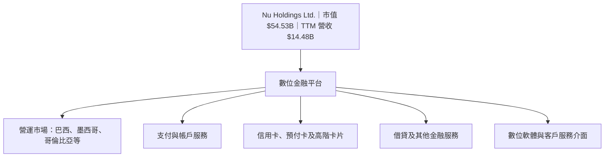
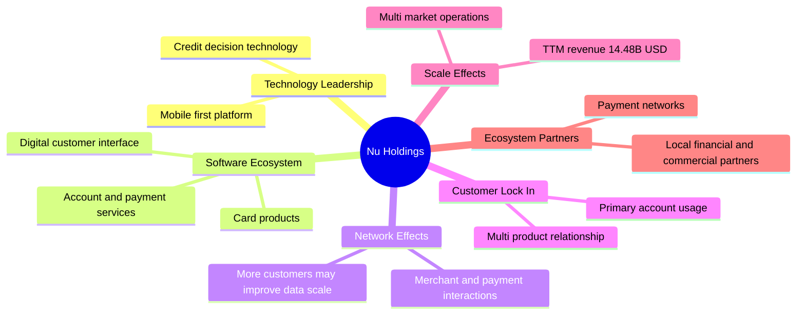
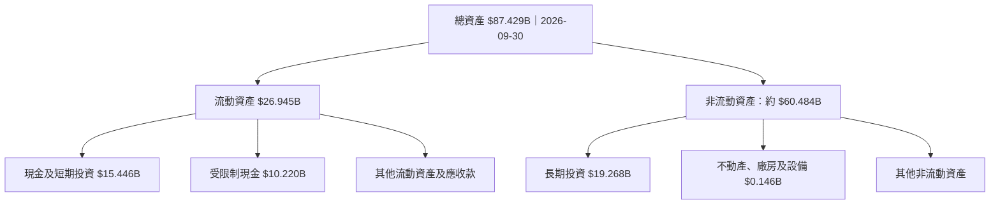
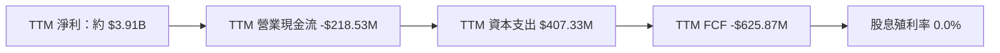
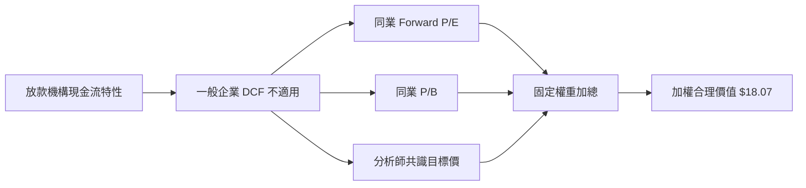
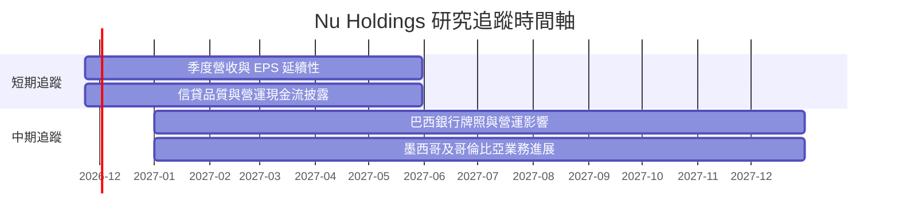
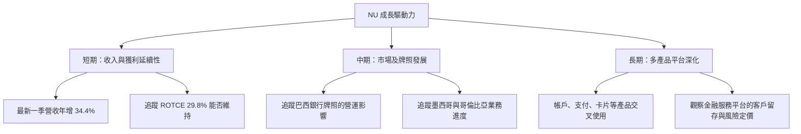
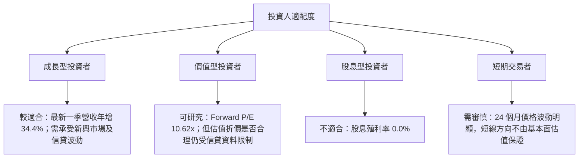

# NU 基本面深度分析報告
> **報告日期**：2026-11-23 ｜ **語言**：繁體中文 ｜ **數據來源**：Yahoo Finance、Finviz、StockAnalysis、Roic.ai ｜ **分析師**：CFA 級機構研究

## 目錄

| # | 章節 | 核心結論 |
|---|------|----------|
| 1 | 執行摘要 | 評級為買入；加權合理價值 $18.07，MOS +37.6% |
| 2 | 公司概覽與商業模式 | 數位金融平台具規模與客戶生態優勢，但市場份額數據未提供 |
| 3 | 損益表深度分析 | TTM 營收 $14.48B；最新一季營收年增 34.4%，現金流與利潤率解讀須考慮金融業特性 |
| 4 | 資產負債表分析 | 現金及短期投資 $15.45B，總債務 $6.12B，淨現金 $9.32B |
| 5 | 現金流量深度分析 | TTM FCF 為 -$625.87M；貸款機構的營運現金流不等同一般企業自由現金流 |
| 6 | 獲利能力與資本效率 | ROIC 對放款機構不適用；ROTCE 29.8%，WACC 14.00% |
| 7 | 相對估值分析 | Forward P/E 10.62x，低於同業中位數 18.2x；相對估值結果偏正面 |
| 8 | DCF 內在價值評估 | DCF 不適用於銀行式現金流；改以程式提供的三種相對估值方法交叉驗證 |
| 9 | 成長催化劑 | 巴西銀行牌照與跨市場數位金融產品擴張值得追蹤；TAM 數據未提供 |
| 10 | 風險矩陣 | 信貸損失、利率與監管風險為主要風險；部分關鍵信貸指標缺漏 |
| 11 | 投資建議 | 買入；以加權合理價值及可查核的營運指標作分批布局與風險監控 |

---

## 1. 執行摘要

NU 的估值訊號偏正面：2026-11-20 收盤價為 **$11.27**，三項相對估值法得到加權合理價值 **$18.07**，對應 **MOS +37.6%**、上行空間 **+60.3%**，程式提供的評級為**買入**。營運面，最新一季營收年增 **34.4%**，TTM 淨利息收入佔總營收 **84.7%**，顯示利息收入仍是核心；但 TTM FCF 為 **-$625.87M**，且逾放比、淨沖銷率、CET1 等重要銀行風險數據未提供，因此買入判斷更依賴相對估值與 ROTCE，而非傳統 DCF 或完整信貸品質檢驗。

### 1.0 一頁式投資儀表板（Portfolio Manager 30 秒速讀）

| 項目 | 內容 |
|------|------|
| **投資論點（3 句）** | ① 最新一季營收年增 **34.4%**，反映平台仍在擴大業務規模。② TTM **ROTCE 29.8%**，高於股權成本 **9.81%**，但 ROTCE 不等同 ROIC。③ 加權合理價值 **$18.07**，高於 2026-11-20 收盤價 **$11.27**，而 TTM FCF 為 **-$625.87M**，須審慎看待現金流。 |
| **綜合評分** | **7.7/10**（引用 1.1 評分卡） |
| **財務健康** | 🟡 現金及短期投資 **$15.45B**、淨現金 **$9.32B**；但銀行流動性不能僅由淨現金判斷，且信貸品質指標缺漏。 |
| **ROIC vs WACC** | **ROIC：N/A（放款機構不適用）**；WACC **14.00%**。ROTCE **29.8%** 高於股權成本 **9.81%**，僅能作為股東回報參考。 |
| **FCF 趨勢** | 年度 FCF 由 FY2022 **$0.64B** 增至 FY2025 **$3.16B**；TTM FCF 為 **-$625.87M**，TTM FCF Yield **-1.15%**。銀行營運現金流易受貸款增減影響，不能直接視為可分配現金。 |
| **估值** | Forward P/E **10.62x** ｜ EV/EBITDA **N/A** ｜ FCF Yield **-1.15%** |
| **DCF 內在價值（基準）** | **N/A**；放款機構的現金流屬資金來源與運用，DCF 模型未提供。DCF 折溢價亦為 N/A。 |
| **安全邊際（MOS）** | **+37.6%**＝（加權合理價值 **$18.07** − 現價 **$11.27**）÷ 加權合理價值；🟢 高於 25%。 |
| **預期報酬（基準情境 12M）** | **+56.4%**，以 23 位分析師共識目標價 **$17.63** 為參考；此為共識目標價隱含上行，不是 DCF 情境。 |
| **關鍵風險（前二）** | 信貸損失惡化但淨沖銷率、逾放比缺漏；巴西及其他營運市場的利率、匯率與監管變動。 |
| **評級 + 信心度** | 🟢 **買入** ｜ 信心：**中**；估值訊號明確，但 TTM FCF、信貸風險與資料口徑存在限制。 |

### 1.1 綜合評分卡（全報告唯一）

| 維度 | 評分（1–10） | 主要依據（引用數字與其來源章節） |
|------|--------------|----------------------------------|
| 成長性 | 8.0 | 最新一季營收年增 **34.4%**，FY2022–FY2025 營收 CAGR 約 **53.0%**；TTM 營收成長率未提供（第 3 章）。 |
| 獲利能力 | 8.0 | TTM ROTCE **29.8%**；最新一季營業利益率 **50.9%**，但 TTM 營業利益率及 ROIC 不適用或未提供（第 3、6 章）。 |
| 財務健康 | 8.0 | 現金及短期投資 **$15.45B**、總債務 **$6.12B**、淨現金 **$9.32B**；信貸品質及資本適足率資料缺漏（第 4、6 章）。 |
| 估值 | 9.0 | 加權合理價值 **$18.07**、MOS **+37.6%**；Forward P/E **10.62x**，低於同業中位數 **18.2x**（第 7、8 章）。 |
| 護城河 | 7.0 | 跨市場數位平台、多產品金融服務與淨利息收入佔比 **84.7%**；未提供市場份額、活躍客戶與客戶留存數據（第 2 章）。 |
| 管理層與資本配置 | 6.0 | FY2025 SBC **$271.85M**，約佔營收 **2.6%**；股息殖利率 **0.0%**，回購數據未提供（第 3、5 章）。 |
| **綜合評分** | **7.7** | 六項算術平均：**(8.0 + 8.0 + 8.0 + 9.0 + 7.0 + 6.0) ÷ 6 = 7.7**。 |

### 1.2 五大投資論點 + 三大核心風險

| 類型 | 項目 | 具體依據 | 信心度 |
|------|------|----------|--------|
| 🟢 **投資論點①** | 營收仍在擴張 | 最新一季營收 **$4.03B**，季度營收年增 **34.4%**；擴大客戶與產品使用有機會帶動收入規模及營運槓桿。 | 🟢 高 |
| 🟢 **投資論點②** | 股東報酬率具吸引力 | TTM ROTCE **29.8%**，高於 **9.81%** 股權成本代理值；若能維持且未伴隨信貸風險上升，有利於累積股東價值。 | 🟢 中高 |
| 🟢 **投資論點③** | 相對估值折價 | NU Forward P/E **10.62x**，低於 SOFI、MELI、HOOD 的 Forward P/E 中位數 **18.2x**；折價是否合理取決於成長與信貸品質能否延續。 | 🟢 中高 |
| 🟢 **投資論點④** | 資金緩衝可觀 | 現金及短期投資 **$15.45B**，淨現金 **$9.32B**；提供營運與投資緩衝，但不等同銀行監管資本。 | 🟢 中 |
| 🟢 **投資論點⑤** | 產品及市場擴張選擇權 | 業務覆蓋巴西、墨西哥、哥倫比亞等市場，並提供支付、卡片與帳戶等金融服務；各項收入拆分及市場份額未提供。 | 🟡 中 |
| 🟡 **風險①** | 信貸品質惡化 | 淨沖銷率及逾放比為 N/A；若放款成長伴隨壞帳上升，淨利息收入與 ROTCE 可能同步下滑。 | 🟡 中 |
| 🔴 **風險②** | 利率與監管變動 | 巴西銀行牌照、利率環境與監管要求可能改變融資成本、信貸供給及合規支出；具體敏感度資料未提供。 | 🔴 高衝擊 |
| 🟡 **風險③** | 現金流品質及資料口徑 | TTM FCF **-$625.87M**，但 FY2025 年度 FCF **$3.16B**；銀行貸款相關現金流可使兩者差異擴大，需以監管與損益資料核實。 | 🟡 中 |

### 1.3 快速統計卡片

| 指標 | 公司實際值（期間） | 同業中位數 | 狀態 |
|------|--------------------|------------|------|
| 營收成長（TTM） | **N/A** | — | 🟡 |
| 營收成長（最新一季年增） | **34.4%** | **43.9%** | 🟡 |
| 毛利率（TTM） | **0.0%（資料庫值；金融業不宜直接比較）** | **84.2%（商業模式不同，不宜直接比較）** | 🟡 |
| 營業利益率（TTM） | **N/A** | — | 🟡 |
| ROIC（TTM） | **N/A（放款機構不適用）** | — | 🟡 |
| Forward P/E | **10.62x** | **18.2x** | 🟢 |
| FCF Yield（TTM） | **-1.15%** | — | 🔴 |
| Piotroski F-Score | **N/A（不適用放款機構）** | — | 🟡 |

### 1.4 投資結論

```text
╔══════════════════════════════════════════════════════════════════╗
║                    📊 投資結論摘要                               ║
╠══════════════════════════════════════════════════════════════════╣
║  評級：買入（依規則 20 的程式評級）                              ║
║  價格（2026-11-20 收盤）：$11.27                                 ║
║  DCF 內在價值（基準）：N/A（放款機構不適用傳統 DCF）              ║
║  DCF 折溢價：N/A                                                 ║
║  安全邊際 MOS：+37.6%（以加權合理價值 $18.07 為分母）             ║
║  加權合理價值（8.8）：$18.07                                     ║
║  DCF 情境價值：N/A（DCF MODEL 未提供）                            ║
║  綜合評分：7.7/10（引用 1.1）                                    ║
║  適合投資人：能承受金融股、信貸週期及新興市場波動的成長型投資人  ║
╚══════════════════════════════════════════════════════════════════╝
```

---

## 2. 公司概覽與商業模式

### 2.1 業務結構與收入來源

公司資料描述 NU Holdings 在巴西、墨西哥、哥倫比亞、開曼群島及美國提供數位金融平台服務，產品涵蓋信用卡、預付卡、帳戶、支付與進階卡片服務。各產品的收入拆分、收入佔比及金額未提供，因此不把產品描述誤當成分部財務數據。



### 2.2 市場份額

**市場份額數據未提供**，因此不列市場佔比或製作市場份額圖表。以收入規模觀察，NU TTM 營收為 **$14.48B**，最新一季營收年增 **34.4%**；同業最新季度年增率中 SOFI 為 **43.9%**、MELI 為 **45.1%**、HOOD 為 **11.8%**。但這些公司產品與收入結構不同，成長率只可作為背景參照，不能直接推導市場份額。

### 2.3 競爭護城河分析



### 2.4 護城河強度

| 護城河項目 | 強度（強／中／弱） | 證據（引用數字或事實） | 會削弱它的情況 |
|------------|--------------------|------------------------|----------------|
| 技術與數位平台 | 中 | 公司以數位平台提供帳戶、支付及卡片服務；最新一季營收年增 **34.4%**，但技術投入與客戶取得成本未提供。 | 服務中斷、網路安全事件、競爭對手更快複製功能。 |
| 軟體生態系統 | 中 | 同一平台涵蓋支付、卡片及帳戶等服務；產品別收入與交叉銷售率未提供。 | 多產品使用未能提升留存或單客收入。 |
| 網路效應 | 中偏弱 | 平台用戶與交易資料可能提升風控及服務體驗，但客戶數、交易量與商戶數未提供。 | 信貸模型表現轉差，或支付端未形成商戶與用戶雙邊網路。 |
| 客戶鎖定 | 中偏弱 | 金融帳戶有潛在日常使用與資金沉澱效果；活躍客戶率、存款留存與流失率未提供。 | 客戶多平台持有帳戶、利率或獎勵促使資金快速轉移。 |
| 規模效應 | 中 | TTM 營收 **$14.48B**、跨多個市場營運；單客成本與規模經濟數據未提供。 | 新市場擴張成本高於規模效益，或競爭導致獲客成本上升。 |
| 生態夥伴 | 中偏弱 | 提供多種支付與金融產品，但合作夥伴收入依賴度未提供。 | 夥伴條款改變、支付網路費用上升或合作關係中止。 |

1.1 的護城河評分為 **7.0/10**，依據是平台規模、跨產品服務與最新季度成長；未提供市場份額、留存率及客戶單位經濟數據，故不給更高評價。

---

## 3. 損益表深度分析

### 3.1 年度收入成長趨勢（近4年）

| 財年 | 營收 | YoY 成長 |
|------|------|----------|
| FY2022 | $2.97B | — |
| FY2023 | $5.63B | **+89.6%** |
| FY2024 | $8.27B | **+46.9%** |
| FY2025 | $10.63B | **+28.5%** |

FY2022–FY2025 營收 CAGR 的演算為：

`($10.63B ÷ $2.97B)^(1 ÷ 3) − 1 = 約 53.0%`

```text
╔══════════════════════════════════════════════════════════════════╗
║             Nu Holdings 年度收入趨勢（FY2022–FY2025）            ║
╠══════════════════════════════════════════════════════════════════╣
║  FY2022  $2.97B  ██████░░░░░░░░░░░░░░░░░░░  YoY：基期          ║
║  FY2023  $5.63B  █████████████░░░░░░░░░░░░  YoY：+89.6% 🟢     ║
║  FY2024  $8.27B  ███████████████████░░░░░░  YoY：+46.9% 🟢     ║
║  FY2025 $10.63B  █████████████████████████  YoY：+28.5% 🟢     ║
╠══════════════════════════════════════════════════════════════════╣
║  FY2022–FY2025 營收 CAGR：約 +53.0%                              ║
╚══════════════════════════════════════════════════════════════════╝
```

FY2023 的高增幅包含較低基期效應；FY2024、FY2025 仍維持成長，但增速逐年回落。這與業務規模擴大後的基期墊高相符，評估未來成長不能單純外推早期增速。

### 3.2 季度收入趨勢分析

以下季度收入採 Yahoo 季報資料；TTM 四季加總與 VERIFIED FIGURES 的 TTM 營收 **$14.48B** 相符。季度 QoQ 由相鄰季度營收計算，最新一季 YoY 採來源提供的單季成長率。

| 季度 | 營收 | QoQ 成長 | YoY 成長 | 備註 |
|------|------|----------|----------|------|
| 2025 Q4 | $3.14B | — | N/A | 比較基期的季度營收。 |
| 2026 Q1 | $3.54B | **+12.7%** | N/A | QoQ = ($3.54B ÷ $3.14B) − 1。 |
| 2026 Q2 | $3.77B | **+6.5%** | N/A | QoQ = ($3.77B ÷ $3.54B) − 1。 |
| 2026 Q3 | $4.03B | **+6.9%** | **+34.4%** | YoY 為最新一季年增率，不是 TTM 成長率。 |

季度收入持續增加，代表當期業務收入規模仍在擴大；但 TTM 營收成長率為 **N/A**，不能用最新一季的 **34.4%** 代替 TTM 成長率。

### 3.3 利潤率演變分析

| 利潤率指標 | FY2022 | FY2023 | FY2024 | FY2025 | 趨勢 | 評估 |
|------------|--------|--------|--------|--------|------|------|
| **淨利率** | **-12.3%** | **18.3%** | **23.8%** | **27.0%** | 由虧轉盈並逐年上升 | 🟢 FY2022–FY2025 資料顯示獲利改善；仍需留意信貸成本與會計項目。 |
| **毛利率（TTM）** | — | — | — | **0.0%** | 年度歷史可比資料未提供 | 🟡 金融機構的毛利率定義與一般企業不同；0.0% 不宜視為經濟性毛利率。 |
| **營業利益率（TTM）** | N/A | N/A | N/A | N/A | TTM 未提供 | 🟡 |
| **營業利益率（最新一季）** | — | — | — | **50.9%** | 僅有最新一季資料 | 🟢 單季指標，不可推稱為 TTM 利潤率。 |

淨利率由 FY2022 的 **-12.3%** 改善至 FY2025 的 **27.0%**，與公司從年度淨損 **$364.58M** 轉為淨利 **$2.87B** 同步。對金融平台而言，收入規模、利息收入與信貸損失共同決定利潤；但資料未提供年度貸款損失準備與利息成本拆解，無法把改善精確歸因於定價、產品組合或信用表現。

### 3.4 費用結構分析

**費用結構細項與金額未提供**，因此不製作費用結構圓餅圖，也不以推算方式補出利息費用、信貸損失、營運費用的佔比。可確認的資料為 FY2025 營業現金流 **$3.50B**、資本支出 **$340.77M**，以及最新一季營業利益率 **50.9%**；不足以構成完整費用拆分。

### 3.5 季度 EPS 趨勢與盈餘品質（Quality of Earnings）

#### EPS 趨勢與預期落差

| 季度 | 實際 EPS | EPS 季增變化 | EPS 年增率 | 預期落差 |
|------|----------|--------------|------------|----------|
| 2025 Q4 | $0.18 | — | — | 預期值 N/A，無法判定超預期或不及預期。 |
| 2026 Q1 | $0.18 | 0.0% | **+55.93%** | 預期值 N/A。 |
| 2026 Q2 | $0.22 | **+22.2%** | **+66.31%** | 預期值 N/A。 |
| 2026 Q3 | $0.23 | **+4.5%** | **+40.13%** | 預期值 N/A。 |

四季 EPS Est 與 EPS Act surprise 資料為 NaN，因此無法據實判定四季盈餘是否超越市場預期。上述季度 EPS 及年增率採 StockAnalysis 資料；不同資料來源的季度收入及收入列示口徑存在差異，故 EPS 趨勢不等於盈餘預期落差分析。

#### 盈餘品質指標

| 盈餘品質項目 | 數值/佔比 | 評估 |
|--------------|-----------|------|
| 股權薪酬 SBC / 營收 | 估算 **2.7%**：TTM SBC $394.13M ÷ TTM 營收 $14.48B | 🟡 SBC 以股份支付仍會稀釋股東；該比率顯示稀釋成本不可忽略。 |
| SBC / 營業現金流 | TTM 營業現金流為負；SBC 約為營業現金流絕對值的 **180.4%** | 🔴 分母為負時比例不能當作一般費用率解讀；但說明 TTM 營運現金流不足以涵蓋非現金薪酬規模。 |
| FCF / 淨利（現金轉換率） | 約 **-16.0%**：-$625.87M ÷ TTM 淨利約 $3.91B | 🔴 期間採季度淨利加總與 TTM FCF；現金轉換明顯弱於帳面盈餘。 |
| 一次性/非經常性損益 | N/A（資料未提供） | 無法確認是否有一次性項目影響淨利。 |
| 有效稅率異常 | **25.8%**（最新年度有效稅率） | 🟡 與單一季度盈利不能直接對應；未見足夠資料判斷稅率是否異常。 |
| 資本化支出 vs 費用化 | TTM 資本支出 **$407.33M**；資本化政策細節未提供 | 🟡 無法確認資本化支出是否延後費用認列。 |

補充年度錨點：FY2025 SBC **$271.85M** ÷ 營收 **$10.63B** 約為 **2.6%**；FY2025 SBC ÷ 營業現金流 **$3.50B** 約為 **7.8%**。這顯示年度營運現金流情況好於最新 TTM，但不同期間不能混用。

**盈餘品質結論**：GAAP 淨利成長具參考價值，但 TTM FCF 為負、現金轉換率為負，且季度現金流波動顯著。銀行放款增長會將現金流量表的營運現金流推低，故不能僅憑 FCF 判斷盈利失真；然而在現有資料下，也不能將會計淨利視為已充分轉化為可分配股東現金。估值應搭配 ROTCE、信貸損失與資本適足率追蹤。

---

## 4. 資產負債表分析

### 4.1 資產結構分解

資產結構採 StockAnalysis 2026-09-30 資料。現金及短期投資數據與 VERIFIED FIGURES 同期數值一致；其他項目提供的資料分類包括受限制現金、長期投資及其他資產。



非流動資產為總資產減流動資產的算術差額：**$87.429B − $26.945B = $60.484B**。圖中沒有把未披露的其他細項再行估算分配。

### 4.2 流動性與營運資金分析

| 指標 | 最新值 | 一年前值 | 變化 | 解讀 |
|------|--------|----------|------|------|
| 現金及短期投資 | **$15.45B** | N/A | N/A | 金額充足，但銀行資金、監管用途及可自由運用程度不能由該數字單獨判斷。 |
| 淨現金 | **$9.32B** | N/A | N/A | 依資料區塊原值引用；與現金減債的直接算術差可能有尾差。 |
| Current Ratio | N/A | N/A | N/A | 金融機構的流動比率通常不如銀行資本與流動性指標有解釋力，且資料未提供。 |
| Quick Ratio | N/A | N/A | N/A | 資料未提供。 |
| DSO／DIO／DPO／CCC | 不適用（金融業） | 不適用（金融業） | 不適用 | 放款資產與存款融資不是一般企業的應收、存貨與應付週期。 |

### 4.3 債務結構分析

```text
╔══════════════════════════════════════════════════════════════════╗
║                   Nu Holdings 債務健康診斷                       ║
╠══════════════════════════════════════════════════════════════════╣
║  總債務：          $6.12B   ████████░░░░░░░░░░░░                  ║
║  現金及短期投資： $15.45B   ████████████████████                  ║
║  淨現金：          $9.32B   🟢 正淨現金                           ║
║                                                                  ║
║  Debt/EBITDA：     N/A      TTM EBITDA 不可用                     ║
║  利息保障倍數：    N/A      利息費用與可比 EBITDA 資料不足         ║
║  Debt/Equity：     N/A      資料未提供                             ║
║  Current Ratio：   N/A      資料未提供；銀行流動性需以監管指標判讀 ║
╚══════════════════════════════════════════════════════════════════╝
```

淨現金提供緩衝，但不是監管資本充足度的替代指標。對銀行及放款機構，應優先取得存款穩定性、流動性覆蓋率、CET1、逾放比與沖銷率資料；上述指標未提供，因此不將淨現金解讀為「無信貸或資本風險」。

### 4.4 股東權益趨勢

| 年度 | 股東權益 | YoY 變化 |
|------|----------|----------|
| 2022 | $4.89B | — |
| 2023 | $6.41B | 約 **+31.1%** |
| 2024 | $7.65B | 約 **+19.3%** |
| 2025 | $11.29B | 約 **+47.6%** |

```text
╔══════════════════════════════════════════════════════════════════╗
║                  股東權益年度變化（年度財報）                    ║
╠══════════════════════════════════════════════════════════════════╣
║  2022  $4.89B   ███████████                                      ║
║  2023  $6.41B   ██████████████                                   ║
║  2024  $7.65B   █████████████████                                ║
║  2025 $11.29B   █████████████████████████                        ║
╚══════════════════════════════════════════════════════════════════╝
```

權益逐年上升，與獲利累積相符；但股東權益增加也可能受到發股、其他綜合損益及匯率等因素影響，單靠年度表格無法拆分來源。

---

## 5. 現金流量深度分析

### 5.1 現金流量瀑布圖



淨利到營業現金流的差額可能受到放款、存款與金融資產變動影響；因此上圖只呈現資料列的方向關係，不代表一般非金融企業的現金流轉換瀑布。回購金額及淨現金變化的完整分解未提供，故不延伸連線或估算。

### 5.2 FCF 轉換率趨勢

| 財年／期間 | FCF | 淨利 | FCF／淨利 | 解讀 |
|------------|-----|------|-----------|------|
| FY2022 | $0.64B | -$0.36B | 不具解讀性 | 淨利為負，比例不宜比較。 |
| FY2023 | $1.09B | $1.03B | 約 **105.8%** | 年度現金流略高於淨利。 |
| FY2024 | $2.22B | $1.97B | 約 **112.7%** | 年度現金轉換高於 100%。 |
| FY2025 | $3.16B | $2.87B | 約 **110.1%** | 年度現金流高於淨利。 |
| TTM 至 2026-09-30 | **-$625.87M** | 約 $3.91B | 約 **-16.0%** | 明顯低於年度歷史；放款資金變化可能是重要因素，需拆解銀行現金流項目。 |

### 5.3 自由現金流趨勢

| 期間 | FCF | 方向 |
|------|-----|------|
| FY2022 | $0.64B | 正值 |
| FY2023 | $1.09B | 增加 |
| FY2024 | $2.22B | 增加 |
| FY2025 | $3.16B | 增加 |
| TTM | -$625.87M | 轉負 |

```text
╔══════════════════════════════════════════════════════════════════╗
║                  自由現金流歷史趨勢（美元）                      ║
╠══════════════════════════════════════════════════════════════════╣
║  FY2022   +$0.64B  █████                                          ║
║  FY2023   +$1.09B █████████                                       ║
║  FY2024   +$2.22B ██████████████████                              ║
║  FY2025   +$3.16B █████████████████████████                       ║
║  TTM      -$0.63B ◀ 負值                                          ║
╠══════════════════════════════════════════════════════════════════╣
║  TTM FCF Yield：-1.15%（以市場市值為分母）                       ║
║  注意：放款機構的營運現金流會受貸款資金流影響，非傳統企業 FCF。   ║
╚══════════════════════════════════════════════════════════════════╝
```

TTM FCF Yield **-1.15%**，但不宜直接以一般企業「負 FCF 等於營運惡化」解讀。應查核負值是否主要源於貸款增加、證券配置或季節性資金流；可用資料未提供完整現金流細項，暫不能定量歸因。

### 5.4 資本配置評估

| 資本配置項目 | 可用資料 | 評估 |
|--------------|----------|------|
| 股息 | 股息殖利率 **0.0%**；派息率 **0.0%** | 資料顯示目前沒有現金股息回報。 |
| 回購 | N/A | 回購金額與股數變化拆分未提供。 |
| 資本支出 | TTM **$407.33M**；FY2025 **$340.77M** | 對數位平台的資本支出需搭配開發支出及資本化政策解讀。 |
| 留存獲利／投資 | FY2025 淨利 **$2.87B** | 以留存支持平台與市場擴張的可能性存在，但用途拆分未提供。 |

資本配置各項沒有可核對的資金用途佔比，故不製作資本配置圓餅圖，也不把未知回購或投資金額補成比例。

---

## 6. 獲利能力與資本效率

### 6.1 ROE / ROA / ROIC 趨勢

| 指標 | 最新可用值 | 歷史比較 | 評估 |
|------|------------|----------|------|
| ROE（TTM） | **31.5%** | 多年度趨勢未提供 | 🟢 股東帳面報酬高；尚需結合信貸品質及資本結構解讀。 |
| ROA（TTM） | **5.0%** | 多年度趨勢未提供 | 🟢 反映資產獲利，但貸款損失與資產組成未提供。 |
| ROIC | **N/A** | N/A | 放款機構資金結構與一般公司不同，傳統投入資本及營運資本口徑不適用。 |
| ROTCE（TTM） | **29.8%** | 一年前數值未提供 | 🟢 有形普通股權益報酬的金融業參考指標。 |

行業均值資料未提供，不列示未經來源支持的行業比較值。

### 6.2 ROIC vs WACC 分析（核心價值創造判斷）

金融機構的借貸資金及貸款資產本身是核心營運組成，故**傳統 ROIC 與營運資本分析不適用**。WACC 可作為資本成本參考，但不能以 ROTCE 冒充 ROIC。下列成本資本資訊按程式提供的 Cost of capital 數字引用：

```text
╔══════════════════════════════════════════════════════════════════╗
║                 資本成本與銀行股東報酬參考                       ║
╠══════════════════════════════════════════════════════════════════╣
║  無風險利率（10Y Treasury）：                         4.91%     ║
║  市場風險溢酬 ERP：                                    5.00%     ║
║  原始 Beta：                                           0.97      ║
║  調整後 Beta：                                         0.98      ║
║  股權成本 Ke：4.91% + 0.98 × 5.00% =                  9.81%     ║
║  稅前債務成本：                                       74.76%     ║
║  稅後債務成本：74.76% × (1 − 25.8%) =                 55.47%     ║
║  股權／債務權重：                                     89.9% / 10.1%║
║  加權計算值：                                         14.42%     ║
║  限制後採用 WACC：                                    14.00%     ║
║                                                                  ║
║  傳統 ROIC：N/A（放款機構不適用）                                 ║
║  ROTCE：29.8%；股權成本：9.81%（僅作金融業參考）                  ║
╚══════════════════════════════════════════════════════════════════╝
```

**逐步演算：**

1. **Ke（CAPM）** = 4.91% + 0.98 × 5.00% = **9.81%**。  
   Beta 調整方式：`(2 ÷ 3) × 0.97 + (1 ÷ 3) × 1.00 = 0.98`。10 年期美債殖利率的觀察日期未提供，故只引用 4.91% 原值。
2. **稅前 Kd** = **74.76%**（程式提供的利息／債務成本值）；利息費用與平均計息負債明細未提供，不能自行重建其分子、分母。
3. **稅後 Kd** = 74.76% × (1 − 25.8%) = **55.47%**。
4. **權重** = 股權 **89.9%**、債務 **10.1%**；依 Cost of capital 輸入原值引用，未以帳面股東權益替代市值權重。
5. **加權 WACC** = 89.9% × 9.81% + 10.1% × 55.47% = **14.42%**；該估算被限制在 7%–14% 區間，故採用 **14.00%**。

稅前債務成本 **74.76%** 顯著偏高，可能受銀行類負債口徑、利息費用或分母定義影響；由於組成資料不全，不能把該值當作一般公司債券殖利率解讀。金融機構創造股東價值的判斷應以 ROTCE、股權成本、信貸品質及監管資本合併評估；NU 的 ROTCE **29.8%** 高於股權成本 **9.81%**，但信貸與監管指標缺漏，僅能視為初步正面訊號。

### 6.3 杜邦三因素分解

| 因素 | 數值（TTM） | 解讀 |
|------|-------------|------|
| 淨利率 | N/A | 杜邦計算所需的同期輸入資料不足。 |
| 資產週轉率 | N/A | 同期收入、資產口徑不完整。 |
| 權益乘數 | N/A | 資料未能構成一致的杜邦計算。 |
| **ROE** | **N/A（DuPont）** | QUALITY FIGURES 判定 N/A：淨利、營收、總資產或正股東權益等所需資料缺漏。另列示的 ROE 31.5% 不取代杜邦三因素拆解。 |

### 6.4 財務體質：放款機構指標

Piotroski F-Score **N/A**：該指標不適用放款機構，因貸款成長會被當成營運現金流出，造成現金流測試誤判。

| 金融業指標 | 數值（TTM） | 解讀 |
|------------|-------------|------|
| 淨利息收入 NII ÷ 總營收 | **84.7%** | 收入主要由淨利息收入構成，利率與信貸表現對盈餘重要。 |
| 淨利差代理值 | **15.74%** | NII ÷ 平均總資產；因缺少生息資產資料，數值可能高於正式 NIM。 |
| 成本收入比代理值 | **68.1%** | (營收 − 稅前淨利) ÷ 營收；包含信貸準備等因素，通常高於銀行正式效率比率。 |
| ROTCE | **29.8%** | 淨利 ÷ 有形帳面價值，為股東報酬參考。 |
| P/TBV | **4.16x** | 市場為每單位有形帳面價值支付 4.16 倍；高估值需要持續高回報支撐。 |
| 放款淨額 ÷ 總資產 | **14.0%** | 反映資料中的放款資產比例；不能單獨推斷風險權重或資產品質。 |
| 淨沖銷率 | **N/A（數據未提供）** | 不引用未提供或記憶中的數值。 |
| 逾放比 | **N/A（數據未提供）** | 不引用未提供或記憶中的數值。 |
| CET1 | **N/A（數據未提供）** | 無法完成監管資本充足度核驗。 |

---

## 7. 相對估值分析

### 7.1 同業估值比較

倍數及營運數據採 Yahoo Finance 的 Peer multiples。各公司業務組合不同，以下比較是市場定價參考，不代表完全可比。

| 估值指標 | **NU** | **SOFI** | **MELI** | **HOOD** | 本公司評估 |
|----------|-------:|--------:|--------:|--------:|-----------|
| **Trailing P/E** | **14.1x** | 22.7x | 36.3x | 28.6x | 🟢 低於三家同業；須確認較低估值不是信貸風險折價。 |
| **Forward P/E** | **10.62x** | 13.9x | 25.6x | 18.2x | 🟢 低於同業中位數 **18.2x**。 |
| **P/S Ratio** | **5.99x** | 3.5x | 1.8x | 11.0x | 🟡 高於 SOFI、MELI，低於 HOOD；金融業收入定義差異大。 |
| **EV/EBITDA** | **N/A** | N/A | 19.7x | N/A | 🟡 可比樣本不足，不使用此倍數推算。 |
| **最新一季營收年增** | **34.4%** | 43.9% | 45.1% | 11.8% | 🟡 NU 成長低於 SOFI、MELI，高於 HOOD。 |
| **毛利率（TTM）** | **0.0%（不可直接比較）** | 84.2% | 46.7% | 91.0% | 🟡 不同金融與平台業務的毛利率定義不可直接類比。 |

### 7.2 歷史估值區間分析

N/A（沒有可引用的「Valuation vs own history」歷史估值倍數區間或百分位數據）。現有 24 個月價格資料顯示股價從 2025-11 月 **$17.39**、2026-01 月 **$17.75** 回落至 2026-11-20 收盤 **$11.27**；這是價格走勢，不等於歷史 P/E 或估值百分位，故不以股價代替估值區間。

### 7.3 情境價值（Bear / Base / Bull）

**N/A（DCF 無法計算：金融機構的現金流包含融資與放款資金變動，DCF MODEL 未建立，不提供悲觀／基準／樂觀 DCF 情境價值）。**

### 7.4 相對估值隱含價格區間

以下為財務類公司的固定估值方法與權重，價格及權重照估值方法資料引用：

```text
╔══════════════════════════════════════════════════════════════════╗
║                 相對估值與市場價格參考                           ║
╠══════════════════════════════════════════════════════════════════╣
║  現價（2026-11-20）：                    $11.27                  ║
║  同業 P/B：                              $16.60                  ║
║  分析師共識目標價：                      $17.63                  ║
║  同業 Forward P/E：                      $19.34                  ║
║  三法加權合理價值：                      $18.07                  ║
╠══════════════════════════════════════════════════════════════════╣
║  同業 Forward P/E：同業中位數 18.2x × Forward EPS $1.06          ║
║  同業 P/B：同業中位數 5.6x × 每股帳面價值 $2.96                 ║
║  分析師共識：23 位分析師平均目標價 $17.63                        ║
╚══════════════════════════════════════════════════════════════════╝
```

| 方法 | 每股價值 | 方法依據 | 相對現價 |
|------|----------:|----------|----------|
| 同業 Forward P/E | **$19.34** | SOFI、MELI、HOOD 同業中位數 **18.2x** × NU Forward EPS **$1.06** | +71.6% |
| 同業 P/B | **$16.60** | 同業 P/B 中位數 **5.6x** × 每股帳面價值 **$2.96** | +47.3% |
| 分析師共識目標價 | **$17.63** | 23 位分析師平均目標價 | +56.4% |

---

## 8. DCF 內在價值評估（Discounted Cash Flow）

> **適用性結論：本章 DCF MODEL 為 N/A。** 對放款機構而言，貸款資金增加可能表現為營運現金流出，存款與借款則是營運資金來源；因此一般企業的 FCFF／FCFE DCF 定義不能直接套用。以下 8.1–8.7 不自建模型、不補造假設或目標價；估值改採第 7.4 節與第 8.8 節程式提供的方法。

### 8.0 估值推理鏈（Thinking Logic）

**Step 1 — 價值來源與主要變數**

NU 的股權價值主要取決於既有數位金融平台的淨利息收入、信貸損失與有形權益報酬，以及其他支付、卡片及帳戶服務的增長選擇權。TTM 淨利息收入佔總營收 **84.7%**，是可量化的主要收入來源；其他產品別營收佔比未提供，不能編造。對估值影響最大的可觀察變數是信貸表現能否支撐 TTM **ROTCE 29.8%**，但淨沖銷率與逾放比缺漏，無法建構可稽核的 DCF 敏感度。

**Step 2 — 模型選擇**

| 決策點 | 本報告採用 | 理由（含數字） | 曾考慮但否決 | 否決理由 |
|--------|-----------|----------------|--------------|----------|
| 現金流定義 | N/A | TTM OCF **-$218.53M**、資本支出 **$407.33M**，金融業現金流受貸款資金與融資活動影響。 | FCFF／FCFE DCF | 以一般企業現金流模式可能把貸款增長誤判為自由現金流惡化。 |
| 預測期 N | N/A | DCF MODEL 未提供逐年預測假設。 | 自行設定 5–10 年 | 會形成未經資料支持的黑箱模型。 |
| 終值方法 | N/A | DCF MODEL 未提供。 | Gordon Growth／退出倍數 | 缺少合適的 DCF 現金流基礎。 |
| 盈餘基礎 | 相對估值 | Forward P/E、P/B 及分析師共識方法已提供。 | 自建 GAAP EBIT DCF | 放款機構的 EBIT 與企業自由現金流並非合適的主要估值框架。 |

**Step 3 — 關鍵假設推導鏈**

本次 DCF 不建立模型，因此營收 CAGR、期末營業利潤率、稅率、Capex、ΔWC、SBC 組合、年稀釋率、永續成長率、預測期及終值假設均為 **N/A**。為遵守可稽核原則，不以年度歷史增長外推 DCF，也不另設情境價值。

**Step 4 — 最脆弱環節**

最脆弱的環節是信貸品質資料缺漏；若淨沖銷率與逾放比惡化，即使收入成長仍高，ROTCE 與估值倍數也可能下修。現有資料不足以量化其對每股 DCF 價值的影響。

**Step 5 — 計算路徑**



### 8.1 模型假設總表（Model Inputs）

N/A（DCF MODEL 未提供；放款機構現金流不適合直接用一般企業 FCFF DCF。若填入預測期、營收 CAGR、利潤率、稅率、Capex、D&A、營運資金、SBC、稀釋率或終值假設，將是自行建立模型，故不提供。）

### 8.2 折現率推導（WACC）

**DCF 折現率：N/A，因本報告不建立 DCF。** 資本成本參考值已於第 6.2 節列示：程式提供的 WACC 計算值為 **14.42%**，受 7%–14% 區間限制後採用 **14.00%**。該值可作一般資本成本參考，但不代表本報告 DCF 的折現率輸入。

### 8.3 逐年自由現金流預測（基準情境）

N/A（DCF MODEL 未提供；不自建逐年預測，也不以銀行貸款相關現金流推算企業 FCFF）。

### 8.4 終值計算（Terminal Value）

N/A（無 DCF 預測現金流與終值模型，Gordon Growth 及退出倍數均不計算）。

### 8.5 企業價值 → 每股內在價值（Bridge）

N/A（沒有 DCF 企業價值、DCF 淨負債橋接或 DCF 每股內在價值）。因此本節不計算 DCF 折溢價；全報告安全邊際 MOS 只採用第 8.8 節加權合理價值。

### 8.6 敏感性分析（WACC × 永續成長率）

N/A（沒有 DCF 基準值、永續成長率或敏感性矩陣）。不建立自行試算矩陣，也不提供 DCF 三情境。

### 8.7 反推 DCF（Reverse DCF：市場在預期什麼）

N/A（沒有 DCF MODEL，無法以現價反推唯一變數，也沒有可引用的迭代軌跡）。以相對估值觀察，市場價格為 **$11.27**，低於同業 P/B 推算 **$16.60**、分析師共識 **$17.63** 及同業 Forward P/E 推算 **$19.34**；這不等同反推 DCF，也不能據此宣稱市場隱含某一特定營收 CAGR。

### 8.8 估值三角驗證與安全邊際

本公司的類型為金融業。估值方法名稱、每股價值及權重依程式提供的固定設定引用；沒有新增 DCF 方法，也沒有加入未提供的估值倍數。

| 估值方法 | 隱含每股價值 | 上行空間（÷現價） | 權重 | 說明 |
|----------|--------------|-------------------|------|------|
| 同業 Forward P/E | **$19.34** | **+71.6%** | **50%** | 同業中位數 **18.2x** × NU Forward EPS **$1.06**。 |
| 同業 P/B | **$16.60** | **+47.3%** | **40%** | 同業中位數 **5.6x** × 每股帳面價值 **$2.96**。 |
| 分析師共識目標價 | **$17.63** | **+56.4%** | **10%** | 23 位分析師平均目標價，作參考方法。 |
| **加權合理價值** | **$18.07** | **+60.3%** | **100%** | 按金融業固定權重加權；DCF 因不適用未列入估值方法。 |

**加權演算：**

`$19.34 × 50% + $16.60 × 40% + $17.63 × 10%`
`= $9.670 + $6.640 + $1.763`
`= $18.073 ≈ $18.07`

MOS 與上行空間按程式提供值引用；以顯示的兩位小數複算，差異僅為四捨五入：

- **MOS** =（加權合理價值 − 現價）÷ 加權合理價值  
  `($18.07 − $11.27) ÷ $18.07 = $6.80 ÷ $18.07 ≈ 37.6%`
- **上行空間** =（加權合理價值 − 現價）÷ 現價  
  `($18.07 − $11.27) ÷ $11.27 = $6.80 ÷ $11.27 ≈ 60.3%`
- **折溢價**：依本報告規則只以 DCF 基準內在價值為分母；DCF 為 N/A，因此不計算。

```text
╔══════════════════════════════════════════════════════════════════╗
║                  估值區間與安全邊際                              ║
╠══════════════════════════════════════════════════════════════════╣
║  $11.27 ─────── $16.60 ─────── [$18.07] ─────── $19.34          ║
║  現價           同業 P/B       加權合理值       同業 Forward P/E ║
║                                                                  ║
║  安全邊際 MOS：+37.6%（分母：加權合理價值 $18.07）               ║
║  MOS 評估：🟢 高於 25%                                           ║
║  上行空間：+60.3%（分母：現價 $11.27）                           ║
║  DCF 基準價值：N/A                                               ║
║                                                                  ║
║  建議買入區間：$11.27–$16.26（加權合理價值的 90% 以下）          ║
║  合理持有區間：$16.26–$18.07（MOS 由 10% 以下至合理價值）        ║
║  減碼考慮區間：高於 $19.34（高於同業 Forward P/E 推算值）        ║
╚══════════════════════════════════════════════════════════════════╝
```

建議買入區間上限演算：`$18.07 × (1 − 10%) = $16.263 ≈ $16.26`。此買入區間上限高於現價，與「買入」評級相容；區間為估值紀律參考，並非股價預測。

> 🔎 **程式複算（Python，依本節各項自動重算）**
>
> 加權合理價值 = $19.34 × 50% + $16.60 × 40% + $17.63 × 10% = **$18.07**（權重合計 100%）
>
> 以價格 $11.27 計：MOS = **+37.6%**，上行空間 = **+60.3%**
>
> ✅ 與本節所寫數值一致。

### 8.9 DCF 模型的局限與失效條件

- **終值依賴度**：N/A；本報告未建立 DCF，無法計算終值佔企業價值比重。
- **最脆弱的估值前提**：同業 P/E 與 P/B 倍數可維持在目前參考水平；若同業倍數收縮，推算價值會下降，但缺少估值模型輸入，不能量化每股下修幅度。
- **不適用情境說明**：放款機構營運現金流受到貸款與存款增減影響；估值主要採同業 P/E、P/B 與分析師共識。若信貸損失、資本充足率或存款成本出現重大變化，須重新評估 EPS、帳面價值與適用倍數。
- **與第 10 章風險矩陣的連結**：信貸惡化影響盈利及有形權益報酬；利率與監管變動可能影響融資成本、資本要求與估值倍數。由於淨沖銷率、逾放比及 CET1 未提供，這些風險目前無法完整量化。

### 8.10 複算檢核表（Audit Trail）

| # | 檢核項目 | 檢查方式 | 結果 |
|---|----------|----------|------|
| 1 | DCF 高／中敏感度輸入推導 | DCF MODEL 為 N/A，沒有模型輸入 | N/A |
| 2 | DCF 假設都有來歷 | 未建立 DCF，未填假設值 | N/A |
| 3 | WACC 五步算式與權重 | 第 6.2 節列示；權重 **89.9% + 10.1% = 100.0%** | ✅ |
| 4 | Kd 分母與債務權重同一範圍 | 資料只提供總成本與權重，未提供計息債務明細；不重建 Kd | N/A |
| 5 | WACC 與第 6.2 節一致 | 引用採用 WACC **14.00%** | ✅ |
| 6 | DCF 逐年表格欄數 | DCF 未建立 | N/A |
| 7 | DCF 代表年度演算 | DCF 未建立 | N/A |
| 8 | DCF 預測期 PV 加總 | DCF 未建立 | N/A |
| 9 | WACC 與 g 關係 | DCF 永續成長率 g 未提供 | N/A |
| 10 | 終值基於 FY+N 並折現 N 期 | DCF 未建立 | N/A |
| 11 | DCF EV 至每股價值橋接 | DCF 未建立 | N/A |
| 12 | SBC 與 DCF 股數假設相容 | DCF 未建立；盈餘品質章節已獨立披露 SBC | N/A |
| 13 | 敏感性矩陣基準格等於 DCF 價值 | 無 DCF 矩陣 | N/A |
| 14 | 矩陣 WACC > g 有效性 | 無 DCF 矩陣 | N/A |
| 15 | DCF 三情境機率加總 | 無 DCF 三情境 | N/A |
| 16 | 反推 DCF 每列只放開一個變數 | 沒有反推 DCF | N/A |
| 17 | MOS 與折溢價基準一致 | MOS 使用加權合理價值；DCF 折溢價因 DCF N/A 而不計 | ✅ |
| 18 | 報告完整至第 11 章 | 已包含第 1–11 章 | ✅ |
| 19 | 加權合理價值與方法加總一致 | `$19.34×50% + $16.60×40% + $17.63×10% = $18.073 ≈ $18.07` | ✅ |
| 20 | 評級符合規則 20 | 依程式提供 MOS **+37.6%** 與金融業規則採 **買入** | ✅ |

---

## 9. 成長催化劑

### 9.1 催化劑時間軸

以下時間區段是研究追蹤框架，不是公司已公布的財測或事件日期。現有資料未提供各催化劑的確切落地時間。



**研究觀察重點：**最近新聞提及 NU 在巴西取得銀行牌照；其後續營運影響及盈利貢獻尚無量化資料。成長時間軸應以季度營收、ROTCE、信貸品質與監管資本的實際披露更新。

### 9.2 TAM 市場規模分析

**N/A（TAM 數據未提供）**。NU TTM 營收為 **$14.48B**，最新一季營收年增 **34.4%**，顯示仍有業務擴張，但無法據此推算金融服務的可服務市場規模或市場滲透率。市場份額與各國收入拆分亦未提供。

### 9.3 成長驅動力結構圖



短期量化依據是最新一季營收年增 **34.4%** 及 TTM ROTCE **29.8%**；中長期驅動力屬業務方向，客戶數、交叉銷售率與市場別營收未提供，尚不能量化其價值貢獻。

---

## 10. 風險矩陣

### 10.1 風險評分矩陣

財務資料未提供可量化的風險機率與損失幅度，也未提供淨沖銷率、逾放比及 CET1。為避免將主觀座標冒充為財務數據，本節不製作帶有數值座標的 quadrantChart；下表以定性風險排序呈現。

| 風險類別 | 相對關注度 | 依據 |
|----------|------------|------|
| 信貸品質 | 高 | 淨沖銷率與逾放比均為 N/A；NII 佔總營收 **84.7%**，獲利對利息及信用表現敏感。 |
| 利率、融資與監管 | 高 | 銀行牌照及跨市場業務面對利率及監管變動；可量化敏感度與 CET1 未提供。 |
| 現金流與資料口徑 | 中高 | TTM FCF **-$625.87M**，FY2025 FCF **$3.16B**，銀行貸款相關現金流使期間差異需要解釋。 |
| 估值倍數收縮 | 中 | 加權合理價值依賴同業倍數與共識目標價；公司 Forward P/E **10.62x**，同業中位數 **18.2x**。 |
| 營運競爭與客戶留存 | 中 | 最新一季營收年增 **34.4%**，低於 SOFI **43.9%** 與 MELI **45.1%**；留存率與獲客成本未提供。 |

### 10.2 風險清單詳細分析

| # | 風險項目 | 發生機率 | 財務衝擊 | 風險評估 | 緩解措施 |
|---|----------|----------|----------|----------|----------|
| 1 | 🔴 **信貸品質惡化** | 無法量化；需每季追蹤 | 金額或比例 N/A；可能同時壓低淨利與 ROTCE | 🔴 高衝擊 | 每季核對逾放比、淨沖銷率、信貸成本及撥備覆蓋率；目前前三項中兩項缺少。 |
| 2 | 🔴 **利率與資金成本變動** | 無法量化 | NII 佔營收 **84.7%**，利差變化可能影響主要收入來源 | 🔴 高衝擊 | 追蹤淨利息收入、存款成本、貸款定價及正式 NIM；目前資料只有 **15.74%** 淨利差代理值。 |
| 3 | 🟠 **監管及銀行牌照要求** | 無法量化 | 資本、合規與營運成本影響未量化 | 🟠 高衝擊 | 追蹤牌照落地要求、監管資本及合規支出；CET1 資料未提供。 |
| 4 | 🟡 **營收增速回落** | 已觀察到年度增速逐步回落 | FY2023 **+89.6%**、FY2024 **+46.9%**、FY2025 **+28.5%**；最新一季回升或延續至 **+34.4%** | 🟡 中高 | 監控各市場與產品收入拆分、客戶留存及單客收入；現有分部數據未提供。 |
| 5 | 🟡 **估值倍數下修** | 無法量化 | Forward P/E **10.62x**；相對估值方法推算值依賴同業倍數 | 🟡 中高 | 每季重新核對 Forward EPS、P/B 及同業倍數；若獲利預期下修，重新計算合理價值與 MOS。 |
| 6 | 🟡 **TTM 現金流轉負** | 已發生 | TTM FCF **-$625.87M**、FCF Yield **-1.15%** | 🟡 中 | 把貸款資金變動與一般營運現金分開追蹤，避免用單一 FCF 數值判斷盈利品質。 |

---

## 11. 投資建議

### 11.1 最終評級與評分

依提供的估值規則與程式評級，NU 評級為**買入**，加權合理價值 **$18.07**、MOS **+37.6%**。此評級未作一級質化調整；綜合評分引用 1.1 的 **7.7/10**，六項分數為成長性 **8.0**、獲利能力 **8.0**、財務健康 **8.0**、估值 **9.0**、護城河 **7.0**、管理層與資本配置 **6.0**。評級與分數不代表 DCF 支持，因 DCF 對放款機構不適用。

### 11.2 合理價值與隱含報酬率

| 估值依據 | 每股價值 | 相對 2026-11-20 收盤價 $11.27 | 機率／權重 |
|----------|----------:|------------------------------:|-----------:|
| 同業 Forward P/E | **$19.34** | **+71.6%** | **50%** |
| 同業 P/B | **$16.60** | **+47.3%** | **40%** |
| 分析師共識目標價 | **$17.63** | **+56.4%** | **10%** |
| **加權合理價值** | **$18.07** | **+60.3% 上行空間** | **100%** |
| 悲觀／基準／樂觀 DCF 情境 | N/A | N/A | DCF MODEL 未提供 |

### 11.3 買入時機與觸發因素

```text
╔══════════════════════════════════════════════════════════════════╗
║                  ✅ 買入觸發因素 Checklist                      ║
╠══════════════════════════════════════════════════════════════════╣
║  立即買入觸發條件（多數符合）：                                  ║
║  ✅ 價格低於加權合理價值 $18.07，現價為 $11.27                   ║
║  ✅ MOS 按加權合理價值計算為 +37.6%                              ║
║  ✅ 最新一季營收年增 34.4%，營收規模仍在擴大                    ║
║                                                                  ║
║  加碼觸發條件（出現以下任一，且信貸品質沒有惡化）：              ║
║  ☐ Forward EPS 仍約為 $1.06 或上修，估值基礎沒有下滑             ║
║  ☐ ROTCE 維持在目前 29.8% 附近，且逾放與沖銷指標穩定             ║
║  ☐ 買入價格低於 $16.26，維持至少 10% 的估值 MOS                  ║
║                                                                  ║
║  減碼／停損觸發條件（出現以下任一）：                             ║
║  ☐ 最新一季營收年增連續兩季低於 20%（分析師監控門檻）             ║
║  ☐ ROTCE 由 29.8% 明顯回落，且信貸損失同步上升                   ║
║  ☐ 股價高於同業 Forward P/E 推算值 $19.34，但盈利預期未上修       ║
║  ☐ 取得信貸資料後，逾放比或淨沖銷率連續兩季惡化                  ║
╚══════════════════════════════════════════════════════════════════╝
```

其中營收年增低於 20% 是本報告的**分析師監控門檻**，不是公司財測或歷史事實；必須與利潤、信貸及估值同時判讀，不能單一觸發即機械式賣出。

### 11.4 投資人適配度分析



### 11.5 每季財報監控清單（Quarterly Watch List）

| 監控指標 | 目前基準 | 觸發加碼觀察 | 觸發減碼／重新評估 |
|----------|----------|--------------|--------------------|
| 營收年增率 | 最新一季 **34.4%** | 維持在 30% 以上且收入品質穩定 | 連續兩季低於 **20%**；此為分析師監控門檻。 |
| 淨利息收入佔營收 | **84.7%（TTM）** | NII 增長且信貸品質未惡化 | NII 下滑並伴隨利差壓縮或壞帳增加。 |
| ROTCE | **29.8%（TTM）** | 維持接近目前水準，且有形權益成長合理 | 連續兩季下降並伴隨信貸損失上升。 |
| 淨利差代理值 | **15.74%** | 代理值維持或改善，並與正式 NIM 趨勢一致 | 代理值下降；應要求公司正式 NIM 與生息資產明細核實。 |
| 成本收入比代理值 | **68.1%** | 代理值改善，並確認不是由信貸準備變動造成 | 代理值上升且營運費用、信貸成本同步惡化。 |
| 淨沖銷率、逾放比、CET1 | **N/A** | 首要監控：後續披露後建立基準 | 若資料披露後連續兩季惡化或低於監管要求，重新評估。 |
| 營業現金流與 FCF | TTM OCF **-$218.53M**；FCF **-$625.87M** | 分析貸款增長造成的資金流後，現金流趨勢改善 | 若負值主要由經常性營運惡化造成，且持續擴大，降低估值信心。 |
| Forward EPS | **$1.06121** | 分析師預期穩定或上修 | 下修使 Forward P/E 或合理價值重算後失去 MOS。 |
| 資本配置與 SBC | FY2025 SBC **$271.85M**；股息殖利率 **0.0%** | SBC 佔營收維持在約 FY2025 的 **2.6%** 附近或下降 | SBC 持續快於營收成長，增加稀釋；回購與稀釋資料需核對。 |

### 11.6 反面論證：什麼會證明論點錯誤（What Would Change My Mind）

```text
╔══════════════════════════════════════════════════════════════════╗
║              ⚠️ 論點失效條件（Disconfirming Evidence）           ║
╠══════════════════════════════════════════════════════════════════╣
║  本投資論點在下列情況成立時應重新檢視或退出：                    ║
║  ☐ 最新一季營收年增連續兩季低於 20%                              ║
║  ☐ TTM ROTCE 明顯低於目前 29.8%，且原因為信貸成本惡化            ║
║  ☐ 淨沖銷率或逾放比披露後連續兩季上升                            ║
║  ☐ CET1 或其他監管資本指標低於公司或監管要求                     ║
║  ☐ TTM FCF 持續為負，且無法由貸款增長或資金配置變動解釋          ║
║  ☐ Forward EPS 由 $1.06121 顯著下修，導致加權合理價值低於現價     ║
║  ☐ SBC 佔營收持續高於目前約 2.7%，並造成每股盈餘增長停滯         ║
╚══════════════════════════════════════════════════════════════════╝
```

> **免責聲明**：本報告為 AI 自動生成，僅供研究參考，不構成投資建議。投資有風險，入市需謹慎。

---

## 資料與來源

| 項目 | 內容 |
|------|------|
| 價格 | 11.27 USD，2026-11-20 收盤（Yahoo Finance 日線） |
| 財務報表 | Yahoo quarterly statements (no SEC filing data)，最新季度 2026-09-30（TTM = four quarters to this date） |
| 有回應的資料來源 | Yahoo Finance、Finviz、StockAnalysis、Roic.ai |
| 未回應的資料來源 | SEC 申報資料 (XBRL) |
| 由程式計算 | TTM 數字、WACC、DCF 模型、估值方法與權重、加權合理價值、MOS、評級門檻、F-Score、杜邦分解、營運資金天數、綜合評分 |
| 撰寫模型 | openai / gpt-6-luna |

> 本區塊由產生報告的程式依實際取得的資料填寫，非模型撰寫。「由程式計算」的數字不是模型的估計；其餘判斷（評分、情境、策略）是模型的分析。
