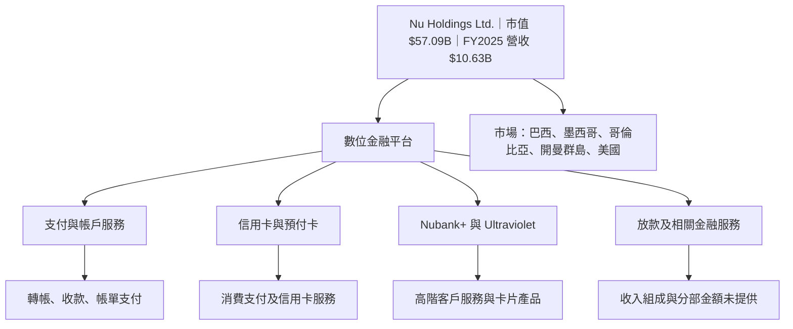
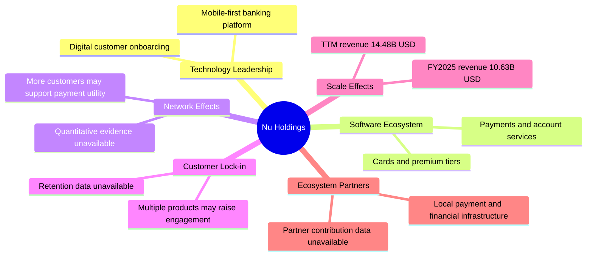
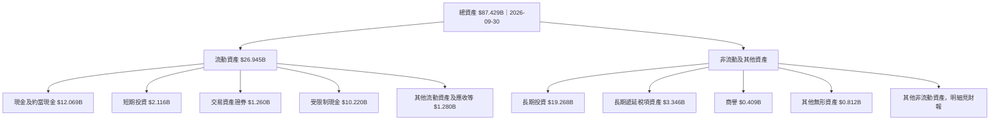
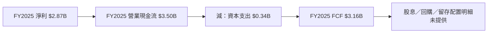
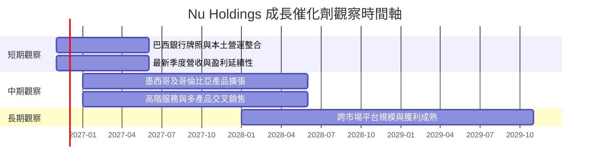
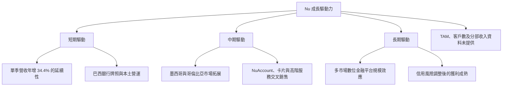
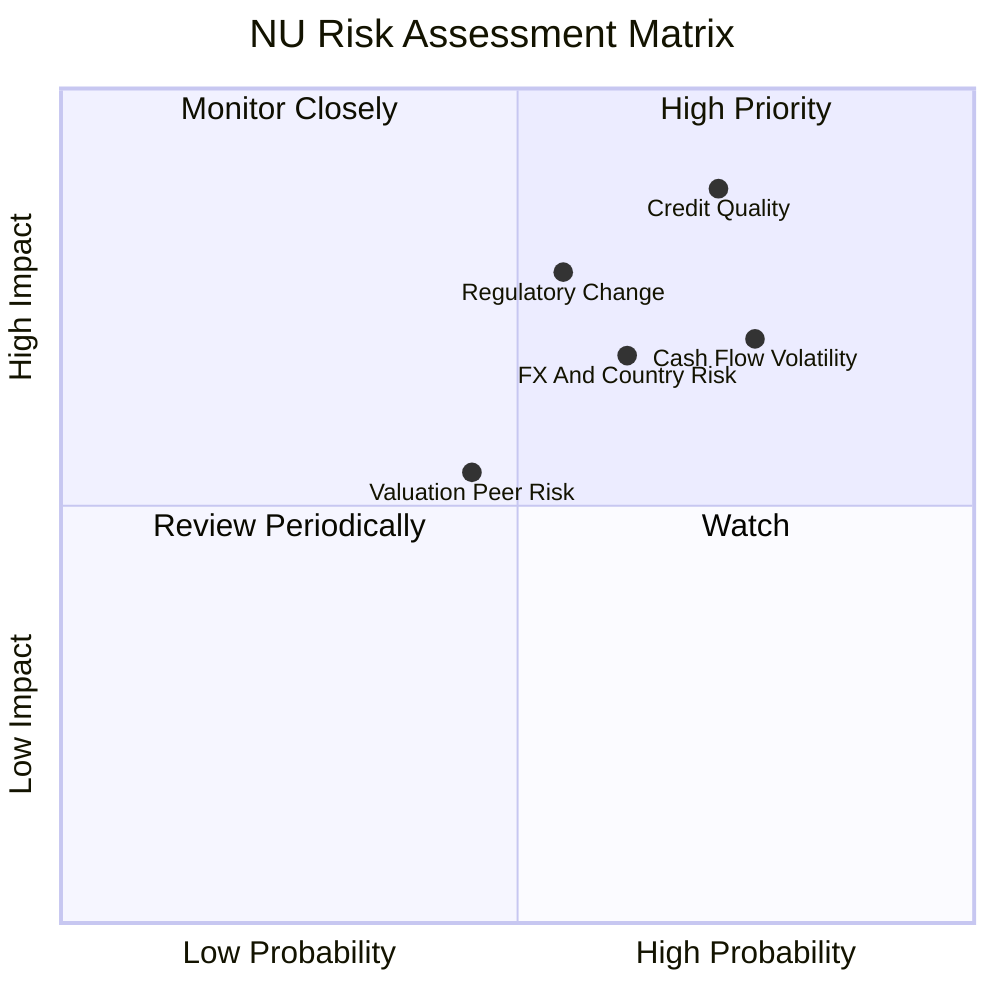
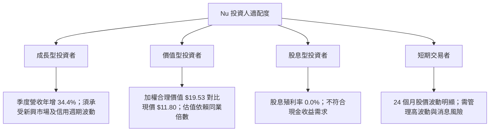

# NU 基本面深度分析報告
> **報告日期**：2026-11-24 ｜ **語言**：繁體中文 ｜ **數據來源**：Yahoo Finance、Finviz、StockAnalysis、Roic.ai ｜ **分析師**：CFA 級機構研究

---

## 目錄

| # | 章節 | 核心結論 |
|---|------|----------|
| 1 | 執行摘要 | 評級「買入」；加權合理價值 $19.53；MOS +39.6% |
| 2 | 公司概覽與商業模式 | 數位銀行平台具規模與跨產品交叉銷售潛力；市場份額資料未提供 |
| 3 | 損益表深度分析 | 最新一季營收年增 34.4%；TTM 營收及多來源財務口徑有差異 |
| 4 | 資產負債表分析 | 淨現金 $9.32B；金融業流動性比率與營運資金天數不適用 |
| 5 | 現金流量深度分析 | TTM FCF -$625.87M；貸款成長與資金流動使傳統 FCF 指標波動 |
| 6 | 獲利能力與資本效率 | ROTCE 29.8%；ROIC 對放款機構不適用，不能直接與 WACC 比較 |
| 7 | 相對估值分析 | Forward P/E 11.0x；同業估值法回推 $17.99–$21.18 |
| 8 | DCF 內在價值評估 | DCF 不適用於銀行類貸款現金流；改以固定估值方法加權 |
| 9 | 成長催化劑 | 新市場拓展、數位銀行牌照及產品交叉銷售是主要觀察項目 |
| 10 | 風險矩陣 | 信用品質、監管與國別風險、現金流口徑波動為主要風險 |
| 11 | 投資建議 | 買入；以 $19.53 加權合理價值為基準，持續追蹤放款品質與現金流 |

---

## 1. 執行摘要

Nu Holdings 的 2026-11-23 收盤價為 **$11.80**。依固定估值方法，股價由同業 Forward P/E、同業 P/B、分析師共識目標價加權推得合理價值 **$19.53**，MOS 為 **+39.6%**、上行空間為 **+65.5%**；按規則 20，MOS 已達 25%，但 lender 不適用 ROIC，不能確認 ROIC > WACC，因此評級為**買入**而非強烈買入。基本面方面，最新一季營收年增 **34.4%**、ROTCE **29.8%**、淨現金 **$9.32B**；反向訊號是 TTM FCF **-$625.87M**，且放款品質關鍵指標未提供。這些數據支持偏正面的相對估值判斷，但現金流與信用風險資料缺口限制了結論信心。

### 1.0 一頁式投資儀表板（Portfolio Manager 30 秒速讀）

| 項目 | 內容 |
|------|------|
| **投資論點（3 句）** | ① 最新一季營收年增 **34.4%**，顯示收入仍在擴張。② ROTCE **29.8%**，反映有形權益回報具吸引力，但不等同 ROIC。③ 淨現金 **$9.32B**，可提供資產負債表緩衝；惟 TTM FCF 為 **-$625.87M**，須釐清放款成長與現金流的關係。 |
| **綜合評分** | **7.3/10**（引用 1.1 評分卡） |
| **財務健康** | 🟡 現金及短期投資 **$15.45B**、總債務 **$6.12B**、淨現金 **$9.32B**；但逾放比、淨沖銷率、CET1 未提供。 |
| **ROIC vs WACC** | ROIC **N/A（放款機構不適用）**；WACC **14.00%**。ROTCE 29.8% 不是 ROIC，故不能據此判定 ROIC 是否高於 WACC。 |
| **FCF 趨勢** | FY2025 FCF **$3.16B**，但 TTM FCF **-$625.87M**；TTM FCF Yield **-1.10%**。貸款機構的放款與存款變化會使營業現金流不等同一般企業的自由現金流。 |
| **估值** | Forward P/E **11.004384x**｜EV/EBITDA **N/A**｜FCF Yield **-1.10%** |
| **DCF 內在價值（基準）** | **N/A**；貸款機構現金流是融資與放款活動的一部分，不能用一般企業 FCFF DCF 解讀。 |
| **現價相對 DCF 折溢價** | N/A（DCF 未計算） |
| **安全邊際（MOS）** | **+39.6%＝($19.53 − $11.80) ÷ $19.53**；🟢 >25% 充足。基準為 8.8 加權合理價值。 |
| **預期報酬（基準情境 12M）** | DCF 情境資料 N/A；以加權合理價值 $19.53 衡量，隱含上行空間 **+65.5%**，但並非 DCF 12 個月目標價。 |
| **關鍵風險（前二）** | ① 放款品質資料不足，無法量化信用週期風險。② TTM FCF 為負且與年度 FCF 呈現反轉，現金流口徑需要持續核對。 |
| **評級 + 信心度** | 🟢 **買入**｜信心：中低（估值折價明確，但信用指標與現金流一致性不足） |

### 1.1 綜合評分卡（全報告唯一）

| 維度 | 評分（1–10） | 主要依據（引用數字與其來源章節） |
|------|--------------|----------------------------------|
| 成長性 | 8.0 | 最新一季營收年增 **34.4%**；TTM 成長率為 N/A，見第 3 章。 |
| 獲利能力 | 8.0 | ROTCE **29.8%**，最新一季營業利益率 **50.9%**；但 lender 的 ROIC 不適用，見第 3、6 章。 |
| 財務健康 | 7.0 | 淨現金 **$9.32B**；逾放比、CET1、淨沖銷率未提供，見第 4、6 章。 |
| 估值 | 8.0 | 加權合理價值 **$19.53**，MOS **+39.6%**；估值方法依同業倍數及分析師共識，見第 7、8 章。 |
| 護城河 | 7.0 | 多市場數位金融平台與多產品服務具交叉銷售基礎，但市場份額、客戶留存及成本優勢數據未提供，見第 2 章。 |
| 管理層與資本配置 | 6.0 | FY2025 SBC **$271.85M**、無股息；回購與資本配置明細不足，見第 3、5 章。 |
| **綜合評分** | **7.3** | 六項算術平均：**(8.0 + 8.0 + 7.0 + 8.0 + 7.0 + 6.0) ÷ 6 = 7.3**。 |

### 1.2 五大投資論點 + 三大核心風險

| 類型 | 項目 | 具體依據 | 信心度 |
|------|------|----------|--------|
| 🟢 **投資論點①** | 營收仍有高成長 | 最新一季營收年增 **34.4%**；季度營收由 2026-06-30 的 **$3.77B** 升至 2026-09-30 的 **$4.03B**。 | 🟢 高 |
| 🟢 **投資論點②** | 有形權益回報具吸引力 | ROTCE **29.8%**，表明相對於有形帳面價值的獲利回報高；但不代表經風險調整後信用成本已完全反映。 | 🟢 中高 |
| 🟢 **投資論點③** | 估值低於同業中位數相對倍數推導價 | NU Forward P/E **11.004384x**；固定同業 Forward P/E 方法推導價 **$21.18**。 | 🟢 中 |
| 🟢 **投資論點④** | 資產負債表具淨現金緩衝 | 現金及短期投資 **$15.45B**，總債務 **$6.12B**，淨現金 **$9.32B**。 | 🟢 中 |
| 🟢 **投資論點⑤** | 多產品與跨市場平台可支持交叉銷售 | 業務涵蓋巴西、墨西哥、哥倫比亞、開曼群島及美國，產品包括信用卡、預付卡、帳戶支付及高階服務；分部收入數據未提供。 | 🟡 中 |
| 🟡 **風險①** | 信用品質不透明 | 淨沖銷率、逾放比與 CET1 均為 N/A，無法直接量化信用風險或資本緩衝。 | 🔴 高衝擊 |
| 🟡 **風險②** | TTM FCF 轉負 | TTM OCF **-$218.53M**、資本支出 **$407.33M**，TTM FCF **-$625.87M**；相較 FY2025 FCF **$3.16B** 出現顯著反轉。 | 🔴 高衝擊 |
| 🟡 **風險③** | 財務資料來源存在口徑差異 | VERIFIED TTM 營收為 **$14.48B**，另有資料來源列 TTM 營收 **$9.10B**；估值和比率解讀可能受來源口徑影響。 | 🟡 中 |

### 1.3 快速統計卡片

| 指標 | 公司實際值（期間） | 同業中位數 | 狀態 |
|------|--------------------|------------|------|
| 營收成長（TTM） | **N/A** | — | 🟡 資料未提供 |
| 營收成長（最新一季年增） | **34.4%** | **43.9%** | 🟡 低於三家同業中位數 |
| 毛利率（TTM） | **0.0%（資料欄位）** | **84.2%** | 🔴 不宜直接比較；銀行毛利率口徑不具可比性且 NU 數值疑為欄位缺失 |
| 營業利益率（TTM） | **N/A** | — | 🟡 資料未提供 |
| ROIC（TTM） | **N/A（金融業不適用）** | — | 🟡 不應以一般公司 ROIC 解讀銀行 |
| Forward P/E | **11.004384x** | **19.8x** | 🟢 低於 peer median |
| FCF Yield（TTM） | **-1.10%** | — | 🔴 負值；貸款機構 FCF 解讀受限 |
| Piotroski F-Score | **N/A（不適用放款機構）** | — | 🟡 現金流測試會誤讀放款成長 |

### 1.4 投資結論

```text
╔══════════════════════════════════════════════════════════════════╗
║                    📊 投資結論摘要                               ║
╠══════════════════════════════════════════════════════════════════╣
║  評級：買入（依規則 20；MOS 達 25%，但 ROIC 對 lender 不適用）   ║
║  價格（2026-11-23 收盤）：$11.80                                 ║
║  DCF 內在價值（基準）：N/A（放款機構不適用一般企業 FCFF DCF）    ║
║  安全邊際 MOS：+39.6%＝($19.53−$11.80)÷$19.53                   ║
║  加權合理價值（8.8）：$19.53                                     ║
║  DCF 情境價值：N/A（DCF MODEL 未提供）                           ║
║  綜合評分：7.3/10（引用 1.1）                                    ║
║  適合投資人：可承受新興市場、信用週期及估值波動的成長型投資人    ║
╚══════════════════════════════════════════════════════════════════╝
```

---

## 2. 公司概覽與商業模式

### 2.1 業務結構與收入來源

公司資料顯示 Nu Holdings 經營數位金融平台，服務市場包括巴西、墨西哥、哥倫比亞、開曼群島及美國；主要產品涵蓋 Nu 信用與預付卡、NuAccount 轉帳及帳單支付、Nubank+、Ultraviolet 等服務。分業務營收、客戶數、活躍客戶數與收入占比未提供，因此不臆測板塊比重。



公司年度營收由 FY2022 **$2.97B** 增至 FY2025 **$10.63B**，三年 CAGR 約 **53.0%**；這顯示平台規模擴張，但不能據此推斷各產品線的獲利或市場份額。FY2025 營收採年度損益表口徑；TTM 營收優先採 VERIFIED FIGURES 的 **$14.48B**，兩者期間不同。

### 2.2 市場份額

市場份額數據未提供。Nu 最新一季營收年增 **34.4%**，低於 SOFI、MELI、HOOD 最新季度營收年增率中位數 **43.9%**；但三者業務組合與地區並不完全可比，因此這只能作為增長速度的方向性參考，不能替代份額資料。

### 2.3 競爭護城河分析



### 2.4 護城河強度

| 護城河項目 | 強度（強／中／弱） | 證據（引用數字或事實） | 會削弱它的情況 |
|------------|--------------------|------------------------|----------------|
| 技術與數位平台 | 中 | 業務以數位銀行平台提供帳戶、支付及卡片服務；具體技術投入、系統穩定度數據未提供。 | 資安事件、服務中斷或技術更新落後。 |
| 軟體生態系統 | 中 | 產品涵蓋卡片、轉帳支付及高階服務，可形成多產品互動；產品別收入與滲透率未提供。 | 產品交叉銷售未能增加留存或客戶價值。 |
| 網路效應 | 中偏弱 | 支付網路有機會因用戶增加而提高便利性，但用戶量、商戶接受度及網路效應指標未提供。 | 競爭平台可低成本複製支付功能或以補貼爭取客戶。 |
| 客戶鎖定 | 中偏弱 | 多產品服務可提高客戶整合程度，但留存率、客戶終身價值與轉換率未提供。 | 客戶轉換成本低、存款或支付客戶流失。 |
| 規模效應 | 中 | FY2025 營收 **$10.63B**，TTM 營收 **$14.48B**；分部成本與單位成本數據未提供。 | 信貸損失與獲客成本增幅快於收入規模。 |
| 生態夥伴 | 中偏弱 | 公司在多個國家營運，但合作夥伴、平台收入與依賴程度未提供。 | 監管或合作條件改變，造成支付或融資渠道受阻。 |

**1.1 護城河評分 7.0/10**，依據是多產品數位平台與跨市場業務具備形成規模和交叉銷售的條件，但客戶留存、成本優勢、份額及單位經濟數據未提供，無法將其評為更高確信度。

---

## 3. 損益表深度分析

### 3.1 年度收入成長趨勢（近4年）

╔══════════════════════════════════════════════════════════════════╗  
║              Nu Holdings 年度收入趨勢（FY2022-FY2025）          ║  
╠══════════════════════════════════════════════════════════════════╣  
║ FY2022  $2.97B  ██████░░░░░░░░░░░░░░░░  YoY：基期              ║  
║ FY2023  $5.63B  ███████████░░░░░░░░░░░  YoY：+89.6% 🟢          ║  
║ FY2024  $8.27B  ████████████████░░░░░░  YoY：+46.9% 🟢          ║  
║ FY2025  $10.63B ██████████████████████  YoY：+28.5% 🟢          ║  
║                                                                  ║  
║ FY2022–FY2025 三年營收 CAGR：                                     ║  
║ (($10.63B ÷ $2.97B)^(1÷3)) − 1 = 約 +53.0%                       ║  
╚══════════════════════════════════════════════════════════════════╝

年度營收成長率是以年度損益表數字計算。FY2023 至 FY2025 成長逐年放緩，與較大營收基期相符；FY2025 仍增長 **28.5%**，代表規模擴張尚未停止。TTM 成長率在 VERIFIED FIGURES 中為 N/A，不能把單季年增率 **34.4%** 代稱為 TTM 成長率。

### 3.2 季度收入趨勢分析

| 季度 | 營收 | QoQ 成長率 | YoY 成長率 | 備註 |
|------|------|------------:|-----------:|------|
| 2025-12-31 | $3.14B | — | 43.9% | YoY 參照 StockAnalysis 季度增幅；財務來源存在期間口徑差異。 |
| 2026-03-31 | $3.54B | +12.7% | 43.8% | QoQ = $3.54B ÷ $3.14B − 1。 |
| 2026-06-30 | $3.77B | +6.5% | 52.2% | QoQ = $3.77B ÷ $3.54B − 1。 |
| 2026-09-30 | $4.03B | +6.9% | **34.4%** | 最新一季 YoY 直接引用 VERIFIED FIGURES；不可標為 TTM。 |

註：QoQ 以季度損益表四捨五入後的收入計算。其他來源列出的 2026 季度營收數字與上述季度表存在差異，因此本文對最新一季 YoY 優先使用已核實的 **34.4%**，不將不同來源的金額混加。

### 3.3 利潤率演變分析

| 利潤率指標 | FY2022 | FY2023 | FY2024 | FY2025 | 趨勢 | 評估 |
|------------|--------|--------|--------|--------|------|------|
| **毛利率** | 0.0%欄位值 | 0.0%欄位值 | 0.0%欄位值 | 0.0%欄位值 | 財務資料未提供可比年度毛利率 | 🟡 銀行業毛利率口徑不適用，欄位值不應作實質解讀 |
| **營業利益率** | N/A | N/A | N/A | N/A | 年度可比數據未提供 | 🟡 |
| **最新一季營業利益率** | — | — | — | 50.9% | 僅有最新單季數據 | 🟢 不能外推為 TTM 或年度趨勢 |
| **淨利率** | -12.3% | 18.3% | 23.8% | 27.0% | 逐年改善 | 🟢 依年度收入及淨利計算 |

年度淨利率以年度損益表除算：FY2025 **$2.87B ÷ $10.63B = 27.0%**，FY2024 **$1.97B ÷ $8.27B = 23.8%**，FY2023 **$1.03B ÷ $5.63B = 18.3%**。改善顯示盈利能力隨規模提升，但無法僅由總體數字拆出定價、信用成本、利息收入及營運費用各自貢獻。資料另列 TTM 淨利率 43.0%，但其營收基礎與 VERIFIED TTM 營收 **$14.48B** 不一致，不宜混用。

### 3.4 費用結構分析

銀行的利息成本、信用減損、營運費用與資本化項目口徑不同；可用的財務數據沒有完整費用明細分解，故**不繪製費用結構圓餅圖，也不推估各類費用占比**。目前可確認 FY2025 淨利 **$2.87B**，但不足以據此推算各費用項目的比重。

### 3.5 季度 EPS 趨勢與盈餘品質（Quality of Earnings）

| 季度 | EPS 實際值 | EPS 預估 | 超預期／不及預期 |
|------|-----------:|---------:|------------------|
| 2025-12-31 | $0.18 | N/A | N/A；估值資料未提供 |
| 2026-03-31 | $0.18 | N/A | N/A；估值資料未提供 |
| 2026-06-30 | $0.22 | N/A | N/A；估值資料未提供 |
| 2026-09-30 | $0.23 | N/A | N/A；估值資料未提供 |

過去四季 EPS 實際值由 **$0.18** 增至 **$0.23**，但 EPS Est 四季均為 nan，故不能判斷超預期或不及預期，也無法將盈餘變化歸因於分析師預估差異。

| 盈餘品質項目 | 數值／佔比 | 評估 |
|--------------|-----------|------|
| 股權薪酬 SBC / 營收 | FY2025 SBC **$271.85M ÷ FY2025 營收 $10.63B = 2.6%** | 🟡 具稀釋成本；應與股數變化一併觀察。 |
| SBC / 營業現金流 | FY2025 **$271.85M ÷ $3.50B = 7.8%** | 🟢 FY2025 OCF 為正時比例尚可；最新 TTM OCF 為負，該比率不具正常經濟解讀。 |
| FCF / 淨利（現金轉換率） | FY2025 **$3.16B ÷ $2.87B = 110.1%**；TTM FCF **-$625.87M** | 🟡 年度現金轉換良好，但 TTM 轉負，現金流波動需要查明。 |
| 一次性／非經常性損益 | 未提供 | N/A；無法判斷是否有一次性項目抬高或壓低盈餘。 |
| 有效稅率異常 | **25.8%**（最新年度有效稅率） | 未見資料足以判定異常；沒有稅項明細可拆解。 |
| 資本化支出 vs 費用化 | TTM 資本支出 **$407.33M**；資本化與費用化政策明細未提供 | N/A；不能據此判斷是否延遲費用認列。 |

SBC 最新四季合計（依季度資料）為 **$394.13M**，相對 VERIFIED TTM 營收 **$14.48B** 約 **2.7%**；由於 TTM OCF 為負，SBC／OCF 比率不宜用來評估常態稀釋負擔。FY2025 FCF 高於淨利，與最新 TTM FCF 為負形成反差，可能反映金融業放款與資金流變化，但現有資料不足以完整拆解。故 GAAP 獲利有實質年度現金流支持，卻不能忽略近期現金流反轉與資料來源差異。

---

## 4. 資產負債表分析

### 4.1 資產結構分解

以下採 2026-09-30 StockAnalysis 資產明細；公司總資產為 **$87.429B**。此圖列示有數字的資產項目，不將未列項目反推成分類總額。



### 4.2 流動性與營運資金分析

金融業的資產與負債包括存款、放款及金融工具，傳統 current ratio、quick ratio 及營運資金天數不適用或不具解讀力；相關數據未提供，不以一般企業方式套用。

| 指標 | 最新值 | 歷史趨勢 | 評估 |
|------|-------:|----------|------|
| 現金及短期投資 | **$15.45B** | FY2025 為 **$16.332B**（不同報表口徑） | 🟢 提供流動性緩衝；帳列現金與受限制現金須區分。 |
| 總債務 | **$6.12B** | FY2025 年底為 **$1.90B**（口徑或期間不同） | 🟡 金額較低於現金投資，但資料源需核對期間與範圍。 |
| 淨現金 | **$9.32B** | 最新 TTM 數據 | 🟢 資產負債表淨現金為正。 |
| Current ratio／Quick ratio | N/A | N/A | 金融業通常不宜用一般企業流動比率。 |
| DSO／DIO／DPO／CCC | 不適用（金融業） | 不適用（金融業） | 放款與存款是金融營運核心，不按一般企業應收、存貨、應付週轉日數解讀。 |

### 4.3 債務結構分析

```text
╔══════════════════════════════════════════════════════════════════╗
║                   NU 債務健康診斷                                ║
╠══════════════════════════════════════════════════════════════════╣
║  總債務：               $6.12B   ███████░░░░░░░░░░░░  🟡        ║
║  現金及短期投資：      $15.45B   ████████████████████  🟢        ║
║  淨現金：               $9.32B   ████████████░░░░░░░░  🟢        ║
║                                                                  ║
║  Debt/Equity：N/A（財務資料未提供且金融業口徑需審慎解讀）        ║
║  Interest Coverage：N/A（利息保障倍數資料未提供）                 ║
║  放款品質：逾放比、淨沖銷率、CET1 均 N/A                          ║
╚══════════════════════════════════════════════════════════════════╝
```

淨現金按核實數據為 **$9.32B**。總債務的不同來源與資產負債表年度數字有差異，故不將 FY2025 年底債務與 2026 TTM 現金數字混算。對銀行而言，總負債亦包含存款等經營性資金來源，不能用一般企業的債務／EBITDA框架推論償債能力。

### 4.4 股東權益趨勢

╔══════════════════════════════════════════════════════════════════╗  
║                   NU 股東權益趨勢                                ║  
╠══════════════════════════════════════════════════════════════════╣  
║ FY2022  $4.89B  ████████░░░░░░░░░░░░░░░░                         ║  
║ FY2023  $6.41B  ███████████░░░░░░░░░░░                            ║  
║ FY2024  $7.65B  █████████████░░░░░░░                              ║  
║ FY2025  $11.29B ████████████████████                              ║  
║                                                                  ║  
║ FY2024→FY2025：$11.29B ÷ $7.65B − 1 = 約 +47.6%                 ║  
╚══════════════════════════════════════════════════════════════════╝

股東權益上升與獲利累積相符，但權益成長也可能受股權薪酬、資本發行及其他綜合收益影響；現有資料沒有完整權益變動表，不將增加額全部歸因於留存盈餘。

---

## 5. 現金流量深度分析

### 5.1 現金流量瀑布圖

以下採 FY2025 年度數據；資本支出以現金流出方向呈現。股息、回購及營運後淨現金變化的年度分配明細未提供。



### 5.2 FCF 轉換率趨勢

| 財年 | 淨利 | FCF | FCF／淨利 | 解讀 |
|------|-----:|----:|---------:|------|
| FY2022 | -$364.58M | $641.27M | 約 -175.9% | 淨利為負，轉換率因分母為負而不宜作常態評估。 |
| FY2023 | $1.03B | $1.09B | 約 105.8% | FCF 略高於淨利。 |
| FY2024 | $1.97B | $2.22B | 約 112.7% | 現金轉換高於淨利。 |
| FY2025 | $2.87B | $3.16B | 約 110.1% | 年度現金轉換維持正值。 |
| TTM 至 2026-09-30 | N/A（TTM 淨利來源口徑不一致） | **-$625.87M** | 不宜直接比較 | TTM FCF 與年度趨勢反轉；須拆分放款與資金來源變化。 |

### 5.3 自由現金流趨勢

╔══════════════════════════════════════════════════════════════════╗  
║                自由現金流（FCF）年度趨勢                         ║  
╠══════════════════════════════════════════════════════════════════╣  
║ FY2022  $0.64B  ████░░░░░░░░░░░░░░░░  年度 FCF                   ║  
║ FY2023  $1.09B  ███████░░░░░░░░░░░░░  年度 FCF                   ║  
║ FY2024  $2.22B  ██████████████░░░░░░  年度 FCF                   ║  
║ FY2025  $3.16B  ████████████████████  年度 FCF                   ║  
║ TTM Sep-2026 -$0.63B  負值；不按正向比例尺畫條                   ║  
║                                                                  ║  
║ TTM FCF Yield：-1.10%（固定定義：OCF − Capex）                   ║  
╚══════════════════════════════════════════════════════════════════╝

FY2022–FY2025 年度 FCF 逐步增長，但截至 2026-09-30 的 TTM FCF 為 **-$625.87M**，且 TTM OCF 為 **-$218.53M**、Capex 為 **$407.33M**。放款機構的現金流可能因貸款發放、存款與投資活動大幅波動，因此此處 FCF 不宜直接當作可分配給股東的現金。

### 5.4 資本配置評估

資本配置的股息、回購、成長投資與現金留存分項金額未提供，故不繪製比例圓餅圖，避免由不完整資料推算資金用途。

| 項目 | 可確認資料 | 評估 |
|------|------------|------|
| 資本支出 | FY2025 現金流表 Capex **$340.77M**；TTM Capex **$407.33M** | 對數位金融平台而言，需追蹤科技與基礎設施投入，但細項未提供。 |
| 股息 | 殖利率 **0.0%**；派息率 **0.0%** | 目前無現金股息回報。 |
| 股權薪酬 | FY2025 **$271.85M**；TTM 季度合計約 **$394.13M** | SBC 會稀釋股東權益，須觀察股數變化及公司是否用回購抵銷。 |
| 回購 | 未提供 | 無法判斷是否以回購抵銷 SBC。 |
| 留存與放款投資 | 分項金額未提供 | 金融機構資金配置應以放款風險調整後報酬及資本充足度評估。 |

---

## 6. 獲利能力與資本效率

### 6.1 ROE / ROA / ROIC 趨勢

| 指標 | 可用數值 | 評估 |
|------|---------|------|
| ROE（TTM） | **31.5%** | 有獲利能力參考價值，但需與資本結構和信用損失併讀。 |
| ROA（TTM） | **5.0%** | 對金融機構可作獲利效率參考；與資產組成及風險權重相關。 |
| ROTCE（TTM） | **29.8%** | 以有形帳面價值衡量的股東回報指標；不等同 ROIC。 |
| ROIC | **N/A** | 對銀行及放款機構，利息收入、負債與營運資本構成和一般企業不同，不宜用標準 ROIC 判斷價值創造。 |
| 行業均值比較 | N/A | 數據未提供，故不做虛構的行業比較。 |

### 6.2 ROIC vs WACC 分析（核心價值創造判斷）

放款機構 ROIC 不適用；以下 WACC 只依核實資本成本數據列示，不把 ROTCE 當作 ROIC，也不據此宣稱 ROTCE 超越 WACC 即代表創造經濟價值。

```text
╔══════════════════════════════════════════════════════════════════╗
║                ROIC vs WACC 深度分析                            ║
╠══════════════════════════════════════════════════════════════════╣
║  WACC 輸入（成本資本資料）：                                     ║
║  ├── 無風險利率 Rf（10Y Treasury）：  4.92%                     ║
║  ├── 股權風險溢酬 ERP：                5.00%                     ║
║  ├── 原始 Beta：                        0.97                     ║
║  ├── 調整後 Beta：                      0.98                     ║
║  ├── 股權成本 Ke：                      9.81%                     ║
║  ├── 稅前債務成本 Kd：                 74.76%                     ║
║  ├── 稅率：                             25.8%                     ║
║  ├── 股權／債務權重：                   90.3%／9.7%               ║
║  ├── 計算 WACC：                       14.24%                     ║
║  └── 採用 WACC：                       14.00%（限制於 7%–14%）   ║
║                                                                  ║
║  ROIC：N/A（金融業不適用；資金成本與放款是核心營運投入）         ║
║  ROTCE：29.8%（不同指標，不可與 ROIC 直接等同）                   ║
║  ROIC − WACC：N/A；無法據此判定標準意義下的 EVA。                ║
╚══════════════════════════════════════════════════════════════════╝
```

WACC 核實輸入的 CAPM 為 **4.92% + 0.98 × 5.00% = 9.82%**（與資料列示 9.81% 的差異為輸入精度／四捨五入）；債務成本高達 **74.76%**，使未限制計算值為 **14.24%**，依指定區間上限採用 **14.00%**。由於銀行負債多屬融資與經營資金來源，且資料計算的債務成本可能受分母口徑影響，不把它視為可獨立驗證的企業債券融資成本。ROIC 與 WACC 的價值創造測試對放款機構不適用。

### 6.3 杜邦三因素分解

**N/A（品質指標列示：淨利、營收、總資產或正權益資料不足以計算一致口徑的杜邦分解）**。雖然另有 ROE 31.5%，但沒有可核實一致口徑的淨利率、資產週轉率及權益乘數組合，故不自行重算或補填。

### 6.4 財務體質：Piotroski F-Score 與 lender 指標

Piotroski F-Score **N/A**：該分數不適用放款機構，因貸款成長會造成營業現金流流出，現金流測試可能誤判銀行營運表現。

| 金融業指標 | 數值（TTM） | 解讀 |
|------|---------:|------|
| 淨利息收入 NII ÷ 總營收 | **84.7%** | 營收主要來自淨利息收入；收入對利率與信用週期較敏感。 |
| 淨利差代理值 NII ÷ 平均總資產 | **15.74%** | 這是代理值；因未提供生息資產，該值會高於一般以生息資產計算的正式 NIM。 |
| 成本收入比代理值 | **68.1%** | 公式為（營收−稅前淨利）÷營收；包含信用準備，因此高於正式效率比率。 |
| ROTCE | **29.8%** | 以淨利除以有形帳面價值；反映有形權益報酬，不是 ROIC。 |
| P/TBV | **4.35x** | 市場對有形帳面價值給予較高倍數，依賴未來獲利持續性。 |
| 淨放款 ÷ 總資產 | **14.0%** | 放款占比指標；需注意其與其他資產和表內金融工具的分類口徑。 |
| 淨沖銷率 | **N/A（數據未提供）** | 不引用外部記憶值。 |
| 逾放比 | **N/A（數據未提供）** | 不引用外部記憶值。 |
| CET1 | **N/A（數據未提供）** | 不引用外部記憶值。 |

---

## 7. 相對估值分析

### 7.1 同業估值比較表格

公司 Forward P/E、P/E、P/S 取估值資料；同業倍數取 Yahoo Finance Peer multiples。銀行、金融科技平台、電商支付平台的收入認列和業務風險不同，倍數比較屬相對參考而非完全同質比較。

| 估值指標 | **NU** | **SOFI** | **MELI** | **HOOD** | NU 評估 |
|----------|-------:|-------:|-------:|-------:|-----------|
| **Trailing P/E** | 14.75x | 23.8x | 38.2x | 28.7x | 🟢 NU 倍數低；須確認 EPS 資料口徑一致。 |
| **Forward P/E** | 11.004384x | 14.6x | 26.9x | 19.8x | 🟢 低於三家同業；相對估值方法採用同業中位數 **19.8x**。 |
| **P/S Ratio** | 6.2721953x | 3.6x | 1.9x | 11.9x | 🟡 高於 SOFI、MELI，低於 HOOD；業務組合差異大。 |
| **EV / EBITDA（TTM）** | N/A | N/A | 20.6x | N/A | 🟡 僅 MELI 可用，不能構成有代表性的中位數比較。 |
| **最新一季營收 YoY** | 34.4% | 43.9% | 45.1% | 11.8% | 🟡 NU 低於 SOFI 與 MELI，高於 HOOD。 |
| **毛利率（TTM）** | 0.0%欄位值 | 84.2% | 46.7% | 91.0% | 🔴 金融業毛利率口徑不宜直接比較，NU 欄位亦可能是缺失值表示。 |

同業最新季度營收成長中位數為 **43.9%**，但 NU 的 **34.4%** 並非低成長；只是相對 SOFI、MELI 的當季增速較低。NU Forward P/E 低於同業倍數，但不同公司盈利週期與信用風險差異可能解釋一部分估值折價。

### 7.2 歷史估值區間分析

╔══════════════════════════════════════════════════════════════════╗  
║                   歷史估值位置                                  ║  
╠══════════════════════════════════════════════════════════════════╣  
║ 歷史 P/E 區間：N/A（Valuation vs own history 數值未提供）        ║  
║ 當前 P/E（TTM）：14.75x                                          ║  
║ 當前 Forward P/E：11.004384x                                     ║  
║ 歷史百分位：N/A（不得以股價走勢代替估值百分位）                   ║  
╚══════════════════════════════════════════════════════════════════╝

24 個月價格序列不等於歷史估值區間，故不以股價高低推算歷史 P/E 百分位。

### 7.3 情境價值（Bear / Base / Bull）

**N/A（DCF MODEL 未提供情境表；金融機構的放款現金流不適用一般企業 DCF，因此不另行自建或自行設定情境目標價。）**

### 7.4 相對估值隱含價格區間

╔══════════════════════════════════════════════════════════════════╗  
║               相對估值方法回推每股價值                           ║  
╠══════════════════════════════════════════════════════════════════╣  
║ 同業 P/B：$17.99 ───────── 現價：$11.80 ───────── $21.18：同業 P/E║  
║ 分析師共識：$17.41                                                ║  
║                                                                  ║  
║ 同業 Forward P/E：$21.18，採 peer median 19.8x × Forward EPS 1.07 ║  
║ 同業 P/B：$17.99，採 peer median 6.1x × BVPS $2.96               ║  
║ 分析師共識：$17.41，23 位分析師平均目標價                         ║  
╚══════════════════════════════════════════════════════════════════╝

相對估值方法的價值範圍為 **$17.41–$21.18**。其中分析師目標價是參考值，不是同業倍數推導；固定權重與加權結果見第 8.8 節。

---

## 8. DCF 內在價值評估（Discounted Cash Flow）

> **DCF MODEL：N/A。** Nu 是放款機構，貸款發放、存款與其他資金流是其營運模式的一部分，不能直接把一般企業的營業現金流減資本支出視為可供所有資本提供者分配的 FCFF。下列 DCF 子節依資料條件標示 N/A，不另建模型，也不製造 DCF 內在價值。

### 8.0 估值推理鏈（Thinking Logic）

**Step 1 — 價值來源與主導變數**

Nu 的股權價值應主要由放款與支付業務的持續獲利能力、資金成本及信用損失決定；淨利息收入占總營收 **84.7%**，顯示利息收入是核心收入來源。產品別營收比例、新產品收入及客戶數據未提供，因此無法可靠拆分主業與第二成長曲線的占比。對此類金融機構，影響估值的核心變數是**風險調整後獲利及信用成本**，而非一般企業 DCF 中的自由現金流 CAGR。

**Step 2 — 模型選擇**

| 決策點 | 本報告採用 | 理由（含數字） | 曾考慮但否決 | 否決理由 |
|--------|-----------|----------------|--------------|----------|
| 主要估值方法 | 同業 Forward P/E、同業 P/B、分析師共識加權 | 公司類型為 financial；固定權重分別 50%、40%、10%。 | 一般企業 FCFF DCF | 放款與資金變動是營運活動一部分；DCF MODEL 明確為 N/A。 |
| 現金流定義 | 不適用 | TTM FCF **-$625.87M**，且 lender 現金流定義不宜直接等同企業可分配 FCFF。 | FCFE／FCFF 模型 | 缺乏可直接建模的放款、存款、信用損失與資本充足度預測。 |
| 預測期 N | N/A | DCF 未建模。 | 5–10 年 | 無模型依據，不自行設定。 |
| 終值方法 | N/A | DCF 未建模。 | Gordon Growth／退出倍數 | 未提供可核實 DCF 假設。 |
| EBIT 基礎 | N/A | 金融機構估值方法不採本報告的一般企業 EBIT-DCF。 | GAAP EBIT FCFF | 放款機構 EBIT 及銀行資金成本口徑不適合直接套用。 |

**Step 3 — 關鍵假設推導鏈**

DCF MODEL 為 N/A，故沒有營收 CAGR、期末營業利潤率、g、預測期、Capex 比率、ΔWC、SBC 組合或稀釋率等模型輸入，亦不能套用一般企業假設。估值採用的相對倍數、每股價值及權重則按固定方法照列於 8.8，不另行調整。

**Step 4 — 最脆弱的一環**

目前最脆弱的估值環節是信用風險與資本要求資料不足：淨沖銷率、逾放比、CET1 均未提供。若信用成本上升，盈利可能下滑，P/E 與 P/B 推導價值均會向下；由於缺少信貸損失數據，不能以 DCF 敏感性數字量化其幅度。

**Step 5 — 計算路徑**

一般企業 DCF 路徑不適用於本公司，故不提供會造成錯誤暗示的 FCFF 模型圖。本文採用 8.8 固定相對估值方法進行三角驗證。

### 8.1 模型假設總表（Model Inputs）

**N/A（DCF MODEL：放款機構現金流屬資金與放款營運的一部分，不適用一般企業 FCFF DCF；預測期、營收 CAGR、Capex/營收、ΔWC、終值及 DCF 股數假設均未提供。）**

### 8.2 折現率推導（WACC）

WACC 資料依成本資本數據照列；但因 DCF 不適用，本 WACC 不是第 8 章 DCF 折現率的實際應用值。

```text
╔══════════════════════════════════════════════════════════════════╗
║                    WACC 推導（折現率）                           ║
╠══════════════════════════════════════════════════════════════════╣
║  股權成本 Ke（CAPM，核實值）：                                  ║
║  ├── 無風險利率 Rf：                     4.92%                   ║
║  ├── 股權風險溢酬 ERP：                   5.00%                   ║
║  ├── 原始 Beta：                          0.97                    ║
║  ├── 調整後 Beta：                        0.98                    ║
║  └── 資料列示 Ke：                        9.81%                   ║
║                                                                  ║
║  債務成本及權重（核實值）：                                      ║
║  ├── 稅前 Kd：                           74.76%                   ║
║  ├── 有效稅率：                          25.8%                    ║
║  ├── 資本權重 E / D：                    90.3% / 9.7%             ║
║  ├── 未限制計算值：                      14.24%                   ║
║  └── 採用 WACC：                         14.00%（限制在 7%–14%） ║
╚══════════════════════════════════════════════════════════════════╝
```

Beta 調整依公式 **(2/3 × 0.97) + (1/3 × 1.00) = 0.98**。CAPM 以提供的 10Y Treasury 無風險利率 **4.92%**、假設 ERP **5.00%** 及調整後 Beta 計算；數據列示 Ke 為 **9.81%**。WACC 核實計算值為 **14.24%**，依指定的 **7%–14%** 範圍上限採用 **14.00%**。債務成本異常偏高，且 Kd 的完整債務分母細節未提供，因此不自行重算或替換。

### 8.3 逐年自由現金流預測（基準情境）

**N/A（DCF MODEL 未提供；不自行預測 FY+1 至 FY+N 的營收、EBIT、FCFF 或折現值。）**  
此外，貸款機構的 OCF 與貸款發放、存款變動等高度相關，將其視為一般企業 FCFF 可能得出錯誤估值。

### 8.4 終值計算（Terminal Value）

**N/A（DCF MODEL 未提供預測期 FCFF、永續成長率 g 或退出倍數；不計算 Gordon Growth 終值或退出倍數終值。）**

### 8.5 企業價值 → 每股內在價值（Bridge）

**N/A（DCF 企業價值、DCF 現金流現值、DCF 終值與 DCF 每股內在價值均無模型結果。）**  
本報告現價相對 DCF 的折溢價因此亦為 N/A。第 8.8 的安全邊際以加權合理價值為唯一基準，不由 DCF 代替。

### 8.6 敏感性分析（WACC × 永續成長率）

**N/A（DCF MODEL 為 N/A，沒有基準 FCFF、WACC × g 矩陣或可稽核的敏感性數字；不自行建模。）**

### 8.7 反推 DCF（Reverse DCF：市場在預期什麼）

**N/A（沒有 DCF 基準模型，亦無法由單一現價反推營收 CAGR、利潤率、永續成長率或預測期。）**  
不能把相對估值推導的 $19.53 誤稱為反推 DCF 結果。

### 8.8 估值三角驗證與安全邊際

公司類型為 **financial**，方法與權重依固定規則照列；未提供 DCF 價值，故不新增 DCF 方法或自行調整權重。

| 估值方法 | 隱含每股價值 | 上行空間（÷現價） | 權重 | 說明 |
|----------|--------------|-------------------|------|------|
| 同業 Forward P/E | **$21.18** | **+79.5%** | **50%** | 同業中位數 **19.8x** × Forward EPS **$1.07**。 |
| 同業 P/B | **$17.99** | **+52.5%** | **40%** | 同業中位數 **6.1x** × BVPS **$2.96**。 |
| 分析師共識目標價 | **$17.41** | **+47.5%** | **10%** | 23 位分析師平均目標價。 |
| **加權合理價值** | **$19.53** | **+65.5%** | **100%** | 金融類公司固定估值方法加權值；DCF 未計算，沒有 DCF 方法可納入。 |

**逐步演算（權重外顯）**：

$$
21.18 \times 50\% + 17.99 \times 40\% + 17.41 \times 10\%
= 10.590 + 7.196 + 1.741
= 19.527\ \text{USD}
\approx 19.53\ \text{USD}
$$

加權價值使用原始加總 **$19.527**，呈現時按兩位小數四捨五入為 **$19.53**；權重總和為 **50% + 40% + 10% = 100%**。

MOS、上行空間及折溢價口徑如下：

- **MOS** = (加權合理價值 − 現價) ÷ 加權合理價值  
  **= ($19.53 − $11.80) ÷ $19.53 = $7.73 ÷ $19.53 = +39.6%**
- **上行空間** = (加權合理價值 − 現價) ÷ 現價  
  **= ($19.53 − $11.80) ÷ $11.80 = $7.73 ÷ $11.80 = +65.5%**
- **折溢價**相對 DCF 內在價值：N/A（DCF 未計算）。

```text
╔══════════════════════════════════════════════════════════════════╗
║                  估值區間與安全邊際                              ║
╠══════════════════════════════════════════════════════════════════╣
║  $17.41 ─────── $19.53 ─────── $21.18                            ║
║  分析師共識      加權合理值       同業 Forward P/E                 ║
║                                                                  ║
║  現價：$11.80                                                     ║
║  安全邊際 MOS = ($19.53 − $11.80) ÷ $19.53 = +39.6%             ║
║  MOS 評估：🟢 >25% 充足                                          ║
║  上行空間 = ($19.53 − $11.80) ÷ $11.80 = +65.5%                 ║
║  （兩個指標分母不同，不可互換）                                  ║
║                                                                  ║
║  建議買入區間：$11.80–$17.58（合理價值的 90%；MOS 約 10% 以上）  ║
║  合理持有區間：$17.58–$21.18（接近方法推導價值區間）             ║
║  減碼考慮區間：高於 $21.18（超過本次相對估值方法高端）           ║
╚══════════════════════════════════════════════════════════════════╝
```

建議買入區間上緣以 **$19.53 × (1 − 10%) = $17.577 ≈ $17.58** 推算；下緣不代表估值底部，僅用現價作為區間起點以符合買入評級時上限不得低於現價的規則。

> 🔎 **程式複算（Python，依本節各項自動重算）**
>
> 加權合理價值 = $21.18 × 50% + $17.99 × 40% + $17.41 × 10% = **$19.53**（權重合計 100%）
>
> 以價格 $11.80 計：MOS = **+39.6%**，上行空間 = **+65.5%**
>
> ✅ 與本節所寫數值一致。

### 8.9 DCF 模型的局限與失效條件

- **終值依賴度**：N/A，DCF 未建模，沒有可列示的終值占企業價值比例。
- **估值方法的薄弱點**：同業倍數取決於 peer selection 及各公司盈利質量；NU Forward P/E **11.004384x** 與同業倍數的差異，不能單憑折價就證明市場定價錯誤。
- **放款機構估值限制**：宜以風險調整獲利、P/B、P/TBV、資本充足度與貸款品質共同評估；現有資料缺少逾放比、淨沖銷率與 CET1，降低估值可靠度。
- **現金流限制**：FY2025 FCF **$3.16B**，但 TTM FCF **-$625.87M**；若負現金流反映資產品質惡化而非正常放款擴張，相對估值亦可能下修。
- **與第 10 章風險的連結**：信用損失上升會壓低淨利與 Forward EPS；監管資本要求提高可能壓低可分配盈餘；市場融資成本上升則可能傷害淨利差及 P/B 倍數。

### 8.10 複算檢核表（Audit Trail）

| # | 檢核項目 | 檢查方式 | 結果 |
|---|----------|----------|------|
| 1 | 高／中敏感度 DCF 輸入有完整四段式推導 | DCF MODEL 為 N/A，無模型假設可推導 | N/A（未建 DCF） |
| 2 | 每個 DCF 假設都有來歷 | 不適用，沒有 DCF 輸入 | N/A |
| 3 | WACC 五步算式齊全且相乘相加正確 | 核實 WACC 計算值 14.24%，採用上限 14.00% | N/A（DCF 不適用）；資料值已揭露 |
| 4 | Kd 分母與權重 D 範圍一致 | 成本資本資料未提供足以獨立核對的完整分母細項 | N/A（來源輸入照列，未重算） |
| 5 | WACC 與第 6.2 節同值 | 兩處採用 **14.00%** | ✅ |
| 6 | 逐年預測年度數符合 N | 無 DCF 預測年度 | N/A |
| 7 | FY+1 FCFF 與 PV 可複算 | 無 DCF 預測 | N/A |
| 8 | 預測期 PV 加總正確 | 無 DCF 預測 | N/A |
| 9 | WACC > g | 無 g 假設 | N/A |
| 10 | 終值以 FY+N 現金流為基礎 | 無終值 | N/A |
| 11 | DCF 橋接可複算 | 無 DCF EV／股權價值 | N/A |
| 12 | SBC 組合與 DCF 股數假設相容 | 無 DCF EBIT 與 DCF 股數假設 | N/A |
| 13 | 敏感性矩陣基準格等於 DCF 基準值 | 無矩陣 | N/A |
| 14 | 敏感性矩陣無 WACC ≤ g 無效格 | 無矩陣 | N/A |
| 15 | DCF 三情境機率加總 100% | DCF 情境資料未提供 | N/A |
| 16 | 反推 DCF 一次只放開一個變數 | 無反推模型 | N/A |
| 17 | MOS 基準為 8.8 加權價值，折溢價為 DCF 基準 | MOS **+39.6%**；DCF 折溢價 N/A | ✅ |
| 18 | 報告完整輸出至第 11 章 | 已包含第 1–11 章 | ✅ |
| 19 | 加權合理價值等於各項價值乘權重總和 | $21.18×50% + $17.99×40% + $17.41×10% = $19.527 ≈ $19.53 | ✅ |
| 20 | 評級符合規則 20 | MOS +39.6%，但 ROIC 不適用，採「買入」 | ✅ |

---

## 9. 成長催化劑

### 9.1 催化劑時間軸

具體發佈時程未提供，下列時間範圍是觀察框架，不代表公司已公布財務指引。



近期新聞提及「Nu 在巴西取得銀行牌照」，但沒有附具體財務效益或收入預測。牌照能否轉化為成本下降、產品擴展或獲利改善，仍需由後續營運數據驗證。

### 9.2 TAM 市場規模分析

**N/A（TAM 數據未提供）**。公司最新一季營收年增 **34.4%**，FY2025 年收入為 **$10.63B**，顯示業務仍在擴張；但沒有可引用的市場總額、客戶滲透率或市場份額數字，因此不推估 TAM 或滲透率。

### 9.3 成長驅動力結構圖



---

## 10. 風險矩陣

### 10.1 風險評分矩陣

以下座標為分析師對風險機率與衝擊的定性分布，不是公司財務預測；採英文節點文字以符合圖表語法要求。



### 10.2 風險清單詳細分析

機率與衝擊是研究判斷的定性區間，不是歷史統計頻率或公司指引。財務衝擊因缺少分部與信用損失敏感度數據，不以虛構的收入下跌百分比量化。

| # | 風險項目 | 發生機率 | 財務衝擊 | 風險評分 | 緩解措施 |
|---|----------|----------|----------|----------|----------|
| 1 | 🔴 **放款品質惡化** | 中高（分析判斷） | 高；可能推升撥備、降低淨利與 P/B 合理倍數；量化幅度 N/A | 🔴 高 | 每季追蹤逾放比、淨沖銷率、逾期遷徙及撥備覆蓋；目前數據未提供，投資者應要求後續報表補足。 |
| 2 | 🔴 **營業現金流與 FCF 波動** | 高（近期已見波動） | TTM FCF **-$625.87M**，相較 FY2025 **$3.16B** 轉負；是否源於成長性放款或基本面惡化須拆解 | 🔴 高 | 區分貸款發放、存款流入、投資及資本支出；觀察多季趨勢，不以單季 OCF 評判獲利品質。 |
| 3 | 🟠 **監管與資本要求變化** | 中 | 可能影響放款、產品推出、資本回報及業務成本；量化幅度 N/A | 🟠 中高 | 追蹤巴西銀行牌照實施、各市場監管規則及 CET1；CET1 數據目前 N/A。 |
| 4 | 🟠 **新興市場與匯率風險** | 中 | 多國營運涉及匯率、利率和政治環境差異；報價為 USD，匯率對股東回報有影響 | 🟠 中高 | 觀察各市場收入與成本自然對沖、貨幣曝險及地區分布；分部數據未提供。 |
| 5 | 🟡 **同業倍數與共識估值風險** | 中 | 加權價值 **$19.53** 主要由同業倍數與共識構成；若 peer 倍數收縮，合理價值會下修 | 🟡 中 | 按季度更新同業估值、EPS 與 P/B；分別檢視同業 P/E 推導值 **$21.18**、P/B 推導值 **$17.99**。 |
| 6 | 🟡 **資料口徑不一致** | 中高 | VERIFIED TTM 營收 **$14.48B**，另一來源列 **$9.10B**；若混用會扭曲成長率與利潤率 | 🟠 中高 | 估值、比率一律鎖定期間與來源；重要結論優先採用核實指標並保留口徑註記。 |

---

## 11. 投資建議

### 11.1 最終評級與評分

依加權合理價值 **$19.53**、現價 **$11.80** 計算，MOS 為 **+39.6%**，按規則 20 的 MOS 門檻屬買入區間；由於 ROIC 對放款機構不適用，不能確認 ROIC > WACC，故不升為強烈買入。1.1 綜合評分為 **7.3/10**，六項分數依序為成長性 **8.0**、獲利能力 **8.0**、財務健康 **7.0**、估值 **8.0**、護城河 **7.0**、管理層與資本配置 **6.0**。

### 11.2 合理價值與隱含報酬率

| 方法 | 每股價值 | 相對現價 $11.80 | 機率／權重 | 說明 |
|------|---------:|----------------:|------------:|------|
| 同業 Forward P/E | **$21.18** | **+79.5%** | 權重 50% | peer median 19.8x × Forward EPS $1.07。 |
| 同業 P/B | **$17.99** | **+52.5%** | 權重 40% | peer median 6.1x × BVPS $2.96。 |
| 分析師共識目標價 | **$17.41** | **+47.5%** | 權重 10% | 23 位分析師平均目標價。 |
| **加權合理價值** | **$19.53** | **+65.5%** | **權重 100%** | 相對估值方法加權值；不是 DCF 目標價。 |

DCF 三情境價值與機率為 N/A，不在此處另行設定。

### 11.3 買入時機與觸發因素

```text
╔══════════════════════════════════════════════════════════════════╗
║                  ✅ 買入觸發因素 Checklist                      ║
╠══════════════════════════════════════════════════════════════════╣
║  目前可支持分批建立部位的條件：                                  ║
║  ✅ 2026-11-23 收盤價 $11.80，低於加權合理價值 $19.53            ║
║  ✅ MOS +39.6%，高於規則 20 買入區間所需的 10% MOS               ║
║  ✅ 現金及短期投資 $15.45B，淨現金 $9.32B                        ║
║                                                                  ║
║  加碼觸發條件（需與信用品質共同確認）：                          ║
║  ☐ 最新季度營收年增持續高於 30%，且淨利增長未靠一次性項目支撐    ║
║  ☐ 公司披露逾放比、淨沖銷率、CET1，且信用指標沒有惡化            ║
║  ☐ TTM FCF 由 -$625.87M 改善，並能由貸款／存款明細解釋            ║
║  ☐ 股價回落至 $17.58 以下，維持相對加權價值至少約 10% MOS        ║
║                                                                  ║
║  減碼／重新評估觸發條件：                                        ║
║  ☐ 股價高於 $21.18，超過本次相對估值方法高端                     ║
║  ☐ 信用損失增加並持續侵蝕淨利或有形權益回報                      ║
║  ☐ TTM FCF 持續為負，且不能由正常放款成長與資金流變化解釋          ║
╚══════════════════════════════════════════════════════════════════╝
```

### 11.4 投資人適配度分析



### 11.5 每季財報監控清單（Quarterly Watch List）

| 監控指標 | 目前基準 | 加碼觀察門檻 | 減碼／重新評估門檻 |
|----------|---------:|--------------|-------------------|
| 營收年增率 | 最新一季 **34.4%** | 維持在 30% 以上，且收入與淨利趨勢一致 | 連續兩季低於 20%，且沒有合理的產品或基期解釋 |
| 淨利年增率 | 最新一季 **39.4%** | 延續正成長並由核心業務支撐 | 連續兩季轉負或明顯落後營收趨勢 |
| 最新一季營業利益率 | **50.9%** | 維持高水準且沒有信用成本被遞延的證據 | 連續兩季較 50.9% 收縮逾 5 個百分點 |
| TTM FCF | **-$625.87M** | 轉正或負值可由放款成長與資金流明確解釋 | 持續負值且無法由營運性資金配置解釋 |
| SBC／營收 | FY2025 約 **2.6%**；最新四季約 **2.7%** | SBC 比率穩定或下降，股數增長受到控制 | SBC／營收持續上升，且股數淨增快於盈利增長 |
| 放款品質 | 逾放比、淨沖銷率 N/A | 披露數據並確認穩定或改善 | 逾放、沖銷或撥備明顯上升 |
| 資本充足 | CET1 N/A | 披露並維持監管要求之上 | 資本緩衝縮小或監管限制資本回報 |
| 淨現金 | **$9.32B** | 維持正淨現金並保持流動性 | 淨現金快速下降且貸款品質同時惡化 |
| 分析師預期與財測 | 23 位分析師共識均值 **$17.41** | 公司指引與實際業績相符 | 公司指引下修且估值倍數同步下滑 |

### 11.6 反面論證：什麼會證明論點錯誤（What Would Change My Mind）

```text
╔══════════════════════════════════════════════════════════════════╗
║              ⚠️ 論點失效條件（Disconfirming Evidence）           ║
╠══════════════════════════════════════════════════════════════════╣
║  本投資論點在下列情況出現時應重新檢視或退出：                    ║
║  ☐ 核心營收年增連續兩季低於 20%，且不是單純基期效應              ║
║  ☐ 最新一季營業利益率由 50.9% 水準收縮逾 5 個百分點並持續        ║
║  ☐ TTM FCF 持續為負，且不能由放款擴張及存款變化解釋              ║
║  ☐ 逾放比、淨沖銷率或撥備連續惡化；目前基準數據未提供            ║
║  ☐ ROTCE 從 29.8% 明顯下滑，並伴隨淨利及資產品質轉弱             ║
║  ☐ 淨現金由 $9.32B 快速下降，且主要用於彌補營運或信用損失        ║
║  ☐ 以更新財務數據重算後，加權合理價值低於現價且 MOS 轉負          ║
╚══════════════════════════════════════════════════════════════════╝
```

> **免責聲明**：本報告為 AI 自動生成，僅供研究參考，不構成投資建議。投資有風險，入市需謹慎。

---

## 資料與來源

| 項目 | 內容 |
|------|------|
| 價格 | 11.80 USD，2026-11-23 收盤（Yahoo Finance 日線） |
| 財務報表 | Yahoo quarterly statements (no SEC filing data)，最新季度 2026-09-30（TTM = four quarters to this date） |
| 有回應的資料來源 | Yahoo Finance、Finviz、StockAnalysis、Roic.ai |
| 未回應的資料來源 | SEC 申報資料 (XBRL) |
| 由程式計算 | TTM 數字、WACC、DCF 模型、估值方法與權重、加權合理價值、MOS、評級門檻、F-Score、杜邦分解、營運資金天數、綜合評分 |
| 撰寫模型 | openai / gpt-6-luna |

> 本區塊由產生報告的程式依實際取得的資料填寫，非模型撰寫。「由程式計算」的數字不是模型的估計；其餘判斷（評分、情境、策略）是模型的分析。
