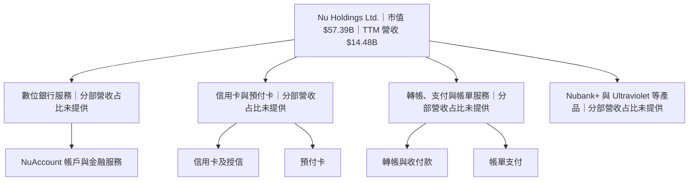
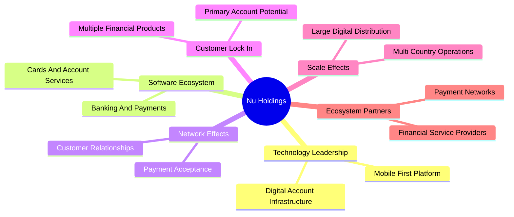
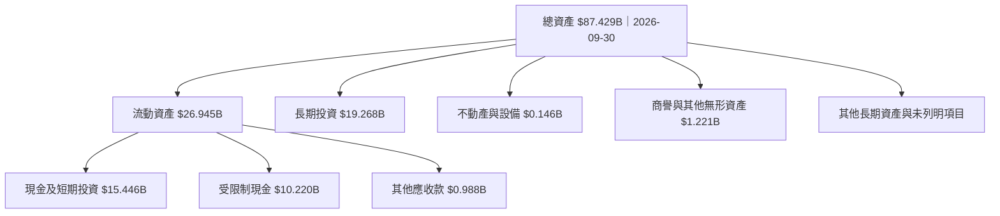
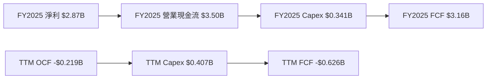
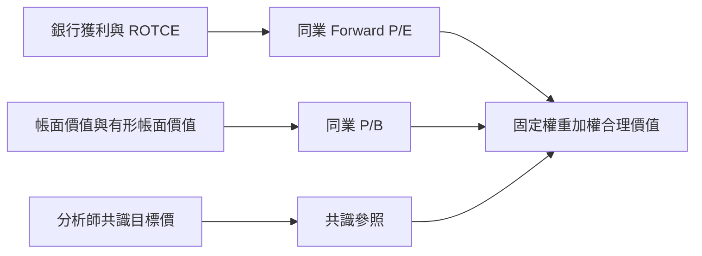
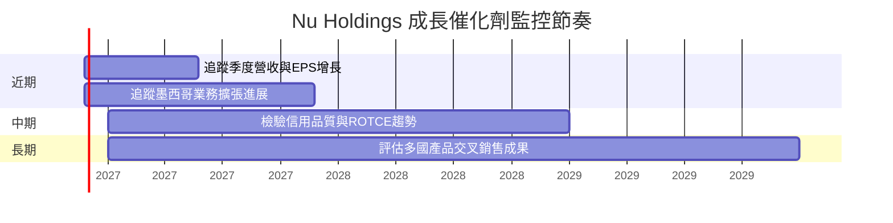
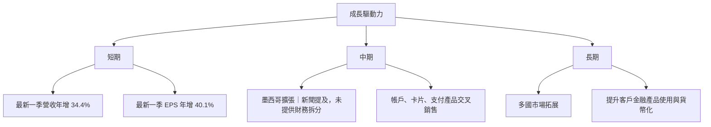
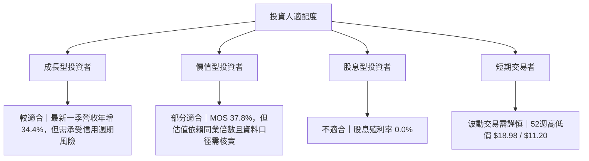

# NU 基本面深度分析報告
> **報告日期**：2026-11-25 ｜ **語言**：繁體中文 ｜ **數據來源**：Yahoo Finance、Finviz、StockAnalysis、Roic.ai ｜ **分析師**：CFA 級機構研究

---

## 目錄

| # | 章節 | 核心結論 |
|---|------|----------|
| 1 | 執行摘要 | 買入；加權合理價值 $19.06；MOS +37.8% |
| 2 | 公司概覽與商業模式 | 數位金融平台具規模與交叉銷售潛力；細分營收與市場份額未提供 |
| 3 | 損益表深度分析 | TTM 營收 $14.48B；最新一季營收年增 34.4%，但 TTM 成長率 N/A |
| 4 | 資產負債表分析 | 現金及短期投資 $15.45B、總債務 $6.12B、淨現金 $9.32B |
| 5 | 現金流量深度分析 | TTM FCF -$625.87M；銀行放款現金流特性使單一 FCF 指標解讀受限 |
| 6 | 獲利能力與資本效率 | ROTCE 29.8%；銀行不宜以一般企業 ROIC/WACC 與營運資金天數直接判斷 |
| 7 | 相對估值分析 | 同業估值法與分析師共識加權，合理價值 $19.06 |
| 8 | DCF 內在價值評估 | DCF N/A；貸款機構現金流是資金來源與運用，不適合一般 FCFF 模型 |
| 9 | 成長催化劑 | 最新一季營收年增 34.4%；墨西哥擴張與新產品為質化催化因素 |
| 10 | 風險矩陣 | 信用損失、監管與市場資料不一致為主要監控風險 |
| 11 | 投資建議 | 買入；估值買入區間約 $11.86–$17.15，需追蹤信用品質與現金流 |

---

## 1. 執行摘要

Nu Holdings 最新可用季度資料顯示，2026-09-30 單季營收年增 **34.4%**、EPS 年增 **40.1%**，TTM 營收 **$14.48B**；同時，現金及短期投資 **$15.45B**、總債務 **$6.12B**，淨現金為 **$9.32B**。但 TTM 營業現金流為 **-$218.53M**、資本支出 **$407.33M**，依指定定義的 TTM FCF 為 **-$625.87M**，顯示成長與會計獲利尚未在最新 TTM 期間轉化為正 FCF。DCF 不適用於此貸款機構；依同業 Forward P/E、同業 P/B 與分析師共識計算的加權合理價值為 **$19.06**，相對 **2026-11-24 收盤價 $11.86** 的 MOS 為 **+37.8%**，故採用資料計算出的評級 **買入**，未作質化調整。

### 1.0 一頁式投資儀表板（Portfolio Manager 30 秒速讀）

| 項目 | 內容 |
|------|------|
| **投資論點（3 句）** | ① 最新一季營收年增 **34.4%**，顯示平台仍有擴張動能。② 現金及短期投資 **$15.45B** 高於總債務 **$6.12B**，淨現金 **$9.32B**。③ 加權合理價值 **$19.06** 高於現價 **$11.86**，但 TTM FCF **-$625.87M** 是核心品質警訊。 |
| **綜合評分** | **7.4/10**（引用 1.1 評分卡） |
| **財務健康** | 🟢 現金及短期投資高於總債務，淨現金 **$9.32B**；逾放率、CET1 等關鍵銀行指標未提供。 |
| **ROIC vs WACC** | **N/A vs 14.00%**；貸款機構 ROIC 不宜用一般企業定義直接比較。ROTCE **29.8%** 可作權益獲利代理指標，但不等同 ROIC。 |
| **FCF 趨勢** | TTM FCF **-$625.87M**，FCF Yield **-1.09%**；金融業放款與存款變動會令營業現金流波動，須與獲利及貸款品質一併觀察。 |
| **估值** | Forward P/E **11.06x** ｜ EV/EBITDA **N/A** ｜ FCF Yield **-1.09%** |
| **DCF 內在價值（基準）** | **N/A**；DCF 不適用，故折溢價 N/A。 |
| **安全邊際（MOS）** | **+37.8%**＝($19.06 − $11.86) ÷ $19.06；🟢 高於 25%。 |
| **預期報酬（基準情境 12M）** | DCF 情境 N/A；以加權合理價值作估值參照的上行空間為 **+60.7%**，並非保證報酬或 12 個月目標價。 |
| **關鍵風險（前二）** | 信用損失惡化但淨沖銷率、逾放比未提供；TTM FCF 為負且季度現金流波動。 |
| **評級 + 信心度** | 🟢 **買入** ｜ 信心：中低（估值折價明顯，但信用品質與資料一致性限制判斷） |

### 1.1 綜合評分卡（全報告唯一）

| 維度 | 評分（1–10） | 主要依據（引用數字與其來源章節） |
|------|--------------|----------------------------------|
| 成長性 | 8.0 | 最新一季營收年增 **34.4%**、EPS 年增 **40.1%**；TTM 成長率 N/A，見第 3 章。 |
| 獲利能力 | 7.0 | ROTCE **29.8%**；TTM FCF **-$625.87M**，營業利益率 TTM N/A，見第 3、5、6 章。 |
| 財務健康 | 8.0 | 淨現金 **$9.32B**；但流動比率及逾放、CET1 等資料未提供，見第 4、6 章。 |
| 估值 | 8.0 | MOS **+37.8%**；同業估值與現價存在資料口徑差異，見第 7、8 章。 |
| 護城河 | 7.5 | 多產品數位金融平台及跨國經營；市場份額與客戶留存量化資料未提供，見第 2 章。 |
| 管理層與資本配置 | 6.0 | FY2025 SBC **$271.85M**；股息殖利率 **0.0%**，買回與資本配置細項未提供，見第 3、5 章。 |
| **綜合評分** | **7.4** | 六項算術平均：($8.0+$7.0+$8.0+$8.0+$7.5+$6.0) ÷ 6 = **7.4**。 |

### 1.2 五大投資論點 + 三大核心風險

| 類型 | 項目 | 具體依據 | 信心度 |
|------|------|----------|--------|
| 🟢 **投資論點①** | 數位平台仍有成長 | 最新一季營收 **$4.03B**，年增 **34.4%**；反映產品滲透與客戶貨幣化仍在擴張，但單季增長不能直接外推為 TTM 增長。 | 🟢 高 |
| 🟢 **投資論點②** | 盈餘增長快於營收 | 最新一季 EPS 年增 **40.1%**，高於營收年增 **34.4%**；若源於費用槓桿與產品組合改善，可支持每股獲利擴張。 | 🟡 中 |
| 🟢 **投資論點③** | 淨現金提供緩衝 | 現金及短期投資 **$15.45B**、總債務 **$6.12B**、淨現金 **$9.32B**，有助吸收信貸週期衝擊及支持投資。 | 🟢 高 |
| 🟢 **投資論點④** | 相對估值提供折價緩衝 | 加權合理價值 **$19.06**、MOS **+37.8%**；同業 Forward P/E 方法得出 **$20.61**。 | 🟡 中 |
| 🟢 **投資論點⑤** | 跨國產品拓展可形成第二成長來源 | 公司在巴西、墨西哥、哥倫比亞等市場經營；近期資訊提及墨西哥擴張，但分國營收與獲利未提供。 | 🟡 中 |
| 🟡 **風險①** | 信用週期及授信品質 | 淨沖銷率、逾放比、CET1 未提供；若貸款損失上升，可能同時壓低利潤與資本回報。 | 🟡 中 |
| 🔴 **風險②** | FCF 轉負與現金流可讀性 | TTM OCF **-$218.53M**、Capex **$407.33M**、FCF **-$625.87M**；若非單純貸款資金流動而是經營效率惡化，估值支撐將下降。 | 🔴 高衝擊 |
| 🟡 **風險③** | 財務資料口徑不一致 | 市場資料市值 **$57.39B**，而報價 **$11.86** 與流通股數 **3.82B** 的乘積不相符；多來源營收數字亦存在差異。 | 🟡 中 |

### 1.3 快速統計卡片

| 指標 | 公司實際值（期間） | 同業中位數 | 狀態 |
|------|--------------------|------------|------|
| 營收成長（TTM） | **N/A** | — | 🟡 |
| 營收成長（最新一季年增） | **34.4%** | **43.9%**（SOFI、MELI、HOOD 中位數） | 🟡 |
| 毛利率（TTM） | **0.0%（資料欄位值，對銀行型業務不具可比性）** | — | 🟡 |
| 營業利益率（TTM） | **N/A** | — | 🟡 |
| ROIC（TTM） | **N/A（貸款機構指標不適用）** | — | 🟡 |
| Forward P/E | **11.06x** | **19.2x**（Peer multiples 中位數） | 🟢 |
| FCF Yield（TTM） | **-1.09%** | — | 🔴 |
| Piotroski F-Score | **N/A（不適用貸款機構）** | — | 🟡 |

### 1.4 投資結論

```text
╔══════════════════════════════════════════════════════════════════╗
║                    📊 投資結論摘要                               ║
╠══════════════════════════════════════════════════════════════════╣
║  評級：買入（依 VERIFIED 評級；MOS +37.8%）                     ║
║  價格（2026-11-24 收盤）：$11.86                                ║
║  DCF 內在價值（基準）：N/A（貸款機構 DCF 不適用）               ║
║  安全邊際 MOS：+37.8%（以加權合理價值 $19.06 為基準）           ║
║  加權合理價值（8.8）：$19.06                                    ║
║  綜合評分：7.4/10（引用 1.1）                                   ║
║  適合投資人：能承受新興市場、信貸週期與股價波動的成長型投資人   ║
╚══════════════════════════════════════════════════════════════════╝
```

---

## 2. 公司概覽與商業模式

### 2.1 業務結構與收入來源

公司資料顯示 Nu Holdings 提供數位銀行平台及支付、信用卡、預付卡、帳戶轉帳、帳單支付等服務，市場包括巴西、墨西哥、哥倫比亞、開曼群島及美國。TTM 營收為 **$14.48B**；但各產品線營收、地區收入與占比未提供，因此不將總營收拆成未經證實的業務比例。



收入包含利息相關收益與金融服務收入；依貸款機構指標，TTM 淨利息收入佔總營收 **84.7%**。這表示利差、貸款組合及資產品質是主要獲利變數；但非利息收入拆分未提供，無法量化其對收入多元化的貢獻。

### 2.2 市場份額

市場份額數據未提供，故不繪製份額圖或填寫推估比例。公司最新一季營收年增 **34.4%**，低於 SOFI、MELI、HOOD 最新一季營收年增率的中位數 **43.9%**；但三者業務組合及地理市場並不完全相同，不能將增速差距直接解讀為份額變化。

### 2.3 競爭護城河分析



以上為商業模式質化結構；客戶數、月活、留存率、獲客成本及各國市場份額未提供，因此不能據此聲稱網路效應已達到特定強度。

### 2.4 護城河強度

| 護城河項目 | 強度（強／中／弱） | 證據（引用數字或事實） | 會削弱它的情況 |
|------------|--------------------|------------------------|----------------|
| 技術與數位服務 | 中 | 以數位帳戶、支付與卡片服務為核心，跨多個國家營運；研發支出與技術效率數據未提供。 | 系統中斷、資安事故或競爭者複製使用者體驗。 |
| 產品生態系 | 中 | 產品包括帳戶、信用卡、預付卡、支付與高階產品；TTM 淨利息收入佔營收 **84.7%**，也顯示收入仍高度受利息業務主導。 | 信用產品單一化、交叉銷售未能提升非利息收入。 |
| 網路效應 | 中偏弱 | 多國平台與支付產品提供形成網路效應的可能，但交易量、商戶數與客戶留存率未提供。 | 客戶可低成本多平台使用，平台活躍度或交易密度下降。 |
| 客戶鎖定 | 中 | 多產品帳戶關係可提升黏著度；但客戶流失率、主要往來帳戶比例未提供。 | 競爭者補貼、服務中斷或產品定價失去吸引力。 |
| 規模效應 | 中 | TTM 營收 **$14.48B**，最新一季營收年增 **34.4%**；單位服務成本未提供。 | 擴張帶來的壞帳、合規及獲客成本快於收入上升。 |
| 生態夥伴 | 弱至中 | 有卡片、支付等業務，但合作夥伴名單與依賴程度未提供。 | 主要支付網路或金融合作方改變條款、提高費用。 |

**護城河評分理由：**1.1 的 **7.5/10** 反映多產品及跨國數位平台具一定規模，但缺少留存率、成本優勢及市場份額資料，尚不足以將護城河評為最強。

---

## 3. 損益表深度分析

### 3.1 年度收入成長趨勢（近4年）

年度收入資料為 2022–2025 年表列數值。2022 至 2025 年收入由 **$2.97B** 增至 **$10.63B**，三年 CAGR 約 **53.0%**；這是年度歷史資料的計算結果，不等於 TTM 成長率。年度資料及季度資料來源存在版本差異，以下按年度損益表列示值計算。

```text
╔══════════════════════════════════════════════════════════════════╗
║             Nu Holdings 年度收入趨勢（FY2022-FY2025）           ║
╠══════════════════════════════════════════════════════════════════╣
║  FY2022  $2.97B   ██████░░░░░░░░░░░░░░░░░░  YoY：—             ║
║  FY2023  $5.63B   █████████████░░░░░░░░░░░  YoY：+89.6% 🟢     ║
║  FY2024  $8.27B   ███████████████████░░░░░  YoY：+46.9% 🟢     ║
║  FY2025  $10.63B  ████████████████████████  YoY：+28.5% 🟢     ║
║                                                                  ║
║  2022–2025 CAGR = (10.63 ÷ 2.97)^(1/3) − 1 ≈ 53.0%             ║
╚══════════════════════════════════════════════════════════════════╝
```

成長率由 FY2023 的高基期後 **89.6%** 降至 FY2025 的 **28.5%**，代表高速擴張仍在延續，但百分比增長已受規模擴大影響。最新 TTM 營收 **$14.48B**；TTM 對前一 TTM 成長率標示 N/A，故不以年度 CAGR 替代。

### 3.2 季度收入趨勢分析

最近四季季度營收合計為 **$14.48B**，與 VERIFIED TTM 營收一致。QoQ 依表列季度值計算；YoY 僅對最新一季引用已驗證單季年增率，其餘季度按可比季度資料計算。

| 季度 | 營收 | QoQ 成長 | YoY 成長 | 備註 |
|------|------|---------|---------|------|
| 2025 Q4 | $3.14B | — | — | 四季序列起點；對應上一年同期數字未列於此組季度表。 |
| 2026 Q1 | $3.54B | **+12.7%** | **+57.0%**（$3.54B 對 $2.25B，年度序列） | 季增反映營收延續擴大；來源季度口徑可能與 StockAnalysis 資料列不同。 |
| 2026 Q2 | $3.77B | **+6.5%** | **+50.2%**（$3.77B 對 $2.51B，年度序列） | QoQ 增速較 Q1 放緩，但仍為正。 |
| 2026 Q3 | $4.03B | **+6.9%** | **+34.4%**（驗證的單季年增率） | 年增率直接採用單季 VERIFIED 數值；不得標示為 TTM 成長率。 |

> 上表營收季度表與另一資料源 StockAnalysis 的季度營收數字有明顯差異。為避免混用，表中使用與 VERIFIED TTM 合計一致的季度損益表數字；單季 YoY 的最新值則原值引用 34.4%。

### 3.3 利潤率演變分析

| 利潤率指標 | FY2022 | FY2023 | FY2024 | FY2025 | 趨勢 | 評估 |
|------------|--------|--------|--------|--------|------|------|
| **毛利率** | N/A | N/A | N/A | N/A | 金融機構毛利率資料欄顯示 TTM 0.0%，不具一般商品企業可比性 | 🟡 |
| **營業利益率** | N/A | N/A | N/A | N/A | 歷史年度利潤率未提供；最新一季營業利益率 **50.9%**，TTM 為 N/A | 🟡 |
| **淨利率** | N/A | **18.3%**（Roic.ai 歷史欄） | N/A | N/A | 年度營收與淨利來自另一組資料，未以混合來源重算 | 🟡 |

**利潤率演變深度解析：**最新一季營業利益率 **50.9%** 是單季口徑，不能當作 TTM 利潤率。淨利息收入佔總營收 **84.7%**，故獲利率主要受授信利差、資金成本、信用提列與產品組合影響；這與一般軟體公司靠訂閱毛利擴張的邏輯不同。現有資料缺少年度信用成本拆分、營運費用及利息支出細項，不能將利潤率變化精確歸因於單一產品或費用項目。

### 3.4 費用結構分析

金融機構的收入與費用呈現方式不同於一般製造企業。可用資料沒有完整利息費用、信用損失準備、營運費用及稅費的統一期間拆分，因此不製作比例圓餅圖，以免將不完整項目誤作完整費用結構。

可量化的成本效率代理值為 **68.1%**，定義為「(營收 − 稅前淨利) ÷ 營收」。此代理值包含信用提列，通常高於銀行自行披露的營運效率比，不能直接等同成本收入比。

### 3.5 季度 EPS 趨勢與盈餘品質（Quality of Earnings）

| 季度 | EPS 實際值 | EPS 年增 | 超預期／不及預期 |
|------|------------|---------|------------------|
| 2025 Q4 | $0.18 | +60.87% | N/A：預期 EPS 未提供 |
| 2026 Q1 | $0.18 | +55.93% | N/A：預期 EPS 未提供 |
| 2026 Q2 | $0.22 | +66.31% | N/A：預期 EPS 未提供 |
| 2026 Q3 | $0.23（StockAnalysis 季度資料） | +40.13% | N/A：預期 EPS 未提供 |

提供的 Earnings History 中，四季 EPS Est 與 EPS Act 為 nan，故不能判定超預期或不及預期，也不能編造原因。季度 EPS 依季度資料顯示逐步上升，但各來源對 EPS 與季度數據口徑存在差異，應以公司正式財報核對。

| 盈餘品質項目 | 數值／佔比 | 評估 |
|--------------|-----------|------|
| 股權薪酬 SBC / 營收 | FY2025：$271.85M ÷ $10.63B = **2.56%** | 🟡 SBC 對股東有稀釋成本；年度金額不低，但佔營收比例尚未顯示極端。 |
| SBC / 營業現金流 | FY2025：$271.85M ÷ $3.50B = **7.77%** | 🟡 以 FY2025 年度 OCF 計，SBC 相當於 OCF 的 7.77%；與 TTM 負 OCF 期間不能混算。 |
| FCF / 淨利（現金轉換率） | TTM：-$625.87M ÷ $3.915B = **-16.0%** | 🔴 TTM 現金轉換率為負；銀行放款可能造成 OCF 時點波動，仍需追蹤。 |
| 一次性／非經常性損益 | N/A | 一次性損益細項未提供，無法判斷是否美化盈餘。 |
| 有效稅率異常 | **25.8%**（最新年度有效稅率） | 🟡 資料未呈現多年稅率或遞延稅影響，不足以判斷異常。 |
| 資本化支出 vs 費用化 | TTM Capex **$407.33M**；資本化政策細節 N/A | 🟡 沒有資本化政策與費用化調節資料，無法判定是否遞延成本。 |

**盈餘品質結論：**FY2025 年度 OCF **$3.50B**、FCF **$3.16B**，但截至 2026-09-30 的 TTM FCF 為 **-$625.87M**，兩者方向不同。金融業放款與投資變動可能讓現金流與淨利短期背離；因此不宜僅憑 TTM FCF 認定盈餘失真，也不宜忽略負值。估值上應以銀行相對估值、ROTCE、資產品質及資本充足度為主，並把最新 TTM 現金流視為風險訊號。

---

## 4. 資產負債表分析

### 4.1 資產結構分解

StockAnalysis 顯示截至 2026-09-30 總資產 **$87.429B**，但已列示的資產細項合計與總資產不符，且金融機構資產含大量投資及受限制現金，故不以不完整細項製作比例圖。



圖中所列為資料源明列項目；因細項未能與總資產完全勾稽，不可將它們視為完整資產負債表構成。

### 4.2 流動性與營運資金分析

| 指標 | 最新值 | 一年前 | 解讀 |
|------|--------|--------|------|
| 現金及短期投資 | **$15.45B** | N/A | 相較總債務 **$6.12B** 為正向緩衝，但銀行現金與投資需考慮監管及資金用途。 |
| 淨現金 | **$9.32B** | N/A | 資金彈性良好；不能據此替代存款穩定性與資本充足度分析。 |
| Current Ratio | N/A | N/A | 銀行業一般流動比率可比性有限，且數據未提供。 |
| DSO 應收帳款天數 | 不適用（金融業） | 不適用 | 一般應收帳款周轉概念不適合銀行貸款資產。 |
| DIO 存貨天數 | 不適用（金融業） | 不適用 | 金融機構無一般存貨週轉的經營意義。 |
| DPO 應付帳款天數 | 不適用（金融業） | 不適用 | 負債結構主要應看存款、融資與銀行負債。 |
| CCC 現金轉換週期 | 不適用（金融業） | 不適用 | 不以製造或零售業現金轉換週期分析放款機構。 |

### 4.3 債務結構分析

```text
╔══════════════════════════════════════════════════════════════════╗
║                   Nu Holdings 債務健康診斷                      ║
╠══════════════════════════════════════════════════════════════════╣
║  總債務：          $6.12B       ▓▓▓▓▓▓░░░░░░░░░░░░░░             ║
║  現金及短期投資： $15.45B       ▓▓▓▓▓▓▓▓▓▓▓▓▓▓▓▓░░░░             ║
║  淨現金：          $9.32B       🟢 正淨現金                      ║
║                                                                  ║
║  Debt/Equity：N/A；銀行負債結構不宜只用一般企業口徑解讀。       ║
║  Debt/EBITDA：N/A；EV/EBITDA 亦未提供。                          ║
║  利息保障倍數：N/A；利息費用與銀行資產負債結構無法一致化。      ║
╚══════════════════════════════════════════════════════════════════╝
```

淨現金 **$9.32B** 是有利的資金緩衝，但資料中的「總債務」不一定涵蓋銀行主要資金來源與存款負債，因此不能將淨現金直接視為完整的銀行償債能力指標。

### 4.4 股東權益趨勢

| 年度 | 股東權益 | 年增變化 | 評估 |
|------|----------|----------|------|
| 2022 | $4.89B | — | 起點 |
| 2023 | $6.41B | +31.1% | 盈餘累積與資本變化支持權益擴大 |
| 2024 | $7.65B | +19.3% | 持續增加 |
| 2025 | $11.29B | +47.6% | 增幅較大，需以完整股東權益變動表拆分留存盈餘、發股及其他項目 |

股東權益擴張提供資本緩衝，但年度資產負債表數據截至 2025-12-31，不能與 2026-09-30 TTM 資產數值混為同一期。

---

## 5. 現金流量深度分析

### 5.1 現金流量瀑布圖

FY2025 年度現金流數據顯示 OCF **$3.50B**、Capex **$340.77M**、年度 FCF **$3.16B**；然而最新 TTM FCF 按 VERIFIED 定義為 **-$625.87M**。以下圖示分開標示年度及 TTM 數據，並不把貸款與存款資金流誤解為一般企業現金瀑布。



FY2025 與 TTM 期間的 FCF 方向相反，反映期間差異與金融機構資產負債流動性的影響。股息殖利率 **0.0%**；回購金額及股息支付金額未提供，故不延伸推算現金用途。

### 5.2 FCF 轉換率趨勢

| 年度／期間 | FCF | 淨利 | FCF／淨利 | 解讀 |
|------------|-----|------|----------|------|
| 2023 | $1.09B | $1.03B | 約 **105.8%** | 年度現金流高於淨利；依年度損益與現金流表計算。 |
| 2024 | $2.22B | $1.97B | 約 **112.6%** | 現金轉換高於 100%。 |
| 2025 | $3.16B | $2.87B | 約 **110.1%** | 年度表現良好，但不應外推至最新 TTM。 |
| TTM 至 2026-09-30 | -$625.87M | $3.915B（StockAnalysis TTM） | 約 **-16.0%** | 不同資料來源及期間口徑下呈負值，需以公司正式報表核實。 |

### 5.3 自由現金流趨勢

```text
╔══════════════════════════════════════════════════════════════════╗
║                自由現金流：年度歷史 vs 最新 TTM                  ║
╠══════════════════════════════════════════════════════════════════╣
║  FY2023  $1.09B   ▓▓▓▓▓▓▓░░░░░░░░░░░░░░░  正值                 ║
║  FY2024  $2.22B   ▓▓▓▓▓▓▓▓▓▓▓▓▓▓░░░░░░░░  正值                 ║
║  FY2025  $3.16B   ▓▓▓▓▓▓▓▓▓▓▓▓▓▓▓▓▓▓▓▓░░  正值                 ║
║  TTM     -$0.626B ◀ 負值；FCF Yield -1.09%                     ║
╠══════════════════════════════════════════════════════════════════╣
║  注意：金融業貸款資產與存款變動會使 OCF 與 FCF 有較大期間波動。 ║
╚══════════════════════════════════════════════════════════════════╝
```

### 5.4 資本配置評估

| 資本配置項目 | 可用數據 | 評估 |
|--------------|----------|------|
| 資本支出 | FY2025 **$340.77M**；TTM **$407.33M** | TTM 投資支出增加，但用途及維持性／成長性拆分未提供。 |
| 股權薪酬 | FY2025 **$271.85M** | 屬股東稀釋成本，應與每股盈餘增長共同評估。 |
| 股息 | 殖利率 **0.0%**；支付金額未提供 | 目前不是股息收益型標的。 |
| 回購 | N/A | 回購金額及股數變動歸因未提供。 |
| 留存／其他投資 | N/A | 國別及產品投資明細未提供。 |

缺乏完整資金用途拆分，故不製作資本配置圓餅圖。

---

## 6. 獲利能力與資本效率

### 6.1 ROE / ROA / ROIC 趨勢

| 指標 | 可用數值 | 評估 |
|------|----------|------|
| ROE（TTM） | **31.5%**（Yahoo／Finviz 合併資料） | 顯示帳面權益回報高；來源口徑與銀行監管資本回報仍需區分。 |
| ROA（TTM） | **5.0%**（Yahoo／Finviz 合併資料） | 對金融機構而言應與資產風險及貸款損失一同解讀。 |
| ROTCE（TTM） | **29.8%**（Lender Metrics） | 依淨利除以有形帳面價值計算，較一般 ROE 排除部分無形資產影響。 |
| ROIC（TTM） | **N/A** | 貸款機構的債務通常是營運資金來源，傳統投入資本定義不適用。 |

缺少同口徑歷史 ROTCE 與同業平均，故不提供行業均值對比，也不推算歷年 ROIC。

### 6.2 ROIC vs WACC 分析（核心價值創造判斷）

銀行的存款與融資常是營業資金來源，普通企業常用的「投入資本＝權益＋債務−現金」與 ROIC 定義不適合直接套用。因此 NU 的 ROIC 為 N/A；不能以 ROIC 小於或大於 WACC 直接斷言價值創造或摧毀。資料提供的 ROTCE **29.8%** 可作權益獲利代理，但它不等同 ROIC。

```text
╔══════════════════════════════════════════════════════════════════╗
║                ROIC vs WACC 深度分析                            ║
╠══════════════════════════════════════════════════════════════════╣
║  WACC（指定資本成本數據）：14.00%                                ║
║  ├── 無風險利率（10Y 美債）：4.90%                               ║
║  ├── 市場風險溢酬：5.00%                                         ║
║  ├── Beta（調整後）：0.98；原始 Beta：0.97                       ║
║  ├── 股權成本：9.80%                                             ║
║  ├── 稅前債務成本代理值：74.76%                                  ║
║  ├── 股權／債務權重：90.4%／9.6%                                 ║
║  └── 計算值 14.20%，因資本成本設定上限而採用 14.00%              ║
║                                                                  ║
║  ROIC：N/A（貸款機構不適合一般企業 ROIC 定義）                   ║
║  ROTCE：29.8%（銀行權益獲利代理，不等同 ROIC）                  ║
║  EVA：N/A；不得將 ROTCE − WACC 冒充 ROIC − WACC                  ║
║                                                                  ║
║  結論：目前資料不足以嚴謹量化 ROIC 是否高於 WACC。               ║
╚══════════════════════════════════════════════════════════════════╝
```

WACC 的高稅前債務成本代理值可能受「利息除以債務」分母及貸款機構融資特性影響，並非直接可解讀為一般公司債殖利率。ROIC 與 WACC 的方法限制亦是本報告不採一般企業 DCF 的原因之一。

### 6.3 杜邦三因素分解

| 因素 | 數值（TTM） | 解讀 |
|------|-------------|------|
| 淨利率 | N/A | 淨利率、營收與資產口徑不足以作一致杜邦計算。 |
| 資產週轉率 | N/A | 所需一致期間的淨利、營收與平均資產組合未提供。 |
| 權益乘數 | N/A | QUALITY FIGURES 的 DuPont 為 N/A。 |
| **ROE** | **N/A（杜邦分解）** | DuPont 因淨利、營收、總資產或正權益資料組合缺漏而未計算；不補算。 |

### 6.4 財務體質：Piotroski F-Score 與貸款機構指標

Piotroski F-Score 為 **N/A**，因貸款成長在現金流量表中可能表現為營業現金流流出，傳統現金流測試會錯讀銀行營運，不適用九項測試分數。

| 貸款機構指標 | 數值 | 解讀 |
|--------------|------|------|
| 淨利息收入 NII ÷ 總營收 | **84.7%** | 收入高度依賴利息業務；利差及信用成本為核心驅動因素。 |
| 淨利差代理值 | **15.74%** | NII ÷ 平均總資產；因缺少生息資產而高於正式 NIM，不可視作公司披露 NIM。 |
| 成本收入比代理值 | **68.1%** | (營收 − 稅前淨利) ÷ 營收；包含信用準備，因此高於自行披露的營運效率比。 |
| ROTCE | **29.8%** | 淨利 ÷ 有形帳面價值，反映有形權益獲利能力。 |
| P/TBV | **4.37x** | 市場對有形帳面價值給予高溢價，反映成長預期；同時提高估值敏感度。 |
| 放款淨額 ÷ 總資產 | **14.0%** | 需與貸款定義、資產結構及表外風險一併解讀。 |
| 淨沖銷率 | **N/A（數據未提供）** | 不推測或引用外部記憶數字。 |
| 逾放比 | **N/A（數據未提供）** | 不推測或引用外部記憶數字。 |
| CET1 | **N/A（數據未提供）** | 無法評估監管資本緩衝。 |

---

## 7. 相對估值分析

### 7.1 同業估值比較表格

| 估值指標 | **NU** | **SOFI** | **MELI** | **HOOD** | NU 評估 |
|----------|--------|----------|----------|----------|-----------|
| **Trailing P/E** | **14.825x** | 23.4x | 38.9x | 31.1x | 🟢 NU 低於三家同業；但盈利與業務組合不同。 |
| **Forward P/E** | **11.060x** | 14.4x | 27.4x | 19.2x | 🟢 NU 低於同業中位數 **19.2x**。 |
| **P/S Ratio** | **6.304x** | 3.6x | 1.9x | 11.6x | 🟡 NU 高於 SOFI、MELI，低於 HOOD；收入定義跨公司未必完全可比。 |
| **EV/EBITDA** | **N/A** | N/A | 20.9x | N/A | 🟡 僅 MELI 有可用數字，樣本不足以作中位數比較。 |
| 最新一季營收年增 | **34.4%** | 43.9% | 45.1% | 11.8% | 🟡 NU 低於 SOFI、MELI，高於 HOOD。 |
| Gross margin（TTM） | **0.0%（不具可比性欄位值）** | 84.2% | 46.7% | 91.0% | 🟡 銀行與金融平台毛利率口徑差異大，不直接比較。 |

估值倍數均按提供的 Yahoo Peer multiples 與市場資料引用。市場資料中的 NU P/S 為 **6.304x**，但市值與 TTM 營收直接相除會得到不同結果；本報告保留原始欄位值，不自行替換。

### 7.2 歷史估值區間分析

**N/A（數據未提供：缺少 VERIFIED 的「Valuation vs own history」歷史 P/E 區間及百分位）**。不得以現有單一時點 P/E 倒推歷史估值分位。

### 7.3 情境價值（Bear / Base / Bull）

**N/A（DCF 無法計算：貸款機構的現金流包含貸款資金運用與融資來源，不適用一般 FCFF DCF；因此沒有可引用的 DCF Scenarios。）**

### 7.4 相對估值隱含價格區間

```text
╔══════════════════════════════════════════════════════════════════╗
║                  相對估值每股價值參照                            ║
╠══════════════════════════════════════════════════════════════════╣
║  $11.86 現價 ── $17.41 分析師共識 ── $17.53 同業 P/B              ║
║                          └──────── $20.61 同業 Forward P/E        ║
╚══════════════════════════════════════════════════════════════════╝
```

| 方法 | 隱含每股價值 | 計算依據 |
|------|--------------|----------|
| 同業 Forward P/E | **$20.61** | SOFI、MELI、HOOD 同業中位數 Forward P/E **19.2x** × NU Forward EPS **$1.07**。 |
| 同業 P/B | **$17.53** | 同業 P/B 中位數 **5.9x** × NU 每股帳面價值 **$2.96**。 |
| 分析師共識目標價 | **$17.41** | 23 位分析師平均目標價。 |

此等方法依 Peer multiples 中位數估值，沒有採用 NU 自身目前倍數回推，以免形成循環估值。

---

## 8. DCF 內在價值評估（Discounted Cash Flow）

### 8.0 估值推理鏈（Thinking Logic）

本節先說明模型適用性，再提供可用的估值路徑。**DCF MODEL 為 N/A**，理由是貸款機構的現金流量包含貸款發放、存款及資金調度，並非一般企業可直接折現的自由現金流。故不建立 FCFF 模型，也不虛構營收 CAGR、終值或每股 DCF 內在價值。

**Step 1 — 價值由哪些變數決定？**  
NU 的價值主要取決於淨利息收入與信用損失、ROTCE 與資本要求、以及跨國平台的收入增長與產品交叉銷售。TTM 淨利息收入佔總營收 **84.7%**，顯示信用成本與資金成本是最直接的主導變數；但產品分部營收占比未提供，不能為各成長曲線配置虛構比例。

**Step 2 — 模型與方法選擇**

| 決策點 | 本報告採用 | 理由 | 曾考慮但否決 | 否決理由 |
|--------|-----------|------|--------------|----------|
| 現金流定義 | DCF N/A；以金融業相對估值為主 | TTM FCF **-$625.87M**，且貸款資金運用會影響營業現金流 | 一般企業 FCFF | 銀行債務及現金具有營運性質，FCFF 橋接不具可比性。 |
| 預測期 N | N/A | 無可用 DCF 模型 | 任意 5–10 年預測 | 缺少與銀行業務相容的模型輸入。 |
| 終值方法 | N/A | DCF 不適用 | Gordon Growth、退出倍數 | 不建立黑箱終值。 |
| EBIT 基礎 | N/A | 不建立 DCF EBIT 路徑 | GAAP EBIT／非 GAAP EBIT 預測 | 銀行估值更適合以盈利及帳面價值方法處理。 |

**Step 3 — 關鍵假設推導鏈：**由於沒有 DCF MODEL，預測期營收、利潤率、稅率、Capex、營運資金、SBC、稀釋率、終值與 WACC 對應的 DCF 輸入全部 N/A，不另行假設。

**Step 4 — 最脆弱環節：**最大的模型風險不是某個任意 DCF 假設，而是將銀行的營運資金現金流誤當一般公司 FCFF；若採用該錯誤方法，可能因資金流動造成的負 FCF 將錯誤壓低或扭曲企業價值。

**Step 5 — 可用估值路徑**



### 8.1 模型假設總表（Model Inputs）

**N/A（DCF MODEL 未提供：貸款機構現金流是融資及放款活動的一部分，不適用一般 FCFF 模型；依要求不自行建立 DCF。）**

| 假設項目 | 採用值 | 依據／來源 | 敏感度 |
|----------|--------|-------------|--------|
| 預測期長度 N | N/A | DCF MODEL 不適用 | N/A |
| 營收 CAGR（預測期） | N/A | 不建立 DCF 預測 | N/A |
| 營業利潤率（期末） | N/A | 銀行獲利指標未形成可用 FCFF 模型 | N/A |
| 有效稅率 | N/A | 不套入 DCF | N/A |
| Capex／營收 | N/A | 不套入 DCF | N/A |
| D&A／營收 | N/A | 不套入 DCF | N/A |
| ΔWC／營收增額 | N/A | 銀行營運資金不適用一般模型 | N/A |
| EBIT 基礎 | N/A | 不建立 DCF | N/A |
| SBC 處理 | N/A | 不建立 DCF | N/A |
| 年稀釋率 | N/A | 不建立 DCF 股數路徑 | N/A |
| 永續成長率 g | N/A | 不計算終值 | N/A |
| 終值方法 | N/A | 不計算終值 | N/A |
| WACC | **14.00%（資本成本資料）** | 資本成本區塊；不作 DCF 折現率使用 | 不適用於此 DCF |

### 8.2 折現率推導（WACC）

WACC 數據依資本成本資料引用，用於第 6.2 節的參照；由於 DCF 不適用，以下不把它帶入現金流模型。資料指出計算值 **14.20%**，並限制在 7%–14% 區間，因此採用 **14.00%**。

```text
╔══════════════════════════════════════════════════════════════════╗
║                    WACC 資料（非 DCF 折現）                      ║
╠══════════════════════════════════════════════════════════════════╣
║  股權成本 Ke：9.80%                                              ║
║  ├── 無風險利率 Rf：4.90%                                        ║
║  ├── ERP：5.00%                                                   ║
║  ├── 原始 Beta：0.97；調整 Beta：0.98                             ║
║  └── Beta 調整：⅔ × 0.97 + ⅓ × 1.00 = 0.98                       ║
║                                                                  ║
║  稅前債務成本代理值：74.76%                                      ║
║  有效稅率：25.8%                                                  ║
║  E / D 權重：90.4% / 9.6%                                        ║
║  加權計算值：14.20%；7%–14% 區間上限後採用 WACC：14.00%          ║
║  債務成本代理值高，對貸款機構不宜視為一般公司債融資成本。       ║
╚══════════════════════════════════════════════════════════════════╝
```

資料未提供 10 年美債殖利率具體觀測日期、Beta 回溯期間及額外國別溢酬分拆；因此保留已計算的資本成本數值，不另加溢酬或重算另一個 WACC。作一致性展示，數據區的成本資本計算為 **14.20%**，受限後採用 **14.00%**；第 6.2 節同樣引用 **14.00%**。

### 8.3 逐年自由現金流預測（基準情境）

**N/A（DCF MODEL 未提供且不得另建模型）。**因此沒有 FY+1 至 FY+N 營收、FCFF、折現因子及現值表，也不提供代表年度演算、FCF CAGR 或預測 FCF 視覺圖。

### 8.4 終值計算（Terminal Value）

**N/A（無 DCF 預測期現金流，也無永續成長率或退出倍數；不計算 Gordon Growth 或退出倍數終值。）**

### 8.5 企業價值 → 每股內在價值（Bridge）

**N/A（無預測期現金流現值、終值現值及 DCF 股權價值橋接）。**本節 DCF 內在價值為 N/A，因此折溢價也為 N/A；安全邊際只依 8.8 加權合理價值計算。

### 8.6 敏感性分析（WACC × 永續成長率）

**N/A（DCF MODEL 未提供敏感性矩陣；不自行試算或建立情境。）**

### 8.7 反推 DCF（Reverse DCF）

**N/A（沒有可用 DCF 模型，不能從現價回推營收 CAGR、期末利潤率、永續成長率或預測期。）**

### 8.8 估值三角驗證與安全邊際

| 估值方法 | 隱含每股價值 | 上行空間（÷現價） | 權重 | 說明 |
|----------|--------------|-------------------|------|------|
| 同業 Forward P/E | **$20.61** | **+73.8%** | **50%** | 同業中位數 **19.2x** × NU Forward EPS **$1.07**。 |
| 同業 P/B | **$17.53** | **+47.8%** | **40%** | 同業中位數 **5.9x** × NU 每股帳面價值 **$2.96**。 |
| 分析師共識目標價 | **$17.41** | **+46.8%** | **10%** | 23 位分析師平均目標價。 |
| **加權合理價值** | **$19.06** | **+60.7%** | **100%** | 金融業固定方法權重；DCF 不適用且未納入。 |

**逐步演算（權重外顯）**

加權合理價值  
= $20.61 × 50% + $17.53 × 40% + $17.41 × 10%  
= $10.305 + $7.012 + $1.741  
= **$19.058 ≈ $19.06**

權重合計 = 50% + 40% + 10% = **100%**。金融業估值權重採同業 Forward P/E 50%、同業 P/B 40%、分析師共識 10%；沒有加入 DCF 或其他方法。

**MOS 與上行空間計算**

- MOS = ($19.06 − $11.86) ÷ $19.06  
  = $7.20 ÷ $19.06  
  = **37.8%**
- 上行空間 = ($19.06 − $11.86) ÷ $11.86  
  = $7.20 ÷ $11.86  
  = **60.7%**

```text
╔══════════════════════════════════════════════════════════════════╗
║                  估值區間與安全邊際                              ║
╠══════════════════════════════════════════════════════════════════╣
║  $11.86 現價 ── $17.41 共識 ── [$19.06 加權合理值] ── $20.61 P/E ║
║                                                                  ║
║  MOS = (加權合理價值 − 現價) ÷ 加權合理價值 = +37.8%            ║
║  上行空間 = (加權合理價值 − 現價) ÷ 現價 = +60.7%               ║
║  評估：🟢 MOS 高於 25%                                           ║
║                                                                  ║
║  買入區間參考：$11.86 – $17.15                                   ║
║  計算：$19.06 × (1 − 10%) = $17.154 ≈ $17.15                     ║
║  DCF 情境價值與 DCF 基準內在價值：N/A                            ║
╚══════════════════════════════════════════════════════════════════╝
```

> 🔎 **程式複算（Python，依本節各項自動重算）**
>
> 加權合理價值 = $20.61 × 50% + $17.53 × 40% + $17.41 × 10% = **$19.06**（權重合計 100%）
>
> 以價格 $11.86 計：MOS = **+37.8%**，上行空間 = **+60.7%**
>
> ✅ 與本節所寫數值一致。

### 8.9 DCF 模型的局限與失效條件

- **終值依賴度：**N/A，沒有 DCF 模型及終值。
- **最脆弱的假設：**不存在可稽核 DCF 輸入；目前估值主要依同業倍數與分析師目標價，對同業估值中位數及公司 forward EPS 敏感。
- **不適用情境說明：**銀行存款、融資與貸款放款均屬營運活動，普通企業 FCFF 的現金與債務橋接可能造成錯誤估值。較合適的方法為 P/E、P/B、P/TBV、ROTCE 與貸款品質分析。
- **與第 10 章風險矩陣的連結：**信用成本增加會壓低淨利、EPS 與 P/B 支撐；監管資本要求提高則可能降低可分配資本與 ROTCE。

### 8.10 複算檢核表（Audit Trail）

| # | 檢核項目 | 檢查方式 | 結果 |
|---|----------|----------|------|
| 1 | DCF 高／中敏感度輸入推導 | DCF 模型為 N/A，未設定輸入 | ✅ 不適用 |
| 2 | 每個 DCF 假設均有來歷 | 未建立模型，沒有未標示輸入 | ✅ |
| 3 | WACC 算式與採用值 | 引用計算值 14.20%，依區間上限採 14.00% | ✅ |
| 4 | Kd 分母與債務權重一致 | 原始計資本成本數據照引；貸款機構代理值不重算 | ✅ 資料限制已揭露 |
| 5 | WACC 與第 6.2 節一致 | 兩處均為採用值 14.00% | ✅ |
| 6 | 逐年 DCF 表格年度數 | DCF N/A，無預測年度表 | ✅ 不適用 |
| 7 | FY+1 FCFF 與 PV 演算 | DCF N/A，不存在代表年度 | ✅ 不適用 |
| 8 | 預測期 PV 加總 | DCF N/A | ✅ 不適用 |
| 9 | WACC 與 g 關係 | 無 g 或終值 | ✅ 不適用 |
| 10 | 終值基期與折現期 | 無終值 | ✅ 不適用 |
| 11 | EV 至每股 DCF 橋接 | 無 DCF EV | ✅ 不適用 |
| 12 | SBC 與 DCF 股數組合 | 無 DCF，不建立 SBC 股數組合 | ✅ 不適用 |
| 13 | 矩陣基準格與 DCF 價值一致 | 無敏感性矩陣 | ✅ 不適用 |
| 14 | 矩陣無效格處理 | 無敏感性矩陣 | ✅ 不適用 |
| 15 | DCF 情境機率加總 | DCF 情境 N/A | ✅ 不適用 |
| 16 | Reverse DCF 單一變數求解 | Reverse DCF N/A | ✅ 不適用 |
| 17 | MOS 與折溢價分母 | MOS 以 $19.06 加權合理價值計算；DCF 折溢價 N/A | ✅ |
| 18 | 完整輸出至第 11 章 | 章節完整列示 | ✅ |
| 19 | 加權合理價值加總 | $10.305 + $7.012 + $1.741 = $19.058 ≈ $19.06 | ✅ |
| 20 | 評級符合 MOS 門檻 | MOS +37.8%，採用來源給定「買入」 | ✅ |

---

## 9. 成長催化劑

### 9.1 催化劑時間軸

具體產品上市時程與管理層財測未提供，因此不編造日期型 gantt 時程。依現有資料可建立的監控節奏如下：



以上為研究監控項目，不代表公司承諾的財測或產品發布日期。

### 9.2 TAM 市場規模分析

**N/A（TAM 數據未提供）**。可確認的業務範圍包括巴西、墨西哥、哥倫比亞、開曼群島及美國，但缺少各國金融服務 TAM 與 NU 客戶／收入滲透率數據。公司 TTM 營收為 **$14.48B**，最新一季營收年增 **34.4%**；這可作公司規模與近期成長參照，不能替代市場規模或份額。

### 9.3 成長驅動力結構圖



短期增長已有季度營收及 EPS 數據支持；中長期催化因素則為質化推論，須待分國收入、活躍客戶與產品使用率數據驗證。

---

## 10. 風險矩陣

### 10.1 風險評分矩陣

具體風險機率未有公司披露，因此不把分析師主觀機率標成財務事實，也不繪製帶數值座標的象限圖。以下按「影響來源及可監控指標」呈現主要風險。

### 10.2 風險清單詳細分析

| # | 風險項目 | 發生機率 | 財務衝擊 | 風險評估 | 緩解措施／監控項目 |
|---|----------|----------|----------|----------|--------------------|
| 1 | 🔴 信用損失及資產品質惡化 | N/A；缺少違約與逾放數據 | 可能壓低淨利、ROTCE 與估值倍數；幅度 N/A | 🔴 高衝擊 | 每季追蹤淨沖銷率、逾放比、重組貸款、信用成本及撥備覆蓋；目前均需公司披露。 |
| 2 | 🔴 現金流轉弱或短期資金需求加大 | TTM FCF 已為負，但原因需拆分 | TTM FCF **-$625.87M**、Yield **-1.09%** | 🔴 高 | 分析 OCF 變化是否由貸款成長、存款變動或經營獲利造成；避免僅看 FCF 單一數字。 |
| 3 | 🟡 利率與資金成本風險 | N/A | NII 佔收入 **84.7%**，資金成本變化可影響利差與淨利 | 🟡 中高 | 追蹤 NII、貸款收益率、存款成本與淨利差；目前只有淨利差代理值 **15.74%**。 |
| 4 | 🟡 監管與資本要求 | N/A | CET1 未提供，資本要求變動可能限制增長或資本回報 | 🟡 中高 | 追蹤巴西及其他市場監管變化、CET1、資本緩衝及牌照進展。 |
| 5 | 🟡 跨國擴張執行風險 | N/A | 新市場投入可能增加費用與信用損失；地區營收未披露 | 🟡 中 | 追蹤墨西哥及其他市場的客戶增長、盈虧與獲客成本，避免只看合併營收。 |
| 6 | 🟡 資料口徑與市場估值風險 | 已出現不同來源差異 | 市值、股數、價格及 P/S 的口徑存在差異，可能影響估值精確度 | 🟡 中 | 以公司 SEC／正式財報與申報股數核對；當前財報數據由 Yahoo 財務季度報表整理，未提供 SEC 數據。 |

---

## 11. 投資建議

### 11.1 最終評級與評分

MOS 為 **+37.8%**，按指定規則 20 的門檻，採用來源計算的評級 **買入**；未作上下調整。綜合評分為 **7.4/10**，引用 1.1 六項分數：成長性 8.0、獲利能力 7.0、財務健康 8.0、估值 8.0、護城河 7.5、管理層與資本配置 6.0。

### 11.2 合理價值與隱含報酬率

| 估值參照 | 每股價值 | 相對 2026-11-24 收盤價 $11.86 | 機率／權重 |
|----------|----------|------------------------------|------------|
| 加權合理價值 | **$19.06** | **+60.7% 上行空間**；MOS **+37.8%** | 固定方法權重合計 100% |
| 同業 Forward P/E | $20.61 | +73.8% | 50% |
| 同業 P/B | $17.53 | +47.8% | 40% |
| 分析師共識 | $17.41 | +46.8% | 10% |
| DCF 悲觀／基準／樂觀情境 | N/A | N/A | DCF 模型不適用 |

加權合理價值是相對估值參照，不是保證能達到的目標價；若信用成本或利差不利，市場可透過降低 EPS 預期或估值倍數使合理價值下修。

### 11.3 買入時機與觸發因素

```text
╔══════════════════════════════════════════════════════════════════╗
║                  ✅ 買入觸發因素 Checklist                      ║
╠══════════════════════════════════════════════════════════════════╣
║  立即買入條件（需同時檢視估值與信用品質）：                      ║
║  ✅ 股價不高於 $17.15；此價約對應加權合理價值至少 10% MOS。      ║
║  ✅ 最新季度營收年增維持在 34.4% 附近或以上，且 EPS 持續增長。   ║
║  ✅ 公司披露淨沖銷率、逾放比、CET1，且未顯示信用品質惡化。      ║
║                                                                  ║
║  加碼觸發條件：                                                  ║
║  ☐ 最新 TTM FCF 改善並回到正值，或公司清楚拆解負現金流原因。    ║
║  ☐ ROTCE 維持在 29.8% 附近或以上，並有一致口徑的季度披露。     ║
║  ☐ 墨西哥等新市場收入與獲利開始有可驗證的分部數據。             ║
║                                                                  ║
║  減碼／重新評估條件：                                             ║
║  ☐ 最新一季營收年增連續兩季低於 20%。                            ║
║  ☐ 單季營業利益率較最新已知 50.9% 收縮超過 10 個百分點。        ║
║  ☐ 淨沖銷率或逾放比明顯惡化，或 CET1 顯示資本緩衝不足。         ║
║  ☐ 股價高於 $20.97 且基本面未同步上修。                          ║
╚══════════════════════════════════════════════════════════════════╝
```

其中 **$17.15** 由加權合理價值 $19.06 × (1 − 10%) 推導；**$20.97** 為加權合理價值 $19.06 × (1 + 10%) 的估值參考界線，不是公司財測或 DCF 目標價。

### 11.4 投資人適配度分析



### 11.5 每季財報監控清單（Quarterly Watch List）

| 監控指標 | 最新基準／已知值 | 加碼觸發 | 減碼／重新評估 |
|----------|------------------|----------|----------------|
| 營收年增率 | 最新一季 **34.4%** | 維持在 30% 以上且收入品質穩定 | 連續兩季低於 20% |
| EPS 年增率 | 最新一季 **40.1%** | EPS 增長與營收、信用成本一致 | EPS 增長大幅低於收入且無合理解釋 |
| 單季營業利益率 | 最新一季 **50.9%** | 保持穩定或改善 | 低於 40.9%（相對最新值收縮超過 10 pp） |
| TTM 淨利息收入佔營收 | **84.7%** | 收入成長伴隨利差及風險可控 | 收入過度集中且信用成本快速上升 |
| 淨利差代理值 | **15.74%** | 代理值穩定，並取得正式 NIM | 明顯下行且資金成本上升 |
| 成本收入比代理值 | **68.1%** | 代理值下降，且信用成本未轉差 | 上升並伴隨利潤率收縮 |
| ROTCE | **29.8%** | 維持高於資金成本並有一致季度口徑 | 持續下降且資本效率轉弱 |
| 淨沖銷率／逾放比 | N/A | 取得正式披露並維持穩定 | 任一指標明顯惡化 |
| CET1 | N/A | 取得正式披露並維持足夠緩衝 | 資本緩衝下降或監管限制加劇 |
| TTM FCF | **-$625.87M** | 轉正或公司清楚證明負值由貸款資金流動造成 | 持續為負且獲利、資金流均惡化 |
| Capex | TTM **$407.33M** | 投資帶動營收或效率提升 | 支出上升但收入與效率未改善 |
| 新市場進展 | 墨西哥拓展為質化催化因素 | 公布收入、客戶及獲利指標 | 長期投入增加但無明確成果 |
| 股權薪酬 | FY2025 **$271.85M** | SBC 占營收比例下降或每股增長抵銷稀釋 | SBC 持續快於收入增長 |

### 11.6 反面論證：什麼會證明論點錯誤（What Would Change My Mind）

```text
╔══════════════════════════════════════════════════════════════════╗
║              ⚠️ 論點失效條件（Disconfirming Evidence）           ║
╠══════════════════════════════════════════════════════════════════╣
║  本投資論點在下列情況成立時應重新檢視或退出：                    ║
║  ☐ 最新一季營收年增連續兩季低於 20%。                            ║
║  ☐ 單季營業利益率由 50.9% 收縮超過 10 個百分點且持續惡化。      ║
║  ☐ TTM FCF 持續為負，且公司無法以貸款與存款資金流解釋。         ║
║  ☐ 淨沖銷率、逾放比或 CET1 出現重大惡化（取得披露後量化追蹤）。 ║
║  ☐ ROTCE 從 29.8% 明顯下滑，且無法由擴張投資或資本增加解釋。   ║
║  ☐ 每股盈利增長長期低於 SBC 稀釋及收入增長，股東價值被稀釋。   ║
╚══════════════════════════════════════════════════════════════════╝
```

> **免責聲明**：本報告為 AI 自動生成，僅供研究參考，不構成投資建議。投資有風險，入市需謹慎。

---

## 資料與來源

| 項目 | 內容 |
|------|------|
| 價格 | 11.86 USD，2026-11-24 收盤（Yahoo Finance 日線） |
| 財務報表 | Yahoo quarterly statements (no SEC filing data)，最新季度 2026-09-30（TTM = four quarters to this date） |
| 有回應的資料來源 | Yahoo Finance、Finviz、StockAnalysis、Roic.ai |
| 未回應的資料來源 | SEC 申報資料 (XBRL) |
| 由程式計算 | TTM 數字、WACC、DCF 模型、估值方法與權重、加權合理價值、MOS、評級門檻、F-Score、杜邦分解、營運資金天數、綜合評分 |
| 撰寫模型 | openai / gpt-6-luna |

> 本區塊由產生報告的程式依實際取得的資料填寫，非模型撰寫。「由程式計算」的數字不是模型的估計；其餘判斷（評分、情境、策略）是模型的分析。
