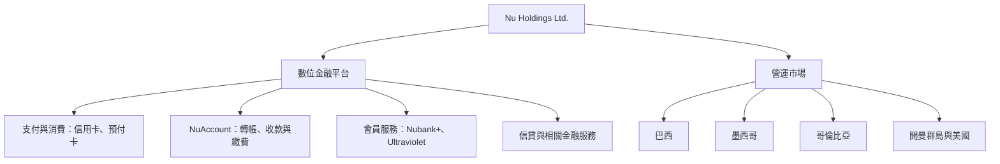
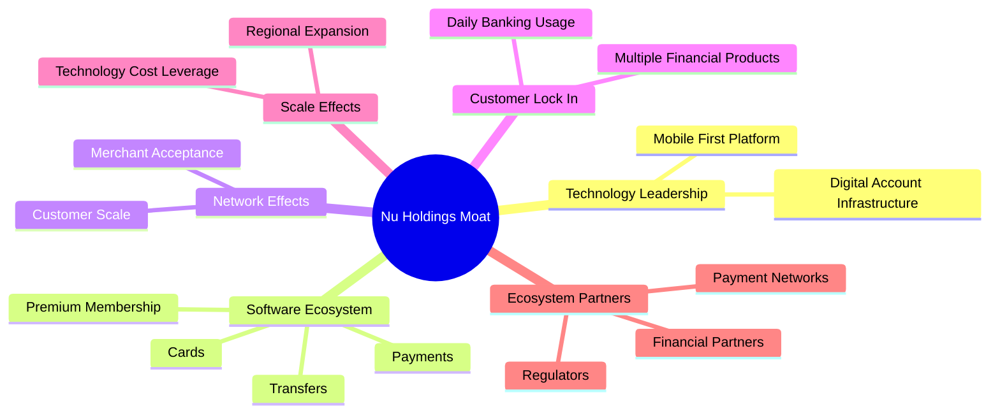
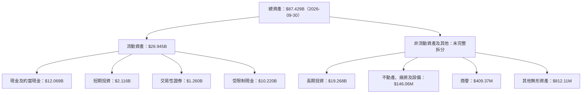
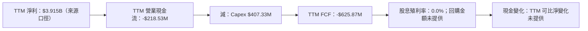
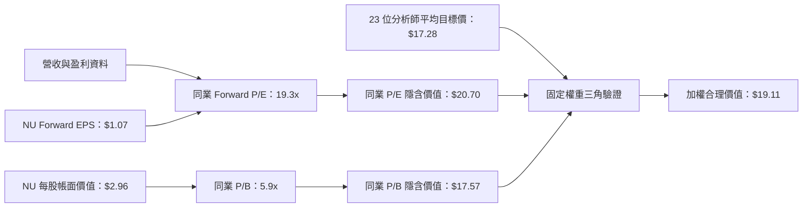
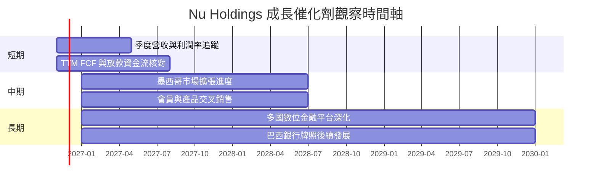
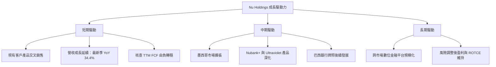
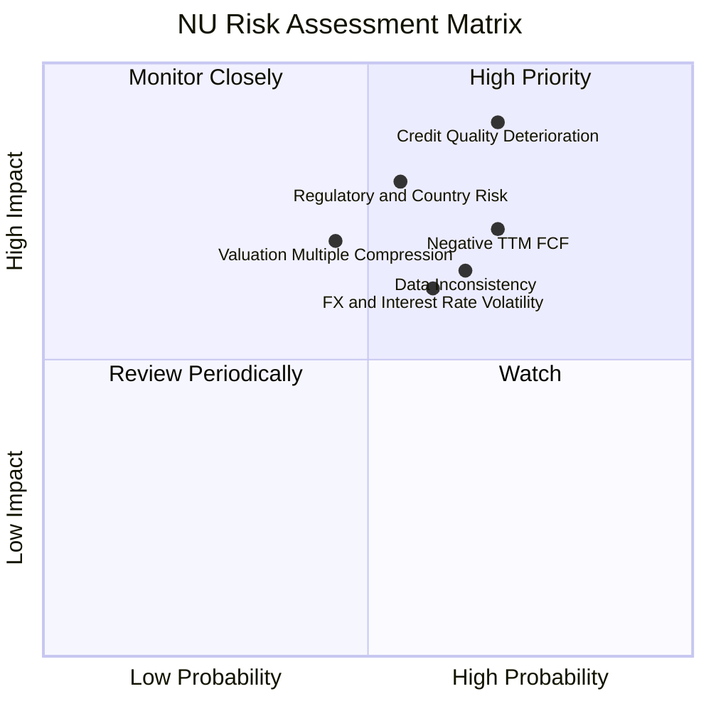
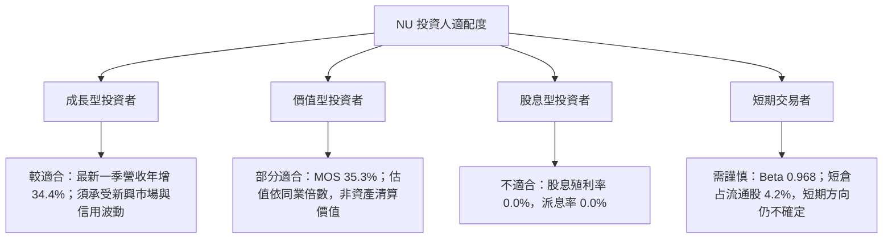

# NU 基本面深度分析報告
> **報告日期**：2026-11-26 ｜ **語言**：繁體中文 ｜ **數據來源**：Yahoo Finance、Finviz、StockAnalysis、Roic.ai ｜ **分析師**：CFA 級機構研究

> **資料口徑提示：**財務資料來源存在重大不一致。例如，2026-09-30 TTM 營收的核驗值為 **$14.48B**，另一資料表列示 **$9.10B**；季度損益表金額亦與 StockAnalysis.com 的季度金額不同。以下凡涉及核驗數據，優先引用核驗值；對口徑不一致且無法可靠調和的數字，明確標示，不混合計算。

## 目錄

| # | 章節 | 核心結論 |
|---|------|----------|
| 1 | 執行摘要 | 買入；加權合理價值 $19.11；MOS +35.3% |
| 2 | 公司概覽與商業模式 | 數位金融平台與客戶生態具規模優勢；市場份額數據未提供 |
| 3 | 損益表深度分析 | 核驗單季營收年增 34.4%；TTM 營收成長率未提供，利潤率資料不完整 |
| 4 | 資產負債表分析 | 核驗淨現金 $9.32B；金融業流動性比率不適合一般企業解讀 |
| 5 | 現金流量深度分析 | TTM FCF 為 -$625.87M，與年度歷史 FCF 顯著背離 |
| 6 | 獲利能力與資本效率 | ROTCE 29.8%；銀行業 ROIC 不適用，不能直接判定 ROIC 是否高於 WACC |
| 7 | 相對估值分析 | NU Forward P/E 11.50x，低於同業中位數 19.3x |
| 8 | DCF 內在價值評估 | DCF 不適用於此處 lender 現金流口徑；採核驗相對估值加權值 |
| 9 | 成長催化劑 | 墨西哥拓展、產品交叉銷售及數位金融滲透是主要質化催化劑 |
| 10 | 風險矩陣 | 信貸品質、監管與匯率、負 FCF 及資料口徑不一致為主要風險 |
| 11 | 投資建議 | 買入；合理價值 $19.11；建議以估值與放款品質條件分批部署 |

## 1. 執行摘要

NU 的 2026-11-25 收盤價為 **$12.36**。核驗的同業 Forward P/E 估值為 **$20.70**、同業 P/B 估值為 **$17.57**，分析師共識目標價為 **$17.28**；按固定權重加權後合理價值為 **$19.11**，對應 **MOS +35.3%**、上行空間 **+54.6%**。然而，核驗 TTM FCF 為 **-$625.87M**、FCF Yield **-1.05%**，且數據來源出現營收與季度金額衝突，因此評級雖依 MOS 規則為買入，估值與現金流信心需打折。

### 1.0 一頁式投資儀表板（Portfolio Manager 30 秒速讀）

| 項目 | 內容 |
|------|------|
| **投資論點（3 句）** | ① 2026-09-30 最新一季營收年增 **34.4%**，顯示平台仍有擴張動能。② TTM ROTCE 為 **29.8%**，盈利能力指標具吸引力，但銀行業資本效率不等同一般企業 ROIC。③ 加權合理價值 **$19.11**，較 $12.36 現價有 **+54.6% 上行空間**，但 TTM FCF 為 **-$625.87M**。 |
| **綜合評分** | **7.2/10**（引用 1.1 六項算術平均） |
| **財務健康** | 🟡 核驗淨現金 **$9.32B**；但 TTM 營業現金流為 **-$218.53M**，且金融業流動性比率與一般公司不可直接比較。 |
| **ROIC vs WACC** | ROIC：N/A（放款機構不適用）；WACC：**13.99%**。ROTCE **29.8%** 是權益報酬代理指標，不可直接替代 ROIC。 |
| **FCF 趨勢** | TTM FCF **-$625.87M**，FCF Yield **-1.05%**；與 FY2025 FCF **$3.16B** 方向相反，需釐清期間、放款現金流及資料口徑。 |
| **估值** | Forward P/E **11.499813x** ｜ EV/EBITDA **N/A** ｜ FCF Yield **-1.05%** |
| **DCF 內在價值（基準）** | **N/A**；放款機構資金流是融資活動核心，核驗模型不採一般企業 DCF。 |
| **安全邊際（MOS）** | **+35.3%＝($19.11 − $12.36) ÷ $19.11**（加權合理價值基準）｜ 🟢 >25% |
| **預期報酬（基準情境 12M）** | DCF 基準情境：N/A；加權合理價值相對現價的上行空間為 **+54.6%**，不等同保證 12 個月報酬。 |
| **關鍵風險（前二）** | 信貸惡化及監管／匯率衝擊；負 TTM FCF 與財務數據來源不一致。 |
| **評級 + 信心度** | 🟢 **買入** ｜ 信心：**中低**（評級由核驗 MOS 決定；資料不一致與 FCF 負值限制信心） |

### 1.1 綜合評分卡（全報告唯一）

| 維度 | 評分（1–10） | 主要依據（引用數字與其來源章節） |
|------|--------------|----------------------------------|
| 成長性 | 8.0 | 最新一季營收年增 **34.4%**；TTM 成長率 N/A（第 3 章） |
| 獲利能力 | 7.5 | ROTCE **29.8%**；最新一季營業利益率 **50.9%**，但 TTM 營業利益率 N/A（第 3、6 章） |
| 財務健康 | 6.5 | 淨現金 **$9.32B**，但 TTM FCF **-$625.87M**；金融業流動性及信用指標資料不足（第 4、5 章） |
| 估值 | 8.0 | 加權合理價值 **$19.11**、MOS **+35.3%**；公司自身歷史估值區間未提供（第 7、8 章） |
| 護城河 | 7.0 | 覆蓋巴西、墨西哥、哥倫比亞等市場的數位金融平台；客戶數、留存率及市場份額未提供（第 2 章） |
| 管理層與資本配置 | 6.0 | FY2025 SBC **$271.85M**、股息殖利率 **0.0%**；回購與資本回報資料不足（第 3、5 章） |
| **綜合評分** | **7.2** | 六項算術平均：**(8.0 + 7.5 + 6.5 + 8.0 + 7.0 + 6.0) ÷ 6 = 7.1667 ≈ 7.2** |

### 1.2 五大投資論點 + 三大核心風險

| 類型 | 項目 | 具體依據 | 信心度 |
|------|------|----------|--------|
| 🟢 **投資論點①** | 高成長數位平台 | 最新一季營收年增 **34.4%**；單季營收 QoQ 約 **6.9%**，顯示營運規模仍在擴張。 | 🟢 高 |
| 🟢 **投資論點②** | 權益報酬具吸引力 | TTM ROTCE **29.8%**；相較核驗 WACC **13.99%** 看似具價值創造潛力，但兩種指標定義不同，不能直接作 ROIC−WACC 判定。 | 🟡 中 |
| 🟢 **投資論點③** | 資產負債表有淨現金緩衝 | 現金及短期投資 **$15.45B**，總債務 **$6.12B**，淨現金 **$9.32B**。 | 🟢 高 |
| 🟢 **投資論點④** | 相對估值低於同業部分指標 | NU Forward P/E **11.499813x**，低於 SOFI、MELI、HOOD 的中位數 **19.3x**。 | 🟡 中 |
| 🟢 **投資論點⑤** | 跨市場與產品擴張空間 | 公司業務涵蓋巴西、墨西哥、哥倫比亞等地，近期新聞提及墨西哥擴張及巴西銀行牌照；未提供各市場營收占比，不能量化增量。 | 🟡 中 |
| 🟡 **風險①** | 信貸品質轉差 | 淨沖銷率、逾放比及 CET1 均未提供；若放款成長伴隨逾放及撥備上升，利潤與資本安全可能同步惡化。 | 🟡 中 |
| 🔴 **風險②** | TTM 現金流轉負 | TTM OCF **-$218.53M**、Capex **$407.33M**、FCF **-$625.87M**；若非放款擴張造成的期間波動，而是持續性現金轉換惡化，估值支撐下降。 | 🔴 高 |
| 🟡 **風險③** | 財務數據口徑衝突 | TTM 營收核驗值 **$14.48B**，另一處列示 **$9.10B**；季度收入亦存在不同金額序列，影響比率與模型可稽核性。 | 🔴 高 |

### 1.3 快速統計卡片

| 指標 | 公司實際值（期間） | 同業中位數 | 狀態 |
|------|--------------------|------------|------|
| 營收成長（TTM） | **N/A** | — | 🟡 未提供核驗 TTM 成長率 |
| 營收成長（最新一季年增） | **34.4%** | **43.9%** | 🟡 低於同業中位數 |
| 毛利率（TTM） | **0.0%（資料欄位）** | **84.2%** | 🔴 銀行類毛利定義不具可比性，且公司欄位可能不適用 |
| 營業利益率（TTM） | **N/A** | — | 🟡 未提供 |
| ROIC（TTM） | **N/A** | — | 🟡 放款機構不適用 |
| Forward P/E | **11.499813x** | **19.3x** | 🟢 低於同業中位數 |
| FCF Yield（TTM） | **-1.05%** | — | 🔴 負值 |
| Piotroski F-Score | **N/A** | — | 🟡 不適用放款機構 |

### 1.4 投資結論

> 評級依核驗 MOS **+35.3%** 對照規則 20 應為「買入」（MOS ≥25%，但 ROIC 不可用以確認是否滿足強烈買入條件），未作質化調整。TTM FCF **-$625.87M** 與數據口徑衝突，使信心度低於單看估值時的判斷。

```text
╔══════════════════════════════════════════════════════════════════╗
║                    📊 投資結論摘要                               ║
╠══════════════════════════════════════════════════════════════════╣
║  評級：買入（依 MOS；ROIC 對放款機構不適用，故不升為強烈買入）   ║
║  價格（2026-11-25 收盤）：$12.36                                 ║
║  DCF 內在價值（基準）：N/A（放款機構現金流不適用一般 DCF）       ║
║  加權合理價值（8.8）：$19.11                                     ║
║  安全邊際 MOS：+35.3%＝($19.11−$12.36)÷$19.11                   ║
║  綜合評分：7.2/10（引用 1.1）                                    ║
║  適合投資人：可承受新興市場、信貸及匯率波動的成長型長線投資人    ║
╚══════════════════════════════════════════════════════════════════╝
```

## 2. 公司概覽與商業模式

### 2.1 業務結構與收入來源

Nu Holdings Ltd. 透過數位平台提供金融服務，涵蓋巴西、墨西哥、哥倫比亞、開曼群島及美國。資料未提供各產品營收或占比，因此不畫收入占比圖、不推估分部金額。



**收入結構資料未提供。**最新一季營收年增 **34.4%**，但營收核驗 TTM **$14.48B** 與另一資料源的 **$9.10B** 不一致，因此不按產品或地區拆解營收。

### 2.2 市場份額

市場份額數據未提供，且所列新聞標題沒有可引用的份額數值。可確認的是公司跨巴西、墨西哥與哥倫比亞提供數位金融服務，核驗最新一季營收年增 **34.4%**；同業最新一季年增中位數為 **43.9%**，NU 成長率低於該比較組中位數。

### 2.3 競爭護城河分析



以上是商業模式層面的可能優勢，不代表已量化證明護城河。客戶總數、活躍率、獲客成本、每客收入、交叉銷售率及流失率均未提供；新聞標題提及「143 million customers」，但未提供可核實的數據正文，因此不將其當作已驗證營運指標。

### 2.4 護城河強度

| 護城河項目 | 強度（強／中／弱） | 證據（引用數字或事實） | 會削弱它的情況 |
|------------|--------------------|------------------------|----------------|
| 數位平台與技術 | 中 | 提供帳戶、支付、卡片等數位金融服務；最新一季營收年增 **34.4%**。 | 系統故障、資安事件、技術成本上升或競品快速複製。 |
| 軟體與產品生態 | 中 | NuAccount、信用／預付卡及 Nubank+、Ultraviolet 等產品形成多服務入口。 | 產品使用率與交叉銷售未能轉化為風險調整後收益。 |
| 網路效應 | 中偏弱 | 支付與金融帳戶具潛在網路效應；缺少活躍客戶、商戶數及支付量資料。 | 客戶增長未帶來交易密度或單位經濟改善。 |
| 客戶鎖定 | 中偏弱 | 日常支付、帳戶與信用產品可能提高轉換成本；留存及主帳戶率未提供。 | 競品優惠、利率變動及監管限制使客戶轉換容易。 |
| 規模效應 | 中 | TTM 營收核驗值 **$14.48B**、最新一季年增 **34.4%**；數據來源另有營收口徑衝突。 | 國別擴張、獲客與信用成本抵銷規模經濟。 |
| 生態夥伴 | 弱至中 | 依賴卡組織、支付網路、銀行與監管環境；合作資料未詳。 | 合作成本上升、依賴單一網路或牌照限制。 |

**1.1「護城河」評分 7.0/10**：業務覆蓋多個金融產品與市場，但客戶留存、單位經濟及市場份額等關鍵證據不足。

## 3. 損益表深度分析

### 3.1 年度收入成長趨勢（近4年）

以下依年度損益表的同一序列計算，金額為 USD；這些 FY 營收與核驗 TTM 營收並非同一欄位口徑。

```text
╔══════════════════════════════════════════════════════════════════╗
║              NU 年度收入趨勢（FY2022–FY2025）                   ║
╠══════════════════════════════════════════════════════════════════╣
║  FY2022  $2.97B  ██████░░░░░░░░░░░░░░░░░░  基期               ║
║  FY2023  $5.63B  ████████████░░░░░░░░░░░░  YoY: +89.6% 🟢    ║
║  FY2024  $8.27B  █████████████████░░░░░░░  YoY: +46.9% 🟢    ║
║  FY2025 $10.63B  ██████████████████████░░  YoY: +28.5% 🟢    ║
║                                                                  ║
║  FY2022–FY2025 CAGR = (10.63 ÷ 2.97)^(1/3) − 1 = 約 +53.0%     ║
╚══════════════════════════════════════════════════════════════════╝
```

年度增速由 FY2023 的 **89.6%** 降至 FY2025 的 **28.5%**，反映高速擴張階段的基期效應；仍為正成長，但不宜將早期高增速直接外推。上述年度收入序列與核驗 TTM **$14.48B** 有口徑差異，估值分析應以各自指定來源欄位為準。

### 3.2 季度收入趨勢分析

季度損益表列示營收為 $3.14B、$3.54B、$3.77B、$4.03B；但另一季度資料源列示不同金額序列。表內 QoQ 僅依前一組相同季度表計算，最新季度 YoY 僅引用核驗的 **34.4%**。

| 季度 | 營收（季度表） | QoQ 成長 | YoY 成長 | 備註 |
|------|----------------|----------|----------|------|
| 2025-12-31 | $3.14B | N/A | N/A | 比較基期未在同一季度表中列出 |
| 2026-03-31 | $3.54B | **+12.7%** | N/A | QoQ = $3.54B ÷ $3.14B − 1 |
| 2026-06-30 | $3.77B | **+6.5%** | N/A | QoQ = $3.77B ÷ $3.54B − 1 |
| 2026-09-30 | $4.03B | **+6.9%** | **+34.4%** | YoY 只引用核驗最新季度年增率 |

逐季營收仍增加，但 QoQ 增速由 **12.7%** 降至 **6.5%–6.9%**；這可能是正常基期與業務規模效應，也可能反映市場擴張速度放緩，需觀察後續季報。不同來源的金額不一致，不宜用混合序列推算多季 YoY。

### 3.3 利潤率演變分析

| 利潤率指標 | FY2022 | FY2023 | FY2024 | FY2025 | 趨勢 | 評估 |
|------------|--------|--------|--------|--------|------|------|
| 毛利率 | N/A | N/A | N/A | N/A | 銀行類毛利率不具充分可比性 | 🟡 |
| 營業利益率 | N/A | N/A | N/A | N/A | 年度同口徑營業利益率序列未提供 | 🟡 |
| 淨利率（以年度損益表計算） | **-12.3%** | **18.3%** | **23.8%** | **27.0%** | 由虧轉盈並上升 | 🟢 |
| 最新一季營業利益率 | — | — | — | **50.9%** | 最新單季指標，不代表 TTM | 🟡 |

淨利率計算使用年度收入與淨利表列值，例如 FY2025：**$2.87B ÷ $10.63B = 27.0%**。逐年改善反映從虧損轉為盈利、收入擴張及營運規模增加；但缺少可一致比較的年度營業利益與費用明細，不能把最新單季 **50.9%** 誤當作全年利潤率，也無法精確拆分產品組合、定價與信貸成本的貢獻。

### 3.4 費用結構分析

資料未提供可一致對照的利息支出、信用損失準備、營運費用等費用明細，因此不製作費用結構圓餅圖或 ASCII 費用比例圖。核驗 lender 指標顯示「成本收入比代理值」為 **68.1%**，但該值包含信用準備，故高於銀行自行公布的效率比率，不能視為純粹營業費用率。

### 3.5 季度 EPS 趨勢與盈餘品質（Quality of Earnings）

EPS beat/miss 資料中的估值與實際值均為 NaN，無法判斷過去四季盈餘是否超預期。StockAnalysis.com 列示的最近四季 EPS 實際值為 $0.18、$0.18、$0.22、$0.23；這與其他資料列的季度 EPS 口徑可能不同，因此僅作趨勢參考，不作一致性預測誤差分析。

| 盈餘品質項目 | 數值/佔比 | 評估 |
|--------------|-----------|------|
| 股權薪酬 SBC / 營收 | FY2025：**$271.85M ÷ $10.63B = 2.56%** | 🟡 SBC 對股東有稀釋成本；比率中等，仍應跟蹤股數變化。 |
| SBC / 營業現金流 | FY2025：**$271.85M ÷ $3.50B = 7.77%** | 🟢 FY2025 單年營業現金流口徑下相對有限；不可套用於 TTM 負 OCF。 |
| FCF / 淨利（現金轉換率） | TTM：**-$625.87M ÷ $3.915B = -16.0%** | 🔴 TTM 現金流未覆蓋會計淨利；放款成長可能令營運現金流受資金需求影響，但此處須以正式季報確認。 |
| 一次性／非經常性損益 | N/A | 🟡 未提供損益調節表，無法判斷有無重大一次性項目。 |
| 有效稅率異常 | **25.8%**（最新年度有效稅率） | 🟡 未見足夠歷史稅率序列，無法判定異常或稅務利益影響。 |
| 資本化支出 vs 費用化 | TTM Capex **$407.33M**；FY2025 SBC **$271.85M** | 🟡 無資本化支出細項及費用化政策調節表，無法判定是否有成本遞延。 |

TTM SBC 以最近四季表列季度 SBC 相加為 **$394.13M**；相對核驗 TTM 營收 **$14.48B** 約 **2.72%**。此比值受來源口徑不一致影響，視為估算。整體而言，年度淨利持續改善，但最新 TTM FCF 為負，不能只以 GAAP 盈利評價盈餘品質；需確認放款資金流、信用準備、SBC 稀釋及季報現金流重分類。

## 4. 資產負債表分析

### 4.1 資產結構分解

依 StockAnalysis.com 2026-09-30 資產資料，總資產為 **$87.429B**。圖中只列資料明確提供的資產項目，不代表這些項目可加總為全部資產。



資產負債表屬金融機構結構，投資資產、受限制現金及貸款資產應按監管與流動性規則解讀，不能僅以一般公司流動比率評估。數據中現金與短期投資核驗值為 **$15.45B**，不等同所有現金及受限制資產的可自由使用現金。

### 4.2 流動性與營運資金分析

| 指標 | 最新 TTM | 一年前 TTM | 變化 | 解讀 |
|------|----------|------------|------|------|
| 流動比率 | N/A | N/A | N/A | 金融業流動資產／負債分類不宜直接套用一般企業比率，相關分母也未提供。 |
| Quick Ratio | N/A | N/A | N/A | 未提供。 |
| DSO 應收帳款天數 | 不適用（金融業） | 不適用（金融業） | 不適用 | 放款與應收款為金融業核心資產，不宜直接採一般製造業 DSO 解讀。 |
| DIO 存貨天數 | 不適用（金融業） | 不適用（金融業） | 不適用 | 金融業無一般商品庫存週期。 |
| DPO 應付帳款天數 | 不適用（金融業） | 不適用（金融業） | 不適用 | 供應商應付帳款並非金融機構主要資金來源衡量方式。 |
| CCC 現金轉換週期 | 不適用（金融業） | 不適用（金融業） | 不適用 | 放款及存款期限結構較適合分析流動性覆蓋與資產負債期限錯配；本資料未提供。 |

Piotroski F-Score、DuPont 與營運資金天數均不適用或無足夠數據。淨沖銷率、逾放比及 CET1 未提供，不能用外部記憶值補入。

### 4.3 債務結構分析

```text
╔══════════════════════════════════════════════════════════════════╗
║                   NU 債務健康診斷                                ║
╠══════════════════════════════════════════════════════════════════╣
║  總債務：        $6.12B    ████████░░░░░░░░░░░░  核驗值          ║
║  現金+短期投資： $15.45B   ████████████████████  核驗值          ║
║  淨現金：        $9.32B    ████████████░░░░░░░░  🟢 正值         ║
║                                                                  ║
║  Debt/EBITDA：   N/A       TTM EBITDA 未提供                     ║
║  Interest Coverage：N/A    利息保障倍數資料未提供                ║
║  Current / Quick Ratio：N/A 金融業相關分類不可直接比照一般公司   ║
╚══════════════════════════════════════════════════════════════════╝
```

核驗資產負債表的總債務 **$6.12B** 與年度財務表中 FY2025 債務 **$1.90B** 不一致，應視為期間或口徑差異，不能拼接成債務成長率。淨現金正值提供緩衝，但金融機構的存款、批發融資與受限資產並未完整列入此簡化指標。

### 4.4 股東權益趨勢

```text
╔══════════════════════════════════════════════════════════════════╗
║                   NU 股東權益趨勢                                ║
╠══════════════════════════════════════════════════════════════════╣
║  FY2022  $4.89B  █████████░░░░░░░░░░░░░  🟡                   ║
║  FY2023  $6.41B  ████████████░░░░░░░░░░  🟢                   ║
║  FY2024  $7.65B  ██████████████░░░░░░░░  🟢                   ║
║  FY2025 $11.29B  ██████████████████████  🟢                   ║
╚══════════════════════════════════════════════════════════════════╝
```

FY2022 至 FY2025 股東權益增加，FY2025 為 **$11.29B**。增長可來自留存獲利與股本項目；未提供權益變動表的完整拆解，故不將全部增幅歸因於淨利或資本募集。

## 5. 現金流量深度分析

### 5.1 現金流量瀑布圖



此圖呈現核驗 TTM FCF 定義 **OCF − Capex**。淨利與 TTM 現金流來自資料表列，兩者差距大且現金流可能受到金融機構放款與融資活動影響，不應將負 FCF 直接等同企業經營失敗，但須由季報確認資金使用來源。

### 5.2 FCF 轉換率趨勢

| 期間 | FCF | 淨利 | FCF / 淨利 | 評估 |
|------|-----|------|------------|------|
| FY2022 | $641.27M | -$364.58M | 比率不具經濟意義 | 虧損年度，正 FCF 不能用一般轉換率解讀 |
| FY2023 | $1.09B | $1.03B | 約 **105.8%** | 🟢 依年度表列值計算 |
| FY2024 | $2.22B | $1.97B | 約 **112.7%** | 🟢 依年度表列值計算 |
| FY2025 | $3.16B | $2.87B | 約 **110.1%** | 🟢 依年度表列值計算 |
| TTM 至 2026-09-30 | **-$625.87M** | **$3.915B** | 約 **-16.0%** | 🔴 與 FY 歷史趨勢背離，需查明放款現金流及數據口徑 |

年度 FCF、年度淨利與 TTM FCF 均照各自列示口徑使用。年度 FCF / 淨利高於 100% 不代表銀行業永久可維持同樣轉換率；最新 TTM 轉負則是明確的監控訊號。

### 5.3 自由現金流趨勢

```text
╔══════════════════════════════════════════════════════════════════╗
║                   NU 自由現金流趨勢                              ║
╠══════════════════════════════════════════════════════════════════╣
║  FY2022   $0.64B  ████░░░░░░░░░░░░░░░░  年度歷史值             ║
║  FY2023   $1.09B  ███████░░░░░░░░░░░░░  年度歷史值             ║
║  FY2024   $2.22B  ██████████████░░░░░░  年度歷史值             ║
║  FY2025   $3.16B  ████████████████████  年度歷史值             ║
║  TTM Sep26 -$0.63B  負值；FCF Yield -1.05%                      ║
╠══════════════════════════════════════════════════════════════════╣
║  年度序列向上，但最新 TTM 轉負；期間口徑及放款資金需求需核對。  ║
╚══════════════════════════════════════════════════════════════════╝
```

TTM OCF **-$218.53M** 扣除 Capex **$407.33M** 後為核驗 FCF **-$625.87M**。由於金融機構貸款投放可能反映為營運現金流出，該 FCF 並非一般非金融公司的純粹自由現金流指標；不過負值持續仍會壓低可分配資本，需同時觀察貸款增長、存款增長及資本比率。

### 5.4 資本配置評估

股息殖利率為 **0.0%**，股息 payout ratio 為 **0.0%**；FY2025 Capex 列示 **$340.77M**（現金流表以負值呈現支出），SBC **$271.85M**。回購與收購支出未提供，故不製作資本配置圓餅圖。

| 資本配置項目 | 可用數據 | 評估 |
|--------------|----------|------|
| Capex | FY2025 **$340.77M**；TTM **$407.33M** | 投資支出存在，但銀行平台資本支出不是貸款再投資的完整代表。 |
| 股息 | 殖利率 **0.0%**、派息率 **0.0%** | 利潤主要留存再投資或累積資本。 |
| SBC | FY2025 **$271.85M** | 股權薪酬造成稀釋成本，應與流通股數趨勢一起監測。 |
| 回購／收購 | N/A | 未提供資料，不推定資本配置金額。 |

## 6. 獲利能力與資本效率

### 6.1 ROE / ROA / ROIC 趨勢

| 指標 | FY2022 | FY2023 | FY2024 | FY2025／TTM | 評估 |
|------|--------|--------|--------|-------------|------|
| ROE | N/A | N/A | N/A | **31.5%（TTM）** | 🟢 權益報酬高；不能單憑單期值確認可持續性 |
| ROA | N/A | N/A | N/A | **5.0%（TTM）** | 🟡 金融業資產密集，需與信用損失及資本要求一併看 |
| ROIC | N/A | N/A | N/A | N/A | 放款機構 ROIC 口徑不適用，資料亦未提供 |
| ROTCE | N/A | N/A | N/A | **29.8%（TTM）** | 🟢 有形普通股權益報酬代理指標 |

行業均值未提供，不列出主觀比較數值。對金融機構，資產負債表本身是獲利生產要素；ROIC／企業價值中的營運資本定義容易失真，故以 ROTCE、P/TBV、資本充足率及信用成本等指標更合適，但後兩項資料缺漏。

### 6.2 ROIC vs WACC 分析（核心價值創造判斷）

**對放款機構，ROIC 不適用；此處不將 ROTCE 冒充 ROIC，也不以其與 WACC 差額宣稱 EVA。**以下依核驗資本成本欄位列出 WACC 構成；所提供的 Cost of capital 權重與 WACC 算式一致。

```text
╔══════════════════════════════════════════════════════════════════╗
║             ROIC vs WACC：金融業適用性與資本成本                ║
╠══════════════════════════════════════════════════════════════════╣
║  ROIC：N/A（放款機構資金流與投入資本口徑不適用）                ║
║  ROTCE：29.8%（TTM；非 ROIC，不直接與 WACC 相減）                ║
║                                                                  ║
║  無風險利率（10Y Treasury）：4.85%                               ║
║  ERP（假設值）：5.00%                                            ║
║  原始 Beta：0.97；調整後 Beta：0.98                              ║
║  Ke = 4.85% + 0.98 × 5.00% = 9.75%（核驗列示 9.74%）             ║
║  核驗股權成本 Ke：9.74%                                          ║
║  稅前債務成本：74.76%；稅率：25.8%                               ║
║  稅後 Kd = 74.76% × (1 − 25.8%) = 約 55.47%                      ║
║  股權／債務權重：90.7%／9.3%                                     ║
║  核驗 WACC：13.99%                                               ║
║                                                                  ║
║  結論：缺 ROIC，不足以判定 NU 的 ROIC 是否高於 WACC；             ║
║  lender 應以 ROTCE、P/TBV、資本充足與信用風險綜合判斷。          ║
╚══════════════════════════════════════════════════════════════════╝
```

核驗 WACC = **13.99%**。逐步代入為：**90.7% × 9.74% + 9.3% × [74.76% × (1−25.8%)] = 8.834% + 約 5.158% = 約 13.99%**。原始 Beta **0.97** 按核驗調整方式 \(⅔×0.97+⅓\) 得 **0.98**。10Y 無風險利率日期未在資料列中提供；ERP **5.00%** 為假設值。債務成本 74.76% 特別高，可能受利息費用與債務口徑影響，應視為模型風險，而非穩定市場融資成本。由於資料要求使用核驗 WACC，本報告不另行替換。

**價值創造判斷：未能由現有資料證明 ROIC > WACC 或 ROIC < WACC。**ROTCE **29.8%** 高於 WACC **13.99%** 是觀察性比較，並非嚴格的經濟利潤測試；要確認價值創造，尚需資本充足、融資成本與有形權益基礎的期間一致數據。

### 6.3 杜邦三因素分解

QUALITY FIGURES 的 DuPont 結果為 N/A，原因是缺少可用的淨利、營收、總資產或正權益的同口徑組合；不自行補算杜邦分解。

| 因素 | 數值（TTM） | 解讀 |
|------|-------------|------|
| 淨利率 | N/A | 核驗品質欄位判定無法形成一致杜邦拆分 |
| 資產週轉率 | N/A | 同上 |
| 權益乘數 | N/A | 同上 |
| **ROE** | **N/A（DuPont）** | 品質指標列為 N/A；市場資料另列 ROE 31.5%，但不以此推回杜邦因素 |

### 6.4 財務體質：Piotroski F-Score 與 Lender Metrics

Piotroski F-Score：**N/A—不適用放款機構**。貸款成長會表現為營運現金流出，傳統 F-Score 的現金流測試可能誤讀銀行經營狀況。

| 放款機構指標 | 核驗值 | 解讀 |
|--------------|--------|------|
| 淨利息收入 NII／總營收 | **84.7%** | 營收主要來自淨利息收入；信貸與資金成本變化對收入影響大。 |
| 淨利差代理值：NII／平均總資產 | **15.74%** | **代理值**；分母用總資產而非生息資產，因此高於正式 NIM，不可與銀行公布 NIM 混用。 |
| 成本收入比代理值 | **68.1%** | **代理值**＝(營收−稅前淨利)／營收，包含信用準備，通常高於正式效率比率。 |
| ROTCE | **29.8%** | 淨利／有形帳面價值，反映有形普通權益報酬；不等同 ROIC。 |
| P/TBV | **4.56x** | 市價相對有形帳面價值倍數，反映市場對未來回報與成長的定價。 |
| 放款淨額／總資產 | **14.0%** | 資產配置代理；不代表全部生息資產或風險加權資產。 |
| 淨沖銷率 | **N/A（數據未提供）** | 不引用外部記憶值。 |
| 逾放比 | **N/A（數據未提供）** | 不引用外部記憶值。 |
| CET1 | **N/A（數據未提供）** | 無法評估監管資本緩衝。 |

## 7. 相對估值分析

### 7.1 同業估值比較表格

同業倍數依 Yahoo Finance 的 Peer multiples。NU 自身估值取市場估值欄；同業營收成長及毛利率為最新季度年增及 TTM 毛利率。

| 估值指標 | **NU** | **SOFI** | **MELI** | **HOOD** | NU 評估 |
|----------|-------:|--------:|--------:|--------:|-----------|
| **Trailing P/E** | **15.45x** | 23.8x | 39.4x | 30.3x | 🟢 低於三家同業 |
| **Forward P/E** | **11.499813x** | 14.6x | 27.7x | 19.3x | 🟢 低於同業中位數 **19.3x** |
| **P/S Ratio** | **6.569858x** | 3.6x | 1.9x | 11.7x | 🟡 高於 SOFI、MELI，低於 HOOD；公司營收口徑有衝突 |
| **EV/EBITDA** | **N/A** | N/A | 21.1x | N/A | 🟡 可比較同業僅 MELI，樣本不足 |
| 最新一季營收年增 | **34.4%** | 43.9% | 45.1% | 11.8% | 🟡 低於同業中位數 **43.9%** |
| TTM 毛利率 | **0.0%（資料欄位）** | 84.2% | 46.7% | 91.0% | 🔴 銀行類毛利率不具直接可比性 |

NU 的 Forward P/E 相對 peer median **19.3x** 有估值折讓，但 P/S 並不便宜於所有同業。金融機構收入組成、利息收入與信用準備會使 P/S、毛利率與一般金融科技公司不完全可比，故 Forward P/E 與 P/B 估值更適合交叉檢視。核驗相對估值方法使用同業中位數，不使用 NU 自身目前倍數回推。

### 7.2 歷史估值區間分析

```text
╔══════════════════════════════════════════════════════════════════╗
║                   NU 歷史估值區間分析                            ║
╠══════════════════════════════════════════════════════════════════╣
║  歷史 P/E 最低值：N/A（估值歷史區間未提供）                      ║
║  歷史 P/E 中位數：N/A                                            ║
║  歷史 P/E 最高值：N/A                                            ║
║  當前 Trailing P/E：15.45x；Forward P/E：11.499813x              ║
║  當前歷史百分位：N/A（不可自行估計）                              ║
╚══════════════════════════════════════════════════════════════════╝
```

NU 24 個月股價資料顯示 2026-01 月收盤 **$17.75**、2026-10 **$11.61**、2026-11 **$12.36**，但價格走勢不能替代歷史 P/E 區間；核驗估值歷史區間未提供，因此不推估估值百分位。

### 7.3 情境價值（Bear / Base / Bull）

**N/A（DCF 無法計算：放款機構的資金流屬融資與放款活動，不能直接以一般企業 FCF DCF 估值；核驗 DCF MODEL 為 N/A）。**不自行設定 DCF 情境目標價。

### 7.4 相對估值隱含價格區間

```text
╔══════════════════════════════════════════════════════════════════╗
║                   相對估值每股價值                               ║
╠══════════════════════════════════════════════════════════════════╣
║  $12.36 現價 ───── $17.57 P/B ───── $17.28 共識 ───── $20.70 P/E║
║                 ↑ +42.2%          ↑ +39.8%         ↑ +67.5%    ║
╚══════════════════════════════════════════════════════════════════╝
```

| 方法 | 每股價值 | 對現價上行空間 | 推導依據 |
|------|----------|----------------|----------|
| 同業 Forward P/E | **$20.70** | **+67.5%** | SOFI、MELI、HOOD 中位數 Forward P/E **19.3x** × NU Forward EPS **$1.07** |
| 同業 P/B | **$17.57** | **+42.2%** | 同業 P/B 中位數 **5.9x** × NU 每股帳面價值 **$2.96** |
| 分析師共識目標價 | **$17.28** | **+39.8%** | 23 位分析師平均目標價 |

以上隱含價值與權重依固定核驗估值方法使用；同業樣本倍數適用性仍受金融業與金融科技公司的業務差異限制。

## 8. DCF 內在價值評估（Discounted Cash Flow）

### 8.0 估值推理鏈（Thinking Logic）

Nu Holdings 是放款機構，存貸款及放款資金流本身就是營運活動，故一般企業以 FCFF＝NOPAT + D&A − Capex − ΔWC 的模型會把資金需求與企業融資混在一起。核驗模型明確列為 **DCF MODEL：N/A**，本章不自建 DCF、不產生 DCF 基準內在價值、敏感度矩陣或反推情境。

公司目前可以驗證的估值依據為：同業 Forward P/E **19.3x** × NU Forward EPS **$1.07**，隱含每股 **$20.70**；同業 P/B 中位數 **5.9x** ×每股帳面價值 **$2.96**，隱含 **$17.57**；23 位分析師平均目標價 **$17.28**。NU 的 Forward P/E **11.499813x** 低於同業中位數，但成長率、信用風險與數據口徑一致性是該折價能否收斂的關鍵。

| 決策點 | 本報告採用 | 理由 | 曾考慮但否決 | 否決理由 |
|--------|-----------|------|--------------|----------|
| 現金流定義 | DCF 不適用 | 放款機構資金流為營運核心；核驗模型指定 N/A | 一般企業 FCFF | 會將貸款投放／資金需求混入一般再投資支出 |
| 預測期 N | N/A | 沒有核驗 DCF 預測期 | 任意設定年限 | 違反不得自建 DCF 規則 |
| 終值方法 | N/A | 沒有核驗 DCF 模型 | Gordon Growth、退出倍數 | 沒有核驗逐年 FCFF 與終值輸入 |
| EBIT 基礎與 SBC | N/A | 不建 DCF | GAAP 或非 GAAP EBIT | 無相容逐年模型可供計算 |

推理鏈最脆弱處是同業倍數能否代表 NU 的風險調整後盈利能力；若信用成本或監管資本要求惡化，Forward EPS 與同業倍數可能同時下修。由於 DCF MODEL 為 N/A，沒有合法的敏感度數字可量化該下修。



### 8.1 模型假設總表（Model Inputs）

**N/A（DCF MODEL 為 N/A）。**不列一般企業 DCF 輸入，避免使用未經核驗的營收 CAGR、利潤率、Capex／營收、稀釋率、永續成長率或預測期假設。

### 8.2 折現率推導（WACC）

核驗 Cost of capital 指定 WACC **13.99%**，並於第 6.2 節一致引用。該數字可作公司資本成本資料，但因本報告不採 DCF，並非 DCF 折現率模型的實際輸入。

```text
╔══════════════════════════════════════════════════════════════════╗
║                    WACC 資料（不作 DCF 折現）                    ║
╠══════════════════════════════════════════════════════════════════╣
║  Rf（10Y Treasury）：4.85%；觀察日期未提供                        ║
║  ERP（假設值）：5.00%                                             ║
║  原始 Beta：0.97；調整後 Beta：0.98                              ║
║  核驗 Ke：9.74%                                                   ║
║  稅前 Kd：74.76%；稅率：25.8%                                     ║
║  E / D 權重：90.7% / 9.3%                                         ║
║  核驗 WACC：13.99%                                                ║
║  DCF 使用狀態：N/A（核驗模型不適用放款機構）                      ║
╚══════════════════════════════════════════════════════════════════╝
```

Ke 按核驗 Beta 近似代入：**4.85% + 0.98 × 5.00% = 9.75%**，核驗列示 **9.74%**，差異屬輸入精度或四捨五入。債務成本異常偏高，表示其利息／債務口徑不宜作為獨立的融資成本預測值。此處直接引用核驗 WACC，不另計一個替代值。

### 8.3 逐年自由現金流預測（基準情境）

**N/A（DCF MODEL：N/A）。**原因是放款機構現金流包含貸款、存款與融資活動，不能直接視為一般企業自由現金流；不提供逐年預測、FCF 現值合計或自建模型算式。

### 8.4 終值計算（Terminal Value）

**N/A（DCF MODEL：N/A）。**未提供核驗終值、永續成長率、退出倍數或終值現值，故不計算 Gordon Growth 或退出倍數。

### 8.5 企業價值 → 每股內在價值（Bridge）

**N/A（DCF MODEL：N/A）。**不提供 DCF 企業價值、現金與債務橋接後的 DCF 每股價值，也不計算「現價相對 DCF 基準內在價值」的折溢價。

### 8.6 敏感性分析（WACC × 永續成長率）

**N/A（DCF MODEL：N/A）。**沒有核驗 DCF 的基準現金流與終值，無法合法生成 WACC × 永續成長率敏感度矩陣或情境價值。

### 8.7 反推 DCF（Reverse DCF：市場在預期什麼）

**N/A（DCF MODEL：N/A）。**一條股價方程式無法在缺少基準 DCF 的條件下反解營收 CAGR、期末利潤率、永續成長率或預測期；不自行試算或宣稱市場隱含假設。

### 8.8 估值三角驗證與安全邊際

| 估值方法 | 隱含每股價值 | 上行空間（÷現價） | 權重 | 說明 |
|----------|--------------|-------------------|------|------|
| 同業 Forward P/E | **$20.70** | **+67.5%** | **50%** | 同業中位數 **19.3x** × NU Forward EPS **$1.07** |
| 同業 P/B | **$17.57** | **+42.2%** | **40%** | 同業中位數 **5.9x** × NU 每股帳面價值 **$2.96** |
| 分析師共識目標價 | **$17.28** | **+39.8%** | **10%** | 23 位分析師平均目標價 |
| **加權合理價值** | **$19.11** | **+54.6%** | **100%** | 金融公司固定權重；DCF 方法依規則未列入 |

計算過程：

- 同業 Forward P/E 貢獻：**$20.70 × 50% = $10.350**
- 同業 P/B 貢獻：**$17.57 × 40% = $7.028**
- 分析師共識貢獻：**$17.28 × 10% = $1.728**
- **加權合理價值 = $10.350 + $7.028 + $1.728 = $19.106 ≈ $19.11**
- 權重合計：**50% + 40% + 10% = 100%**
- **MOS = ($19.11 − $12.36) ÷ $19.11 = $6.75 ÷ $19.11 = 35.3%**
- **上行空間 = ($19.11 − $12.36) ÷ $12.36 = $6.75 ÷ $12.36 = 54.6%**

MOS 價值基準固定為加權合理價值 **$19.11**；本報告不提供 DCF 折溢價，因 DCF 基準值不存在。

```text
╔══════════════════════════════════════════════════════════════════╗
║                  估值區間與安全邊際                              ║
╠══════════════════════════════════════════════════════════════════╣
║  $12.36 現價 ───── $17.28 共識 ───── $19.11 加權合理價值         ║
║                                                                  ║
║  安全邊際 MOS = ($19.11 − $12.36) ÷ $19.11 = +35.3%              ║
║  MOS 評估：🟢 >25% 充足                                          ║
║  上行空間 = ($19.11 − $12.36) ÷ $12.36 = +54.6%                  ║
║                                                                  ║
║  參考買入價格上限（MOS ≥10%）：                                   ║
║  $19.11 × (1 − 10%) = $17.20                                     ║
║  參考買入區間：$12.36–$17.20（估值條件，不是價格預測）           ║
║  合理價值參考點：$19.11；高於此值需重新評估估值與成長預期。       ║
╚══════════════════════════════════════════════════════════════════╝
```

> 🔎 **程式複算（Python，依本節各項自動重算）**
>
> 加權合理價值 = $20.70 × 50% + $17.57 × 40% + $17.28 × 10% = **$19.11**（權重合計 100%）
>
> 以價格 $12.36 計：MOS = **+35.3%**，上行空間 = **+54.6%**
>
> ✅ 與本節所寫數值一致。

### 8.9 DCF 模型的局限與失效條件

- **終值依賴度：**N/A，核驗 DCF 模型未計算終值，不能捏造占比。
- **最脆弱的假設：**本報告的相對估值主要依賴同業中位數 P/E **19.3x**、P/B **5.9x** 及 Forward EPS **$1.07**。若 EPS 下修或可比同業估值收縮，合理價值會下移；無核驗情境模型，無法提供精確跌幅。
- **不適用情境：**貸款投放、存款與融資活動會改變金融機構現金流，故一般 DCF 可靠度低；應以盈利能力、信用品質、資本充足、P/TBV、Forward P/E 及單位經濟性為主。
- **與第 10 章風險連結：**信貸惡化影響預期 EPS 與 P/TBV；監管及利率變化可能影響 NII、資金成本與股本要求；負 FCF 若持續，會削弱市場對盈利轉現金能力的信任。
- **資料限制：**TTM 營收欄位、季度營收金額及債務口徑存在衝突；在用於實際投資前應以公司 10-Q／10-K 或正式季報重新核對。

### 8.10 複算檢核表（Audit Trail）

| # | 檢核項目 | 檢查方式 | 結果 |
|---|----------|----------|------|
| 1 | 高／中敏感度 DCF 假設四段式推導 | DCF 為 N/A，未建立輸入假設 | ✅ 適用性已說明 |
| 2 | 每個假設都有來歷 | 未建立 DCF 假設；相對估值來源列明倍數及 EPS／帳面價值 | ✅ |
| 3 | WACC 五步算式及相乘相加 | WACC 只作核驗資本成本引用；DCF 不使用 | N/A |
| 4 | Kd 與債務權重範圍一致 | 相對估值不採 WACC；核驗 WACC 的債務口徑未完整披露 | N/A |
| 5 | WACC 與第 6.2 節同值 | 兩處均為 **13.99%** | ✅ |
| 6 | 逐年預測年度數與 N 相符 | DCF N/A，無逐年表格 | N/A |
| 7 | FY+1 FCFF 與 PV 可複算 | 無核驗 DCF 預測 | N/A |
| 8 | 預測期 PV 加總 | 無核驗 DCF 預測 | N/A |
| 9 | WACC > g | DCF 未提供 g | N/A |
| 10 | 終值基於 FY+N 並折現 N 期 | 無核驗終值 | N/A |
| 11 | DCF 橋接至每股價值 | 無核驗 DCF 橋接 | N/A |
| 12 | SBC 組合 A／B／C 相容性 | 未建 DCF SBC 模型；盈餘品質另列 FY2025 SBC | N/A |
| 13 | 敏感度矩陣基準格等於 DCF 每股價值 | 無矩陣與基準值 | N/A |
| 14 | 矩陣只包含 WACC > g 有效格 | 無矩陣 | N/A |
| 15 | 三情境機率相加 | DCF 情境 N/A | N/A |
| 16 | 反推 DCF 一次解一變數且有疊代 | DCF 反推 N/A | N/A |
| 17 | MOS 分母及折溢價基準正確 | MOS 以 $19.11 加權合理價值計算；不列 DCF 折溢價 | ✅ |
| 18 | 報告完整至第 11 章 | 本報告列出第 1–11 章 | ✅ |
| 19 | 加權合理價值等於方法加權總和 | $10.350 + $7.028 + $1.728 = $19.106 ≈ $19.11 | ✅ |
| 20 | 評級符合 MOS 門檻 | MOS +35.3%，按規則為買入；未以 ROIC 不適用資料升級 | ✅ |

**修正與限制：**第 3、4、6–16 項中的 DCF 計算均因核驗模型為 N/A 而不適用；本報告未自行補建模型，估值結論只採核驗固定權重方法。

## 9. 成長催化劑

### 9.1 催化劑時間軸



時間區間為分析監控框架，並非公司正式財測。短期重點是確認營收成長能否延續、負 TTM FCF 是否由放款增長造成；中長期則觀察墨西哥及巴西業務能否形成可持續的風險調整後回報。

### 9.2 TAM 市場規模分析

**N/A（TAM 數據未提供）。**目前可確認的規模參考是核驗 TTM 營收 **$14.48B**、最新一季營收年增 **34.4%**，但兩者不等於 TAM 或市場滲透率。公司已在多個拉美市場營運，擴張空間具質化吸引力；各國金融市場規模、客群滲透率及公司份額未提供，故不填入 TAM 金額。

### 9.3 成長驅動力結構圖



## 10. 風險矩陣

### 10.1 風險評分矩陣

下列機率／衝擊座標為定性研究判斷，不是由歷史損失頻率估計；圖中風險名稱使用英文以符合 Mermaid quadrantChart 語法要求。



### 10.2 風險清單詳細分析

| # | 風險項目 | 發生機率 | 財務衝擊 | 風險評分 | 緩解措施 |
|---|----------|----------|----------|----------|----------|
| 1 | 🔴 **信用品質惡化** | 中高（主觀 60%） | 高；EPS、ROTCE 與資本可能同時受壓，幅度 N/A | 🔴 8.5/10（風險優先級判斷，不是公司評分卡） | 追蹤逾放、淨沖銷、撥備覆蓋率與 CET1；上述關鍵比率目前未提供。 |
| 2 | 🔴 **監管與國別風險** | 中（主觀 50%） | 高；可能增加合規成本、限制產品及資本回報 | 🔴 8.0/10 | 分市場追蹤牌照、資本要求、存款保障與監管變化。 |
| 3 | 🔴 **負 TTM FCF 延續** | 中高（主觀 65%） | 中高；目前 FCF **-$625.87M**、Yield **-1.05%** | 🔴 8.0/10 | 拆解放款投放、存款流入與資本支出；若連續多季 FCF 惡化，重新檢視估值。 |
| 4 | 🟡 **財務數據口徑不一致** | 高（目前已觀察到） | 中；TTM 營收 **$14.48B** 對比另一欄 **$9.10B**，影響倍數與趨勢判讀 | 🟠 7.5/10 | 以公司正式申報資料核對損益表、現金流、股數及債務口徑後再更新估值。 |
| 5 | 🟡 **估值倍數收縮** | 中（主觀 45%） | 中高；核驗合理價值依賴同業 Forward P/E **19.3x** | 🟠 7.0/10 | 要求 EPS 成長與 ROTCE 支撐倍數；以 P/B 與盈利估值交叉驗證。 |
| 6 | 🟡 **匯率與利率變動** | 中高（主觀 60%） | 中；可能改變當地購買力、融資成本與 USD 報表換算 | 🟠 6.5/10 | 追蹤各市場利率、匯率、資產負債幣別匹配與避險政策；目前細節未提供。 |

## 11. 投資建議

### 11.1 最終評級與評分

核驗加權合理價值 **$19.11**、MOS **+35.3%**，依規則 20 評級為**買入**，未調整等級；ROIC 對放款機構不適用，故不具備將評級升為強烈買入所需的 ROIC > WACC 證據。綜合評分引用 1.1 為 **7.2/10**，六項分數依序為成長性 **8.0**、獲利能力 **7.5**、財務健康 **6.5**、估值 **8.0**、護城河 **7.0**、管理層與資本配置 **6.0**。

### 11.2 合理價值與隱含報酬率

| 估值方法 | 每股價值 | 相對 2026-11-25 收盤價 $12.36 | 權重／機率 |
|----------|----------|------------------------------|------------|
| 同業 Forward P/E | **$20.70** | **+67.5%** | 50% |
| 同業 P/B | **$17.57** | **+42.2%** | 40% |
| 分析師共識目標價 | **$17.28** | **+39.8%** | 10% |
| **加權合理價值** | **$19.11** | **+54.6%** | 100% |
| DCF 悲觀／基準／樂觀情境 | **N/A** | N/A | DCF MODEL 不適用 |

### 11.3 買入時機與觸發因素

```text
╔══════════════════════════════════════════════════════════════════╗
║                  ✅ 買入觸發因素 Checklist                      ║
╠══════════════════════════════════════════════════════════════════╣
║  分批建立部位的條件：                                            ║
║  ✅ 股價不高於 $17.20：對 $19.11 合理價值仍保留至少 10% MOS      ║
║  ✅ 季度營收年增維持正值；最新核驗單季年增為 34.4%               ║
║  ✅ 後續財報能解釋 TTM FCF -$625.87M 的主要來源                  ║
║                                                                  ║
║  加碼觸發條件：                                                  ║
║  ☐ 最新一季營收 YoY 維持 ≥30%，並持續披露一致口徑               ║
║  ☐ TTM FCF 改善至非負，或公司清楚證明負值由貸款增長所致          ║
║  ☐ 逾放、淨沖銷與 CET1 有正式數據且未見明顯惡化                  ║
║                                                                  ║
║  減碼／重新評估條件：                                            ║
║  ☐ Forward EPS 下修，使 $20.70 同業 P/E 隱含價值失去支持         ║
║  ☐ FCF 連續多季為負且無法由放款、存款或季節性資金流解釋          ║
║  ☐ 信用指標惡化，或監管資本要求明顯提高                          ║
║  ☐ 財務數據口徑未能以公司正式申報資料調和                        ║
╚══════════════════════════════════════════════════════════════════╝
```

### 11.4 投資人適配度分析



### 11.5 每季財報監控清單（Quarterly Watch List）

| 監控指標 | 已知基準 | 觸發加碼條件 | 觸發減碼／重新評估條件 |
|----------|----------|--------------|------------------------|
| 單季營收年增 | 最新 **34.4%** | 維持 **≥30%** 且口徑一致 | 連續兩季 **<20%**，需重估成長假設 |
| 單季營業利益率 | 最新 **50.9%**，TTM N/A | 後續維持在接近最新季水準，且無一次性因素 | 連續兩季較最新季度回落 **>5 個百分點** |
| TTM 營業現金流 | **-$218.53M** | 能解釋資金用途，並呈改善至非負 | 負值加深且貸款品質同步惡化 |
| TTM FCF | **-$625.87M**；Yield **-1.05%** | 轉為非負，或明確證明屬可控放款資金需求 | 連續兩季 TTM FCF 走弱，且資金來源與報酬不透明 |
| 信用風險指標 | 淨沖銷率、逾放比、CET1：N/A | 正式披露且穩定或改善 | 逾放、淨沖銷上升或 CET1 顯著下降 |
| ROTCE | **29.8% TTM** | 維持高水準且資本安全度可驗證 | 明顯下滑並伴隨 P/TBV 壓縮 |
| 費用與效率 | 成本收入比代理值 **68.1%** | 代理值改善，並確認信用準備影響 | 代理值上升且非由擴張投資可解釋 |
| Capex | TTM **$407.33M** | 投資增加能對應產品／效率成果 | Capex 上升但收入與效率無改善 |
| EPS 與財測 | Forward EPS **$1.0748**；EPS beat 資料缺漏 | EPS 估計穩定或上修，並有實際財測支持 | EPS 下修或季度盈餘連續低於預期 |
| 股權薪酬與股數 | FY2025 SBC **$271.85M** | SBC 占收入受控且稀釋減緩 | SBC 增速長期高於收入或股數明顯擴張 |

### 11.6 反面論證：什麼會證明論點錯誤（What Would Change My Mind）

```text
╔══════════════════════════════════════════════════════════════════╗
║              ⚠️ 論點失效條件（Disconfirming Evidence）           ║
╠══════════════════════════════════════════════════════════════════╣
║  本投資論點在下列情況成立時應重新檢視或退出：                    ║
║  ☐ 最新一季營收年增連續兩季低於 20%                              ║
║  ☐ 最新一季營業利益率較 50.9% 收縮超過 5 個百分點，且非短期投資  ║
║  ☐ TTM FCF 持續為負，且無法由貸款成長與融資變化合理解釋          ║
║  ☐ 正式披露的逾放、淨沖銷惡化，或 CET1 顯著下降                  ║
║  ☐ Forward EPS 低於目前 $1.0748 且同業估值倍數同步壓縮            ║
║  ☐ 公司正式申報資料仍無法調和營收及債務口徑差異                  ║
║  ☐ ROTCE 明顯下滑，且 P/TBV 4.56x 不再有盈利能力支撐              ║
╚══════════════════════════════════════════════════════════════════╝
```

> **免責聲明：**本報告為 AI 自動生成，僅供研究參考，不構成投資建議。投資有風險，入市需謹慎。

---

## 資料與來源

| 項目 | 內容 |
|------|------|
| 價格 | 12.36 USD，2026-11-25 收盤（Yahoo Finance 日線） |
| 財務報表 | Yahoo quarterly statements (no SEC filing data)，最新季度 2026-09-30（TTM = four quarters to this date） |
| 有回應的資料來源 | Yahoo Finance、Finviz、StockAnalysis、Roic.ai |
| 未回應的資料來源 | SEC 申報資料 (XBRL) |
| 由程式計算 | TTM 數字、WACC、DCF 模型、估值方法與權重、加權合理價值、MOS、評級門檻、F-Score、杜邦分解、營運資金天數、綜合評分 |
| 撰寫模型 | openai / gpt-6-luna |

> 本區塊由產生報告的程式依實際取得的資料填寫，非模型撰寫。「由程式計算」的數字不是模型的估計；其餘判斷（評分、情境、策略）是模型的分析。
