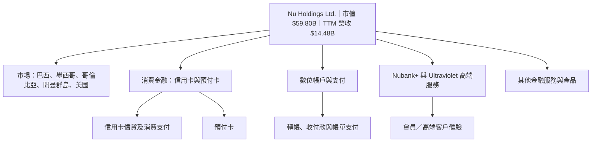
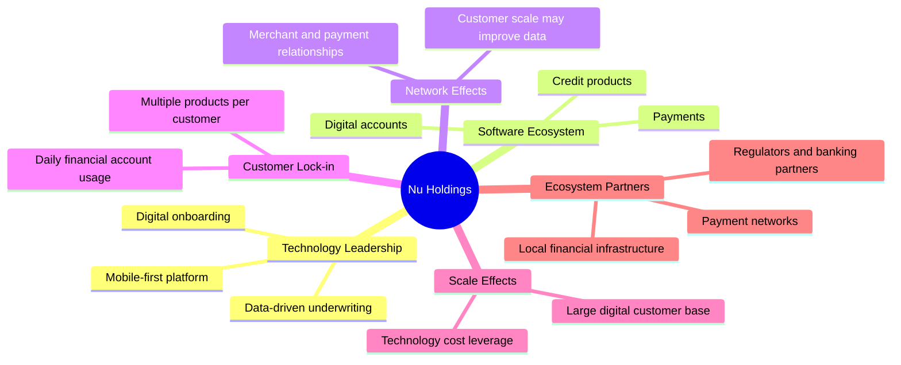
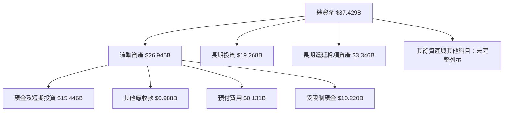
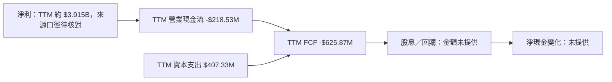
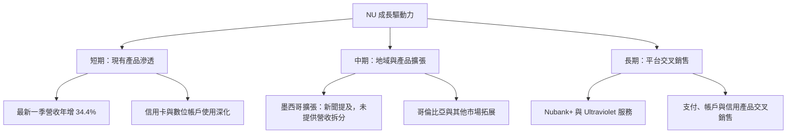
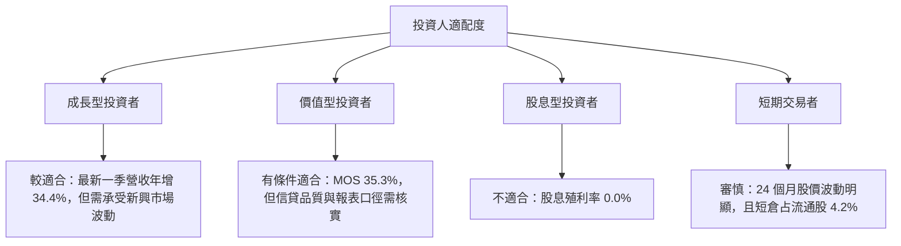

# NU 基本面深度分析報告
> **報告日期**：2026-11-27 ｜ **語言**：繁體中文 ｜ **數據來源**：Yahoo Finance、Finviz、StockAnalysis、Roic.ai ｜ **分析師**：CFA 級機構研究

## 目錄

| # | 章節 | 核心結論 |
|---|------|----------|
| 1 | 執行摘要 | 買入；加權合理價值 $19.11，MOS +35.3% |
| 2 | 公司概覽與商業模式 | 數位金融平台具規模與交叉銷售潛力，但缺少市場份額及分部營收數據 |
| 3 | 損益表深度分析 | 最新一季營收年增 34.4%；TTM 營收成長率 N/A，來源數據存在差異 |
| 4 | 資產負債表分析 | 現金及短期投資 $15.45B、總債務 $6.12B、淨現金 $9.32B |
| 5 | 現金流量深度分析 | TTM FCF -$625.87M；貸款機構現金流受放款與存款變化影響，不能直接等同一般企業 FCF |
| 6 | 獲利能力與資本效率 | ROTCE 29.8%；傳統 ROIC 不適用貸款機構，不能直接與 WACC 作等價比較 |
| 7 | 相對估值分析 | 同業 Forward P/E 中位數 19.3x；同業估值法支持高於現價 |
| 8 | DCF 內在價值評估 | 貸款機構 DCF 不適用；依固定權重相對估值與分析師共識，加權合理價值 $19.11 |
| 9 | 成長催化劑 | 數位金融產品擴張、墨西哥成長及交叉銷售為潛在驅動因素；TAM 數字未提供 |
| 10 | 風險矩陣 | 信貸品質、監管／國別風險、現金流波動為主要風險 |
| 11 | 投資建議 | 買入；建議區間 $11.20–$17.20，需密切追蹤信貸品質及資金流 |

---

## 1. 執行摘要

Nu Holdings（NU）最新可用收盤價為 **2026-11-25 的 $12.36**。最新一季營收年增 **34.4%**，但 TTM 營收成長率未提供；TTM FCF 為 **-$625.87M**，而 TTM 淨現金為 **$9.32B**。由同業 Forward P/E、同業 P/B 及分析師共識目標價計算的加權合理價值為 **$19.11**，相對現價的安全邊際（MOS）為 **+35.3%**，上行空間為 **+54.6%**。依數據區塊提供的規則 20 評級為 **買入**；此處不以傳統 ROIC 作評級調整，因為貸款機構的 ROIC 與一般企業不可直接比較，且資料未提供可用的 ROIC。

### 1.0 一頁式投資儀表板（Portfolio Manager 30 秒速讀）

| 項目 | 內容 |
|------|------|
| **投資論點（3 句）** | ① 最新一季營收年增 **34.4%**，反映平台仍有成長動能；② ROTCE **29.8%**，顯示有形權益回報具吸引力；③ 加權合理價值 **$19.11**，高於 2026-11-25 收盤價 **$12.36**。 |
| **綜合評分** | **7.3/10**（引用 1.1 評分卡） |
| **財務健康** | 🟢 現金及短期投資 **$15.45B**、總債務 **$6.12B**，淨現金 **$9.32B**；但貸款品質指標未提供。 |
| **ROIC vs WACC** | ROIC：N/A（貸款機構不適用）；WACC **13.99%**。ROTCE **29.8%** 可作補充觀察，但不等同 ROIC。 |
| **FCF 趨勢** | TTM FCF **-$625.87M**、FCF Yield **-1.05%**；負值需審慎解讀，貸款發放可能造成營業現金流流出。 |
| **估值** | Forward P/E **11.50x** ｜ EV/EBITDA **N/A** ｜ FCF Yield **-1.05%** |
| **DCF 內在價值（基準）** | N/A；貸款機構現金流包含資金募集及放款，不適合一般企業 DCF。DCF 折溢價 N/A。 |
| **安全邊際（MOS）** | **+35.3%**＝($19.11 − $12.36) ÷ $19.11；基準為 8.8 加權合理價值。🟢 >25% 充足 |
| **預期報酬（基準情境 12M）** | **+54.6%**，以 $19.11 加權合理價值相對 $12.36 現價計算；不是 DCF 情境預測。 |
| **關鍵風險（前二）** | 信貸品質惡化及監管／國別風險；逾放、淨沖銷及 CET1 數據未提供。 |
| **評級 + 信心度** | 🟢 **買入** ｜ 信心：中。估值資料支持折價，但現金流數據與貸款品質資訊不足。 |

### 1.1 綜合評分卡（全報告唯一）

| 維度 | 評分（1–10） | 主要依據（引用數字與其來源章節） |
|------|--------------|----------------------------------|
| 成長性 | 8.0 | 最新一季營收年增 **34.4%**；TTM 成長率 N/A，且來源間 TTM 營收有差異（第 3 章）。 |
| 獲利能力 | 7.5 | ROTCE **29.8%**、最新一季營業利益率 **50.9%**；傳統 ROIC 未提供且貸款機構不適用（第 3、6 章）。 |
| 財務健康 | 7.0 | 淨現金 **$9.32B**；逾放比、淨沖銷率、CET1 均未提供（第 4、6 章）。 |
| 估值 | 8.0 | MOS **+35.3%**；Forward P/E **11.50x**，低於同業中位數 **19.3x**（第 7、8 章）。 |
| 護城河 | 7.0 | 多國數位金融平台及多產品交叉銷售，但客戶數、留存率與各市場份額數字未提供（第 2 章）。 |
| 管理層與資本配置 | 6.5 | 年度 SBC 約 **$271.85M**（FY2025），公司未提供股息；回購紀錄及資本配置目標未提供（第 3、5 章）。 |
| **綜合評分** | **7.3** | 六項算術平均：(**8.0 + 7.5 + 7.0 + 8.0 + 7.0 + 6.5**) ÷ 6 = **7.3**。 |

### 1.2 五大投資論點 + 三大核心風險

| 類型 | 項目 | 具體依據 | 信心度 |
|------|------|----------|--------|
| 🟢 **投資論點①** | 最新一季仍維持成長 | 最新一季營收年增 **34.4%**；同業 SOFI、MELI、HOOD 最新一季營收年增分別為 **43.9%、45.1%、11.8%**。 | 🟢 高 |
| 🟢 **投資論點②** | 有形權益回報具吸引力 | ROTCE **29.8%**，為貸款機構衡量股東權益回報的重要參考指標。 | 🟢 高 |
| 🟢 **投資論點③** | 現金緩衝充足 | 現金及短期投資 **$15.45B**，總債務 **$6.12B**，淨現金 **$9.32B**。 | 🟢 高 |
| 🟢 **投資論點④** | 相對估值有折價 | NU Forward P/E **11.50x**，低於同業中位數 **19.3x**；估值方法加權結果為 **$19.11**。 | 🟡 中 |
| 🟢 **投資論點⑤** | 多國平台提供產品擴張選擇權 | 業務涵蓋巴西、墨西哥、哥倫比亞、開曼群島及美國；各市場獲利與收入占比未提供。 | 🟡 中 |
| 🟡 **風險①** | 現金流數字波動且 TTM FCF 為負 | TTM OCF **-$218.53M**、Capex **$407.33M**、FCF **-$625.87M**；貸款發放與資金流可能是重要影響因素。 | 🟡 中 |
| 🔴 **風險②** | 信貸品質無法從現有數據核實 | 淨沖銷率、逾放比、CET1 均為 N/A；若信貸損失上升，獲利及資本緩衝可能承壓。 | 🔴 高衝擊 |
| 🟡 **風險③** | 數據源間存在營收差異 | TTM 營收一處為 **$14.48B**，另一處為 **$9.10B**；季度營收也有不同序列，增加估值與趨勢判讀風險。 | 🟡 中 |

### 1.3 快速統計卡片

| 指標 | 公司實際值（期間） | 同業中位數 | 狀態 |
|------|--------------------|------------|------|
| 營收成長（TTM） | **N/A** | — | 🟡 資料未提供 |
| 營收成長（最新一季年增） | **34.4%** | **43.9%** | 🟡 低於同業中位數 |
| 毛利率（TTM） | **0.0%（財務資料欄位）** | **84.2%** | 🔴 金融機構毛利率口徑不可比，資料欄位不宜採信 |
| 營業利益率（TTM） | **N/A** | — | 🟡 資料未提供 |
| ROIC（TTM） | **N/A** | — | 🟡 貸款機構不宜直接套用 |
| Forward P/E | **11.50x** | **19.3x** | 🟢 低於同業中位數 |
| FCF Yield（TTM） | **-1.05%** | — | 🔴 負值；須考量貸款機構現金流特性 |
| Piotroski F-Score | **N/A** | — | 🟡 不適用貸款機構 |

### 1.4 投資結論

╔══════════════════════════════════════════════════════════════════╗  
║                    📊 投資結論摘要                               ║  
╠══════════════════════════════════════════════════════════════════╣  
║  評級：買入（依規則 20 的已提供評級；未作質化調整）             ║  
║  價格（2026-11-25 收盤）：$12.36                                ║  
║  DCF 內在價值（基準）：N/A（貸款機構 DCF 不適用）               ║  
║  安全邊際 MOS：+35.3%（＝(加權合理價值−現價)÷加權合理價值）     ║  
║  加權合理價值（8.8）：$19.11                                    ║  
║  DCF 情境價值：N/A（DCF MODEL 未提供，且不可自行建模）           ║  
║  綜合評分：7.3/10（引用 1.1）                                    ║  
║  適合投資人：能承受新興市場、信貸週期與估值波動的成長型投資人    ║  
╚══════════════════════════════════════════════════════════════════╝

---

## 2. 公司概覽與商業模式

### 2.1 業務結構與收入來源

公司摘要顯示 NU 在巴西、墨西哥、哥倫比亞、開曼群島及美國提供數位金融服務，包括信用卡、預付卡、帳戶及支付服務。可用資料沒有各產品營收及占比，因此不將總營收拆分成未經證實的產品金額。

> TTM 營收使用財務資料中標示為 VERIFIED 的 **$14.48B**。另一資料來源列示 TTM 營收 **$9.10B**，兩者不一致；本文依規則優先引用 VERIFIED 數字，不以未核實資料拆分營收。

### 2.2 市場份額

市場份額數據未提供，近期新聞摘要也沒有可引用的市場份額比例及年份。NU 最新一季營收年增 **34.4%**，低於 SOFI 與 MELI 的 **43.9%**、**45.1%**，高於 HOOD 的 **11.8%**；不過各公司業務組合及地區不同，不能直接視為市場地位排名。

### 2.3 競爭護城河分析

### 2.4 護城河強度

| 護城河項目 | 強度（強／中／弱） | 證據（引用數字或事實） | 會削弱它的情況 |
|------------|--------------------|------------------------|----------------|
| 技術與數位服務 | 中 | 多國提供數位銀行、支付及卡片產品；最新一季營收年增 **34.4%**。 | 系統事故、網路安全事件或競爭者複製產品體驗。 |
| 軟體生態系統 | 中 | 數位帳戶、支付、信用卡及會員服務可形成交叉銷售；產品別收入與客戶使用率未提供。 | 客戶只使用單一產品，或競品以更低成本提供替代服務。 |
| 網路效應 | 中 | 平台型金融服務可能累積交易及信用資料；客戶數及支付交易量未提供。 | 客戶規模未能轉化為更低獲客成本或更準確風控。 |
| 客戶鎖定 | 中 | 帳戶、支付與信用產品可提升使用黏著；留存率、流失率未提供。 | 利率、費率或服務體驗導致客戶轉移。 |
| 規模效應 | 中 | TTM 營收資料列示 **$14.48B**，但其他來源有差異；規模可能攤薄技術成本。 | 規模擴大同時帶來更高信貸損失與營運成本。 |
| 生態夥伴 | 弱至中 | 卡片及支付服務通常依賴支付網路與當地金融基礎設施；具體合作條款未提供。 | 監管或合作條款改變，降低交易經濟效益。 |

**1.1 護城河評分 7.0/10** 的理由：平台具多產品與多市場發展條件，但市場份額、客戶數、留存、單客獲利及產品收入占比等核心證據未提供。

---

## 3. 損益表深度分析

### 3.1 年度收入成長趨勢（近 4 年）

年度營收採年度損益表列示數據。FY2023、FY2024、FY2025 的 YoY 成長率由年度營收計算；FY2022 因缺少 FY2021 年度營收，不列 YoY。

╔══════════════════════════════════════════════════════════════════╗  
║              Nu Holdings 年度收入趨勢（FY2022–FY2025）           ║  
╠══════════════════════════════════════════════════════════════════╣  
║ FY2022  $2.97B   ██████░░░░░░░░░░░░░░░░░░░  YoY：N/A            ║  
║ FY2023  $5.63B   ████████████░░░░░░░░░░░░░  YoY：+89.6% 🟢      ║  
║ FY2024  $8.27B   ██████████████████░░░░░░░  YoY：+46.9% 🟢      ║  
║ FY2025  $10.63B  ███████████████████████░░  YoY：+28.5% 🟢      ║  
╠══════════════════════════════════════════════════════════════════╣  
║ FY2022–FY2025 CAGR＝(10.63 ÷ 2.97)^(1/3) − 1＝約 53.0%          ║  
╚══════════════════════════════════════════════════════════════════╝

成長率逐年放緩，從 FY2023 的 **89.6%** 降至 FY2025 的 **28.5%**。這與收入基期擴大相符，但不能只憑年度總營收判斷單客變現或信用品質；須同時觀察產品組合、放款成長及信貸損失。

### 3.2 季度收入趨勢分析

最近四季季度營收表與另一資料來源存在差異。下表依季度損益表列示的 **$4.03B、$3.77B、$3.54B、$3.14B** 計算 QoQ；YoY 僅對最新一季引用 VERIFIED 的單季年增率 **34.4%**，其他季度 YoY 不以混用資料計算。

| 季度 | 營收 | QoQ 成長 | YoY 成長 | 備註 |
|------|------:|---------:|---------:|------|
| 2025 Q4 | $3.14B | — | N/A | 缺少一致口徑的上一年季度比較值。 |
| 2026 Q1 | $3.54B | +12.7% | N/A | QoQ＝(3.54 ÷ 3.14)−1。 |
| 2026 Q2 | $3.77B | +6.5% | N/A | QoQ＝(3.77 ÷ 3.54)−1。 |
| 2026 Q3 | $4.03B | +6.9% | **+34.4%** | YoY 為最新一季單季年增率，非 TTM。 |

季度表現顯示營收連續增加，但 Q1 至 Q3 的 QoQ 成長有基期及季節性影響，不能直接推定往後維持同樣速度。StockAnalysis 另列 2026 Q3 營收 **$2.58B**，與季度損益表 **$4.03B** 不一致，應在取得公司申報資料前視為資料品質風險。

### 3.3 利潤率演變分析

| 利潤率指標 | FY2022 | FY2023 | FY2024 | FY2025／最新 | 趨勢 | 評估 |
|------------|--------|--------|--------|--------------|------|------|
| 毛利率 | N/A | N/A | N/A | 財務欄位列示 TTM **0.0%** | 欄位可能不適用金融業 | 🔴 不宜採用 |
| 營業利益率 | N/A | N/A | N/A | TTM N/A；最新一季 **50.9%** | 年度序列無法核實 | 🟡 |
| 淨利率 | 年度收入與淨利可計算，但不同來源口徑需核對 | — | — | 資料欄列示 TTM **43.0%** | 與其他收入序列不完全一致 | 🟡 |

年度淨利由 FY2022 **-$364.58M** 改善至 FY2023 **$1.03B**、FY2024 **$1.97B**、FY2025 **$2.87B**。這顯示公司已從虧損轉為盈利並擴大淨利，但目前資料沒有足夠、同口徑的年度營業費用與貸款損失明細，無法把利潤率改善精確拆為定價、資金成本、信貸撥備或成本控制的貢獻。最新一季營業利益率 **50.9%** 亦不應誤寫成 TTM 利潤率。

### 3.4 費用結構分析

金融機構的利息成本、信用損失及資金成本是核心費用，但現有資料未提供可核對的費用分項金額，故不繪製費用占比圓餅圖或費用結構比例圖，避免製造虛假比例。可確認的年度營業現金流、Capex 及 SBC 資料見第 5 章。

### 3.5 季度 EPS 趨勢與盈餘品質（Quality of Earnings）

EPS 預期值及實際值四季均為 nan，因此無法判定超預期或不及預期。可觀察已報告 EPS 序列為 2025 Q4 **$0.18**、2026 Q1 **$0.18**、2026 Q2 **$0.22**、2026 Q3 **$0.23**；季度逐步增加，但不能代替市場預期比較。最新一季 EPS 年增率為 **40.1%**。

| 盈餘品質項目 | 數值／佔比 | 評估 |
|--------------|-----------|------|
| 股權薪酬 SBC / 營收 | FY2025：$271.85M ÷ $10.63B＝**2.56%**；TTM 依四季資料合計約 $394.13M，除以 VERIFIED 營收 $14.48B＝**2.72%** | 🟡 SBC 不是現金支出，但會稀釋股東權益；最新四季 SBC / 營收約 2.72%。 |
| SBC / 營業現金流 | TTM 約 $394.13M ÷ -$218.53M＝**-180.4%** | 🔴 分母為負，比例不具一般經濟解讀；說明現金流不能直接覆蓋 SBC。 |
| FCF / 淨利（現金轉換率） | 以 TTM FCF -$625.87M ÷ StockAnalysis TTM 淨利 $3.915B＝約 **-16.0%** | 🔴 現金轉換為負，但貸款機構的貸款及存款變化會扭曲傳統 FCF。 |
| 一次性／非經常性損益 | N/A（明細未提供） | 無法確認一次性項目是否推升或壓低盈餘。 |
| 有效稅率異常 | **25.8%**（最近年度有效稅率） | 🟡 資料未提供跨年稅率序列，無法判定是否異常。 |
| 資本化支出 vs 費用化 | TTM Capex **$407.33M**；資本化政策及費用化明細 N/A | 無法判定是否有成本遞延或資本化造成的盈餘偏差。 |

**盈餘品質結論**：年度淨利增長與 ROTCE 支持公司具實質獲利能力，但 TTM FCF 為負、現金轉換率為負，且來源間收入數據不一致。獲利含金量需要以貸款機構專用的淨沖銷、逾放、準備金與資本比率進一步核驗；現有資料不足以斷言 GAAP 淨利高估或低估經濟盈餘。

---

## 4. 資產負債表分析

### 4.1 資產結構分解

最新 TTM 資產負債表資料列示總資產 **$87.429B**。下圖只列有明確數值的項目，並非完整加總分解；資產科目分類口徑可能與其他來源不同。

現金及短期投資 **$15.45B** 不等同全部可自由支配現金；其中受限制現金另列 **$10.22B**，因此分析流動性時應注意資產可用性及監管要求。

### 4.2 流動性與營運資金分析

| 指標 | 最新值 | 歷史比較 | 評估 |
|------|-------:|----------|------|
| 現金及短期投資 | **$15.45B** | FY2025：$16.332B；TTM 資料較 FY2025 下降約 $0.886B | 🟢 規模充足，但部分現金可能受限或用於金融業務營運。 |
| 總債務 | **$6.12B** | FY2025 年末列示 $1.90B；統計期間或債務口徑不同 | 🟡 需核對債務範圍與日期。 |
| 淨現金 | **$9.32B** | 以現金及短期投資扣除總債務 | 🟢 提供資金緩衝。 |
| Current Ratio / Quick Ratio | N/A | N/A | 金融業流動資產與負債分類不同，常規比率有限。 |

營運資金天數對貸款機構不適用；DSO、DIO、DPO、CCC 均不列，因為 QUALITY FIGURES 未提供此類貸款機構營運資金指標。

### 4.3 債務結構分析

╔══════════════════════════════════════════════════════════════════╗  
║                   Nu Holdings 債務健康診斷                       ║  
╠══════════════════════════════════════════════════════════════════╣  
║  總債務：              $6.12B                                    ║  
║  現金及短期投資：      $15.45B                                   ║  
║  淨現金：              $9.32B   🟢                               ║  
║  Debt/Equity：         N/A（資料未提供）                         ║  
║  Debt/EBITDA：         N/A（EV/EBITDA 亦未提供）                  ║  
║  利息保障倍數：        N/A（所需利息與口徑未提供）                ║  
║  信貸品質與資本比率：  淨沖銷率、逾放比、CET1 均 N/A             ║  
╚══════════════════════════════════════════════════════════════════╝

淨現金提供緩衝，但銀行資產負債表的存款、信貸承諾及監管資本要求不能僅用企業式淨現金判斷。總債務在資料來源中，FY2025 年末為 **$1.90B**、最新統計為 **$6.12B**，應在季度申報資料中確認變動原因。

### 4.4 股東權益趨勢

╔══════════════════════════════════════════════════════════════════╗  
║                 股東權益趨勢（年度資料）                         ║  
╠══════════════════════════════════════════════════════════════════╣  
║ FY2022  $4.89B   ██████████░░░░░░░░░░░░░░                        ║  
║ FY2023  $6.41B   █████████████░░░░░░░░░░░                        ║  
║ FY2024  $7.65B   ████████████████░░░░░░░░                        ║  
║ FY2025  $11.29B  ████████████████████████                        ║  
╚══════════════════════════════════════════════════════════════════╝

股東權益由 FY2022 的 **$4.89B** 增至 FY2025 的 **$11.29B**。FY2025 相較 FY2024 增加約 **47.6%**，有助支撐業務擴張；但若權益增長部分來自股權融資或留存盈餘，應分辨每股帳面價值及每股盈餘的變化。

---

## 5. 現金流量深度分析

### 5.1 現金流量瀑布圖

以下呈現可用現金流資料及其限制。股息、回購與淨現金變化未提供，不填入未核實金額。

### 5.2 FCF 轉換率趨勢

以下以年度現金流量表列示的 FCF 除以年度淨利計算；TTM 則因淨利及 FCF 來源口徑存在差異，只作方向性參考。

| 年度 | FCF | 淨利 | FCF / 淨利 | 解讀 |
|------|----:|-----:|-----------:|------|
| 2023 | $1.09B | $1.03B | **105.8%** | 年度現金流高於淨利。 |
| 2024 | $2.22B | $1.97B | **112.7%** | 現金轉換仍高於 100%。 |
| 2025 | $3.16B | $2.87B | **110.1%** | 年度數據顯示較佳現金轉換。 |
| TTM 至 2026-09-30 | -$625.87M | 約 $3.915B | **約 -16.0%** | 與年度趨勢反轉；貸款機構放款現金流可造成大幅波動。 |

### 5.3 自由現金流趨勢

╔══════════════════════════════════════════════════════════════════╗  
║          自由現金流：年度現金流量表 vs 最新 TTM                  ║  
╠══════════════════════════════════════════════════════════════════╣  
║ FY2023  $1.09B    █████████░░░░░░░░░░░░░░░  FCF/淨利：105.8%    ║  
║ FY2024  $2.22B    ██████████████████░░░░░░  FCF/淨利：112.7%    ║  
║ FY2025  $3.16B    ████████████████████████  FCF/淨利：110.1%    ║  
║ TTM     -$0.626B  負值；FCF Yield：-1.05%                       ║  
╚══════════════════════════════════════════════════════════════════╝

年度 FCF 由 **$1.09B** 增至 **$3.16B**，但最新 TTM 轉為負值。兩組數據反映貸款機構現金流具有時點波動，不能將單一 TTM FCF 等同可供股東分配的持續性自由現金流；亦需核對報表口徑與期間。

### 5.4 資本配置評估

股息殖利率 **0.0%**、派息率 **0.0%**；公司年度 SBC FY2025 為 **$271.85M**。回購、併購、投資支出及留存盈餘的完整分配資料未提供，因此不繪製資本配置圓餅圖。

| 資本配置項目 | 可用數據 | 評估 |
|--------------|----------|------|
| 股息 | 殖利率 **0.0%**；派息率 **0.0%** | 目前非股息收益型標的。 |
| 資本支出 | TTM **$407.33M** | 金融機構技術與平台投資需求可能持續，但資本化明細未提供。 |
| SBC | FY2025 **$271.85M** | 應持續監控稀釋股數及薪酬效率。 |
| 回購／併購／留存 | N/A | 無法評價回購價格或再投資回報。 |

---

## 6. 獲利能力與資本效率

### 6.1 ROE / ROA / ROIC 趨勢

| 指標 | 可用數值 | 期間 | 評估 |
|------|----------|------|------|
| ROE | **31.5%** | TTM | 顯示股東權益回報較高；但 DuPont 數據列為 N/A，不能拆解獲利率、資產週轉率與槓桿。 |
| ROA | **5.0%** | TTM | 對金融機構應結合資產風險與信貸損失看待。 |
| ROIC | **N/A** | TTM | 貸款機構投入資本及資金成本定義不同，不宜硬套一般企業 ROIC。 |
| ROTCE | **29.8%** | TTM | 貸款機構較適用的有形權益回報指標之一。 |
| 行業均值 | N/A | N/A | 未提供可引用的同口徑資料，不做比較。 |

### 6.2 ROIC vs WACC 分析（核心價值創造判斷）

貸款機構的存款、借款及放款屬於核心營運資金，傳統企業 ROIC 分子與投入資本分母不適合直接套用。故本節不以 ROIC − WACC 得出 EVA；可以比較的是 WACC 與 **ROTCE 29.8%** 的方向性差異，但 ROTCE 不是 ROIC，不能據此宣稱精確的股東價值增加額。

╔══════════════════════════════════════════════════════════════════╗  
║                ROIC vs WACC 深度分析                            ║  
╠══════════════════════════════════════════════════════════════════╣  
║  WACC（直接採用財務資料提供值）：13.99%                         ║  
║  ├── 無風險利率：4.85%                                           ║  
║  ├── ERP：5.00%                                                  ║  
║  ├── 原始 Beta：0.97；調整後 Beta：0.98                         ║  
║  ├── 股權成本：9.74%                                             ║  
║  ├── 稅前債務成本：74.76%                                       ║  
║  ├── 有效稅率：25.8%                                            ║  
║  ├── 股權／債務權重：90.7%／9.3%                                ║  
║  └── WACC：13.99%（採用值；不另行重建模型）                     ║  
║                                                                  ║  
║  貸款機構資本效率：                                              ║  
║  ├── ROIC：N/A（不適用一般企業口徑）                            ║  
║  ├── ROTCE：29.8%                                                ║  
║  └── ROTCE 高於 WACC，但兩者不是完全同口徑指標                  ║  
║                                                                  ║  
║  結論：方向性回報指標具吸引力；不能以此取代 ROIC-EVA 分析。      ║  
╚══════════════════════════════════════════════════════════════════╝

調整後 Beta 依提供定義為 **⅔ × 0.97 + ⅓ × 1 = 0.98**。WACC 與其成本組成直接採用程式計算值；資料沒有提供 10 年美債殖利率的具體觀察日期，因此不補寫日期。稅前債務成本 **74.76%** 偏高，可能受利息與債務口徑、金融機構負債結構影響；此 WACC 僅按資料區塊指定值引用，不視為獨立重建的融資成本估計。

### 6.3 杜邦三因素分解

| 因素 | 數值（TTM） | 解讀 |
|------|-------------|------|
| 淨利率 | N/A | QUALITY FIGURES 的 DuPont 為 N/A；缺少可一致計算的淨利、營收、總資產或正股東權益組合。 |
| 資產週轉率 | N/A | 同上。 |
| 權益乘數 | N/A | 同上。 |
| **ROE** | **N/A（DuPont）** | DuPont 區塊明確列 N/A；不得以其他口徑補算。 |

### 6.4 財務體質：Piotroski F-Score 與貸款機構指標

Piotroski F-Score 為 **N/A（不適用貸款機構）**：放款成長會使營業現金流流出，常規現金流測試可能誤判銀行經營狀況。九項測試個別結果不適用，故不逐項虛構結果。

| 貸款機構指標 | 數值 | 解讀 |
|--------------|------:|------|
| 淨利息收入 NII / 總營收 | **84.7%** | 收入主要來自淨利息收入，顯示利差與信貸資產收益的重要性。 |
| 淨利差代理值 | **15.74%** | NII ÷ 平均總資產；因未提供生息資產，這通常高於以生息資產計算的正式 NIM。 |
| 成本收入比代理值 | **68.1%** | (營收 − 稅前淨利) ÷ 營收；包含信用撥備，因此高於公司自行公布的純營運效率比率。 |
| ROTCE | **29.8%** | 淨利 ÷ 有形帳面價值，反映有形權益回報。 |
| P/TBV | **4.56x** | 市場價格相對有形帳面價值倍數，反映市場對未來盈利與成長的定價。 |
| 放款淨額 / 總資產 | **14.0%** | 反映資產配置中放款淨額占比；與傳統零售銀行資產結構比較需保持口徑一致。 |
| 淨沖銷率 | **N/A（數據未提供）** | 無法核驗實際信用損失。 |
| 逾放比 | **N/A（數據未提供）** | 無法評估逾期資產變化。 |
| CET1 | **N/A（數據未提供）** | 無法直接核驗監管資本緩衝。 |

---

## 7. 相對估值分析

### 7.1 同業估值比較表格

同業倍數取自 Peer multiples。NU 自身倍數取市場資料；金融機構的 P/S、毛利率及 EV/EBITDA 受會計分類與資本結構影響，應以 P/E、P/B 及貸款品質指標為主。

| 估值指標 | **NU** | **SOFI** | **MELI** | **HOOD** | 本公司評估 |
|----------|-------:|--------:|--------:|--------:|-----------|
| **Trailing P/E** | **15.45x** | 23.8x | 39.4x | 30.3x | 🟢 低於三家同業 |
| **Forward P/E** | **11.50x** | 14.5x | 27.7x | 19.3x | 🟢 低於同業中位數 **19.3x** |
| **P/S Ratio** | **6.57x** | 3.6x | 1.9x | 11.7x | 🟡 高於 SOFI、MELI，低於 HOOD；金融收入分類不同 |
| **EV/EBITDA** | N/A | N/A | 21.1x | N/A | 🟡 只有 MELI 有可用值，無法作充分比較 |
| **最新一季營收年增** | **34.4%** | 43.9% | 45.1% | 11.8% | 🟡 低於 SOFI、MELI，高於 HOOD |
| **毛利率（TTM）** | **0.0% 欄位值** | 84.2% | 46.7% | 91.0% | 🔴 NU 金融業毛利率欄位不可比 |

NU 的 P/E 低於同業中位數，反映估值可能包含新興市場、信貸風險及監管風險折價。SOFI、MELI、HOOD 的業務模式不完全相同，因此倍數折價只能視為相對參考，不能單獨證明 NU 被低估。

### 7.2 歷史估值區間分析

N/A（數據未提供：沒有「Valuation vs own history」的歷史 P/E 區間與百分位數據）。24 個月價格資料可見股價在 2026-01 月收盤 **$17.75**，之後至 2026-10 月收盤 **$11.61**，2026-11 月為 **$12.36**；價格走勢不能代替歷史估值倍數區間。

### 7.3 情境價值（Bear / Base / Bull）

N/A（DCF 無法計算：貸款機構的現金流包含資金流入及放款，資料區塊明確不提供 DCF MODEL）。依規則不另行建立情境目標價。

### 7.4 相對估值隱含價格區間

估值方法及權重依公司類型固定採用資料所列數字。以下不是自行選擇倍數，而是使用同業中位數倍數及公司對應指標回推。

╔══════════════════════════════════════════════════════════════════╗  
║                  相對估值方法與價格位置                         ║  
╠══════════════════════════════════════════════════════════════════╣  
║ 現價（2026-11-25）：$12.36                                      ║  
║ 同業 Forward P/E：$20.70（中位數 19.3x × Forward EPS $1.07）    ║  
║ 同業 P/B：        $17.57（中位數 5.9x × BVPS $2.96）            ║  
║ 分析師共識目標價：$17.28（23 位分析師平均目標價）               ║  
║ 加權合理價值：   $19.11                                        ║  
╚══════════════════════════════════════════════════════════════════╝

| 方法 | 每股價值 | 相對現價 | 權重 | 依據 |
|------|---------:|---------:|-----:|------|
| 同業 Forward P/E | **$20.70** | **+67.5%** | 50% | SOFI、MELI、HOOD 同業中位數 Forward P/E **19.3x** × NU Forward EPS **$1.07**。 |
| 同業 P/B | **$17.57** | **+42.2%** | 40% | 同業 P/B 中位數 **5.9x** × 帳面價值每股 **$2.96**。 |
| 分析師共識目標價 | **$17.28** | **+39.8%** | 10% | 23 位分析師平均目標價。 |

---

## 8. DCF 內在價值評估（Discounted Cash Flow）

> **重要：DCF MODEL 為 N/A。** 對貸款機構而言，營業現金流會受到吸收存款、發放貸款及金融資產變動影響，不能將一般企業 FCFF 直接當作可分配現金流。本章不建立自製 DCF，也不提供假造的 DCF 內在價值、敏感度矩陣或情境目標價。

### 8.0 估值推理鏈（Thinking Logic）

**Step 1 — 價值來源。** NU 的價值主要取決於現有金融平台的獲利能力、信貸損失與資金成本管理，以及新市場與新產品的交叉銷售機會。現有資料未提供分部營收占比，不能把第二成長曲線或新業務選擇權量化成營收占比。最重要且尚未充分核實的變數是信貸風險調整後的獲利能力。

**Step 2 — 模型選擇。**

| 決策點 | 本報告採用 | 理由（含數字） | 曾考慮但否決 | 否決理由 |
|--------|-----------|----------------|--------------|----------|
| 現金流定義 | 不建立 FCFF DCF | TTM FCF **-$625.87M**，貸款現金流具有金融資產負債特性 | 一般企業 FCFF | 對貸款機構現金流定義不穩定，亦違反資料區塊指示 |
| 預測期 N | N/A | DCF 模型未提供 | 自行設定 5–10 年 | 沒有模型輸入與申報依據，不能自建 |
| 終值方法 | N/A | DCF 不適用 | Gordon Growth、退出倍數 | 無可用基礎現金流及模型輸入 |
| EBIT 基礎 | N/A | 不建立 DCF | GAAP／非 GAAP EBIT | 不應以一般企業 EBIT 估值替代銀行盈利模型 |

**Step 3 — 關鍵假設。** 營收 CAGR、營業利潤率、終值成長率、Capex、稀釋率及 WACC 的 DCF 模型輸入均 N/A，故不設定估計值。WACC 僅在第 6.2 節作為程式提供的資本成本參考，不代表本報告以它折現 NU 的貸款機構現金流。

**Step 4 — 最脆弱環節。** 最脆弱之處是信貸品質指標缺失；若逾放及淨沖銷上升，淨利與 ROTCE 可能下滑，現有相對估值所依據的 Forward EPS 也可能不成立。影響幅度無法在缺少損失率及貸款組合資料時量化。

**Step 5 — 計算路徑。** 不繪製一般企業 FCFF 到每股價值的計算圖，因為資料區塊明確將 DCF MODEL 標記為 N/A。

### 8.1 模型假設總表（Model Inputs）

N/A（資料未提供：DCF MODEL 的預測期、逐年營收與利潤率、稅率、Capex、折舊、營運資金變動、終值假設、稀釋股數及敏感度輸入；且貸款機構 DCF 不適用）。

### 8.2 折現率推導（WACC）

WACC 作為財務資料提供的資本成本參考值，採用 **13.99%**。依嚴格要求，這裡不重新建構或替換 WACC；貸款機構估值亦不將此 WACC 用於一般 FCFF DCF。

╔══════════════════════════════════════════════════════════════════╗  
║                    WACC 資料引用（非 DCF 模型）                  ║  
╠══════════════════════════════════════════════════════════════════╣  
║ 無風險利率：4.85% ｜ ERP：5.00%                                  ║  
║ 原始 Beta：0.97 ｜ 調整後 Beta：0.98                            ║  
║ 股權成本：9.74% ｜ 稅前債務成本：74.76%                          ║  
║ 有效稅率：25.8% ｜ 股權／債務權重：90.7%／9.3%                  ║  
║ 提供的 WACC：13.99%                                               ║  
║ 本節不另行推算 Ke、Kd 及加權算式；此數值只作資本成本參考。       ║  
╚══════════════════════════════════════════════════════════════════╝

### 8.3 逐年自由現金流預測（基準情境）

N/A（DCF MODEL 未提供逐年預測；且貸款機構的放款現金流不是一般企業可直接折現的 FCFF）。不建立逐年預測表、不推算 FCF 現值合計。

### 8.4 終值計算（Terminal Value）

N/A（缺少 DCF 模型中的 FY+N FCFF、永續成長率及退出倍數；因此不計算 Gordon Growth 或退出倍數終值）。

### 8.5 企業價值 → 每股內在價值（Bridge）

N/A（缺少 DCF 企業價值及相應橋接模型輸入）。因此不提供 DCF 每股內在價值；2026-11-25 收盤價相對 DCF 的折溢價亦為 N/A。

### 8.6 敏感性分析（WACC × 永續成長率）

N/A（DCF MODEL 未提供敏感度矩陣，不得自行建立）。

### 8.7 反推 DCF（Reverse DCF）

N/A（沒有 DCF 模型，現價不能在本報告中反解為一組可複算的營收成長率或利潤率假設）。市場對 NU 的定價可由 Forward P/E、P/B 及分析師共識作相對估值參考，但不應冒充 Reverse DCF。

### 8.8 估值三角驗證與安全邊際

DCF 欄位不納入，因資料區塊沒有可用 DCF 價值。下列三項及權重照錄固定估值方法。

| 估值方法 | 隱含每股價值 | 上行空間（÷現價） | 權重 | 說明 |
|----------|--------------:|-------------------:|-----:|------|
| 同業 Forward P/E | $20.70 | +67.5% | 50% | 同業中位數 **19.3x** × Forward EPS **$1.07**。 |
| 同業 P/B | $17.57 | +42.2% | 40% | 同業中位數 **5.9x** × BVPS **$2.96**。 |
| 分析師共識目標價 | $17.28 | +39.8% | 10% | 23 位分析師平均目標價。 |
| **加權合理價值** | **$19.11** | **+54.6%** | **100%** | 金融業固定方法權重。 |

逐步演算：

- 同業 Forward P/E 貢獻：$20.70 × 50% = **$10.35**
- 同業 P/B 貢獻：$17.57 × 40% = **$7.028**
- 分析師共識貢獻：$17.28 × 10% = **$1.728**
- 加權合理價值：**$10.35 + $7.028 + $1.728 = $19.106，四捨五入至美分為 $19.11**
- MOS：**($19.11 − $12.36) ÷ $19.11 = +35.3%**
- 上行空間：**($19.11 − $12.36) ÷ $12.36 = +54.6%**

此估值方法的公司類型為金融業，權重依固定規則使用同業 Forward P/E 50%、同業 P/B 40%、分析師共識 10%。DCF 與 EV/EBITDA 因無可用計算值，不在方法清單中。

╔══════════════════════════════════════════════════════════════════╗  
║                  估值區間與安全邊際                              ║  
╠══════════════════════════════════════════════════════════════════╣  
║  $12.36 現價 ───────── [$19.11 加權合理價值]                     ║  
║                                                                  ║  
║  安全邊際 MOS = (19.11 − 12.36) ÷ 19.11 = +35.3%                ║  
║  MOS 評估：🟢 >25% 充足                                          ║  
║  上行空間 = (19.11 − 12.36) ÷ 12.36 = +54.6%                    ║  
║  DCF 基準、悲觀及樂觀情境：N/A                                   ║  
║                                                                  ║  
║  建議買入區間：$11.20–$17.20                                     ║  
║  合理持有參考：$17.20–$19.11                                     ║  
║  減碼考慮：高於 $19.11 時重新檢視估值與信貸品質                  ║  
╚══════════════════════════════════════════════════════════════════╝

買入區間上限 **$17.20** 的計算為加權合理價值乘以 90%：**$19.11 × (1 − 10%) = $17.20**，對應至少約 10% MOS；下限參考 52 週低點 **$11.20**，不是 DCF 推導值。現價低於買入區間上限，符合買入評級與區間一致性要求。

> 🔎 **程式複算（Python，依本節各項自動重算）**
>
> 加權合理價值 = $20.70 × 50% + $17.57 × 40% + $17.28 × 10% = **$19.11**（權重合計 100%）
>
> 以價格 $12.36 計：MOS = **+35.3%**，上行空間 = **+54.6%**
>
> ✅ 與本節所寫數值一致。

### 8.9 DCF 模型的局限與失效條件

- **終值依賴度**：N/A，DCF 未計算，無法量化終值占企業價值比重。
- **最脆弱的假設**：沒有 DCF 假設可供測試；目前相對估值最依賴 Forward EPS **$1.07** 及同業倍數中位數 **19.3x**。若盈利預期下修或估值倍數收縮，$20.70 的同業 Forward P/E 估值將下修。
- **不適用情境說明**：貸款機構應優先關注信貸調整後盈利、ROTCE、P/TBV、淨沖銷率、逾放比、資本充足率與存款資金成本；傳統 FCFF DCF 可靠度不足。
- **與第 10 章風險矩陣的連結**：信貸損失上升會壓低 EPS 與 ROTCE；監管資本要求上升可能限制放款與資本回報；數據來源錯誤會影響 Forward P/E 的分子及分母判斷。

### 8.10 複算檢核表（Audit Trail）

| # | 檢核項目 | 檢查方式 | 結果 |
|---|----------|----------|------|
| 1 | 所有 DCF 高／中敏感度輸入完整推導 | DCF MODEL 為 N/A，未提供輸入 | N/A |
| 2 | 每個 DCF 假設都有來歷 | 未設定 DCF 假設 | N/A |
| 3 | WACC 五步算式及重算 | 依要求直接採用提供的 WACC，不另算 | N/A |
| 4 | Kd 分母與債務權重口徑一致 | 未建立本報告自建 WACC 模型 | N/A |
| 5 | WACC 與第 6.2 節同值 | 兩處均引用 **13.99%** | ✅ |
| 6 | 逐年預測年數等於 N | 不適用，沒有 DCF 預測期 | N/A |
| 7 | 代表年度 FCFF 與 PV 可複算 | 無逐年模型 | N/A |
| 8 | 預測期 PV 逐項加總 | 無預測期 PV | N/A |
| 9 | WACC > g | g 未提供，無法檢驗 | N/A |
| 10 | 終值以 FY+N 現金流為基礎 | 無終值計算 | N/A |
| 11 | EV 至每股價值橋接可複算 | 無 DCF 橋接 | N/A |
| 12 | SBC 組合相容 | 無 DCF EBIT、SBC 扣除或股數假設 | N/A |
| 13 | 敏感性矩陣基準格等於 DCF 價值 | 無矩陣與基準 DCF 價值 | N/A |
| 14 | 矩陣格子符合 WACC > g | 無矩陣 | N/A |
| 15 | 三情境機率相加為 100% | DCF 情境未提供 | N/A |
| 16 | Reverse DCF 每列只放開一個變數 | 未建立 Reverse DCF | N/A |
| 17 | MOS 分母及折溢價基準正確 | MOS 以 $19.11 加權合理價值為分母；DCF 折溢價 N/A | ✅ |
| 18 | 已完整輸出至第 11 章 | 本報告含 11 章 | ✅ |
| 19 | 加權合理價值等於方法加權總和 | $20.70×50% + $17.57×40% + $17.28×10% = $19.106，四捨五入 $19.11 | ✅ |
| 20 | 評級符合 MOS 門檻 | MOS **+35.3%**，採用提供的規則 20 評級 **買入** | ✅ |

---

## 9. 成長催化劑

### 9.1 催化劑時間軸

N/A（數據未提供：可供核對的催化劑落地日期或公司財測時間表）。近期新聞提及墨西哥擴張與客戶成長，但沒有可驗證的時間節點，故不製作帶日期的甘特圖。

### 9.2 TAM 市場規模分析

N/A（TAM 數據未提供）。可確認的是年度營收由 FY2022 **$2.97B** 增至 FY2025 **$10.63B**，最新一季營收年增 **34.4%**；NU 在巴西、墨西哥、哥倫比亞等市場經營，仍有地區擴張空間，但缺少市場規模及滲透率數據，無法量化 TAM。

### 9.3 成長驅動力結構圖

新市場與會員服務的成長效果需以各地區營收、客戶活躍度、單客收入及信貸損失驗證；現有資料不足以判斷其對總體獲利的實際貢獻。

---

## 10. 風險矩陣

### 10.1 風險評估

可用財務數據未提供各風險的量化發生機率與損失幅度，因此不以未經證實的機率數字繪製 quadrantChart。以下以風險性質與可監測指標呈現。

### 10.2 風險清單詳細分析

| # | 風險項目 | 發生機率 | 財務衝擊 | 風險評估 | 緩解措施 |
|---|----------|----------|----------|----------|----------|
| 1 | 🔴 **信貸品質惡化** | N/A；缺少逾放及淨沖銷序列 | 高；可能增加撥備、壓低淨利與 ROTCE | 🔴 高衝擊 | 每季追蹤淨沖銷率、逾放比、逾期貸款分層、準備金覆蓋率；此等數據目前均未提供。 |
| 2 | 🟠 **監管與國別風險** | N/A；無量化資料 | 高；可能影響產品定價、資本要求或放款能力 | 🟠 高 | 追蹤巴西、墨西哥、哥倫比亞監管變化及各地區營收與資本配置。 |
| 3 | 🟠 **營業現金流波動** | 已觀察到 TTM OCF 為負 | 中至高；TTM FCF **-$625.87M**、FCF Yield **-1.05%** | 🟠 中高 | 拆分貸款發放、存款變化、證券投資與實際營運現金流；不可只看單季 FCF。 |
| 4 | 🟡 **數據來源與報表口徑不一致** | 已觀察到 | 中；TTM 營收分別為 **$14.48B** 與 **$9.10B** | 🟡 中 | 優先採用公司申報資料，核對季度收入、資產負債及現金流口徑。 |
| 5 | 🟡 **估值倍數回落** | N/A；無可驗證機率 | 中至高；估值方法中 Forward P/E 對應 **$20.70**，高度依賴 EPS 與倍數 | 🟡 中高 | 以實際 EPS、ROTCE、P/TBV 及信貸損失共同檢驗，不以單一倍數作決策。 |
| 6 | 🟡 **SBC 稀釋** | 已觀察到 SBC 支出 | 中；FY2025 SBC **$271.85M**，約占 FY2025 營收 **2.56%** | 🟡 中 | 監測稀釋股數、SBC 占營收及每股盈餘增長是否落後淨利增長。 |

---

## 11. 投資建議

### 11.1 最終評級與評分

NU 的評級為 **買入**，採用規則 20 所提供的評級，未另作一級調整；MOS **+35.3%**，高於現價相對加權合理價值的折價門檻。1.1 綜合評分為 **7.3/10**，六項分數依序為成長性 **8.0**、獲利能力 **7.5**、財務健康 **7.0**、估值 **8.0**、護城河 **7.0**、管理層與資本配置 **6.5**。評級與品質評分並不等同：買入判斷由相對估值與 MOS 支持，風險主要在信貸品質資料缺漏與 TTM FCF 為負。

### 11.2 合理價值與隱含報酬率

| 方法／情境 | 每股價值 | 相對 2026-11-25 現價 | 機率／權重 | 備註 |
|-----------|---------:|----------------------:|------------:|------|
| 同業 Forward P/E | $20.70 | +67.5% | 50% 權重 | 同業中位數 19.3x × Forward EPS $1.07。 |
| 同業 P/B | $17.57 | +42.2% | 40% 權重 | 同業中位數 5.9x × BVPS $2.96。 |
| 分析師共識目標價 | $17.28 | +39.8% | 10% 權重 | 23 位分析師平均值。 |
| **加權合理價值** | **$19.11** | **+54.6%** | **100%** | MOS **+35.3%**。 |
| DCF 悲觀／基準／樂觀情境 | N/A | N/A | N/A | DCF MODEL 未提供，不建立情境目標價。 |

### 11.3 買入時機與觸發因素

╔══════════════════════════════════════════════════════════════════╗  
║                  ✅ 買入觸發因素 Checklist                       ║  
╠══════════════════════════════════════════════════════════════════╣  
║  目前估值觸發條件：                                              ║  
║  ✅ 現價 $12.36 低於加權合理價值 $19.11                          ║  
║  ✅ MOS +35.3%，高於 25%                                         ║  
║  ✅ 現價處於建議買入區間 $11.20–$17.20                           ║  
║                                                                  ║  
║  加碼觸發條件：                                                  ║  
║  ☐ 最新一季營收年增維持在 30% 以上，且信貸指標未惡化            ║  
║  ☐ ROTCE 維持在 25% 以上，並有可核驗的資本充足率資料            ║  
║  ☐ 逾放比與淨沖銷率穩定，且現金流波動可由放款成長解釋            ║  
║                                                                  ║  
║  減碼／重新評估條件：                                            ║  
║  ☐ 股價高於 $19.11，且盈利或信貸品質未同步改善                  ║  
║  ☐ 連續兩季營收年增低於 20%                                      ║  
║  ☐ ROTCE 跌破 20%，或信貸損失明顯上升                            ║  
║  ☐ TTM FCF 持續為負且無清楚的貸款／存款流量解釋                  ║  
╚══════════════════════════════════════════════════════════════════╝

上述營收、ROTCE 及 FCF 門檻是投資監控條件，不是公司財測；需以後續季度申報資料驗證。買入區間上限 **$17.20** 對應約 10% MOS，下限 **$11.20** 參考 52 週低點。

### 11.4 投資人適配度分析

### 11.5 每季財報監控清單（Quarterly Watch List）

| 追蹤指標 | 目前基準 | 加碼觀察條件 | 減碼／重估條件 |
|----------|----------|--------------|----------------|
| 營收年增率 | 最新一季 **34.4%** | 維持 **30% 以上**，且成長不依賴風險顯著上升 | 連續兩季低於 **20%** |
| EPS 年增率 | 最新一季 **40.1%** | EPS 成長持續不低於營收成長，且信貸品質穩定 | EPS 年增轉負或低於營收成長且撥備上升 |
| ROTCE | TTM **29.8%** | 維持 **25% 以上** | 跌破 **20%** 或連續下滑 |
| NII / 總營收 | TTM **84.7%** | NII 成長與風險調整後收益一致 | 淨利息收入下滑且信貸損失上升 |
| 淨沖銷率／逾放比 | N/A | 公司披露後確認穩定或改善 | 連續上升，或超出公司歷史正常區間 |
| CET1 | N/A | 取得可核驗披露且資本緩衝充足 | 接近監管要求或下降趨勢明顯 |
| TTM OCF／FCF | OCF **-$218.53M**；FCF **-$625.87M** | 負值可由放款增加解釋，並與獲利品質一致 | 負現金流持續且無法由貸款成長解釋 |
| Capex | TTM **$407.33M** | 投資支出支持平台擴張且回報清楚 | Capex 增長但營收及效率未改善 |
| SBC | FY2025 **$271.85M**；約占營收 **2.56%** | SBC 占比穩定、每股盈餘增長不受明顯稀釋 | SBC 占比上升且稀釋股數快速增加 |
| 財報口徑一致性 | TTM 營收來源間為 **$14.48B** 與 **$9.10B** | 季報及資料庫口徑取得一致 | 關鍵數據長期無法核對，降低估值信心 |

### 11.6 反面論證：什麼會證明論點錯誤（What Would Change My Mind）

╔══════════════════════════════════════════════════════════════════╗  
║              ⚠️ 論點失效條件（Disconfirming Evidence）           ║  
╠══════════════════════════════════════════════════════════════════╣  
║ 本投資論點在下列情況成立時應重新檢視或退出：                    ║  
║ ☐ 核心營收成長連續兩季低於 20%                                  ║  
║ ☐ ROTCE 由目前 29.8% 跌破 20%，且非短期季節性因素              ║  
║ ☐ 淨沖銷率或逾放比連續上升，導致盈利與資本緩衝同步惡化          ║  
║ ☐ TTM FCF 持續為負，且無法由貸款發放或存款變化合理解釋          ║  
║ ☐ SBC 占營收持續高於 FY2025 的 2.56%，且每股盈餘成長停滯        ║  
║ ☐ 資料來源差異持續擴大，致使收入、淨利或債務無法核實            ║  
║ ☐ 股價超過加權合理價值 $19.11，而盈利與信貸品質未同步改善       ║  
╚══════════════════════════════════════════════════════════════════╝

> **免責聲明**：本報告為 AI 自動生成，僅供研究參考，不構成投資建議。投資有風險，入市需謹慎。

---

## 資料與來源

| 項目 | 內容 |
|------|------|
| 價格 | 12.36 USD，2026-11-25 收盤（Yahoo Finance 日線） |
| 財務報表 | Yahoo quarterly statements (no SEC filing data)，最新季度 2026-09-30（TTM = four quarters to this date） |
| 有回應的資料來源 | Yahoo Finance、Finviz、StockAnalysis、Roic.ai |
| 未回應的資料來源 | SEC 申報資料 (XBRL) |
| 由程式計算 | TTM 數字、WACC、DCF 模型、估值方法與權重、加權合理價值、MOS、評級門檻、F-Score、杜邦分解、營運資金天數、綜合評分 |
| 撰寫模型 | openai / gpt-6-luna |

> 本區塊由產生報告的程式依實際取得的資料填寫，非模型撰寫。「由程式計算」的數字不是模型的估計；其餘判斷（評分、情境、策略）是模型的分析。
