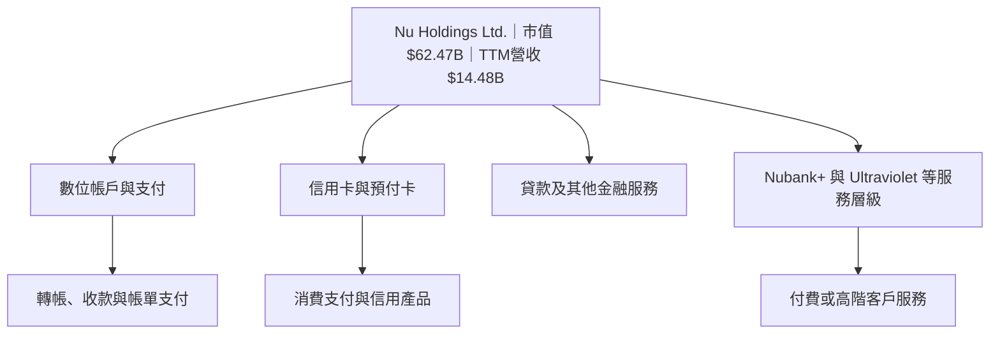
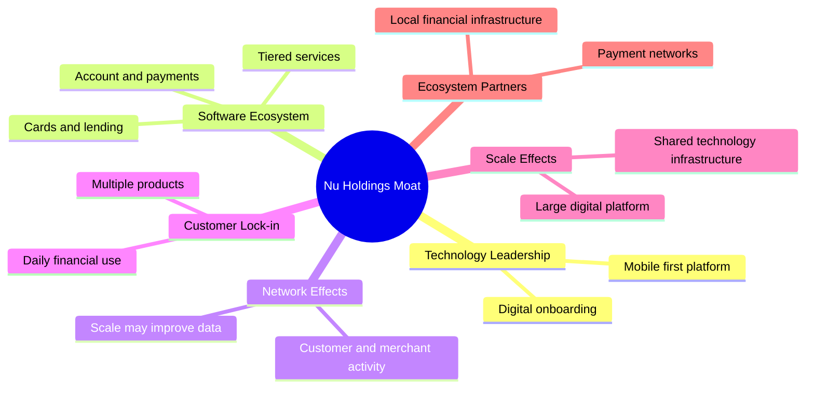
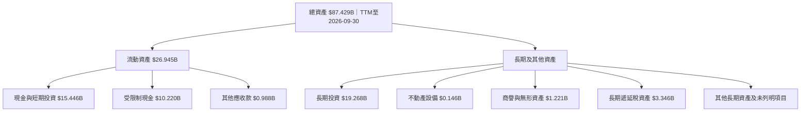
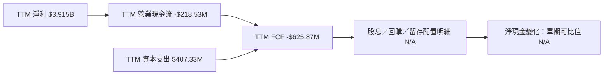
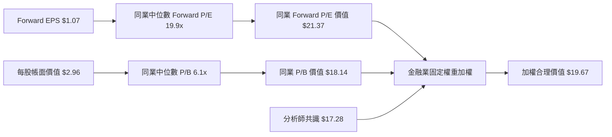
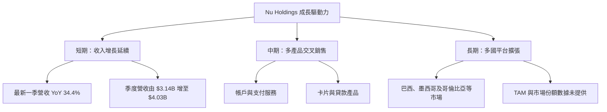
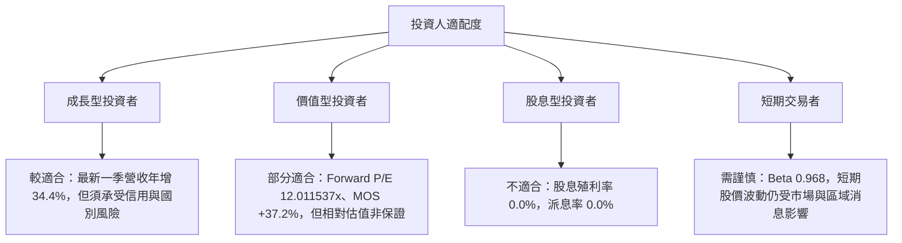

# NU 基本面深度分析報告
> **報告日期**：2026-11-28 ｜ **語言**：繁體中文 ｜ **數據來源**：Yahoo Finance、Finviz、StockAnalysis、Roic.ai ｜ **分析師**：CFA 級機構研究

> **資料口徑提醒**：部分來源對 NU 的營收、股數及現金流口徑不一致。本報告對「TTM 營收、TTM 營業利益率、TTM 自由現金流、WACC、同業倍數與品質指標」優先採用程式計算並交叉標示的數值；年度及季度趨勢則標明採用的報表來源。缺少的項目不以推算方式補齊。

## 目錄

| # | 章節 | 核心結論 |
|---|------|----------|
| 1 | 執行摘要 | 買入；加權合理價值 $19.67；MOS +37.2% |
| 2 | 公司概覽與商業模式 | 數位金融平台具規模及交叉銷售潛力，市場份額數據未提供 |
| 3 | 損益表深度分析 | 最新一季營收年增 34.4%；季度營收逐季增加，TTM 營業利益率 N/A |
| 4 | 資產負債表分析 | 淨現金 $9.32B；金融機構資產負債表不宜套用一般流動比率 |
| 5 | 現金流量深度分析 | TTM FCF -$625.87M；對銀行而言營業現金流受放款與資金流動影響 |
| 6 | 獲利能力與資本效率 | ROIC 不適用／缺資料；ROTCE 29.8%，WACC 13.91% |
| 7 | 相對估值分析 | 公司報價倍數低於同業部分倍數，但不同金融業態使比較需審慎 |
| 8 | DCF 內在價值評估 | DCF N/A；採金融業相對估值三角驗證，加權合理價值 $19.67 |
| 9 | 成長催化劑 | 最新一季營收年增 34.4%；TAM 與市場份額數據未提供 |
| 10 | 風險矩陣 | 信用品質、監管／國別及現金流口徑為主要風險 |
| 11 | 投資建議 | 買入；現價 $12.36，估值區間及監控門檻詳見本章 |

## 1. 執行摘要

### 1.0 一頁式投資儀表板（Portfolio Manager 30 秒速讀）

| 項目 | 內容 |
|------|------|
| **投資論點（3 句）** | ① 最新一季營收年增 **34.4%**，顯示平台仍在擴張。② TTM 淨現金 **$9.32B**，提供資產負債表緩衝，但銀行資產中受限制現金與金融資產不可完全視為可自由運用現金。③ TTM FCF **-$625.87M**、FCF Yield **-1.00%**，現金流轉換需持續驗證，不能僅以淨利增長推論股東現金回報。 |
| **綜合評分** | **7.4/10**（引用 1.1 六項算術平均） |
| **財務健康** | 🟢 淨現金 **$9.32B**；但逾放、淨沖銷及 CET1 數據未提供，銀行資產品質仍需補充資料 |
| **ROIC vs WACC** | ROIC **N/A**；WACC **13.91%**。金融業較適合看 ROTCE；其 **29.8%** 高於 WACC，但兩者定義不同，不能直接當作 ROIC 利差 |
| **FCF 趨勢** | TTM FCF **-$625.87M**，FCF Yield **-1.00%**；年度現金流表曾呈正 FCF，與最新 TTM 口徑有反轉，需查因 |
| **估值** | Forward P/E **12.011537x** ｜ EV/EBITDA **N/A** ｜ FCF Yield **-1.00%** |
| **DCF 內在價值（基準）** | **N/A**；銀行現金流是資金來源與放款活動的一部分，DCF 不適用，故無 DCF 折溢價 |
| **安全邊際（MOS）** | **+37.2%**＝($19.67 − $12.36) ÷ $19.67；基準為 8.8 加權合理價值。🟢 >25% 充足 |
| **預期報酬（基準情境 12M）** | DCF 情境 N/A；以加權合理價值作相對估值參考，上行空間 **+59.1%**，並非保證報酬 |
| **關鍵風險（前二）** | 🔴 信貸損失、逾放及資本充足率資料缺漏；🟡 最新 TTM FCF 為負且現金流口徑波動 |
| **評級 + 信心度** | 🟢 **買入** ｜ 信心：中 |

### 1.1 綜合評分卡（全報告唯一）

| 維度 | 評分（1–10） | 主要依據（引用數字與其來源章節） |
|------|--------------|----------------------------------|
| 成長性 | 8.0 | 最新一季營收年增 **34.4%**；年度營收 FY2025 **$10.63B**，FY2024 **$8.27B**（第 3 章） |
| 獲利能力 | 7.5 | 最新一季營業利益率 **50.9%**；TTM ROTCE **29.8%**，但 ROIC 為 N/A、TTM 營業利益率為 N/A（第 3、6 章） |
| 財務健康 | 7.0 | 淨現金 **$9.32B**；逾放、淨沖銷及 CET1 未提供，限制資產品質評估（第 4、6 章） |
| 估值 | 8.0 | 加權合理價值 **$19.67**、MOS **+37.2%**；DCF 不適用且同業業態差異大（第 7、8 章） |
| 護城河 | 8.0 | 數位帳戶、支付、信用卡及貸款產品形成平台交叉銷售；但未提供客戶數、留存率與市場份額可核實數據（第 2 章） |
| 管理層與資本配置 | 6.0 | FY2025 SBC **$271.85M**；無股息資料顯示殖利率 **0.0%**，回購與資本配置細節未提供（第 3、5 章） |
| **綜合評分** | **7.4** | 六項算術平均：(**8.0 + 7.5 + 7.0 + 8.0 + 8.0 + 6.0**) ÷ 6 = **7.4** |

### 1.2 五大投資論點 + 三大核心風險

| 類型 | 項目 | 具體依據 | 信心度 |
|------|------|----------|--------|
| 🟢 **投資論點①** | 高速營收擴張 | 最新一季營收年增 **34.4%**；FY2025 營收 **$10.63B**，較 FY2024 **$8.27B**增加 | 🟢 高 |
| 🟢 **投資論點②** | 獲利能力具規模效應 | 最新一季營業利益率 **50.9%**；TTM ROTCE **29.8%**，顯示股東帳面資本報酬較高 | 🟢 中 |
| 🟢 **投資論點③** | 淨現金提供緩衝 | 現金及短期投資 **$15.45B**，總債務 **$6.12B**，淨現金 **$9.32B** | 🟢 中 |
| 🟢 **投資論點④** | 相對估值有折價空間 | 加權合理價值 **$19.67** 對比 2026-11-25 收盤 **$12.36**，上行空間 **+59.1%** | 🟡 中 |
| 🟡 **投資論點⑤** | 多產品平台有交叉銷售可能 | 公司業務包含帳戶、支付、信用卡及借貸產品；分部收入和滲透率未提供，故無法量化貢獻 | 🟡 中 |
| 🟡 **風險①** | 信貸品質與資本資料不完整 | 淨沖銷率、逾放比及 CET1 均 N/A，無法直接衡量信用週期下的損失承受力 | 🟡 中 |
| 🔴 **風險②** | TTM 現金流轉負 | TTM OCF **-$218.53M**、Capex **$407.33M**、FCF **-$625.87M**；需辨別放款擴張與基本獲利現金化 | 🔴 高衝擊 |
| 🟡 **風險③** | 數據口徑及股數資料不一致 | Yahoo／StockAnalysis 對收入與部分期間數值不同；財務建模和每股估值應以一致申報口徑重新核對 | 🟡 中 |

### 1.3 快速統計卡片

| 指標 | 公司實際值（期間） | 同業中位數 | 狀態 |
|------|--------------------|------------|------|
| 營收成長（TTM） | **N/A** | — | 🟡 |
| 營收成長（最新一季年增） | **34.4%** | **43.9%** | 🟡 |
| 毛利率（TTM） | **0.0%（合併來源欄位；不適合直接解讀為一般企業毛利）** | **84.2%** | 🔴 |
| 營業利益率（TTM） | **N/A** | — | 🟡 |
| ROIC（TTM） | **N/A** | — | 🟡 |
| Forward P/E | **12.011537x** | **19.9x** | 🟢 |
| FCF Yield（TTM） | **-1.00%** | — | 🔴 |
| Piotroski F-Score | **N/A（不適用於放款機構）** | — | 🟡 |

### 1.4 投資結論

```text
╔══════════════════════════════════════════════════════════════════╗
║                    📊 投資結論摘要                               ║
╠══════════════════════════════════════════════════════════════════╣
║  評級：買入（依 8.8 加權合理價值 MOS +37.2%，符合規則 20）       ║
║  價格（2026-11-25 收盤）：$12.36                                 ║
║  DCF 內在價值（基準）：N/A（金融業現金流不適用一般 DCF）         ║
║  安全邊際 MOS：+37.2%（＝($19.67−$12.36)÷$19.67）               ║
║  加權合理價值（8.8）：$19.67                                     ║
║  綜合評分：7.4/10（引用 1.1）                                    ║
║  適合投資人：能承受新興市場、金融監管與信用週期波動的成長型投資人║
╚══════════════════════════════════════════════════════════════════╝
```

## 2. 公司概覽與商業模式

### 2.1 業務結構與收入來源

Nu Holdings Ltd. 在巴西、墨西哥、哥倫比亞、開曼群島及美國提供數位金融服務。業務描述包括 NuAccount、信用卡與預付卡、支付及貸款等。各產品線營收金額與占比未提供，因此不繪製分部占比圖，也不將總營收拆分成未經證實的份額。



上述 TTM 營收 **$14.48B** 與其他來源列示的 TTM 營收 **$9.10B** 不一致；本報告依指定口徑引用 $14.48B，並將差異視為資料核對風險，不自行混用。

### 2.2 市場份額

市場份額數據未提供，無法以可引用的國家別或產品別份額量化 NU 的競爭位置。可確認的營運規模指標是 TTM 營收 **$14.48B**、最新一季營收年增 **34.4%**；同業 SOFI、MELI、HOOD 最新一季營收年增率分別為 **43.9%、45.1%、11.8%**，NU 的增速高於 HOOD、低於 SOFI 與 MELI。

### 2.3 競爭護城河分析



此圖呈現商業模式的可能護城河來源，不代表已由客戶留存、獲客成本或交易量資料證實。

### 2.4 護城河強度

| 護城河項目 | 強度（強／中／弱） | 證據（引用數字或事實） | 會削弱它的情況 |
|------------|--------------------|------------------------|----------------|
| 技術與數位服務 | 中 | 多國提供數位銀行平台；具帳戶、支付、卡片與借貸產品 | 系統故障、資安事件或競爭者複製體驗 |
| 軟體生態系統 | 中 | 多產品組合及 Nubank+、Ultraviolet 等服務層級 | 交叉銷售率、留存與單客收入下降 |
| 網路效應 | 中 | 客戶活動可能改善數據與產品匹配；可量化活躍客戶及交易資料未提供 | 新客獲取成本上升，客戶活躍度下降 |
| 客戶鎖定 | 中 | 帳戶、支付、卡片與借貸集中於單一平台的可能性 | 客戶多平台使用或帳戶轉移成本低 |
| 規模效應 | 中 | TTM 營收 **$14.48B**；最新一季營收年增 **34.4%** | 信貸成本上升侵蝕規模帶來的效率收益 |
| 生態夥伴 | 弱至中 | 跨國金融服務需要支付及金融基礎設施合作；合作收入占比未提供 | 夥伴費率、監管或基礎設施依賴改變 |

**1.1「護城河」評分 8.0/10**：產品橫跨帳戶、支付、卡片及貸款且營收規模已達十億美元級，但缺少客戶留存、活躍度、獲客成本與市場份額數據，限制了對護城河持久性的驗證。

## 3. 損益表深度分析

### 3.1 年度收入成長趨勢（近4年）

以下採 Yahoo 年度損益表的 FY2022–FY2025 收入。YoY 由相鄰年度營收計算；年度報表序列與 TTM 財務摘要存在口徑差異。

```text
╔══════════════════════════════════════════════════════════════════╗
║              Nu Holdings 年度收入趨勢（FY2022-FY2025）           ║
╠══════════════════════════════════════════════════════════════════╣
║ FY2022  $2.97B   ██████░░░░░░░░░░░░░░░░░░  基期                ║
║ FY2023  $5.63B   █████████████░░░░░░░░░░░  YoY +89.6%  🟢      ║
║ FY2024  $8.27B   ███████████████████░░░░░  YoY +46.9%  🟢      ║
║ FY2025  $10.63B  ████████████████████████  YoY +28.5%  🟢      ║
╠══════════════════════════════════════════════════════════════════╣
║ FY2022-FY2025 CAGR = (10.63 ÷ 2.97)^(1/3) − 1 = 約 53.0%        ║
╚══════════════════════════════════════════════════════════════════╝
```

年度增速自 FY2023 的 **89.6%** 降至 FY2025 的 **28.5%**，符合高基期下增速回落的形態；絕對營收仍增加。金融平台成長可能來自客戶擴張、交易與信用產品滲透，但產品別收入與客戶數未提供，不能將增長歸因於某一特定產品。

### 3.2 季度收入趨勢分析

下表季度金額採 Yahoo quarterly statements；最新一季單季 YoY 增長則採可核對的最新一季數據。由於其他來源的季度收入值有差異，QoQ 計算只在此表內沿用同一序列。

| 季度 | 營收 | QoQ | YoY | 備註 |
|------|------:|----:|----:|------|
| 2025 Q4 | $3.14B | — | N/A | 比較基期 |
| 2026 Q1 | $3.54B | **+12.7%** | N/A | QoQ = 3.54 ÷ 3.14 − 1 |
| 2026 Q2 | $3.77B | **+6.5%** | N/A | QoQ = 3.77 ÷ 3.54 − 1 |
| 2026 Q3 | $4.03B | **+6.9%** | **+34.4%** | 最新一季年增率為單季 YoY，不是 TTM |

季度營收逐季上升，但 QoQ 成長由 Q1 的 **12.7%** 降至 Q2 的 **6.5%**、Q3 的 **6.9%**，顯示增長仍延續但短期速度較 Q1 平緩。最新一季 **34.4%** 的 YoY 仍是較高增速，若信用損失與獲客成本可控，平台擴張可能繼續推升收入。

### 3.3 利潤率演變分析

| 利潤率指標 | FY2022 | FY2023 | FY2024 | FY2025／最新 | 趨勢 | 評估 |
|------------|--------|--------|--------|---------------|------|------|
| 毛利率 | N/A | N/A | N/A | TTM **0.0%**（合併來源欄位） | 口徑不適合直接作一般企業毛利率 | 🔴 |
| 營業利益率 | N/A | N/A | N/A | TTM **N/A**；最新一季 **50.9%** | 無法建立可比年度序列 | 🟡 |
| 淨利率 | 年度淨利/收入口徑可計算，但與 TTM 摘要不一致 | 同左 | 同左 | TTM 摘要列 **43.0%** | 來源序列不一致 | 🟡 |

財務服務公司的利息收入、資金成本與信用損失不宜以工業企業的「毛利率」概念直接解讀。最新一季營業利益率 **50.9%** 反映該季報表口徑下的營業槓桿，但缺少同一口徑的歷史 TTM 利潤率，無法確定改善幅度或持續性。銀行獲利更應同步觀察淨利息收入、信用成本及效率比率；目前只有代理指標，且成本收入比代理值包含信用提列。

### 3.4 費用結構分析

產品成本、信用提列、營運費用及稅費的 TTM 金額明細未提供，無法繪製有數字依據的費用結構圓餅圖。可用的代理指標是成本收入比 **68.1%**，但此數值由「營收 − 稅前淨利」除以營收計算，包含信用提列，高於公司自行公布的營運效率比率的可能性較大，不宜視為純行政費用率。

### 3.5 季度 EPS 趨勢與盈餘品質（Quality of Earnings）

| 盈餘品質項目 | 數值／佔比 | 評估 |
|--------------|-----------|------|
| 股權薪酬 SBC / 營收 | 近四季 SBC 合計 **$394.13M** ÷ TTM 營收 **$14.48B** = **約 2.72%** | 🟡 SBC 是實質股東成本；佔比不低，會透過稀釋降低每股盈餘 |
| SBC / 營業現金流 | **$394.13M ÷ -$218.53M = -180.4%** | 🔴 分母為負，比例不宜作正向效率比較；SBC 金額大於 TTM OCF 絕對值 |
| FCF / 淨利（現金轉換率） | **-$625.87M ÷ $3.915B ≈ -16.0%** | 🔴 以 TTM 淨利口徑計算，現金流轉換為負；放款機構的 OCF 受貸款增長影響，需搭配資產負債表理解 |
| 一次性／非經常性損益 | N/A | 缺少逐項調節與一次性項目明細，不能判定有無盈餘美化 |
| 有效稅率異常 | **25.8%**（最新年度有效稅率） | 🟢 未顯示極端異常，但缺少各季稅務調節明細 |
| 資本化支出 vs 費用化 | TTM Capex **$407.33M**；資本化政策明細 N/A | N/A 無法判斷費用遞延程度 |

Earnings history 的 2026 Q3、Q2、Q1 及 2025 Q4 EPS 預估值與實際值均為 NaN，**四季超預期／不及預期狀況無法判定**。StockAnalysis 季度 EPS 序列提供數值，但不能代替分析師共識預估。總體而言，會計淨利看起來可觀，但 TTM FCF 為負、SBC 持續發生，獲利現金含量需要審慎折價；對估值應更依賴 ROTCE、每股淨值及同業估值，而非單靠會計淨利。

## 4. 資產負債表分析

### 4.1 資產結構分解

以下為 StockAnalysis 最新 TTM 資產表列示數字，單位美元；分類明細並未完整涵蓋總資產，不作百分比圓餅圖。



### 4.2 流動性與營運資金分析

| 指標 | 最新值 | 歷史值 | 評估 |
|------|--------|--------|------|
| 現金及短期投資 | **$15.45B** | FY2025 年末 **$16.332B**（另一來源口徑） | 🟢 規模大；但部分資金可能受監管或營運用途限制 |
| 總債務 | **$6.12B** | FY2025 年末 **$1.90B**（來源／期間不同） | 🟡 負債數字差異需核對資產負債表定義 |
| 淨現金 | **$9.32B** | N/A | 🟢 有緩衝，但不等於一般企業可自由分配的淨現金 |
| Current ratio／Quick ratio | N/A | N/A | 金融業分類不宜用一般企業流動比率；未提供可比值 |

金融業營運資金週轉指標不適用（金融業）；QUALITY FIGURES 未提供 DSO、DIO、DPO 或 CCC，亦不應套用工業企業營運資金分析。

### 4.3 債務結構分析

```text
╔══════════════════════════════════════════════════════════════════╗
║                 Nu Holdings 債務健康診斷                         ║
╠══════════════════════════════════════════════════════════════════╣
║  總債務：        $6.12B       🟡 金融機構負債需看資金用途         ║
║  現金+短期投資： $15.45B      🟢 高於總債務                       ║
║  淨現金：        $9.32B       🟢 正淨現金                         ║
║  Debt/EBITDA：   N/A          未提供可用 EBITDA                   ║
║  Interest coverage：N/A       利息保障倍數資料未提供              ║
║  Debt/Equity：   N/A          未提供                              ║
╚══════════════════════════════════════════════════════════════════╝
```

此處總債務與現金為金融資料摘要的 TTM 數字。銀行的存款與其他融資負債是營運資金來源，單純以「現金減總債務」不能替代資本適足率、流動性覆蓋率或資產品質分析；上述審慎性指標未提供。

### 4.4 股東權益趨勢

| 財年 | 股東權益 | YoY 變化 |
|------|---------:|---------:|
| 2022 | $4.89B | — |
| 2023 | $6.41B | **+31.1%** |
| 2024 | $7.65B | **+19.3%** |
| 2025 | $11.29B | **+47.6%** |

```text
╔══════════════════════════════════════════════════════════════════╗
║                 股東權益趨勢（年度報表）                         ║
╠══════════════════════════════════════════════════════════════════╣
║ FY2022  $4.89B   ██████████░░░░░░░░░░░░                         ║
║ FY2023  $6.41B   █████████████░░░░░░░░░                         ║
║ FY2024  $7.65B   ████████████████░░░░░░                         ║
║ FY2025  $11.29B  ████████████████████████                       ║
╚══════════════════════════════════════════════════════════════════╝
```

權益擴張有助支撐放款與資產增長；但股權薪酬及新增股數會影響每股價值，且不同資料源股數差異明顯，不宜只以總權益增長判斷每股資本累積。

## 5. 現金流量深度分析

### 5.1 現金流量瀑布圖

以下使用指定 TTM FCF 定義：營業現金流減資本支出。對放款機構，營業現金流可能因貸款資產擴張而顯著波動，並非一般企業自由現金流的完全等價物。



### 5.2 FCF 轉換率趨勢

| 期間 | FCF | 淨利 | FCF／淨利 | 解讀 |
|------|----:|----:|----------:|------|
| FY2022 | $0.641B | -$0.365B | 比率不具解讀性 | 淨利為負，分母符號使比率失真 |
| FY2023 | $1.09B | $1.03B | 約 **105.8%** | 年度現金流高於淨利 |
| FY2024 | $2.22B | $1.97B | 約 **112.7%** | 年度現金轉換良好 |
| FY2025 | $3.16B | $2.87B | 約 **110.1%** | 年度口徑仍為正向 |
| TTM 至 2026-09-30 | **-$625.87M** | $3.915B | 約 **-16.0%** | 最新 TTM 轉負，與歷史年度值形成反差 |

金融機構的貸款增長可能使營運現金流出現負值，故 TTM 轉負不必然等於核心獲利惡化；但仍需用放款增長、存款流入、貸款損失準備及逾放率解釋。相關信用指標目前未提供。

### 5.3 自由現金流趨勢

```text
╔══════════════════════════════════════════════════════════════════╗
║                 自由現金流趨勢                                  ║
╠══════════════════════════════════════════════════════════════════╣
║ FY2022  $0.641B  █████░░░░░░░░░░░░░░░                           ║
║ FY2023  $1.09B   ███████░░░░░░░░░░░░░                           ║
║ FY2024  $2.22B   ██████████████░░░░░                           ║
║ FY2025  $3.16B   ████████████████████                           ║
║ TTM     -$0.626B ← 最新 TTM 轉負；FCF Yield -1.00%              ║
╚══════════════════════════════════════════════════════════════════╝
```

FY2022–FY2025 的年度 FCF 趨勢向上，但最新 TTM FCF 為 **-$625.87M**。兩者可能受財報期間、金融活動現金流及資料來源差異影響；投資判斷應以最新 TTM 指標警示為準，直到公司提供可核對的放款與存款現金流調節。

### 5.4 資本配置評估

公司股息殖利率 **0.0%**、派息率 **0.0%**；FY2025 資本支出列示 **$340.77M**（現金流表以負數呈現）、SBC **$271.85M**。股權回購、投資支出與留存現金的完整金額分配未提供，因此不繪製資本配置圓餅圖。就股東回報而言，現階段回報主要依賴每股獲利與估值變化，而非現金股息。

## 6. 獲利能力與資本效率

### 6.1 ROE / ROA / ROIC 趨勢

| 指標 | 最新資料 | 歷史趨勢 | 評估 |
|------|---------|----------|------|
| ROE | TTM **31.5%** | 年度可比序列未提供 | 🟢 高報酬，但須注意股東權益與股數口徑 |
| ROA | TTM **5.0%** | 年度可比序列未提供 | 🟢 對金融機構有參考性，但需結合信用風險 |
| ROIC | **N/A** | N/A | 金融機構負債與資本投入定義不同，且可用輸入資料不足 |
| ROTCE | TTM **29.8%** | N/A | 較適合觀察有形股東資本回報 |
| 行業均值 | N/A | N/A | 未提供可引用同口徑資料，不作比較 |

### 6.2 ROIC vs WACC 分析（核心價值創造判斷）

金融機構的存款與借款通常是核心營運資金來源，傳統 ROIC（NOPAT／投入資本）與工業企業定義不適用；本報告不虛構 ROIC，也不以 ROTCE 直接替代 ROIC。以下列示程式提供的 WACC 及其成分，並將 ROTCE 作為另一項股東報酬參考。

```text
╔══════════════════════════════════════════════════════════════════╗
║                ROIC vs WACC 深度分析                             ║
╠══════════════════════════════════════════════════════════════════╣
║  ROIC：N/A（放款機構的融資負債屬營運結構，且輸入資料不足）       ║
║                                                                  ║
║  WACC 資料（照錄資本成本估算）：                                 ║
║  ├── 無風險利率（10Y 美債）：4.94%                               ║
║  ├── ERP：5.00%                                                  ║
║  ├── 原始 Beta：0.97；調整後 Beta：0.98                         ║
║  ├── 股權成本 Ke：9.83%                                         ║
║  ├── 稅前債務成本：74.76%                                        ║
║  ├── 有效稅率：25.8%                                            ║
║  ├── 股權／債務權重：91.1%／8.9%                                ║
║  └── WACC：13.91%                                               ║
║                                                                  ║
║  股東資本回報參考：ROTCE 29.8%                                  ║
║  ROTCE 高於 WACC，但兩者定義不同，不能推導為 ROIC−WACC 或 EVA。  ║
╚══════════════════════════════════════════════════════════════════╝
```

債務成本 **74.76%** 顯著偏高，對金融機構可能受利息／債務口徑、短期融資或資料抓取影響，不宜自行改算成另一個 WACC；估值章節依規定使用提供的 **13.91%**。整體而言，ROTCE 顯示股東帳面資本報酬具吸引力，但要判斷是否持續創造經濟價值，仍需確認信用損失、資本成本與報表口徑。

### 6.3 杜邦三因素分解

| 因素 | 數值（TTM） | 解讀 |
|------|-------------|------|
| 淨利率 | N/A | QUALITY FIGURES：缺少完成杜邦計算所需資料 |
| 資產週轉率 | N/A | 同上 |
| 權益乘數 | N/A | 同上 |
| **ROE** | **N/A（杜邦分解）** | QUALITY FIGURES 明確列示 N/A；不可自行補算 |

雖然其他來源列有 ROE **31.5%**，但品質指標所需淨利、收入、總資產或正權益組合不完整，故此處不以不同來源拼接杜邦分解。

### 6.4 財務體質：金融業放款指標

Piotroski F-Score **N/A**：其現金流測試會把放款增長造成的營運現金流出誤判為財務弱化，不適合放款機構。應改用以下放款業指標：

| 指標 | 數值 | 解讀 |
|------|------|------|
| 淨利息收入 NII／總營收 | **84.7%** | 收入以利息相關業務為主；利率及信用成本對盈餘影響重要 |
| 淨利差代理值 | **15.74%** | NII／平均總資產；因未提供生息資產，通常高於正式 NIM，不可當作公司公布 NIM |
| 成本收入比代理值 | **68.1%** | 含信用提列，通常高於正式效率比率；不是純營運費用率 |
| ROTCE | **29.8%** | 淨利／有形帳面價值；反映有形股東資本報酬 |
| P/TBV | **4.76x** | 市場對有形帳面價值有較高溢價，須靠高回報與成長支撐 |
| 放款淨額／總資產 | **14.0%** | 反映資產配置的一項比例；不能替代放款帳齡及信用品質 |
| 淨沖銷率 | **N/A（數據未提供）** | 無法量化已實現信用損失 |
| 逾放比 | **N/A（數據未提供）** | 無法評估貸款拖欠狀況 |
| CET1 | **N/A（數據未提供）** | 無法核實監管資本緩衝 |

## 7. 相對估值分析

### 7.1 同業估值比較表格

本公司倍數採市場資料欄位；同業倍數採 Yahoo 同業數據。金融科技平台與純數位銀行業務組合不同，應將倍數差異視作相對定價線索，而非直接判定高低估。

| 估值指標 | **NU** | **SOFI** | **MELI** | **HOOD** | 本公司評估 |
|----------|------:|--------:|--------:|-------:|-----------|
| **Trailing P/E** | **16.137499x** | 24.3x | 41.1x | 31.3x | 🟢 低於三家同業 |
| **Forward P/E** | **12.011537x** | 14.9x | 28.9x | 19.9x | 🟢 低於同業；需確認 EPS 口徑與增長可持續性 |
| **P/S Ratio** | **6.8622065x** | 3.7x | 2.0x | 12.0x | 🟡 高於 SOFI、MELI，低於 HOOD |
| **EV/EBITDA** | N/A | N/A | 21.9x | N/A | 🟡 可比較樣本不足 |
| **最新一季營收 YoY** | **34.4%** | 43.9% | 45.1% | 11.8% | 🟡 高於 HOOD、低於 SOFI 與 MELI |
| **毛利率 TTM** | **0.0%（欄位口徑不適用）** | 84.2% | 46.7% | 91.0% | 🔴 不宜作直接比較 |

本公司市值 **$62.47B**、EV **$53.15B**，但市場資料的 P/S **6.8622065x** 與以 TTM 營收 **$14.48B**計算的比率並不一致，可能來自收入或市值口徑差異；故表格照錄既有倍數，估值推論以 8.8 程式指定方法為準。

### 7.2 歷史估值區間分析

N/A（數據未提供：缺少「Valuation vs own history」估值區間、分位數及歷史 P/E 範圍，不能自行估計百分位。）

### 7.3 情境價值（Bear / Base / Bull）

N/A（DCF 無法計算：Nu 為放款機構，放款與存款現金流屬融資及營運活動，DCF MODEL 未提供可用模型；依規則不自行建立情境目標價。）

### 7.4 相對估值隱含價格區間

```text
╔══════════════════════════════════════════════════════════════════╗
║               相對估值隱含價格與現價位置                         ║
╠══════════════════════════════════════════════════════════════════╣
║ 同業 Forward P/E     $21.37  ───────────────────────┐            ║
║ 同業 P/B             $18.14  ────────────────┐      │            ║
║ 分析師共識目標價     $17.28  ─────────────┐  │      │            ║
║ 現價（2026-11-25）   $12.36  ───────●─────┴──┴──────┴────────    ║
╚══════════════════════════════════════════════════════════════════╝
```

- **同業 Forward P/E：$21.37**＝同業中位數 **19.9x** × Forward EPS **$1.07**。
- **同業 P/B：$18.14**＝同業中位數 **6.1x** × 每股帳面價值 **$2.96**。
- **分析師共識目標價：$17.28**＝23 位分析師平均目標價。
- 三種估值都高於現價 **$12.36**，但共識目標價和同業倍數都有模型與樣本差異，不應視為保證達成的價格。

## 8. DCF 內在價值評估（Discounted Cash Flow）

### 8.0 估值推理鏈（Thinking Logic）

**Step 1 — 價值由哪些變數決定？**  
NU 的合理價值主要取決於放款及支付平台的獲利能力、信用損失與資本需求，以及股東帳面價值的成長；產品別營收占比未提供，無法將總收入拆成主業與新業務比重。對金融機構，貸款與存款現金流本身是營運及融資活動，企業自由現金流 DCF 不具可靠可比性。

**Step 2 — 模型選擇**

| 決策點 | 本報告採用 | 理由（含數字） | 曾考慮但否決 | 否決理由 |
|--------|-----------|----------------|--------------|----------|
| 現金流定義 | 不採 FCFF／FCFE DCF | TTM OCF **-$218.53M**、Capex **$407.33M**；放款現金流屬金融營運 | FCFF DCF | DCF MODEL 明確 N/A，無法把貸款資金流當一般企業 FCF |
| 預測期 N | N/A | 金融機構 DCF 模型未提供 | 5–10 年自行預測 | 缺少分部、信用成本及資本需求假設 |
| 終值方法 | N/A | 無有效 DCF 現金流基礎 | Gordon Growth／退出倍數 | 會形成不可稽核的自行建模 |
| EBIT 基礎 | N/A | 財務業以淨利息收入、信用提列及資本適足性分析為主 | GAAP EBIT DCF | 缺少完整、同口徑年度 EBIT 序列 |

**Step 3 — 關鍵輸入推導鏈**  
營收 CAGR、期末營業利潤率、永續成長率、預測期、Capex 比率、ΔWC、稀釋率與終值均不設自建假設值；原因是 DCF MODEL 為 N/A，且資料不足以支持可稽核的逐年預測。估值改用第 7 章及 8.8 的金融業相對估值方法。

**Step 4 — 最脆弱環節**  
最脆弱的投資判斷不是終值假設，而是缺少淨沖銷率、逾放比與 CET1；若實際信用損失高於市場預期，淨利、ROTCE 及同業估值都可能下修。

**Step 5 — 計算路徑圖**  
由於模型不適用，不將貸款資金流錯誤地轉成一般企業 FCFF；估值路徑採相對倍數與分析師共識：



### 8.1 模型假設總表（Model Inputs）

| 假設項目 | 採用值 | 依據／來源 | 敏感度 |
|----------|--------|-------------|--------|
| 預測期長度 N | N/A | DCF MODEL 為 N/A | N/A |
| 營收 CAGR（預測期） | N/A | 未建立 DCF 預測，避免自行編造假設 | N/A |
| 營業利潤率（期末） | N/A | TTM 營業利益率 N/A，只有最新一季 50.9% | N/A |
| 有效稅率 | 25.8%（資本成本資料的最新年度有效稅率） | 可引用作成本資本背景，但 DCF 未使用 | N/A |
| Capex／營收 | N/A | 不建 DCF；TTM Capex 為 $407.33M | N/A |
| D&A／營收 | N/A | DCF 未提供 | N/A |
| 營運資金變動／營收增額 | N/A | 金融業營運資金口徑不適用一般公司 DCF | N/A |
| EBIT 基礎 | N/A | 不建立 DCF | N/A |
| SBC 處理 | N/A | 不建立 DCF | N/A |
| 年稀釋率 | N/A | 股數資料來源存在差異，不納入自建模型 | N/A |
| 永續成長率 g | N/A | 無 DCF 模型 | N/A |
| 終值方法 | N/A | 無 DCF 模型 | N/A |
| WACC | **13.91%** | 資本成本資料；第 6.2 節亦採同一值 | 僅作成本資本參考 |

DCF 模型為 N/A，故 8.3–8.7 不提供逐年 FCF、終值、企業價值橋接、敏感度矩陣或反推 DCF；不以自行假設數字填補。

### 8.2 折現率推導（WACC）

```text
╔══════════════════════════════════════════════════════════════════╗
║                    WACC 推導（折現率）                           ║
╠══════════════════════════════════════════════════════════════════╣
║  股權成本 Ke（資料所列 CAPM）：                                  ║
║  ├── 無風險利率 Rf：4.94%                                       ║
║  ├── 市場風險溢酬 ERP：5.00%                                     ║
║  ├── 原始 Beta：0.97                                            ║
║  ├── 調整後 Beta：0.98 = ⅔ × 0.97 + ⅓ × 1.00                   ║
║  └── 資料所列股權成本 Ke：9.83%                                 ║
║                                                                  ║
║  債務成本與資本結構（照錄）：                                    ║
║  ├── 稅前債務成本：74.76%                                       ║
║  ├── 有效稅率：25.8%                                            ║
║  ├── 股權／債務權重：91.1%／8.9%                                ║
║  └── WACC：13.91%                                               ║
╚══════════════════════════════════════════════════════════════════╝
```

**重要限制**：資料來源未提供 Rf 的具體觀察日期、ERP 的估計依據、計息負債明細與利息費用分母，也未提供市值及債務權重的完整重算底稿；因此依規則直接採用資本成本區塊的 **WACC 13.91%**，不另建 WACC。資料列示 Ke **9.83%**；以已四捨五入的 4.94%、0.98、5.00% 直接重算會有微小尾差，故不取代原值。此 WACC 與第 6.2 節相同。

### 8.3 逐年自由現金流預測（基準情境）

N/A（DCF MODEL：金融業放款與資金現金流是融資及營運活動，不能直接視為一般企業自由現金流；模型未提供逐年預測。）

### 8.4 終值計算（Terminal Value）

N/A（無 DCF 預測期現金流、WACC—g 終值假設或終值折現值，不能計算 Gordon Growth 或退出倍數。）

### 8.5 企業價值 → 每股內在價值（Bridge）

N/A（無 DCF 企業價值可供橋接。不得以金融業現金及債務直接拼接成一般企業每股 DCF 價值。）  
此處不計算 MOS；全報告 MOS 僅採 8.8 加權合理價值為分母。

### 8.6 敏感性分析（WACC × 永續成長率）

N/A（DCF MODEL 為 N/A，未提供 WACC × g 敏感度矩陣，亦不自建矩陣。）

### 8.7 反推 DCF（Reverse DCF）

N/A（DCF MODEL 未提供反推結果；單一股價方程式在沒有明確模型與固定輸入時，無法可稽核地回推營收 CAGR、利潤率或永續成長率。）

### 8.8 估值三角驗證與安全邊際

| 估值方法 | 隱含每股價值 | 上行空間（÷現價） | 權重 | 說明 |
|----------|--------------:|-------------------:|------:|------|
| 同業 Forward P/E | **$21.37** | **+72.9%** | **50%** | 同業中位數 19.9x × Forward EPS 1.07 |
| 同業 P/B | **$18.14** | **+46.8%** | **40%** | 同業中位數 6.1x × 每股帳面價值 2.96 |
| 分析師共識目標價 | **$17.28** | **+39.8%** | **10%** | 23 位分析師平均目標價 |
| **加權合理價值** | **$19.67** | **+59.1%** | **100%** | 金融業固定權重；DCF 未列入方法 |

**逐步演算：**

- 同業 Forward P/E 貢獻：**$21.37 × 50% = $10.685**
- 同業 P/B 貢獻：**$18.14 × 40% = $7.256**
- 分析師共識貢獻：**$17.28 × 10% = $1.728**
- 權重合計：**50% + 40% + 10% = 100%**
- 加權價值：**$10.685 + $7.256 + $1.728 = $19.669 ≈ $19.67**

本公司屬金融業，權重依金融業固定方法採用；由於 DCF 不適用且 EV/EBITDA 缺資料，估值方法中沒有加入這些項目。MOS 使用加權合理價值作分母：

- **MOS**＝($19.67 − $12.36) ÷ $19.67＝**+37.2%**
- **上行空間**＝($19.67 − $12.36) ÷ $12.36＝**+59.1%**
- **折溢價**：N/A，因為沒有 DCF 基準內在價值。

```text
╔══════════════════════════════════════════════════════════════════╗
║                  估值區間與安全邊際                              ║
╠══════════════════════════════════════════════════════════════════╣
║  $17.28 ───── $18.14 ───── [$19.67] ───── $21.37                 ║
║  共識目標價     同業P/B      加權合理值      同業Forward P/E       ║
║                                                                  ║
║  現價：$12.36                                                      ║
║  MOS = ($19.67 − $12.36) ÷ $19.67 = +37.2%                       ║
║  上行空間 = ($19.67 − $12.36) ÷ $12.36 = +59.1%                  ║
║  評級：買入                                                       ║
║  參考買入區間：$11.20–$17.70（上限按 MOS 10% 門檻推算）          ║
╚══════════════════════════════════════════════════════════════════╝
```

買入區間上限的推算為 **$19.67 × (1 − 10%) = $17.703 ≈ $17.70**；下限採市場資料提供的 52 週低點 **$11.20** 作觀察區間，不代表估值保證或技術支撐。

> 🔎 **程式複算（Python，依本節各項自動重算）**
>
> 加權合理價值 = $21.37 × 50% + $18.14 × 40% + $17.28 × 10% = **$19.67**（權重合計 100%）
>
> 以價格 $12.36 計：MOS = **+37.2%**，上行空間 = **+59.1%**
>
> ✅ 與本節所寫數值一致。

### 8.9 DCF 模型的局限與失效條件

- **終值依賴度**：N/A；無 DCF 終值。
- **最脆弱的假設**：相對估值依賴同業中位數 P/E、P/B 及分析師共識。若信用週期惡化、EPS 下修或市場下調同業倍數，加權合理價值會下降。
- **模型適用性**：NU 是金融機構，現金流包含貸款與資金來源變動，DCF 可靠度不足；目前以同業 Forward P/E、P/B 和共識目標價交叉檢驗較合理。若取得更完整資料，可再檢查單位經濟性、信用損失及帳面價值回報。
- **與第 10 章風險連結**：信用損失上升會壓低 EPS 與 ROTCE，監管提高資本要求會降低可分配資本及放款增長，國別風險則可能影響收入與估值倍數。

### 8.10 複算檢核表（Audit Trail）

| # | 檢核項目 | 檢查方式 | 結果 |
|---|----------|----------|------|
| 1 | DCF 高／中敏感度假設四段式推導 | DCF MODEL 為 N/A，未建立假設 | ✅ 不適用，未自建模型 |
| 2 | 每項 DCF 假設均有來歷 | 模型輸入未填自設數值 | ✅ |
| 3 | WACC 五步算式 | 採用來源列示 WACC；底層完整債務資料未提供 | ✅ 依規則照錄，未另算 |
| 4 | Kd 分母與債務權重範圍一致 | 缺計息負債明細與利息分母 | ⚠️ 無法獨立驗證，保留原 WACC |
| 5 | WACC 與第 6.2 節同值 | 比對兩處數值 | ✅ 13.91% |
| 6 | 逐年表格年度數與 N 相符 | 無 DCF 預測期 | ✅ 不適用 |
| 7 | FY+1 九步算式可複算 | 無 FY+1 模型資料 | ✅ 不適用 |
| 8 | 預測期 PV 加總 | 無預測期 PV | ✅ 不適用 |
| 9 | WACC > g | 無 g 假設 | ✅ 不適用 |
| 10 | 終值使用 FY+N 現金流 | 無終值 | ✅ 不適用 |
| 11 | EV 至每股價值橋接 | 無 DCF EV | ✅ 不適用 |
| 12 | SBC 模型組合一致 | 無 DCF EBIT／股數模型 | ✅ 未重複扣除 |
| 13 | 敏感度基準格等於 DCF 值 | 無矩陣 | ✅ 不適用 |
| 14 | 矩陣有效格 WACC > g | 無矩陣 | ✅ 不適用 |
| 15 | 三情境機率加總 | DCF 情境 N/A | ✅ 不適用 |
| 16 | 反推 DCF 每列只放開一個變數 | 無反推模型 | ✅ 不適用 |
| 17 | MOS 分母及 DCF 折溢價基準 | MOS 使用 8.8 加權合理價值；DCF 折溢價 N/A | ✅ |
| 18 | 報告完整至第 11 章 | 章節核對 | ✅ |
| 19 | 8.8 加權價值等於方法加總 | 21.37×50% + 18.14×40% + 17.28×10% | ✅ $19.669 ≈ $19.67 |
| 20 | 評級符合 MOS 門檻 | MOS +37.2%，且 ROIC N/A；來源評級為買入 | ✅ 依程式列示評級，不升級 |

## 9. 成長催化劑

### 9.1 催化劑時間軸

市場資料未提供具日期的產品推出、監管核准或管理層財測，故不將質化推測繪成帶有具體時間點的 Gantt 圖。短期可觀察最新季度的收入與利潤延續，中期追蹤產品交叉銷售及海外市場營運，時間點須待公司公告確認。

### 9.2 TAM 市場規模分析

N/A（TAM 數據未提供：缺少可引用的市場規模、來源及年份。）Nu 的 TTM 營收列示 **$14.48B**，最新一季營收年增 **34.4%**；這些數字顯示業務仍在擴張，但不能代替 TAM 或滲透率資料。

### 9.3 成長驅動力結構圖

以下為商業模式層面的觀察方向，不代表公司已提供可量化的產品增長預測。



## 10. 風險矩陣

### 10.1 風險評分矩陣

發生機率與衝擊幅度沒有經核實的數值資料，因此不以主觀數字填入 quadrantChart。以下改以定性風險清單及可監控指標呈現。

### 10.2 風險清單詳細分析

| # | 風險項目 | 發生機率 | 財務衝擊 | 風險評估 | 緩解措施 |
|---|----------|----------|----------|----------|----------|
| 1 | 🔴 **信用品質惡化** | 無法量化；需追蹤 | 高：提高提列會壓低淨利與 ROTCE | 🔴 高衝擊 | 每季檢查逾放率、淨沖銷率、貸款損失準備及放款增長；目前相關數據 N/A |
| 2 | 🟡 **監管、資本與流動性要求變化** | 無法量化 | 高：可能限制放款、提高資本需求 | 🟡 中高 | 追蹤 CET1、監管資本、流動性與監管公告；CET1 資料目前未提供 |
| 3 | 🟡 **TTM FCF 轉負與報表口徑差異** | 已觀察到 FCF 為負 | 中至高：若非放款增長所致，可能代表現金轉換轉弱 | 🟡 中高 | 核對營業現金流、貸款資產增量與資本支出；要求跨來源一致的申報口徑 |
| 4 | 🟡 **新興市場與匯率風險** | 持續存在，機率未量化 | 中至高：匯率、利率及經濟周期可影響盈餘與估值 | 🟡 中高 | 追蹤各國收入、成本及資產負債幣別曝險；資料未提供時避免以美元單一數字掩蓋風險 |
| 5 | 🟡 **估值倍數收縮** | 無法量化 | 中：目前估值優勢可能隨同業倍數下修而減少 | 🟡 中 | 追蹤 Forward EPS、P/E、P/B 及分析師預估修正 |

## 11. 投資建議

### 11.1 最終評級與評分

依 8.8 加權合理價值 **$19.67**、2026-11-25 收盤價 **$12.36** 計算，MOS 為 **+37.2%**；來源依規則 20 列示評級為 **買入**。ROIC 不適用於本報告的金融業分析，故不以 ROTCE 取代 ROIC 判定門檻；1.1 綜合評分為 **7.4/10**，六項依序為 **8.0、7.5、7.0、8.0、8.0、6.0**。

### 11.2 合理價值與隱含報酬率

| 估值項目 | 每股價值 | 相對現價 $12.36 | 機率 |
|----------|---------:|----------------:|-----:|
| 加權合理價值 | **$19.67** | **+59.1%** | 不適用 |
| DCF 悲觀情境 | N/A | N/A | N/A |
| DCF 基準情境 | N/A | N/A | N/A |
| DCF 樂觀情境 | N/A | N/A | N/A |

DCF 情境未提供，因此不自行設定情境目標價。相對估值參考包括同業 Forward P/E **$21.37**、同業 P/B **$18.14**、分析師共識 **$17.28**；三者的權重與計算已於 8.8 列示。

### 11.3 買入時機與觸發因素

```text
╔══════════════════════════════════════════════════════════════════╗
║                  ✅ 買入觸發因素 Checklist                      ║
╠══════════════════════════════════════════════════════════════════╣
║  目前觀察條件：                                                  ║
║  ✅ 2026-11-25 收盤價 $12.36，低於加權合理價值 $19.67            ║
║  ✅ MOS +37.2%，高於買入門檻 10%                                 ║
║  ✅ 最新一季營收年增 34.4%                                        ║
║                                                                  ║
║  加碼觸發條件：                                                  ║
║  ☐ 後續季度營收年增維持 25% 以上，且信用品質未惡化               ║
║  ☐ TTM FCF 轉正，或管理層能以放款增長解釋負現金流               ║
║  ☐ 公司披露逾放率、淨沖銷率及 CET1，且未見不利趨勢              ║
║                                                                  ║
║  減碼／重新評估條件：                                            ║
║  ☐ 連續兩季營收年增低於 20%                                      ║
║  ☐ 信貸損失上升並造成 ROTCE 明顯下降                             ║
║  ☐ Forward EPS 下修，使同業估值推導價值低於現價                  ║
║  ☐ TTM FCF 持續為負，且不能由貸款資產擴張合理解釋               ║
╚══════════════════════════════════════════════════════════════════╝
```

以上成長與 FCF 門檻是投資監控條件，不是公司財測或歷史資料的替代值。

### 11.4 投資人適配度分析



### 11.5 每季財報監控清單（Quarterly Watch List）

| 指標 | 最新可用值 | 觸發加碼 | 觸發減碼／重估 |
|------|-----------|----------|----------------|
| 單季營收年增 | **34.4%** | 維持 **25% 以上**且信用指標穩定 | 連續兩季低於 **20%** |
| 單季營業利益率 | **50.9%** | 維持高位且信用提列未侵蝕獲利 | 連續兩季低於 **40%**，需核對口徑與原因 |
| TTM FCF | **-$625.87M** | 轉正，或公司披露合理的放款增長現金流解釋 | 持續為負且貸款現金流不能解釋 |
| SBC | 近四季合計 **$394.13M** | SBC／營收下降且股數稀釋可控 | SBC／營收持續高於目前約 **2.72%** |
| ROTCE | **29.8%** | 維持接近目前水準，並有資產品質數據佐證 | 明顯下滑且主要由信用損失驅動 |
| 淨沖銷率、逾放比 | **N/A** | 公司公布並維持穩定 | 指標快速惡化或不披露關鍵信用風險 |
| CET1 | **N/A** | 公布且資本緩衝充足 | 資本比率接近監管要求或快速下滑 |
| Forward EPS／目標價 | Forward EPS **$1.0748**；共識目標 $17.28 | 預估上修且估值支持 | 預估下修使合理價值接近或低於現價 |

### 11.6 反面論證：什麼會證明論點錯誤（What Would Change My Mind）

```text
╔══════════════════════════════════════════════════════════════════╗
║              ⚠️ 論點失效條件（Disconfirming Evidence）           ║
╠══════════════════════════════════════════════════════════════════╣
║  下列條件出現時，應重新檢視或退出原投資論點：                    ║
║  ☐ 單季營收年增連續兩季低於 20%                                  ║
║  ☐ 最新一季營業利益率由 50.9% 降至低於 40%，且不能由一次性因素解釋║
║  ☐ 淨沖銷率或逾放比快速上升，並帶動 ROTCE 明顯低於目前 29.8%     ║
║  ☐ TTM FCF 持續為負，且公司無法以貸款資產擴張與資金流向解釋     ║
║  ☐ Forward EPS 下修或同業倍數下修，使加權合理價值降至 $12.36 以下║
║  ☐ CET1 或其他監管資本指標顯示資本緩衝不足                      ║
║  ☐ 股權薪酬／營收持續高於目前約 2.72%，稀釋加速侵蝕每股價值      ║
╚══════════════════════════════════════════════════════════════════╝
```

> **免責聲明**：本報告為 AI 自動生成，僅供研究參考，不構成投資建議。投資有風險，入市需謹慎。

---

## 資料與來源

| 項目 | 內容 |
|------|------|
| 價格 | 12.36 USD，2026-11-25 收盤（Yahoo Finance 日線） |
| 財務報表 | Yahoo quarterly statements (no SEC filing data)，最新季度 2026-09-30（TTM = four quarters to this date） |
| 有回應的資料來源 | Yahoo Finance、Finviz、StockAnalysis、Roic.ai |
| 未回應的資料來源 | SEC 申報資料 (XBRL) |
| 由程式計算 | TTM 數字、WACC、DCF 模型、估值方法與權重、加權合理價值、MOS、評級門檻、F-Score、杜邦分解、營運資金天數、綜合評分 |
| 撰寫模型 | openai / gpt-6-luna |

> 本區塊由產生報告的程式依實際取得的資料填寫，非模型撰寫。「由程式計算」的數字不是模型的估計；其餘判斷（評分、情境、策略）是模型的分析。
