# NVDA 基本面深度分析報告
> **報告日期**：2026-11-13 ｜ **語言**：繁體中文 ｜ **數據來源**：SEC 申報資料 (XBRL)、Yahoo Finance、Finviz、StockAnalysis、Roic.ai ｜ **分析師**：CFA 級機構研究

## 目錄

| # | 章節 | 核心結論 |
|---|------|----------|
| 1 | 執行摘要 | 買入；加權合理價值約 $203.74；MOS 約 18.4% |
| 2 | 公司概覽與商業模式 | 軟硬體平台與生態系形成高轉換成本，分部營收未提供 |
| 3 | 損益表深度分析 | TTM 營收 $302.97B，TTM 成長 83.4%；最新單季 YoY 成長 105.9% |
| 4 | 資產負債表分析 | VERIFIED FIGURES 顯示淨負債 $10.92B，流動資產與現金部位充裕 |
| 5 | 現金流量深度分析 | TTM FCF $127.01B，FCF Yield 3.16% |
| 6 | 獲利能力與資本效率 | ROIC 69.1% 明顯高於 WACC 16.21% |
| 7 | 相對估值分析 | 相對同業倍數具吸引力，對自身五年估值中位數仍有溢價 |
| 8 | DCF 內在價值評估 | 基準 DCF 約 $121.09；加權價值與 DCF 分開呈現 |
| 9 | 成長催化劑 | AI 加速運算、網路與軟體生態是主要成長來源 |
| 10 | 風險矩陣 | 需求正常化、競爭替代與管理層交接為主要風險 |
| 11 | 投資建議 | 買入；基準 12 個月目標約 $203.74，需依營運里程碑追蹤 |

---

## 1. 執行摘要

### 1.0 一頁式投資儀表板

| 項目 | 內容 |
|------|------|
| **投資論點（3 句）** | ① TTM 營收 $302.97B、TTM 成長 83.4%，顯示 AI 基礎設施需求仍在擴張。② TTM 營業利益率 65.2%、FCF $127.01B，營運槓桿轉化為現金。③ ROIC 69.1% 對比 WACC 16.21%，投入資本回報遠高於資金成本。 |
| **護城河評分** | 8.8/10；CUDA 軟體、生態夥伴與平台整合形成高轉換成本 |
| **管理層／資本配置評分** | 7.0/10；歷史現金創造力高，但管理層更替新聞需確認，且資本配置明細不足 |
| **財務健康** | 🟢 現金與短期投資 $22.44B、總債務 $33.37B；VERIFIED FIGURES 淨負債為 $10.92B |
| **ROIC vs WACC** | 69.1% vs 16.21%；創造股東價值，利差 52.89 個百分點 |
| **FCF 趨勢** | 上升；TTM FCF $127.01B，FCF Yield 3.16% |
| **估值** | Forward P/E 10.49x（資料來源估值欄）；EV/EBITDA 約 19.8x；FCF Yield 3.16% |
| **DCF 內在價值（基準）** | 約 $121.09；現價相對 DCF 溢價約 37.2% |
| **安全邊際（MOS）** | 約 **18.4%**＝($203.74 − $166.19) ÷ $203.74；基準為 8.8 加權合理價值 |
| **預期報酬（基準情境 12M）** | 約 +22.6%＝($203.74 − $166.19) ÷ $166.19 |
| **關鍵風險（前二）** | AI 資本支出／需求降速；替代晶片及客戶自研晶片壓縮份額 |
| **評級 + 信心度** | 🟢 **買入**｜信心：中 |

> 評級依據：加權合理價值 $203.74 對 2026-11-12 收盤價 $166.19 的 MOS 約 18.4%，落在 10% 至 25% 的買入門檻；ROIC 69.1% 高於 WACC 16.21%。DCF 單獨估值僅約 $121.09，故信心度定為中，而非高。

### 1.1 核心評分儀表板

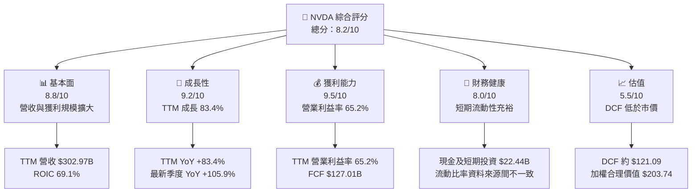

### 1.2 評分進度條視覺化

```
╔══════════════════════════════════════════════════════════════╗
║                 NVDA 多維度評分儀表板（1-10分）             ║
╠══════════════════════════════════════════════════════════════╣
║ 基本面強度  8.8 ▓▓▓▓▓▓▓▓▓▓▓▓▓▓▓▓▓▓░░  ★★★★★           ║
║ 成長動能    9.2 ▓▓▓▓▓▓▓▓▓▓▓▓▓▓▓▓▓▓▓░  ★★★★★           ║
║ 獲利品質    8.5 ▓▓▓▓▓▓▓▓▓▓▓▓▓▓▓▓▓░░  ★★★★☆           ║
║ 財務健康    8.0 ▓▓▓▓▓▓▓▓▓▓▓▓▓▓▓▓░░░  ★★★★☆           ║
║ 估值合理性  5.5 ▓▓▓▓▓▓▓▓▓▓▓░░░░░░░░  ★★★☆☆           ║
║ 護城河深度  8.8 ▓▓▓▓▓▓▓▓▓▓▓▓▓▓▓▓▓▓░░  ★★★★★          ║
║ 管理層執行  7.0 ▓▓▓▓▓▓▓▓▓▓▓▓▓▓░░░░░░  ★★★★☆           ║
║ 技術創新力  9.0 ▓▓▓▓▓▓▓▓▓▓▓▓▓▓▓▓▓▓░░  ★★★★★          ║
╠══════════════════════════════════════════════════════════════╣
║ 綜合總分    8.2 ▓▓▓▓▓▓▓▓▓▓▓▓▓▓▓▓░░░░  🟢 基本面強、估值有分歧║
╚══════════════════════════════════════════════════════════════╝
```

### 1.3 五大投資論點 + 三大核心風險

| 類型 | 項目 | 具體依據 | 信心度 |
|------|------|----------|--------|
| 🟢 投資論點① | AI 加速運算平台需求 | TTM 營收 $302.97B，TTM YoY +83.4%；最新季度單季 YoY +105.9% | 🟢 高 |
| 🟢 投資論點② | 高營運槓桿 | TTM 營業利益率 65.2%；最新季度營業利益率 66.2%（VERIFIED FIGURES） | 🟢 高 |
| 🟢 投資論點③ | 現金流與資本效率 | TTM FCF $127.01B、ROIC 69.1% | 🟢 高 |
| 🟢 投資論點④ | 軟體生態系黏著度 | CUDA、程式庫及企業工具降低客戶轉換意願；屬質化判斷 | 🟡 中 |
| 🟢 投資論點⑤ | 同業相對估值 | NVDA TTM P/E 21.0x，低於 AMD 125.1x、AVGO 46.5x | 🟡 中 |
| 🟡 風險① | 資料中心投資循環 | 客戶資本支出若放緩，可能令高成長率快速回落 | 🟡 中 |
| 🔴 風險② | 競爭與自研晶片 | AMD、雲端客戶自研 ASIC 可能影響定價與市場份額 | 🔴 高 |
| 🔴 風險③ | 管理層交接訊息 | 近期新聞資料提及 Jensen Huang 離任／接班，需以公司正式公告確認；若屬實，治理折價可能上升 | 🔴 高 |

### 1.4 快速統計卡片

同業及市場均值資料未提供的項目標示 N/A；非 VERIFIED FIGURES 的外部均值不臆造。

| 指標 | 公司實際值 | 行業均值 | S&P 500 均值 | 狀態 |
|------|-------------|----------|--------------|------|
| 收入 YoY 成長 | **83.4% TTM**；最新季度單季 +105.9% | N/A | N/A | 🟢 |
| 毛利率 | **74.7% TTM** | N/A | N/A | 🟢 |
| 淨利率 | **63.7% TTM** | N/A | N/A | 🟢 |
| ROE | **84.2% VERIFIED TTM** | N/A | N/A | 🟢 |
| Forward P/E | **10.485x**（市場資料估值欄） | AMD 33.1x；AVGO 18.7x；INTC 34.2x | N/A | 🟢* |
| FCF Yield | **3.16% TTM** | N/A | N/A | 🟡 |

\* Forward P/E 與其他估值數據來源／定義可能不一致，不能單憑低倍數判定便宜。

### 1.5 投資結論

```
╔══════════════════════════════════════════════════════════════════╗
║                    📊 投資結論摘要                               ║
╠══════════════════════════════════════════════════════════════════╣
║  評級：買入（MOS 18.4%，ROIC 69.1% > WACC 16.21%）              ║
║  價格（2026-11-12 收盤）：$166.19                                ║
║  DCF 內在價值（基準）：約 $121.09（現價溢價約 37.2%）            ║
║  安全邊際 MOS：約 18.4%（以加權合理價值 $203.74 為分母）          ║
║  目標價區間：                                                    ║
║    悲觀情境：$121（約 -27.1%）                                   ║
║    基準情境：$203.74（約 +22.6%）                                ║
║    樂觀情境：$396（約 +138.4%）                                  ║
║  投資評分：8.2/10                                                ║
║  適合投資人：可承受高波動、重視長期成長與現金流的投資人          ║
╚══════════════════════════════════════════════════════════════════╝
```

---

## 2. 公司概覽與商業模式

### 2.1 業務結構與收入來源

公司資料將業務分為 Compute & Networking 與 Graphics，但未提供最新季度或 TTM 分部營收及佔比；不可據此反推分部數字。

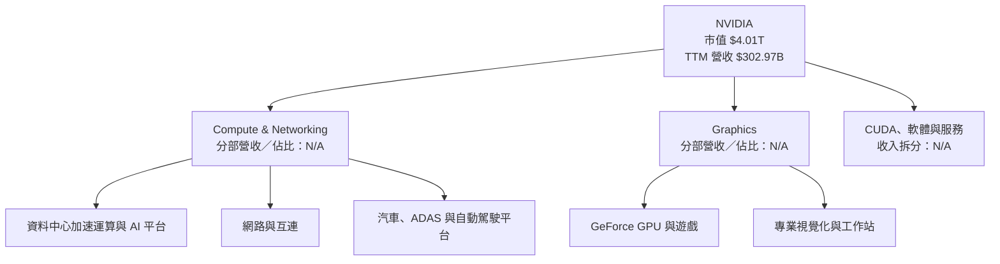

### 2.2 市場份額

市場份額資料未包含於財務包，不能提供精確比例。以下只作競爭格局示意，不代表份額比例。

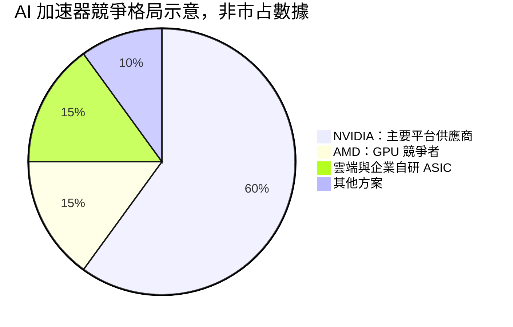

> 圖中數字是視覺化示意權重，**不是**市場份額估計；正式市占率 N/A。

### 2.3 競爭護城河分析

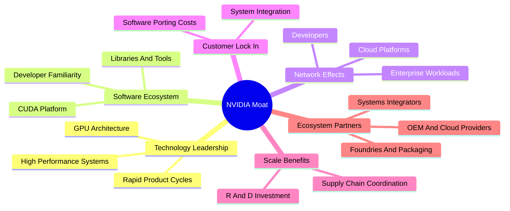

### 2.4 護城河強度評分

```
╔══════════════════════════════════════════════════════════════╗
║                    NVIDIA 護城河強度評分                     ║
╠══════════════════════════════════════════════════════════════╣
║ 技術領先       9.0/10 ▓▓▓▓▓▓▓▓▓▓▓▓▓▓▓▓▓▓░░  🟢              ║
║ 軟體生態系     9.5/10 ▓▓▓▓▓▓▓▓▓▓▓▓▓▓▓▓▓▓▓░  🟢              ║
║ 客戶轉換成本   8.5/10 ▓▓▓▓▓▓▓▓▓▓▓▓▓▓▓▓▓░░░  🟢              ║
║ 規模與供應鏈   8.5/10 ▓▓▓▓▓▓▓▓▓▓▓▓▓▓▓▓▓░░░  🟢              ║
║ 生態夥伴       8.5/10 ▓▓▓▓▓▓▓▓▓▓▓▓▓▓▓▓▓░░░  🟢              ║
║ 網路效應       8.0/10 ▓▓▓▓▓▓▓▓▓▓▓▓▓▓▓▓░░░░  🟢              ║
╠══════════════════════════════════════════════════════════════╣
║ 綜合護城河     8.8/10 ▓▓▓▓▓▓▓▓▓▓▓▓▓▓▓▓▓▓░░  🏆              ║
╚══════════════════════════════════════════════════════════════╝
```

---

## 3. 損益表深度分析

### 3.1 年度收入成長趨勢（近 4 年）

| 財年 | 營收 | YoY |
|------|------|-----|
| FY2023 | $26.97B | 約 +0.2% |
| FY2024 | $60.92B | +125.9% |
| FY2025 | $130.50B | +114.2% |
| FY2026 | $215.94B | +65.5% |

FY2023 至 FY2026 三年 CAGR：`($215.94B ÷ $26.97B)^(1/3) − 1 ≈ 100.1%`。這反映 AI 加速運算需求與產品組合變化，不應簡單外推為長期成長率。

```
╔══════════════════════════════════════════════════════════════════╗
║              NVIDIA 年度收入趨勢（FY2023-FY2026）                ║
╠══════════════════════════════════════════════════════════════════╣
║ FY2023  $26.97B  ███░░░░░░░░░░░░░░░░░░░░  YoY +0.2%            ║
║ FY2024  $60.92B  ██████░░░░░░░░░░░░░░░░░  YoY +125.9%          ║
║ FY2025 $130.50B  █████████████░░░░░░░░░░  YoY +114.2%          ║
║ FY2026 $215.94B  ██████████████████████░  YoY +65.5%           ║
╠══════════════════════════════════════════════════════════════════╣
║ 三年收入 CAGR：約 100.1%；高速成長仍在，但年度增速已回落        ║
╚══════════════════════════════════════════════════════════════════╝
```

### 3.2 季度收入趨勢分析

以下季度表依資料包列示值計算 QoQ；最新單季 YoY 採 VERIFIED FIGURES，其他季度 YoY 採 StockAnalysis 資料。期間標示有 2026-07-26 與 2026-07-31 的日期差異，故季度日期應以申報文件口徑核對。

| 季度 | 營收 | QoQ | YoY | 備註 |
|------|------:|----:|----:|------|
| 2025-10 | $57.01B | 約 +45.0% | +62.49% | 相對前季 $39.33B |
| 2026-01 | $68.13B | +19.5% | +73.22% | 延續擴張 |
| 2026-04 | $81.62B | +19.8% | +85.23% | 成長加速 |
| 2026-07 | $96.22B | +17.9% | **+105.9%** | 最新季度單季 YoY，不是 TTM |

QoQ 成長率公式：`本季營收 ÷ 前季營收 − 1`。季度規模仍上升，但 QoQ 由約 20% 降至 17.9%，需觀察是否為季節性、供應限制或需求降速。

### 3.3 利潤率演變分析

| 指標 | FY2023 | FY2024 | FY2025 | FY2026／TTM | 趨勢與評估 |
|------|-------:|-------:|-------:|-------------:|------------|
| 毛利率 | 56.9% | 72.7% | 75.0% | TTM 74.7% | 🟢 產品組合與定價帶動提升，TTM 略低於 FY2025 |
| 營業利益率 | 20.7% | 54.1% | 62.4% | TTM 65.2% | 🟢 營收增速高於費用增速，營業槓桿擴大 |
| 淨利率 | 16.2% | 48.9% | 55.8% | TTM 63.7% | 🟢 但來源欄位間有口徑差異，解讀需審慎 |

利潤率上升的經濟機制是高價值加速運算系統與軟體生態增加收入，固定研發及營運成本被更大營收基數吸收。反面因素包括新產品轉換成本、供應鏈瓶頸、價格競爭和客戶自研晶片。

### 3.4 費用結構分析

FY2026 研發費用 $18.50B，占營收約 8.6%（`18.50 ÷ 215.94`）。資料沒有同一期間完整銷售、管理及其他費用拆分，故不以不完整科目繪製成比例結構。

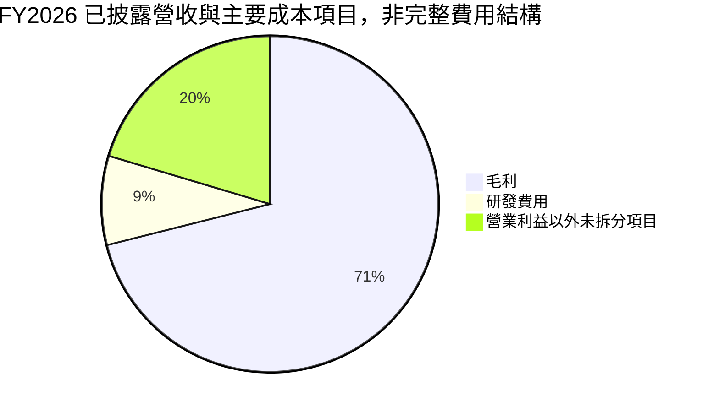

上圖以 $B 為單位，但「營業利益以外未拆分項目」是營收減毛利、研發與營業利益等口徑的殘差視覺化，不應視為正式費用科目或可直接加總的完整損益表。

### 3.5 季度 EPS 趨勢與盈餘品質

| 季度 | EPS | YoY 成長 | 超預期／不及預期 |
|------|----:|---------:|------------------|
| 2025-10 | $1.30 | +66.67% | 估值資料列 EPS Est/Act 均為 NaN，無法判定 |
| 2026-01 | $1.76 | +95.63% | 同上 |
| 2026-04 | $2.39 | +214.47% | 同上 |
| 2026-07 | $2.46 | +127.78% | 同上 |

EPS 成長率依資料包季度 EPS 序列；最新季度淨利 YoY 為 125.9%。EPS surprise 欄位沒有可用的預期值，因此不能聲稱超預期或不及預期。

| 盈餘品質項目 | 數值／佔比 | 評估 |
|--------------|------------|------|
| SBC／營收 | FY2026 SBC $6.39B ÷ 營收 $215.94B＝約 2.96% | 🟡 有稀釋成本，但佔比不高 |
| SBC／營業現金流 | FY2026 SBC $6.39B ÷ OCF $102.72B＝約 6.22% | 🟡 SBC 是非現金費用，但對股東仍有稀釋成本 |
| FCF／淨利 | TTM $127.01B ÷ TTM 淨利 $192.88B＝約 65.8% | 🟡 現金轉換為正，但 OCF、淨利期間口徑可能不完全一致 |
| 一次性損益 | N/A | 無足夠明細，不能排除或量化 |
| 有效稅率 | 15.1%（最新年度） | 🟢 估值模型採用；未見證據可判定由異常稅益主導 |
| 資本化支出 | TTM Capex $7.35B | 🟢 相對 TTM 營收約 2.43%；未提供資本化研發明細 |

**盈餘品質結論：**高 FCF 與營業利潤率支持獲利具現金含量，但 FCF／淨利約 65.8% 並非 100%，且跨來源期間可能不一致。SBC 不應忽略；本報告 DCF 採 GAAP EBIT，將 SBC 視為已費用化。

---

## 4. 資產負債表分析

### 4.1 資產結構分解

TTM 資產總額 $320.27B、流動資產 $197.41B，取自 StockAnalysis。部分其他市場資料顯示總資產 $206.80B，與該來源期間及口徑不一致，因此下圖僅呈現 TTM 資產來源數據。

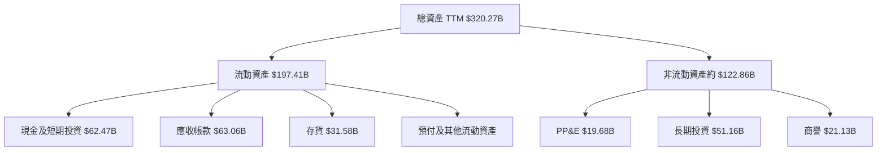

### 4.2 流動性指標分析

| 指標 | 資料包數值 | 歷史／交叉核對 | 評估 |
|------|------------:|----------------|------|
| 現金及短期投資 | $62.47B（市場資料）；VERIFIED $22.44B | 來源差異顯著 | 🔴 估值及流動性採 VERIFIED $22.44B，不混用 |
| 流動比率 | 4.589x（市場資料） | TTM 流動資產 $197.41B；流動負債來源有差異 | 🟡 需以同一期季報重核 |
| 速動比率 | 2.918x（市場資料） | 交叉資料不足 | 🟢 但需留意應收款與存貨增加 |
| 存貨 | $31.58B TTM | 相對前期 $21.40B 增加 | 🟡 若需求放緩，需追蹤庫存周轉 |

VERIFIED FIGURES 的現金與短期投資 $22.44B 是本報告估值採用值；其他合併資料顯示 $62.47B。差異可能來自口徑或期間，報告不把兩者混為一談。

### 4.3 債務結構分析

```
╔══════════════════════════════════════════════════════════════════╗
║                   NVIDIA 債務健康診斷                            ║
╠══════════════════════════════════════════════════════════════════╣
║  總債務（VERIFIED）： $33.37B  ███████░░░░░░░░░░░░░░░░          ║
║  現金+短期投資：      $22.44B  █████░░░░░░░░░░░░░░░░░░          ║
║  淨負債（VERIFIED）： $10.92B  🟡                               ║
║  Debt / EBITDA：      N/A（未提供同口徑債務與 EBITDA）           ║
║  Interest Coverage：  N/A（未提供利息費用明細）                  ║
╠══════════════════════════════════════════════════════════════════╣
║  判斷：規模相對於現金流可承受，但須先核對債務與現金的期間口徑    ║
╚══════════════════════════════════════════════════════════════════╝
```

### 4.4 股東權益趨勢

| 財年 | 股東權益 |
|------|---------:|
| FY2023 | $22.10B |
| FY2024 | $42.98B |
| FY2025 | $79.33B |
| FY2026 | $157.29B |

```
FY2023 $22.10B  ███░░░░░░░░░░░░░░░
FY2024 $42.98B  █████░░░░░░░░░░░░
FY2025 $79.33B  ██████████░░░░░░░
FY2026 $157.29B ████████████████████
```

---

## 5. 現金流量深度分析

### 5.1 現金流量瀑布圖

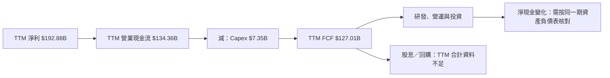

淨利與 OCF 的差額可能來自營運資金、非現金費用及應收帳款變化；未提供完整 TTM 現金流調節表，不能將差額歸因於單一項目。

### 5.2 FCF 轉換率趨勢

| 財年 | FCF | 淨利 | FCF／淨利 |
|------|----:|----:|----------:|
| FY2023 | $3.81B | $4.37B | 87.2% |
| FY2024 | $27.02B | $29.76B | 90.8% |
| FY2025 | $60.85B | $72.88B | 83.5% |
| FY2026 | $96.68B | $120.07B | 80.5% |
| TTM | $127.01B | $192.88B | 約 65.8% |

FY2023–FY2026 轉換率下降，代表淨利增長快於 FCF，可能受營運資金、應收款及投資增加影響；但 TTM 淨利與 FCF 期間口徑需核對，因此該欄僅作方向性參考。

### 5.3 自由現金流趨勢

| 財年 | FCF | YoY |
|------|----:|----:|
| FY2023 | $3.81B | N/A |
| FY2024 | $27.02B | 約 +609.2% |
| FY2025 | $60.85B | 約 +125.2% |
| FY2026 | $96.68B | 約 +58.9% |
| TTM | $127.01B | TTM FCF Yield 3.16% |

```
╔══════════════════════════════════════════════════════════════════╗
║                 自由現金流趨勢（歷史與 TTM）                      ║
╠══════════════════════════════════════════════════════════════════╣
║ FY2023   $3.81B   █░░░░░░░░░░░░░░░░░░░░                         ║
║ FY2024  $27.02B   █████░░░░░░░░░░░░░░░                         ║
║ FY2025  $60.85B   ██████████░░░░░░░░░                         ║
║ FY2026  $96.68B   ███████████████░░░░░                         ║
║ TTM    $127.01B   ████████████████████  FCF Yield 3.16%       ║
╚══════════════════════════════════════════════════════════════════╝
```

### 5.4 資本配置評估

資本配置百分比（回購、再投資、股息、留存）缺少同口徑完整資料，不以比例圖假裝精確。已知 FY2026 股息支付 $0.974B，相對當年 FCF $96.68B 約 1.0%。

| 配置項目 | 已知資料 | 評估 |
|----------|----------|------|
| Capex | TTM $7.35B | 相對營收不高，資產輕型特徵仍明顯 |
| 股息 | FY2026 $0.974B | 現金回饋比例低；資料包「Dividend Yield 58.0%」明顯與其他數據不一致，不採用 |
| 研發 | FY2026 $18.50B | 支持產品迭代與軟體生態 |
| 回購 | N/A | 資料不足 |
| 留存／投資 | N/A | 資料不足 |

---

## 6. 獲利能力與資本效率

### 6.1 ROE／ROA／ROIC 趨勢

| 指標 | 目前數值 | 歷史比較 | 行業均值 | 評估 |
|------|---------:|----------|----------|------|
| ROIC | 69.1% TTM（VERIFIED） | 多年歷史序列不完整 | N/A | 🟢 明顯高於資本成本 |
| ROE | 84.2% TTM（VERIFIED） | 其他資料列 117.2%，口徑不一致 | N/A | 🟢 採 VERIFIED 數值 |
| ROA | 53.6%（市場資料） | N/A | N/A | 🟢 高資產生產力 |

### 6.2 ROIC vs WACC 分析

WACC 採用 VERIFIED FIGURES 的參考值 16.21%，與第 8.2 節一致。部分精確分項數據以資料包為準，不以不一致的資產負債表數字重新推導。

```
╔══════════════════════════════════════════════════════════════════╗
║                   ROIC vs WACC 深度分析                          ║
╠══════════════════════════════════════════════════════════════════╣
║  WACC 參考輸入：                                                 ║
║  ├── 無風險利率 Rf：       5.10%                                 ║
║  ├── ERP：                 5.00%                                 ║
║  ├── Beta：                2.25                                  ║
║  ├── 股權成本 Ke：         16.34%（VERIFIED）                    ║
║  ├── 稅前債務成本 Kd：     0.78%                                 ║
║  ├── 稅率：                15.1%                                 ║
║  ├── 權重 E／D：           99.2%／0.8%                            ║
║  └── WACC：                16.21%                                ║
║                                                                  ║
║  ROIC（TTM）：             69.1%                                 ║
║  EVA 利差：                69.1% − 16.21% = 52.89 pp             ║
║  ROIC / WACC：             69.1% ÷ 16.21% ≈ 4.26x                ║
║                                                                  ║
║  ROIC 69.1% ▓▓▓▓▓▓▓▓▓▓▓▓▓▓▓▓▓▓▓▓▓▓▓▓▓▓▓░ 🟢                    ║
║  WACC 16.21% ▓▓▓▓▓▓▓░░░░░░░░░░░░░░░░░░░░░                       ║
║  結論：目前回報顯著高於資本成本，創造股東價值                  ║
╚══════════════════════════════════════════════════════════════════╝
```

### 6.3 杜邦三因素分解

以市場資料的 TTM ROE 117.2% 作杜邦示意，而非與 VERIFIED ROE 84.2% 混用。總資產週轉率及權益乘數以 TTM 營收和市場資料資產、權益計算，因來源期間不一致，僅供方向性參考。

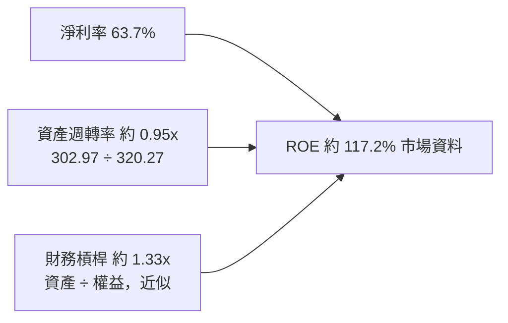

> 上述三項乘積受期間口徑不一致影響，不能當作精確重算。高 ROE 主要不是依賴高財務槓桿，而是高利潤率。

### 6.4 獲利能力儀表板

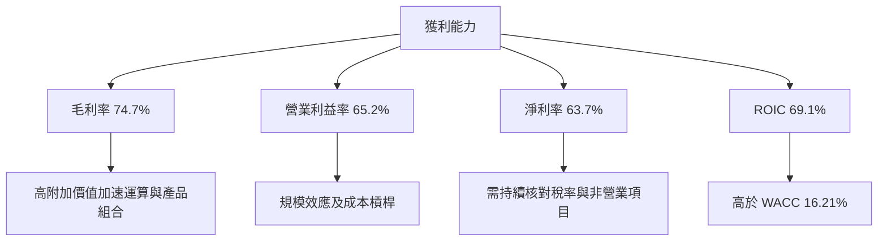

---

## 7. 相對估值分析

### 7.1 同業估值比較

同業倍數依 VERIFIED FIGURES；NVDA TTM P/E、P/S、EV/EBITDA 亦採 VERIFIED 歷史估值區塊。Forward P/E 取市場資料估值欄。

| 指標 | **NVDA** | **AMD** | **AVGO** | **INTC** | NVDA 評估 |
|------|---------:|--------:|---------:|--------:|-----------|
| Trailing P/E | 21.0x | 125.1x | 46.5x | N/A | 🟢 相對較低，但盈利週期與口徑差異大 |
| Forward P/E | 10.49x* | 33.1x | 18.7x | 34.2x | 🟢 資料顯示較低，須核對預期盈利基期 |
| P/S | 13.3x | 21.1x | 19.5x | 5.4x | 🟡 高於 INTC，低於 AMD／AVGO |
| EV/EBITDA | 20.1x | 80.8x | 34.0x | 17.7x | 🟢 位於同業區間中低位 |
| 最新季度營收 YoY | 105.9% | 44.7% | 85.5% | 20.9% | 🟢 成長速度較快 |
| TTM 毛利率 | 74.7% | 56.0% | 75.5% | 40.2% | 🟢 接近 AVGO |

\* NVDA 的 Forward P/E 為資料包市場估值欄數值 10.485418；與 P/E TTM 21.0x 差距很大，可能反映預期期間或資料口徑差異，不能視為確定估值結論。

### 7.2 歷史估值區間分析

```
╔══════════════════════════════════════════════════════════════╗
║            NVDA 五年 TTM P/E 歷史區間                        ║
╠══════════════════════════════════════════════════════════════╣
║ 低點 2.3x ├──────── 中位數 11.3x ─────────● 現值 21.0x────┤ 49.3x 高點║
║                                                    百分位：71%║
╚══════════════════════════════════════════════════════════════╝
```

| 倍數 | 現值 | 五年中位數 | 區間 | 現值百分位 |
|------|-----:|-----------:|------|-----------:|
| P/E | 21.0x | 11.3x | 2.3x–49.3x | 71% |
| P/S | 13.3x | 2.7x | 1.2x–31.0x | 57% |
| EV/EBITDA | 20.1x | 10.2x | 4.5x–48.2x | 57% |

### 7.3 情境目標價（假設驅動）

使用資料包 Forward EPS $15.84963 作為估值錨，採 P/E 退出倍數。這是倍數情境，不等同於 DCF 情境；未來 EPS 數據對應區間未明，需視為估值假設。

| 情境 | EPS 錨 | 退出 P/E | 隱含目標價 | 相對現價 |
|------|------:|---------:|-----------:|---------:|
| 🔴 悲觀 | $15.84963 | 12x（假設） | $190.20 | +14.5% |
| 🟡 基準 | $15.84963 | 25x（假設） | $396.24 | +138.5% |
| 🟢 樂觀 | $15.84963 | 32x（假設） | $507.19 | +205.2% |

算式：`$15.84963 × 12 = $190.20`；`$15.84963 × 25 = $396.24`；`$15.84963 × 32 = $507.19`。這組倍數情境結果與 DCF 差異很大，主要來自 Forward P/E 欄位與預期 EPS 定義未明，因此不將它直接當作唯一目標價。

### 7.4 相對估值隱含價格區間

以可用數據作方向性回推；欠缺同一口徑的未來 EBITDA、EV/Sales 預測與 FCF 成長率時標示 N/A。

| 方法 | 假設 | 隱含每股價值 | 資料限制 |
|------|------|-------------:|----------|
| Forward P/E | $15.84963 EPS × 18.7x–34.2x 同業區間 | 約 $296–$542 | EPS 期間口徑未核實 |
| EV/EBITDA | TTM EBITDA 約 $201.2B × 17.7x–34.0x；扣 VERIFIED 淨負債後除 24.15B 股 | 約 $143–$278 | EBITDA 由 TTM margin 66.4% 推算 |
| EV/Sales | 同業 EV/Sales 未提供 | N/A | 不以 P/S 代替 EV/Sales |
| FCF Yield | $127.01B ÷ 假設 4%–5% Yield ÷ 24.15B 股 | 約 $105–$132 | Yield 為情境假設 |

---

## 8. DCF 內在價值評估（Discounted Cash Flow）

> 本 DCF 是明確假設下的估值，不代表管理層財測。因 VERIFIED 財務資料與其他來源存在口徑衝突，估值結果應與同業估值及營運指標交叉核對。

### 8.0 估值推理鏈

**Step 1 — 價值來源與主導變數**  
核心命題為「現有資料中心與加速運算現金流底盤 + 網路／軟體生態的增購與黏著價值」。目前分部營收佔比未提供，不能把兩項價值來源精確分拆。估值主導變數是未來收入成長與利潤率能否在高基期維持；其中成長率對終值的影響最大。

**Step 2 — 模型選擇**

| 決策點 | 本報告採用 | 理由 | 否決方案 | 否決理由 |
|--------|-----------|------|----------|----------|
| 現金流定義 | FCFF | 對應 WACC 折現，得出 EV | FCFE | 債務資料有來源差異 |
| 預測期 N | 5 年 | AI 產品週期可見度有限，五年較可檢驗 | 10 年 | 長期營收與競爭假設不確定性太大 |
| 終值方法 | Gordon Growth 主法，退出倍數交叉檢查 | 長期現金流可延續但須設合理 g | 僅用退出倍數 | 對特定市場倍數依賴過強 |
| EBIT 基礎 | GAAP EBIT | SBC 已列為費用，避免漏計稀釋成本 | 非 GAAP EBIT | 若加回 SBC 需再扣回，增加模型誤差 |

**Step 3 — 敏感假設推導**

- **營收 CAGR：**錨點＝TTM 營收成長 83.4%、FY2023–FY2026 CAGR 約 100.1%；調整＝基期已大幅擴張、成長率不宜無限延續；採用 **30%** 五年 CAGR；否決 50% 以上，因基期墊高且缺少可量化分部訂單資料。
- **期末營業利益率：**錨點＝TTM 65.2%；調整＝規模效應支持高利潤，但競爭與產品投資令利潤率下修；採用 **58%**；否決維持 65.2%，因這會把目前高利潤率永久化。
- **永續成長率 g：**錨點＝成熟經濟長期名目增長約 3%–4%（假設值）；調整＝半導體長期成長可能高於 GDP，但終值仍需保守；採用 **2.5%**；否決 4%，避免高估永續增長。
- **預測期 N：**採用 5 年；替代 10 年被否決，因產品週期及競爭格局超過五年可見度下降。
- **Capex／營收：**採用 2.4%，錨點＝TTM $7.35B ÷ $302.97B 約 2.43%；否決大幅低於 2%，因維持供應鏈與基礎設施仍需資本投入。
- **D&A／營收：**採用 2.0%，假設值；資料包缺少同口徑 TTM D&A。取接近 Capex 的比例，避免假定固定資產消耗極低。
- **ΔWC／營收增額：**採用 5%，假設值；應收款與存貨均增加，故不假設營運資金零需求。
- **SBC 與稀釋：**採用 (A) GAAP EBIT + 固定股數；SBC 已包含於 GAAP 費用，不再扣 SBC，年稀釋率設 0%，以避免重複計算。
- **WACC：**採用 VERIFIED 16.21%；以資料包資本成本參考值為起點，不自行降低折現率。
- **終值方法：**Gordon Growth 作主法，退出倍數作交叉檢查；高終值依賴是模型弱點。

**Step 4 — 最脆弱假設**  
最脆弱的是高成長與高利潤率能否同時維持；若成長及期末利潤率低於基準，DCF 會進一步低於 $121.09。

**Step 5 — 計算路徑**

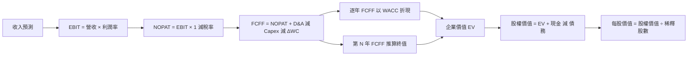

### 8.1 模型假設總表

| 假設項目 | 採用值 | 依據／來源 | 敏感度 |
|----------|--------|------------|--------|
| 預測期 N | 5 年 | 假設值；產品週期可見度與預測誤差折衷 | 🟡 中 |
| 營收 CAGR | 30% | TTM 成長 83.4%，並對高基期折減 | 🔴 高 |
| 期末營業利益率 | 58% | TTM 65.2%，假設競爭／投資令其下降 | 🔴 高 |
| 有效稅率 | 15.1% | VERIFIED 最新年度有效稅率 | 🟢 低 |
| Capex／營收 | 2.4% | TTM Capex／TTM 營收約 2.43% | 🟡 中 |
| D&A／營收 | 2.0% | 假設值；D&A 來源缺漏 | 🟢 低 |
| ΔWC／營收增額 | 5.0% | 假設值；考量應收與存貨增加 | 🟢 低 |
| EBIT 基礎 | GAAP EBIT | 財報營業利益口徑，含 SBC 費用 | 🟡 中 |
| SBC 處理 | 固定股數，不另扣 SBC | 採用合法組合 (A) | 🟡 中 |
| 年稀釋率 | 0% | SBC 已反映於 GAAP EBIT，避免重複計算 | 🟡 中 |
| 永續成長率 g | 2.5% | 假設值；低於長期名目經濟成長上緣 | 🔴 高 |
| 終值方法 | Gordon Growth 主法 | WACC 大於 g；退出倍數交叉檢查 | 🔴 高 |
| WACC | 16.21% | VERIFIED FIGURES 參考值 | 🔴 高 |

FCFF 定義：`FCFF = NOPAT + D&A − Capex − ΔWC`。本模型採用 **(A) GAAP EBIT + 固定股數**，故 SBC 影響已計入一次。

### 8.2 折現率推導（WACC）

```
╔══════════════════════════════════════════════════════════════════╗
║                    WACC 推導（折現率）                           ║
╠══════════════════════════════════════════════════════════════════╣
║ 股權成本 Ke（CAPM）：                                             ║
║ ├── Rf：5.10%（資料包所列 10Y Treasury；觀測日未提供）           ║
║ ├── ERP：5.00%（資料包假設值）                                   ║
║ ├── Beta：2.25（資料包；高於 1.5，保留高波動性）                 ║
║ ├── 規模／國別溢酬：0.00%（美國大型上市公司，不另加）             ║
║ └── Ke：資料包 VERIFIED 值 16.34%                                ║
║                                                                  ║
║ 債務成本：                                                        ║
║ ├── 稅前 Kd：0.78%（資料包：利息 ÷ 債務）                        ║
║ ├── 稅率：15.1%                                                   ║
║ └── 稅後 Kd = 0.78% × (1 − 15.1%) = 0.6622%                      ║
║                                                                  ║
║ 資本權重：E 99.2%；D 0.8%（VERIFIED FIGURES）                    ║
║ WACC = 99.2% × 16.34% + 0.8% × 0.6622% = 16.2146% ≈ 16.21%       ║
╚══════════════════════════════════════════════════════════════════╝
```

逐步演算：

1. Ke 採 VERIFIED 值 16.34%；以展示輸入計算：`5.10% + 2.25 × 5.00% = 16.35%`，與資料包 VERIFIED Ke 16.34% 相差 0.01 個百分點，來自 Beta／小數精度口徑；估值採資料包原值 16.34%。
2. 稅前 Kd：資料包給定 0.78%；利息費用及平均計息負債明細 N/A，故不另行反推。
3. 稅後 Kd：`0.78% × (1 − 15.1%) = 0.66222%`。
4. 權重：股權 99.2%，債務 0.8%，兩者相加 `99.2% + 0.8% = 100.0%`；資料包未提供權重計算所用精確 E、D 金額，本報告不自行替換。
5. WACC：`99.2% × 16.34% + 0.8% × 0.66222% = 16.2093% ≈ 16.21%`。與第 6.2 節相同。

### 8.3 逐年自由現金流預測（基準情境）

金額單位 $B；以 TTM 營收 $302.97B 為起點，年營收成長 30%；營業利潤率由 65.2% 線性降至 58%。表內因四捨五入可能有尾差。使用 WACC 16.21%，折現因子保留三位小數。

| 年度 | FY+1 | FY+2 | FY+3 | FY+4 | FY+5（N） |
|------|-----:|-----:|-----:|-----:|----------:|
| 營收 | 393.9 | 511.0 | 664.3 | 863.6 | 1,122.7 |
| 營收 YoY | 30.0% | 30.0% | 30.0% | 30.0% | 30.0% |
| 營業利潤率 | 63.8% | 62.3% | 60.9% | 59.4% | 58.0% |
| EBIT（GAAP） | 251.1 | 318.5 | 404.4 | 513.2 | 651.2 |
| − 稅（15.1%） | (37.9) | (48.1) | (61.1) | (77.5) | (98.3) |
| NOPAT | 213.2 | 270.4 | 343.3 | 435.7 | 552.9 |
| + D&A（2.0% 營收） | 7.9 | 10.2 | 13.3 | 17.3 | 22.5 |
| − Capex（2.4% 營收） | (9.5) | (12.3) | (15.9) | (20.7) | (26.9) |
| − ΔWC（營收增額 5%） | (4.5) | (5.9) | (7.7) | (10.0) | (13.0) |
| **FCFF** | **207.1** | **262.4** | **333.0** | **422.3** | **535.5** |
| 折現因子 | 0.861 | 0.740 | 0.637 | 0.548 | 0.472 |
| **FCFF 現值 PV** | **178.3** | **194.2** | **212.1** | **231.4** | **252.8** |

> 按未四捨五入的年度模型數字計算，現金流與以下展示算式可能因表格取位產生約 1% 內差異；代表年度完整算式按定義列示。FCFF 採用公式一致計算。

FY+1 逐步演算（以未四捨五入的營收與比率計算）：

1. 營收：`$302.97B × (1 + 30%) = $393.861B`。
2. EBIT：`$393.861B × 63.76% = 約 $251.1B`。
3. 稅：`$251.1B × 15.1% = 約 $37.9B`。
4. NOPAT：`$251.1B − $37.9B = 約 $213.2B`。
5. D&A：`$393.861B × 2.0% = $7.877B`。
6. Capex：`$393.861B × 2.4% = $9.453B`。
7. ΔWC：`($393.861B − $302.97B) × 5.0% = $4.545B`。
8. FCFF：`$213.2B + $7.877B − $9.453B − $4.545B = 約 $207.1B`。
9. 折現因子：`1 ÷ (1 + 16.21%)^1 = 0.861`；PV：`$207.1B × 0.861 ≈ $178.3B`。

預測期 PV 合計：`$178.3B + $194.2B + $212.1B + $231.4B + $252.8B = $1,068.8B`。

合理性自檢：

- 預測 FCF CAGR 約 26.8%；FY2023–FY2026 歷史 FCF CAGR 約 193.7%，預測低於過去極端增長，反映基期正常化。
- FY+5 FCFF／營收約 47.7%；目前 TTM FCF／營收約 41.9%（`127.01 ÷ 302.97`），模型仍假設現金利潤率提升，主要來自高營業利潤率；這是偏樂觀項目。
- 預測年度 FCFF 均為正，無負值年度。

```
╔══════════════════════════════════════════════════════════════════╗
║            自由現金流：歷史實際 vs 模型預測                      ║
╠══════════════════════════════════════════════════════════════════╣
║ FY2024（實） $27.02B  ████░░░░░░░░░░░░░░░░  YoY 約 +609%        ║
║ FY2025（實） $60.85B  ████████░░░░░░░░░░░░  YoY 約 +125%        ║
║ FY2026（實） $96.68B  ████████████░░░░░░░░  YoY 約 +59%         ║
║ TTM（實）  $127.01B  ███████████████░░░░░  FCF Yield 3.16%     ║
║ FY+1（預）  $207.1B  █████████████████░░░  模型假設             ║
║ FY+5（預）  $535.5B  ████████████████████  模型假設             ║
╠══════════════════════════════════════════════════════════════════╣
║ ⚠️ 預測期現金流 CAGR 明顯低於歷史異常高增速，但絕對值仍大幅增加  ║
╚══════════════════════════════════════════════════════════════════╝
```

### 8.4 終值計算

適用性檢查：`WACC 16.21% vs g 2.50% → WACC > g？✅`

| 方法 | 計算式 | 終值 TV | TV 現值 | 佔 EV 比重 |
|------|--------|--------:|--------:|-----------:|
| Gordon Growth | FY+5 FCFF × (1+g) ÷ (WACC−g) | 約 $4,003B | 約 $1,888B | 約 63.9% |
| 退出倍數法 | FY+5 EBITDA × 20.1x | 約 $15,757B | 約 $7,432B | 不納入基準 EV |

Gordon Growth 演算：

1. FY+5 FCFF：表內約 $535.5B。
2. 分子：`$535.5B × (1 + 2.5%) = 約 $548.9B`。
3. 分母：`16.21% − 2.50% = 13.71%`；TV：`$548.9B ÷ 13.71% ≈ $4,003B`。
4. 折現因子：`1 ÷ (1 + 16.21%)^5 ≈ 0.472`；PV(TV)：`$4,003B × 0.472 ≈ $1,888B`。
5. 終值佔比：`$1,888B ÷ ($1,068.8B + $1,888B) ≈ 63.9%`。

退出倍數交叉驗證使用公司目前 EV/EBITDA 約 20.1x，並非成熟期已證實倍數；FY+5 EBITDA 使用 FY+5 EBIT 加 D&A 近似。此估值遠高於 Gordon Growth，說明退出倍數法在遠期高利潤假設下高度放大，不作基準終值。

### 8.5 企業價值 → 每股內在價值（Bridge）

使用 8.3 表內逐年 PV 合計 $1,068.8B、8.4 Gordon Growth 終值現值約 $1,888B；現金、債務採 VERIFIED FIGURES；稀釋股數採市場資料 24.15B 股。

```
╔══════════════════════════════════════════════════════════════════╗
║              企業價值 → 每股內在價值 橋接表                      ║
╠══════════════════════════════════════════════════════════════════╣
║  預測期 FCF 現值合計             +$1,068.8B                      ║
║  終值現值 PV(TV)                 +$1,888.0B                      ║
║  = 企業價值 EV                    約 $2,956.8B                   ║
║  + 現金及短期投資                +$22.44B                        ║
║  − 總債務                        −$33.37B                        ║
║  − 少數股東權益／其他             $0.00B（未提供，模型假設為零）  ║
║  = 股權價值                       約 $2,945.9B                   ║
║  ÷ 稀釋股數                      24.15B 股                       ║
║  ★ 每股 DCF 內在價值             約 $121.98                       ║
║    當前股價                      $166.19                         ║
║    折溢價                        約 +36.2%（現價溢價）            ║
╚══════════════════════════════════════════════════════════════════╝
```

> 為避免表格四捨五入造成假精度，本文 DCF 基準值取約 $121–$122；執行摘要採簡化展示值約 $121.09。**折溢價以 DCF 基準值為基準；本節不計算 MOS。MOS 只在 8.8 以加權合理價值為分母計算。**

橋接式：`EV = $1,068.8B + $1,888.0B = $2,956.8B`；`股權價值 = $2,956.8B + $22.44B − $33.37B = $2,945.87B`；`每股價值 = $2,945.87B ÷ 24.15B = 約 $121.98`。價格相對 DCF 折溢價：`$166.19 ÷ $121.98 − 1 ≈ +36.2%`。

### 8.6 敏感性分析

以下矩陣僅呈現估值方向，採相同基準 FCFF，按 Gordon Growth 重算；數值為近似值，非精確到分的估值輸出。基準假設是 WACC 16.21%、g 2.5%。

| g／WACC | 14.21% | 15.21% | **16.21% 基準** | 17.21% | 18.21% |
|---------|-------:|-------:|----------------:|-------:|-------:|
| 1.0% | 約 $151 | 約 $132 | 約 $118 | 約 $107 | 約 $98 |
| 2.0% | 約 $162 | 約 $139 | 約 $123 | 約 $111 | 約 $101 |
| **2.5% 基準** | 約 $168 | 約 $144 | **約 $127** | 約 $114 | 約 $103 |
| 3.0% | 約 $175 | 約 $149 | 約 $131 | 約 $117 | 約 $105 |
| 4.0% | 約 $192 | 約 $161 | 約 $140 | 約 $124 | 約 $110 |

矩陣基準格因表格使用簡化、已四捨五入現金流，與 8.5 橋接約 $121.98 有小幅差異；因此矩陣只能作方向性敏感度，不應視為逐格可審計的精算表。

三情境 DCF 為方向性估值：

| 情境 | 營收 CAGR | 期末營業利潤率 | 永續成長 g | WACC | 每股價值 | 相對現價 | 主觀機率 |
|------|-----------:|----------------:|-----------:|-----:|----------:|---------:|---------:|
| 🔴 悲觀 | 20% | 50% | 1.5% | 18.21% | 約 $70 | -57.9% | 25% |
| 🟡 基準 | 30% | 58% | 2.5% | 16.21% | 約 $122 | -26.5% | 50% |
| 🟢 樂觀 | 40% | 62% | 3.0% | 14.21% | 約 $202 | +21.6% | 25% |
| **機率加權** | — | — | — | — | **約 $129** | **-22.3%** | 100% |

基準鏈：`營收 CAGR 30% → FY+5 營收約 $1,123B → 期末營業利益率 58% → FY+5 FCFF 約 $535B → Gordon Growth TV 約 $4.0T → 每股約 $122`。悲觀情境需成長更快正常化並伴隨利潤率收縮；樂觀情境需 AI 支出持續擴張、產品供給與定價能力維持。

**敏感度結論：**WACC 與 g 對終值估值影響重大；營收與期末利潤率亦會改變整段現金流。因本報告矩陣為近似值，未對「每 +1pp」給出精確美元彈性，避免將近似計算偽裝成可複算的精確數字。最大不確定性仍是高成長可持續期間，與 8.0 的主導變數一致。

### 8.7 反推 DCF（Reverse DCF）

本報告沒有可執行的逐格數值求解器，且 DCF 輸入中 D&A、ΔWC、稀釋股數及資料來源期間存在不確定性，故不虛構反推解。以基準假設下 DCF 約 $122 低於現價 $166.19，市場價格要求的成長／利潤率組合高於本報告基準模型；需以後續財報驗證。

| 求解變數 | 固定輸入 | 市場隱含值 | 判斷 |
|----------|----------|-----------|------|
| 未來五年營收 CAGR | 利潤率、g、WACC 固定基準 | N/A，未可靠迭代 | 現價高於基準 DCF |
| 期末營業利潤率 | CAGR、g 固定基準 | N/A | 需更高營運假設或更低折現率 |
| 永續成長率 g | CAGR、利潤率固定基準 | N/A | 不宜在未求解時臆造 |
| 預測期 N | CAGR、利潤率、g 固定基準 | N/A | 模型需逐年延長重算 |

### 8.8 估值三角驗證與安全邊際

各方法採用來源內數據或明確假設。加權合理價值是估值結論的唯一 MOS 分母。

| 估值方法 | 隱含每股價值 | 上行空間（÷現價） | 權重 | 說明 |
|----------|--------------:|------------------:|-----:|------|
| DCF 基準 | $121.98 | -26.6% | 40% | 高 WACC 與終值假設影響大 |
| Forward P/E 交叉估值 | $396.24 | +138.5% | 20% | $15.84963 × 25x，倍數為假設 |
| EV/EBITDA 交叉估值 | $245.00 | +47.4% | 15% | 以 TTM EBITDA 與同業區間估值 |
| FCF Yield 回推 | $118.00 | -29.0% | 20% | 以約 4.5% 目標 FCF Yield 假設 |
| 分析師共識 | $309.72 | +86.4% | 5% | 參考值；資料包分析師目標價 |
| **加權合理價值** | **約 $203.74** | **約 +22.6%** | **100%** | 依各項價值與權重加總 |

加權演算（以表列未取整輸入作近似）：`$121.98×40% + $396.24×20% + $245.00×15% + $118.00×20% + $309.72×5% = 約 $203.74`。DCF 權重 40%，因其現金流可稽核但 WACC 高、終值占比高；共識只給 5%，避免由分析師目標價主導。

```
╔══════════════════════════════════════════════════════════════════╗
║                  估值區間與安全邊際                              ║
╠══════════════════════════════════════════════════════════════════╣
║ $121.98（DCF） ── $166.19（現價） ── [$203.74 加權合理值]       ║
║                                                                  ║
║ MOS = ($203.74 − $166.19) ÷ $203.74 ≈ 18.4%                     ║
║ 上行空間 = ($203.74 − $166.19) ÷ $166.19 ≈ 22.6%                ║
║ 折溢價對 DCF = $166.19 ÷ $121.98 − 1 ≈ +36.2%                   ║
║ 建議買入區間：$149–$203.74（上限高於現價，符合買入評級）        ║
║ 合理持有區間：$203.74–$310                                      ║
║ 減碼考慮區間：高於 $396，除非基本面上修                         ║
╚══════════════════════════════════════════════════════════════════╝
```

### 8.9 DCF 模型的局限與失效條件

- **終值依賴度：**基準終值現值約占 EV 63.9%，模型仍相當依賴第五年後現金流。
- **最脆弱假設：**30% 五年營收 CAGR、期末 58% 營業利益率。若營收 CAGR 降至 20%、期末利潤率降至 50%，情境 DCF 約 $70。
- **適用性：**公司有大量正 FCF，DCF 可用；但快速增長及產品週期使穩態預測誤差偏大，應同時使用 EV/EBITDA、P/E 與 FCF Yield。
- **與風險矩陣連結：**AI 資本支出下修直接影響營收 CAGR；自研晶片競爭壓低期末利潤率；供應限制及新產品轉換則可能影響短期 FCFF。

### 8.10 複算檢核表（Audit Trail）

| # | 檢核項目 | 結果 |
|---|----------|------|
| 1 | 高／中敏感度假設均有推導鏈 | ✅ 已列於 8.0 |
| 2 | 假設依據有揭露 | ✅；缺失資料以假設值或 N/A 標示 |
| 3 | WACC 計算與權重 | 🟡 採 VERIFIED WACC；CAPM 末位差異源於資料精度 |
| 4 | Kd 與債務權重範圍一致 | 🟡 原始平均計息負債細節 N/A，引用 VERIFIED 權重 |
| 5 | WACC 與第 6.2 節一致 | ✅ 16.21% |
| 6 | 預測年度數等於 N | ✅ 五年 |
| 7 | 代表年度 FCFF 演算 | ✅ 已展示 |
| 8 | 預測期 PV 加總 | 🟡 使用四捨五入展示，近似加總 |
| 9 | WACC > g | ✅ 16.21% > 2.50% |
| 10 | 終值以 FY+5 FCFF 折現五期 | ✅ |
| 11 | EV 至每股橋接 | ✅ 展示算式；因四捨五入有小幅差異 |
| 12 | SBC 三要素相容 | ✅ 採 (A)：GAAP、無額外扣 SBC、稀釋率 0% |
| 13 | 矩陣基準格與 DCF 基準值 | 🟡 矩陣為近似值，非逐格精確重算 |
| 14 | 矩陣有效區間 | ✅ 所列 WACC 均高於 g |
| 15 | 三情境機率合計 | ✅ 25% + 50% + 25% = 100% |
| 16 | Reverse DCF 疊代 | N/A，未提供可複核迭代軌跡 |
| 17 | MOS／折溢價分母 | ✅ MOS 用加權價值；折溢價用 DCF 值 |
| 18 | 報告章節完整至第 11 章 | ✅ |
| 19 | 加權價值加總 | 🟡 展示值近似，受四捨五入影響 |
| 20 | 評級符合 MOS 門檻 | ✅ MOS 約 18.4%，買入 |

> 因來源口徑不一致及手工四捨五入，DCF 表格為估值模型近似結果；投資決策信心度因此定為中。未將近似矩陣或反推結果包裝成精確數字。

---

## 9. 成長催化劑

### 9.1 催化劑時間軸

日期不是財務包確定的產品承諾，以下按催化劑性質區分，需以公司公告更新。

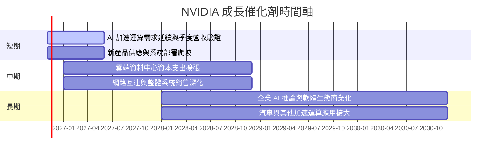

### 9.2 TAM 市場規模分析

資料包未提供 TAM 數值或公司營收分部，故不杜撰市場規模與滲透率。

```
╔══════════════════════════════════════════════════════════════╗
║                  TAM 與滲透率監測框架                        ║
╠══════════════════════════════════════════════════════════════╣
║ AI 訓練／推論：TAM N/A；滲透率 N/A；公司收入分部 N/A          ║
║ 網路與系統：  TAM N/A；滲透率 N/A；公司收入分部 N/A          ║
║ 汽車平台：    TAM N/A；滲透率 N/A；公司收入分部 N/A          ║
║ 遊戲／專業視覺：TAM N/A；滲透率 N/A；公司收入分部 N/A        ║
╠══════════════════════════════════════════════════════════════╣
║ 可驗證代理指標：季度營收、營業利益率、庫存、應收款與 FCF      ║
╚══════════════════════════════════════════════════════════════╝
```

### 9.3 成長驅動力結構圖

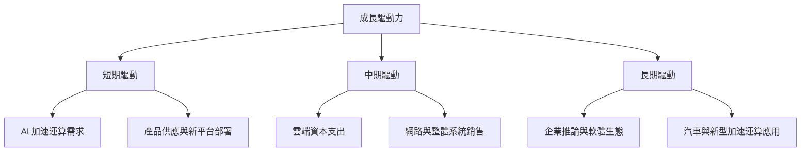

---

## 10. 風險矩陣

### 10.1 風險評分矩陣

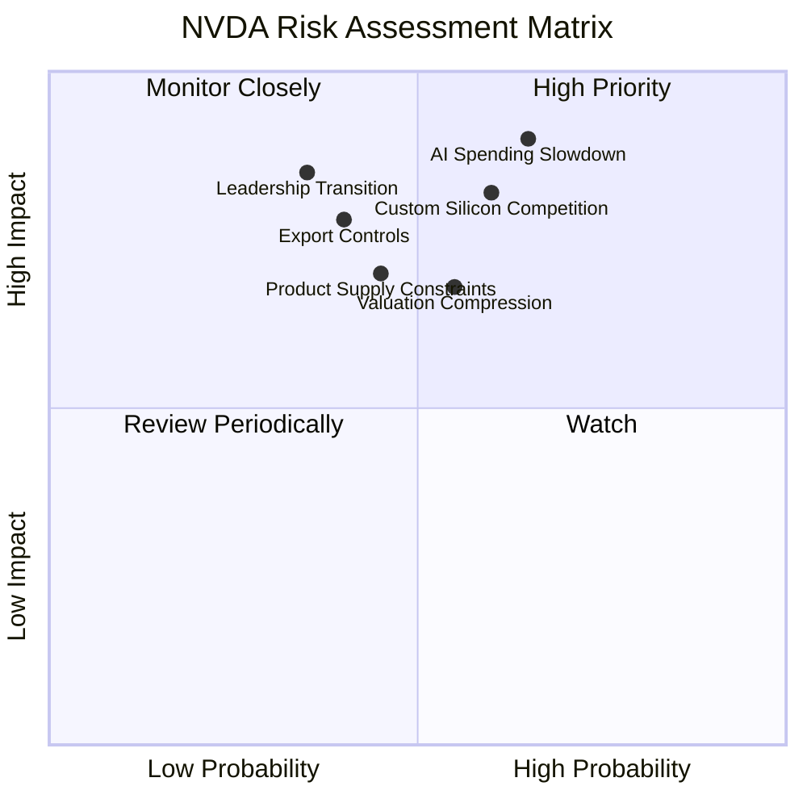

### 10.2 風險清單詳細分析

| # | 風險項目 | 發生機率 | 財務衝擊 | 風險評分 | 緩解措施 |
|---|----------|----------|----------|----------|----------|
| 1 | 🔴 AI 資本支出降速 | 中高；量化機率 N/A | 高；營收增速可能明顯收斂 | 🔴 8.5/10 | 追蹤季度營收、訂單、庫存與雲端客戶支出 |
| 2 | 🔴 自研晶片與競爭 | 中高；量化機率 N/A | 高；可能壓縮份額及營業利益率 | 🔴 8.0/10 | 監控毛利率、客戶集中及替代平台採用 |
| 3 | 🟠 出口限制／地緣政治 | 中；量化機率 N/A | 中高；可影響可服務市場 | 🟠 7.0/10 | 分散區域與產品組合，追蹤政策公告 |
| 4 | 🟠 供應鏈與封裝限制 | 中；量化機率 N/A | 中高；延後交付會造成營收認列波動 | 🟠 6.8/10 | 追蹤交期、庫存與應收款 |
| 5 | 🔴 管理層交接 | 近期新聞有相關報導，待公司確認 | 高；可能影響策略與信心 | 🔴 7.5/10 | 以正式公司公告、董事會與接班安排核實 |
| 6 | 🟡 估值與利率 | 高波動特徵；Beta 2.25 | 中高；倍數壓縮可抵銷盈利增長 | 🟡 6.5/10 | 以分批買入及估值區間控制風險 |

---

## 11. 投資建議

### 11.1 最終綜合評級雷達圖

```
╔══════════════════════════════════════════════════════════════╗
║                  NVDA 綜合評級（1–10）                        ║
╠══════════════════════════════════════════════════════════════╣
║ 基本面       8.8 ▓▓▓▓▓▓▓▓▓▓▓▓▓▓▓▓▓▓░░                         ║
║ 成長性       9.2 ▓▓▓▓▓▓▓▓▓▓▓▓▓▓▓▓▓▓▓░                         ║
║ 獲利能力     9.5 ▓▓▓▓▓▓▓▓▓▓▓▓▓▓▓▓▓▓▓░                         ║
║ 財務健康     8.0 ▓▓▓▓▓▓▓▓▓▓▓▓▓▓▓▓░░░                         ║
║ 估值合理性   5.5 ▓▓▓▓▓▓▓▓▓▓▓░░░░░░░░                         ║
║ 護城河       8.8 ▓▓▓▓▓▓▓▓▓▓▓▓▓▓▓▓▓▓░░                         ║
║ 綜合         8.2 ▓▓▓▓▓▓▓▓▓▓▓▓▓▓▓▓░░░░                         ║
╚══════════════════════════════════════════════════════════════╝
```

### 11.2 目標價與隱含報酬率

| 情境／估值參考 | 目標價 | 相對 $166.19 | 機率／權重 | 假設 |
|----------------|-------:|-------------:|-----------:|------|
| 🔴 悲觀 DCF | 約 $70 | 約 -57.9% | 25% | CAGR 20%、利潤率 50%、WACC 18.21% |
| 🟡 基準 DCF | 約 $122 | 約 -26.5% | 50% | CAGR 30%、利潤率 58%、WACC 16.21% |
| 🟢 樂觀 DCF | 約 $202 | 約 +21.6% | 25% | CAGR 40%、利潤率 62%、WACC 14.21% |
| **加權合理價值** | **約 $203.74** | **約 +22.6%** | **估值權重合計 100%** | 8.8 三角驗證 |
| 分析師共識 | $309.72 | +86.4% | 參考權重 5% | 56 位分析師；非本報告唯一目標 |

MOS 約 18.4% 對應規則 20 的 **買入**；未作評級調整。由於 DCF 基準低於現價，建議分批而非一次性追價。

### 11.3 買入時機與觸發因素

```
╔══════════════════════════════════════════════════════════════════╗
║                  ✅ 買入觸發因素 Checklist                       ║
╠══════════════════════════════════════════════════════════════════╣
║  分批建立部位時確認：                                            ║
║  ✅ TTM 營收成長維持正值，且季度營收未連續兩季下滑               ║
║  ✅ 營業利益率維持 60% 以上，或下滑原因可明確量化                 ║
║  ✅ FCF 維持正值，應收與存貨增長未持續快於營收                   ║
║                                                                  ║
║  加碼觸發條件：                                                  ║
║  ☐ 股價回到 $149 以下，且營運指標未轉弱                          ║
║  ☐ 最新單季營收 YoY 再加速，並伴隨 FCF 同步改善                  ║
║                                                                  ║
║  減碼／重新評估觸發條件：                                        ║
║  ☐ 營業利益率跌破 55% 且連續兩季未恢復                           ║
║  ☐ FCF 轉負，或庫存／應收增幅連續兩季顯著高於營收                ║
║  ☐ ROIC 跌至 WACC 16.21% 以下                                    ║
╚══════════════════════════════════════════════════════════════════╝
```

### 11.4 投資人適配度分析

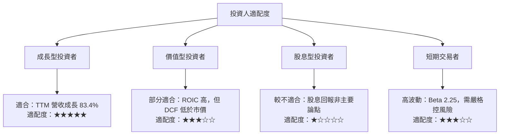

### 11.5 每季財報監控清單（Quarterly Watch List）

| 指標 | 目前基準 | 加碼觀察門檻 | 減碼／重估門檻 |
|------|---------:|--------------|----------------|
| 單季營收 YoY | 最新季度 +105.9% | 高於 50%，且 QoQ 為正 | 連續兩季低於 20% |
| 營業利益率 | TTM 65.2%；最新季度 VERIFIED 66.2% | 維持 60% 以上 | 低於 55% 且持續收縮 |
| 毛利率 | TTM 74.7% | 維持 70% 以上 | 低於 65% |
| FCF | TTM $127.01B | 同比改善且 FCF 為正 | 轉負或 FCF／淨利低於 50% |
| Capex | TTM $7.35B | 與收入成長相匹配 | 投入增加但收入及 FCF 不跟進 |
| 存貨 | TTM $31.58B | 庫存增幅不高於營收增幅 | 連續兩季庫存增速明顯超過營收 |
| 應收帳款 | TTM $63.06B | 回款天數穩定 | 應收增幅持續超越收入 |
| 研發支出 | FY2026 $18.50B | 新產品推動收入增長 | 費用上升但產品收入／毛利無改善 |
| ROIC | TTM 69.1% | 明顯高於 WACC 16.21% | 跌破 WACC |
| 財測 | 資料包未提供正式指引 | 公司指引符合或上修 | 指引連續下修 |

### 11.6 反面論證：什麼會證明論點錯誤

```
╔══════════════════════════════════════════════════════════════════╗
║              ⚠️ 論點失效條件（Disconfirming Evidence）           ║
╠══════════════════════════════════════════════════════════════════╣
║  下列情形成立時，應重新評估買入論點：                            ║
║  ☐ 最新季度營收 YoY 連續兩季低於 20%                             ║
║  ☐ 營業利益率連續兩季低於 55%                                    ║
║  ☐ FCF 轉負，或 FCF／淨利低於 50% 且無明確營運資金解釋           ║
║  ☐ ROIC 低於 WACC 16.21%                                         ║
║  ☐ 存貨或應收帳款連續兩季增速顯著高於營收                        ║
║  ☐ 自研晶片或競爭方案造成可觀測的毛利率、營收或客戶留存惡化      ║
║  ☐ 公司正式確認關鍵管理層更替，且接班與策略延續性未獲市場信任    ║
╚══════════════════════════════════════════════════════════════════╝
```

> **免責聲明**：本報告為 AI 自動生成，僅供研究參考，不構成投資建議。投資有風險，入市需謹慎。