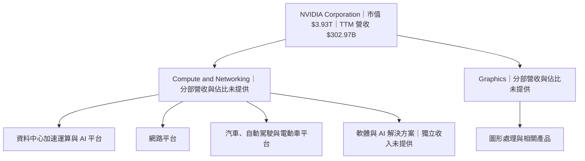
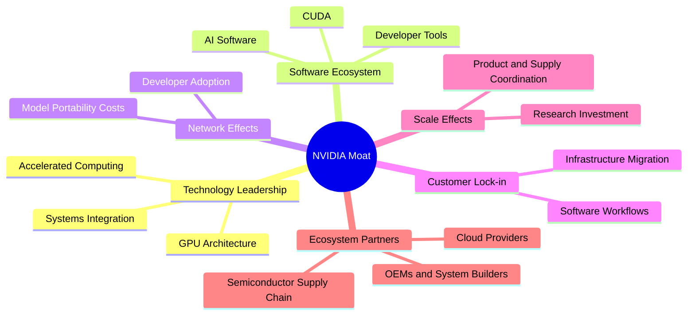
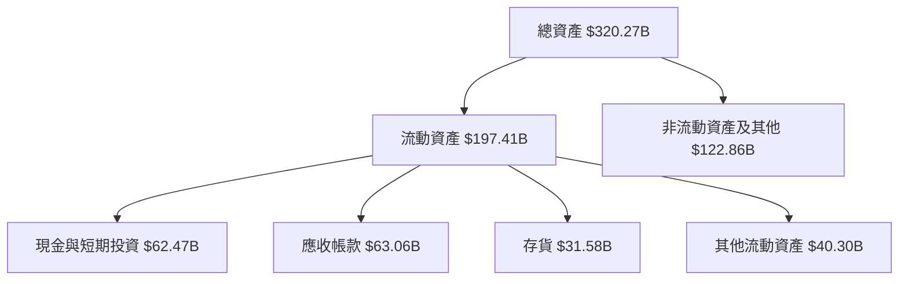
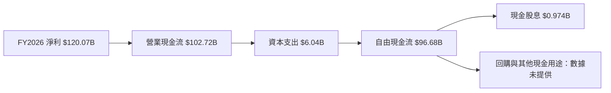
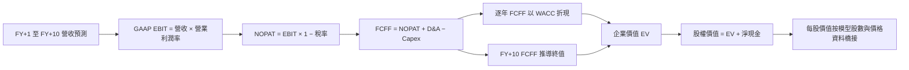
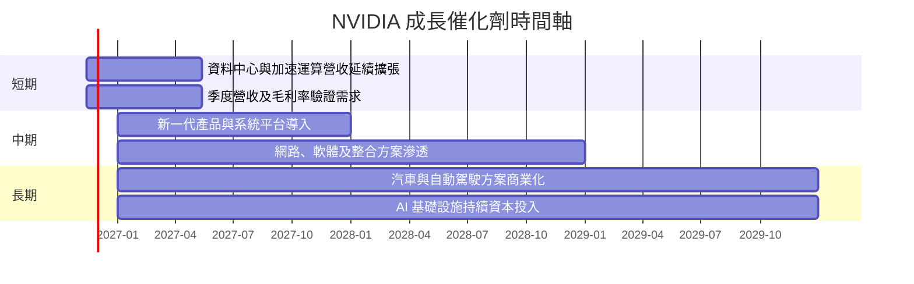
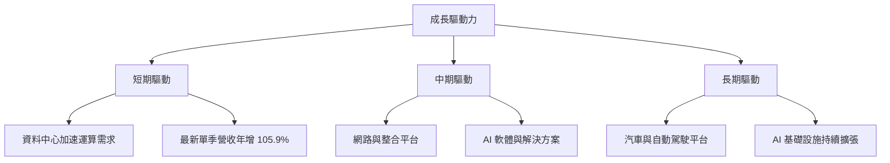
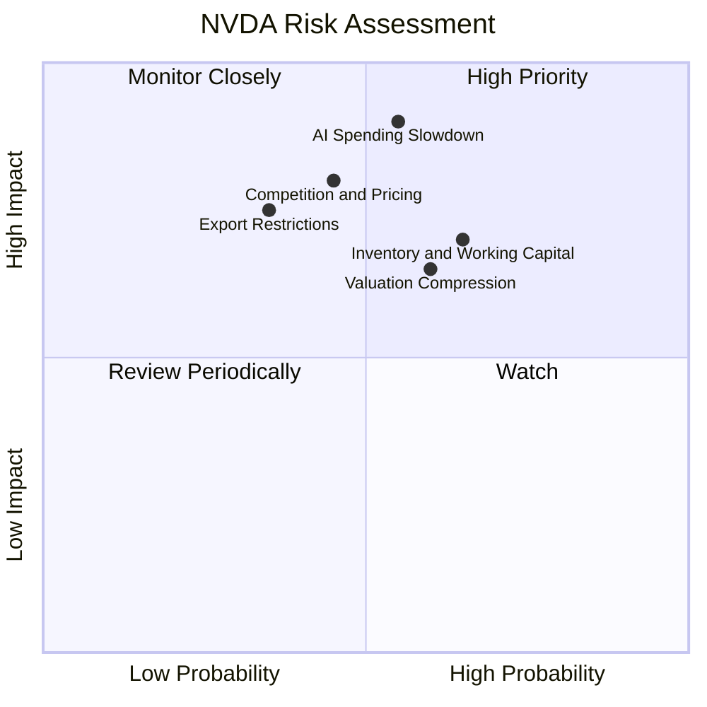
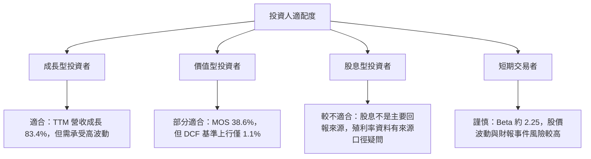

# NVDA 基本面深度分析報告
> **報告日期**：2026-11-14 ｜ **語言**：繁體中文 ｜ **數據來源**：SEC 申報資料 (XBRL)、Yahoo Finance、Finviz、StockAnalysis、Roic.ai ｜ **分析師**：CFA 級機構研究

## 目錄

| # | 章節 | 核心結論 |
|---|------|----------|
| 1 | 執行摘要 | 規則 20 評級為強烈買入；加權合理價值 $265.28，MOS +38.6% |
| 2 | 公司概覽與商業模式 | GPU、軟體與系統生態系構成主要競爭優勢；市場份額數據未提供 |
| 3 | 損益表深度分析 | TTM 營收 $302.97B、TTM 成長 83.4%；最新單季年增 105.9% |
| 4 | 資產負債表分析 | 淨現金 $23.22B；營運資金天數上升，值得監控 |
| 5 | 現金流量深度分析 | TTM FCF $127.01B，FCF Yield 3.23% |
| 6 | 獲利能力與資本效率 | ROIC 80.6% 對 WACC 14.00%，正向利差 66.6 個百分點 |
| 7 | 相對估值分析 | 估值較自身歷史中位數高，但相對部分同業倍數較低 |
| 8 | DCF 內在價值評估 | 基準 DCF 每股 $164.66；加權合理價值 $265.28 |
| 9 | 成長催化劑 | AI 加速運算、網路與軟體生態系是主要成長來源；TAM 數據未提供 |
| 10 | 風險矩陣 | 需求放緩、競爭與資本支出回報是主要風險 |
| 11 | 投資建議 | 維持強烈買入；採分批布局並監控成長、利潤率與現金轉換 |

## 1. 執行摘要

截至 2026-11-13 收盤，NVDA 股價為 **$162.85**。公司 TTM 營收 **$302.97B**、TTM 年增 **83.4%**、TTM 營業利益率 **65.2%**，TTM FCF **$127.01B**，而 ROIC **80.6%** 高於採用的 WACC **14.00%**。依加權估值 **$265.28** 計算，MOS 為 **38.6%**；因此依規則 20 評級為 **🟢 強烈買入**。此評級以加權合理價值與 MOS 門檻決定，並非單靠公司營運品質推導。

### 1.0 一頁式投資儀表板

| 項目 | 內容 |
|------|------|
| **投資論點（3 句）** | ① TTM 營收年增 83.4%，反映資料中心運算需求擴張。② TTM 營業利益率 65.2%、ROIC 80.6%，顯示目前規模與定價能力帶來高回報。③ TTM FCF $127.01B，但基準 DCF 每股 $164.66 僅較現價高 1.1%，估值結論對方法權重和長期成長假設敏感。 |
| **綜合評分** | **8.6/10**（引用 1.1） |
| **財務健康** | 🟢 淨現金 $23.22B、流動比率 4.589；但 CCC 從 105 天升至 155 天 |
| **ROIC vs WACC** | **80.6% vs 14.00%**，創造股東價值 |
| **FCF 趨勢** | TTM FCF $127.01B；FCF Yield **3.23%** |
| **估值** | Forward P/E **10.27x** ｜ EV/EBITDA **19.38x** ｜ FCF Yield **3.23%** |
| **DCF 內在價值（基準）** | **$164.66** ｜ 現價相對 DCF 折價 **1.1%**（第 8.5 節） |
| **安全邊際（MOS）** | **+38.6%**＝($265.28 − $162.85) ÷ $265.28 ｜ 🟢 >25% |
| **預期報酬（基準情境 12M）** | DCF 基準情境 **+1.1%**；加權合理價值上行空間 **+62.9%**，兩者方法及用途不同 |
| **關鍵風險（前二）** | AI 基礎設施需求或客戶投資減速；產品競爭、出口管制與供應鏈限制 |
| **評級 + 信心度** | 🟢 **強烈買入** ｜ 信心：中（DCF 基準與加權價值差距大） |

### 1.1 綜合評分卡（全報告唯一）

| 維度 | 評分（1–10） | 主要依據（引用數字與其來源章節） |
|------|--------------|----------------------------------|
| 成長性 | 9.5 | TTM 營收年增 83.4%，最新一季年增 105.9%（第 3 章） |
| 獲利能力 | 10.0 | TTM 營業利益率 65.2%、ROIC 80.6%，高於 WACC 14.00%；F-Score 5/9（第 6 章） |
| 財務健康 | 9.0 | 淨現金 $23.22B、流動比率 4.589；CCC 增至 155 天（第 4 章） |
| 估值 | 6.5 | 加權 MOS +38.6%，但 DCF 基準價僅 $164.66，且 P/E、P/S 高於自身歷史中位數（第 7–8 章） |
| 護城河 | 9.5 | 營業利潤率 65.2%、高現金生成能力及平台生態系（第 2 章） |
| 管理層與資本配置 | 8.0 | FY2026 SBC $6.39B、稀釋股數測試通過；留存與再投資資本龐大，投資回報需持續驗證 |
| **綜合評分** | **8.8** | 六項算術平均：(9.5 + 10.0 + 9.0 + 6.5 + 9.5 + 8.0) ÷ 6 = **8.75，四捨五入 8.8** |

### 1.2 五大投資論點 + 三大核心風險

| 類型 | 項目 | 具體依據 | 信心度 |
|------|------|----------|--------|
| 🟢 **投資論點①** | AI 算力需求持續擴張 | TTM 營收 $302.97B、年增 83.4%；最新單季年增 105.9% | 🟢 高 |
| 🟢 **投資論點②** | 高利潤率與營業槓桿 | TTM 營業利益率 65.2%；年度營業利益由 FY2023 $5.58B 增至 FY2026 $130.39B | 🟢 高 |
| 🟢 **投資論點③** | 現金流轉化能力強 | TTM OCF $134.36B、Capex $7.35B、FCF $127.01B | 🟢 高 |
| 🟢 **投資論點④** | 資本回報高於資金成本 | ROIC 80.6% − WACC 14.00% = 66.6 個百分點 | 🟢 高 |
| 🟢 **投資論點⑤** | 加權估值有折價 | 加權合理價值 $265.28，相對現價 MOS +38.6% | 🟡 中 |
| 🟡 **風險①** | 成長速度降檔 | 年度營收成長從 FY2025 114.2% 降至 FY2026 65.5%；若降速快於模型預期，估值受壓 | 🟡 中 |
| 🔴 **風險②** | CCC 拉長與庫存增加 | DIO 由 110 天增至 150 天，CCC 由 105 天增至 155 天 | 🔴 高衝擊 |
| 🔴 **風險③** | 估值依賴長期假設 | DCF 終值現值占 EV 44.4%；敏感度矩陣顯示 WACC、永續成長率會顯著改變估值 | 🔴 高衝擊 |

### 1.3 快速統計卡片

| 指標 | 公司實際值（期間） | 同業中位數 | 狀態 |
|------|--------------------|------------|------|
| 營收成長（TTM） | **83.4%** | — | 🟢 |
| 營收成長（最新一季年增） | **105.9%** | **44.7%**（AMD、AVGO、INTC） | 🟢 |
| 毛利率（TTM） | **74.7%** | **56.0%**（AMD、AVGO、INTC） | 🟢 |
| 營業利益率（TTM） | **65.2%** | — | 🟢 |
| ROIC（TTM） | **80.6%** | — | 🟢 |
| Forward P/E | **10.27x** | **30.2x** | 🟢 |
| FCF Yield（TTM） | **3.23%** | — | 🟡 |
| Piotroski F-Score | **5 / 9** | — | 🟡 |

### 1.4 投資結論

╔══════════════════════════════════════════════════════════════════╗  
║                    📊 投資結論摘要                               ║  
╠══════════════════════════════════════════════════════════════════╣  
║ 評級：強烈買入（MOS +38.6%，ROIC 80.6% > WACC 14.00%）           ║  
║ 價格（2026-11-13 收盤）：$162.85                                ║  
║ DCF 內在價值（基準）：$164.66（折價 1.1%）                      ║  
║ 安全邊際 MOS：+38.6%（以加權合理價值為分母）                    ║  
║ 加權合理價值（8.8）：$265.28                                    ║  
║ DCF 情境價值：悲觀 $75.00（-53.9%）｜基準 $164.66（+1.1%）      ║  
║                樂觀 $338.85（+108.1%）                           ║  
║ 綜合評分：8.8/10（引用 1.1）                                    ║  
║ 適合投資人：可承受高波動的成長型、長線持有者                    ║  
╚══════════════════════════════════════════════════════════════════╝

## 2. 公司概覽與商業模式

### 2.1 業務結構與收入來源

公司資料描述兩個業務部門：Compute & Networking 與 Graphics；另包括汽車平台等業務。但沒有提供最新分部收入及佔比，因此不繪製收入比例圖，也不把總營收拆成未證實的分部金額。

### 2.2 市場份額

市場份額數據未提供，無法可靠計算 GPU、資料中心加速器或 AI 軟體的市占率。可以確認的是，NVDA TTM 營收達 $302.97B、成長 83.4%，最新單季營收年增 105.9%；同業最新單季年增率為 AMD 44.7%、AVGO 85.5%、INTC 20.9%。這些數字代表相對成長動能強，但不能直接替代市場份額。

### 2.3 競爭護城河分析

### 2.4 護城河強度

| 護城河項目 | 強度（強／中／弱） | 證據（引用數字或事實） | 會削弱它的情況 |
|------------|--------------------|------------------------|----------------|
| 技術與系統整合 | 強 | TTM 營業利益率 65.2%；Compute & Networking 涵蓋加速運算、網路與 AI 平台 | 競品在效能、供應量、總持有成本上形成可替代方案 |
| 軟體生態系 | 強 | 公司產品描述包含 AI 解決方案與軟體；形成開發與部署遷移成本 | 開放軟體標準普及、客戶採用自研或多平台方案 |
| 網路效應 | 中至強 | 開發者、系統夥伴與客戶互相強化平台吸引力；未提供可量化開發者數據 | 生態系分散或開發工具跨平台化 |
| 客戶鎖定 | 中至強 | 軟體、模型、系統及部署流程共同增加轉換成本；未提供客戶留存數據 | 大型客戶降低供應商集中度 |
| 規模效應 | 強 | FY2026 R&D $18.50B；TTM FCF $127.01B 支持持續投入 | 產品複雜度及供應鏈限制削弱交付能力 |
| 生態夥伴 | 中至強 | 業務跨美國、台灣、中國、香港、歐洲等市場，包含系統與網路平台 | 地緣政治、出口限制或夥伴轉向競品 |

**1.1 護城河分數理由：**9.5/10 反映高營業利益率、軟體平台及系統整合所形成的競爭優勢；因缺乏市占率、留存率與分部數據，未給滿分。

## 3. 損益表深度分析

### 3.1 年度收入成長趨勢（近 4 年）

╔══════════════════════════════════════════════════════════════════╗  
║              NVIDIA 年度收入趨勢（FY2023–FY2026）                ║  
╠══════════════════════════════════════════════════════════════════╣  
║ FY2023  $26.97B   ███░░░░░░░░░░░░░░░░░░░  YoY：基期             ║  
║ FY2024  $60.92B   ██████░░░░░░░░░░░░░░░░  YoY：+125.9% 🟢       ║  
║ FY2025  $130.50B  █████████████░░░░░░░░░  YoY：+114.2% 🟢       ║  
║ FY2026  $215.94B  ██████████████████████  YoY：+65.5% 🟢        ║  
║ 2023–2026 三年 CAGR：(215.94 ÷ 26.97)^(1/3) − 1 ≈ 100.1%       ║  
╚══════════════════════════════════════════════════════════════════╝

營收在 FY2024、FY2025 快速放大，FY2026 仍成長 65.5%，但增速已較前兩年放緩。高基期下仍有擴張，反映需求規模仍大；同時，成長率回落意味估值更依賴新增產品與客戶資本支出的延續。

### 3.2 季度收入趨勢分析

| 季度 | 營收 | QoQ | YoY | 備註 |
|------|------:|----:|----:|------|
| 2025-10-31 | $57.01B | — | — | 2025 年第四季，前一季未列入此表 |
| 2026-01-31 | $68.13B | +19.5% | +73.2% | 營收延續擴張 |
| 2026-04-30 | $81.62B | +19.8% | +85.2% | 年增率進一步提高 |
| 2026-07-26，FY2027 Q2 | $96.22B | +17.9% | +105.9% | 最新單季年增率，不是 TTM 成長率 |

最新一季 QoQ 增幅約 17.9%，較前兩季約 19% 略低，但最新單季 YoY 加速至 105.9%。季度營收增長仍快，然而 QoQ 增幅是較適合辨識短期放緩的指標。

### 3.3 利潤率演變分析

| 利潤率指標 | FY2023 | FY2024 | FY2025 | FY2026 | 趨勢 | 評估 |
|------------|-------:|-------:|-------:|-------:|------|------|
| 毛利率 | 56.9% | 72.7% | 75.0% | 71.1% | FY2025 見高，FY2026 回落 | 🟢 |
| 營業利益率 | 20.7% | 54.1% | 62.4% | 60.4% | 大幅擴張後小幅收斂 | 🟢 |
| 淨利率 | 16.2% | 48.9% | 55.8% | 55.6% | 高位大致持平 | 🟢 |

FY2026 毛利率與營業利益率較 FY2025 低，顯示高增長不必然帶來持續利潤率擴張。可能的影響因素包括產品組合、供應成本、產品轉換與研發投入；現有資料未提供足以定量拆分的項目。另一方面，TTM 毛利率為 74.7%、營業利益率為 65.2%，顯示最新 TTM 口徑與完整 FY2026 年度口徑不同，不應混用。

### 3.4 費用結構分析

損益表提供 FY2026 R&D $18.50B、營收 $215.94B、毛利 $153.46B，但未提供完整可核對的銷管費、其他營業費用及費用分類，因此不繪製費用結構圓餅圖。FY2026 R&D 約為營收的 8.6%（$18.50B ÷ $215.94B），反映公司仍投入研發，但此比率不是完整費用結構。

### 3.5 季度 EPS 趨勢與盈餘品質（Quality of Earnings）

| 季度 | EPS | YoY 成長 | QoQ 成長 | 超預期／不及預期 |
|------|----:|---------:|---------:|----------------|
| 2025-10-31 | $1.30 | +66.7% | — | EPS 預估與實際值缺漏，無法判斷 |
| 2026-01-31 | $1.76 | +95.6% | +35.4% | EPS 預估與實際值缺漏，無法判斷 |
| 2026-04-30 | $2.39 | +214.5% | +35.8% | EPS 預估與實際值缺漏，無法判斷 |
| 2026-07-31 | $2.46 | +127.8% | +2.9% | EPS 預估與實際值缺漏，無法判斷 |

近期 EPS 仍高於去年同期，但 QoQ 增幅從約 35% 降至約 3%，可能反映單季獲利增速開始收斂。盈餘歷史中的 EPS Est 與 EPS Act 為缺值，不能依市場資料判定 beat/miss。

| 盈餘品質項目 | 數值／佔比 | 評估 |
|--------------|-----------|------|
| 股權薪酬 SBC / 營收 | FY2026：$6.39B ÷ $215.94B = **約 3.0%** | 🟡 SBC 是股東成本；規模可控，但仍應觀察每股價值是否被稀釋 |
| SBC / 營業現金流 | FY2026：$6.39B ÷ $102.72B = **約 6.2%** | 🟡 現金流足以覆蓋，仍需納入經濟成本考量 |
| FCF / 淨利（現金轉換率） | TTM FCF $127.01B ÷ TTM 淨利 $192.88B = **約 65.9%** | 🟡 FCF 為正且高，但低於淨利；營運資金與應計項目需持續觀察 |
| 一次性／非經常性損益 | N/A（未提供可核對拆分） | 無法確認是否存在顯著一次性項目 |
| 有效稅率異常 | 15.1%（DCF 採用的最新年度有效稅率） | 未見數據可判定異常；不能據此認定稅率未來固定 |
| 資本化支出 vs 費用化 | TTM Capex $7.35B；資本化細項及會計政策影響未提供 | Capex 相對 FCF 不高，但無法由現有資料判斷是否有成本遞延 |

**盈餘品質結論：** TTM OCF $134.36B、FCF $127.01B 支持獲利有實際現金流，但 FCF/淨利約 65.9%、CCC 拉長，表示淨利並未完全轉化為自由現金流。SBC 需視為股東成本；DCF 採 GAAP EBIT，已將 SBC 納入費用，避免再扣一次。

## 4. 資產負債表分析

### 4.1 資產結構分解

截至 TTM 資產負債表，總資產為 $320.27B；流動資產 $197.41B。現有資料另列應收帳款 $63.06B、存貨 $31.58B、現金與短期投資 $62.47B。餘額包括非流動資產及其他項目；由於完整資產分類未提供，本圖僅呈現有明確數字的類別。

### 4.2 流動性與營運資金分析

| 指標 | 最新 TTM | 一年前 TTM | 變化 | 解讀 |
|------|---------:|-----------:|-----:|------|
| DSO 應收帳款天數 | 76 天 | 61 天 | +15 天 | 收款天數上升；應收帳款增速需與營收、客戶付款條件一併追蹤 |
| DIO 存貨天數 | 150 天 | 110 天 | +40 天 | 庫存週轉放慢；可能包含供應鏈備貨或產品轉換影響，但資料未提供細分原因 |
| DPO 應付帳款天數 | 72 天 | 66 天 | +6 天 | 付款天數略增，供應商信用提供部分營運資金支持 |
| CCC 現金轉換週期 | 155 天 | 105 天 | +50 天 | 現金占用加重；若持續增加，可能壓低現金轉換率 |

流動比率 **4.589**、速動比率 **2.918**，短期流動性有緩衝。不過 DSO、DIO 同時上升，應收與存貨合計擴張可能先於收入變現，需避免只用現金餘額判斷營運資金健康度。

### 4.3 債務結構分析

╔══════════════════════════════════════════════════════════════════╗  
║                   NVIDIA 債務健康診斷                            ║  
╠══════════════════════════════════════════════════════════════════╣  
║ 總債務：          $33.37B  ███████░░░░░░░░░░░░░  🟡             ║  
║ 現金及短期投資：  $56.59B  ████████████░░░░░░░░  🟢             ║  
║ 淨現金：          $23.22B  █████░░░░░░░░░░░░░░░  🟢             ║  
║ 流動比率：        4.589x   流動資產高於流動負債                   ║  
║ Quick Ratio：     2.918x   扣除存貨後仍有流動性緩衝               ║  
║ Debt/EBITDA：     N/A（所需 EBITDA 分母未在核定數據列示）          ║  
║ Interest Coverage：N/A（未提供可核對的利息費用與覆蓋倍數）        ║  
╚══════════════════════════════════════════════════════════════════╝

數據源另有總債務 $38.86B、總現金 $62.47B 的合併資料；本報告財務分析採用核定數字 **債務 $33.37B、現金及短期投資 $56.59B、淨現金 $23.22B**，不以其他來源數字替換或混算。

### 4.4 股東權益趨勢

╔══════════════════════════════════════════════════════════════════╗  
║               NVIDIA 歷年股東權益（年度）                        ║  
╠══════════════════════════════════════════════════════════════════╣  
║ FY2023  $22.10B  ███░░░░░░░░░░░░░░░░░░░░░░                      ║  
║ FY2024  $42.98B  ███████░░░░░░░░░░░░░░░░░░░                      ║  
║ FY2025  $79.33B  █████████████░░░░░░░░░░░                      ║  
║ FY2026  $157.29B █████████████████████████                      ║  
║ FY2026 年增：(157.29 ÷ 79.33) − 1 = 98.3%                       ║  
╚══════════════════════════════════════════════════════════════════╝

股東權益擴張與留存盈餘、獲利增長相符；同期間股數未增加的 F-Score 測試通過，代表稀釋未抵銷每股經濟價值成長。

## 5. 現金流量深度分析

### 5.1 現金流量瀑布圖

FY2026 淨利 $120.07B、營業現金流 $102.72B、Capex $6.04B、FCF $96.68B；股息 $0.974B。年度回購金額未提供，故不把回購或淨現金變化填入現金流瀑布。

### 5.2 FCF 轉換率趨勢

| 財年 | OCF | Capex | FCF | 淨利 | FCF / 淨利 |
|------|----:|------:|----:|----:|-----------:|
| FY2023 | $5.64B | $1.83B | $3.81B | $4.37B | 87.2% |
| FY2024 | $28.09B | $1.07B | $27.02B | $29.76B | 90.8% |
| FY2025 | $64.09B | $3.24B | $60.85B | $72.88B | 83.5% |
| FY2026 | $102.72B | $6.04B | $96.68B | $120.07B | 80.5% |

FCF 逐年增加，但年度 FCF/淨利由 FY2024 的 90.8% 降至 FY2026 的 80.5%。這表示獲利成長仍有現金支持，但現金轉換率不是單向改善；應與應收、存貨和付款週期共同追蹤。

### 5.3 自由現金流趨勢

╔══════════════════════════════════════════════════════════════════╗  
║              自由現金流：年度實際與 TTM                         ║  
╠══════════════════════════════════════════════════════════════════╣  
║ FY2023  $3.81B    █░░░░░░░░░░░░░░░░░░░░░░░                      ║  
║ FY2024  $27.02B   ███████░░░░░░░░░░░░░░░░░░                    ║  
║ FY2025  $60.85B   ███████████████░░░░░░░░░                    ║  
║ FY2026  $96.68B   ████████████████████████░                    ║  
║ 最新 TTM $127.01B ███████████████████████████                  ║  
║ 最新 TTM FCF Yield：3.23%                                        ║  
╚══════════════════════════════════════════════════════════════════╝

### 5.4 資本配置評估

資本配置數據未提供完整的回購、投資、Capex、股息與留存盈餘拆分，因此不繪製資本配置比例圖。可確認 FY2026 Capex $6.04B、股息支付 $0.974B、SBC $6.39B，TTM FCF $127.01B；現金流的主要特徵是再投資後仍保有大量自由現金流，但回購及其他資本配置的具體金額需以申報資料核驗。

## 6. 獲利能力與資本效率

### 6.1 ROE / ROA / ROIC 趨勢

| 指標 | FY2023 | FY2024 | FY2025 | 最新 TTM | 評估 |
|------|------:|------:|------:|---------:|------|
| ROE | N/A | N/A | N/A | **84.2%** | 高回報；採用核定 TTM 指標 |
| ROA | N/A | N/A | N/A | **N/A** | 核定區塊未提供可直接引用的歷年 ROA 序列 |
| ROIC | N/A | N/A | N/A | **80.6%** | 顯著高於 WACC 14.00% |
| WACC | — | — | — | **14.00%** | 採用核定資本成本 |

其他來源顯示 ROE 117.2%、ROA 53.6%，但與核定品質指標所列 ROE 84.2% 不一致；為確保全報告指標口徑一致，此處採 **ROE 84.2%**，不混用其他來源口徑。

### 6.2 ROIC vs WACC 分析（核心價值創造判斷）

╔══════════════════════════════════════════════════════════════════╗  
║                 ROIC vs WACC 深度分析                            ║  
╠══════════════════════════════════════════════════════════════════╣  
║ 無風險利率 Rf（10Y 美債）：       5.15%                           ║  
║ 市場風險溢酬 ERP：                5.00%                           ║  
║ 原始 Beta：                       2.25                            ║  
║ 調整後 Beta：                     1.83                            ║  
║ 股權成本 Ke：                     14.31%                          ║  
║ 稅前債務成本：                    0.78%                           ║  
║ 有效稅率：                        15.1%                           ║  
║ 股權／債務權重：                  99.2%／0.8%                     ║  
║ 採用 WACC：                       14.00%                          ║  
║ ROIC（TTM）：                     80.6%                           ║  
║ EVA 利差：                        80.6% − 14.00% = +66.6pp         ║  
║ 結論：目前回報顯著高於資金成本，創造股東價值                     ║  
╚══════════════════════════════════════════════════════════════════╝

核定成本資本資料列示未受限制計算值 14.20%，並將採用 WACC 限定在 7%–14% 區間，因此本報告採用 **14.00%**，與 DCF 相同。Beta 使用調整後值 1.83，調整方式為 ⅔ × 2.25 + ⅓；WACC 詳細算式見 8.2。ROIC 80.6% 與 WACC 14.00% 相差 66.6 個百分點，顯示現有營運回報遠高於資本成本；若 ROIC 後續跌破 WACC，價值創造論點即失效。

### 6.3 杜邦三因素分解

| 因素 | 數值（TTM） | 解讀 |
|------|-------------|------|
| 淨利率 | 63.7% | 獲利率是 ROE 的主要來源 |
| 資產週轉率 | 0.95 | 資產每年產生接近自身規模的營收 |
| 權益乘數 | 1.40 | 槓桿程度有限，ROE 不主要依靠高槓桿 |
| **ROE** | **84.2%** | 63.7% × 0.95 × 1.40 = 84.7%，與核定 ROE 84.2% 有四捨五入差異 |

### 6.4 財務體質：Piotroski F-Score

Piotroski F-Score 為 **5/9**；九項測試皆有結果。

| 測試 | 結果 | 解讀 |
|------|------|------|
| ROA > 0 | ✅ 通過 | 盈利為正 |
| 營業現金流 > 0 | ✅ 通過 | 營運產生正現金流 |
| ROA 高於一年前 | ❌ 未通過 | 依此測試口徑，ROA 未高於前一年 |
| 營業現金流 > 淨利 | ❌ 未通過 | 應計品質測試未通過，淨利高於營業現金流 |
| 長期負債 ÷ 總資產低於一年前 | ❌ 未通過 | 負債比改善條件未通過 |
| 流動比率高於一年前 | ✅ 通過 | 短期流動性指標改善 |
| 稀釋股數未增加 | ✅ 通過 | 未見稀釋股數增加 |
| 毛利率高於一年前 | ✅ 通過 | 毛利率改善 |
| 資產週轉率高於一年前 | ❌ 未通過 | 資產效率未改善 |

5/9 不是完美的品質訊號：正營運現金流與流動比率改善是正面，但現金流低於淨利、CCC 拉長及資產週轉率測試未通過，均需持續追蹤。

## 7. 相對估值分析

### 7.1 同業估值比較表格

| 估值指標 | **NVDA** | **AMD** | **AVGO** | **INTC** | 本公司評估 |
|----------|---------:|--------:|---------:|--------:|-----------|
| **Trailing P/E** | 20.6x | 114.1x | 44.3x | N/A | 🟢 低於 AMD、AVGO；INTC 不可比較 |
| **Forward P/E** | 10.27x | 30.2x | 17.9x | 33.3x | 🟢 顯著低於同業所列值；須注意不同盈利增長預期 |
| **P/S Ratio** | 13.0x | 19.3x | 18.6x | 5.3x | 🟡 低於 AMD、AVGO，但高於 INTC |
| **EV/EBITDA** | 19.5x | 78.0x | 32.4x | 17.2x | 🟢 低於 AMD、AVGO；略高於 INTC |
| **最新一季營收年增** | 105.9% | 44.7% | 85.5% | 20.9% | 🟢 同業中成長率最高 |
| **毛利率（TTM）** | 74.7% | 56.0% | 75.5% | 40.2% | 🟢 高於 AMD、INTC，略低於 AVGO |

Peer multiples 由 Yahoo Finance 提供。NVDA 相對估值較低，部分由更快成長及更高盈利能力支持，但同業商業組合並不完全相同，倍數差異不能單獨視為低估證據。

### 7.2 歷史估值區間分析

╔══════════════════════════════════════════════════════════════════╗  
║                   NVDA 五年歷史估值位置                          ║  
╠══════════════════════════════════════════════════════════════════╣  
║ P/E：       2.3x ───── 中位數 11.3x ───── 現值 20.6x ─── 49.3x ║  
║                         當前百分位：71%                           ║  
║ P/S：       1.2x ───── 中位數 2.7x ────── 現值 13.1x ─── 31.0x ║  
║                         當前百分位：57%                           ║  
║ EV/EBITDA： 3.4x ───── 中位數 8.9x ────── 現值 19.5x ─── 47.8x ║  
║                         當前百分位：57%                           ║  
╚══════════════════════════════════════════════════════════════════╝

三項 TTM 倍數均高於五年中位數，P/E 位於 71 百分位。這表示估值相對自身歷史不便宜，但仍未接近歷史極端高位。成長放緩時，歷史高於中位數的估值會增加回檔風險。

### 7.3 情境價值（Bear / Base / Bull，照抄 DCF MODEL 的 Scenarios）

| 情境 | 第 1 年營收成長 | 期末營業利潤率 | WACC | 每股價值 | 相對現價 | 機率 | 會發生的條件 |
|------|----------------:|----------------:|-----:|----------:|---------:|-----:|--------------|
| 🔴 悲觀 | 15.0% | 51.3% | 15.00% | $75.00 | -53.9% | 25% | AI 投資與資料中心擴張顯著降速，競爭及成本壓力壓縮利潤率 |
| 🟡 基準 | 30.0% | 60.4% | 14.00% | $164.66 | +1.1% | 50% | 成長逐年放緩，利潤率回歸模型期末假設 |
| 🟢 樂觀 | 45.0% | 66.4% | 13.00% | $338.85 | +108.1% | 25% | 產品需求擴張超預期，規模效益與定價能力維持 |

模型提供的機率加權值為 **$185.79（+14.1%）**，僅作情境參照；第 8.8 節依規定使用基準 DCF 與固定權重估值。

### 7.4 相對估值隱含價格區間

╔══════════════════════════════════════════════════════════════════╗  
║                 相對估值每股價值與現價位置                       ║  
╠══════════════════════════════════════════════════════════════════╣  
║ 悲觀 DCF $75.00 ─ 現價 $162.85 ─ DCF 基準 $164.66               ║  
║                 EV/EBITDA $207.73 ─ 加權值 $265.28              ║  
║                 Forward P/E $478.60 ─ 樂觀 DCF $338.85           ║  
╚══════════════════════════════════════════════════════════════════╝

| 方法 | 每股價值 | 依據 |
|------|---------:|------|
| DCF（基準） | $164.66 | 10 年 FCFF、WACC 14.00%、永續成長率 3.0% |
| 同業 Forward P/E | $478.60 | AMD、AVGO、INTC 同業中位數 30.2x × NVDA Forward EPS $15.85 |
| 同業 EV/EBITDA | $207.73 | AVGO、INTC 同業中位數 24.8x × TTM EBITDA，並加回淨現金 |
| 分析師共識目標價 | $278.31 | 53 位分析師平均目標價 |

Forward P/E 估值特別高，對盈利基數與估值倍數高度敏感；同業 EV/EBITDA 的 $207.73 相對較接近 DCF。因此不宜以單一相對估值法取代現金流分析。

## 8. DCF 內在價值評估（Discounted Cash Flow）

### 8.0 估值推理鏈（Thinking Logic）

**Step 1 — 價值由哪些變數決定？**  
模型以全公司現有業務營收 $302.97B 為起點，不另將 Compute、Graphics 或軟體拆分成未提供的收入比例。估值由未來營收增長、GAAP 營業利潤率及 WACC／永續成長率共同決定；由敏感度矩陣看，折現率與終值成長率對價值影響顯著。

**Step 2 — 模型選擇**

| 決策點 | 本報告採用 | 理由（含數字） | 曾考慮但否決 | 否決理由 |
|--------|-----------|----------------|--------------|----------|
| 現金流定義 | FCFF | 對應 WACC 折現，先得到 EV；TTM FCF 為 $127.01B | FCFE | 債務結構不是模型的主要營運變數 |
| 預測期 N | 10 年 | DCF 模型固定為 10 年；涵蓋高成長逐步淡出的期間 | 5 年 | 無法呈現模型所設定的逐年成長淡化 |
| 終值方法 | Gordon Growth | g=3.0%，低於 WACC 14.00% | 退出倍數 | DCF 程式基準採 Gordon Growth；退出倍數交叉驗證數據未提供 |
| EBIT 基礎 | GAAP | DCF 明確使用 GAAP EBIT | 非 GAAP | 可能加回 SBC，與固定股數處理不一致 |

**Step 3 — 關鍵假設推導鏈**

- **營收成長曲線：**錨點＝TTM 營收成長 83.4%、最新單季 YoY 105.9% → 調整＝以高基期及年度成長放緩降低持續性 → **FY+1 成長 30.0%，FY+10 成長 3.0%，中間線性遞減** → 曾考慮延續 83.4%，但不採用，因會將近期高速成長過度外推。
- **期末營業利潤率：**錨點＝TTM 65.2% → 調整＝由高位逐步回落至模型指定的近五年中位數 → **FY+10 60.4%** → 未採用長期維持 65.2%，因未來競爭、產品組合與成本變化可能壓低利潤率。
- **永續成長率 g：**錨點＝長期經濟成長需低於資本成本；具體長期 GDP 與通膨資料未提供 → 採用模型值 **3.0%** → 不採用高於 WACC 的成長率，避免 Gordon Growth 失效。
- **預測期 N：**錨點＝模型固定 10 年 → 調整＝不另行調整，採用 **10 年** → 曾考慮更短期間，但本模型已預設完整 10 年現金流，不自行改建。
- **Capex/營收：**錨點＝TTM Capex $7.35B ÷ TTM 營收 $302.97B 約 2.4% → 依模型逐步淡化至 1.3% → **FY+1 2.4%、FY+10 1.3%** → 不採用長期維持 2.4%，因模型假設收入增長後資本支出強度下降。
- **EBIT 基礎及 SBC：**錨點＝GAAP EBIT 已扣除 SBC → 採組合 **(A) GAAP EBIT + 固定股數**，不再扣 SBC，年稀釋率設為 0% → 不採用 GAAP EBIT 再扣 SBC或再加股數稀釋，以免重複計算。
- **WACC：**錨點＝資本成本區塊未限制計算值 14.20% → 依提供的 7%–14% 區間上限採用 **14.00%** → 不採用 14.20%，因核定資本成本明確要求採用受限值。
- **稅率、D&A：**有效稅率採用 15.1%；D&A/營收採用 TTM 1.2%，兩者均照模型假設固定。
- **終值方法：**採 Gordon Growth，並以 FY+10 FCFF 作基礎；不另用無資料支持的退出倍數改寫終值。

**Step 4 — 最脆弱環節**  
最脆弱的是十年營收及利潤率路徑：若需求與利潤率下滑至悲觀情境，模型每股價值為 $75.00，而不是基準 $164.66；這與 8.9 的風險方向一致。

**Step 5 — 計算路徑圖**

### 8.1 模型假設總表（Model Inputs）

| 假設項目 | 採用值 | 依據／來源 | 敏感度 |
|----------|--------|-------------|--------|
| 預測期長度 N | 10 年 | DCF MODEL 固定預測期 | 🟡 中 |
| 營收成長曲線 | FY+1 30.0% → FY+10 3.0%，線性遞減 | TTM 成長 83.4%；模型將成長限制於 0%–30% 並逐步淡出 | 🔴 高 |
| 營業利潤率 | FY+1 65.2% → FY+10 60.4% | TTM 營業利益率及模型所列近五年中位數 | 🔴 高 |
| 有效稅率 | 15.1% | 最新年度有效稅率 | 🟢 低 |
| Capex / 營收 | 2.4% → 1.3% | TTM Capex/營收約 2.4%；模型淡化至 1.1×D&A 附近 | 🟡 中 |
| D&A / 營收 | 1.2% | TTM 比率，固定 | 🟢 低 |
| 營運資金變動 | 不建模 | DCF MODEL 明確未建模 working capital | 🟢 低 |
| EBIT 基礎 | GAAP | 模型採 GAAP EBIT | 🟡 中 |
| SBC 處理 | 組合 (A)：不另扣 SBC | GAAP EBIT 已含 SBC 費用 | 🟡 中 |
| 年稀釋率 | 0% | 固定股數；SBC 成本已反映於 GAAP EBIT | 🟡 中 |
| 永續成長率 g | 3.0% | DCF MODEL 指定，且低於 WACC | 🔴 高 |
| 終值方法 | Gordon Growth | DCF MODEL 提供的基準方法 | 🔴 高 |
| WACC | 14.00% | 核定資本成本；14.20% 計算值受限於 7%–14% 區間 | 🔴 高 |

FCFF 定義為 **NOPAT + D&A − Capex**；模型不含 ΔWC。模型採用 (A)，故 SBC 影響已計入一次。

### 8.2 折現率推導（WACC）

╔══════════════════════════════════════════════════════════════════╗  
║                    WACC 推導（折現率）                           ║  
╠══════════════════════════════════════════════════════════════════╣  
║ Rf（10Y 美債）：                   5.15%                           ║  
║ ERP（假設值）：                    5.00%                           ║  
║ 原始 Beta（Yahoo Finance）：        2.25                            ║  
║ 調整後 Beta：                      ⅔ × 2.25 + ⅓ = 1.83             ║  
║ Ke：                               5.15% + 1.83 × 5.00% = 14.30%   ║  
║ 核定 Ke：                          14.31%                          ║  
║ 稅前 Kd：                          0.78%                           ║  
║ 稅後 Kd：                          0.78% × (1 − 15.1%) = 0.66%     ║  
║ E / D 權重：                       99.2% / 0.8%                    ║  
║ 未限制計算 WACC：                  14.20%                          ║  
║ 採用 WACC：                        14.00%（受限於 7%–14% 區間）    ║  
╚══════════════════════════════════════════════════════════════════╝

Rf 日期未在資本成本資料中細列，採用核定 5.15%；ERP 5.00% 為假設值，來源為資本成本輸入。未加計規模或國別溢酬，因未提供相應依據。計息負債、平均負債餘額及利息費用拆分不足以由本報告獨立重建 Kd，故遵照核定 Cost of capital 輸入，不自行替代。

**逐步演算（WACC）：**

1. **Ke（CAPM）**＝5.15% + 1.83 × 5.00%＝5.15% + 9.15%＝14.30%；核定值為 **14.31%**（未四捨五入輸入）。
2. **稅前 Kd**＝核定值 **0.78%**；利息費用與平均計息負債的原始金額未提供，不能另行重建。
3. **稅後 Kd**＝0.78% × (1 − 15.1%)＝0.78% × 84.9%＝**0.6622%**，四捨五入 0.66%。
4. **權重**＝E 99.2%、D 0.8%；合計 99.2% + 0.8% = **100.0%**。市場市值為 $3.93T，核定權重照抄，不由市值與其他來源債務反推替代。
5. **未限制 WACC**＝99.2% × 14.31% + 0.8% × 0.6622%＝14.1955% ≈ **14.20%**；依 7%–14% 限制後，採用 **14.00%**。第 6.2 節採相同數值。

### 8.3 逐年自由現金流預測（基準情境）

單位：$B；金額取 2 位小數，折現因子取 3 位小數。DCF 模型不建模營運資金，因此不列 ΔWC；GAAP EBIT 已含 SBC，不列 SBC 扣除項。

| 年度 | FY+1 | FY+2 | FY+3 | FY+4 | FY+5 | FY+6 | FY+7 | FY+8 | FY+9 | FY+10 |
|------|-----:|-----:|-----:|-----:|-----:|-----:|-----:|-----:|-----:|------:|
| 營收 | 393.86 | 500.20 | 620.25 | 750.50 | 885.59 | 1,018.43 | 1,140.64 | 1,243.30 | 1,317.90 | 1,357.44 |
| 營收 YoY | 30.0% | 27.0% | 24.0% | 21.0% | 18.0% | 15.0% | 12.0% | 9.0% | 6.0% | 3.0% |
| 營業利潤率 | 65.2% | 64.7% | 64.1% | 63.6% | 63.1% | 62.5% | 62.0% | 61.5% | 60.9% | 60.4% |
| GAAP EBIT | 256.85 | 323.52 | 397.83 | 477.35 | 558.51 | 636.82 | 707.11 | 764.08 | 802.85 | 819.64 |
| − 稅 | (38.83) | (48.91) | (60.14) | (72.16) | (84.43) | (96.27) | (106.89) | (115.51) | (121.37) | (123.91) |
| = NOPAT | 218.02 | 274.61 | 337.69 | 405.19 | 474.08 | 540.55 | 600.22 | 648.57 | 681.48 | 695.74 |
| + D&A | 4.79 | 6.09 | 7.55 | 9.13 | 10.78 | 12.39 | 13.88 | 15.13 | 16.04 | 16.52 |
| − Capex | (9.56) | (11.54) | (13.55) | (15.49) | (17.21) | (18.56) | (19.41) | (19.65) | (19.24) | (18.17) |
| **= FCFF** | **213.26** | **269.16** | **331.68** | **398.82** | **467.65** | **534.39** | **594.69** | **644.05** | **678.28** | **694.09** |
| 折現因子 @14.00% | 0.877 | 0.769 | 0.675 | 0.592 | 0.519 | 0.456 | 0.400 | 0.351 | 0.308 | 0.270 |
| **FCFF 現值 PV** | **187.07** | **207.11** | **223.88** | **236.14** | **242.88** | **243.46** | **237.66** | **225.78** | **208.58** | **187.23** |

預測期 PV 合計：  
**$187.07 + $207.11 + $223.88 + $236.14 + $242.88 + $243.46 + $237.66 + $225.78 + $208.58 + $187.23 = $2,199.79B**。  
模型合計為 **$2,199.78B**；差異 $0.01B，來自各年度金額四捨五入，低於 1%。

**FY+1 逐步演算：**

1. 營收＝$302.97B × (1 + 30.0%)＝**$393.86B**。
2. EBIT＝$393.86B × 65.2%＝**$256.85B**。
3. 稅＝$256.85B × 15.1%＝**$38.83B**。
4. NOPAT＝$256.85B − $38.83B＝**$218.02B**。
5. D&A＝$393.86B × 1.2%＝**$4.79B**。
6. Capex＝$393.86B × 2.4%＝**$9.56B**。
7. ΔWC＝模型不建模，故為 **$0.00B（模型處理）**，不是歷史估算。
8. FCFF＝$218.02B + $4.79B − $9.56B＝**$213.25B**；模型逐項數字列示為 **$213.26B**，差異為底層未四捨五入值。
9. 折現因子＝1 ÷ (1 + 14.00%)¹＝**0.877**；PV＝$213.26B × 0.877＝**$187.07B**（以模型未四捨五入值計算）。

**合理性自檢：**
- 模型 FY+1 至 FY+10 FCFF 由 $213.26B 增至 $694.09B；十年 CAGR 約 **12.5%**。FY2023 至 FY2026 年度 FCF 由 $3.81B 增至 $96.68B，歷史 CAGR 約 **194%**；歷史值受低基期影響，不能直接外推。
- FY+10 FCFF 利潤率＝$694.09B ÷ $1,357.44B＝**51.1%**；目前 TTM FCF 利潤率＝$127.01B ÷ $302.97B＝**41.9%**。模型隱含逐步提高，且沒有同業最佳 FCF 利潤率資料可比較。
- 每年 FCFF 均為正；模型未包括營運資金變動，CCC 上升可能令實際 FCF 低於預測。

╔══════════════════════════════════════════════════════════════════╗  
║            自由現金流：歷史實際 vs 模型預測                      ║  
╠══════════════════════════════════════════════════════════════════╣  
║ FY2024 實際 $27.02B  ███░░░░░░░░░░░░░░░░░░░                      ║  
║ FY2025 實際 $60.85B  ██████░░░░░░░░░░░░░░░░                      ║  
║ FY2026 實際 $96.68B  ██████████░░░░░░░░░░                        ║  
║ FY+1 預測  $213.26B █████████████████████░                      ║  
║ FY+10 預測 $694.09B ███████████████████████████████████████████ ║  
║ 預測 FCFF CAGR 約 12.5%；模型未納入營運資金變動                  ║  
╚══════════════════════════════════════════════════════════════════╝

### 8.4 終值計算（Terminal Value）

**適用性檢查：**WACC **14.00%** vs g **3.0%** → WACC > g？✅

| 方法 | 計算式 | 終值 TV | TV 現值 | 佔總 EV 比重 |
|------|--------|--------:|--------:|-------------:|
| Gordon Growth | FY+10 FCFF × (1+g) ÷ (WACC−g) | $6,499.17B | $1,753.11B | 44.4% |
| 退出倍數法 | N/A（DCF MODEL 未提供退出倍數終值） | N/A | N/A | N/A |

**逐步演算：**

1. FY+10 FCFF＝**$694.09B**。
2. 分子＝$694.09B × (1 + 3.0%)＝**$714.91B**（模型未四捨五入值推導）。
3. 分母＝14.00% − 3.0%＝**11.00%**；TV＝$714.91B ÷ 11.00%＝**$6,499.17B**。
4. PV(TV)＝$6,499.17B × 0.270＝**$1,753.11B**（模型採未四捨五入折現因子）。
5. 終值占比＝$1,753.11B ÷ $3,952.89B＝**44.4%**。

終值比重未超過 75%，但仍接近企業價值的一半，長期假設不可忽略。退出倍數交叉驗證未提供可直接照抄的 DCF 終值倍數，本報告不自行編造。

### 8.5 企業價值 → 每股內在價值（Bridge）

╔══════════════════════════════════════════════════════════════════╗  
║              企業價值 → 每股內在價值 橋接表                      ║  
╠══════════════════════════════════════════════════════════════════╣  
║ 預測期 FCF 現值合計             +$2,199.78B                       ║  
║ 終值現值 PV(TV)                 +$1,753.11B                       ║  
║ = 企業價值 EV                    $3,952.89B                       ║  
║ + 淨現金                         +$23.22B                          ║  
║ = 股權價值                       $3,976.11B                       ║  
║ 每股價值（依模型價格／市值橋接） $164.66                          ║  
║ 當前股價（2026-11-13 收盤）       $162.85                          ║  
║ 折溢價（現價÷DCF內在價值−1）      -1.1%（折價）                    ║  
╚══════════════════════════════════════════════════════════════════╝

**逐步演算：**

1. EV＝$2,199.78B + $1,753.11B＝**$3,952.89B**。
2. 股權價值＝$3,952.89B + $23.22B＝**$3,976.11B**。
3. 每股價值＝模型列示公式「股權價值 × 價格 ÷ 市值」，DCF MODEL 結果為 **$164.66**；該行使用價格資料庫及模型底層未四捨五入市值，不用摘要四捨五入市值重建。
4. 折溢價＝$162.85 ÷ $164.66 − 1＝**-1.1%**。
5. **本節不計算 MOS**；MOS 僅於 8.8 以加權合理價值為分母計算。

股數按模型組合 (A) 固定，不另計年稀釋；財報資產負債表所列淨現金為 2026-07-26 最新 TTM 口徑 **$23.22B**。模型每股換算採其指定的價格／市值橋接，不另以不同來源股數重算。

### 8.6 敏感性分析（WACC × 永續成長率）

| g（列）／WACC（欄） | 12.00% | 13.00% | **14.00%（基準）** | 15.00% | 16.00% |
|-----------|-------:|-------:|-------------------:|-------:|-------:|
| 2.0% | $195.90（+20.3%） | $175.14（+7.5%） | $157.97（-3.0%） | $143.56（-11.8%） | $131.31（-19.4%） |
| 2.5% | $201.36（+23.6%） | $179.28（+10.1%） | $161.17（-1.0%） | $146.07（-10.3%） | $133.31（-18.1%） |
| 3.0% | $207.42（+27.4%） | $183.83（+12.9%） | **$164.66（+1.1%）** | $148.79（-8.6%） | $135.46（-16.8%） |
| 3.5% | $214.20（+31.5%） | $188.87（+16.0%） | $168.49（+3.5%） | $151.76（-6.8%） | $137.79（-15.4%） |
| 4.0% | $221.82（+36.2%） | $194.47（+19.4%） | $172.70（+6.0%） | $154.98（-4.8%） | $140.31（-13.8%） |

相對現價百分比按「每股價值 ÷ $162.85 − 1」計算。矩陣數值與 DCF MODEL 原值一致；百分比為四捨五入呈現。

**矩陣有效格示範：**所選格 WACC **13.00% > g 3.0%** ✅。但該敏感度矩陣只提供各格每股價值，沒有提供重新折現的年度 PV、終值 PV、股權價值中間值；依規定不得自行另建模型，故不能把矩陣格的黑箱中間過程冒充為可複算算式。矩陣格值照抄模型。

**三情境 DCF**

| 情境 | 營收成長假設 | 期末營業利潤率 | g | WACC | 每股內在價值 | 相對現價 | 機率 |
|------|------------|----------------|---|------|--------------|----------|------:|
| 🔴 悲觀 | FY+1 15.0% | 51.3% | N/A（情境模型未另列） | 15.00% | $75.00 | -53.9% | 25% |
| 🟡 基準 | FY+1 30.0% | 60.4% | 3.0% | 14.00% | $164.66 | +1.1% | 50% |
| 🟢 樂觀 | FY+1 45.0% | 66.4% | N/A（情境模型未另列） | 13.00% | $338.85 | +108.1% | 25% |
| **機率加權** | — | — | — | — | **$185.79** | **+14.1%** | **100%** |

DCF MODEL 沒有提供悲觀及樂觀情境的 FY+10 營收、FCFF、終值中間值，也未列各情境 g；依規定不自行補算。機率加權可複核：**$75.00 × 25% + $164.66 × 50% + $338.85 × 25% = $185.79**（模型使用未四捨五入數值）。

**敏感度結論：**
- g 由 2.0% 增至 3.0%、WACC 14.00% 固定：$157.97 → $164.66，增加 **$6.69／4.2%**。
- WACC 由 13.00% 增至 14.00%、g 3.0% 固定：$183.83 → $164.66，減少 **$19.17／10.4%**。
- 期末營業利潤率每 +1pp 的單獨彈性：**N/A（敏感度矩陣未提供此維度）**。
- 依已有矩陣，WACC 變動的 1 個百分點影響大於 g 上升 1 個百分點，方向與 8.0 所述資本成本／終值折現的重要性一致。

### 8.7 反推 DCF（Reverse DCF：市場在預期什麼）

模型只提供兩個單變數反推結果；其餘變數未提供，不自行求解。固定輸入依模型基準：WACC 14.00%、稅率 15.1%、Capex 路徑為模型值、ΔWC 不建模、N=10 年、固定股數。

| 求解的變數（一次一個） | 其餘變數設定 | 市場隱含值（令 DCF = 現價） | 公司歷史／基準 | 判斷 |
|------------------------|--------------|------------------------------:|----------------|------|
| FY+1 營收成長率 | 其餘基準假設固定 | **29.7%** | 基準 30.0%；TTM 成長 83.4% | 🟡 現價已反映接近基準的第一年成長 |
| 固定營業利潤率 | 成長、g 其餘固定 | **61.0%** | TTM 65.2%；基準由 65.2% 降至 60.4% | 🟡 仍要求長期維持高利潤率 |
| 永續成長率 g | 未計算 | N/A | 基準 3.0% | DCF MODEL 未提供 |
| 預測期 N | 未計算 | N/A | 基準 10 年 | DCF MODEL 未提供 |

模型沒有提供營收 CAGR 反推的數值迭代軌跡或每一步中間估值；因此不能聲稱使用特定級距試算，也不能補造軌跡。反推結果顯示，現價大致要求 FY+1 成長約 29.7%，並要求長期營業利潤率約 61.0%；若成長及利潤率同時明顯下滑，現價將難由基準現金流路徑支撐。

### 8.8 估值三角驗證與安全邊際

| 估值方法 | 隱含每股價值 | 上行空間（÷現價） | 權重 | 說明 |
|----------|--------------:|-------------------:|------|------|
| DCF（基準） | $164.66 | +1.1% | 40% | 10 年 FCFF、WACC 14.00%、g 3.0% |
| 同業 Forward P/E | $478.60 | +193.9% | 25% | 同業中位數 30.2x × Forward EPS $15.85 |
| 同業 EV/EBITDA | $207.73 | +27.6% | 25% | 同業中位數 24.8x × TTM EBITDA，加回淨現金 |
| 分析師共識目標價 | $278.31 | +70.9% | 10% | 53 位分析師平均目標價 |
| **加權合理價值** | **$265.28** | **+62.9%** | **100%** | — |

加權合理價值完整算式：  
**$164.66 × 40% + $478.60 × 25% + $207.73 × 25% + $278.31 × 10%  
= $65.864 + $119.650 + $51.9325 + $27.831  
= $265.2775 ≈ $265.28。**

方法權重依獲利公司類型固定；未列出被剔除方法，因列示四項均可計算。相對估值法依同業中位數倍數，不以 NVDA 自身倍數替代。

╔══════════════════════════════════════════════════════════════════╗  
║                  估值區間與安全邊際                              ║  
╠══════════════════════════════════════════════════════════════════╣  
║ $75.00 ─── $162.85 ─── [$265.28] ─── $164.66 ─── $338.85       ║  
║ 悲觀DCF       現價       加權合理值     基準DCF       樂觀DCF     ║  
║                                                                  ║  
║ MOS = ($265.28 − $162.85) ÷ $265.28 = +38.6%                    ║  
║ MOS 評估：🟢 >25% 充足                                           ║  
║ 上行空間 = ($265.28 − $162.85) ÷ $162.85 = +62.9%               ║  
║ 建議買入區間：$148.80–$238.75                                   ║  
║ 合理持有區間：$238.75–$265.28                                    ║  
║ 減碼考慮區間：高於 $338.85                                       ║  
╚══════════════════════════════════════════════════════════════════╝

MOS 按加權合理價值計算，與 1.0 儀表板相同。買入區間上限 $238.75 為加權合理價值的 90%（$265.28 × 90%），即 MOS 10% 門檻；下限參考已提供的 52 週低點 $148.80，並非模型內在價值下限。

> 🔎 **程式複算（Python，依本節各項自動重算）**
>
> 加權合理價值 = $164.66 × 40% + $478.60 × 25% + $207.73 × 25% + $278.31 × 10% = **$265.28**（權重合計 100%）
>
> 以價格 $162.85 計：MOS = **+38.6%**，上行空間 = **+62.9%**
>
> ✅ 與本節所寫數值一致。

### 8.9 DCF 模型的局限與失效條件

- **終值依賴度：**終值現值占 EV **44.4%**，近半企業價值由 FY+10 之後的現金流假設決定。
- **最脆弱假設：**營收成長與利潤率路徑。悲觀情境價值 **$75.00**，相對基準 $164.66 下跌約 54.4%；其對現價為 -53.9%。
- **營運資金缺口：**模型不建模 ΔWC，但 CCC 從 105 天增至 155 天；若營運資金占用持續上升，模型 FCF 會偏高。
- **SBC 與股數：**使用 GAAP EBIT，股數固定。此法避免 SBC 重複扣除，但若未來 SBC 導致股數增加，固定股數假設會高估每股價值。
- **現金流適用性：**公司目前 TTM FCF 為正，適合 DCF；但高成長半導體公司的供應週期、產品更替與客戶集中資本支出可能使遠期預測誤差較大。相對估值與情境分析應作交叉參照。
- **風險連結：**AI 投資降速會衝擊營收成長；競爭加劇會壓縮營業利潤率；庫存和應收增加會令未建模 ΔWC 假設失效；資本成本上升則直接壓低折現價值。

### 8.10 複算檢核表（Audit Trail）

| # | 檢核項目 | 檢查方式 | 結果 |
|---|----------|----------|------|
| 1 | 所有高／中敏感度輸入都有推導 | 對照 8.1 與 8.0；模型未提供部分以 N/A 說明 | ✅ |
| 2 | 每個假設都有來歷 | 8.1 依據欄列出數據或模型來源 | ✅ |
| 3 | WACC 算式與權重 | 權重 99.2% + 0.8% = 100%；未限制值 14.20%，採用 14.00% | ✅ |
| 4 | Kd 分母與債務權重口徑 | 原始平均計息負債及拆分未提供；採核定資本成本輸入，未自行拼湊 | ⚠️ |
| 5 | WACC 與第 6.2 節一致 | 兩節均採 14.00% | ✅ |
| 6 | 逐年表格年度數 | FY+1 至 FY+10 共 10 年，無省略 | ✅ |
| 7 | 代表年度 FCFF 與 PV | 模型底層未四捨五入值與展示值有 $0.01B 尾差 | ⚠️ |
| 8 | 預測期 PV 加總 | 展示值 $2,199.79B；模型值 $2,199.78B，差 $0.01B | ✅ |
| 9 | WACC > g | 14.00% > 3.0% | ✅ |
| 10 | 終值基期與折現期 | FY+10 FCFF，折現 10 期 | ✅ |
| 11 | EV 與股權價值橋接 | $2,199.78B + $1,753.11B = $3,952.89B；加淨現金為 $3,976.11B | ✅ |
| 12 | SBC 三要素一致性 | GAAP EBIT、無 SBC 扣除列、固定股數／0% 稀釋 | ✅ |
| 13 | 敏感度基準格 | WACC 14%、g 3.0% = $164.66 | ✅ |
| 14 | 敏感矩陣有效性 | 所有 WACC 均大於表列 g | ✅ |
| 15 | 三情境機率加總 | 25% + 50% + 25% = 100%；模型加權值 $185.79 | ✅ |
| 16 | 反推每列只放開一個變數 | 已列模型提供的兩個單變數結果；未提供迭代軌跡 | ⚠️ |
| 17 | MOS 與折溢價口徑 | MOS 使用 $265.28；折溢價使用 DCF $164.66 | ✅ |
| 18 | 報告完整至第 11 章 | 章節 1–11 均列出 | ✅ |
| 19 | 加權合理價值加總 | 加權算式合計 $265.2775，四捨五入 $265.28 | ✅ |
| 20 | 評級符合規則 20 | MOS +38.6%，ROIC 80.6% > WACC 14.00%，強烈買入 | ✅ |

**未完全驗證項目：**平均計息負債原始拆分與 DCF 中間數字的完整未四捨五入值未提供；採核定資本成本及 DCF 輸出，不自行重建或改寫。反推模型亦未提供迭代軌跡，故只引用可核定的解。

## 9. 成長催化劑

### 9.1 催化劑時間軸

上述日期是分析追蹤時間範圍，不代表管理層承諾產品時程。已知業務描述涵蓋資料中心、網路、AI 軟體、汽車平台；具體產品上市日與訂單數據未提供。

### 9.2 TAM 市場規模分析

**N/A（TAM 數據未提供）**。NVDA TTM 營收為 $302.97B、成長 83.4%，顯示現有業務規模已大，但沒有可引用的市場總量、滲透率與年份資料，因此不估算 TAM 或市場滲透率。

### 9.3 成長驅動力結構圖

## 10. 風險矩陣

### 10.1 風險評分矩陣

### 10.2 風險清單詳細分析

| # | 風險項目 | 發生機率 | 財務衝擊 | 風險評分 | 緩解措施 |
|---|----------|----------|----------|----------|----------|
| 1 | 🔴 AI 資本支出與需求放緩 | 中（約 35%–55%，分析判斷） | 高；若營收成長低於 DCF FY+1 30.0%，內在價值可能下修至悲觀情境 $75.00 | 🔴 8.5/10 | 追蹤季度營收年增、訂單與客戶資本支出；避免以單季高增長線性外推 |
| 2 | 🔴 競爭與價格／毛利壓力 | 中（約 30%–50%，分析判斷） | 高；FY2026 毛利率由 FY2025 75.0% 回落至 71.1% | 🔴 8.0/10 | 追蹤毛利率、營業利益率與產品組合；觀察同業成長和平台替代 |
| 3 | 🔴 庫存及營運資金惡化 | 中高（約 45%–65%，分析判斷） | 中高；DIO +40 天、CCC +50 天，可能壓低實際 FCF | 🔴 7.5/10 | 按季追蹤 DIO、DSO、FCF/淨利及存貨增速 |
| 4 | 🟡 出口管制及地緣政治 | 中（約 25%–45%，分析判斷） | 高；可能限制可服務市場與產品配置 | 🟡 7.0/10 | 追蹤法規變化、地區營收與供應鏈配置 |
| 5 | 🟡 估值倍數收縮 | 中高（約 40%–60%，分析判斷） | 中高；P/E 20.6x 高於五年中位數 11.3x | 🟡 7.0/10 | 以現金流與加權價值分批布局，避免單以同業倍數追價 |

機率與風險分數為分析判斷，非財務報表數據。主要量化警訊是成長較模型假設大幅降速、利潤率持續回落，以及 CCC 延長。

## 11. 投資建議

### 11.1 最終評級與評分

依 MOS **+38.6%** 且 ROIC **80.6%** 高於 WACC **14.00%**，規則 20 評級為 **🟢 強烈買入**；未作質化調整。1.1 綜合評分為 **8.8/10**，六項分數為成長性 9.5、獲利能力 10.0、財務健康 9.0、估值 6.5、護城河 9.5、管理層與資本配置 8.0。

### 11.2 合理價值與隱含報酬率

| 估值 | 每股價值 | 相對現價 | 機率／權重 |
|------|---------:|---------:|-----------:|
| 加權合理價值 | **$265.28** | **+62.9%** | 估值方法權重 100% |
| DCF 悲觀情境 | $75.00 | -53.9% | 25% |
| DCF 基準情境 | $164.66 | +1.1% | 50% |
| DCF 樂觀情境 | $338.85 | +108.1% | 25% |
| DCF 機率加權參照 | $185.79 | +14.1% | 100% |

加權合理價值與 DCF 機率加權值的用途不同：前者是固定權重估值的評級基礎，後者是模型情境的參照，不互相替代。

### 11.3 買入時機與觸發因素

╔══════════════════════════════════════════════════════════════════╗  
║                  ✅ 買入觸發因素 Checklist                      ║  
╠══════════════════════════════════════════════════════════════════╣  
║ 立即分批布局條件：                                               ║  
║ ✅ 現價 $162.85 低於加權合理價值 $265.28                         ║  
║ ✅ TTM FCF $127.01B 為正，淨現金 $23.22B                         ║  
║ ✅ ROIC 80.6% 高於 WACC 14.00%                                   ║  
║                                                                  ║  
║ 加碼觸發條件：                                                   ║  
║ ☐ 最新單季營收年增維持 30% 以上且營業利益率維持 60% 以上         ║  
║ ☐ FCF 持續為正，且 CCC 停止上升、DIO 開始回落                    ║  
║ ☐ 股價回落至 $148.80–$162.85，且基本面未惡化                     ║  
║                                                                  ║  
║ 減碼／重新評估條件：                                             ║  
║ ☐ 連續兩季營收年增低於 30%                                      ║  
║ ☐ TTM 營業利益率低於 60% 或毛利率快速收縮                        ║  
║ ☐ CCC 持續高於 155 天，或 FCF/淨利降至 50% 以下                  ║  
║ ☐ 股價高於 $338.85 且營運數據未上修                              ║  
╚══════════════════════════════════════════════════════════════════╝

### 11.4 投資人適配度分析

### 11.5 每季財報監控清單（Quarterly Watch List）

| 指標 | 目前基準 | 觸發加碼 | 觸發減碼／重估 | 投資含義 |
|------|----------|----------|----------------|----------|
| 單季營收 YoY | 105.9% | 維持 >30% 且 QoQ 持續為正 | 連續兩季 <30% | 檢驗需求及成長降速幅度 |
| TTM 營收成長 | 83.4% | 維持高於 30% | 低於 20% 且趨勢續降 | 評估模型收入路徑是否過高 |
| TTM 營業利益率 | 65.2% | 維持 >60% | 低於 60% | 衡量競爭與產品組合壓力 |
| 毛利率 | TTM 74.7% | 維持高於 70% | 連續兩季低於 70% | 檢查定價與供應成本 |
| OCF、Capex、FCF | TTM FCF $127.01B | FCF 持續為正、FCF/淨利改善 | FCF 轉負或 FCF/淨利 <50% | 確認盈餘現金含量 |
| DSO／DIO／CCC | 76／150／155 天 | CCC 回落、DIO 下降 | CCC 高於 155 天並持續上升 | 監控應收、存貨與資金占用 |
| SBC | FY2026 $6.39B | SBC/營收不再上升 | SBC/營收持續增加或股數稀釋 | 衡量每股價值是否被稀釋 |
| 財測與指引 | 未提供未來指引數字 | 指引達到或超越基準成長假設 | 指引低於模型路徑 | 校準 DCF 營收成長與利潤率 |

### 11.6 反面論證：什麼會證明論點錯誤（What Would Change My Mind）

╔══════════════════════════════════════════════════════════════════╗  
║              ⚠️ 論點失效條件（Disconfirming Evidence）           ║  
╠══════════════════════════════════════════════════════════════════╣  
║ ☐ 最新單季營收年增連續兩季低於 30%                               ║  
║ ☐ TTM 營業利益率跌破 60%，且毛利率同步持續下降                   ║  
║ ☐ TTM FCF 轉負，或 FCF／淨利低於 50%                             ║  
║ ☐ ROIC 跌破 WACC 14.00%，代表資本回報不再高於資金成本            ║  
║ ☐ CCC 高於 155 天並連續惡化，且應收或庫存增速高於營收             ║  
║ ☐ 股權薪酬或股數稀釋快速上升，抵銷每股獲利增長                   ║  
║ ☐ 出口限制、供應中斷或替代平台使核心業務無法維持模型成長路徑     ║  
╚══════════════════════════════════════════════════════════════════╝

> **免責聲明**：本報告為 AI 自動生成，僅供研究參考，不構成投資建議。投資有風險，入市需謹慎。

---

## 資料與來源

| 項目 | 內容 |
|------|------|
| 價格 | 162.85 USD，2026-11-13 收盤（Yahoo Finance 日線） |
| 財務報表 | SEC 10-Q filed 2026-08-26，最新季度 2026-07-26（FY2027 Q2） |
| 有回應的資料來源 | SEC 申報資料 (XBRL)、Yahoo Finance、Finviz、StockAnalysis、Roic.ai |
| 由程式計算 | TTM 數字、WACC、DCF 模型、估值方法與權重、加權合理價值、MOS、評級門檻、F-Score、杜邦分解、營運資金天數、綜合評分 |
| 撰寫模型 | openai / gpt-6-luna |

> 本區塊由產生報告的程式依實際取得的資料填寫，非模型撰寫。「由程式計算」的數字不是模型的估計；其餘判斷（評分、情境、策略）是模型的分析。
