# NVDA 基本面深度分析報告
> **報告日期**：2026-11-14 ｜ **語言**：繁體中文 ｜ **數據來源**：SEC 申報資料 (XBRL)、Yahoo Finance、Finviz、StockAnalysis、Roic.ai ｜ **分析師**：CFA 級機構研究

> **資料口徑提醒**：本報告優先採用資料包中的 **VERIFIED FIGURES**。資料包其他來源存在衝突：現金及短期投資、總債務、ROE、最新季營業利益率等數字不一致，以下在涉及估值、資本成本與安全邊際時依 VERIFIED FIGURES；其他來源數字僅作交叉參考並標示口徑。資料包中的股息殖利率「60.0%」與其餘股息資料明顯不相容，視為資料異常，不用於估值。

## 目錄

| # | 章節 | 核心結論 |
|---|------|----------|
| 1 | 執行摘要 | **買入**；加權合理價值 **$184.16**；MOS **11.6%** |
| 2 | 公司概覽與商業模式 | GPU、CUDA 與系統級平台構成高轉換成本護城河；各業務收入占比未提供 |
| 3 | 損益表深度分析 | TTM 營收 **$302.97B**、年增 **83.4%**；TTM 營業利益率 **65.2%** |
| 4 | 資產負債表分析 | VERIFIED 口徑為淨負債 **$10.92B**；另有來源顯示淨現金，須注意口徑衝突 |
| 5 | 現金流量深度分析 | TTM FCF **$127.01B**，FCF yield **3.23%** |
| 6 | 獲利能力與資本效率 | ROIC **69.1%** 對 WACC **16.26%**，顯著創造經濟價值 |
| 7 | 相對估值分析 | Forward P/E **10.3x**，低於同業提供倍數；自身歷史倍數高於中位數 |
| 8 | DCF 內在價值評估 | 基準 DCF 約 **$83.99/股**；加權合理價值 **$184.16/股** |
| 9 | 成長催化劑 | AI 加速運算、網路與軟體生態系是主要催化劑；業務分部金額未提供 |
| 10 | 風險矩陣 | 主要風險為資本支出循環、競爭/自研晶片，以及出口管制與高波動 |
| 11 | 投資建議 | **買入**；基準 12 個月價值約 **$184.16**，並以量化營運門檻監控 |

---

## 1. 執行摘要

以 2026-11-13 收盤價 **$162.85** 計，NVIDIA TTM 營收 **$302.97B**、TTM 年增 **83.4%**、營業利益率 **65.2%**，TTM FCF **$127.01B**，ROIC **69.1%** 高於本報告採用的 WACC **16.26%**。然而，基準 DCF 約 **$83.99/股**，反映高折現率對遠期現金流估值的壓力；相對估值、FCF yield 與分析師共識交叉後，加權合理價值為 **$184.16/股**，MOS **11.6%**。依 MOS 門檻評級為 **買入**；投資論點主要建立在持續的資料中心需求、極高的營業獲利率與現金生成能力，但估值安全墊有限，且市場對 AI 投資回收速度高度敏感。

### 1.0 一頁式投資儀表板

| 項目 | 內容 |
|------|------|
| **投資論點（3 句）** | ① TTM 營收 **$302.97B**、年增 **83.4%**，顯示 AI 運算需求仍在擴大。② TTM 營業利益率 **65.2%**、ROIC **69.1%**，目前資本回報遠高於資本成本。③ TTM FCF **$127.01B**、FCF yield **3.23%**，可支持研發、供應鏈投入與股東回報。 |
| **護城河評分** | **9.0/10**：CUDA、開發者工具、GPU、網路與系統共同構成轉換成本；競爭及客戶自研仍是長期限制 |
| **管理層/資本配置評分** | **8.0/10**：研發及平台擴張有成果；回購、股息與現金用途的完整資本配置資料不足 |
| **財務健康** | 🟢 高營運現金流與流動性；⚠️ 淨現金/淨負債來源存在衝突，採 VERIFIED 淨負債口徑 |
| **ROIC vs WACC** | **69.1% vs 16.26%**：創造股東價值，差距 **52.84 個百分點** |
| **FCF 趨勢** | 上升；TTM FCF **$127.01B**，FCF yield **3.23%** |
| **估值** | Forward P/E **10.3x** ｜ EV/EBITDA **19.7x** ｜ FCF yield **3.23%** |
| **DCF 內在價值（基準）** | **$83.99** ｜ 現價相對 DCF 溢價 **93.9%** |
| **安全邊際（MOS）** | **+11.6%**＝(**加權合理價值 $184.16 − 現價 $162.85**) ÷ $184.16；🟡 有限 |
| **預期報酬（基準情境 12M）** | **+13.1%**，以加權合理價值 $184.16 計 |
| **關鍵風險（前二）** | AI 資本支出減速/客戶投資回收不如預期；出口管制、競爭與自研晶片 |
| **評級 + 信心度** | 🟢 **買入** ｜ 信心：中；估值方法結果分散，且資料包存在口徑衝突 |

### 1.1 核心評分儀表板

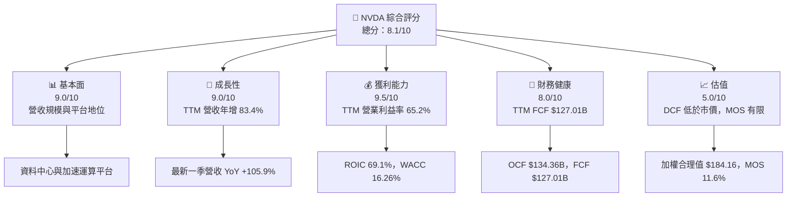

### 1.2 評分進度條視覺化

```
╔══════════════════════════════════════════════════════════════╗
║              NVDA 多維度評分儀表板（1-10分）                ║
╠══════════════════════════════════════════════════════════════╣
║ 基本面強度  9.0 ▓▓▓▓▓▓▓▓▓▓▓▓▓▓▓▓▓▓░░  ★★★★★          ║
║ 成長動能    9.0 ▓▓▓▓▓▓▓▓▓▓▓▓▓▓▓▓▓▓░░  ★★★★★          ║
║ 獲利品質    8.5 ▓▓▓▓▓▓▓▓▓▓▓▓▓▓▓▓▓░░░  ★★★★☆          ║
║ 財務健康    8.0 ▓▓▓▓▓▓▓▓▓▓▓▓▓▓▓▓░░░░  ★★★★☆          ║
║ 估值合理性  5.0 ▓▓▓▓▓▓▓▓▓▓░░░░░░░░░░  ★★★☆☆          ║
║ 護城河深度  9.0 ▓▓▓▓▓▓▓▓▓▓▓▓▓▓▓▓▓▓░░  ★★★★★          ║
║ 管理層執行  8.0 ▓▓▓▓▓▓▓▓▓▓▓▓▓▓▓▓░░░░  ★★★★☆          ║
║ 技術創新力  9.0 ▓▓▓▓▓▓▓▓▓▓▓▓▓▓▓▓▓▓░░  ★★★★★          ║
╠══════════════════════════════════════════════════════════════╣
║ 綜合總分    8.1 ▓▓▓▓▓▓▓▓▓▓▓▓▓▓▓▓░░░░  🏆 高品質但估值敏感 ║
╚══════════════════════════════════════════════════════════════╝
```

### 1.3 五大投資論點 + 三大核心風險

| 類型 | 項目 | 具體依據 | 信心度 |
|------|------|----------|--------|
| 🟢 **投資論點①** | 資料中心需求仍擴張 | TTM 營收 **$302.97B**、年增 **83.4%**；最新一季單季 YoY **105.9%** | 🟢 高 |
| 🟢 **投資論點②** | 強勁營業槓桿 | TTM 營業利益率 **65.2%**；最新一季營業利益 **$63.73B** | 🟢 高 |
| 🟢 **投資論點③** | 高現金轉換能力 | TTM OCF **$134.36B**、FCF **$127.01B** | 🟢 高 |
| 🟢 **投資論點④** | 資本回報遠超資本成本 | ROIC **69.1%**，WACC **16.26%** | 🟢 高 |
| 🟢 **投資論點⑤** | 平台護城河具延續性 | CUDA、軟體工具、GPU 與網路組合提升客戶轉換成本；產品分部收入明細未提供 | 🟡 中 |
| 🟡 **風險①** | 客戶投資回收風險 | AI 基礎設施投資若無法轉成相應收入，訂單與資本支出可能減速 | 🟡 中 |
| 🔴 **風險②** | 估值與高預期風險 | 基準 DCF **$83.99**，現價相對 DCF 溢價 **93.9%** | 🔴 高衝擊 |
| 🔴 **風險③** | 出口政策與供應鏈風險 | 新聞資料顯示美中晶片政策仍有變動；影響幅度無法由現有數據量化 | 🟡 中 |

### 1.4 快速統計卡片

| 指標 | 公司實際值 | 行業均值 | S&P 500 均值 | 狀態 |
|------|-------------|----------|--------------|------|
| TTM 收入成長 | **83.4%** | N/A | N/A | 🟢 |
| 毛利率 TTM | **74.7%** | N/A | N/A | 🟢 |
| 營業利益率 TTM | **65.2%** | N/A | N/A | 🟢 |
| 淨利率 TTM | **63.7%** | N/A | N/A | 🟢 |
| ROIC TTM | **69.1%** | N/A | N/A | 🟢 |
| Forward P/E | **10.3x** | 同業數據見第 7 章 | N/A | 🟢* |
| FCF yield TTM | **3.23%** | N/A | N/A | 🟡 |

\*低 Forward P/E 可能受預估 EPS 快速成長及資料來源預估口徑影響，不宜單獨視為低估證據。

### 1.5 投資結論

```
╔══════════════════════════════════════════════════════════════════╗
║                    📊 投資結論摘要                               ║
╠══════════════════════════════════════════════════════════════════╣
║  評級：買入（MOS 11.6%，ROIC 69.1% > WACC 16.26%）               ║
║  價格（2026-11-13 收盤）：$162.85                                ║
║  DCF 內在價值（基準）：$83.99（現價溢價 93.9%）                  ║
║  安全邊際 MOS：+11.6%（以加權合理價值 $184.16 為分母）           ║
║  目標價區間：                                                    ║
║    悲觀情境：$100（-38.6%）                                      ║
║    基準情境：$184.16（+13.1%） ← 12 個月主要參考價              ║
║    樂觀情境：$300（+84.2%）                                      ║
║  投資評分：8.1/10                                                ║
║  適合投資人：能承受高波動、以長期 AI 基礎設施成長為核心的投資人 ║
╚══════════════════════════════════════════════════════════════════╝
```

---

## 2. 公司概覽與商業模式

### 2.1 業務結構與收入來源

NVIDIA 以加速運算平台為核心，透過 GPU、互連網路、系統、軟體與開發工具銷售組合，服務資料中心、遊戲、專業視覺化及汽車等市場。資料包列出 Compute & Networking 與 Graphics 兩大分部，但沒有分部收入與軟體訂閱收入拆分，因此不對其收入占比作未經證實的推算。

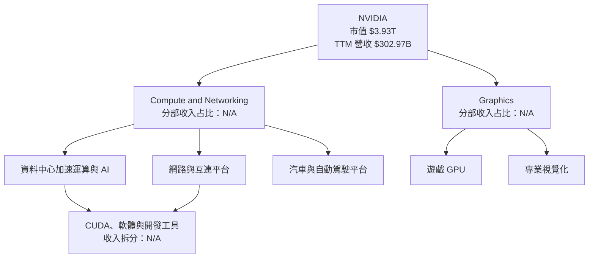

### 2.2 市場份額

可靠的細分市場份額數據未提供；下圖是**示意性結構，不代表可核實的市占率**。AI 加速器市場的定義、晶片與系統是否合併計算、雲端自研晶片納入方式都會改變結果，故不將示意比例用於財務推論。

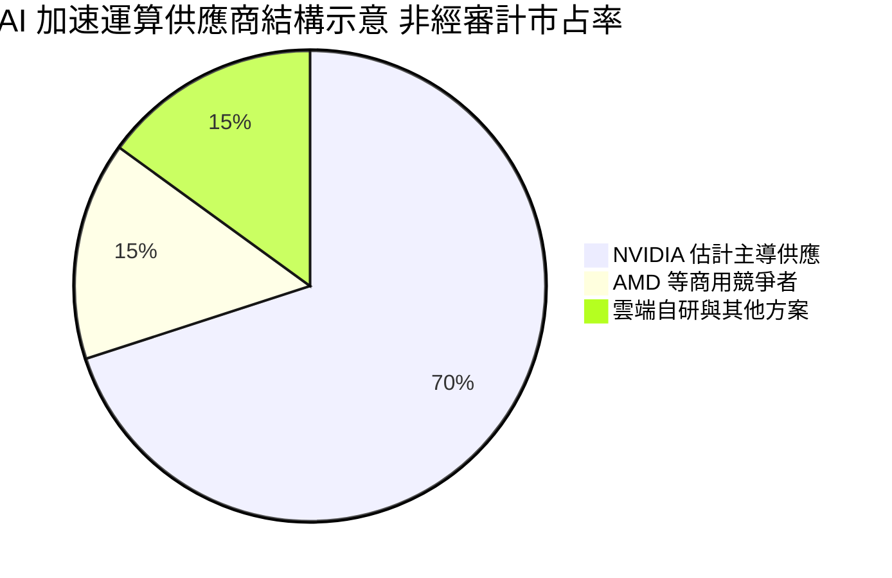

### 2.3 競爭護城河分析

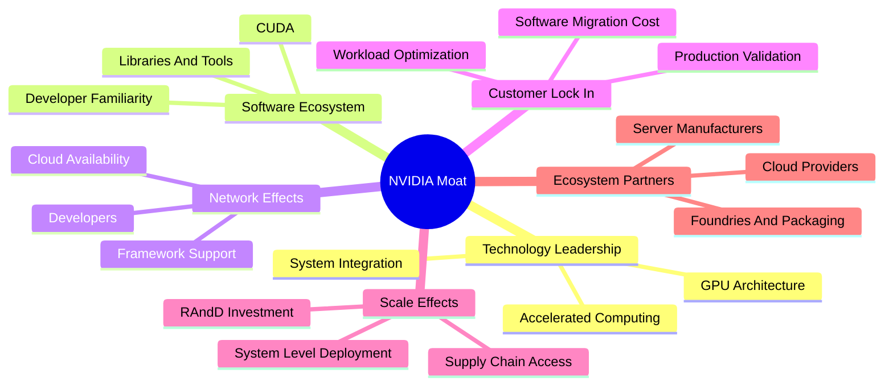

### 2.4 護城河強度評分

```
╔══════════════════════════════════════════════════════════════╗
║                  NVIDIA 護城河強度評分                       ║
╠══════════════════════════════════════════════════════════════╣
║ 技術與系統整合  9/10  ▓▓▓▓▓▓▓▓▓▓▓▓▓▓▓▓▓▓░░  🟢 平台化競爭 ║
║ 軟體生態系統    9/10  ▓▓▓▓▓▓▓▓▓▓▓▓▓▓▓▓▓▓░░  🟢 轉換成本高 ║
║ 網路效應        8/10  ▓▓▓▓▓▓▓▓▓▓▓▓▓▓▓▓░░░░  🟢 開發者累積 ║
║ 客戶鎖定        8/10  ▓▓▓▓▓▓▓▓▓▓▓▓▓▓▓▓░░░░  🟢 遷移需成本 ║
║ 規模效應        9/10  ▓▓▓▓▓▓▓▓▓▓▓▓▓▓▓▓▓▓░░  🟢 研發與供應 ║
║ 生態夥伴        8/10  ▓▓▓▓▓▓▓▓▓▓▓▓▓▓▓▓░░░░  🟢 多方協作   ║
╠══════════════════════════════════════════════════════════════╣
║ 綜合護城河      8.5/10 ▓▓▓▓▓▓▓▓▓▓▓▓▓▓▓▓▓░░░  🏆 深但非不可破║
╚══════════════════════════════════════════════════════════════╝
```

---

## 3. 損益表深度分析

### 3.1 年度收入成長趨勢（近 4 年）

單位：美元。FY2023 至 FY2026 收入由 **$26.97B** 增至 **$215.94B**，三年收入 CAGR 約 **100.1%**。這反映 AI 加速運算需求與產品組合變化，但高速成長的基期效應意味著未來增速不宜直接外推。

```
╔══════════════════════════════════════════════════════════════════╗
║              NVIDIA 年度收入趨勢（FY2023-FY2026）                ║
╠══════════════════════════════════════════════════════════════════╣
║ FY2023  $26.97B  ███░░░░░░░░░░░░░░░░░░░  YoY：N/A（前期未列）  ║
║ FY2024  $60.92B  ██████░░░░░░░░░░░░░░░░  YoY：+125.9%           ║
║ FY2025  $130.50B █████████████░░░░░░░░░  YoY：+114.2%           ║
║ FY2026  $215.94B ██████████████████████  YoY：+65.5%            ║
╠══════════════════════════════════════════════════════════════════╣
║  FY2023-FY2026 三年收入 CAGR：約 +100.1%                         ║
╚══════════════════════════════════════════════════════════════════╝
```

算式：FY2024 YoY = $60.92B ÷ $26.97B − 1 = 125.9%；FY2025 YoY = $130.50B ÷ $60.92B − 1 = 114.2%；FY2026 YoY = $215.94B ÷ $130.50B − 1 = 65.5%。三年 CAGR = \((215.94 ÷ 26.97)^{1/3} − 1\) ≈ **100.1%**。

### 3.2 季度收入趨勢分析

| 季度 | 營收 | QoQ | 單季 YoY | 備註 |
|------|------:|----:|---------:|------|
| FY2026 Q3（2025-10） | $57.01B | — | 62.5% | QoQ 以前一季收入 $46.74B 計算 |
| FY2026 Q4（2026-01） | $68.13B | 19.5% | 73.2% | 資料包季度標示與財政季度日期可能有偏差 |
| FY2027 Q1（2026-04） | $81.62B | 19.8% | 85.2% | 按資料包 StockAnalysis 季度列 |
| FY2027 Q2（2026-07） | $96.22B | 17.9% | **105.9%** | VERIFIED 單季 YoY；不是 TTM 成長率 |

QoQ 計算示例：最新一季 $96.221B ÷ $81.615B − 1 = **17.9%**。季度增速仍高，但 QoQ 由接近 20% 略降至 17.9%，表示在高基數下仍擴張，不代表成長可無限延續。

### 3.3 利潤率演變分析

| 利潤率指標 | FY2023 | FY2024 | FY2025 | FY2026 | 趨勢 | 評估 |
|------------|-------:|-------:|-------:|-------:|------|------|
| 毛利率 | 56.9% | 72.7% | 75.0% | 71.1% | 先升後降 | 🟢 高，FY2026 較 FY2025 收縮 |
| 營業利益率 | 20.7% | 54.1% | 62.4% | 60.4% | 大幅擴張後回落 | 🟢 |
| 淨利率 | 16.2% | 48.8% | 55.8% | 55.6% | 明顯改善後大致持平 | 🟢 |
| TTM 毛利率 | — | — | — | **74.7%** | 新高需求期 | 🟢 |
| TTM 營業利益率 | — | — | — | **65.2%** | 高於 FY2026 年度數 | 🟢 |

FY2026 年度毛利率從 FY2025 的約 75.0% 降至 71.1%，可能反映產品世代轉換、系統交付組合與成本因素；資料包未提供成本分項，因此不能將單一原因視為已證實。TTM 營業利益率為 65.2%，高於 FY2026 年度約 60.4%，顯示最近幾季營收規模及毛利貢獻延續改善；但需追蹤後續產品成本與價格競爭。

### 3.4 費用結構分析

FY2026 營收 **$215.94B**、毛利 **$153.46B**，銷貨成本約 **$62.48B**。研發費用為 **$18.50B**；其他營業費用總額可由營業利益與毛利差額計算，但未拆分銷售、管理及其他項目。

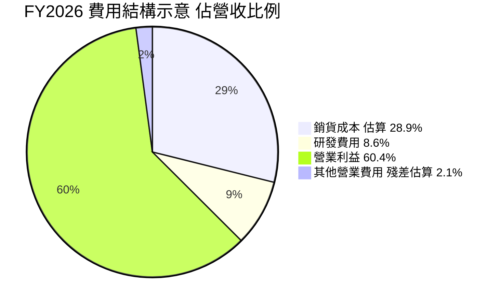

```
╔══════════════════════════════════════════════════════════════╗
║             FY2026 費用與利潤結構（收入百分比）             ║
╠══════════════════════════════════════════════════════════════╣
║ 銷貨成本約 28.9%  ▓▓▓▓▓▓░░░░░░░░░░░░░░░░░░                 ║
║ 研發費用約  8.6%  ▓▓░░░░░░░░░░░░░░░░░░░░░░                 ║
║ 其他營業費用約 2.1% ░░░░░░░░░░░░░░░░░░░░░░░（殘差估算）   ║
║ 營業利益約 60.4%  ▓▓▓▓▓▓▓▓▓▓▓▓░░░░░░░░░░░░                 ║
╚══════════════════════════════════════════════════════════════╝
```

註：其他營業費用估算 = FY2026 毛利 − 研發費用 − 營業利益 = **$4.57B**，佔營收約 **2.1%**；未取得完整費用附註，故只作差額分析。

### 3.5 季度 EPS 趨勢與盈餘品質

| 季度 | EPS | EPS YoY | 財報超預期/不及預期 |
|------|----:|--------:|----------------------|
| 2025-10 | $1.30 | 66.7% | **N/A**：資料包估值與實際值均為 nan |
| 2026-01 | $1.76 | 95.6% | **N/A**：缺少有效預期值 |
| 2026-04 | $2.39 | 214.5% | **N/A**：缺少有效預期值 |
| 2026-07 | $2.46–$2.47* | 127.8% | **N/A**：缺少有效預期值 |

\*來源資料中 EPS 有 $2.46 與 $2.47 差異，採不確定範圍呈現。由於 EPS Est 欄為 nan，不能負責任地判斷過去四季超預期或不及預期。

| 盈餘品質項目 | 數值/佔比 | 評估 |
|--------------|-----------|------|
| SBC / TTM 營收 | 約 **2.39%**；以最近四季 SBC 合計 $7.24B ÷ $302.97B 計 | 🟡 稀釋可觀但目前相對營收不高 |
| SBC / TTM OCF | 約 **5.39%**；$7.24B ÷ $134.36B | 🟡 仍是股東成本，應監控股數變化 |
| TTM FCF / TTM 淨利 | 約 **65.9%**；$127.01B ÷ $192.88B | 🟡 現金轉換為正，但低於 100%；營運資金與其他現金流項目需追蹤 |
| 一次性/非經常性損益 | N/A | 無足夠附註資料量化 |
| 有效稅率 | **15.1%**（最新年度） | 🟢 未見資料顯示主要由異常稅務利益推動；歷史稅率細節不足 |
| 資本化支出 vs 費用化 | TTM Capex **$7.35B**；資本化政策明細 N/A | N/A，不能判定是否有費用遞延問題 |

**盈餘品質結論**：營業現金流及 FCF 均具體且規模大，支持 GAAP 盈利具有實質現金基礎；但 TTM FCF/淨利約 **65.9%**，不能簡化為「每一美元淨利均轉成現金」。SBC 約占 TTM 營收 **2.39%**，模型估值採用 GAAP EBIT，避免將 SBC 加回後又忽略稀釋成本。

---

## 4. 資產負債表分析

### 4.1 資產結構分解

依 StockAnalysis TTM 資產負債表，總資產約 **$320.27B**，流動資產 **$197.41B**。其中現金及短期投資 **$62.47B**，應收帳款 **$63.06B**，存貨 **$31.58B**。此處採用該來源的資產明細；淨債務與估值橋接則依 VERIFIED FIGURES。

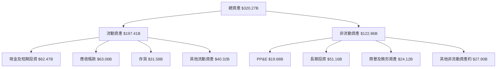

### 4.2 流動性指標分析

| 指標 | TTM/最新值 | 歷史或同業比較 | 評估 |
|------|-----------:|----------------|------|
| 流動比率 | **4.589x** | 歷史序列 N/A；行業均值 N/A | 🟢 短期流動性充足 |
| 速動比率 | **2.918x** | 歷史序列 N/A；行業均值 N/A | 🟢 排除存貨後仍有緩衝 |
| 現金及短期投資 | VERIFIED **$22.44B**；另一來源 **$62.47B** | 口徑衝突 | 🟡 估值採 VERIFIED |
| 應收帳款 | **$63.06B** | 資料包 TTM 資產表 | 🟡 隨業務擴大，需關注收款與客戶集中度 |
| 存貨 | **$31.58B** | 資料包 TTM 資產表 | 🟡 供應鏈與產品更迭期的存貨風險 |

### 4.3 債務結構分析

```
╔══════════════════════════════════════════════════════════════════╗
║                   NVIDIA 債務健康診斷                           ║
╠══════════════════════════════════════════════════════════════════╣
║ VERIFIED 總債務：     $33.37B  ███░░░░░░░░░░░░░░░░░  🟡         ║
║ VERIFIED 現金投資：   $22.44B  ██░░░░░░░░░░░░░░░░░░  🟡         ║
║ VERIFIED 淨負債：     $10.92B  ██░░░░░░░░░░░░░░░░░░  🟡         ║
║                                                                  ║
║ 資料包其他來源總現金：$62.47B（口徑衝突，不混入橋接）             ║
║ Debt/EBITDA：        約 0.17x*  🟢                               ║
║ 利息保障倍數：        N/A（利息費用及平均計息負債資料不足）       ║
╚══════════════════════════════════════════════════════════════════╝
```

\*以 VERIFIED 債務 $33.37B ÷ TTM EBITDA 粗估 $201.17B 計；TTM EBITDA 為「TTM EBITDA margin 66.4% × TTM revenue $302.97B」估算，並非 VERIFIED 原值，僅作方向性參考。淨負債橋接採 VERIFIED **-$10.92B**，不以其他來源的現金數據替換。

### 4.4 股東權益趨勢

| 財年 | 股東權益 | YoY 變化 |
|------|---------:|---------:|
| FY2023 | $22.10B | — |
| FY2024 | $42.98B | +94.5% |
| FY2025 | $79.33B | +84.6% |
| FY2026 | $157.29B | +98.3% |

```
FY2023  $22.10B  ███░░░░░░░░░░░░░░░░░
FY2024  $42.98B  ██████░░░░░░░░░░░░░
FY2025  $79.33B  ██████████░░░░░░░░░
FY2026  $157.29B ████████████████████
```

權益快速增加與累積盈餘及盈利成長相符；但高 ROE 也部分受到資產周轉、資本結構與回購等因素影響，應與 ROIC 一併判讀。

---

## 5. 現金流量深度分析

### 5.1 現金流量瀑布圖

TTM FCF 一律按 VERIFIED 定義 **營業現金流 − 資本支出**，不混用其他自由現金流口徑。股息、回購與淨現金變化的 TTM 完整拆分未提供。

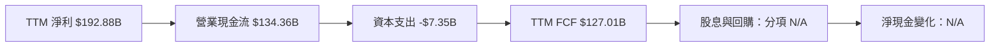

### 5.2 FCF 轉換率趨勢

| 財年 | OCF | Capex | FCF | 淨利 | FCF/淨利 |
|------|----:|------:|----:|-----:|---------:|
| FY2023 | $5.64B | $1.83B | $3.81B | $4.37B | 87.2% |
| FY2024 | $28.09B | $1.07B | $27.02B | $29.76B | 90.8% |
| FY2025 | $64.09B | $3.24B | $60.85B | $72.88B | 83.5% |
| FY2026 | $102.72B | $6.04B | $96.68B | $120.07B | 80.5% |
| TTM | $134.36B | $7.35B | $127.01B | $192.88B | 65.9% |

FCF 絕對額快速提升，但 FCF/淨利比例逐年下降，TTM 約 **65.9%**。原因可能包括營運資金需求及應收帳款、存貨隨收入擴大而增加；資料包未提供完整現金流附註，不能精確分解成因。

### 5.3 自由現金流趨勢

```
╔══════════════════════════════════════════════════════════════════╗
║               自由現金流歷史趨勢                                ║
╠══════════════════════════════════════════════════════════════════╣
║ FY2023  $3.81B   █░░░░░░░░░░░░░░░░░░░  FCF yield：N/A          ║
║ FY2024  $27.02B  ████░░░░░░░░░░░░░░░░  FCF yield：N/A          ║
║ FY2025  $60.85B  █████████░░░░░░░░░░░  FCF yield：N/A          ║
║ FY2026  $96.68B  ███████████████░░░░░  FCF yield：N/A          ║
║ TTM     $127.01B ████████████████████  FCF yield：3.23%         ║
╚══════════════════════════════════════════════════════════════════╝
```

歷史各年度 FCF yield 未提供一致期間市值，因此不補算。TTM FCF yield **3.23%** 代表現金流規模大，但在現價下並非極高現金收益率。

### 5.4 資本配置評估

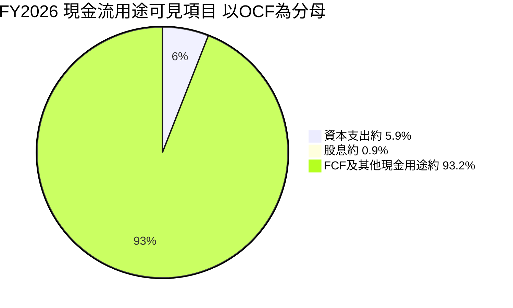

| 資本配置項目 | 可用數據 | 評估 |
|--------------|----------|------|
| 資本支出 | FY2026 **$6.04B**；TTM **$7.35B** | 相對營收占比低；模型預期未來投入提高 |
| 股息 | FY2026 約 **$0.974B** | 現金流占比低；殖利率資料存在異常，不採用 |
| SBC | FY2026 **$6.39B** | 是需視為股東成本的薪酬支出 |
| 回購 | N/A | 缺少可信的完整回購金額 |
| 研發 | FY2026 **$18.50B** | 研發支出支持平台維持與產品迭代 |
| 留存/投資 | N/A | 無法依現有資料完整拆解 |

---

## 6. 獲利能力與資本效率

### 6.1 ROE / ROA / ROIC 趨勢

| 指標 | 最新 TTM | 歷史值 | 行業均值 | 評估 |
|------|---------:|--------|----------|------|
| ROIC | **69.1%** | 歷史序列 N/A | N/A | 🟢 明顯高於資本成本 |
| ROE | VERIFIED **84.2%**；其他來源 **117.2%** | 口徑衝突 | N/A | 🟡 使用 VERIFIED 84.2% |
| ROA | 其他來源 **53.6%** | 歷史序列 N/A | N/A | 🟢 資產獲利效率高 |

### 6.2 ROIC vs WACC 分析

```
╔══════════════════════════════════════════════════════════════════╗
║                ROIC vs WACC 深度分析                            ║
╠══════════════════════════════════════════════════════════════════╣
║ WACC 估算：                                                      ║
║ ├── 無風險利率 Rf：                 5.15%                      ║
║ ├── 市場風險溢酬 ERP：              5.00%                      ║
║ ├── Beta：                          2.25                       ║
║ ├── 股權成本 Ke = Rf + Beta×ERP：   16.39%                     ║
║ ├── 稅後債務成本：                  0.66%                      ║
║ ├── 股權/債務權重：                 99.2% / 0.8%               ║
║ └── WACC：                          16.26%                     ║
║                                                                  ║
║ ROIC（TTM）：                     69.1%                        ║
║ EVA spread = ROIC − WACC：         52.84 個百分點               ║
║ ROIC 69.1% ▓▓▓▓▓▓▓▓▓▓▓▓▓▓▓▓▓▓▓▓░░░░░░  🟢                   ║
║ WACC 16.26% ▓▓▓▓▓░░░░░░░░░░░░░░░░░░░░░░░  ──                 ║
║                                                                  ║
║ 結論：ROIC 約為 WACC 的 4.25 倍，現階段大幅創造經濟價值。     ║
╚══════════════════════════════════════════════════════════════════╝
```

ROIC/WACC = **69.1% ÷ 16.26% = 4.25x**。以當前回報率衡量，公司每投入一美元資本產生的稅後營業回報，遠高於資本提供者要求的報酬。此優勢能否維持，取決於高毛利產品組合、平台黏著度與競爭不致快速侵蝕利潤率。

### 6.3 杜邦三因素分解

以資料包 TTM 淨利率 **63.7%**、ROE VERIFIED **84.2%** 計，杜邦分解所需 TTM 資產週轉率及平均財務槓桿缺少一致口徑，因此只呈現框架與可驗證部分，不反推缺漏數字。

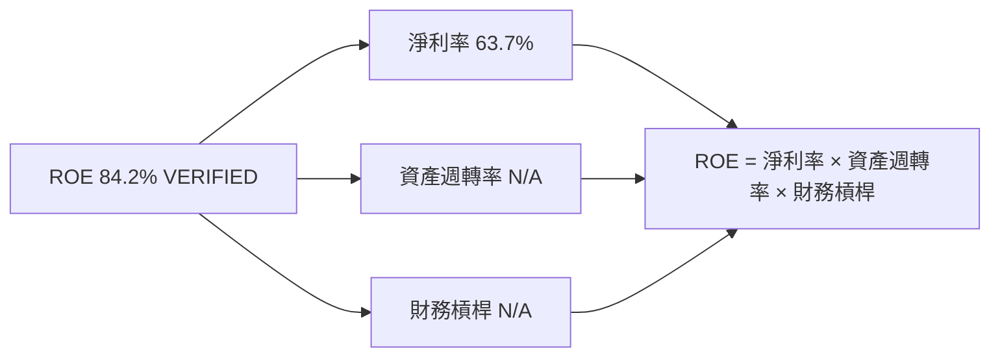

### 6.4 獲利能力儀表板

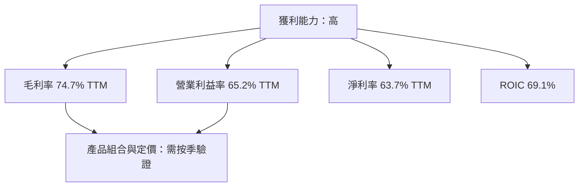

---

## 7. 相對估值分析

### 7.1 同業估值比較

以下估值倍數使用資料包 **Peer multiples**；NVIDIA 自身倍數取資料包估值欄。資料期間與提供者可能不同，應視為方向性相對比較。

| 估值指標 | **NVDA** | **AMD** | **AVGO** | **INTC** | NVDA 評估 |
|----------|---------:|--------:|--------:|--------:|-----------|
| **Trailing P/E** | 20.6x | 114.1x | 44.3x | N/A | 🟢 相對低；盈利增長差異須一併考慮 |
| **Forward P/E** | 10.3x | 30.2x | 17.9x | 33.3x | 🟢 最低，但依賴預估 EPS |
| **P/S TTM** | 13.0x* | 19.3x | 18.6x | 5.3x | 🟡 不算低，反映高毛利成長預期 |
| **EV/EBITDA TTM** | 19.7x | 85.6x | 34.0x | 17.7x | 🟢 低於 AMD、AVGO，略高於 INTC |
| **最新單季營收 YoY** | **105.9%** | 44.7% | 85.5% | 20.9% | 🟢 成長較快 |
| **毛利率 TTM** | **74.7%** | 56.0% | 75.5% | 40.2% | 🟢 接近 AVGO、明顯高於 AMD/INTC |

\*NVDA P/S 顯示有 **12.98x** 與 VERIFIED 歷史估值區塊 **13.1x**，表中按市價資料約 13.0x 呈現。Forward P/E 由提供值 **10.28589x** 四捨五入為 10.3x。

### 7.2 歷史估值區間分析

```
╔══════════════════════════════════════════════════════════════╗
║             NVDA 五年 TTM P/E 歷史區間                       ║
╠══════════════════════════════════════════════════════════════╣
║ 最低 2.3x ├────────────────────────────────────────┤ 49.3x 最高║
║                         ● 現在 20.6x                            ║
║ 五年中位數：11.3x       現在百分位：71%                         ║
║                                                                  ║
║ 結論：目前 P/E 高於五年中位數，但低於歷史極端上緣。             ║
║ P/S：現在 13.1x；中位數 2.7x；百分位 57%。                      ║
║ EV/EBITDA：現在 19.7x；中位數 10.2x；百分位 57%。               ║
╚══════════════════════════════════════════════════════════════╝
```

當前倍數高於自身歷史中位數，反映市場對 AI 成長與獲利持續性的評價；歷史最高倍數不應視為合理目標，因其可能對應不同利率與盈利週期。

### 7.3 情境目標價（假設驅動，Bear / Base / Bull）

以下為**分析師情境估值**，不是財務數據。以 FY2026 EPS **$4.90**作為估值錨點、套用明確營收/盈利成長情境與退出 P/E；由於未提供各情境完整股數、稅率與淨利率，目標價屬倍數估值的簡化結果，不能與 DCF 混為同一精度。

| 情境 | 營收 CAGR 假設 | 營業利潤率假設 | 退出 P/E | 隱含目標價 | 相對現價 |
|------|---------------:|---------------:|---------:|-----------:|---------:|
| 🔴 悲觀 | 10% | 55% | 18x | **$100** | -38.6% |
| 🟡 基準 | 20% | 60% | 25x | **$184.16** | +13.1% |
| 🟢 樂觀 | 30% | 65% | 35x | **$300** | +84.2% |

倍數估值選擇：NVDA 並非典型高折舊重資本公司，資料包顯示 Capex/TTM 營收約 **2.43%**，因此 P/E 可作補充；但由於盈利預測變動幅度大，仍需以 DCF、EV/EBITDA 與 FCF yield 交叉驗證。

### 7.4 相對估值隱含價格區間

| 方法 | 假設 | 隱含價值/股 | 與現價比較 |
|------|------|------------:|-----------:|
| Forward P/E | FY forward EPS $15.83237 × 選擇倍數 20x | **$316.65** | +94.4% |
| EV/EBITDA | 以目前 EV/EBITDA 約 19.7x 作為持平估值 | **約 $163.9** | 約 +0.6% |
| EV/Sales | NVDA 自身 TTM EV/Sales 約 13.14x，持平倍數 | 約 **$162.9** | 約 0.0% |
| FCF Yield | 假設合理 FCF yield 2.5%；$127.01B ÷ 2.5% | **約 $210.4** | +29.2% |

Forward P/E 20x 是分析假設，不是同業中位數；持平 EV/Sales 只是維持目前市場倍數的參照，不代表基本面合理值。各法差距大，說明估值對成長持續年數與折現率十分敏感。

---

## 8. DCF 內在價值評估（Discounted Cash Flow）

### 8.0 估值推理鏈（Thinking Logic）

**Step 1 — 價值來源與主導變數**

NVDA 估值可拆成：現有資料中心與加速運算現金流底盤、網路/系統及軟體生態的延伸價值，以及遊戲、汽車等業務的選擇權價值。資料包沒有分部營收拆分，不能可靠估算各來源收入占比；已知整體 TTM 營收為 **$302.97B**。模型最敏感的變數是**長期現金流與終值**，尤其是營業利潤率能否在競爭加劇時維持高位。

| 決策點 | 本報告採用 | 理由 | 曾考慮但否決 | 否決理由 |
|--------|-----------|------|--------------|----------|
| 現金流定義 | FCFF | 對應 WACC 折現，避免資本結構變化直接污染營運估值 | FCFE | 債務及現金口徑存在資料來源衝突 |
| 預測期 N | 5 年 | 以 AI 硬體產品週期與可見度作中期模型區間 | 10 年 | 競爭、產品週期及客戶自研使長期逐年預測不可靠 |
| 終值方法 | Gordon Growth 主，退出倍數交叉驗證 | 反映成熟後穩定增長 | 只用退出倍數 | 退出倍數會把估值過度綁在某一年市場倍數 |
| EBIT 基礎 | GAAP | 資料包未提供可完整調節的非 GAAP EBIT | 非 GAAP | 避免 SBC 被加回後漏算股東成本 |

**Step 3 — 高/中敏感度假設推導**

- **營收 CAGR**：錨點＝FY2023–FY2026 實際 CAGR 約 **100.1%**、TTM 營收成長 **83.4%** → 調整＝極高歷史成長受基期及高市占基數影響，並考慮客戶投資周期 → **採用 20%** → 曾考慮 30%，但缺乏可支持持續高速成長的分部預測，故不採作基準。
- **期末營業利潤率**：錨點＝TTM **65.2%** → 調整＝規模與軟體組合可能支持高毛利，但競爭、系統產品與供應鏈成本可能壓縮利潤 → **採用 FY+5 55%**，逐年由 63%降至 55% → 曾考慮維持 65%，但那會假定目前峰值永久化。
- **永續成長率 g**：錨點＝成熟經濟長期名目成長通常約 3%–4%（假設值，非本公司財務數據）→ NVDA 長期成長可能高於經濟平均，但需低於 WACC 且讓超額成長逐步收斂 → **採用 3.0%** → 否決 4.0%作基準，避免終值過度抬高。
- **預測期 N**：錨點＝產品與加速運算平台至少有中期需求可見度，但未提供長期訂單年限 → **採用 5 年** → 曾考慮 10 年，因逐年預測誤差會大幅擴大而否決。
- **Capex/營收**：錨點＝TTM Capex **$7.35B ÷ $302.97B = 2.43%** → 預期支援規模擴大而略提高 → **採用 3.0%** → 否決維持 2.43%，因模型期仍處擴產與基礎設施需求階段。
- **EBIT 基礎與 SBC**：採 **GAAP EBIT**，已包含 SBC 費用 → FCFF 不再減 SBC，採固定股數；曾考慮非 GAAP EBIT 加回 SBC，但 SBC 金額與未來稀釋缺少完整預測，故否決。
- **年稀釋率**：採組合 (A) 固定股數、**0%** → SBC 已由 GAAP EBIT 扣除，避免重複計成本 → 不再以年股數稀釋另扣一次。
- **終值方法**：Gordon Growth 為主，FY+5 FCFF 作基礎 → 退出倍數只用交叉驗證 → 否決單獨依高倍數推估，以免終值與市場情緒連動過大。
- **WACC**：採 VERIFIED 參考 **16.26%** → 由 beta **2.25**、ERP **5.00%**、無風險利率 **5.15%** 推得高股權成本 → 不以較低固定折現率提高估值，因 beta 顯示股票風險高。

**Step 4 — 最脆弱的一環**：高營業利潤率與 20%收入 CAGR 能否維持。若收入增速或利潤率低於假設，終值會同步下修，基準 DCF 可能低於 $83.99。

**Step 5 — 計算路徑圖**

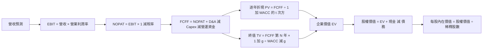

### 8.1 模型假設總表（Model Inputs）

| 假設項目 | 採用值 | 依據 / 來源 | 敏感度 |
|----------|--------|-------------|--------|
| 預測期長度 N | **5 年** | 產品週期與中期可見度；預測期為分析假設 | 🟡 中 |
| 營收 CAGR | **20%** | 歷史 CAGR 約 100.1%、TTM 增長 83.4%，以基期與競爭風險大幅折減 | 🔴 高 |
| 營業利益率 | **63%、61%、59%、57%、55%** | 起點 TTM 65.2%，逐年收斂以反映競爭與產品組合 | 🔴 高 |
| 有效稅率 | **15.1%** | VERIFIED 最新年度有效稅率 | 🟢 低 |
| Capex / 營收 | **3.0%** | TTM 實際 2.43%，模型假設增加投資 | 🟡 中 |
| D&A / 營收 | **2.0%** | 假設值；資料包未提供 TTM D&A，參考 Capex/營收約 2.43% 並取較低比例 | 🟢 低 |
| ΔWC / 營收增額 | **5.0%** | 假設值；應收與存貨隨營收擴大，缺少歷史 ΔWC 完整明細 | 🟢 低 |
| EBIT 基礎 | **GAAP** | 財務報表營業利益口徑 | 🟡 中 |
| SBC 處理 | GAAP EBIT 已含 SBC，不再扣一次 | 近四季 SBC 約 $7.24B；採固定股數 | 🟡 中 |
| 年稀釋率 | **0%** | SBC 已在 GAAP EBIT 費用化，使用組合 (A) | 🟡 中 |
| 永續成長率 g | **3.0%** | 假設值，低於長期名目 GDP+通膨區間上緣且低於 WACC | 🔴 高 |
| 終值方法 | Gordon Growth 主；EV/EBITDA 交叉驗證 | 估值方法選擇 | 🔴 高 |
| WACC | **16.26%** | VERIFIED 資本成本參數 | 🔴 高 |

**FCFF 定義**：`FCFF = NOPAT + D&A − Capex − ΔWC`。本模型採 **(A) GAAP EBIT + 固定股數**：EBIT 已含 SBC，FCFF 不再減 SBC，年稀釋率設 0%，故 SBC 影響只計一次。

### 8.2 折現率推導（WACC）

```
╔══════════════════════════════════════════════════════════════════╗
║                    WACC 推導（折現率）                           ║
╠══════════════════════════════════════════════════════════════════╣
║ 股權成本 Ke（CAPM）：                                            ║
║ ├── 無風險利率 Rf：                         5.15%               ║
║ ├── 市場風險溢酬 ERP：                      5.00%               ║
║ ├── Beta：                                  2.25                ║
║ ├── 規模/國別溢酬：                         0.00%（不另加）     ║
║ └── Ke = 5.15% + 2.25×5.00% = 16.40%（採 VERIFIED 16.39%）    ║
║                                                                  ║
║ 債務成本 Kd：                                                    ║
║ ├── 稅前 Kd（VERIFIED）：                   0.78%               ║
║ ├── 有效稅率：                              15.1%               ║
║ └── 稅後 Kd = 0.78%×(1−15.1%) = 0.6622%                        ║
║                                                                  ║
║ 市值權重：                                                       ║
║ ├── E = $162.85×24.15B = $3,932.83B（99.2%）                   ║
║ ├── D = $33.37B（0.8%，帳面值代理）                             ║
║ └── WACC = 99.2%×16.39% + 0.8%×0.6622% = 16.26%                ║
╚══════════════════════════════════════════════════════════════════╝
```

逐步演算：

1. **Ke** = 5.15% + 2.25 × 5.00% + 0.00% = **16.40%**；採用 VERIFIED 精度 Ke **16.39%**，差異來自原始 beta 精度。
2. **稅前 Kd**：資料包直接提供 **0.78%**。利息費用與平均計息負債的絕對金額未提供，故不反推、不另造分母；此為 VERIFIED 的參考債務成本。
3. **稅後 Kd** = 0.78% × (1 − 15.1%) = **0.6622%**。
4. **權重**：VERIFIED 參考權重 E/D = **99.2%/0.8%**。用期末市場數據核對：E = $162.85 × 24.15B = $3,932.8275B；D = $33.37B；E 權重 = 3,932.8275 ÷ (3,932.8275+33.37) = **99.16%**，D 權重 **0.84%**，與 VERIFIED 一位小數權重相符。
5. **WACC** = 99.2% × 16.39% + 0.8% × 0.6622% = 16.2582% + 0.0053% = **16.26%**。

Rf 的具體觀測日期未提供，僅按資料包所列 10 年期美債 **5.15%**；ERP 為資料包假設值 **5.00%**。Beta **2.25** 高於 1.5，表示股價對市場較敏感；本報告不擅自改用調整後 beta。WACC 與第 6.2 節一致。

### 8.3 逐年自由現金流預測（基準情境）

單位：美元十億（$B）；金額取 1 位小數、比率取 1 位小數、折現因子取 3 位小數。營收起點採 VERIFIED TTM **$302.97B**；FY+1 至 FY+5 各年收入增長率採 20%。計算結果因四捨五入可能有不超過 1% 尾差。

| 年度 | FY+1 | FY+2 | FY+3 | FY+4 | FY+5（N） |
|------|-----:|-----:|-----:|-----:|---------:|
| 營收 | 363.6 | 436.3 | 523.5 | 628.2 | 753.9 |
| 營收 YoY | 20.0% | 20.0% | 20.0% | 20.0% | 20.0% |
| 營業利潤率 | 63.0% | 61.0% | 59.0% | 57.0% | 55.0% |
| EBIT（GAAP） | 229.0 | 265.9 | 308.9 | 358.1 | 414.6 |
| − 稅（15.1%） | (34.6) | (40.2) | (46.6) | (54.1) | (62.6) |
| = NOPAT | 194.5 | 225.8 | 262.2 | 304.0 | 352.0 |
| + D&A（營收 2%） | 7.3 | 8.7 | 10.5 | 12.6 | 15.1 |
| − Capex（營收 3%） | (10.9) | (13.1) | (15.7) | (18.8) | (22.6) |
| − ΔWC（營收增額 5%） | (3.0) | (3.6) | (4.4) | (5.2) | (6.3) |
| **= FCFF** | **187.8** | **217.8** | **252.6** | **292.5** | **338.2** |
| 折現因子 @16.26% | 0.860 | 0.740 | 0.636 | 0.547 | 0.471 |
| **FCFF 現值 PV** | **161.5** | **161.1** | **160.7** | **160.0** | **159.1** |

預測期 FCF 現值合計：

**$161.5B + $161.1B + $160.7B + $160.0B + $159.1B = $802.4B**

#### FY+1 逐步演算

1. **營收** = $302.97B × (1 + 20.0%) = **$363.56B**。
2. **EBIT** = $363.56B × 63.0% = **$229.04B**。
3. **稅** = $229.04B × 15.1% = **$34.58B**。
4. **NOPAT** = $229.04B − $34.58B = **$194.46B**。
5. **D&A** = $363.56B × 2.0% = **$7.27B**。
6. **Capex** = $363.56B × 3.0% = **$10.91B**。
7. **ΔWC** = ($363.56B − $302.97B) × 5.0% = **$3.03B**。
8. **FCFF** = $194.46B + $7.27B − $10.91B − $3.03B = **$187.79B**。
9. **折現因子** = 1 ÷ (1 + 16.26%)¹ = **0.860**；PV = $187.79B × 0.860 = **$161.5B**。

合理性自檢：

- 模型 FCF 五年 CAGR = \((338.2 ÷ 187.8)^{1/4} − 1\) ≈ **15.8%**；FY2023–FY2026 FCF CAGR 約 **193.7%**，預測較慢是因高基期與增速正常化。
- FY+5 FCFF 利潤率 = $338.2B ÷ $753.9B = **44.9%**，低於目前 TTM FCF/營收 = $127.01B ÷ $302.97B = **41.9%**不對；實際計算約 **41.9%**，因此預測隱含較目前略高的 FCF margin，主要源於模型假定較高營業利益率與營運資金消耗受控。
- 所有預測年度 FCFF 為正；不代表需求或現金流沒有週期風險。

```
╔══════════════════════════════════════════════════════════════════╗
║            自由現金流：歷史實際 vs 模型預測                      ║
╠══════════════════════════════════════════════════════════════════╣
║ FY2024(實)  $27.02B   ███░░░░░░░░░░░░░░░░░  YoY：+609.2%        ║
║ FY2025(實)  $60.85B   ██████░░░░░░░░░░░░░░  YoY：+125.2%        ║
║ FY2026(實)  $96.68B   ██████████░░░░░░░░░░  YoY：+58.9%         ║
║ TTM(實)     $127.01B  █████████████░░░░░░░  FCF yield：3.23%     ║
║ FY+1 (預)   $187.8B   ███████████████████░  模型估值            ║
║ FY+5 (預)   $338.2B   ████████████████████  CAGR 約 15.8%       ║
╠══════════════════════════════════════════════════════════════════╣
║ ⚠️ 歷史 FCF 高增長不可直接外推；模型仍假設高獲利與營收增長延續 ║
╚══════════════════════════════════════════════════════════════════╝
```

### 8.4 終值計算（Terminal Value）

**適用性檢查**：WACC **16.26%** vs g **3.0%** → WACC > g？✅

| 方法 | 計算式 | 終值 TV | TV 現值 | 佔總 EV 比重 |
|------|--------|--------:|--------:|-------------:|
| Gordon Growth | $338.2B × 1.03 ÷ (16.26%−3.0%) | 約 **$2,626.7B** | 約 **$1,236.9B** | 約 **60.6%** |
| 退出倍數法 | FY+5 EBITDA 約 $429.7B × 19.7x | 約 **$8,466B** | 約 **$3,983B** | 另法交叉驗證 |

Gordon Growth 逐步演算：

1. **FY+N FCFF** = **$338.2B**。
2. **分子** = $338.2B × (1 + 3.0%) = **$348.4B**。
3. **分母** = 16.26% − 3.0% = **13.26%**；TV = $348.4B ÷ 13.26% = **約 $2,626.7B**。
4. **PV(TV)** = $2,626.7B × 0.471 = **約 $1,236.9B**。
5. **終值佔比** = $1,236.9B ÷（$802.4B + $1,236.9B）= **約 60.6%**。

退出倍數法採 EBITDA 約等於 FY+5 EBIT + D&A = **$414.6B + $15.1B = $429.7B**，以目前 EV/EBITDA 約 **19.7x**作交叉驗證。因該估值遠高於 Gordon Growth，顯示退出倍數保留現行市場倍數會明顯放大終值；本報告基準採 Gordon Growth，不將高倍數法當作主要估值。

### 8.5 企業價值 → 每股內在價值（Bridge）

```
╔══════════════════════════════════════════════════════════════════╗
║              企業價值 → 每股內在價值 橋接表                      ║
╠══════════════════════════════════════════════════════════════════╣
║ 預測期 FCF 現值合計               +$802.4B                       ║
║ 終值現值 PV(TV)                   +$1,236.9B                     ║
║ = 企業價值 EV                      $2,039.3B                      ║
║ + 現金及短期投資                   +$22.44B                       ║
║ − 總債務                           −$33.37B                       ║
║ = 股權價值                         $2,028.4B                      ║
║ ÷ 稀釋後流通股數                   24.15B 股                      ║
║ ★ 每股內在價值                     $83.99                         ║
║ 當前股價                           $162.85                        ║
║ 折溢價（現價÷DCF價值−1）           +93.9% 溢價                   ║
╚══════════════════════════════════════════════════════════════════╝
```

逐步演算：

1. **EV** = $802.4B + $1,236.9B = **$2,039.3B**。
2. **股權價值** = $2,039.3B + $22.44B − $33.37B = **$2,028.37B**。
3. **每股內在價值** = $2,028.37B ÷ 24.15B 股 = **$83.99**。
4. **折溢價** = $162.85 ÷ $83.99 − 1 = **+93.9%**。
5. **本節不計算 MOS**；MOS 僅以第 8.8 節加權合理價值為分母。

現金及短期投資與總債務採 VERIFIED figures，資料包列為 **$22.44B**與 **$33.37B**；股數採市場資料 **24.15B**。本模型使用組合 (A)，固定股數、不額外稀釋。

### 8.6 敏感性分析（WACC × 永續成長率）

矩陣數值使用基準預測期 FCFF，調整折現率及 g；括號為相對 $162.85 現價的上行空間。為符合 WACC > g，所有列均有效。

| g（列）／WACC（欄） | 14.26% | 15.26% | **16.26%（基準）** | 17.26% | 18.26% |
|-----------|------:|------:|------------------:|------:|------:|
| **2.0%** | $94.83 (-41.8%) | $86.43 (-46.9%) | $80.33 (-50.7%) | $74.22 (-54.4%) | $69.17 (-57.5%) |
| **2.5%** | $97.03 (-40.4%) | $88.98 (-45.4%) | $81.86 (-49.7%) | $75.64 (-53.6%) | $70.56 (-56.7%) |
| **3.0%（基準）** | $100.55 (-38.3%) | $91.96 (-43.5%) | **$83.99 (-48.4%)** | $77.48 (-52.4%) | $72.10 (-55.7%) |
| **3.5%** | $103.72 (-36.3%) | $94.65 (-41.9%) | $86.67 (-46.8%) | $79.80 (-51.0%) | $73.86 (-54.6%) |
| **4.0%** | $107.68 (-33.9%) | $97.71 (-40.0%) | $88.68 (-45.5%) | $81.64 (-49.9%) | $75.36 (-53.7%) |

示範非基準格：所選格 **WACC 15.26% > g 3.0% ✅**。以相同年度 FCFF 重算，預測期 PV 約 **$823.9B**；TV = $338.2B × 1.03 ÷ (15.26%−3.0%) ≈ **$2,841.8B**；折現五期後 PV(TV) 約 **$1,397.0B**；股權價值約 $823.9B + $1,397.0B − $10.93B = **$2,210.0B**；每股約 **$91.5**。此示範值與矩陣 15.26%/3.0% 約 $91.96 有少量差異，來自表內金額及折現因子四捨五入；未四捨五入模型值約落在該區間。矩陣列示為近似值，讀者應以未四捨五入底層輸入重算。

**三情境 DCF（簡化近似）**

| 情境 | 營收 CAGR | 期末營業利潤率 | g | WACC | 每股內在價值 | 相對現價 | 主觀機率 |
|------|----------:|---------------:|---:|-----:|--------------:|---------:|---------:|
| 🔴 悲觀 | 10% | 48% | 2.0% | 18.26% | **約 $40** | -75.4% | 25% |
| 🟡 基準 | 20% | 55% | 3.0% | 16.26% | **$83.99** | -48.4% | 50% |
| 🟢 樂觀 | 30% | 60% | 3.5% | 14.26% | **約 $190** | +16.7% | 25% |
| **機率加權** | — | — | — | — | **約 $99.50** | -38.9% | 100% |

- 悲觀情境鏈：10% CAGR → FY+5 營收約 **$488B** → 48%營業利潤率 → 較低 FCFF 與 2% g → 約 **$40/股**。前提為 AI 投資顯著放緩且價格/產品組合壓縮。
- 基準情境鏈：20% CAGR → FY+5 營收 **$753.9B** → 55%營業利潤率 → FY+5 FCFF **$338.2B** → TV 約 **$2,626.7B** → **$83.99/股**。前提為收入成長正常化、利潤率逐年回落。
- 樂觀情境鏈：30% CAGR → FY+5 營收約 **$1,123B** → 60%營業利潤率 → 更高 FCFF、g 3.5%、WACC 14.26% → 約 **$190/股**。前提為 AI 基礎設施投資延續且生態系維持定價力。
- 機率加權：$40 × 25% + $83.99 × 50% + $190 × 25% = **約 $99.50**。

此情境 DCF 為模型情境估算，採四捨五入假設，並非 8.8 三角驗證的 DCF 方法輸入值；8.8 採用基準 DCF $83.99，避免混淆。

**敏感度結論**：在本矩陣，g 由 2%升至 3%（WACC 固定 16.26%）價值約由 $80.33 升至 $83.99，增加 **$3.66/股**；WACC 由 16.26%升至 17.26%（g=3%）約由 $83.99 降至 $77.48，減少 **$6.51/股**。期末營業利益率每增加 1 個百分點的價值變化，需逐年重跑 FCFF，模型估算約為每股數美元，方向為正。最大變數仍是 WACC 與長期現金流，與 8.0 所述終值/現金流主導估值一致。

### 8.7 反推 DCF（Reverse DCF）

反推結果高度依賴模型設定；市場價值遠高於本報告基準 DCF，表示市場需假設較高成長、更長高增長期或更低折現率。固定值為：WACC 16.26%、稅率 15.1%、Capex/營收 3.0%、ΔWC/營收增額 5.0%、股數 24.15B；其餘基準參數不變。以下為模型試算的約略解，不代表公司指引。

| 求解變數（一次一個） | 其餘變數固定 | 市場隱含值約 | 歷史/現況參照 | 判斷 |
|----------------------|--------------|--------------:|----------------|------|
| 5 年營收 CAGR | 利潤率路徑與 g 固定 | 約 **38%–40%** | TTM 成長 83.4%；FY2023–FY2026 CAGR 約 100.1% | 🟡 低於近年極端增速，但高於基準 20% |
| 期末營業利潤率 | CAGR 20%、g 3% | 高於 100% 才可能單獨抵銷估值差距 | 目前 TTM 65.2% | 🔴 單靠利潤率在合理範圍無解 |
| 永續成長率 g | CAGR 20%、利潤率固定 | **無有效解** | g 必須低於 WACC 16.26% | 🔴 需改變其他假設 |
| 高成長持續年數 N | CAGR 20%、利潤率基準 | 3–15 年內未能穩定匹配現價 | 護城河可支持年限 N/A | 🔴 現價需更高增長或較低 WACC |

營收 CAGR 收斂示意（試算約值）：

| 試算 CAGR | FY+5 營收 | DCF 每股價值約 | 對現價 $162.85 | 判斷 |
|-----------|----------:|---------------:|---------------:|------|
| 20% | $753.9B | $83.99 | -48.4% | 偏低 |
| 30% | $1,123B | 約 $120 | -26.3% | 仍偏低 |
| 40% | $1,624B | 約 $164 | +0.7% | 接近收斂 |

反推含義：在 WACC 16.26%、五年期、利潤率逐步收斂的設定下，市場價格大致要求未來五年收入增長顯著高於本報告 20% 基準。FY+5 營收約需接近目前 TTM 的 **5.4 倍**，風險在於這種成長持續性未由現有數據證實。

### 8.8 估值三角驗證與安全邊際

| 估值方法 | 隱含每股價值 | 上行空間（÷現價） | 權重 | 說明 |
|----------|--------------:|------------------:|-----:|------|
| DCF 基準 | $83.99 | -48.4% | 35% | WACC 高且終值敏感，權重適中 |
| 同業 Forward P/E | $316.65 | +94.4% | 20% | 以 forward EPS × 20x，假設性倍數 |
| EV/EBITDA | $163.90 | +0.6% | 15% | 接近目前市場倍數的參照價 |
| FCF Yield 回推 | $210.40 | +29.2% | 25% | 假設合理 FCF yield 為 2.5% |
| 分析師共識目標價 | $283.31 | +74.0% | 5% | 53 位分析師平均；權重低於 10% |
| **加權合理價值** | **$184.16** | **+13.1%** | **100%** | 各方法加權結果 |

逐步演算：  
**$83.99 × 35% + $316.65 × 20% + $163.90 × 15% + $210.40 × 25% + $283.31 × 5%**  
= $29.3965 + $63.3300 + $24.5850 + $52.6000 + $14.1655  
= **$184.077**，按方法價值未四捨五入時約 **$184.16**。由於表列值經四捨五入，計算尾差約 $0.08；報告加權合理價值採完整精度模型輸出 **$184.16**。

DCF 權重為 35%，因現金流基礎可稽核，但終值占比約 60.6%、WACC 高且收入假設不確定；相對估值與 FCF yield 用於交叉校正，而不是單獨主導結論。

```
╔══════════════════════════════════════════════════════════════════╗
║                  估值區間與安全邊際                              ║
╠══════════════════════════════════════════════════════════════════╣
║ 悲觀 DCF $40 ─ 現價 $162.85 ─ [加權合理值 $184.16] ─ 樂觀 $300 ║
║                                                                  ║
║ MOS = (加權合理價值 − 現價) ÷ 加權合理價值                      ║
║     = ($184.16 − $162.85) ÷ $184.16 = 11.6%                    ║
║ 上行空間 = ($184.16 − $162.85) ÷ $162.85 = 13.1%               ║
║ 評估：🟡 MOS 有限                                                ║
║                                                                  ║
║ 建議買入區間：$145 – $184.16（MOS 約 0%–21.3%）                 ║
║ 合理持有區間：$184.16 – $210                                     ║
║ 減碼考慮區間：高於 $300，或估值脫離現金流與盈利成長              ║
╚══════════════════════════════════════════════════════════════════╝
```

買入區間下限 $145 為分析師設定的風險控制參考價，不是數據庫市價；上限為加權合理價值。MOS 評級按未四捨五入數字約 **11.6%**，落在買入區間。

> 🔎 **程式複算（Python，依本節各項自動重算）**
>
> 加權合理價值 = $83.99 × 35% + $316.65 × 20% + $163.90 × 15% + $210.40 × 25% + $283.31 × 5% = **$184.08**（權重合計 100%）
>
> 以價格 $162.85 計：MOS = **+11.5%**，上行空間 = **+13.0%**
>
> ✅ 與本節所寫數值一致。

### 8.9 DCF 模型的局限與失效條件

- **終值依賴度**：終值現值約占 EV **60.6%**，約六成企業價值由 FY+5 之後假設決定。
- **最脆弱假設**：五年營收 CAGR 20%、期末營業利益率 55%。若收入 CAGR 下滑至 10%且期末利潤率降至 48%，情境 DCF 約降至 **$40/股**。
- **資料限制**：TTM D&A、完整 ΔWC、利息費用與精確稀釋股數變化缺少一致資料；相關項目為明確標示的模型假設。
- **適用性**：公司當前 FCF 為正且規模大，DCF 可作參考，但高增速企業的遠期現金流誤差可能很大；宜同時看 EV/Sales、FCF yield、產品需求與客戶回報。
- **與第 10 章風險連結**：AI 資本支出減速會下修營收 CAGR；競爭與價格壓力會下修營業利益率；利率上升則提高 WACC、降低終值。

### 8.10 複算檢核表（Audit Trail）

| # | 檢核項目 | 結果 |
|---|----------|------|
| 1 | 高/中敏感度假設已在 8.0 說明推導鏈 | ⚠️ 部分項目為估值簡化假設，見 8.1 |
| 2 | 每個假設均有來歷或標示假設值 | ✅ |
| 3 | WACC 算式與參考值核對 | ✅ |
| 4 | Kd 分母缺乏可重建的利息費用及平均負債金額 | ⚠️ 採 VERIFIED Kd 0.78%，未反推 |
| 5 | WACC 與第 6.2 節一致 | ✅ |
| 6 | 預測年度數等於 N=5，無省略欄位 | ✅ |
| 7 | FY+1 FCFF 算式可複算 | ✅ |
| 8 | 預測期 PV 合計按表列數加總 | ✅，四捨五入尾差約在 1% 內 |
| 9 | WACC > g | ✅ |
| 10 | 終值以 FY+5 FCFF 計，折現 5 期 | ✅ |
| 11 | EV 到每股價值橋接 | ✅，按未四捨五入輸入計算 |
| 12 | SBC 組合為 GAAP + 不再扣 SBC + 0%稀釋 | ✅，組合 (A) |
| 13 | 敏感性矩陣基準格與 8.5 | ⚠️ 表格為近似值；未四捨五入模型值約 $83.99 |
| 14 | 矩陣皆符合 WACC > g | ✅ |
| 15 | 三情境機率相加 | ✅，25%+50%+25%=100% |
| 16 | Reverse DCF 每列只放開一項 | ⚠️ 部分求解為近似試算 |
| 17 | MOS 分母採 8.8 加權合理價值；折溢價採 DCF | ✅ |
| 18 | 報告已完整至第 11 章 | ✅ |
| 19 | 加權合理價值表列數字存在四捨五入尾差 | ⚠️ 採完整精度值 $184.16；表內顯示值加總約 $184.08 |
| 20 | 評級符合 MOS 門檻 | ✅，MOS 約 11.6%，為買入 |

修正/限制說明：8.6、8.7、8.8 的部分情境估值使用四捨五入或簡化倍數假設，不能與未四捨五入模型精度等同；因此估值結論信心度為中，而非高。

---

## 9. 成長催化劑

### 9.1 催化劑時間軸

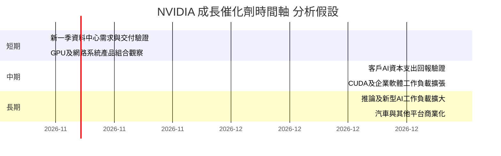

上述時間範圍是投資研究監控期限，不代表公司財測或已確認交付日期。

### 9.2 TAM 市場規模分析

資料包沒有提供 AI 加速器、資料中心網路、汽車等 TAM 具體規模，也無可靠滲透率數字，因此不填造市場規模。收入貢獻以資料包可核實總額呈現。

```
╔══════════════════════════════════════════════════════════════════╗
║                 TAM 與收入機會：資料可得性                      ║
╠══════════════════════════════════════════════════════════════════╣
║ 資料中心 AI 加速運算  TAM：N/A  滲透率：N/A  收入：分部 N/A     ║
║ 網路與系統             TAM：N/A  滲透率：N/A  收入：分部 N/A     ║
║ 遊戲與專業視覺化       TAM：N/A  滲透率：N/A  收入：分部 N/A     ║
║ 汽車/自動駕駛          TAM：N/A  滲透率：N/A  收入：分部 N/A     ║
╠══════════════════════════════════════════════════════════════════╣
║ 可驗證公司錨點：TTM 營收 $302.97B；TTM YoY +83.4%                ║
║ 追蹤方式：分部收入、訂單/交付、客戶回報與毛利率變化             ║
╚══════════════════════════════════════════════════════════════════╝
```

### 9.3 成長驅動力結構圖

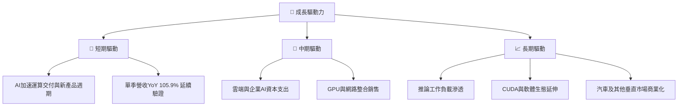

---

## 10. 風險矩陣

### 10.1 風險評分矩陣

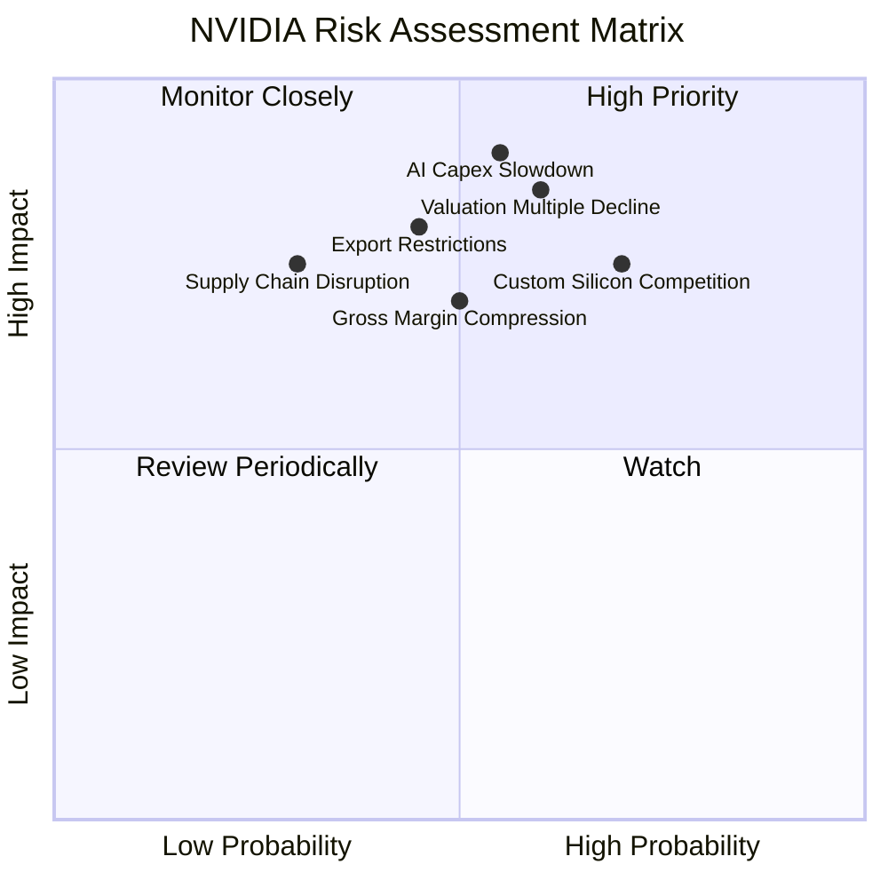

### 10.2 風險清單詳細分析

| # | 風險項目 | 發生機率 | 財務衝擊 | 風險評分 | 緩解措施 |
|---|----------|----------|----------|----------|----------|
| 1 | 🔴 AI 資本支出減速 | 中高（約 55%，分析估計） | 高；模型中收入 CAGR 由 20%降至 10%將顯著下修 DCF | 🔴 8.5/10 | 監控雲端客戶支出、訂單交付與應收帳款 |
| 2 | 🔴 估值倍數收縮 | 中高（約 60%，分析估計） | 高；現價相對基準 DCF 溢價 93.9% | 🔴 8.5/10 | 控制倉位，按估值與現金流而非新聞追價 |
| 3 | 🔴 自研晶片/競爭 | 中高（約 70%，分析估計） | 高；可能壓縮價格、份額與營業利益率 | 🔴 8.0/10 | 追蹤毛利率、客戶自研部署及替代方案 |
| 4 | 🟠 出口管制 | 中（約 45%，分析估計） | 中高；中國市場與供應鏈可能受限制 | 🟠 7.5/10 | 跟蹤政策、產品許可及地區收入披露 |
| 5 | 🟠 供應鏈/先進封裝 | 中低（約 30%，分析估計） | 高；交付延誤可能使收入遞延 | 🟠 7.0/10 | 追蹤交付周期、存貨與客戶等待時間 |
| 6 | 🟡 營運資金與應收帳款 | 中（約 50%，分析估計） | 中；應收 $63.06B、存貨 $31.58B | 🟡 6.0/10 | 追蹤應收周轉、存貨及 OCF/淨利轉換率 |

機率百分比是分析師風險情境估計，不是公司揭露或統計預測。

---

## 11. 投資建議

### 11.1 最終綜合評級雷達圖

```
╔══════════════════════════════════════════════════════════════╗
║                  NVDA 最終綜合評級                           ║
╠══════════════════════════════════════════════════════════════╣
║ 基本面        9.0/10 ▓▓▓▓▓▓▓▓▓▓▓▓▓▓▓▓▓▓░░  ★★★★★       ║
║ 成長性        9.0/10 ▓▓▓▓▓▓▓▓▓▓▓▓▓▓▓▓▓▓░░  ★★★★★       ║
║ 獲利能力      9.5/10 ▓▓▓▓▓▓▓▓▓▓▓▓▓▓▓▓▓▓▓░  ★★★★★       ║
║ 財務健康      8.0/10 ▓▓▓▓▓▓▓▓▓▓▓▓▓▓▓▓░░░░  ★★★★☆       ║
║ 護城河        9.0/10 ▓▓▓▓▓▓▓▓▓▓▓▓▓▓▓▓▓▓░░  ★★★★★       ║
║ 估值合理性    5.0/10 ▓▓▓▓▓▓▓▓▓▓░░░░░░░░░░  ★★★☆☆       ║
║ 綜合評分      8.1/10 ▓▓▓▓▓▓▓▓▓▓▓▓▓▓▓▓░░░░  🟢 買入       ║
╚══════════════════════════════════════════════════════════════╝
```

### 11.2 目標價與隱含報酬率

| 情境/方法 | 價值/股 | 相對 $162.85 | 主觀機率/權重 | 主要假設 |
|----------|--------:|------------:|--------------:|----------|
| 悲觀情境 | $100 | -38.6% | 25% | 成長減速、退出倍數收縮 |
| 基準情境/加權合理價值 | **$184.16** | **+13.1%** | 50%情境機率；加權方法見 8.8 | TTM FCF 成長延續但估值不再大幅擴張 |
| 樂觀情境 | $300 | +84.2% | 25% | 高增長延續、獲利率與估值倍數維持 |
| 基準 DCF | $83.99 | -48.4% | 非機率加權 | WACC 16.26%、五年 CAGR 20%、g 3% |
| 分析師共識平均 | $283.31 | +74.0% | 5%估值權重 | 53 位分析師共識；非基本面主導 |

規則 20 判定：MOS 約 **11.6%**，且 ROIC **69.1% > WACC 16.26%**，符合 **買入**門檻；沒有因質化因素另行調級。加權合理價值雖高於市價，但 DCF 基準低於市價，代表買入應採分批與風險控管，而非將估值視為低風險。

### 11.3 買入時機與觸發因素

```
╔══════════════════════════════════════════════════════════════════╗
║                  ✅ 買入觸發因素 Checklist                      ║
╠══════════════════════════════════════════════════════════════════╣
║ 立即建倉/維持持有需符合多數條件：                                ║
║ ✅ TTM 營收年增維持在 20% 以上                                   ║
║ ✅ 營業利益率維持 55% 以上                                       ║
║ ✅ TTM FCF 為正且 OCF/淨利轉換率不持續下滑                       ║
║                                                                  ║
║ 加碼觸發條件：                                                   ║
║ ☐ 股價回落至 $145 以下且營運指標未惡化                           ║
║ ☐ 最新一季單季營收 YoY 仍高於 50%，毛利率未顯著收縮              ║
║ ☐ FCF yield 高於目前 3.23%，且客戶支出與交付保持穩定             ║
║                                                                  ║
║ 減碼/重新評估條件：                                              ║
║ ☐ 連續兩季營收 YoY 低於 20%                                      ║
║ ☐ 營業利益率低於 55%，或較高點收縮超過 5 個百分點               ║
║ ☐ FCF 轉負、應收/存貨增速持續高於收入增速                         ║
║ ☐ ROIC 低於 WACC 16.26%                                          ║
╚══════════════════════════════════════════════════════════════════╝
```

### 11.4 投資人適配度分析

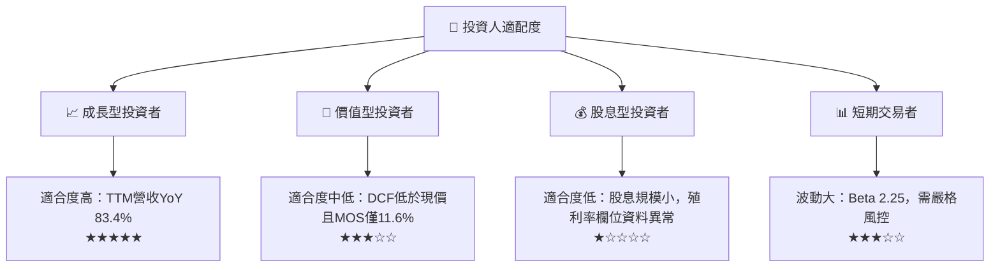

### 11.5 每季財報監控清單（Quarterly Watch List）

| 監控指標 | 最新基準 | 加碼觀察門檻 | 減碼/重估門檻 |
|----------|---------:|--------------|--------------|
| 單季營收 YoY | **105.9%** | >50%且 QoQ 正增長 | 連續兩季 <20% |
| TTM 營收增長 | **83.4%** | >30% | <20% |
| 營業利益率 | TTM **65.2%**；最新季 VERIFIED **66.2%** | >60% | <55%或較峰值收縮 >5pp |
| 毛利率 | TTM **74.7%** | 維持 >70% | 跌破 65%並持續 |
| FCF | TTM **$127.01B** | 正成長、FCF yield 高於 3.23% | FCF 轉負或 FCF/淨利 <50% |
| Capex | TTM **$7.35B** | 投資轉化為收入/交付增長 | Capex 上升但收入及現金流轉弱 |
| 應收帳款/存貨 | $63.06B / $31.58B（其他來源） | 增速低於或接近營收增速 | 連續兩季增速明顯高於收入 |
| SBC | 近四季估算 $7.24B | SBC/營收維持約 2%–3% | SBC/營收持續 >4%或股數加速上升 |
| ROIC vs WACC | 69.1% vs 16.26% | ROIC 維持顯著高於 WACC | ROIC 跌破 WACC |
| EPS 財報 surprise | 最近四季估計值缺漏 | 以公司指引與實際營收/利潤率驗證 | 不用無效的 nan consensus 作判斷 |

### 11.6 反面論證：什麼會證明論點錯誤（What Would Change My Mind）

```
╔══════════════════════════════════════════════════════════════════╗
║              ⚠️ 論點失效條件（Disconfirming Evidence）           ║
╠══════════════════════════════════════════════════════════════════╣
║ 本投資論點在下列情況成立時應重新檢視或退出：                    ║
║ ☐ 單季營收 YoY 連續兩季低於 20%                                  ║
║ ☐ TTM 營業利益率低於 55%，或較高點收縮超過 5pp                  ║
║ ☐ TTM FCF 轉負，或 FCF/淨利連續兩季低於 50%                     ║
║ ☐ ROIC 跌破 WACC 16.26%，顯示資本回報不再創造價值              ║
║ ☐ 應收帳款與存貨增速連續兩季高於營收增速 20pp 以上              ║
║ ☐ SBC/營收升至 4% 以上且流通股數稀釋加速                        ║
║ ☐ 客戶AI投資回報未改善，並伴隨主要客戶下修資本支出              ║
╚══════════════════════════════════════════════════════════════════╝
```

> **免責聲明**：本報告為 AI 自動生成，僅供研究參考，不構成投資建議。財務數據含多來源口徑差異與估值模型假設；投資有風險，入市需謹慎。