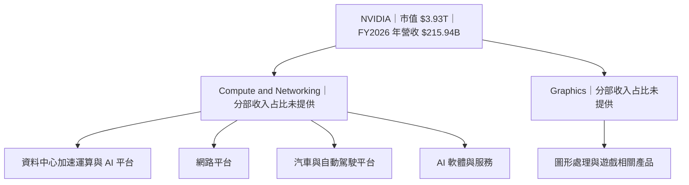
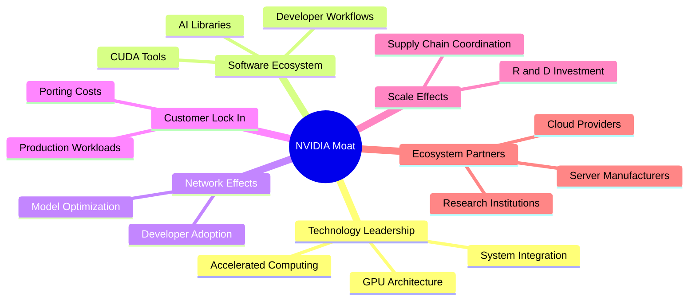
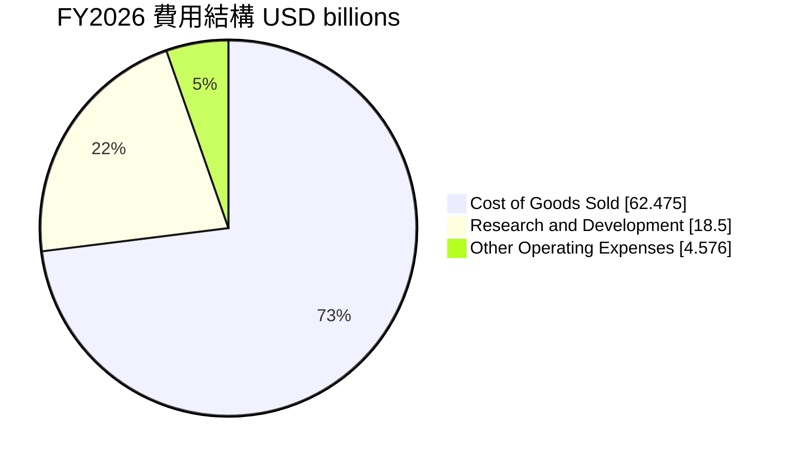
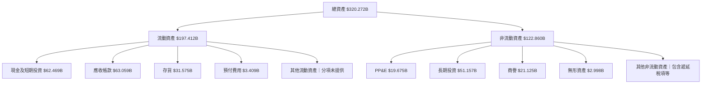
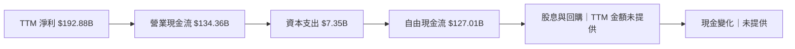
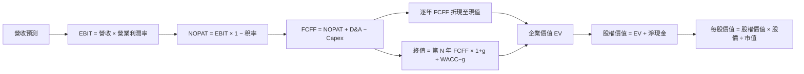
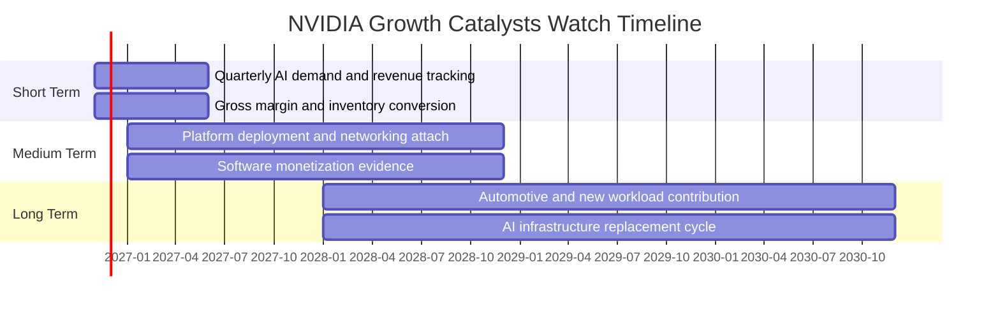
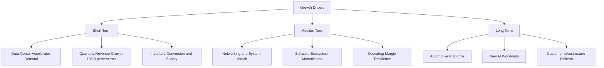
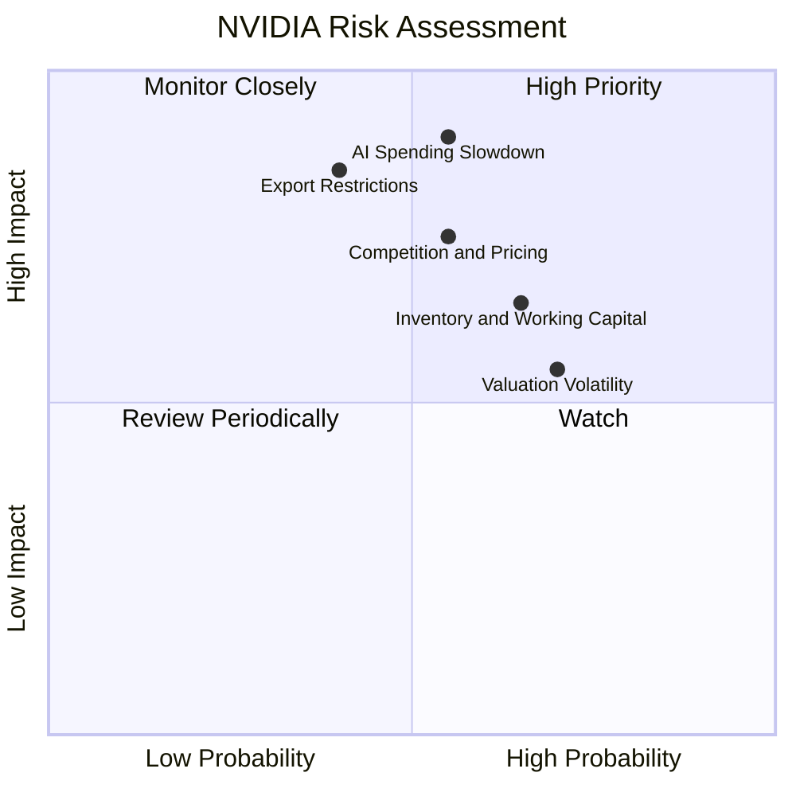
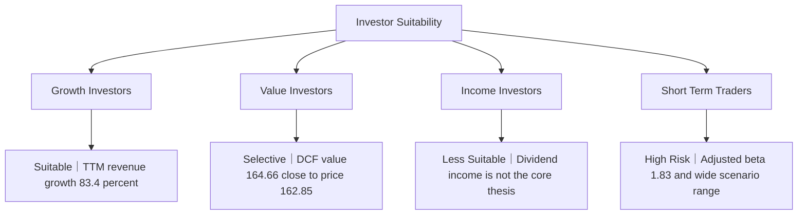

# NVDA 基本面深度分析報告
> **報告日期**：2026-11-15 ｜ **語言**：繁體中文 ｜ **數據來源**：SEC 申報資料 (XBRL)、Yahoo Finance、Finviz、StockAnalysis、Roic.ai ｜ **分析師**：CFA 級機構研究

## 目錄

| # | 章節 | 核心結論 |
|---|------|----------|
| 1 | 執行摘要 | 強烈買入；加權合理價值 $265.10；MOS +38.6% |
| 2 | 公司概覽與商業模式 | AI 加速運算與軟硬體生態系構成護城河；分部營收占比未提供 |
| 3 | 損益表深度分析 | TTM 營收 $302.97B、年增 83.4%；TTM 營業利益率 65.2% |
| 4 | 資產負債表分析 | 淨現金 $23.22B；營運資金天數上升值得監察 |
| 5 | 現金流量深度分析 | TTM FCF $127.01B，FCF Yield 3.23% |
| 6 | 獲利能力與資本效率 | ROIC 80.6% 高於 WACC 14.00%，正創造經濟價值 |
| 7 | 相對估值分析 | 相對同業估值不高，但自身 P/E 高於五年中位數 |
| 8 | DCF 內在價值評估 | DCF 基準價值 $164.66；加權合理價值 $265.10 |
| 9 | 成長催化劑 | AI 加速運算與資料中心需求是核心；TAM 數據未提供 |
| 10 | 風險矩陣 | 主要風險為競爭、資本支出／庫存週期及出口管制 |
| 11 | 投資建議 | 強烈買入；建議買入區間上限約 $238.59，並設定營運監控門檻 |

---

## 1. 執行摘要

截至 2026-11-13 收盤，NVDA 股價為 **$162.85**。公司 TTM 營收 **$302.97B**、TTM 年增 **83.4%**，最新一季營收年增 **105.9%**，TTM 營業利益率 **65.2%**，TTM FCF **$127.01B**；ROIC **80.6%** 明顯高於採用的 WACC **14.00%**。估值方面，DCF 基準價值為 **$164.66**，但同業倍數與分析師共識推升三角驗證後的加權合理價值至 **$265.10**；按規定 MOS 為 **+38.6%**，因此評級依 MOS 門檻為 **強烈買入**。這項評級對相對估值倍數及分析師共識有依賴，應以營運指標確認其可持續性。

### 1.0 一頁式投資儀表板（Portfolio Manager 30 秒速讀）

| 項目 | 內容 |
|------|------|
| **投資論點（3 句）** | ① TTM 營收年增 **83.4%**，最新一季年增 **105.9%**，顯示需求仍在擴張。② TTM 營業利益率 **65.2%**、ROIC **80.6%**，獲利與資本效率高。③ 加權合理價值 **$265.10** 對比現價 **$162.85**，MOS **+38.6%**，但估值對同業倍數與共識目標價敏感。 |
| **綜合評分** | **8.0/10**（引用 1.1 評分卡） |
| **財務健康** | 🟢 淨現金 **$23.22B**；但 CCC 從 **105 天**增至 **155 天**，營運資金占用增加。 |
| **ROIC vs WACC** | **80.6% vs 14.00%**；利差 **66.6 個百分點**，正在創造股東價值。 |
| **FCF 趨勢** | TTM FCF **$127.01B**；FCF Yield **3.23%**。年度 FCF 由 FY2023 **$3.81B** 增至 FY2026 **$96.68B**。 |
| **估值** | Forward P/E **10.27x**（市場資料）；EV/EBITDA **19.38x**；FCF Yield **3.23%**。 |
| **DCF 內在價值（基準）** | **$164.66**；現價相對 DCF 基準折價 **1.1%**（折溢價定義為現價÷DCF價值−1）。 |
| **安全邊際（MOS）** | **+38.6%＝($265.10−$162.85)÷$265.10**｜🟢 充足；基準為 8.8 加權合理價值。 |
| **預期報酬（基準情境 12M）** | DCF 基準情境 **+1.1%**；DCF 機率加權情境 **+14.1%** 僅作參考，不等同 12 個月預測。 |
| **關鍵風險（前二）** | AI 資本支出與需求週期逆轉；競爭或出口限制使營收／利潤率低於模型假設。 |
| **評級 + 信心度** | 🟢 **強烈買入** ｜ 信心：中（估值方法差異大，DCF 基準價值接近現價） |

### 1.1 綜合評分卡（全報告唯一）

| 維度 | 評分（1–10） | 主要依據（引用數字與其來源章節） |
|------|--------------|----------------------------------|
| 成長性 | 9.5 | TTM 營收年增 **83.4%**、最新一季年增 **105.9%**（第 3 章）；增速高但存在基期及週期風險。 |
| 獲利能力 | 9.5 | TTM 營業利益率 **65.2%**、ROIC **80.6%**，高於 WACC **14.00%**；F-Score **5/9**（第 6 章）。 |
| 財務健康 | 8.5 | 淨現金 **$23.22B**；CCC **155 天**，較一年前增加 **50 天**（第 4 章）。 |
| 估值 | 7.0 | MOS **+38.6%**，但 DCF 基準價值僅 **$164.66**，且自身 P/E 高於五年中位數（第 7–8 章）。 |
| 護城河 | 9.0 | GPU、軟體生態與系統整合構成高轉換成本；但市場份額數據未提供（第 2 章）。 |
| 管理層與資本配置 | 4.5 | FY2026 SBC **$6.39B**，約占營收 **3.0%**；稀釋股數測試通過，但資本配置回購明細不足以完整評估。 |
| **綜合評分** | **8.0** | 六項算術平均：**(9.5+9.5+8.5+7.0+9.0+4.5)÷6=8.0** |

### 1.2 五大投資論點 + 三大核心風險

| 類型 | 項目 | 具體依據 | 信心度 |
|------|------|----------|--------|
| 🟢 **投資論點①** | AI 計算需求仍在加速 | TTM 營收 **$302.97B**、年增 **83.4%**；最新一季年增 **105.9%**。 | 🟢 高 |
| 🟢 **投資論點②** | 高營業槓桿與定價能力 | TTM 營業利益率 **65.2%**，FY2026 營業利益 **$130.39B**。 | 🟢 高 |
| 🟢 **投資論點③** | 現金流可支持研發與股東回報 | TTM OCF **$134.36B**、Capex **$7.35B**、FCF **$127.01B**。 | 🟢 高 |
| 🟢 **投資論點④** | 資本回報顯著高於資本成本 | ROIC **80.6%** 對 WACC **14.00%**，利差 **66.6pp**。 | 🟢 高 |
| 🟢 **投資論點⑤** | 加權價值相對現價有折價 | 加權合理價值 **$265.10**，MOS **+38.6%**；但 DCF 基準價值只高於現價 **1.1%**。 | 🟡 中 |
| 🟡 **風險①** | 成長率高基期後可能快速正常化 | DCF 基準將首年營收成長由 TTM **83.4%** 下修至 **30.0%**；若低於悲觀情境假設，估值可能顯著下降。 | 🟡 中 |
| 🔴 **風險②** | CCC 拉長、庫存和應收增加資金占用 | DIO **150 天**、DSO **76 天**，CCC **155 天**，均高於一年前。 | 🔴 高衝擊 |
| 🔴 **風險③** | 估值方法差異與市場風險 | DCF **$164.66**、同業 Forward P/E **$478.60**；Beta（調整後）**1.83**，股價波動敏感。 | 🔴 高 |

### 1.3 快速統計卡片

| 指標 | 公司實際值（期間） | 同業中位數 | 狀態 |
|------|--------------------|------------|------|
| 營收成長（TTM） | **83.4%** | — | 🟢 |
| 營收成長（最新一季年增） | **105.9%** | **44.7%**（AMD、AVGO、INTC） | 🟢 |
| 毛利率（TTM） | **74.7%** | **56.0%**（三家中位數） | 🟢 |
| 營業利益率（TTM） | **65.2%** | — | 🟢 |
| ROIC（TTM） | **80.6%** | — | 🟢 |
| Forward P/E | **10.27x**（市場資料） | **30.2x**（同業中位數） | 🟢 |
| FCF Yield（TTM） | **3.23%** | — | 🟡 |
| Piotroski F-Score | **5 / 9** | — | 🟡 |

### 1.4 投資結論

╔══════════════════════════════════════════════════════════════════╗  
║                    📊 投資結論摘要                               ║  
╠══════════════════════════════════════════════════════════════════╣  
║ 評級：強烈買入（MOS +38.6%，ROIC 80.6% > WACC 14.00%）           ║  
║ 價格（2026-11-13 收盤）：$162.85                                ║  
║ DCF 內在價值（基準）：$164.66（折價 1.1%）                      ║  
║ 安全邊際 MOS：+38.6%（＝($265.10−$162.85)÷$265.10）             ║  
║ 加權合理價值（8.8）：$265.10                                    ║  
║ DCF 情境價值：                                                   ║  
║   悲觀情境：$75.00（−53.9%）                                    ║  
║   基準情境：$164.66（+1.1%）                                    ║  
║   樂觀情境：$338.85（+108.1%）                                  ║  
║ 綜合評分：8.0/10（引用 1.1）                                    ║  
║ 適合投資人：能承受高波動的成長型、長線持有者                    ║  
╚══════════════════════════════════════════════════════════════════╝

---

## 2. 公司概覽與商業模式

### 2.1 業務結構與收入來源

公司業務分為 Compute & Networking 與 Graphics；前者涵蓋資料中心加速運算、網路、AI 軟體，以及汽車平台；後者涵蓋圖形運算。財務資料未提供最新期間的分部營收金額或占比，因此不拆分收入比例。

資料中心平台的商業價值不只來自晶片，也包含互連、系統及軟體工具鏈；然而分部營收、軟體收入及經常性收入的數字未提供，不能量化各自對總營收的貢獻。

### 2.2 市場份額

市場份額數據未提供，故不呈現比例圖或自行估算。以財務規模作質化比較，NVDA TTM 營收 **$302.97B**、最新一季年增 **105.9%**；AMD 最新一季年增 **44.7%**、Broadcom **85.5%**、Intel **20.9%**。這反映 NVDA 當前營收成長較快，但不能直接等同市場份額或市場占有率變化。

### 2.3 競爭護城河分析

### 2.4 護城河強度

| 護城河項目 | 強度（強／中／弱） | 證據（引用數字或事實） | 會削弱它的情況 |
|------------|--------------------|------------------------|----------------|
| 技術與系統整合 | 強 | 最新一季營收 **$96.22B**、年增 **105.9%**；市場資料顯示毛利率 TTM **74.7%**。 | 競品性能／每瓦效能追近、供應受限或產品更新延遲。 |
| 軟體生態 | 強 | 公司產品涵蓋 AI 軟體與加速運算平台；生態系及轉換成本是質化護城河，相關服務收入未提供。 | 開放標準成熟、客戶軟體移植成本下降。 |
| 客戶鎖定 | 中至強 | 大型 AI 工作負載需要軟硬體整合；但客戶集中度與續約資料未提供。 | 大客戶自行設計晶片或採用多供應商架構。 |
| 規模效應 | 強 | FY2026 研發費用 **$18.50B**，營收 **$215.94B**；研發投入可支撐平台迭代。 | 研發回報下降、產品週期縮短或成本增幅高於收入。 |
| 網路效應與夥伴 | 中至強 | 雲端業者、伺服器廠與開發者相互補充；合作夥伴數量及經濟效益未提供。 | 夥伴轉向自研方案、供應鏈集中或地緣政治限制。 |

1.1「護城河」評分 **9.0/10**，主要依據是高速增長、較高毛利率及軟硬體整合，但市場份額、客戶集中度與軟體收入的量化資料不足。

---

## 3. 損益表深度分析

### 3.1 年度收入成長趨勢（近4年）

╔══════════════════════════════════════════════════════════════════╗  
║              NVIDIA 年度收入趨勢（FY2023–FY2026）                ║  
╠══════════════════════════════════════════════════════════════════╣  
║ FY2023  $26.97B   ██░░░░░░░░░░░░░░░░░░░░░  YoY +0.2%   🟡      ║  
║ FY2024  $60.92B   ██████░░░░░░░░░░░░░░░░░  YoY +125.9% 🟢      ║  
║ FY2025  $130.50B  █████████████░░░░░░░░░░  YoY +114.2% 🟢      ║  
║ FY2026  $215.94B  ██████████████████████░  YoY +65.5%  🟢      ║  
╠══════════════════════════════════════════════════════════════════╣  
║ FY2023–FY2026 收入 CAGR：($215.94B÷$26.97B)^(1/3)−1 ≈ 100.0%   ║  
╚══════════════════════════════════════════════════════════════════╝

FY2026 收入年增仍達 **65.5%**，但低於 FY2024、FY2025 的三位數增速，顯示高速成長下基期效應逐漸顯現。數據支持 AI 加速運算需求推動收入大幅擴張；未來更重要的是增長能否由產品供應轉化為持續客戶資本支出。

### 3.2 季度收入趨勢分析

| 季度 | 營收（$B） | QoQ | YoY | 備註 |
|------|-----------:|----:|----:|------|
| 2025-10-31 | 57.01 | — | 62.5% | QoQ 前季未列於最近四季表。 |
| 2026-01-31 | 68.13 | 19.5% | 73.2% | 季增仍近兩成。 |
| 2026-04-30 | 81.62 | 19.8% | 85.2% | 增長幅度擴大。 |
| 2026-07-26／31 | 96.22 | 17.9% | 105.9% | 年增超過一倍；SEC 季報期間為 2026-07-26，市場資料季度標示為 2026-07-31。 |

QoQ 計算以財報列示季度營收為基礎，例如最新 QoQ = **($96.22B÷$81.615B)−1=17.9%**。最新季 YoY **105.9%** 是單季年增率，不是 TTM 成長率；TTM 成長率另為 **83.4%**。

### 3.3 利潤率演變分析

| 利潤率指標 | FY2023 | FY2024 | FY2025 | FY2026 | 趨勢 | 評估 |
|------------|-------:|-------:|-------:|-------:|------|------|
| **毛利率** | 56.9% | 72.7% | 75.0% | 71.1% | 先升後回落 | 🟡 |
| **營業利益率** | 20.7% | 54.1% | 62.4% | 60.4% | 大幅改善後小幅回落 | 🟢 |
| **淨利率** | 16.2% | 48.9% | 55.8% | 55.6% | 維持高位 | 🟢 |

年度毛利率、營業利益率由年度損益表的毛利、營業利益除以營收計算。FY2026 毛利率由 FY2025 **75.0%** 降至 **71.1%**，同時營業利益率由 **62.4%** 降至 **60.4%**，顯示產品組合、供應成本或新平台初期成本可能帶來壓力；但 TTM 營業利益率仍為 **65.2%**，且最新季度營業利益率採已核實數據為 **66.2%**。不同期間、來源的利潤率口徑有差異，應優先比較同一財報口徑。

### 3.4 費用結構分析

以下為 FY2026 以營收減毛利推算銷貨成本、毛利減營業利益推算營業費用後的費用結構；研發及其他營業費用依已列年度數據拆分。屬於由財務數字計算的年度費用分類，不代表 TTM。

| 費用項目 | FY2026 金額 | 計算依據 |
|----------|-----------:|----------|
| 銷貨成本 | $62.475B | $215.938B 營收 − $153.463B 毛利 |
| 研發費用 | $18.50B | 年度損益表 |
| 其他營業費用 | $4.576B | $153.463B 毛利 − $130.387B 營業利益 − $18.50B 研發費用 |

### 3.5 季度 EPS 趨勢與盈餘品質（Quality of Earnings）

最近四季 EPS 預估值欄位為 `nan`，因此無法判定季度 EPS 超預期或不及預期；實際 EPS 數字在不同資料來源亦有 $2.46 與 $2.47 的微差，不據此虛構 beat/miss。StockAnalysis 顯示最近四季實際 EPS 約為 **$1.30、$1.76、$2.39、$2.47**，方向上持續上升；年度 EPS 由 FY2025 **$2.94** 增至 FY2026 **$4.90**。

| 盈餘品質項目 | 數值/佔比 | 評估 |
|--------------|-----------|------|
| 股權薪酬 SBC / 營收 | 約 **2.39%**（四季 SBC 合計 $7.24B ÷ TTM 營收 $302.97B） | 🟡 SBC 不算營收的主要部分，但仍是股東經濟成本；GAAP 已費用化，仍需留意股數變化。 |
| SBC / 營業現金流 | 約 **5.39%**（$7.24B ÷ $134.36B） | 🟡 現金流覆蓋力高，但 SBC 並非沒有稀釋成本。 |
| FCF / 淨利（現金轉換率） | 約 **65.9%**（$127.01B ÷ $192.88B） | 🟡 FCF 具規模，但低於淨利；營運資金需求與非現金項目可能造成差異。 |
| 一次性/非經常性損益 | N/A（缺少可比明細） | 無法確認是否有一次性項目顯著美化或壓低盈餘。 |
| 有效稅率異常 | **15.1%**（最新年度有效稅率） | 🟢 DCF 採用此稅率；缺少逐年稅務調節表，不能判斷是否由一次性稅務利益主導。 |
| 資本化支出 vs 費用化 | TTM Capex **$7.35B**；資本化政策明細 N/A | Capex 相對 TTM 營收約 **2.43%**；未提供資本化與費用化明細，不能判定成本遞延。 |

TTM FCF 對淨利的轉換率低於 100%，且 Piotroski 應計品質測試未通過，顯示盈餘品質並非沒有需要追蹤之處；但 **$127.01B** 的 TTM FCF 仍提供實質現金支持。整體判斷為 GAAP 淨利有高現金流支撐，但營運資金變化及 SBC 稀釋不能忽略。

---

## 4. 資產負債表分析

### 4.1 資產結構分解

採用 StockAnalysis 的 2026-07 TTM 資產負債表彙總：總資產 **$320.272B**、流動資產 **$197.412B**；非流動資產為兩者差額 **$122.860B**。分項數據並未完整列出，故不將未提供項目填入圖表。

### 4.2 流動性與營運資金分析

| 指標 | 最新 TTM | 一年前 TTM | 變化 | 解讀 |
|------|----------|------------|------|------|
| DSO 應收帳款天數 | **76 天** | **61 天** | **+15 天** | 收款週期拉長，應追蹤客戶付款條件與應收帳款品質。 |
| DIO 存貨天數 | **150 天** | **110 天** | **+40 天** | 庫存占用增加，可能反映供應鏈備貨或新產品爬坡；若需求落差則有庫存風險。 |
| DPO 應付帳款天數 | **72 天** | **66 天** | **+6 天** | 付款期略延長，部分抵銷應收及庫存占用增加。 |
| CCC 現金轉換週期 | **155 天** | **105 天** | **+50 天** | 現金由投入至回收時間延長，營運資金管理是監控重點。 |

CCC 增長並不必然代表需求轉弱，快速擴產和產品備貨也會推高存貨；但 DSO、DIO 同時上升，意味著未來需觀察存貨是否轉化為銷售及現金，而不能只看營收成長。

流動比率相關數據來源存在差異：市場資料列示 current ratio **4.589**，而不同財報彙整口徑亦可能導致資產負債表比率不一致。本報告不以該比率替代已核實的現金、債務與營運資金資料。

### 4.3 債務結構分析

╔══════════════════════════════════════════════════════════════════╗  
║                   NVIDIA 債務健康診斷                            ║  
╠══════════════════════════════════════════════════════════════════╣  
║ 總債務：              $33.37B     🟡                            ║  
║ 現金 + 短期投資：     $56.59B     🟢                            ║  
║ 淨現金：              $23.22B     🟢                            ║  
║ ROIC：                80.6%       高於資本成本                   ║  
║ 債務 / EBITDA：       N/A（核實區塊未提供同口徑 EBITDA）         ║  
║ 利息保障倍數：        N/A（利息費用資料未提供）                  ║  
╚══════════════════════════════════════════════════════════════════╝

市場彙整資料另列現金 **$62.47B**、總債務 **$38.86B**，與核實財務數據的 **$56.59B** 及 **$33.37B** 不同。本報告依指定優先順序使用核實數據，不混用不同口徑計算淨現金。

### 4.4 股東權益趨勢

╔══════════════════════════════════════════════════════════════════╗  
║                 NVIDIA 股東權益變化（年度）                       ║  
╠══════════════════════════════════════════════════════════════════╣  
║ FY2023  $22.10B  ███░░░░░░░░░░░░░░░░░░░░░                     ║  
║ FY2024  $42.98B  ██████░░░░░░░░░░░░░░░░░░░                     ║  
║ FY2025  $79.33B  ████████████░░░░░░░░░░░░                     ║  
║ FY2026  $157.29B ████████████████████████                     ║  
╚══════════════════════════════════════════════════════════════════╝

股東權益擴張與盈利及留存相伴而行；FY2026 股東權益約為 FY2025 的兩倍。帳面權益增長支持資本緩衝，但其本身不等同市場價值創造，仍需與 ROIC 和現金流一起判讀。

---

## 5. 現金流量深度分析

### 5.1 現金流量瀑布圖

最新 TTM 淨利約 **$192.88B**，但核實數據提供的是 OCF 與 FCF，未提供可直接對應的 TTM 股息、回購及現金變動金額，故不填入缺失的瀑布項目。

FCF 定義依統一口徑：**營業現金流 − 資本支出**。本報告不以其他現金流定義替代。

### 5.2 FCF 轉換率趨勢

| 財年 | FCF（$B） | 淨利（$B） | FCF / 淨利 |
|------|----------:|-----------:|-----------:|
| FY2023 | 3.81 | 4.37 | 87.2% |
| FY2024 | 27.02 | 29.76 | 90.8% |
| FY2025 | 60.85 | 72.88 | 83.5% |
| FY2026 | 96.68 | 120.07 | 80.5% |

計算以年度現金流與年度淨利表列數字相除。FCF 絕對額持續上升，但轉換率由 FY2024 **90.8%** 降至 FY2026 **80.5%**；成長期營運資金需求可能是部分原因，最新 CCC 延長進一步支持這項監控必要性。

### 5.3 自由現金流趨勢

╔══════════════════════════════════════════════════════════════════╗  
║               自由現金流：年度實際值與現金流回報                   ║  
╠══════════════════════════════════════════════════════════════════╣  
║ FY2023  $3.81B   █░░░░░░░░░░░░░░░░░░░░░  FCF/淨利 87.2%         ║  
║ FY2024  $27.02B  ██████░░░░░░░░░░░░░░░  FCF/淨利 90.8%         ║  
║ FY2025  $60.85B  █████████████░░░░░░░░  FCF/淨利 83.5%         ║  
║ FY2026  $96.68B  ████████████████████░  FCF/淨利 80.5%         ║  
╠══════════════════════════════════════════════════════════════════╣  
║ TTM FCF $127.01B｜TTM FCF Yield 3.23%                           ║  
╚══════════════════════════════════════════════════════════════════╝

### 5.4 資本配置評估

FY2026 可確認的現金流分配包括：營業現金流 **$102.72B**、資本支出 **$6.04B**、股息支付 **$0.974B**、SBC **$6.39B**。近四季各項回購及投資現金流的可比數字未提供，故不繪製含推估比例的資本配置圓餅圖。

| 資本配置項目 | 已知金額 | 評估 |
|--------------|----------:|------|
| FY2026 Capex | $6.04B | 相較 FY2026 營收 $215.94B 約 2.8%，DCF 假設則使用 TTM 比率。 |
| FY2026 股息支付 | $0.974B | 金額相對年度 FCF 小；股息殖利率資料來源存在異常，未採用。 |
| FY2026 SBC | $6.39B | 約為年度營收 3.0%，是需計入股東報酬的成本。 |
| 回購／長期投資 | N/A | 缺少完整可比年度金額，不能量化配置效率。 |

Yahoo Finance 彙整欄位中的股息殖利率 **61.0%** 與公司股息金額、歷史每股股息資料不相稱，視為資料異常，不據此判斷股息回報。

---

## 6. 獲利能力與資本效率

### 6.1 ROE / ROA / ROIC 趨勢

| 指標 | 最新 TTM | 歷史對比 | 評估 |
|------|---------:|----------|------|
| ROE | **84.2%**（品質數據杜邦口徑） | 市場彙整另列 **117.2%**，口徑不一致 | 🟢 採用同一品質數據口徑的 84.2%。 |
| ROA | **N/A**（未核實提供可比 TTM 序列） | 市場彙整另列 53.6%，非本分析指定口徑 | N/A |
| ROIC | **80.6%** | TTM 核實數據 | 🟢 顯著高於 WACC。 |

同業及產業均值沒有可核實一致口徑的資料，故不列對照欄。ROE 及 ROA 的不同供應商數字存在差異，不將它們混入同一趨勢序列。

### 6.2 ROIC vs WACC 分析（核心價值創造判斷）

╔══════════════════════════════════════════════════════════════════╗  
║                  ROIC vs WACC 深度分析                            ║  
╠══════════════════════════════════════════════════════════════════╣  
║ WACC 採用值：14.00%（程式計算值 14.20%，受 7%–14% 範圍限制）     ║  
║ ├─ 無風險利率 Rf：5.15%                                          ║  
║ ├─ 市場風險溢酬 ERP：5.00%                                       ║  
║ ├─ 原始 Beta：2.25；採用調整後 Beta：1.83                        ║  
║ ├─ Ke = 5.15% + 1.83 × 5.00% = 14.30%（資料列示 14.31%）        ║  
║ ├─ 稅前債務成本：0.78%；稅後約 0.78% × (1−15.1%) = 0.66%         ║  
║ ├─ 股權／債務權重：99.2%／0.8%                                   ║  
║ └─ WACC 計算值 14.20%，依 7%–14% 範圍上限採用 14.00%             ║  
║                                                                  ║  
║ ROIC（TTM）：80.6%                                               ║  
║ EVA 利差 = 80.6% − 14.00% = +66.6 個百分點                       ║  
║ ROIC 80.6%  ▓▓▓▓▓▓▓▓▓▓▓▓▓▓▓▓▓▓▓▓▓▓▓▓▓▓▓▓▓▓▓▓  🟢             ║  
║ WACC 14.0%   ▓▓▓▓▓▓░░░░░░░░░░░░░░░░░░░░░░░░░░                    ║  
║ 結論：ROIC 約為 WACC 的 5.76 倍，創造經濟價值。                 ║  
╚══════════════════════════════════════════════════════════════════╝

ROIC/WACC 比率計算：**80.6%÷14.00%=5.76 倍**。由於財務資料沒有用於重新計算 ROIC 的完整 TTM 稅後營業利益與投入資本明細，本節直接採用核實 ROIC；不另行拼湊一套不同口徑的 ROIC。

### 6.3 杜邦三因素分解

| 因素 | 數值（TTM） | 解讀 |
|------|-------------|------|
| 淨利率 | **63.7%** | 高淨利率是 ROE 的主要來源。 |
| 資產週轉率 | **0.95** | 每單位資產產生約 0.95 單位營收。 |
| 權益乘數 | **1.40** | 槓桿不是 ROE 的主要推動因素。 |
| **ROE** | **84.2%** | **63.7% × 0.95 × 1.40 = 84.2%**（依提供的杜邦數據）。 |

ROE 主要由淨利率而非財務槓桿支撐，與淨現金部位及高營業利潤率相符。

### 6.4 財務體質：Piotroski F-Score

Piotroski F-Score 為 **5 / 9**。九項測試結果如下：

| 測試 | 結果 | 解讀 |
|------|------|------|
| ROA > 0 | ✅ 通過 | 公司維持正報酬。 |
| 營業現金流 > 0 | ✅ 通過 | 現金流為正。 |
| ROA 高於一年前 | ❌ 未通過 | 相對一年前沒有取得此項改善。 |
| 營業現金流 > 淨利 | ❌ 未通過 | 應計品質測試未通過；現金流低於淨利。 |
| 長期負債 ÷ 總資產低於一年前 | ❌ 未通過 | 槓桿指標未改善。 |
| 流動比率高於一年前 | ✅ 通過 | 流動性方向改善。 |
| 稀釋股數未增加 | ✅ 通過 | 測試期間稀釋股數未增加。 |
| 毛利率高於一年前 | ✅ 通過 | 毛利率測試通過。 |
| 資產週轉率高於一年前 | ❌ 未通過 | 資產使用效率相較一年前未改善。 |

5/9 表示基本面訊號並非每一項同步改善。特別是現金流低於淨利、資產週轉率與長期負債測試未通過，需和高 ROIC、強 FCF 一併解讀，而不是單看成長率。

---

## 7. 相對估值分析

### 7.1 同業估值比較表格

| 估值指標 | **NVDA** | **AMD** | **AVGO** | **INTC** | NVDA 評估 |
|----------|---------:|--------:|---------:|---------:|-----------|
| **Trailing P/E** | 20.6x | 114.1x | 44.3x | N/A | 🟢 低於可用同業，但盈利周期及業務結構不同。 |
| **Forward P/E** | 10.27x | 30.2x | 17.9x | 33.3x | 🟢 低於同業中位數 30.2x；低倍數隱含市場對盈利成長持續性有疑慮。 |
| **P/S Ratio** | 12.98x | 19.3x | 18.6x | 5.3x | 🟡 低於 AMD、AVGO，但高於 INTC。 |
| **EV/EBITDA** | 19.38x | 78.0x | 32.4x | 17.2x | 🟢 低於 AMD、AVGO；略高於 INTC。 |
| **最新一季營收年增** | 105.9% | 44.7% | 85.5% | 20.9% | 🟢 NVDA 成長最高，但不代表未來增速必然延續。 |
| **毛利率（TTM）** | 74.7% | 56.0% | 75.5% | 40.2% | 🟢 接近 AVGO，高於 AMD 與 INTC。 |

NVDA 市場資料倍數與核實的歷史估值表略有差異：歷史區間資料的 P/E 為 **20.6x**，市場估值彙整為 **20.59x**，相互接近；P/S 則因資料口徑稍有差異，分別約 **13.1x** 與 **12.98x**。同業 P/E、P/S、EV/EBITDA 依指定同業資料列示，不以其他資料替換。

### 7.2 歷史估值區間分析

╔══════════════════════════════════════════════════════════════════╗  
║                   NVDA 五年估值位置（TTM）                        ║  
╠══════════════════════════════════════════════════════════════════╣  
║ P/E        現值 20.6x｜中位數 11.3x｜區間 2.3x–49.3x｜百分位 71% ║  
║ P/S        現值 13.1x｜中位數  2.7x｜區間 1.2x–31.0x｜百分位 57% ║  
║ EV/EBITDA  現值 19.5x｜中位數  8.9x｜區間 3.4x–47.8x｜百分位 57% ║  
╚══════════════════════════════════════════════════════════════════╝

目前 P/E 高於五年中位數約 **82%**（以倍數差計算），但低於歷史區間高點；P/S 及 EV/EBITDA 也高於各自中位數。這表示自身歷史比較下估值並不便宜，必須由未來盈利成長兌現來支撐。

### 7.3 情境價值（Bear / Base / Bull）

| 情境 | 第 1 年營收成長 | 期末營業利潤率 | WACC | 每股價值 | 相對現價 | 機率 | 會發生的條件 |
|------|----------------:|----------------:|-----:|----------:|----------:|-----:|--------------|
| 🔴 悲觀 | 15.0% | 51.3% | 15.00% | $75.00 | −53.9% | 25% | AI 資本支出放緩、競爭加劇，長期營業利潤率收斂。 |
| 🟡 基準 | 30.0% | 60.4% | 14.00% | $164.66 | +1.1% | 50% | 營收成長逐步降速，利潤率由 TTM 水準向歷史中位數收斂。 |
| 🟢 樂觀 | 45.0% | 66.4% | 13.00% | $338.85 | +108.1% | 25% | AI 部署加速、平台定價力維持，長期利潤率高於基準。 |

DCF 模型的情境概率加權值為 **$185.79**，相對現價 **+14.1%**；這是情境參考值，不替代第 8.8 節依固定權重計算的加權合理價值。

### 7.4 相對估值隱含價格區間

╔══════════════════════════════════════════════════════════════════╗  
║             相對估值方法回推每股價值與現價位置                    ║  
╠══════════════════════════════════════════════════════════════════╣  
║ DCF 基準              $164.66                                    ║  
║ 同業 EV/EBITDA        $207.73                                    ║  
║ 分析師共識             $276.56                                    ║  
║ 同業 Forward P/E      $478.60                                    ║  
║ 現價                   $162.85                                    ║  
╚══════════════════════════════════════════════════════════════════╝

- **同業 Forward P/E**：同業中位數 **30.2x × NVDA Forward EPS $15.85 = $478.60**。
- **同業 EV/EBITDA**：同業中位數 **24.8x** 乘以 NVDA TTM EBITDA，再加回淨現金，模型回推 **$207.73**。
- **分析師共識**：53 位分析師平均目標價 **$276.56**，為參考值，不是基本面現金流模型。
- **DCF 基準**：10 年 FCFF、WACC **14.00%**、永續成長率 **3.0%**，回推 **$164.66**。

同業 Forward P/E 價值遠高於 DCF，顯示方法結果對成長預期及退出倍數極敏感；不宜把單一相對估值結果視為確定的內在價值。

---

## 8. DCF 內在價值評估（Discounted Cash Flow）

### 8.0 估值推理鏈（Thinking Logic：在算之前先想清楚）

**Step 1 — 價值由哪些變數決定？**

NVDA 價值主要由資料中心與加速運算收入的成長、長期營業利潤率，以及折現率共同決定。資料沒有列出分部收入比例，因此無法量化資料中心占比或第二成長曲線的收入貢獻；整體營收、利潤率與 WACC 是本 DCF 可直接檢驗的主要變數。敏感度表顯示，WACC 與永續成長率對終值影響顯著，與這條推理相符。

**Step 2 — 模型選擇**

| 決策點 | 本報告採用 | 理由（含數字） | 曾考慮但否決 | 否決理由 |
|--------|-----------|----------------|--------------|----------|
| 現金流定義 | FCFF | 對應 WACC 折現，直接估企業價值；TTM FCF 為 $127.01B。 | FCFE | 資本結構未另建年度路徑。 |
| 預測期 N | 10 年 | DCF 模型設定 10 年，提供營收成長逐年由 30% 衰減至 3%。 | 5 年 | 會截短模型既定的成長淡出路徑；不得替換程式模型。 |
| 終值方法 | Gordon Growth | DCF 模型用第 10 年 FCFF 與 g=3.0%。 | 退出倍數 | DCF 區塊未提供退出倍數終值，不能另建模型。 |
| EBIT 基礎 | GAAP EBIT | DCF 模型明確使用 GAAP EBIT。 | 非 GAAP EBIT | 會增加加回 SBC 的重複或遺漏風險。 |

**Step 3 — 主要假設推導鏈**

- **營收成長路徑**：錨點＝TTM 營收年增 **83.4%** → 調整＝基期已擴大、成長率不宜線性延續 → **採用 FY+1 30.0%，FY+10 3.0%，逐年線性淡出** → 曾考慮沿用 83.4%，但其長期延續不符合基期與成熟化情境，故不採用。
- **期末營業利潤率**：錨點＝TTM **65.2%** → 調整＝隨產品組合及競爭成熟度逐步回歸五年財年中位數 → **FY+10 採用 60.4%** → 曾考慮固定維持 65.2%，但模型假設需要反映利潤率正常化，故否決。
- **永續成長率 g**：錨點＝終值須低於 WACC，且長期成長應低於高速成長期 → 調整＝採成熟期名目成長假設 → **採用 3.0%** → 曾考慮更高成長，但若靠近 WACC，終值會過度放大，因此不採用。
- **預測期 N**：錨點＝模型提供完整 10 年逐年預測 → 調整＝保留模型規定期間 → **採用 10 年** → 曾考慮較短預測期，但會改變已核實模型結果，故否決。
- **Capex／營收**：錨點＝TTM Capex／營收約 **2.4%** → 調整＝隨折舊強度淡化，到 FY+10 為 **1.3%** → **採用 FY+1 2.4% 至 FY+10 1.3%** → 不採用固定 2.4%，因模型已設計資本支出比率逐步下降。
- **GAAP EBIT 與 SBC**：錨點＝GAAP EBIT 已包含 SBC 費用 → 調整＝不再將 SBC 從 FCFF 扣除，也不另外稀釋股數 → **採用組合 (A)** → 否決「再扣 SBC」與「再加股數稀釋」，避免重複計入。
- **年稀釋率**：錨點＝組合 (A) 固定股數 → 調整＝SBC 已在 GAAP 費用中反映 → **採用 0% 額外稀釋** → 不採用正稀釋率，因會重複反映 SBC 成本。
- **終值方法**：錨點＝DCF 模型提供 Gordon Growth TV → 調整＝保留既有模型算法 → **採用 Gordon Growth** → 退出倍數終值未提供，故不自行填入。
- **WACC**：錨點＝核實計算值 **14.20%** → 調整＝來源明確限制在 **7%–14%** → **採用 14.00%** → 不採用未限制的 14.20%，以保持與模型一致。

**Step 4 — 最脆弱假設**

最脆弱的環節是高營收成長與高營業利潤率能否同時延續；DCF 基準值 **$164.66** 接近現價，但悲觀情境為 **$75.00**，說明需求或利潤率假設惡化時估值下行幅度可能很大。

**Step 5 — 計算路徑圖**

### 8.1 模型假設總表（Model Inputs）

| 假設項目 | 採用值 | 依據 / 來源 | 敏感度 |
|----------|--------|-------------|--------|
| 預測期長度 **N** | 10 年 | DCF 模型設定；逐年成長率由 30.0% 淡出至 3.0%。 | 🟡 中 |
| 營收成長路徑 | FY+1 30.0% 至 FY+10 3.0% | TTM 成長 **83.4%**，模型限定高成長上限後線性淡出。 | 🔴 高 |
| 營業利潤率 | 65.2% 至 FY+10 60.4% | TTM **65.2%**，淡化至最近五個財年中位水準。 | 🔴 高 |
| 有效稅率 | 15.1% | 最新年度有效稅率。 | 🟢 低 |
| Capex / 營收 | FY+1 2.4% 至 FY+10 1.3% | TTM Capex/營收約 2.4%，模型逐步淡化至 1.1×D&A 水準附近。 | 🟡 中 |
| D&A / 營收 | 1.2% | TTM 數值，模型固定。 | 🟢 低 |
| 營運資金變動 | 未建模 | DCF MODEL 明確未納入 working capital；不能自行補估。 | 🟡 中 |
| EBIT 基礎 | GAAP EBIT | 模型採 GAAP EBIT。 | 🟡 中 |
| SBC 處理 | 組合 (A)：不再扣 SBC | GAAP EBIT 已含 SBC 費用，不另外扣現金，也不額外稀釋股數。 | 🟡 中 |
| 年稀釋率 | 0% 額外稀釋 | 與組合 (A) 固定股數處理相容。 | 🟡 中 |
| 永續成長率 g | 3.0% | DCF 模型設定；低於 WACC 14.00%。 | 🔴 高 |
| 終值方法 | Gordon Growth | DCF MODEL 唯一提供方法。 | 🔴 高 |
| WACC | 14.00% | 計算值 14.20%，受 7%–14% 上限限制後採用。 | 🔴 高 |

DCF 使用 **FCFF = NOPAT + D&A − Capex**，營運資金不建模。**本模型採用 (A)：GAAP EBIT + 固定股數，因此 SBC 影響已計入一次**；不再扣 SBC，也不加年稀釋率。

### 8.2 折現率推導（WACC）

╔══════════════════════════════════════════════════════════════════╗  
║                    WACC 推導（折現率）                           ║  
╠══════════════════════════════════════════════════════════════════╣  
║ 股權成本 Ke（CAPM）：                                            ║  
║ ├─ 無風險利率 Rf（10Y 美債）：5.15%                              ║  
║ ├─ 市場風險溢酬 ERP：5.00%                                       ║  
║ ├─ 原始 Beta：2.25；採用調整後 Beta：1.83                        ║  
║ ├─ Beta 調整：⅔ × 2.25 + ⅓ × 1 = 1.83                           ║  
║ └─ Ke = 5.15% + 1.83 × 5.00% = 約 14.31%                        ║  
║                                                                  ║  
║ 債務成本 Kd：                                                    ║  
║ ├─ 稅前 Kd（利息／債務）：0.78%（來源提供值）                    ║  
║ ├─ 有效稅率：15.1%                                               ║  
║ └─ 稅後 Kd = 0.78% × (1−15.1%) = 0.66222%                       ║  
║                                                                  ║  
║ 資本結構：股權 99.2%，債務 0.8%                                 ║  
║ 計算 WACC = 99.2%×14.31% + 0.8%×0.66222% ≈ 14.20%               ║  
║ 限制區間 7%–14%後，採用 WACC = 14.00%                           ║  
╚══════════════════════════════════════════════════════════════════╝

**逐步演算：**

1. **Ke（CAPM）** = 5.15% + 1.83 × 5.00% = **14.30%**；核實資料列示 **14.31%**，差異來自未四捨五入的 Beta／輸入值，本節沿用來源列示的 **14.31%**。
2. **稅前 Kd** = **0.78%**（直接採用核實債務成本；利息費用及平均計息負債明細未提供，故不反推金額）。
3. **稅後 Kd** = 0.78% × (1−15.1%) = **0.66222%**。
4. **權重** = 股權 **99.2%**；債務 **0.8%**；合計 **100.0%**。權重採用核實成本資本資料，不另用帳面股東權益替代。
5. **未限制 WACC** = 99.2% × 14.31% + 0.8% × 0.66222% = **14.2028%**；限於 7%–14% 後，**採用 14.00%**。

Rf 採用來源列示的 10 年期美債 **5.15%**，資料未提供具體觀測日期；ERP **5.00%** 為假設輸入。Beta 原始值 **2.25**，依 **⅔ × 原始 Beta + ⅓ × 1** 調整為 **1.83**。未另加規模／國別溢酬。WACC 與第 6.2 節相同。利息費用、平均計息負債與期末計息負債完整組成未提供，因此本節不自行重建債務成本或債務權重。

### 8.3 逐年自由現金流預測（基準情境）

單位：**USD billions**；折現因子依模型保留三位小數。ΔWC 未建模，因此不列為 FCFF 扣項。

| 年度 | FY+1 | FY+2 | FY+3 | FY+4 | FY+5 | FY+6 | FY+7 | FY+8 | FY+9 | FY+10 |
|------|-----:|-----:|-----:|-----:|-----:|-----:|-----:|-----:|-----:|------:|
| 營收 | 393.86 | 500.20 | 620.25 | 750.50 | 885.59 | 1,018.43 | 1,140.64 | 1,243.30 | 1,317.90 | 1,357.44 |
| 營收 YoY | 30.0% | 27.0% | 24.0% | 21.0% | 18.0% | 15.0% | 12.0% | 9.0% | 6.0% | 3.0% |
| 營業利潤率 | 65.2% | 64.7% | 64.1% | 63.6% | 63.1% | 62.5% | 62.0% | 61.5% | 60.9% | 60.4% |
| EBIT（GAAP） | 256.85 | 323.52 | 397.83 | 477.35 | 558.51 | 636.82 | 707.11 | 764.08 | 802.85 | 819.64 |
| − 稅 | (38.83) | (48.91) | (60.14) | (72.16) | (84.43) | (96.27) | (106.89) | (115.51) | (121.37) | (123.91) |
| = NOPAT | 218.02 | 274.61 | 337.69 | 405.19 | 474.08 | 540.55 | 600.22 | 648.57 | 681.48 | 695.74 |
| + D&A | 4.79 | 6.09 | 7.55 | 9.13 | 10.78 | 12.39 | 13.88 | 15.13 | 16.04 | 16.52 |
| − Capex | (9.56) | (11.54) | (13.55) | (15.49) | (17.21) | (18.56) | (19.41) | (19.65) | (19.24) | (18.17) |
| = FCFF | **213.26** | **269.16** | **331.68** | **398.82** | **467.65** | **534.39** | **594.69** | **644.05** | **678.28** | **694.09** |
| 折現因子 @14.00% | 0.877 | 0.769 | 0.675 | 0.592 | 0.519 | 0.456 | 0.400 | 0.351 | 0.308 | 0.270 |
| FCFF 現值 PV | **187.07** | **207.11** | **223.88** | **236.14** | **242.88** | **243.46** | **237.66** | **225.78** | **208.58** | **187.23** |

預測期現值合計：  
**$187.07 + $207.11 + $223.88 + $236.14 + $242.88 + $243.46 + $237.66 + $225.78 + $208.58 + $187.23 = $2,199.79B**。  
DCF 模型列示合計 **$2,199.78B**；相差 **$0.01B**，是逐年數字四捨五入造成，採用模型原值 **$2,199.78B**。

**FY+1 逐步演算：**

1. **營收** = $302.97B × (1+30.0%) = **$393.86B**。
2. **EBIT** = $393.86B × 65.2% = **$256.85B**（依模型保留精度）。
3. **稅** = $256.85B × 15.1% = **$38.83B**。
4. **NOPAT** = $256.85B − $38.83B = **$218.02B**。
5. **D&A** = $393.86B × 1.2% ≈ **$4.79B**（依模型內部精度）。
6. **Capex** = $393.86B × 2.4% ≈ **$9.56B**（依模型內部精度）。
7. **ΔWC** = 不納入模型。
8. **FCFF** = $218.02B + $4.79B − $9.56B = **$213.25B**；模型列為 **$213.26B**，差異為分項四捨五入。
9. **折現因子** = 1÷(1+14.00%)¹ = **0.877**；PV = $213.26B × 0.877 ≈ **$187.07B**。

**合理性自檢**

- 預測 FCFF 由 FY+1 **$213.26B** 至 FY+10 **$694.09B**，九年間 CAGR 約 **14.0%**；FY2023 至 FY2026 年度 FCF 因低基期大幅成長，歷史 CAGR 約 **193%**，兩者差異反映模型把極端歷史增長正常化。
- FY+10 FCFF 利潤率 = **$694.09B÷$1,357.44B=51.1%**；目前 TTM FCF 利潤率 = **$127.01B÷$302.97B=41.9%**。同業最佳水準未提供，不能作排名。
- 模型各年 FCFF 均為正；營運資金未建模，可能高估成長期自由現金流。

╔══════════════════════════════════════════════════════════════════╗  
║            自由現金流：歷史實際 vs 模型預測                      ║  
╠══════════════════════════════════════════════════════════════════╣  
║ FY2025（實） $60.85B  █████░░░░░░░░░░░░░░░  FCF/淨利 83.5%      ║  
║ FY2026（實） $96.68B  ███████░░░░░░░░░░░░░  FCF/淨利 80.5%      ║  
║ FY+1（預）   $213.26B ███████████████░░░░░  FCFF 利潤率 54.2%   ║  
║ FY+10（預）  $694.09B ████████████████████  FCFF 利潤率 51.1%   ║  
╠══════════════════════════════════════════════════════════════════╣  
║ 預測 FCFF CAGR 約 14.0%；歷史 FCF CAGR 受低基期影響極大。       ║  
╚══════════════════════════════════════════════════════════════════╝

### 8.4 終值計算（Terminal Value）

適用性檢查：**WACC 14.00% vs g 3.0% → WACC > g？✅**

| 方法 | 計算式 | 終值 TV | TV 現值 | 佔總 EV 比重 |
|------|--------|--------:|--------:|-------------:|
| Gordon Growth | $694.09 × (1+3.0%) ÷ (14.00%−3.0%) | **$6,499.17B** | **$1,753.11B** | **44.4%** |
| 退出倍數法 | N/A（DCF MODEL 未提供退出倍數終值） | N/A | N/A | N/A |

**逐步演算：**

1. FY+10 FCFF = **$694.09B**。
2. 分子 = $694.09B × 1.03 = **$714.9127B**。
3. 分母 = 14.00% − 3.0% = **11.00%**；TV = $714.9127B ÷ 11.00% = **$6,499.21B**；程式模型列示 **$6,499.17B**，差異源於內部未四捨五入的 FCFF。
4. PV(TV) = **$6,499.17B × 0.270 = $1,753.11B**（模型內部折現精度）。
5. 終值占比 = **$1,753.11B ÷ $3,952.89B = 44.4%**。

終值占企業價值 **44.4%**，雖未超過 75% 警戒線，仍是估值的重要組成。退出倍數交叉驗證值未提供，故不自行建立第二套終值模型。

### 8.5 企業價值 → 每股內在價值（Bridge）

╔══════════════════════════════════════════════════════════════════╗  
║              企業價值 → 每股內在價值 橋接表                      ║  
╠══════════════════════════════════════════════════════════════════╣  
║ 預測期 FCF 現值合計             +$2,199.78B                      ║  
║ 終值現值 PV(TV)                 +$1,753.11B                      ║  
║ = 企業價值 EV                    $3,952.89B                      ║  
║ + 淨現金                         +$23.22B                         ║  
║ = 股權價值                       $3,976.11B                      ║  
║ 每股價值（模型換算）             $164.66                          ║  
║ 現價（2026-11-13 收盤）          $162.85                          ║  
║ 折溢價                           −1.1%（折價）                    ║  
╚══════════════════════════════════════════════════════════════════╝

1. **EV** = $2,199.78B + $1,753.11B = **$3,952.89B**。
2. **股權價值** = $3,952.89B + $23.22B = **$3,976.11B**。
3. **每股內在價值** = DCF 模型指定公式：股權價值 × 價格 ÷ 市值 = **$164.66**；不得替換模型的股數換算方式。
4. **折溢價** = $162.85 ÷ $164.66 − 1 = **−1.1%**。
5. **本節不計算 MOS**；安全邊際只在 8.8 以加權合理價值為分母計算。

現金與債務採核實最新 TTM 數據：現金及短期投資 **$56.59B**、總債務 **$33.37B**，淨現金 **$23.22B**。DCF 橋接直接使用模型提供的淨現金。市場資料列示流通股數 **24.15B**，但模型指定每股換算公式是「股權價值 × 價格 ÷ 市值」，因此本節照抄模型公式與結果，而不以另一股數口徑重建模型。

### 8.6 敏感性分析（WACC × 永續成長率）

| g（列）／WACC（欄） | 12.00% | 13.00% | **14.00%（基準）** | 15.00% | 16.00% |
|-----------|------:|------:|------------------:|------:|------:|
| **2.0%** | $195.90 (+20.3%) | $175.14 (+7.5%) | $157.97 (−3.0%) | $143.56 (−11.8%) | $131.31 (−19.4%) |
| **2.5%** | $201.36 (+23.6%) | $179.28 (+10.1%) | $161.17 (−1.0%) | $146.07 (−10.3%) | $133.31 (−18.1%) |
| **3.0%（基準）** | $207.42 (+27.4%) | $183.83 (+12.9%) | **$164.66 (+1.1%)** | $148.79 (−8.6%) | $135.46 (−16.8%) |
| **3.5%** | $214.20 (+31.5%) | $188.87 (+16.0%) | $168.49 (+3.5%) | $151.76 (−6.8%) | $137.79 (−15.4%) |
| **4.0%** | $221.82 (+36.2%) | $194.47 (+19.4%) | $172.70 (+6.0%) | $154.98 (−4.8%) | $140.31 (−13.8%) |

**矩陣重算限制：**矩陣數字依 DCF MODEL 原值照抄。模型未提供非基準格的完整年度折現因子與橋接中間值，故不另造一個不同精度的逐步重算結果；可直接核對基準格 **WACC 14.00%、g 3.0% = $164.66**，與 8.5 相同。

**三情境 DCF**

| 情境 | 第一年成長 | 期末營業利潤率 | WACC | 每股價值 | 相對現價 | 機率 |
|------|----------:|----------------:|-----:|----------:|----------:|-----:|
| 🔴 悲觀 | 15.0% | 51.3% | 15.00% | $75.00 | −53.9% | 25% |
| 🟡 基準 | 30.0% | 60.4% | 14.00% | $164.66 | +1.1% | 50% |
| 🟢 樂觀 | 45.0% | 66.4% | 13.00% | $338.85 | +108.1% | 25% |
| **機率加權** | — | — | — | **$185.79** | **+14.1%** | **100%** |

DCF MODEL 未提供每個情境的完整 FY+10 營收、FCFF 與終值中間表；依要求不自行重建或改動情境數值。情境條件已在第 7.3 節說明。

**敏感度結論（依核實矩陣）：**

- g 由 **2.0%** 升至 **3.0%**、WACC 固定 14.00%：價值 **$157.97 → $164.66**，增加 **$6.69**，約 **4.2%**。
- WACC 由 **13.00%** 升至 **14.00%**、g 固定 3.0%：價值 **$183.83 → $164.66**，下降 **$19.17**，約 **10.4%**。
- 期末營業利潤率每 +1pp 的獨立敏感度未提供；不可從情境差異中單獨反推，因情境同時改變營收成長、期末利潤率及 WACC。
- 已有矩陣顯示 WACC 變化影響顯著；這與第 8.0 節指出折現率及終值是主要估值變數一致。

### 8.7 反推 DCF（Reverse DCF：市場在預期什麼）

| 求解的變數（一次一個） | 固定條件 | 市場隱含值 | 公司歷史實際／基準 | 判斷 |
|------------------------|----------|------------:|-------------------:|------|
| 第 1 年營收成長 | 其餘採基準模型 | **29.7%** | 基準 **30.0%**；TTM 成長 **83.4%** | 現價大致符合基準首年成長假設。 |
| 固定營業利潤率 | 其餘採基準模型 | **61.0%** | TTM **65.2%**，基準由 65.2% 降至 60.4% | 市場價格所隱含固定利潤率低於現行 TTM。 |
| 永續成長率 g | N/A | 未計算 | 基準 3.0% | DCF MODEL 未提供求解值。 |
| 預測期長度 N | N/A | 未計算 | 基準 10 年 | DCF MODEL 未提供求解值。 |

固定基準輸入包括 WACC **14.00%**、稅率 **15.1%**、預測期 **10 年**、D&A／營收 **1.2%**、Capex 路徑 **2.4% 至 1.3%**；ΔWC 未建模，股數按模型組合 (A) 固定。反推模型只提供年 1 成長率與固定營業利潤率的解，未提供試算迭代軌跡；因此不虛構試算點。可核查的含義是：在模型其他假設維持不變時，現價隱含的首年營收成長 **29.7%**，接近基準 **30.0%**，並未要求首年延續 TTM **83.4%** 的增速。

### 8.8 估值三角驗證與安全邊際

| 估值方法 | 隱含每股價值 | 上行空間（÷現價） | 權重 | 說明 |
|----------|--------------:|-------------------:|-----:|------|
| DCF（基準） | $164.66 | +1.1% | 40% | 10 年 FCFF、WACC 14.00%、g 3.0%。 |
| 同業 Forward P/E | $478.60 | +193.9% | 25% | 同業中位數 30.2x × Forward EPS $15.85。 |
| 同業 EV/EBITDA | $207.73 | +27.6% | 25% | 同業中位數 24.8x × TTM EBITDA，再加淨現金。 |
| 分析師共識目標價 | $276.56 | +69.8% | 10% | 53 位分析師平均目標價。 |
| **加權合理價值** | **$265.10** | **+62.8%** | **100%** | 依可獲利公司固定估值權重。 |

**加權計算：**  
**$164.66×40% + $478.60×25% + $207.73×25% + $276.56×10%**  
**= $65.864 + $119.650 + $51.9325 + $27.656 = $265.1025 ≈ $265.10**。

上式權重合計 **40%+25%+25%+10%=100%**。公司類型為可獲利公司；四種方法均有數值，未剔除方法。

╔══════════════════════════════════════════════════════════════════╗  
║                  估值區間與安全邊際                              ║  
╠══════════════════════════════════════════════════════════════════╣  
║ 悲觀 DCF $75.00 ─ 現價 $162.85 ─ DCF $164.66 ─ 加權值 $265.10 ─ 樂觀 DCF $338.85 ║  
║                                                                  ║  
║ MOS = ($265.10−$162.85)÷$265.10 = +38.6%                        ║  
║ MOS 評估：🟢 >25% 充足                                           ║  
║ 上行空間 = ($265.10−$162.85)÷$162.85 = +62.8%                    ║  
║ 折溢價相對 DCF = $162.85÷$164.66−1 = −1.1%                       ║  
║                                                                  ║  
║ 建議買入區間：$162.85–$238.59（MOS 至少約 10%）                 ║  
║ 合理持有區間：$238.59–$291.61（MOS 約 +10% 至 −10%）             ║  
║ 減碼觀察區間：$291.61–$331.38（MOS 約 −10% 至 −25%）             ║  
╚══════════════════════════════════════════════════════════════════╝

買入區間上限計算：**$265.10×(1−10%)=$238.59**；持有區間上限為 **$265.10×1.10=$291.61**。評級依 MOS 為強烈買入，未作質化調整。

> 🔎 **程式複算（Python，依本節各項自動重算）**
>
> 加權合理價值 = $164.66 × 40% + $478.60 × 25% + $207.73 × 25% + $276.56 × 10% = **$265.10**（權重合計 100%）
>
> 以價格 $162.85 計：MOS = **+38.6%**，上行空間 = **+62.8%**
>
> ✅ 與本節所寫數值一致。

### 8.9 DCF 模型的局限與失效條件

- **終值依賴度**：終值現值占 EV **44.4%**，表示價值有相當部分來自第 10 年以後的現金流。
- **最脆弱假設**：營收成長及高利潤率同時延續。悲觀情境價值 **$75.00**，較現價低 **53.9%**；基準價值 **$164.66**，只較現價高 **1.1%**。
- **營運資金缺口**：模型不納入 ΔWC；而 CCC 已由 **105 天**升至 **155 天**。若庫存與應收增加持續，模型 FCFF 可能偏高。
- **SBC 與股數**：模型採 GAAP EBIT，假設固定股數、不再扣 SBC。若未來股數淨稀釋，實際每股價值會低於模型。
- **適用性**：公司目前 FCF 為正、獲利及現金流龐大，DCF 可作為估值參考；但成長期的需求週期、產品替代與資本支出變化，會降低長期預測精度。可用同業倍數作交叉驗證，但不能取代現金流敏感度分析。
- **第 10 章連結**：AI 資本支出放緩會下修營收成長；競爭與降價會壓低營業利潤率；庫存及應收週期惡化會使未建模營運資金需求侵蝕 FCFF。

### 8.10 複算檢核表（Audit Trail：輸出前自我驗算）

| # | 檢核項目 | 檢查方式 | 結果 |
|---|----------|----------|------|
| 1 | 所有高／中敏感度輸入都有推導 | 對照 8.0 Step 3 與 8.1 | ✅ 主要假設均列明錨點、調整及否決值 |
| 2 | 每個假設都有來歷 | 檢查 8.1 依據欄 | ✅ 未提供項目標示未建模或 N/A |
| 3 | WACC 五步算式與限制 | 核對來源成本、權重及上限 | ✅ 採用值 14.00%；計算值約 14.20% |
| 4 | Kd 與 D 範圍一致 | 檢查計息負債明細是否提供 | ⚠️ 負債細項與平均餘額未提供，採用來源給定的 0.78% 與 99.2%／0.8% 權重，不反推 |
| 5 | WACC 與第 6.2 節一致 | 比對兩節 | ✅ 均為 14.00% |
| 6 | 逐年年度數等於 N | 檢查 FY+1 至 FY+10 | ✅ 共 10 年，無省略年度 |
| 7 | FY+1 代表年度計算 | 核對營收、稅、NOPAT、FCFF、PV | ⚠️ 分項按顯示精度有 $0.01B 四捨五入差異，保留模型原值 |
| 8 | 預測期 PV 合計 | 加總逐年顯示 PV | ⚠️ 顯示值合計 $2,199.79B，模型原值 $2,199.78B；差異 $0.01B，採模型原值 |
| 9 | WACC > g | 14.00% > 3.0% | ✅ |
| 10 | 終值基期與折現 | FY+10 FCFF，折現 10 期 | ✅ |
| 11 | EV 至每股價值橋接 | 對照模型橋接值及指定換算方式 | ✅ |
| 12 | SBC 組合一致 | GAAP EBIT、無 SBC 二次扣除、固定股數 | ✅ 組合 (A) |
| 13 | 敏感性基準格 | 對照 8.5 DCF 值 | ✅ $164.66 |
| 14 | 敏感性矩陣有效性 | WACC 區間 12%–16%，g 2%–4% | ✅ 全部 WACC > g |
| 15 | 情境機率加總 | 25%+50%+25% | ✅ 100% |
| 16 | 反推 DCF 一次一變數 | 檢查可用反推變數 | ⚠️ 模型只提供兩個求解值，未提供疊代軌跡及其他解 |
| 17 | MOS、折溢價分母 | MOS 用加權值；折溢價用 DCF 值 | ✅ MOS +38.6%；DCF 折價 1.1% |
| 18 | 完整輸出至第 11 章 | 檢查章節 | ✅ |
| 19 | 加權價值加總 | 逐項價值乘權重 | ✅ $265.1025 ≈ $265.10 |
| 20 | 評級符合 MOS 門檻 | MOS ≥25%、ROIC>WACC | ✅ 強烈買入，未調整 |

需留意的兩項偏差均已明示：逐年顯示數字的四捨五入差 **$0.01B**，以及成本資本資料沒有提供利息費用與計息負債明細，因此無法獨立重建 Kd 的原始除法。DCF 估值仍採用程式模型原值，不自行改動。

---

## 9. 成長催化劑

### 9.1 催化劑時間軸

下列為可能影響營運的觀察時段，不代表公司已公告特定事件或確定產品日期。

### 9.2 TAM 市場規模分析

**N/A（TAM 數據未提供）**。目前可量化的是公司收入增長：TTM 營收 **$302.97B**、年增 **83.4%**，最新一季營收年增 **105.9%**。即使收入快速擴張，沒有市場規模及公司收入對應市場的數據，就不能據此估算滲透率或剩餘 TAM。

### 9.3 成長驅動力結構圖

短期可驗證指標是營收成長、毛利率、存貨及應收帳款；中期則要看網路、系統與軟體能否提高每個客戶的整體平台收入；長期的新市場與新工作負載仍缺乏可量化收入拆分，應視為選擇權而非已確認的估值貢獻。

---

## 10. 風險矩陣

### 10.1 風險評分矩陣

以下機率與影響座標為研究判斷的**估計值**，不是公司披露的財務統計。

### 10.2 風險清單詳細分析

| # | 風險項目 | 發生機率 | 財務衝擊 | 風險評分 | 緩解措施 |
|---|----------|----------|----------|----------|----------|
| 1 | 🔴 **AI 資本支出週期反轉** | 中高（估計 35%–55%） | 高；若營收增速持續低於基準模型，估值可能向悲觀情境 **$75.00** 靠近。 | 🔴 8.5/10（研究估計） | 按季追蹤營收年增、客戶資本支出趨勢、存貨與應收；控制單一持倉風險。 |
| 2 | 🔴 **競爭與價格壓力** | 中高（估計 35%–55%） | 高；營業利潤率低於基準 FY+10 **60.4%** 會下修長期 FCFF。 | 🔴 8.0/10（研究估計） | 追蹤毛利率、營業利益率及競品成長，若利潤率連續收縮需重估。 |
| 3 | 🔴 **出口限制與地緣政治** | 中（估計 25%–45%） | 高；市場範圍與可交付產品可能受影響，資料未提供單一市場營收占比，無法量化。 | 🔴 7.5/10（研究估計） | 監控法規、地區收入揭露與供應鏈調整，不把未確認收入假設納入基準值。 |
| 4 | 🟡 **庫存與營運資金增加** | 中高（估計 40%–60%） | 中高；CCC 已升至 **155 天**，比一年前增加 **50 天**。 | 🟡 7.0/10（研究估計） | 追蹤 DIO、DSO、庫存成長是否低於營收成長，以及 FCF 轉換率。 |
| 5 | 🟡 **估值與股價波動** | 高（估計 50%–70%） | 中高；Beta 調整值 **1.83**，且 DCF 情境價值由 **$75.00** 至 **$338.85**。 | 🟡 7.0/10（研究估計） | 分批配置；用 MOS、營運指標與估值情境共同決定加減碼。 |

---

## 11. 投資建議

### 11.1 最終評級與評分

評級為**強烈買入**，依據是 MOS **+38.6%**，且 ROIC **80.6%** 高於 WACC **14.00%**；未作質化調整。公司品質綜合評分為 **8.0/10**，六項分數依次為成長性 **9.5**、獲利能力 **9.5**、財務健康 **8.5**、估值 **7.0**、護城河 **9.0**、管理層與資本配置 **4.5**，引用第 1.1 節評分卡。

### 11.2 合理價值與隱含報酬率

| 估值 | 每股價值 | 相對現價 | 機率／權重 | 解讀 |
|------|---------:|---------:|-----------:|------|
| 加權合理價值 | **$265.10** | **+62.8%** | 方法權重 100% | MOS **+38.6%**；由四種估值方法加權。 |
| 🔴 悲觀 DCF | $75.00 | −53.9% | 25% | 成長及期末利潤率低於基準、WACC 上升。 |
| 🟡 基準 DCF | $164.66 | +1.1% | 50% | 模型基準假設。 |
| 🟢 樂觀 DCF | $338.85 | +108.1% | 25% | 成長、期末利潤率改善且 WACC 較低。 |
| DCF 機率加權參考值 | $185.79 | +14.1% | 100% | 只作情境參考，不取代加權合理價值或 MOS。 |

### 11.3 買入時機與觸發因素

╔══════════════════════════════════════════════════════════════════╗  
║                  ✅ 買入觸發因素 Checklist                       ║  
╠══════════════════════════════════════════════════════════════════╣  
║ 立即考慮分批配置：                                               ║  
║ ✅ 現價低於 $238.59，對 $265.10 加權價值保留至少約 10% MOS。    ║  
║ ✅ TTM 營收年增維持正成長，最新季度年增仍高於 30%。             ║  
║ ✅ 營業利益率維持在 60% 附近或以上，FCF 保持正值。               ║  
║                                                                  ║  
║ 加碼觸發條件：                                                   ║  
║ ☐ DSO、DIO 連續兩季下降，CCC 向 155 天以下回落。                 ║  
║ ☐ 營收成長至少維持 30%，且 FCF／淨利轉換率改善。                 ║  
║ ☐ 營業利益率維持 60% 以上，且公司指引未顯示需求減速。            ║  
║                                                                  ║  
║ 減碼／重新評估條件：                                             ║  
║ ☐ 連續兩季營收年增低於 30%。                                     ║  
║ ☐ 營業利益率較 TTM 65.2% 收縮超過 5 個百分點。                   ║  
║ ☐ FCF 轉負，或 CCC 持續上升且庫存增速高於營收。                  ║  
║ ☐ 股價進入 MOS 為負的區間，且基本面未上修。                      ║  
╚══════════════════════════════════════════════════════════════════╝

### 11.4 投資人適配度分析

### 11.5 每季財報監控清單（Quarterly Watch List）

| 指標 | 目前基準 | 觸發加碼 | 觸發減碼／重估 |
|------|---------|----------|----------------|
| 營收成長 | TTM +83.4%；最新季 YoY +105.9% | 最新季 YoY **≥30%** 且未連續減速 | 連續兩季 YoY **<30%** |
| 營業利益率 | TTM 65.2%；最新季核實值 66.2% | 維持 **≥60%** | 低於 **60%** 或較 TTM 基準收縮超過 5pp |
| 毛利率 | TTM 74.7% | 維持在約 **70%** 以上 | 連續兩季低於 **70%** |
| TTM FCF | $127.01B；Yield 3.23% | FCF 持續為正且轉換率改善 | FCF 轉負或 FCF／淨利低於 **50%** |
| DSO / DIO / CCC | 76／150／155 天 | CCC 回落至 **155 天以下** | CCC 高於 **180 天** 且應收、存貨持續增長 |
| SBC／營收 | 約 2.39% TTM 估算 | SBC 占比下降、稀釋股數未增加 | SBC 占比升至 **4% 以上**或股數明顯增加 |
| Capex | TTM $7.35B | Capex 增長伴隨營收與 FCF 同步增長 | Capex 上升而 FCF 下滑 |
| 管理層財測 | N/A（未提供未來財測） | 財測高於市場預期且毛利率穩定 | 財測下修或供應／需求假設惡化 |

### 11.6 反面論證：什麼會證明論點錯誤（What Would Change My Mind）

╔══════════════════════════════════════════════════════════════════╗  
║              ⚠️ 論點失效條件（Disconfirming Evidence）            ║  
╠══════════════════════════════════════════════════════════════════╣  
║ 本投資論點在下列情況成立時應重新檢視或退出：                    ║  
║ ☐ 最新季度營收年增連續兩季低於 30%。                            ║  
║ ☐ TTM 營業利益率低於 60%，或較目前 65.2% 收縮超過 5pp。        ║  
║ ☐ FCF 轉負，或 FCF／淨利轉換率低於 50%。                         ║  
║ ☐ CCC 超過 180 天，且應收與存貨增長持續快於營收。               ║  
║ ☐ ROIC 跌至 WACC 14.00% 以下，顯示資本回報不再高於資本成本。    ║  
║ ☐ 市場需求或產品定價惡化，使基準 DCF 164.66 不再成立。          ║  
╚══════════════════════════════════════════════════════════════════╝

> **免責聲明**：本報告為 AI 自動生成，僅供研究參考，不構成投資建議。投資有風險，入市需謹慎。

---

## 資料與來源

| 項目 | 內容 |
|------|------|
| 價格 | 162.85 USD，2026-11-13 收盤（Yahoo Finance 日線） |
| 財務報表 | SEC 10-Q filed 2026-08-26，最新季度 2026-07-26（FY2027 Q2） |
| 有回應的資料來源 | SEC 申報資料 (XBRL)、Yahoo Finance、Finviz、StockAnalysis、Roic.ai |
| 由程式計算 | TTM 數字、WACC、DCF 模型、估值方法與權重、加權合理價值、MOS、評級門檻、F-Score、杜邦分解、營運資金天數、綜合評分 |
| 撰寫模型 | openai / gpt-6-luna |

> 本區塊由產生報告的程式依實際取得的資料填寫，非模型撰寫。「由程式計算」的數字不是模型的估計；其餘判斷（評分、情境、策略）是模型的分析。
