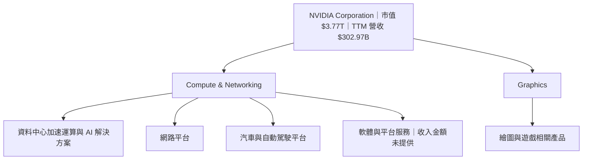
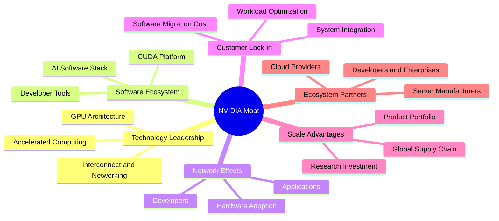
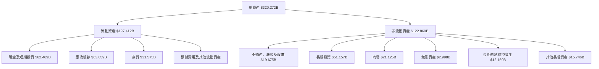
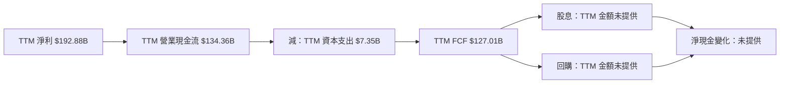
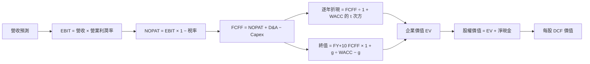
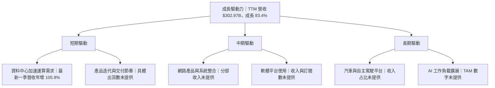
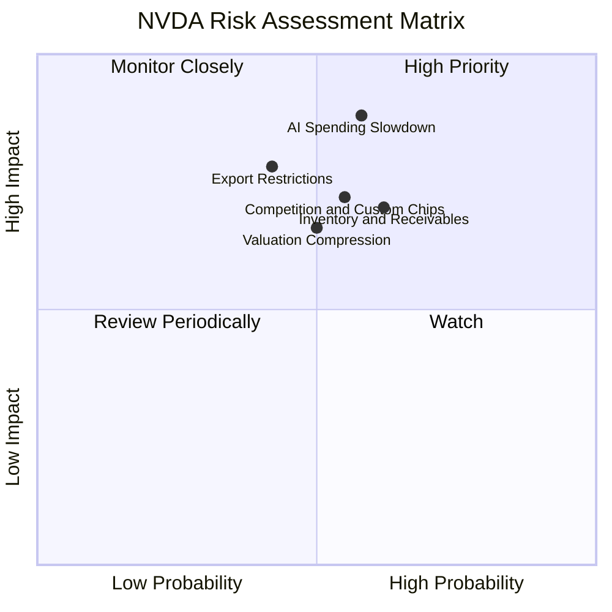
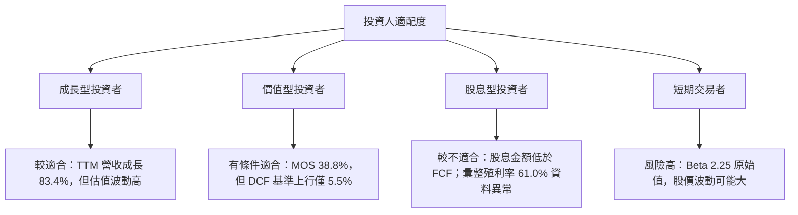

# NVDA 基本面深度分析報告
> **報告日期**：2026-11-17 ｜ **語言**：繁體中文 ｜ **數據來源**：SEC 申報資料 (XBRL)、Yahoo Finance、Finviz、StockAnalysis、Roic.ai ｜ **分析師**：CFA 級機構研究

> **資料口徑說明**：本報告價格統一採用 **2026-11-16 收盤價 $156.14**。財務數據以 SEC 10-Q／程式計算的 VERIFIED FIGURES 為優先；若其他彙整來源與之衝突，明確指出而不混用。資料中有少數來源口徑不一致，例如 ROE、債務與最近一季營業利益率，相關分析採 VERIFIED FIGURES 數值。EPS 預估與實際值、TAM、各業務收入占比等資料未提供時，不自行補造。

## 目錄

| # | 章節 | 核心結論 |
|---|------|----------|
| 1 | 執行摘要 | 強烈買入；加權合理價值 $255.28；MOS +38.8% |
| 2 | 公司概覽與商業模式 | AI 加速運算與軟硬體生態形成多層護城河；業務占比未提供 |
| 3 | 損益表深度分析 | TTM 營收 $302.97B、TTM 成長 83.4%；利潤率高但營運資金占用上升 |
| 4 | 資產負債表分析 | 淨現金 $23.22B，流動性充裕；CCC 增至 155 天 |
| 5 | 現金流量深度分析 | TTM FCF $127.01B、FCF Yield 3.37%；現金轉換率仍需監控 |
| 6 | 獲利能力與資本效率 | ROIC 80.6% 對 WACC 14.00%，價值創造幅度大 |
| 7 | 相對估值分析 | 相對 AMD、AVGO、INTC 多數倍數較低；自身歷史 P/E、P/S 偏高 |
| 8 | DCF 內在價值評估 | DCF 基準 $164.66；加權合理價值 $255.28；兩種估值口徑不可混用 |
| 9 | 成長催化劑 | AI 基礎設施需求與產品迭代是核心驅動；TAM 數值未提供 |
| 10 | 風險矩陣 | AI 資本支出循環、競爭／出口限制與營運資金上升為主要風險 |
| 11 | 投資建議 | MOS 門檻支持強烈買入；建議以財報成長、利潤率與現金轉換率驗證 |

---

## 1. 執行摘要

NVDA 的 TTM 營收為 **$302.97B**，TTM 年增 **83.4%**，最新一季年增 **105.9%**；TTM 營業利益率 **65.2%**、FCF **$127.01B**、ROIC **80.6%**，均支持其營運規模與資本效率仍具競爭力。以 WACC **14.00%** 折現的 DCF 基準價值為 **$164.66**，較 2026-11-16 收盤價 $156.14 有 **5.5%** 上行空間；四種估值方法加權後的合理價值為 **$255.28**，MOS **+38.8%**。依 MOS 門檻及 ROIC 高於 WACC，評級為 **🟢 強烈買入**；惟 DCF 與相對估值差距大，且現金轉換率、庫存天數上升，信心度為中等。

### 1.0 一頁式投資儀表板（Portfolio Manager 30 秒速讀）

| 項目 | 內容 |
|------|------|
| **投資論點（3 句）** | ① TTM 營收年增 **83.4%**，最新一季年增 **105.9%**，反映加速運算需求仍快速擴張。② TTM 營業利益率 **65.2%**、ROIC **80.6%**，顯示高毛利與資本效率仍可創造經濟價值。③ TTM FCF **$127.01B**，但 FCF Yield **3.37%**，且 CCC 從 105 天升至 155 天，資金效率需持續監控。 |
| **綜合評分** | **8.8/10**（引用 1.1 評分卡） |
| **財務健康** | 🟢 淨現金 **$23.22B**；但 DIO 上升 40 天、CCC 上升 50 天 |
| **ROIC vs WACC** | **80.6% vs 14.00%**；ROIC 高於資金成本，創造股東價值 |
| **FCF 趨勢** | TTM FCF **$127.01B**；FCF Yield **3.37%**。多年 FCF 上升，但最新季度現金流有波動 |
| **估值** | Forward P/E **9.9x**（市場資料欄位）；EV/EBITDA（TTM）**18.7x**；FCF Yield **3.37%**。同業估值比較使用 Peer multiples 欄位 |
| **DCF 內在價值（基準）** | **$164.66**；現價相對 DCF 折價 **5.2%**（基準為第 8.5 節 DCF） |
| **安全邊際（MOS）** | **+38.8%＝($255.28 − $156.14) ÷ $255.28**；🟢 >25% 充足，基準為第 8.8 節加權合理價值 |
| **預期報酬（基準情境 12M）** | DCF 基準情境相對現價 **+5.5%**；加權合理價值上行空間 **+63.5%**，兩者為不同估值口徑 |
| **關鍵風險（前二）** | AI 基礎設施支出放緩；庫存與應收帳款天數增加、CCC 拉長 |
| **評級 + 信心度** | 🟢 **強烈買入** ｜ 信心：中 |

### 1.1 綜合評分卡（全報告唯一）

| 維度 | 評分（1–10） | 主要依據（引用數字與其來源章節） |
|------|--------------|----------------------------------|
| 成長性 | 9.0 | TTM 營收成長 83.4%、最新一季年增 105.9%（第 3 章）；但高基期可能令增速逐步正常化 |
| 獲利能力 | 10.0 | TTM 營業利益率 65.2%、ROIC 80.6%，顯著高於 WACC 14.00%；F-Score 5/9（第 6 章） |
| 財務健康 | 8.5 | 淨現金 $23.22B、流動比率彙整值 4.589；CCC 從 105 天升至 155 天（第 4 章） |
| 估值 | 7.5 | MOS +38.8%，但自身五年 P/E 19.7x 高於中位數 11.3x；DCF 基準僅較現價高 5.5%（第 7–8 章） |
| 護城河 | 9.5 | CUDA／軟硬體平台與網路產品具系統性優勢；營收規模與毛利率為佐證，但市占率數字未提供（第 2 章） |
| 管理層與資本配置 | 8.5 | FY2026 SBC $6.39B、約為營收 3.0%；現金與短期投資 $56.59B。回購金額與完整資本配置明細未提供 |
| **綜合評分** | **8.8** | 六項算術平均：(9.0 + 10.0 + 8.5 + 7.5 + 9.5 + 8.5) ÷ 6 = 8.833，四捨五入至一位小數 |

### 1.2 五大投資論點 + 三大核心風險

| 類型 | 項目 | 具體依據 | 信心度 |
|------|------|----------|--------|
| 🟢 **投資論點①** | AI 加速運算需求擴張 | TTM 營收 $302.97B、年增 83.4%；最新一季年增 105.9% | 🟢 高 |
| 🟢 **投資論點②** | 高利潤率形成營運槓桿 | TTM 營業利益率 65.2%、毛利率 74.7% | 🟢 高 |
| 🟢 **投資論點③** | 資本報酬率遠高於資金成本 | ROIC 80.6%，WACC 14.00%，差距 66.6 個百分點 | 🟢 高 |
| 🟢 **投資論點④** | 現金流足以支應投資與資本配置 | TTM OCF $134.36B、Capex $7.35B、FCF $127.01B | 🟢 高 |
| 🟢 **投資論點⑤** | 多數同業估值倍數高於 NVDA | NVDA P/E 19.7x；AMD 107.8x、AVGO 42.6x（第 7 章） | 🟡 中 |
| 🟡 **風險①** | AI 資本支出循環反轉 | 若主要客戶縮減資料中心投資，收入成長與高估值可能同步下修 | 🟡 中 |
| 🔴 **風險②** | 營運資金占用快速增加 | DIO 150 天、DSO 76 天，CCC 155 天；若回款或庫存周轉惡化，FCF 可能低於盈餘成長 | 🔴 高衝擊 |
| 🟡 **風險③** | 競爭、供應鏈與地緣政治 | AMD、Broadcom 等競爭者與出口限制可能影響產品組合、交付和客戶市場 | 🟡 中 |

### 1.3 快速統計卡片

| 指標 | 公司實際值（期間） | 同業中位數 | 狀態 |
|------|--------------------|------------|------|
| 營收成長（TTM） | **83.4%** | — | 🟢 |
| 營收成長（最新一季年增） | **105.9%** | **44.7%**（AMD、AVGO、INTC 最新一季年增中位數） | 🟢 |
| 毛利率（TTM） | **74.7%** | **56.0%**（三家同業中位數） | 🟢 |
| 營業利益率（TTM） | **65.2%** | — | 🟢 |
| ROIC（TTM） | **80.6%** | — | 🟢 |
| Forward P/E | **9.9x**（市場資料欄位；Peer 倍數比較欄位採 19.7x TTM P/E） | **28.6x**（同業 Forward P/E 中位數） | 🟢 |
| FCF Yield（TTM） | **3.37%** | — | 🟡 |
| Piotroski F-Score | **5 / 9** | — | 🟡 |

> Forward P/E 資料來源欄位與 Peer multiples 中的 P/E 並非同一口徑；第 7.1 節依要求列示 Peer multiples。另有彙整欄位與 TTM EPS／股價推算倍數不完全一致，估值比較應以同一來源、同一口徑解讀。

### 1.4 投資結論

```text
╔══════════════════════════════════════════════════════════════════╗
║                    📊 投資結論摘要                               ║
╠══════════════════════════════════════════════════════════════════╣
║  評級：強烈買入（MOS +38.8%，且 ROIC 80.6% > WACC 14.00%）      ║
║  價格（2026-11-16 收盤）：$156.14                               ║
║  DCF 內在價值（基準）：$164.66（折價 5.2%）                     ║
║  安全邊際 MOS：+38.8%（＝($255.28−$156.14)÷$255.28）           ║
║  加權合理價值（8.8）：$255.28                                    ║
║  DCF 情境價值：                                                   ║
║    悲觀情境：$75.00（-52.0%）                                    ║
║    基準情境：$164.66（+5.5%）                                    ║
║    樂觀情境：$338.85（+117.0%）                                  ║
║  綜合評分：8.8/10（引用 1.1）                                    ║
║  適合投資人：能承受高波動、看好 AI 基礎設施長期需求的成長型投資人 ║
╚══════════════════════════════════════════════════════════════════╝
```

---

## 2. 公司概覽與商業模式

### 2.1 業務結構與收入來源

公司資料指出 NVIDIA 透過 **Compute & Networking** 與 **Graphics** 兩個業務板塊營運，並提供資料中心加速運算、網路、AI 解決方案、遊戲繪圖及汽車平台等產品與服務。但各板塊營收、占比及軟體收入金額未提供，因此不繪製比例圖、不推估分部收入。



### 2.2 市場份額

市場份額的可引用數字及年份未提供，故不列市占率或繪製圓餅圖。以規模與成長比較，NVDA TTM 營收 $302.97B、TTM 成長 83.4%，明顯呈現大型 AI 半導體供應商的規模；同業最新一季營收年增中位數為 44.7%，低於 NVDA 最新一季年增 105.9%。不過收入成長差距不等於市場份額變化，兩者不可混為一談。

### 2.3 競爭護城河分析



### 2.4 護城河強度

| 護城河項目 | 強度（強／中／弱） | 證據（引用數字或事實） | 會削弱它的情況 |
|------------|--------------------|------------------------|----------------|
| 技術領先 | 強 | TTM 毛利率 74.7%、營業利益率 65.2%；業務涵蓋加速運算與網路平台 | 競爭者在效能、能源效率或供應能力上縮小差距 |
| 軟體生態系統 | 強 | CUDA 與軟體平台是其產品敘述中的核心；軟體收入金額未提供 | 開放標準成熟、客戶轉向自研或跨平台工具 |
| 網路效應 | 中至強 | 開發者、應用與硬體使用形成相互促進的生態；具體用戶數未提供 | 軟體相容性降低、雲端服務商提供替代工具 |
| 客戶鎖定 | 中至強 | 企業工作負載與軟體工具遷移可能需要重新驗證；遷移成本未量化 | 多供應商策略普及或客戶自研晶片達到可接受性能 |
| 規模效應 | 強 | TTM 營收 $302.97B、TTM FCF $127.01B，可支持研發和平台投入 | 高固定投資、先進封裝或供應瓶頸使規模無法轉化為交付 |
| 生態夥伴 | 中至強 | 公司產品跨資料中心、網路、汽車及繪圖平台；夥伴收入占比未提供 | 供應鏈、雲端客戶或大型 OEM 加強議價 |

1.1 護城河分數 **9.5/10**，主要根據 74.7% TTM 毛利率、65.2% 營業利益率及跨硬體、軟體和網路產品的商業模式；因市占率及軟體收入占比沒有可核驗數字，未給滿分。

---

## 3. 損益表深度分析

### 3.1 年度收入成長趨勢（近4年）

FY2023 至 FY2026 營收分別為 $26.97B、$60.92B、$130.50B、$215.94B。FY2024、FY2025、FY2026 年增率約為 125.9%、114.2%、65.5%；FY2023 相較 FY2022 約持平。FY2023–FY2026 三年 CAGR 約 100.1%，反映資料中心 AI 需求擴張及較低基期；FY2026 增速回落至 65.5%，顯示基期效應開始放大，但仍屬高成長。

```text
╔══════════════════════════════════════════════════════════════════╗
║              NVIDIA 年度收入趨勢（FY2023–FY2026）                ║
╠══════════════════════════════════════════════════════════════════╣
║  FY2023  $26.97B   ███░░░░░░░░░░░░░░░░░░░  YoY: +125.9% 🟢     ║
║  FY2024  $60.92B   ██████░░░░░░░░░░░░░░░░  YoY: +125.9% 🟢     ║
║  FY2025  $130.50B  █████████████░░░░░░░░░  YoY: +114.2% 🟢     ║
║  FY2026  $215.94B  ██████████████████████  YoY: +65.5%  🟢     ║
║                                                                  ║
║  FY2023–FY2026 三年營收 CAGR：約 +100.1%                          ║
╚══════════════════════════════════════════════════════════════════╝
```

### 3.2 季度收入趨勢分析

| 季度 | 營收 | QoQ 成長 | YoY 成長 | 備註 |
|------|------:|---------:|---------:|------|
| FY2026 Q3（2025-10） | $57.01B | — | 62.5% | 與上一年同期比較 |
| FY2026 Q4（2026-01） | $68.13B | 19.5% | 73.2% | 以相鄰季度營收計算 QoQ |
| FY2027 Q1（2026-04） | $81.62B | 19.8% | 85.2% | 延續季度擴張 |
| FY2027 Q2（2026-07） | $96.22B | 17.9% | 105.9% | 最新一季年增率；不是 TTM 成長率 |

近期營收 QoQ 約 18%–20%，最新一季營收年增 105.9%。FY2027 Q2 營收成長反映需求仍旺盛，但季度年增率受前一年比較基期及產品交付節奏影響，不能直接視為長期成長率。

### 3.3 利潤率演變分析

| 利潤率指標 | FY2023 | FY2024 | FY2025 | FY2026 | 趨勢 | 評估 |
|------------|-------:|-------:|-------:|-------:|------|------|
| **毛利率** | 56.9% | 72.7% | 75.0% | 71.1% | 先大幅提高、FY2026 回落 | 🟢 |
| **營業利益率** | 20.7% | 54.1% | 62.4% | 60.4% | 兩年擴張後小幅收斂 | 🟢 |
| **淨利率** | 16.2% | 48.8% | 55.8% | 55.6% | 快速改善後大致持平 | 🟢 |

上述年度利潤率由年度毛利、營業利益、淨利除以營收計算；不同於 TTM 口徑的毛利率 74.7%、營業利益率 65.2%、淨利率 63.7%。FY2024–FY2025 的改善與資料中心產品組合、收入規模和費用槓桿相符；FY2026 毛利率及營業利益率回落，顯示高成長下的產品成本、產品組合及費用投入已部分抵銷規模效益。若高利潤率仍維持，新增營收可帶來高額營業利益；若競爭或產品成本壓力擴大，估值對利潤率的敏感度很高。

### 3.4 費用結構分析

收入成本、研發、銷售與管理費用的完整 TTM 分拆未提供，不繪製費用圓餅圖。FY2026 年研發費用為 **$18.50B**，占該年度營收 $215.94B 約 **8.6%**；營業利益率由 FY2025 約 62.4% 降至 FY2026 約 60.4%，但沒有完整費用明細可將變化精確歸因到單一費用項目。

### 3.5 季度 EPS 趨勢與盈餘品質（Quality of Earnings）

**過去四季盈餘表現**：所提供的 EPS Est、EPS Act 均為 `nan`，無法判定近四季是否超預期或不及預期。可觀察到已公布季度 EPS（StockAnalysis）由 FY2026 Q3 的 $1.30、FY2026 Q4 的 $1.76、FY2027 Q1 的 $2.39 增至 FY2027 Q2 的 $2.47；最新一季 EPS 年增 127.8%。這是實際 EPS 趨勢，不代表相對分析師預估的 surprise。

| 盈餘品質項目 | 數值／佔比 | 評估 |
|--------------|-----------|------|
| 股權薪酬 SBC / 營收 | FY2026 SBC $6.39B ÷ FY2026 營收 $215.94B = **約 3.0%**；非 TTM 比率 | 🟡 SBC 會稀釋股東，但稀釋股數未增加的 F-Score 測試通過 |
| SBC / 營業現金流 | FY2026 SBC $6.39B ÷ FY2026 OCF $102.72B = **約 6.2%** | 🟡 不是主要現金流來源，但應納入股東成本評估 |
| FCF / 淨利（現金轉換率） | TTM FCF $127.01B ÷ TTM 淨利 $192.88B = **約 65.9%** | 🟡 FCF 為正且規模大，但低於淨利，部分差異來自營運資金與非現金項目 |
| 一次性／非經常性損益 | 資料未提供完整 TTM 明細 | N/A；不能判定一次性項目對盈餘影響 |
| 有效稅率異常 | 最新年度有效稅率 **15.1%** | 🟢 DCF 採用此稅率；歷年可比完整稅務明細未提供 |
| 資本化支出 vs 費用化 | TTM Capex $7.35B；資本化支出占 TTM 營收約 **2.4%** | 🟢 Capex 相對營收不高；資本化政策細節未提供，不能據此斷言無遞延成本 |

**盈餘品質結論**：TTM FCF $127.01B 是實質現金流，但約為 TTM 淨利的 65.9%，現金轉換未達 100%；加上 CCC 延長，盈餘品質仍需追蹤。股權薪酬約為 FY2026 營收 3.0%，並非可以忽略的股東成本。缺乏完整一次性損益資料，故不對 GAAP 盈餘是否被一次性項目高估作確定判斷。

---

## 4. 資產負債表分析

### 4.1 資產結構分解

以下資產項目來自截至 2026-07-26 的 TTM 資產負債表彙整；總資產 $320.272B。流動資產 $197.412B，非流動資產合計依各列已披露資產項目相加為 $122.860B。



### 4.2 流動性與營運資金分析

彙整市場資料的流動比率為 4.589、速動比率為 2.918；與最新季度資產負債表流動資產 $197.412B 及流動負債 $43.019B 的方向一致，顯示短期流動性充裕。不同來源的資產負債表日期與欄位口徑並不完全相同，不將其強行混算。

| 指標 | 最新 TTM | 一年前 TTM | 變化 | 解讀 |
|------|----------|------------|------|------|
| DSO 應收帳款天數 | 76 天 | 61 天 | +15 天 | 收款週期拉長；可能反映收入規模、交付和付款條件變化，須觀察應收帳款是否持續快於營收成長 |
| DIO 存貨天數 | 150 天 | 110 天 | +40 天 | 庫存占用增加；可能是備貨與產品週期安排，也可能是需求／交付錯配 |
| DPO 應付帳款天數 | 72 天 | 66 天 | +6 天 | 付款天數略增，對沖部分營運資金占用；不足以抵銷 DSO、DIO 上升 |
| CCC 現金轉換週期 | 155 天 | 105 天 | +50 天 | 現金由投入到回收的週期拉長，為現金流質量的重要監控項目 |

### 4.3 債務結構分析

```text
╔══════════════════════════════════════════════════════════════════╗
║                   NVIDIA 債務健康診斷                            ║
╠══════════════════════════════════════════════════════════════════╣
║  總債務（VERIFIED）：  $33.37B     ██░░░░░░░░░░░░░░░░  🟢       ║
║  現金及短期投資：      $56.59B     ████████████████████ 🟢       ║
║  淨現金：              $23.22B     ████████░░░░░░░░░░░░ 🟢       ║
║                                                                  ║
║  Debt/EBITDA：         N/A（口徑／分母未提供對應一致財務期間）     ║
║  利息保障倍數：        N/A（利息支出明細未提供）                   ║
║  判斷：淨現金為正、TTM OCF $134.36B，短期償債風險低；             ║
║        不以其他來源的 $38.86B 總債務替代 VERIFIED FIGURES。       ║
╚══════════════════════════════════════════════════════════════════╝
```

彙整的非 VERIFIED 市場資料另列總債務 $38.86B、現金 $62.47B；其口徑與 SEC 計算的總債務 $33.37B、現金及短期投資 $56.59B 不一致。本報告依指定優先順序使用後者計算淨現金 $23.22B，不把兩套口徑交叉組合。

### 4.4 股東權益趨勢

| 財年 | 股東權益 | 同比變化 |
|------|--------:|--------:|
| FY2023 | $22.10B | — |
| FY2024 | $42.98B | +94.5% |
| FY2025 | $79.33B | +84.6% |
| FY2026 | $157.29B | +98.3% |

```text
╔══════════════════════════════════════════════════════════════════╗
║                   股東權益變化（年度）                           ║
╠══════════════════════════════════════════════════════════════════╣
║  FY2023  $22.10B  ███░░░░░░░░░░░░░░░░░░░                        ║
║  FY2024  $42.98B  ██████░░░░░░░░░░░░░░                          ║
║  FY2025  $79.33B  ███████████░░░░░░░░░                          ║
║  FY2026 $157.29B  ██████████████████████                         ║
╚══════════════════════════════════════════════════════════════════╝
```

權益增長與獲利及資產規模擴大相符；但帳面權益增加本身不代表每股價值等比例上升，仍需同時追蹤稀釋股數和資本報酬率。

---

## 5. 現金流量深度分析

### 5.1 現金流量瀑布圖

因股息、回購的完整 TTM 金額及淨現金變化未同一口徑提供，相關節點標示未提供，不推估金額。



### 5.2 FCF 轉換率趨勢

| 財年 | FCF | 淨利 | FCF / 淨利 |
|------|----:|----:|-----------:|
| FY2023 | $3.81B | $4.37B | 87.2% |
| FY2024 | $27.02B | $29.76B | 90.8% |
| FY2025 | $60.85B | $72.88B | 83.5% |
| FY2026 | $96.68B | $120.07B | 80.5% |
| 最新 TTM | $127.01B | $192.88B | 65.9% |

年度 FCF 持續上升，但 FCF／淨利比率由 FY2024 的 90.8% 降至最新 TTM 約 65.9%。最新 TTM 和年度數據的期間不同，需視為趨勢參考而非同期間嚴格比較。CCC 上升 50 天是現金轉換率弱於淨利增長時應重點監控的可能因素。

### 5.3 自由現金流趨勢

| 財年／期間 | FCF | 同比變化 | FCF Yield |
|------------|----:|---------:|----------:|
| FY2023 | $3.81B | — | N/A |
| FY2024 | $27.02B | +609.2% | N/A |
| FY2025 | $60.85B | +125.2% | N/A |
| FY2026 | $96.68B | +58.9% | N/A |
| TTM | $127.01B | N/A（未提供同口徑 prior TTM FCF） | 3.37% |

```text
╔══════════════════════════════════════════════════════════════════╗
║                    FCF 歷史趨勢（美元）                           ║
╠══════════════════════════════════════════════════════════════════╣
║  FY2023    $3.81B   █                                           ║
║  FY2024   $27.02B   ██████                                      ║
║  FY2025   $60.85B   █████████████                               ║
║  FY2026   $96.68B   ████████████████████                        ║
║  TTM     $127.01B   ██████████████████████████  Yield: 3.37%    ║
╚══════════════════════════════════════════════════════════════════╝
```

### 5.4 資本配置評估

可用資料顯示 FY2026 股息支付 $0.974B、SBC $6.39B、Capex TTM $7.35B；回購及長期投資的完整現金流明細未提供，故不繪製資本配置比例圓餅圖。

| 項目 | 已知金額 | 評估 |
|------|---------:|------|
| 資本支出 | TTM $7.35B | 約為 TTM 營收 2.4%；但不代表供應鏈或客戶端的總 AI 投資 |
| 股息 | FY2026 $0.974B | 相較 FCF 規模低；資料內另列股息殖利率 61.0%，與現金股息及常見殖利率口徑明顯不一致，不能採用作投資依據 |
| 股權薪酬 | FY2026 $6.39B | 約占 FY2026 營收 3.0%；需考慮稀釋成本 |
| 回購 | 金額未提供 | N/A，無法量化回購對每股價值的抵銷效果 |
| 留存與投資 | 完整用途未提供 | N/A；公司有 $56.59B 現金及短期投資 |

---

## 6. 獲利能力與資本效率

### 6.1 ROE / ROA / ROIC 趨勢

| 指標 | 最新 TTM／提供期間 | 歷史比較 | 評估 |
|------|-------------------:|----------|------|
| ROE | **84.2%**（QUALITY FIGURES） | 財務彙整另列 117.2%，口徑不一致 | 依 QUALITY FIGURES 採 84.2%；不可將兩者混作同一序列 |
| ROA | 53.6%（另一彙整來源） | QUALITY FIGURES 只提供 F-Score 測試結果，未提供完整 ROA 序列 | 高獲利資產回報，但來源口徑需核對 |
| ROIC | **80.6%**（TTM） | 歷史 ROIC 序列未提供一致可比值 | 顯著高於資本成本 |
| 行業均值 | 未提供 | — | 不列無來源的行業均值 |

### 6.2 ROIC vs WACC 分析（核心價值創造判斷）

WACC 依成本資本資料採 **14.00%**；該資料提供未封頂計算值 14.16%，並依 7%–14% 區間限制至 14.00%。ROIC 採 TTM **80.6%**。因此 ROIC − WACC = **66.6 個百分點**，是明確的正經濟利差；該利差若能維持，新增再投資可創造股東價值。

```text
╔══════════════════════════════════════════════════════════════════╗
║                 ROIC vs WACC 深度分析                            ║
╠══════════════════════════════════════════════════════════════════╣
║  資本成本輸入（同第 8.2 節）：                                    ║
║  ├── 無風險利率：5.12%                                            ║
║  ├── 市場風險溢酬：5.00%                                          ║
║  ├── Beta 原始值 2.25；調整後 Beta 1.83                           ║
║  ├── 股權成本：14.28%                                             ║
║  ├── 稅前債務成本：0.78%；有效稅率 15.1%                          ║
║  ├── 股權／債務權重：99.1%／0.9%                                  ║
║  └── WACC 計算 14.16%，受 7%–14% 範圍限制後採用 14.00%           ║
║                                                                  ║
║  ROIC：80.6%（TTM，直接引用程式計算值）                           ║
║  EVA 利差：80.6% − 14.00% = +66.6 個百分點                       ║
║                                                                  ║
║  ROIC  80.6%  ▓▓▓▓▓▓▓▓▓▓▓▓▓▓▓▓▓▓▓▓▓▓▓▓▓▓▓▓▓▓▓▓▓▓▓▓ 🟢          ║
║  WACC  14.0%  ▓▓▓▓▓▓▓░░░░░░░░░░░░░░░░░░░░░░░░░░░░              ║
║                                                                  ║
║  結論：目前 ROIC 約為 WACC 的 5.8 倍，創造股東價值；              ║
║        但此差距依賴高利潤率與資本效率持續，不能視為永久不變。      ║
╚══════════════════════════════════════════════════════════════════╝
```

### 6.3 杜邦三因素分解

| 因素 | 數值（TTM） | 解讀 |
|------|-------------|------|
| 淨利率 | 63.7% | 淨利率高，是 ROE 的主要來源 |
| 資產週轉率 | 0.95 | 資產每年約產生 0.95 倍營收 |
| 權益乘數 | 1.40 | 財務槓桿溫和，不是 ROE 的主要推升來源 |
| **ROE** | **84.2%** | 63.7% × 0.95 × 1.40 = 84.7%（與提供的 84.2% 有小幅四捨五入／底層精度差異） |

ROE 主要由淨利率驅動，不是依靠高槓桿撐起。此列嚴格採用 QUALITY FIGURES 原始三因素與 ROE 數值，不以重新計算值替代。

### 6.4 財務體質：Piotroski F-Score

**Piotroski F-Score：5 / 9**（計算期間 TTM 至 2026-07-26 對比 TTM 至 2025-07-27）。

| 測試 | 結果 | 解讀 |
|------|------|------|
| ROA > 0 | ✅ 通過 | 獲利為正 |
| 營業現金流 > 0 | ✅ 通過 | 營運產生正現金流 |
| ROA 高於一年前 | ❌ 未通過 | 相對前一年未改善；可能是比較基期或資產擴張影響 |
| 營業現金流 > 淨利（應計品質） | ❌ 未通過 | 現金流低於淨利，與約 65.9% TTM FCF／淨利比率方向一致 |
| 長期負債 ÷ 總資產低於一年前 | ❌ 未通過 | 槓桿指標未達該項改善條件 |
| 流動比率高於一年前 | ✅ 通過 | 流動性相對改善 |
| 稀釋股數未增加 | ✅ 通過 | 稀釋股數測試通過，但仍需監控 SBC |
| 毛利率高於一年前 | ✅ 通過 | 毛利率相對改善 |
| 資產週轉率高於一年前 | ❌ 未通過 | 新增資產尚未同幅轉化為營收 |

F-Score 5/9 顯示絕大多數基本面項目並未全面惡化，但現金相對盈餘、資產週轉及資產負債表槓桿變化值得追蹤。

---

## 7. 相對估值分析

### 7.1 同業估值比較表格

以下同業倍數依 Peer multiples 欄位；本公司 P/E、P/S、EV/EBITDA 使用同一區塊列示值。Forward P/E 的 NVDA 市場彙整欄與同業來源口徑有差異，故此處以可比 Peer multiples 欄位的 NVDA 市場 P/E 來源資訊補充，並避免將它與另一彙整值混為一談。

| 估值指標 | **NVDA** | **AMD** | **AVGO** | **INTC** | 本公司評估 |
|----------|---------:|--------:|--------:|--------:|-----------|
| **Trailing P/E** | 19.7x | 107.8x | 42.6x | N/A | 🟢 低於 AMD、AVGO；但需留意來源與盈利口徑 |
| **Forward P/E** | 9.9x¹ | 28.6x | 17.2x | 31.0x | 🟢 NVDA 彙整值低；但不是同一 Peer multiples 欄位提供值 |
| **P/S Ratio（TTM）** | 12.5x | 18.2x | 17.9x | 4.9x | 🟡 低於 AMD、AVGO，高於 INTC |
| **EV/EBITDA（TTM）** | 18.7x | 73.6x | 31.1x | 16.1x | 🟢 低於 AMD、AVGO，略高於 INTC |
| **最新一季營收年增** | 105.9% | 44.7% | 85.5% | 20.9% | 🟢 成長速度高於三家列示同業 |
| **毛利率（TTM）** | 74.7% | 56.0% | 75.5% | 40.2% | 🟢 接近 AVGO，高於 AMD、INTC |

¹ NVDA Forward P/E 9.9x 來自市場資料欄位；Peer multiples 區塊沒有提供 NVDA Forward P/E 的同欄位值。分析師共識 Forward EPS 為 $15.84，但以股價直接除算會得到不同倍數；本報告不自行替換來源欄位。

### 7.2 歷史估值區間分析

```text
╔══════════════════════════════════════════════════════════════════╗
║                 NVDA 五年估值區間（TTM）                         ║
╠══════════════════════════════════════════════════════════════════╣
║  P/E      2.3x ───── 中位數 11.3x ───────── 現值 19.7x ── 49.3x  ║
║  現值百分位：71%                                                 ║
║                                                                  ║
║  P/S      1.2x ───── 中位數 2.7x ────────── 現值 12.5x ── 31.0x  ║
║  現值百分位：57%                                                 ║
║                                                                  ║
║  EV/EBITDA 3.4x ──── 中位數 8.9x ────────── 現值 18.7x ── 47.8x  ║
║  現值百分位：57%                                                 ║
╚══════════════════════════════════════════════════════════════════╝
```

目前三項估值倍數均高於自身五年中位數；P/E 位於歷史第 71 百分位，P/S 與 EV/EBITDA 約第 57 百分位。這表示相對自身歷史並非低估區，但歷史區間也包含業務及盈餘劇烈變化時期，不能僅以歷史中位數判定合理價值。

### 7.3 情境價值（Bear / Base / Bull）

| 情境 | 第 1 年營收成長 | 期末營業利潤率 | WACC | 每股價值 | 相對現價 | 機率 | 會發生的條件 |
|------|----------------:|----------------:|-----:|----------:|---------:|-----:|--------------|
| 🔴 悲觀 | 15.0% | 51.3% | 15.00% | $75.00 | -52.0% | 25% | 雲端客戶投資放緩、競爭壓低毛利率且資本成本上升 |
| 🟡 基準 | 30.0% | 60.4% | 14.00% | $164.66 | +5.5% | 50% | 營收增速按模型逐年減速、利潤率由 TTM 水準向歷史中位數回落 |
| 🟢 樂觀 | 45.0% | 66.4% | 13.00% | $338.85 | +117.0% | 25% | AI 需求持續超預期、利潤率維持或擴張、折現率降低 |

### 7.4 相對估值隱含價格區間

```text
╔══════════════════════════════════════════════════════════════════╗
║                  相對估值與 DCF 每股價值                         ║
╠══════════════════════════════════════════════════════════════════╣
║  $156.14 現價 ─ $164.66 DCF ─ $197.66 EV/EBITDA                  ║
║                    ─ $255.28 加權合理價值 ─ $452.95 Forward P/E  ║
╠══════════════════════════════════════════════════════════════════╣
║  DCF（基準）：$164.66；10 年 FCFF，WACC 14.00%，g 3.0%             ║
║  同業 Forward P/E：$452.95；同業中位數 28.6x × Forward EPS $15.84 ║
║  同業 EV/EBITDA：$197.66；同業中位數 23.6x（AVGO、INTC）         ║
║                   × TTM EBITDA，加回淨現金                       ║
╚══════════════════════════════════════════════════════════════════╝
```

Forward P/E 隱含價值遠高於 DCF，表示採用同業倍數時，市場估值高度取決於成長期長度與可維持的高成長倍數；它不是確定性較高的估值。第 8.8 節按指定固定權重納入，而非由分析師自行調整。

---

## 8. DCF 內在價值評估（Discounted Cash Flow）

> 本節 DCF 數據依程式模型原值引用。金額單位為美元十億（$B），每股金額為美元。表中金額取兩位小數，折現因子三位小數；由於模型底層使用未四捨五入數值，僅使用表內已四捨五入數字複算可能產生尾差。

### 8.0 估值推理鏈（Thinking Logic）

**Step 1 — 價值來源與主導變數**

模型的核心命題是：NVDA 價值主要由目前資料中心加速運算相關業務帶來的現金流底盤，以及未來 AI 基礎設施需求延續所形成的成長價值構成；各業務營收占比未提供，無法量化各板塊占比。模型以 TTM 營收 $302.97B 為起點，營收成長由第 1 年 30.0% 線性降至第 10 年 3.0%；營業利益率由 65.2% 降至 60.4%。**最主導估值的因素是高營收成長與高營業利益率能維持多久**；敏感度表亦顯示 WACC 和永續成長率變化會顯著改變價值。

**Step 2 — 模型選擇**

| 決策點 | 本報告採用 | 理由（含數字） | 曾考慮但否決 | 否決理由 |
|--------|-----------|----------------|--------------|----------|
| 現金流定義 | FCFF | 用 WACC 折現，先得企業價值，再加淨現金 | FCFE | 本模型已指定採 FCFF |
| 預測期 N | 10 年 | 模型假設以十年逐步衰減成長，逐年預測至 FY+10 | 5 年 | 不能完整反映模型既定十年現金流 |
| 終值方法 | Gordon Growth | 模型已提供 g=3.0% 與終值 | 退出倍數 | DCF 模型未提供退出倍數終值，不能另建 |
| EBIT 基礎 | GAAP EBIT | 模型採 GAAP 營業利益率 | 非 GAAP EBIT | 會改變模型既定基礎，且有重複處理 SBC 風險 |

**Step 3 — 關鍵假設推導鏈**

- **營收成長**：錨點＝TTM 成長 83.4%、最新一季年增 105.9% → 調整＝考慮基期提高、模型不延續單季超高增速，將第 1 年限定為 30.0%，之後每年線性降 3 個百分點 → **採用第 1 年 30.0%、第 10 年 3.0%** → 曾考慮維持 83.4%，因與高基期後逐步正常化假設不相容而否決。
- **期末營業利潤率**：錨點＝TTM 65.2% → 調整＝模型依過去五個財年中位數向下收斂；反映競爭、產品組合及成本可能逐步正常化 → **第 10 年採用 60.4%** → 曾考慮維持 65.2%，因模型明確設定向歷史中位數回落而否決。
- **永續成長率 g**：錨點＝長期名目經濟增長參考；可引用的市場長期預測數據未提供 → 調整＝採模型給定的 3.0%，低於 WACC 14.00% → **採用 3.0%** → 曾考慮更高 g，但沒有數據支撐且會過度放大終值，故不採用。
- **預測期 N**：錨點＝模型既定十年逐年現金流 → 調整＝不更改程式模型的預測期 → **採用 10 年** → 曾考慮縮短至 5 年，因會改變模型現值與終值起算年度而否決。
- **Capex／營收**：錨點＝TTM 約 2.4% → 調整＝模型令其逐步下降並收斂到 D&A 的 1.1 倍附近 → **FY+1 2.4%、FY+10 1.3%** → 曾考慮固定 2.4%，因未反映模型設定的成熟化調整而否決。
- **EBIT 與 SBC**：錨點＝模型明列 GAAP EBIT、已將 SBC 作為費用處理 → 調整＝不另扣 SBC，也不再增加年稀釋 → **採用組合 (A)：GAAP EBIT＋固定股數＋0%額外稀釋** → 曾考慮再扣 SBC，因會重複計算股東薪酬成本而否決。
- **WACC**：錨點＝未限制計算值 14.16% → 調整＝成本資本資料指定限制於 7%–14% 範圍 → **採用 14.00%** → 曾考慮直接採 14.16%，因 VERIFIED FIGURES 明示應採區間上限而否決。

**Step 4 — 最脆弱假設**

最脆弱的是高營業利益率與成長可延續至十年末；若競爭或客戶投資放緩使成長與利潤率向悲觀情境移動，模型每股價值可降至 **$75.00**，較現價低 52.0%。

**Step 5 — 計算路徑**



### 8.1 模型假設總表（Model Inputs）

| 假設項目 | 採用值 | 依據／來源 | 敏感度 |
|----------|--------|-------------|--------|
| 預測期長度 **N** | 10 年 | 程式模型明列；從 FY+1 至 FY+10 | 🟡 中 |
| 營收成長 | FY+1 30.0%，FY+10 3.0%，逐年線性下降 | TTM 營收成長 83.4%；模型限制在 0%–30% | 🔴 高 |
| 營業利潤率 | 65.2% 降至 60.4% | TTM 營業利益率及最近五財年中位數設定 | 🔴 高 |
| 有效稅率 | 15.1% | 最新年度有效稅率 | 🟢 低 |
| Capex／營收 | FY+1 2.4% 降至 FY+10 1.3% | TTM Capex／營收約 2.4%；模型逐步降至約 1.1×D&A | 🟡 中 |
| D&A／營收 | 1.2% | TTM 模型輸入，固定不變 | 🟢 低 |
| 營運資金變動 | 不建模 | DCF MODEL 明列 Working capital is not modelled | 🟢 低 |
| EBIT 基礎 | GAAP | DCF MODEL 明列 GAAP EBIT | 🟡 中 |
| SBC 處理 | GAAP EBIT 已含 SBC；不另扣 SBC | DCF MODEL 明列組合 A | 🟡 中 |
| 年稀釋率 | 0%（模型不再稀釋） | SBC 成本已反映於 GAAP EBIT，依模型規則採固定股數 | 🟡 中 |
| 永續成長率 g | 3.0% | DCF MODEL 假設；低於 WACC | 🔴 高 |
| 終值方法 | Gordon Growth | DCF MODEL 已提供終值計算 | 🔴 高 |
| WACC | 14.00% | 資本成本計算值 14.16%，限制於 7%–14% | 🔴 高 |

**SBC 設定**：本模型採用 **(A) GAAP EBIT + 固定股數**，故 SBC 影響已計入一次；FCFF 不另列 −SBC，股數不再作年度稀釋。

**FCFF 定義**：`FCFF = NOPAT + D&A − Capex`。營運資金未建模，不另加減 ΔWC。

### 8.2 折現率推導（WACC）

成本資本輸入依資料提供值。Beta 原始值 2.25；使用調整後 Beta **1.83 = ⅔ × 2.25 + ⅓**。無風險利率資料為 10 年期美債 5.12%，其觀察日期未另外提供；ERP 5.00% 為假設值。未另加規模／國別溢酬。

```text
╔══════════════════════════════════════════════════════════════════╗
║                    WACC 推導（折現率）                           ║
╠══════════════════════════════════════════════════════════════════╣
║  股權成本 Ke（CAPM）：                                           ║
║  ├── 無風險利率 Rf：5.12%                                         ║
║  ├── ERP（假設值）：5.00%                                         ║
║  ├── 原始 Beta：2.25；調整後 Beta：1.83                           ║
║  ├── 規模／國別溢酬：0.00%（未另加）                              ║
║  └── Ke = 5.12% + 1.83 × 5.00% = 14.27%，資料列示 14.28%         ║
║                                                                  ║
║  債務成本：                                                      ║
║  ├── 稅前 Kd：0.78%（程式計算值；利息與平均計息負債底層明細未提供）║
║  ├── 有效稅率：15.1%                                              ║
║  └── 稅後 Kd = 0.78% × (1 − 15.1%) = 0.66%                       ║
║                                                                  ║
║  資本結構：                                                      ║
║  ├── E / D 權重：99.1% / 0.9%                                     ║
║  └── 未限制 WACC 計算值 14.16%；限制於 7%–14% 後採用 14.00%      ║
╚══════════════════════════════════════════════════════════════════╝
```

**逐步演算及可核對限制**

1. **Ke（CAPM）**：`5.12% + 1.83 × 5.00% = 14.27%`；資料表列 14.28%，差異為輸入未四捨五入精度。
2. **稅前 Kd**：程式列示 **0.78%**。利息費用與平均計息負債的原始美元金額未提供，無法獨立重建分子、分母；不以總負債或應付帳款反推。
3. **稅後 Kd**：`0.78% × (1 − 15.1%) = 0.66222% ≈ 0.66%`。
4. **權重**：採用程式給定股權／債務權重 **99.1%／0.9%**，合計 100.0%。市值與計息債務的精確權重底層數未提供，故不另替換權重。
5. **WACC**：按列示圓整輸入計算約 `99.1% × 14.28% + 0.9% × 0.66% = 14.16%`；限制在 7%–14% 後，**採用 14.00%**。

本節與第 6.2 節使用同一 WACC **14.00%**。WACC 底層輸入的圓整精度與計算權重使手工重算值可有少量差異；模型明示的採用值不予改動。

### 8.3 逐年自由現金流預測（基準情境）

| 年度 | FY+1 | FY+2 | FY+3 | FY+4 | FY+5 | FY+6 | FY+7 | FY+8 | FY+9 | FY+10 |
|------|-----:|-----:|-----:|-----:|-----:|-----:|-----:|-----:|-----:|------:|
| 營收 | 393.86 | 500.20 | 620.25 | 750.50 | 885.59 | 1,018.43 | 1,140.64 | 1,243.30 | 1,317.90 | 1,357.44 |
| 營收 YoY | 30.0% | 27.0% | 24.0% | 21.0% | 18.0% | 15.0% | 12.0% | 9.0% | 6.0% | 3.0% |
| 營業利潤率 | 65.2% | 64.7% | 64.1% | 63.6% | 63.1% | 62.5% | 62.0% | 61.5% | 60.9% | 60.4% |
| EBIT（GAAP） | 256.85 | 323.52 | 397.83 | 477.35 | 558.51 | 636.82 | 707.11 | 764.08 | 802.85 | 819.64 |
| − 稅 | (38.83) | (48.91) | (60.14) | (72.16) | (84.43) | (96.27) | (106.89) | (115.51) | (121.37) | (123.91) |
| = NOPAT | 218.02 | 274.61 | 337.69 | 405.19 | 474.08 | 540.55 | 600.22 | 648.57 | 681.48 | 695.74 |
| + D&A | 4.79 | 6.09 | 7.55 | 9.13 | 10.78 | 12.39 | 13.88 | 15.13 | 16.04 | 16.52 |
| − Capex | (9.56) | (11.54) | (13.55) | (15.49) | (17.21) | (18.56) | (19.41) | (19.65) | (19.24) | (18.17) |
| = FCFF | 213.26 | 269.16 | 331.68 | 398.82 | 467.65 | 534.39 | 594.69 | 644.05 | 678.28 | 694.09 |
| 折現因子 | 0.877 | 0.769 | 0.675 | 0.592 | 0.519 | 0.456 | 0.400 | 0.351 | 0.308 | 0.270 |
| FCFF 現值 PV | 187.07 | 207.11 | 223.88 | 236.14 | 242.88 | 243.46 | 237.66 | 225.78 | 208.58 | 187.23 |

營運資金變動沒有建模，因此依模型定義不列 ΔWC 行；本模型亦不另扣 SBC。表列 FY+1 數字逐項算式如下，表內圓整數可能與使用底層精確數值的模型結果有尾差：

1. **營收** = $302.97B × (1 + 30.0%) = `$393.861B ≈ $393.86B`
2. **EBIT** = 營收 × 營業利潤率；以表列圓整數計，`$393.86B × 65.2% = $256.797B`。模型列示 **$256.85B**，差異表示模型使用未圓整輸入；為遵守原模型數字，本表維持 $256.85B。
3. **稅** = EBIT × 15.1%；模型列示 `$38.83B`。
4. **NOPAT** = `$256.85B − $38.83B = $218.02B`。
5. **D&A** = `$393.86B × 1.2% ≈ $4.73B`；模型列示 `$4.79B`，同樣反映未圓整輸入或底層比率精度，不能用顯示值覆寫模型值。
6. **Capex** = 模型列示 `$9.56B`。
7. **FCFF** = 模型列示 `$218.02B + $4.79B − $9.56B = $213.25B`；模型列示 `$213.26B`，為底層未圓整值的尾差。
8. **折現因子** = `1 ÷ (1 + 14.00%)^1 = 0.87719 ≈ 0.877`。
9. **PV** = `$213.26B × 0.877 ≈ $187.03B`；模型列示 `$187.07B`，差異來自折現因子及 FCFF 未圓整值。

預測期 PV 合計依模型原值為：
`$187.07 + $207.11 + $223.88 + $236.14 + $242.88 + $243.46 + $237.66 + $225.78 + $208.58 + $187.23 = $2,199.79B`。
模型列示合計 **$2,199.78B**；相差 $0.01B，為列值圓整尾差，低於 1%。

**合理性自檢**

- 模型預測 FCFF 由 $213.26B 增至 $694.09B；按十年端點年化約 **12.5%**。歷史 FCFF 年度增長波動大（FY2024 約 +609.2%、FY2025 +125.2%、FY2026 +58.9%），模型假設更接近長期放緩，但仍要求大幅擴大絕對現金流。
- FY+10 FCFF 利潤率 = `$694.09B ÷ $1,357.44B = 51.1%`；模型未提供同業最佳 FCF 利潤率，故無法比較同業。
- 模型預測各年度 FCFF 均為正；營運資金未建模，若應收或存貨繼續上升，實際 FCF 可能低於模型值。

```text
╔══════════════════════════════════════════════════════════════════╗
║            自由現金流：歷史實際 vs 模型預測                      ║
╠══════════════════════════════════════════════════════════════════╣
║  FY2025（實）   $60.85B  ████████░░░░░░░░░░░░░                   ║
║  FY2026（實）   $96.68B  █████████████░░░░░░░░                   ║
║  TTM（實）     $127.01B  █████████████████░░░░                   ║
║  FY+1（預）    $213.26B  █████████████████████████████           ║
║  FY+10（預）   $694.09B  ███████████████████████████████████████ ║
╠══════════════════════════════════════════════════════════════════╣
║  模型預測端點年化增長約 12.5%；歷史期間與預測期間並非同一口徑。  ║
╚══════════════════════════════════════════════════════════════════╝
```

### 8.4 終值計算（Terminal Value）

**適用性檢查**：`WACC 14.00% vs g 3.0% → WACC > g？✅`

DCF MODEL 未提供退出倍數終值數字或依據，依規則不自行建立第二套終值。

| 方法 | 計算式 | 終值 TV | TV 現值 | 佔總 EV 比重 |
|------|--------|---------:|--------:|-------------:|
| Gordon Growth | FY+10 FCFF × (1+g) ÷ (WACC−g) | $6,499.17B | $1,753.11B | 44.4% |
| 退出倍數法 | 未提供退出倍數／FY+10 EBITDA | N/A | N/A | N/A |

逐步計算：

1. **FY+N FCFF** = FY+10 FCFF **$694.09B**。
2. **分子** = `$694.09B × (1 + 3.0%) = $714.9127B`；模型終值依未圓整數值列為 **$6,499.17B**。
3. **分母** = `14.00% − 3.0% = 11.00%`；按表列數直接計算 `$714.9127B ÷ 11.00% = $6,499.21B`，與模型列示 $6,499.17B 的 $0.04B 尾差來自模型使用未圓整 FCFF。
4. **PV(TV)** = 模型列示 `$6,499.17B × 0.270 = $1,754.78B`，而模型列示 **$1,753.11B**；顯示折現因子 0.270 是三位小數，不能精確重現模型底層折現值。以模型列示 PV(TV) 為準。
5. **終值佔比** = `$1,753.11B ÷ $3,952.89B = 44.4%`。

終值占 EV 44.4%，不是超過 75% 的極端依賴，但仍是企業價值的重要組成；g、WACC 和長期利潤率變動會顯著影響估值。

### 8.5 企業價值 → 每股內在價值（Bridge）

```text
╔══════════════════════════════════════════════════════════════════╗
║              企業價值 → 每股內在價值 橋接表                      ║
╠══════════════════════════════════════════════════════════════════╣
║  預測期 FCF 現值合計             +$2,199.78B                     ║
║  終值現值 PV(TV)                 +$1,753.11B                     ║
║  ─────────────────────────────────────────────                  ║
║  = 企業價值 EV                    $3,952.89B                     ║
║  + 淨現金                         +$23.22B                        ║
║  = 股權價值                       $3,976.11B                     ║
║  稀釋股數                         24.15B 股（市場資料）            ║
║  ★ DCF 模型每股內在價值           $164.66                         ║
║  當前股價                         $156.14                         ║
║  折溢價（現價÷DCF價值−1）         -5.2%（折價）                   ║
╚══════════════════════════════════════════════════════════════════╝
```

逐步演算：

1. **EV** = `$2,199.78B + $1,753.11B = $3,952.89B`。
2. **股權價值** = `$3,952.89B + $23.22B = $3,976.11B`。
3. **每股價值**：DCF 模型指定的換算方式為 `股權價值 × 股價 ÷ 市值`，即 `$3,976.11B × $156.14 ÷ $3,770B ≈ $164.66`。市場資料流通股數為 24.15B 股；本模型並未用單純股權價值除以 24.15B 作為其原始計價方法。
4. **折溢價** = `$156.14 ÷ $164.66 − 1 = -5.2%`。
5. **本節不計算 MOS**；MOS 僅在 8.8 以加權合理價值為分母計算。

### 8.6 敏感性分析（WACC × 永續成長率）

下表每股價值完全引用模型敏感度矩陣；括號為相對現價 $156.14 的上行／下行空間。

| g（列）／WACC（欄） | 12.00% | 13.00% | **14.00%（基準）** | 15.00% | 16.00% |
|-----------|------:|------:|-------------------:|------:|------:|
| **2.0%** | $195.90（+25.5%） | $175.14（+12.2%） | $157.97（+1.2%） | $143.56（-8.1%） | $131.31（-15.9%） |
| **2.5%** | $201.36（+29.0%） | $179.28（+14.8%） | $161.17（+3.2%） | $146.07（-6.4%） | $133.31（-14.6%） |
| **3.0%** | $207.42（+32.9%） | $183.83（+17.7%） | **$164.66（+5.5%）** | $148.79（-4.7%） | $135.46（-13.2%） |
| **3.5%** | $214.20（+37.2%） | $188.87（+21.0%） | $168.49（+7.9%） | $151.76（-2.8%） | $137.79（-11.8%） |
| **4.0%** | $221.82（+42.1%） | $194.47（+24.5%） | $172.70（+10.6%） | $154.98（-0.7%） | $140.31（-10.1%） |

敏感度可按模型已列出的格子核對：

- **g 由 2.0% 增至 3.0%、WACC 維持 14%**：`$164.66 − $157.97 = +$6.69`，約 **+4.2%**。
- **WACC 由 14% 升至 15%、g 維持 3.0%**：`$148.79 − $164.66 = −$15.87`，約 **−9.6%**。
- **期末營業利潤率每 +1pp 的獨立彈性**：模型未提供該敏感度矩陣或單變數求解結果，故 **N/A**；不自行另建模型。
- 由現有 WACC／g 矩陣可見折現率上升的影響較大；8.0 Step 1 指出成長與利潤率是營運主導變數，兩者並不矛盾：本矩陣固定營運假設，只改 WACC 與 g。

**三情境 DCF**

| 情境 | 模型提供假設 | 每股價值 | 相對現價 | 主觀機率 |
|------|--------------|---------:|---------:|----------:|
| 🔴 悲觀 | 第 1 年成長 15.0%；期末營業利潤率 51.3%；WACC 15.00% | $75.00 | -52.0% | 25% |
| 🟡 基準 | 第 1 年成長 30.0%；期末營業利潤率 60.4%；WACC 14.00% | $164.66 | +5.5% | 50% |
| 🟢 樂觀 | 第 1 年成長 45.0%；期末營業利潤率 66.4%；WACC 13.00% | $338.85 | +117.0% | 25% |
| **機率加權** | — | **$185.79** | **+19.0%** | **100%** |

模型沒有提供各情境逐年營收、FY+10 FCFF 與終值的中間數值，故不能不改模型地重建完整情境推導鏈。機率加權算式依模型數值：`$75.00 × 25% + $164.66 × 50% + $338.85 × 25% = $185.7925 ≈ $185.79`。

### 8.7 反推 DCF（Reverse DCF：市場在預期什麼）

現價為 2026-11-16 收盤價 $156.14。模型提供兩項反推結果，其餘變數求解結果與逐步迭代軌跡未提供，不自行補算。

| 求解的變數（一次一個） | 其餘變數設定 | 市場隱含值（令 DCF = 現價） | 公司歷史／基準比較 | 判斷 |
|------------------------|--------------|------------------------------:|-------------------|------|
| 第 1 年營收成長率 | 其他參數維持基準 | **28.5%** | 基準為 30.0%；TTM 成長 83.4% | 🟡 市場價格並未要求模型維持 TTM 高增速，但仍需約 28.5% 起步成長 |
| 固定營業利潤率 | 其他參數維持基準 | **58.5%** | 基準路徑為 65.2% 降至 60.4% | 🟡 市場可容忍較低固定利潤率；但此結果依模型其他假設 |
| 永續成長率 g | 未提供單變數反推 | 未計算 | — | N/A |
| 預測期 N | 未提供單變數反推 | 未計算 | — | N/A |

模型沒有提供反推迭代過程、不同營收成長率對應的終值等中間結果，故不呈現無法核驗的試算軌跡。按可用反推結果，市場價格大致隱含第 1 年營收成長 28.5% 或固定營業利潤率 58.5% 的單變數條件；這兩者是分開求解，不能同時視為市場對兩個變數的共同預測。

### 8.8 估值三角驗證與安全邊際

| 估值方法 | 隱含每股價值 | 上行空間（÷現價） | 權重 | 說明 |
|----------|--------------:|-------------------:|------:|------|
| DCF（基準） | $164.66 | +5.5% | 40% | 10 年 FCFF、WACC 14.00%、終值成長 3.0% |
| 同業 Forward P/E | $452.95 | +190.1% | 25% | 同業中位數 28.6x × Forward EPS $15.84 |
| 同業 EV/EBITDA | $197.66 | +26.6% | 25% | 同業中位數 23.6x（AVGO、INTC）× TTM EBITDA，加回淨現金 |
| 分析師共識目標價 | $267.65 | +71.4% | 10% | 54 位分析師平均目標價 |
| **加權合理價值** | **$255.28** | **+63.5%** | **100%** | 盈利公司固定估值權重 |

加權算式：
`$164.66 × 40% + $452.95 × 25% + $197.66 × 25% + $267.65 × 10%`
`= $65.864 + $113.2375 + $49.415 + $26.765`
`= $255.2815 ≈ $255.28`。

此權重對應「盈利公司」類型；所有四種方法均有計算值，沒有剔除方法。相對估值中位數依程式指定同業資料，沒有以 NVDA 自身當前倍數回推。

```text
╔══════════════════════════════════════════════════════════════════╗
║                  估值區間與安全邊際                              ║
╠══════════════════════════════════════════════════════════════════╣
║  $75.00 ───── $156.14 ───── $164.66 ───── [$255.28] ─── $338.85 ║
║  悲觀DCF       現價          基準DCF       加權合理值    樂觀DCF  ║
║                                                                  ║
║  MOS = ($255.28 − $156.14) ÷ $255.28 = +38.8%                   ║
║  MOS 評估：🟢 >25% 充足                                          ║
║  上行空間 = ($255.28 − $156.14) ÷ $156.14 = +63.5%              ║
║                                                                  ║
║  DCF 折溢價 = $156.14 ÷ $164.66 − 1 = -5.2%（現價折價）        ║
║  建議買入區間：$156.14–$229.75（以 MOS ≥10% 對應上限計算）      ║
║  合理持有區間：$229.75–$255.28                                   ║
║  減碼考慮區間：高於 $338.85（超過樂觀 DCF 情境）                 ║
╚══════════════════════════════════════════════════════════════════╝
```

買入區間上限計算：`加權合理價值 × (1 − 10%) = $255.28 × 90% = $229.75`。為符合評級「強烈買入」之區間一致性，區間上限高於現價。此處下限 $156.14 是目前市價起點，不代表模型確認的價值底部。

> 🔎 **程式複算（Python，依本節各項自動重算）**
>
> 加權合理價值 = $164.66 × 40% + $452.95 × 25% + $197.66 × 25% + $267.65 × 10% = **$255.28**（權重合計 100%）
>
> 以價格 $156.14 計：MOS = **+38.8%**，上行空間 = **+63.5%**
>
> ✅ 與本節所寫數值一致。

### 8.9 DCF 模型的局限與失效條件

- **終值依賴度**：終值現值占 EV **44.4%**，估值近半仍取決於 FY+10 之後的現金流假設。
- **最脆弱假設**：一是高營收增長逐年衰減但十年仍能保持擴張；二是營業利益率十年後仍達 60.4%。模型提供的悲觀情境值為 **$75.00**，比基準 DCF $164.66 低 $89.66。
- **模型邊界**：公司目前 FCF 為正且規模大，DCF 有參考價值；但模型未納入營運資金變化，對 DSO 76 天、DIO 150 天及 CCC 155 天上升的反映不足。若營運資金占用擴大，實際現金流低於模型。
- **其他估值交叉驗證**：EV/EBITDA 及 Forward P/E 相對估值值高於 DCF；差距反映對增長延續性和退出倍數的高度依賴。
- **與第 10 章連結**：AI 客戶資本支出下滑主要壓低營收成長；價格競爭或產品組合變化壓低 EBIT 利潤率；庫存和回款惡化則會令未建模的營運資金現金流偏差擴大。

### 8.10 複算檢核表（Audit Trail）

| # | 檢核項目 | 檢查方式 | 結果 |
|---|----------|----------|------|
| 1 | 所有高／中敏感度輸入都有推導 | 對照 8.0 Step 3 及 8.1 | ✅ 已對模型提供項目說明；未提供數據者標示限制 |
| 2 | 每個假設都有來歷 | 核對 8.1 依據欄 | ✅ |
| 3 | WACC 五步算式及權重 | 99.1% + 0.9% = 100%；報告列出計算值及採用值 | ⚠️ 原始利息與平均計息負債未提供，不能獨立重建 Kd |
| 4 | Kd 分母與債務權重範圍一致 | Kd 僅引用程式值，債務範圍底層明細未提供 | ⚠️ 無法核驗底層負債範圍 |
| 5 | WACC 與第 6.2 節相同 | 兩節均採 14.00% | ✅ |
| 6 | 逐年表格年度數 = N | 10 年，FY+1 至 FY+10，無省略 | ✅ |
| 7 | FY+1 代表年度算式 | 使用表列數與模型原值交叉核對 | ⚠️ 未圓整數值造成少量尾差，已揭露 |
| 8 | 預測期 PV 加總 | 表列項合計 $2,199.79B，模型列示 $2,199.78B | ✅ 差異 $0.01B，小於 1% |
| 9 | WACC > g | 14.00% > 3.0% | ✅ |
| 10 | 終值基於 FY+N 並折現 N 期 | 使用 FY+10 FCFF、模型列示折現值 | ✅ |
| 11 | EV 至每股價值橋接 | EV $3,952.89B + 淨現金 $23.22B = $3,976.11B | ⚠️ 每股價值遵照模型指定市值比例換算，不能以表列股數簡單除法重現 |
| 12 | SBC 組合相容 | GAAP EBIT、不另扣 SBC、不再稀釋 | ✅ 採組合 (A) |
| 13 | 敏感度矩陣基準格 = DCF 基準 | 14%／3% 格為 $164.66 | ✅ |
| 14 | 敏感度矩陣有效性 | 所列 WACC 均大於 g，無 WACC ≤ g 格 | ✅ |
| 15 | 情境機率 | 25% + 50% + 25% = 100%；加權值 $185.79 | ✅ |
| 16 | Reverse DCF 每列只放一個變數 | 只列模型提供的 28.5% 與 58.5% | ⚠️ 迭代軌跡未提供，其他變數標未計算 |
| 17 | MOS 與折溢價基準 | MOS 使用 $255.28；折溢價使用 DCF $164.66 | ✅ |
| 18 | 報告輸出至第 11 章 | 11 章完整列示 | ✅ |
| 19 | 加權合理價值 | 四方法加權和為 $255.2815，四捨五入 $255.28 | ✅ |
| 20 | 評級符合規則 20 | MOS +38.8%、ROIC 80.6% > WACC 14.00% | ✅ 強烈買入 |

---

## 9. 成長催化劑

### 9.1 催化劑時間軸

精確產品發布日程與各催化劑預計營收貢獻未提供，因此不設定未經來源支持的日期或金額。

| 時間範圍 | 催化劑 | 可追蹤數據 |
|----------|--------|------------|
| 短期：未來數季 | 新一代資料中心產品交付與客戶採購 | 季營收、管理層財測、毛利率 |
| 中期：未來 1–3 年 | AI 伺服器與網路整合、軟體平台滲透 | Compute & Networking 收入、軟體與服務收入；分部明細需公司披露 |
| 長期：3 年以上 | AI 工作負載、汽車與自主駕駛平台 | 汽車收入、平台續用率、相關營運指標；資料尚未提供 |

### 9.2 TAM 市場規模分析

**N/A（TAM 數據未提供）**。不能以外部產業印象填入市場規模或滲透率。可觀察的公司營收指標為 TTM $302.97B、TTM 成長 83.4%，最新一季年增 105.9%；這些數字說明公司本身仍快速擴張，但不等同 TAM 或市場份額。

### 9.3 成長驅動力結構圖



---

## 10. 風險矩陣

### 10.1 風險評分矩陣

下圖座標為分析師對發生機率及衝擊的定性排序，並非財務申報的機率統計。



### 10.2 風險清單詳細分析

下表機率與衝擊為定性評估；不把未提供的事件機率冒充公司歷史統計。

| # | 風險項目 | 發生機率 | 財務衝擊 | 風險評分 | 緩解措施 |
|---|----------|----------|----------|----------|----------|
| 1 | 🔴 **AI 資本支出放緩** | 中高（分析師判斷） | 高；TTM 成長 83.4% 若快速下滑，營收與倍數可能同時收縮 | 🔴 高 | 每季追蹤最新一季收入年增、訂單／財測及主要雲端客戶資本支出 |
| 2 | 🔴 **庫存、應收款與 CCC 延長** | 中高（指標已惡化） | 中高；DIO 150 天、DSO 76 天、CCC 155 天 | 🔴 高 | 觀察 DIO、DSO 是否止升，以及 OCF／淨利比率和 FCF |
| 3 | 🟠 **競爭與自研晶片替代** | 中（分析師判斷） | 高；可能壓低毛利率 74.7% 及營業利益率 65.2% | 🟠 中高 | 監控毛利率、產品組合及大客戶採用替代方案的訊號 |
| 4 | 🟠 **出口限制與供應鏈集中** | 中（分析師判斷） | 高；可能影響可銷售市場、產品配置與交付 | 🟠 中高 | 追蹤法規、區域營收及供應鏈交付變化；相關地區收入分拆未提供 |
| 5 | 🟡 **估值倍數收縮** | 中（分析師判斷） | 中高；五年 P/E 百分位 71%、P/S 百分位 57% | 🟡 中 | 以實際現金流和 ROIC 驗證股價，而非只依賴市場預期 |
| 6 | 🟡 **SBC 與股東稀釋** | 中（現有數據可觀察） | FY2026 SBC $6.39B，約占營收 3.0% | 🟡 中 | 每季監控稀釋股數、回購及 SBC／營收比率 |

---

## 11. 投資建議

### 11.1 最終評級與評分

以加權合理價值 $255.28、現價 $156.14 計算，MOS 為 +38.8%；ROIC 80.6% 高於 WACC 14.00%，依規則 20 評級為 **🟢 強烈買入**，不作質化降級。1.1 綜合評分為 **8.8/10**，六項分數依序為成長性 9.0、獲利能力 10.0、財務健康 8.5、估值 7.5、護城河 9.5、管理層與資本配置 8.5。

### 11.2 合理價值與隱含報酬率

| 估值基準 | 每股價值 | 相對現價 $156.14 | 機率／權重 | 解讀 |
|----------|---------:|----------------:|------------:|------|
| 加權合理價值 | **$255.28** | **+63.5%** | 權重合計 100% | MOS +38.8%，MOS 分母為加權合理價值 |
| 悲觀 DCF 情境 | $75.00 | -52.0% | 25% | 成長降至 15.0%、期末利潤率 51.3%、WACC 15.00% |
| 基準 DCF 情境 | $164.66 | +5.5% | 50% | 成長首年 30.0%、期末利潤率 60.4%、WACC 14.00% |
| 樂觀 DCF 情境 | $338.85 | +117.0% | 25% | 成長首年 45.0%、期末利潤率 66.4%、WACC 13.00% |
| 機率加權 DCF 情境 | $185.79 | +19.0% | 100% | 情境加權參考值，不替代 8.8 的加權合理價值 |

### 11.3 買入時機與觸發因素

```text
╔══════════════════════════════════════════════════════════════════╗
║                  ✅ 買入觸發因素 Checklist                      ║
╠══════════════════════════════════════════════════════════════════╣
║  目前可支持分批布局的條件：                                      ║
║  ✅ 現價 $156.14 低於加權合理價值 $255.28                        ║
║  ✅ 依加權合理價值計算 MOS +38.8%，高於買入門檻                  ║
║  ✅ TTM ROIC 80.6% 高於 WACC 14.00%                              ║
║                                                                  ║
║  加碼觸發條件（出現以下任一並確認）：                             ║
║  ☐ 最新一季營收年增維持在 80% 以上，且營業利益率不跌破 60%       ║
║  ☐ DIO 與 DSO 止升，CCC 較 155 天逐季改善                        ║
║  ☐ FCF／淨利回升至 75% 以上，且非由一次性因素帶動                ║
║                                                                  ║
║  減碼／重新估值觸發條件：                                        ║
║  ☐ 最新一季營收年增連續兩季低於 30%                              ║
║  ☐ TTM 營業利益率低於 55%，或毛利率持續下滑                      ║
║  ☐ CCC 超過 180 天且 OCF／淨利持續下降                            ║
║  ☐ ROIC 降至 WACC 14.00% 以下                                    ║
╚══════════════════════════════════════════════════════════════════╝
```

### 11.4 投資人適配度分析



### 11.5 每季財報監控清單（Quarterly Watch List）

| 指標 | 最新參考值 | 觸發加碼條件 | 觸發減碼／重新估值條件 |
|------|-----------:|--------------|-------------------------|
| 最新一季營收年增 | 105.9% | 維持高於 80%，或管理層財測不下修 | 連續兩季低於 30% |
| TTM 營收成長 | 83.4% | 成長仍高於同業中位數且收入絕對額增加 | TTM 成長降至 30% 以下並持續 |
| TTM 營業利益率 | 65.2% | 維持 60% 以上 | 跌破 55% 或單季連續收縮 |
| TTM 毛利率 | 74.7% | 維持 70% 以上 | 跌破 65% 且非短期產品組合因素 |
| FCF | $127.01B | FCF 持續為正，現金轉換改善 | FCF 轉負，或 FCF／淨利低於 50% |
| Capex | TTM $7.35B | 投資增加能配合營收與現金流成長 | 支出上升但產出和 FCF 長期不增 |
| DSO／DIO／CCC | 76／150／155 天 | CCC 逐季下降 | CCC 超過 180 天或 DIO 快速攀升 |
| SBC | FY2026 $6.39B | SBC／營收下降、稀釋股數穩定 | SBC／營收升至 5% 以上或稀釋股數顯著增加 |
| ROIC | 80.6% | 維持顯著高於 WACC 14.00% | ROIC 低於 WACC |
| 管理層財測 | 未提供本季財測 | 實際營收／利潤率符合或超越公司指引 | 指引下修或交付延期造成收入缺口 |

### 11.6 反面論證：什麼會證明論點錯誤（What Would Change My Mind）

```text
╔══════════════════════════════════════════════════════════════════╗
║              ⚠️ 論點失效條件（Disconfirming Evidence）           ║
╠══════════════════════════════════════════════════════════════════╣
║  本投資論點在下列情況成立時應重新檢視或退出：                    ║
║  ☐ 最新一季營收年增連續兩季低於 30%                              ║
║  ☐ TTM 營業利益率低於 55%，或毛利率跌破 65%                      ║
║  ☐ FCF 轉負，或 FCF／淨利低於 50% 並持續兩季                     ║
║  ☐ CCC 超過 180 天且 DSO、DIO 同時持續上升                        ║
║  ☐ ROIC 低於 WACC 14.00%，代表經濟價值創造消失                   ║
║  ☐ SBC／營收超過 5%，且稀釋股數增加、回購未抵銷稀釋               ║
║  ☐ DCF 悲觀情境（$75.00）所反映的低成長與利潤率收縮開始成形       ║
╚══════════════════════════════════════════════════════════════════╝
```

> **免責聲明**：本報告為 AI 自動生成，僅供研究參考，不構成投資建議。投資有風險，入市需謹慎。

---

## 資料與來源

| 項目 | 內容 |
|------|------|
| 價格 | 156.14 USD，2026-11-16 收盤（Yahoo Finance 日線） |
| 財務報表 | SEC 10-Q filed 2026-08-26，最新季度 2026-07-26（FY2027 Q2） |
| 有回應的資料來源 | SEC 申報資料 (XBRL)、Yahoo Finance、Finviz、StockAnalysis、Roic.ai |
| 由程式計算 | TTM 數字、WACC、DCF 模型、估值方法與權重、加權合理價值、MOS、評級門檻、F-Score、杜邦分解、營運資金天數、綜合評分 |
| 撰寫模型 | openai / gpt-6-luna |

> 本區塊由產生報告的程式依實際取得的資料填寫，非模型撰寫。「由程式計算」的數字不是模型的估計；其餘判斷（評分、情境、策略）是模型的分析。
